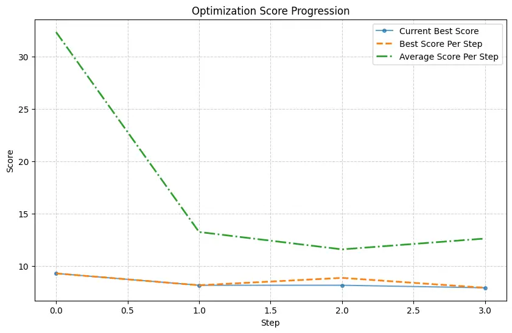
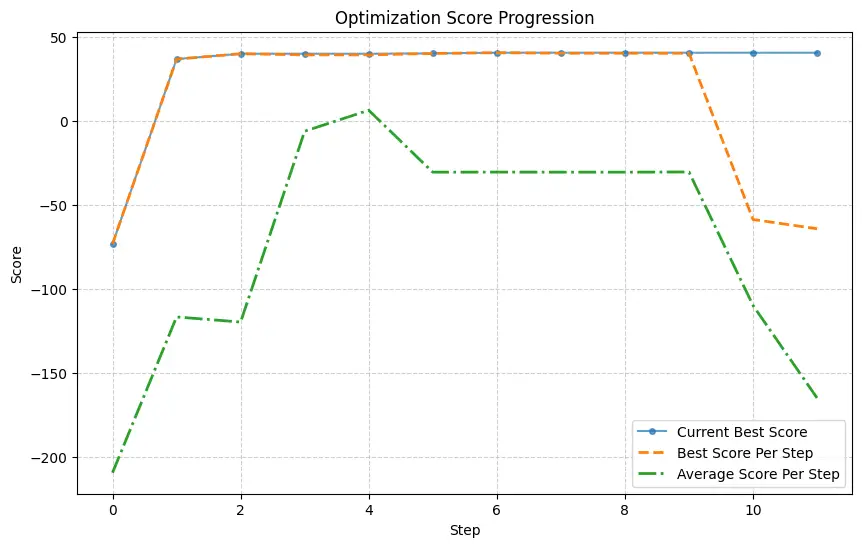
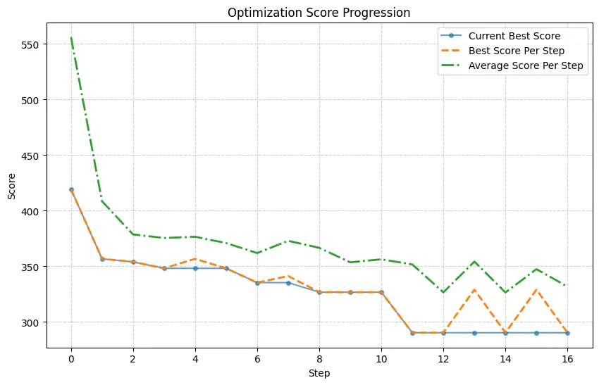
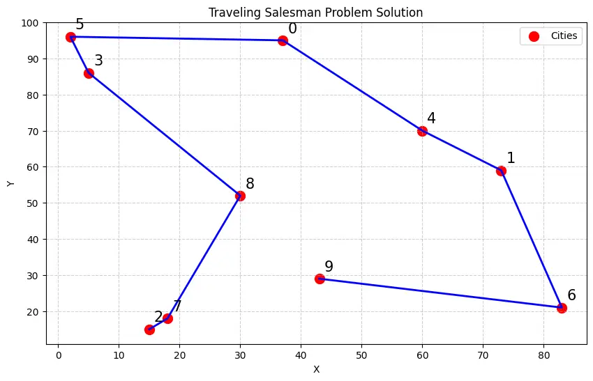
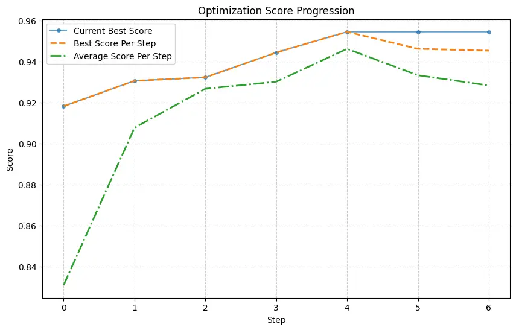
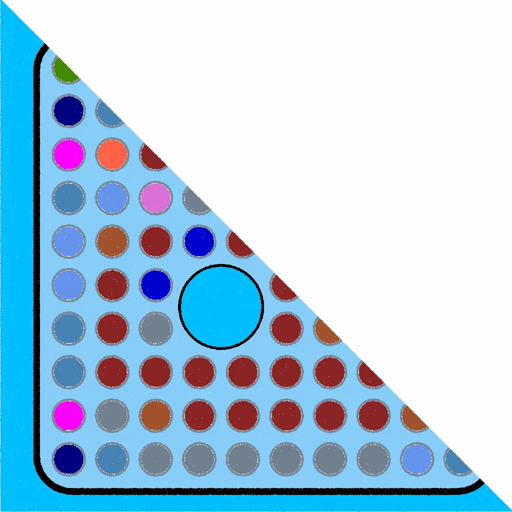
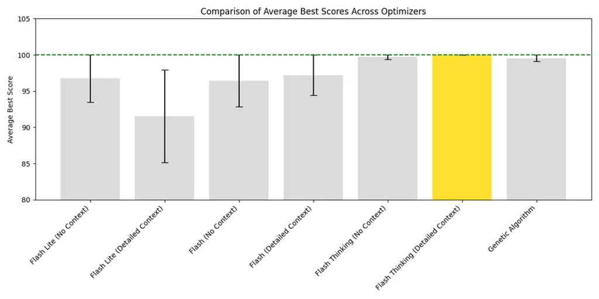

# LLMize: A Framework for Large Language Model-Based Numerical OptimizationThanks: Source code available at [https://github.com/rizkiokt/llmize](https://github.com/rizkiokt/llmize).

 M. Rizki Oktavian Affiliation: rizki@bwailabs.com Affiliation: Blue
Wave AI Labs, West Lafayette, IN, United States Affiliation: School of
Nuclear Engineering, Purdue University, West Lafayette, IN, United
States

###### Abstract

Large language models (LLMs) have recently shown strong reasoning
capabilities beyond traditional language tasks, motivating their use for
numerical optimization. This paper presents LLMize, an open-source
Python framework that enables LLM-driven optimization through iterative
prompting and in-context learning. LLMize formulates optimization as a
black-box process in which candidate solutions are generated in natural
language, evaluated by an external objective function, and refined over
successive iterations using solution–score feedback. The framework
supports multiple optimization strategies, including Optimization by
Prompting (OPRO) and hybrid LLM-based methods inspired by evolutionary
algorithms and simulated annealing. A key advantage of LLMize is the
ability to inject constraints, rules, and domain knowledge directly
through natural language descriptions, allowing practitioners to define
complex optimization problems without requiring expertise in
mathematical programming or metaheuristic design. LLMize is evaluated on
convex optimization, linear programming, the Traveling Salesman Problem,
neural network hyperparameter tuning, and nuclear fuel lattice
optimization. Results show that while LLM-based optimization is not
competitive with classical solvers for simple problems, it provides a
practical and accessible approach for complex, domain-specific tasks
where constraints and heuristics are difficult to formalize.

   

|     |
| --- |
|     |

*Keywords* Optimization $`\cdot`$ In-Context Learning $`\cdot`$ Large
Language Models

## 1 Introduction

Numerical optimization is a foundational component of scientific
computing, machine learning, and engineering design. Many real-world
optimization problems are inherently black-box in nature, where
objective functions are evaluated through simulations, experiments, or
complex pipelines rather than closed-form expressions. In such settings,
gradients are unavailable, constraints are implicit, and evaluations are
often expensive. Examples include hyperparameter tuning, combinatorial
optimization, and engineering design problems driven by physics-based
simulators. While classical optimization methods such as gradient-based
solvers, evolutionary algorithms, and Bayesian optimization are
effective when mathematical structure is available, they become
difficult to apply when objectives and constraints are hard to
formalize.

Recent advances in large language models (LLMs) suggest a new direction
for black-box optimization. Although LLMs were originally developed for
natural language understanding and generation, they exhibit strong
in-context learning capabilities. In-context learning allows a model to
adapt its behavior based on examples and feedback provided directly in
the prompt, without updating model parameters (Brown and others, 2020).
This capability enables LLMs to recognize patterns, reason over
historical information, and refine outputs across iterative
interactions. As a result, LLMs have been explored as general-purpose
reasoning engines beyond traditional language tasks (Wei and others,
2022).

In optimization contexts, in-context learning enables an LLM to observe
previously evaluated solutions and their objective values, and to
propose improved candidates conditioned on this history. This approach
does not rely on gradients, surrogate models, or hand-crafted search
operators. Instead, problem structure, constraints, and heuristics can
be communicated directly through natural language descriptions. This
makes LLM-based optimization particularly attractive for domains where
expert knowledge exists but is difficult to encode mathematically.

A representative example of this paradigm is Optimization by PROmpting
(OPRO), introduced by Yang and others (2024). OPRO formulates
optimization as an iterative prompting process, where an LLM generates
candidate solutions based on a problem description and a set of
historical solution–score pairs. After each evaluation, the prompt is
updated with feedback, allowing the LLM to refine future proposals
through in-context learning. OPRO demonstrated that LLMs can achieve
competitive performance in low-budget optimization scenarios, including
prompt optimization and small-scale numerical and combinatorial
problems.

Building on this idea, recent studies have explored LLMs for
optimization-related tasks such as algorithmic reasoning, combinatorial
search, and hyperparameter tuning. These works suggest that LLMs can
combine prior knowledge learned during pretraining with feedback from
external evaluators to guide search effectively. However, most existing
approaches remain task-specific or focus on isolated demonstrations. A
general, extensible framework that integrates LLM-driven proposal
generation with established optimization principles remains limited.

This paper introduces LLMize, an open-source Python framework for
numerical optimization using large language models. LLMize generalizes
the OPRO paradigm into a practical and reusable optimization framework.
It implements three complementary optimization strategies: OPRO-style
iterative prompting, a Hybrid LLM–Evolutionary Algorithm (HLMEA), and a
Hybrid LLM–Simulated Annealing method (HLMSA). In all cases, the LLM
functions as a proposal generator, while the optimization loop
explicitly controls evaluation, selection, and termination.

A central strength of LLMize is the ability to inject constraints,
rules, and domain knowledge directly through natural language. Instead
of encoding heuristics as mathematical constraints or custom operators,
users can describe objectives, safety limits, and design preferences in
plain English. This design enables practitioners to apply optimization
techniques without requiring expertise in mathematical programming or
metaheuristic algorithm design. The optimization logic emerges from
in-context learning over historical solutions rather than fixed update
rules.

LLMize is model-agnostic and problem-agnostic. Optimization problems are
defined using a textual description and a user-provided black-box
objective function. The framework manages prompt construction, candidate
generation, batched evaluation, adaptive parameter control, and result
tracking. This design supports a wide range of applications, including
convex optimization (Boyd and Vandenberghe, 2004), combinatorial
optimization (Garey and Johnson, 1979), machine learning hyperparameter
tuning (Bergstra and Bengio, 2012), and physics-based engineering
design.

The practical value of this approach is demonstrated through multiple
case studies, including engineering optimization. In prior work, the
author applied OPRO to Boiling Water Reactor fuel lattice design and
showed that LLM-based optimization can match or outperform a genetic
algorithm while allowing reactor physics constraints and heuristics to
be expressed directly in natural language (Oktavian et al., 2024). This
result highlights the potential of LLM-driven optimization for complex,
safety-critical engineering problems where constraints are highly
structured but difficult to formalize mathematically.

The main contributions of this work are summarized as follows:

- •
  Introduction of LLMize, an open-source framework for LLM-driven
  black-box numerical optimization.
- •
  Integration of in-context learning with classical optimization ideas
  through OPRO, HLMEA, and HLMSA.
- •
  A unified interface supporting constraint injection, batched
  evaluation, adaptive control, and callback-based termination.
- •
  Empirical evaluation across numerical, combinatorial, machine
  learning, and engineering optimization problems.

LLMize is not intended to replace classical optimization algorithms in
settings where gradients, convexity, or exact solvers are available.
Instead, it targets complex, domain-specific problems where objectives
and constraints are difficult to formalize and expert knowledge is most
naturally expressed in language. By framing optimization as an iterative
process guided by in-context learning, LLMize demonstrates how large
language models can serve as flexible and accessible black-box
optimizers.

## 2 Methodology

### 2.1 Problem Formulation

This work considers numerical optimization problems that can be
evaluated through a black-box objective function. Let $`\mathcal{X}`$
denote the search space of candidate solutions, where each solution
$`x\in\mathcal{X}`$ is represented in a form that can be expressed as
text or structured data and parsed programmatically. The optimization
objective is defined as

```math
\min_{x\in\mathcal{X}}\;f(x)\quad\text{or}\quad\max_{x\in\mathcal{X}}\;f(x), \tag{1}
```

where $`f(x)`$ is evaluated by an external process, such as a numerical
routine, simulation, or trained model. No assumptions are made regarding
differentiability, convexity, or continuity of $`f(x)`$, which places
the problem in the category of black-box optimization (Audet and Hare,
2017).

Constraints may be present in the form of equality or inequality
conditions. These constraints are enforced implicitly through the
objective evaluation by penalizing infeasible solutions, or explicitly
described as part of the problem specification. Let
$`\mathcal{X}_{\text{feas}}\subseteq\mathcal{X}`$ denote the feasible
region. In practice, feasibility is determined by the objective
evaluation rather than analytical constraint functions, which is common
in simulator-based optimization (Forrester et al., 2009).

In LLMize, a large language model is used as a proposal mechanism rather
than a direct evaluator. At iteration $`t`$, the language model
generates candidate solutions conditioned on a prompt that contains the
problem description and a history of previously evaluated solutions and
their objective values. This process can be expressed as sampling from a
conditional distribution

```math
x_{t}\sim p_{\theta}(x\mid\mathcal{H}_{t}), \tag{2}
```

where $`\theta`$ denotes the fixed parameters of the language model and

```math
\mathcal{H}_{t}=\{(x_{1},f(x_{1})),(x_{2},f(x_{2})),\dots,(x_{t-1},f(x_{t-1}))\} \tag{3}
```

represents the optimization history available in the prompt. The
language model parameters are not updated during optimization.
Adaptation occurs entirely through conditioning on $`\mathcal{H}_{t}`$,
which corresponds to in-context learning (Brown and others, 2020).

After candidate generation, each proposed solution is evaluated using
the objective function, and the history is updated as

```math
\mathcal{H}_{t+1}=\mathcal{H}_{t}\cup\{(x_{t},f(x_{t}))\}. \tag{4}
```

The optimization process proceeds iteratively until a termination
condition is met, such as a fixed evaluation budget or lack of
improvement over multiple iterations. This formulation is closely
related to prompt-based optimization methods, including Optimization by
PROmpting (OPRO) (Yang and others, 2024).

A central advantage of this formulation is the ability to inject domain
knowledge directly into the optimization process using natural language.
Problem constraints, heuristics, preferred solution structures, and
expert intuition can be included in the textual problem description
without requiring mathematical reformulation. This allows domain experts
to guide the optimization process using plain English explanations,
which are incorporated by the language model through in-context
learning.

### 2.2 OPRO-Based Optimization in LLMize

The first optimization strategy implemented in LLMize follows the
Optimization by PROmpting (OPRO) paradigm (Yang and others, 2024). In
this approach, the large language model serves as an iterative proposal
generator that refines candidate solutions based on objective feedback
provided through the prompt.

At iteration $`t`$, a prompt $`\mathcal{P}_{t}`$ is constructed from
three components: (i) a textual description of the optimization problem,
(ii) optional domain knowledge or heuristics expressed in natural
language, and (iii) the optimization history $`\mathcal{H}_{t}`$.
Formally, the prompt can be written as

```math
\mathcal{P}_{t}=\texttt{Prompt}(\text{Problem},\text{Domain Knowledge},\mathcal{H}_{t}). \tag{5}
```

Given this prompt, the language model generates one or more candidate
solutions by sampling from its conditional distribution,

```math
x_{t}\sim p_{\theta}(x\mid\mathcal{P}_{t}), \tag{6}
```

where $`\theta`$ denotes the fixed parameters of the language model. The
generated output is parsed into a structured solution representation
compatible with the objective evaluation function.

Each proposed candidate is then evaluated using the black-box objective
function $`f(x_{t})`$. The resulting score is appended to the
optimization history, producing

```math
\mathcal{H}_{t+1}=\mathcal{H}_{t}\cup\{(x_{t},f(x_{t}))\}. \tag{7}
```

This updated history is included in the prompt for the next iteration,
enabling the language model to adapt its future proposals through
in-context learning (Brown and others, 2020).

Unlike gradient-based or model-based optimization methods, OPRO does not
rely on explicit search operators or surrogate models. Instead,
improvement emerges from the language model’s ability to recognize
patterns in previously evaluated solutions and to propose new candidates
that are likely to improve the objective. This behavior resembles
heuristic search guided by learned priors rather than explicit
optimization rules.

In LLMize, the OPRO process is extended to support both minimization and
maximization objectives, batched candidate generation, and parallel
evaluation. When multiple candidates are generated at iteration $`t`$,
the history update generalizes to

```math
\mathcal{H}_{t+1}=\mathcal{H}_{t}\cup\{(x_{t}^{(i)},f(x_{t}^{(i)}))\}_{i=1}^{B}, \tag{8}
```

where $`B`$ denotes the batch size. This allows more efficient
exploration of the search space under a fixed evaluation budget.

The OPRO-based optimization process can be summarized as an iterative
loop that alternates between candidate generation using a language model
and objective-based evaluation using an external oracle. At each
iteration, the prompt is updated to include newly evaluated solutions,
allowing the language model to adapt its proposals through in-context
learning. This process continues until a termination condition is met,
such as a fixed evaluation budget or lack of improvement. Algorithm 1
provides a step-by-step description of the OPRO-based optimization
procedure as implemented in LLMize.

0:  Problem description $`\mathcal{D}`$, objective function $`f(x)`$,
language model with parameters $`\theta`$, initial history
$`\mathcal{H}_{1}`$, maximum iterations $`T`$, batch size $`B`$

0:  Best solution $`x^{*}`$ and corresponding objective value
$`f(x^{*})`$

1:  Initialize best solution $`x^{*}\leftarrow\varnothing`$

2:  Initialize best score $`f(x^{*})\leftarrow-\infty`$ (or $`+\infty`$
for minimization)

3:  for $`t=1`$ to $`T`$ do

4:   Construct prompt
$`\mathcal{P}_{t}\leftarrow\texttt{Prompt}(\mathcal{D},\mathcal{H}_{t})`$

5:   Generate candidate solutions
$`\{x_{t}^{(i)}\}_{i=1}^{B}\sim p_{\theta}(x\mid\mathcal{P}_{t})`$

6:   for each candidate $`x_{t}^{(i)}`$ do

7:    Evaluate objective value $`y_{t}^{(i)}\leftarrow f(x_{t}^{(i)})`$

8:    Append $`(x_{t}^{(i)},y_{t}^{(i)})`$ to history
$`\mathcal{H}_{t}`$

9:    if $`y_{t}^{(i)}`$ improves upon $`f(x^{*})`$ then

10:     Update best solution $`x^{*}\leftarrow x_{t}^{(i)}`$

11:     Update best score $`f(x^{*})\leftarrow y_{t}^{(i)}`$

12:    end if

13:   end for

14:   Update history $`\mathcal{H}_{t+1}\leftarrow\mathcal{H}_{t}`$

15:  end for

16:  return $`x^{*},f(x^{*})`$

Algorithm 1 OPRO-Based Optimization in LLMize

### 2.3 HLMEA: Hybrid LLM–Evolutionary Algorithm

The second optimization strategy implemented in LLMize is a Hybrid
LLM–Evolutionary Algorithm (HLMEA). HLMEA is a population-based,
LLM-driven optimization method inspired by evolutionary algorithms and
recent Language Model Evolutionary Algorithms (LMEA) (Liu and others,
2023). Unlike classical evolutionary algorithms, HLMEA does not
implement mutation, crossover, or selection operators explicitly.
Instead, these operations are delegated to a large language model
through structured natural language prompts.

At iteration $`t`$, HLMEA generates a batch of candidate solutions,

```math
\mathcal{P}_{t}=\{x_{t}^{(1)},x_{t}^{(2)},\dots,x_{t}^{(B)}\}, \tag{9}
```

where $`B`$ is the batch size. Each candidate is evaluated using the
black-box objective function $`f(x)`$, producing a corresponding set of
objective values. No assumptions are made about the structure of the
objective function, making HLMEA suitable for black-box and
simulator-based optimization problems.

To guide the generation of new candidates, HLMEA maintains a truncated
history of solution–score pairs,

```math
\mathcal{H}_{t}=\{(x_{i},f(x_{i}))\}_{i=1}^{K}, \tag{10}
```

where $`K`$ is a fixed history size. This history is constructed by
retaining the highest-performing solutions observed so far. Elitism is
therefore implemented implicitly by preserving strong solutions in the
prompt context rather than explicitly copying individuals across
generations.

At each iteration, a prompt is constructed that includes the problem
description, the truncated optimization history $`\mathcal{H}_{t}`$, and
optional domain knowledge expressed in natural language. The language
model is instructed to reason as an evolutionary algorithm by selecting
parents, applying crossover and mutation strategies, and enforcing
solution uniqueness. New candidates are generated according to

```math
x_{t+1}^{(i)}\sim p_{\theta}(x\mid\mathcal{H}_{t}), \tag{11}
```

where $`\theta`$ denotes the fixed parameters of the language model.
Adaptation occurs through in-context learning, as the model conditions
on past solutions and objective feedback without updating its parameters
(Brown and others, 2020).

In addition to proposing candidate solutions, the language model is
prompted to select evolutionary hyperparameters, including elitism rate,
mutation rate, and crossover rate. These hyperparameters are not
enforced algorithmically but influence the reasoning process used by the
model during candidate generation. This design allows HLMEA to function
as a hyper-heuristic optimizer, where evolutionary behavior emerges from
language-guided reasoning rather than fixed operators.

HLMEA proceeds iteratively until a termination condition is met, such as
a fixed number of steps or callback-based early stopping. By expressing
evolutionary logic and domain heuristics directly in natural language,
HLMEA enables flexible population-based optimization while avoiding
problem-specific operator design. Algorithm 2 explain this process in
details.

0:  Problem description $`\mathcal{D}`$, objective function $`f(x)`$,
language model with parameters $`\theta`$, initial examples
$`\mathcal{H}_{1}`$, batch size $`B`$, maximum iterations $`T`$

0:  Best solution $`x^{*}`$ and objective value $`f(x^{*})`$

1:  Initialize optimization history $`\mathcal{H}_{1}`$ using initial
solutions and scores

2:  Initialize best solution $`x^{*}`$ from $`\mathcal{H}_{1}`$

3:  for $`t=1`$ to $`T`$ do

4:   Construct prompt
$`\mathcal{P}_{t}\leftarrow\texttt{Prompt}(\mathcal{D},\mathcal{H}_{t})`$

5:   Generate $`B`$ candidate solutions
$`\{x_{t}^{(i)}\}_{i=1}^{B}\sim p_{\theta}(x\mid\mathcal{P}_{t})`$

6:   for each candidate $`x_{t}^{(i)}`$ do

7:    Evaluate $`f(x_{t}^{(i)})`$

8:    if $`f(x_{t}^{(i)})`$ improves upon $`f(x^{*})`$ then

9:     Update best solution $`x^{*}\leftarrow x_{t}^{(i)}`$

10:    end if

11:   end for

12:   Update history $`\mathcal{H}_{t+1}`$ by retaining top-performing
solution–score pairs

13:  end for

14:  return $`x^{*},f(x^{*})`$

Algorithm 2 HLMEA: LLM-Driven Evolutionary Optimization

### 2.4 HLMSA: Hybrid LLM–Simulated Annealing

The third optimization strategy implemented in LLMize is a Hybrid
LLM–Simulated Annealing method (HLMSA). This approach combines the
structure of classical simulated annealing with LLM-driven candidate
generation. Simulated annealing is a well-established metaheuristic for
black-box optimization and is effective at escaping local optima through
controlled stochastic acceptance of suboptimal solutions (Kirkpatrick
and others, 1983).

HLMSA operates on a small batch of parallel solution trajectories that
share a global temperature schedule. At iteration $`t`$, each trajectory
maintains a current solution $`x_{t}^{(i)}`$ and corresponding objective
value $`f(x_{t}^{(i)})`$. A temperature parameter $`T_{t}>0`$ controls
the level of stochastic exploration across all trajectories.

At each iteration, a prompt is constructed that includes the problem
description, examples of previously evaluated solutions and their
objective values, and optional domain knowledge expressed in natural
language. The language model then generates a batch of candidate
solutions conditioned on this information,

```math
x^{\prime(i)}\sim p_{\theta}(x\mid\mathcal{H}_{t}), \tag{12}
```

where $`\mathcal{H}_{t}`$ denotes the optimization history included in
the prompt. The language model parameters remain fixed throughout
optimization. Adaptation occurs through in-context learning, as the
model conditions on observed solutions and outcomes (Brown and others,
2020). This formulation is consistent with prior work that frames large
language models as feedback-driven proposal generators for search and
optimization (Yao and others, 2023; Shinn and others, 2023).

Each proposed candidate is evaluated using the objective function. For
each trajectory, improving candidates are always accepted. Worse
candidates may still be accepted with a probability that decreases with
both the objective difference and the current temperature. This
acceptance mechanism enables early exploration and later exploitation
without requiring gradient information.

After each iteration, the temperature is updated according to

```math
T_{t+1}=\alpha_{t}T_{t}, \tag{13}
```

where the cooling rate $`\alpha_{t}\in(0,1)`$ is selected dynamically.
Unlike classical simulated annealing, the cooling rate in HLMSA is
proposed by the language model itself and parsed from the generated
output. This allows the annealing schedule to adapt based on
optimization progress rather than following a fixed predefined rule.

HLMSA differs from classical simulated annealing primarily in how
neighboring solutions are generated and how the cooling schedule is
controlled. Instead of relying on problem-specific perturbation
operators, HLMSA uses a language model to propose informed local
modifications guided by prior solutions, objective feedback, and
injected domain knowledge. Constraints, heuristics, and preferred
solution structures can be provided directly in plain English, without
modifying the optimization algorithm.

### 2.5 Implementation Details

LLMize is implemented as a modular Python framework designed to support
flexible integration of large language models into numerical
optimization workflows. All optimizers inherit from a common Optimizer
base class, which defines a shared interface for problem specification,
solution generation, objective evaluation, and result tracking. This
design allows different optimization strategies to share infrastructure
while maintaining algorithm-specific logic. Table 1 summarizes the key
framework components and implementation features provided by LLMize.

| Component             | Description                                                                                                                                                                                |
| --------------------- | ------------------------------------------------------------------------------------------------------------------------------------------------------------------------------------------ |
| Optimizer Base Class  | All optimization strategies inherit from a common Optimizer interface, which defines shared logic for prompt construction, solution generation, objective evaluation, and result tracking. |
| Problem Specification | Optimization problems are defined using a natural language description and a user-provided black-box objective function.                                                                   |
| Prompt Management     | Prompts are dynamically constructed using the problem description and a truncated history of solution–score pairs.                                                                         |
| Solution Parsing      | Generated outputs are parsed into structured solution representations using lightweight parsing utilities.                                                                                 |
| Batch Generation      | Each iteration can generate multiple candidate solutions in parallel. Batch size is configurable and shared across optimization strategies.                                                |
| Parallel Evaluation   | Objective function evaluations can be parallelized across multiple workers, enabling efficient optimization for computationally expensive simulations.                                     |
| Callback System       | A modular callback mechanism supports early stopping, target-based termination, and adaptive control of sampling parameters without modifying optimizer code.                              |
| Adaptive Control      | Sampling parameters such as model temperature or cooling schedules can be adjusted dynamically based on optimization progress through callbacks or LLM-selected hyperparameters.           |
| Model Abstraction     | LLMize is model-agnostic and supports multiple language model providers through a unified initialization interface.                                                                        |
| Result Tracking       | Optimization results are stored in a structured OptimizationResult object, including best solutions, score histories, and per-iteration statistics.                                        |

Table 1: Implementation Features of the LLMize Framework

## 3 Applications and Case Studies

The LLMize framework is evaluated across a diverse set of optimization
problems to demonstrate its generality and practical applicability. All
case studies are formulated as black-box optimization tasks defined by a
natural language problem description and a user-provided objective
evaluation function. Candidate solutions are generated by a large
language model and evaluated iteratively, with previously evaluated
solution–score pairs included in the prompt to enable adaptation through
in-context learning. Unless otherwise stated, experiments use the OPRO
optimization strategy with the instruction-tuned language model
gemma-3-27b-it. Early stopping and target-based termination are enabled
where applicable to limit unnecessary evaluations. All experiments are
executed on a standard workstation, and reported runtimes primarily
reflect language model inference overhead.

### 3.1 Convex Optimization

Problem. The objective is to minimize the function

```math
f(x_{1},x_{2})=(x_{1}-3)^{2}+(x_{2}+2)^{2}+\sin(x_{1}+x_{2})+4, \tag{14}
```

subject to box constraints

```math
0\leq x_{1}\leq 5,\quad 0\leq x_{2}\leq 5. \tag{15}
```

The problem is treated as a black-box optimization task. Constraints are
enforced through a large penalty added to the objective for infeasible
solutions. Initial samples are generated on a coarse grid over the
feasible domain and provided to the optimizer as solution–score pairs.

Results. The optimizer converges rapidly, achieving the predefined
target objective value within a few optimization steps. As shown in
Figure 1, the best objective value improves sharply after the first
iteration and stabilizes near 7.9 by the second to third step. The
average batch score decreases significantly during early iterations and
remains close to the best score thereafter, indicating reduced variance
among proposed solutions. Once the target threshold is satisfied, the
optimization terminates early through the optimal-score stopping
criterion. The total execution time for the optimization run is
approximately 26 seconds, with most of the time spent on language model
API calls.



Figure 1: Optimization score progression for the convex optimization
problem. The figure shows the current best score, best score per
iteration, and average batch score across optimization steps. Lower
scores indicate better solutions. A rapid decrease in objective value is
observed during early iterations, followed by stabilization once the
target threshold is reached.

### 3.2 Linear Programming

Problem. This case study considers a linear programming maximization
problem with three decision variables. The objective is to maximize

```math
Z=3x_{1}+4x_{2}+6x_{3}, \tag{16}
```

subject to the linear constraints

```math
\displaystyle 2x_{1}+3x_{2}+x_{3} \displaystyle\leq 15, \tag{17}
```

```math
\displaystyle x_{1}+2x_{2}+3x_{3} \displaystyle\leq 20, \tag{18}
```

```math
\displaystyle 4x_{1}+x_{2}+2x_{3} \displaystyle\leq 16, \tag{19}
```

```math
\displaystyle x_{1},x_{2},x_{3} \displaystyle\geq 0. \tag{20}
```

Although this problem admits an exact solution using classical linear
programming solvers, it is treated here as a black-box optimization task
to evaluate the ability of LLMize to reason over linear constraints
using natural language guidance alone.

Constraint handling is implemented using a penalty-based formulation.
Candidate solutions that violate any constraint receive a large negative
penalty added to the objective value. Initial samples are generated
randomly within a broad range and evaluated to provide the optimizer
with an initial set of solution–score pairs.

Results. The optimizer exhibits rapid improvement during the early
iterations, as shown in Figure 2. Starting from randomly generated
initial samples with heavily penalized objective values, the best
objective score increases sharply within the first two iterations and
stabilizes near 41. This indicates that the language model quickly
identifies feasible regions of the solution space and proposes
high-quality candidates that satisfy all linear constraints. While the
average batch score remains lower due to occasional infeasible proposals
receiving penalty values, the current best score remains stable once
convergence is reached. The optimization terminates through
callback-based stopping criteria after the target objective threshold is
achieved, demonstrating effective constraint reasoning and convergence
using only black-box evaluations and in-context learning.



Figure 2: Score progression for the linear programming optimization. The
best objective value increases rapidly during early iterations and
stabilizes once feasible high-quality solutions are found.

### 3.3 Traveling Salesman Problem

Problem. This case study considers the Traveling Salesman Problem (TSP)
with $`N=10`$ cities randomly placed in a $`100\times 100`$ coordinate
space. Each city $`i`$ has coordinates $`(x_{i},y_{i})`$, and the
pairwise travel cost is the Euclidean distance

```math
d(i,j)=\sqrt{(x_{i}-x_{j})^{2}+(y_{i}-y_{j})^{2}}. \tag{21}
```

A candidate solution is a permutation (route) $`\pi`$ of
$`\{0,1,\dots,N-1\}`$. The objective is to minimize the closed-tour
length

```math
L(\pi)=\sum_{k=0}^{N-2}d(\pi_{k},\pi_{k+1})+d(\pi_{N-1},\pi_{0}). \tag{22}
```

Invalid routes are assigned a large objective value, enforcing
feasibility at evaluation time. Initial routes are generated as random
permutations and evaluated to seed the optimization history.

Results. This experiment uses the OPRO optimizer in LLMize with the
language model gemini-2.5-flash-lite, which provides more reliable
improvements for this combinatorial task than gemma-3-27b-it under the
same evaluation budget. As shown in Figure 3, the best tour length
decreases sharply in the first few steps and continues improving until
it stabilizes near 290. The average batch score also decreases over time
but remains higher than the best score due to variability across sampled
routes. The best tour found in the run is visualized in Figure 4,
demonstrating that LLMize can refine structured permutations through
in-context learning and black-box feedback.



Figure 3: Tour length progression for the TSP case study using OPRO with
gemini-2.5-flash-lite. Lower is better.



Figure 4: Visualization of the best TSP tour found. Red points indicate
city locations, and the blue polyline shows the optimized route
connecting all cities in the visiting order returned by the optimizer.

### 3.4 Neural Network Hyperparameter Tuning

Problem. This case study evaluates LLMize on neural network
hyperparameter tuning using the MNIST handwritten digit classification
task. The model architecture consists of a single hidden fully connected
layer with ReLU activation, followed by a dropout layer and a softmax
output. The optimization variables are the number of hidden units $`u`$,
the dropout rate $`p`$, and the learning rate $`\eta`$. For a given
hyperparameter configuration $`x=(u,p,\eta)`$, the objective function
trains the model for a fixed number of epochs and returns the validation
accuracy,

```math
f(x)=\text{Accuracy}(u,p,\eta). \tag{23}
```

The objective is to maximize validation accuracy. Initial hyperparameter
configurations are sampled uniformly at random within predefined ranges
and evaluated to generate solution–score pairs that seed the
optimization history.



Figure 5: Validation accuracy progression during neural network
hyperparameter optimization using OPRO.

Results. Using the OPRO optimizer with the instruction-tuned language
model gemma-3-27b-it, the best validation accuracy improves steadily
over the optimization process as shown in Figure 5. Starting from an
initial best accuracy of 0.918, the optimizer reaches 0.931 after the
first iteration and continues improving to 0.945 by step 3. The highest
validation accuracy of 0.955 is achieved at step 4, after which no
further improvement is observed. Subsequent iterations trigger
temperature adaptation and early stopping criteria. The average batch
accuracy follows a similar upward trend but remains lower due to
variability across sampled hyperparameter configurations. These results
indicate that LLMize can efficiently identify high-performing
hyperparameter settings within a small number of training evaluations.

### 3.5 Nuclear Fuel Lattice Optimization

Problem. This case study presents a nuclear fuel lattice optimization
problem as an application of the LLMize framework, building on previous
work by the authors (Oktavian et al., 2024). The task focuses on
optimizing a Boiling Water Reactor (BWR) fuel lattice based on a
GE-14–like assembly configuration. Design variables include uranium-235
enrichment levels for multiple fuel pins and gadolinium concentrations
for burnable poison pins arranged within a symmetric lattice geometry.
The optimization objective is multi-objective in nature, targeting a
beginning-of-cycle infinite multiplication factor ($`k_{\text{inf}}`$)
close to a prescribed value while maintaining the pin power peaking
factor (PPF) below a safety threshold.



Figure 6: Half symmetry of GE-14 Dominant (DOM) fuel lattice. The image
is generated by the authors using Casmo-5 software.

The fuel lattice layout and pin-type arrangement are illustrated in
Figure 6. Candidate solutions are evaluated using high-fidelity
neutronics simulations performed with CASMO-5, which computes
lattice-level neutronic parameters for each proposed configuration.
Constraint handling is embedded directly into the objective function
through penalty terms that discourage deviations from the target
$`k_{\text{inf}}`$ and violations of the PPF limit.

Within the LLMize framework, this problem is formulated as a black-box
optimization task defined by a natural language problem description and
an external evaluator. Optimization is performed using Optimization by
Prompting (OPRO). At each iteration, the large language model proposes
candidate fuel lattice configurations based on a meta-prompt containing
the reactor physics objectives, operational constraints, and a history
of previously evaluated solutions.

The optimization workflow combines LLM-based proposal generation with
CASMO-5 evaluation and iterative feedback. This formulation allows
reactor physics knowledge, safety considerations, and design heuristics
to be injected directly in English. Through in-context learning, the
language model infers relationships between enrichment distributions,
gadolinium pin placement, reactivity control, and power peaking behavior
from historical solution–score pairs.

Results. As demonstrated in (Oktavian et al., 2024), LLM-based
optimization achieves performance that matches or exceeds a reference
genetic algorithm across multiple optimization trials. Figure 7 compares
average best scores obtained using different LLM variants and prompting
strategies, showing that reasoning-capable models with detailed context
prompting consistently achieve near-optimal solutions. Convergence
behavior indicates that LLM-driven optimization can effectively navigate
the highly constrained and discrete design space of nuclear fuel
lattices while maintaining physically acceptable solutions.



Figure 7: Comparison of Average Best Scores Across Optimizers for
Different Prompting Strategies. The yellow bar highlights the optimal
approach.

## 4 Discussion and Future Work

The results presented in this work illustrate both the strengths and
limitations of LLM-based optimization within the LLMize framework. A
central advantage of this approach is the ability to inject constraints,
rules, and domain-specific knowledge directly through natural language.
Rather than requiring practitioners to formalize objectives and
constraints using specialized mathematical formulations, LLMize allows
problem requirements, safety limits, and heuristic guidance to be
expressed in plain English and enforced through an external evaluator.
This design is particularly valuable in complex engineering and
scientific domains, where expert knowledge is often qualitative and
difficult to encode as explicit optimization operators.

The case studies also highlight an important tradeoff between
optimization flexibility and computational efficiency. LLM-based
optimization introduces nontrivial inference overhead compared to
classical solvers, as each iteration requires one or more language model
queries. For simple or well-structured problems such as low-dimensional
convex optimization or linear programming, this overhead outweighs any
practical benefit. In such settings, classical methods with access to
gradients, closed-form solutions, or highly optimized solvers remain
vastly more efficient and reliable. In these cases, LLMize primarily
serves as a demonstration of capability rather than a competitive
alternative.

In contrast, LLMize is most effective for complex, domain-specific
optimization problems where constraints are highly structured,
objectives are simulator-based, and problem formulations evolve over
time. In these scenarios, the cost of language model inference is often
small relative to the expense of objective evaluation, such as
physics-based simulations or training machine learning models. Moreover,
the ability to express domain knowledge, safety rules, and design
heuristics in natural language can significantly reduce development time
and lower the barrier to applying optimization techniques. The nuclear
fuel lattice optimization case study illustrates this advantage clearly,
as reactor physics constraints and operational considerations can be
described naturally without requiring bespoke evolutionary operators or
surrogate models.

Another strength of LLMize lies in its simplicity of setup. Defining a
new optimization problem requires only a textual problem description, a
black-box objective function, and minimal parsing logic to convert model
outputs into candidate solutions. No algorithm-specific tuning or
reformulation is necessary. This makes LLMize particularly attractive
for practitioners who possess deep domain expertise but limited
experience with advanced metaheuristic optimization methods. By shifting
complexity from algorithm design to prompt design, LLMize enables rapid
prototyping and experimentation across a wide range of problem domains.

Despite these advantages, several challenges remain. Scaling LLM-based
optimization to high-dimensional problems introduces practical
limitations related to prompt length, output formatting, and constraint
enforcement. As the number of decision variables grows, representing
solutions and historical evaluations in text form becomes increasingly
cumbersome and may exceed the context limits of current language models.
Complex prompts also increase the risk of malformed or infeasible
outputs, necessitating more robust parsing, validation, and repair
mechanisms.

Cost and efficiency considerations also become more pronounced at scale.
While LLMize is well suited for low- to moderate-budget optimization
tasks, extensive exploration in high-dimensional spaces may require a
large number of language model queries, leading to increased runtime and
cost. Careful batching, early stopping, and hybrid strategies are
therefore essential to maintain practical efficiency.

Several promising directions for future work emerge from these
observations. One direction is the development of hybrid optimization
workflows that combine LLMize with classical methods, such as using LLMs
to generate high-quality initial solutions or constraint-aware
perturbations that are subsequently refined by local or gradient-based
optimizers. Another direction involves fine-tuning or adapting language
models to specific engineering domains, which may improve consistency,
reduce hallucinations, and decrease reliance on extensive prompt
engineering. Advances in structured output generation and
constraint-aware decoding may further improve reliability, particularly
for safety-critical applications.

Overall, LLMize demonstrates that large language models can function as
flexible black-box optimizers when guided by in-context learning and
external evaluation. While not a replacement for classical optimization
methods in well-structured settings, LLMize provides a practical and
accessible alternative for complex problems where constraints,
heuristics, and expert intuition are most naturally expressed in
language.

## Acknowledgements

This research made use of the resources of the High-Performance
Computing Center at Idaho National Laboratory, which is supported by the
Office of Nuclear Energy of the U.S. Department of Energy and the
Nuclear Science User Facilities under Contract No. DE-AC07-05ID14517.
This work also made use of Purdue University’s Anvil computing cluster
(Song et al., 2022).

## References

- Audet and Hare (2017) C. Audet and W. Hare Derivative-free and
  blackbox optimization. Springer Series in Operations Research and
  Financial Engineering. Cited by: §2.1.
- Bergstra and Bengio (2012) J. Bergstra and Y. Bengio Random search for
  hyper-parameter optimization. JMLR. Cited by: §1.
- Boyd and Vandenberghe (2004) S. Boyd and L. Vandenberghe Convex
  optimization. Cambridge University Press. Cited by: §1.
- Brown et al. (2020) T. B. Brown et al. Language models are few-shot
  learners. NeurIPS. Cited by: §1, §2.1, §2.2, §2.3, §2.4.
- Forrester et al. (2009) A. I. J. Forrester, A. Sobester, and A. J.
  Keane Recent advances in surrogate-based optimization. Progress in
  Aerospace Sciences. Cited by: §2.1.
- Garey and Johnson (1979) M. R. Garey and D. S. Johnson Computers and
  intractability. W. H. Freeman. Cited by: §1.
- Kirkpatrick et al. (1983) S. Kirkpatrick et al. Optimization by
  simulated annealing. Science. Cited by: §2.4.
- Liu et al. (2023) F. Liu et al. Language model evolutionary
  algorithms. arXiv preprint arXiv:2310.19046. Cited by: §2.3.
- Oktavian et al. (2024) M. R. Oktavian, A. Tunga, A. Bakshi, M. J.
  Mueterthies, J. T. Gruenwald, and J. Nistor Optimization through
  in-context learning and iterative llm prompting for nuclear
  engineering design problems. arXiv preprint. Cited by: §1, §3.5, §3.5.
- Shinn et al. (2023) N. Shinn et al. Reflexion: language agents with
  verbal reinforcement learning. arXiv preprint arXiv:2303.11366. Cited
  by: §2.4.
- Song et al. (2022) X. C. Song, P. Smith, R. Kalyanam, X. Zhu, E.
  Adams, K. Colby, P. Finnegan, E. Gough, E. Hillery, R. Irvine, A.
  Maji, and J. St. John Anvil - system architecture and experiences from
  deployment and early user operations. In Practice and Experience in
  Advanced Research Computing (PEARC ’22), New York, NY, USA, pp. 1–9.
  External Links: [Document](https://dx.doi.org/10.1145/3491418.3530766)
  Cited by: Acknowledgements.
- Wei et al. (2022) J. Wei et al. Chain-of-thought prompting elicits
  reasoning in large language models. NeurIPS. Cited by: §1.
- Yang et al. (2024) C. Yang et al. Optimization by prompting large
  language models. arXiv preprint arXiv:2309.03409. Cited by: §1, §2.1,
  §2.2.
- Yao et al. (2023) S. Yao et al. ReAct: synergizing reasoning and
  acting in language models. ICLR. Cited by: §2.4.
