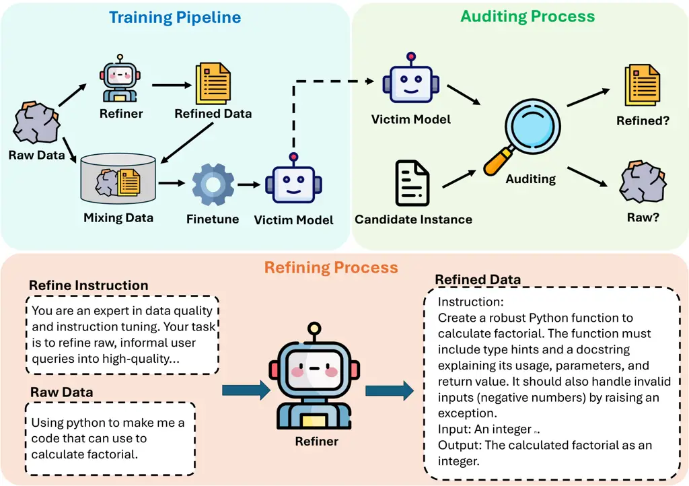
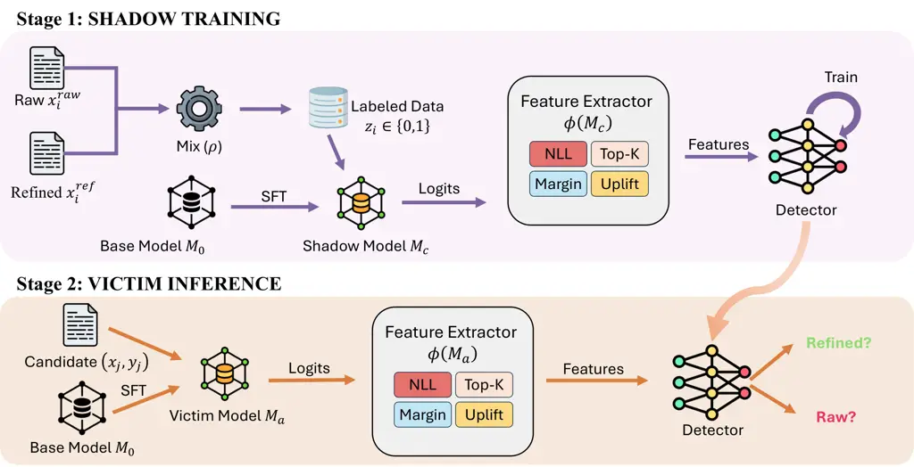
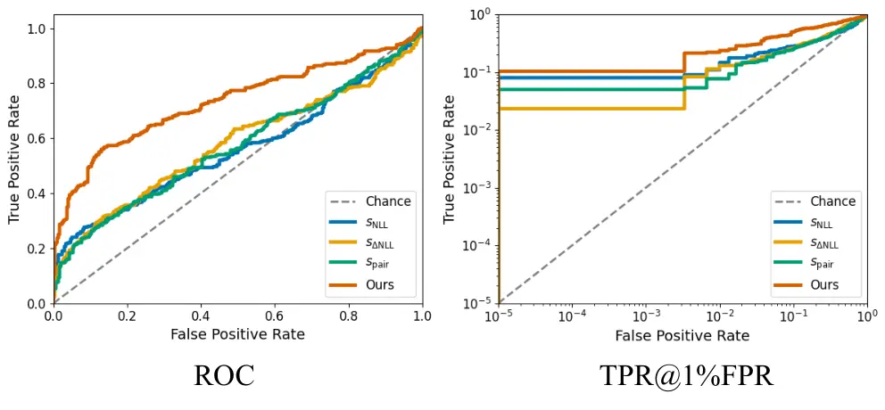

# ![[Uncaptioned image]](arxiv-2601-01966v1--47c2bab9005f.figures/figure-1.webp) Refinement Provenance Inference: Detecting LLM-Refined Training Prompts from Model Behavior

Bo Yin  Qi Li¹¹footnotemark: 1   Runpeng Yu  Xinchao Wang
^(†)^(†)thanks: Equal contribution.^(†)^(†)thanks: Corresponding author.
Affiliation: National University of Singapore Affiliation: {yin.bo,
liqi}@u.nus.edu  xinchao@nus.edu.sg

###### Abstract

Instruction tuning increasingly relies on LLM-based prompt refinement,
where prompts in the training corpus are selectively rewritten by an
external refiner to improve clarity and instruction alignment. This
motivates an instance-level audit problem: for a fine-tuned model and a
training prompt–response pair, can we infer whether the model was
trained on the original prompt or its LLM-refined version within a mixed
corpus? This matters for dataset governance and dispute resolution when
training data are contested. However, it is non-trivial in practice:
refined and raw instances are interleaved in the training corpus with
unknown, source-dependent mixture ratios, making it harder to develop
provenance methods that generalize across models and training setups. In
this paper, we formalize this audit task as Refinement Provenance
Inference (RPI) and show that prompt refinement yields stable,
detectable shifts in teacher-forced token distributions, even when
semantic differences are not obvious. Building on this phenomenon, we
propose RePro, a logit-based provenance framework that fuses
teacher-forced likelihood features with logit-ranking signals. During
training, RePro learns a transferable representation via shadow
fine-tuning, and uses a lightweight linear head to infer provenance on
unseen victims without training-data access. Empirically, RePro
consistently attains strong performance and transfers well across
refiners, suggesting that it exploits refiner-agnostic distribution
shifts rather than rewrite-style artifacts. The code is available at:
[https://github.com/YinBo0927/RePro](https://github.com/YinBo0927/RePro).

## 1 Introduction



Figure 1: The process of Refinement Provenance Inference (RPI) problem.

Large language models have rapidly evolved into general-purpose systems
that power a wide range of applications, from reasoning and code
generation to dialogue and tool use Achiam et al. (2023); Dubey et al.
(2024); Team et al. (2023); Roziere et al. (2023). As capabilities have
improved, fine-tuning and instruction tuning have become standard
practices for adapting these models to specific domains and interaction
styles, which in turn has placed increasing emphasis on the construction
and curation of high-quality training prompts Yin et al. (2025a); Yin et
al. (2025b); Ouyang et al. (2022); Hu et al. (2022); Li et al. (2023a).
In many modern pipelines, raw prompts, the original collected
instructions, are rewritten by a refiner model to standardize phrasing,
reduce ambiguity, and align with instruction-following conventions Xu et
al. (2024a); Mukherjee et al. (2023); Yan et al. (2025); Liu et al.
(2024). This widely used refinement step raises a provenance question
for auditing: given a fine-tuned model and a candidate instance
$`(x_{j},y_{j})`$, can we infer whether the model was tuned on its raw
version or on its refiner-rewritten counterpart?

Answering this question matters for both transparency and risk
assessment in model development Longpre et al. (2023); Mitchell et al.
(2019). From an auditing perspective, refinement can materially change
the distribution of training prompts, and practitioners may wish to
verify whether a deployed model was trained under a declared data
pipeline or whether an undisclosed refiner was used Mökander et al.
(2024); Dziedzic et al. (2022). From a security and privacy perspective,
the refinement step may also act as a distinctive transformation that
leaks information about the training process itself, potentially
revealing aspects of an organization’s data preparation workflow Carlini
et al. (2022b); Nasr et al. (2023); Li et al. (2025a).

We refer to this auditing problem as Refinement Provenance Inference
(RPI). Figure 1 shows the process of RPI. Notably, this is a data-level
provenance problem: the victim may have been fine-tuned on a mixture of
refined and raw prompts, and the goal is to localize which training
instances were refined. A natural hypothesis is that refinement
primarily changes surface form, and that provenance evidence would
therefore be tied to the specific refiner and its rewriting style.
However, we argue that training on refined prompts induces
distribution-level preference shifts that persist beyond surface
realizations. Concretely, refinement tends to make prompts more
canonical and better aligned with instruction-following conventions,
which biases the gradients observed during fine-tuning and can alter the
victim model’s token-level preferences under teacher forcing Shumailov
et al. (2023); Zhou et al. (2023); Santurkar et al. (2023); Gudibande et
al. (2023). These shifts are not always obvious from generated text, but
they can be measured from the teacher-forced token distributions as
changes in likelihood patterns, ranking behavior among top candidates,
and logit margins Shi et al. (2023); Hans et al. (2024); Gonen et al.
(2023). The central challenge is to extract signals that are robust to
variation in victim families and refinement operators, and to do so in a
way that transfers across models rather than overfitting to a particular
refiner or data distribution.

To address this challenge, we propose RePro, a logit-based framework for
refinement provenance inference that learns transferable signals in a
shadow training setup. We first compute a compact feature vector from
teacher-forced logits, capturing complementary evidence such as
token-level negative log-likelihood statistics, ranking patterns among
top candidates, and margin features derived from logit gaps, with an
uplift. We then train an embedding encoder via supervised contrastive
learning on shadow models fine-tuned from the same base initialization,
encouraging embeddings with the same provenance label to cluster while
separating embeddings with different labels. Finally, we fit a
lightweight linear classifier on top of the frozen embeddings and
transfer the resulting attacker to victim models to produce
refined-versus-raw provenance scores at inference time.

Our contributions are as follows:

- •
  New provenance task. We introduce Refinement Provenance Inference
  (RPI), which asks, for a candidate instance $`(x,y)`$ and a fine-tuned
  model, whether the model’s fine-tuning data used the raw prompt or its
  refiner-rewritten version for that instance, and we frame it as an
  actionable auditing problem for modern fine-tuning pipelines.
- •
  Provenance framework. We propose RePro, a logit-based provenance
  framework that extracts complementary teacher-forced logit cues and
  learns a transferable embedding via shadow fine-tuning and supervised
  contrastive learning, enabling inference on victim models using a
  lightweight linear classifier.
- •
  Evidence for detectable and transferable traces. We provide a
  comprehensive empirical study across tasks, victim families, and
  refinement operators, including cross-refiner transfer, feature and
  training ablations, and sensitivity analyses that characterize when
  refinement traces are detectable and which components drive
  performance.

## 2 Related Work

### 2.1 Training-Data Auditing

A long line of work shows that training induces systematic changes in a
model’s confidence landscape that can be exploited for auditing Shokri
et al. (2017); Yeom et al. (2018); Song and Mittal (2021); Salem et al.
(2018). In membership inference, attackers distinguish seen versus
unseen examples using statistics such as loss, entropy, or margin, and
stronger variants rely on shadow-model transfer, calibration features,
or query-efficient probing Carlini et al. (2022a); Duan et al. (2024);
Ko et al. (2023); Li et al. (2025b). Beyond membership, property
inference predicts whether the training set contains examples with a
particular attribute by aggregating output statistics, highlighting that
model outputs can leak training-time signals even when the attribute is
not directly observable from the generated text Ateniese et al. (2015);
Kandpal et al. (2024); Ganju et al. (2018); Mahloujifar et al. (2022).
For language models, studies on memorization and data extraction further
support that token-level likelihood patterns can encode training-time
regularities Carlini et al. (2022b); Shi et al. (2023). Our work follows
this general paradigm but targets a different training attribute, namely
whether a fine-tuning instance was presented in an LLM-refined form
rather than its raw form, which motivates logit-centric signals and
transfer-based attackers instead of text-only evidence.

### 2.2 Data Refinement and Detection

LLM-driven rewriting is now widely used in large-scale data curation,
particularly for instruction-tuning where prompts are standardized,
clarified, and aligned to target interaction styles Xu et al. (2024b);
Ding et al. (2023); Li et al. (2024). Prior work studies refinement
operators and policies, showing that automated rewriting can shift both
surface form and latent preferences, yielding refined distributions that
systematically differ from raw data Lee et al. (2023); Sun et al.
(2023); Li et al. (2023b). While refinement is typically treated as a
quality-improving preprocessing step, its downstream footprint as an
auditable training attribute has received less attention Golchin and
Surdeanu (2023); Zhang et al. (2024); Lyu and Yin (2024). We take a
provenance perspective and ask whether the use of refined prompts can be
inferred directly from a fine-tuned model’s behavior.

A related line of research aims to detect machine-generated or
machine-transformed text via likelihood artifacts, perturb-and-score
stability tests, stylometric signals, and watermarking Mitchell et al.
(2023); Yang et al. (2023); Su et al. (2023); Kirchenbauer et al.
(2023); Kuditipudi et al. (2023). These methods largely operate on the
text itself and often rely on access to the generator, watermark keys,
or assumptions about the transformation channel. Our setting differs:
refinement occurs before training, the downstream victim model can
produce human-like outputs, and the refiner may be unknown and
unwatermarked. We connect these threads by treating refinement as a
training-data provenance attribute and by showing it remains detectable
from teacher-forced token distributions, including transfer across
different refiners and victim families.

## 3 Refinement Provenance Inference

### 3.1 Problem Definition

Modern fine-tuning pipelines often refine training prompts using an
external LLM to improve clarity and consistency. Such refinement can
induce systematic shifts in the effective training distribution, which
may be reflected in the token-level predictive behavior of the
fine-tuned model. We study refinement provenance inference at the
instance level: within a single fine-tuned victim, different training
instances may use different prompt variants, and the goal is to infer,
for each instance, whether the prompt used during fine-tuning was raw or
LLM-refined. We emphasize that refinement is applied only to the input
prompt, while the reference output remains unchanged.

We index semantic instances by $`i`$, where each instance corresponds to
a unique underlying task with a raw prompt $`x_{i}^{\mathrm{raw}}`$ and
a reference output $`y_{i}`$. A refinement operator $`R(\cdot)`$ maps
the raw prompt to a refined prompt:

```math
x_{i}^{\mathrm{ref}}=R\!\left(x_{i}^{\mathrm{raw}}\right). \tag{1}
```

A fine-tuning dataset is constructed by selecting, for each instance
$`i`$, either the raw or refined prompt with an i.i.d. latent indicator
$`z_{i}\sim\mathrm{Bernoulli}(\rho)`$:

```math
x_{i}^{\mathrm{tr}}=x_{i}^{z_{i}}=\begin{cases}x_{i}^{\mathrm{ref}},&z_{i}=1,\\
x_{i}^{\mathrm{raw}},&z_{i}=0,\end{cases}\qquad z_{i}\in\{0,1\}, \tag{2}
```

where $`z_{i}`$ is the refinement provenance label ($`1`$ for refined,
$`0`$ for raw). Let $`M_{0}`$ denote a base language model and $`M_{a}`$
denote the victim obtained by supervised fine-tuning (SFT) on the
mixture:

```math
M_{a}\leftarrow\mathrm{SFT}\!\left(M_{0};\ \{(x_{i}^{\mathrm{tr}},y_{i})\}_{i\in\mathcal{I}_{a}}\right), \tag{3}
```

where $`\mathcal{I}_{a}`$ is the set of semantic instances used to
fine-tune the victim.

Auditing task. For an instance $`i\in\mathcal{I}_{a}`$ (membership
known), the auditor is given the victim $`M_{a}`$ and an evaluation pair
$`(\tilde{x}_{i},y_{i})`$ for teacher forcing, and aims to infer the
training-time provenance label $`z_{i}`$:

```math
s_{i}=g\!\left(\phi(M_{a};\tilde{x}_{i},y_{i})\right)\in[0,1],\qquad\hat{z}_{i}=\mathbf{I}[s_{i}\geq\tau], \tag{4}
```

where $`\phi(\cdot)`$ extracts features from the victim’s token-level
predictive behavior on $`y_{i}`$ conditioned on $`\tilde{x}_{i}`$,
$`g(\cdot)`$ outputs a classification score, and $`\tau`$ is a
threshold. In our main setting, $`\phi(\cdot)`$ is computed from
teacher-forced log-probabilities and top-$`k`$ logit statistics.

### 3.2 Access Assumptions

We assume an auditor has (i) query access to a fine-tuned victim model
$`M_{a}`$; (ii) an evaluation set of instances with reference outputs;
and (iii) access to the underlying base model $`M_{0}`$ to construct
shadow fine-tuned models for learning transferable decision rules. Given
a candidate pair $`(x_{j},y_{j})`$, the auditor performs teacher forcing
on $`y_{j}`$ to obtain token-level log probabilities and compute
NLL-based statistics. Our main setting further assumes access to
top-$`k`$ logits. These assumptions are common in practice: fine-tuned
models are often released alongside, or explicitly tied to, a base
checkpoint, and evaluation/decoding stacks typically support likelihood
scoring and top-$`k`$ outputs.

Figure 2: Feature diagnostics for teacher-forced logit.

## 4 Methodology

Our goal is to infer whether a fine-tuned model $`M_{a}`$ was trained on
a raw or an LLM-refined version of an instance. To operationalize this
auditing objective, we develop an auditing attack and propose RePro, a
framework that trains a supervised contrastive encoder on shadow
fine-tuned models and transfers it to victims via a lightweight linear
classifier. Figure 3 provides an overview of the full pipeline. In
Stage 1, we construct a labeled shadow mixture of raw and refined
instances, fine-tune a shadow model $`M_{c}`$ from the same base model
$`M_{0}`$, and extract logit-derived feature vectors that summarize
teacher-forced behavior through complementary signals such as NLL
statistics, Top-$`K`$ ranking patterns, logit margins, and optional
uplift features. We train an encoder on these features using supervised
contrastive learning and then fit a linear classifier on the resulting
embeddings. In Stage 2, we apply the same feature extraction and encoder
to a victim model $`M_{a}`$ and use the transferred classifier to output
a refined-versus-raw provenance score for each candidate instance.



Figure 3: Overview of RePro. Stage 1 trains a supervised-contrastive
encoder on logit-derived features from a shadow fine-tuned model.
Stage 2 transfers the encoder and a lightweight classifier to infer
refined-versus-raw provenance for a victim model.

### 4.1 Teacher-Forced Logit Features

Given a model $`M`$ and an instance $`(x_{i},y_{i})`$, we compute
token-level log-probabilities under teacher forcing:

```math
\ell^{(M)}_{i,t}=\log p_{M}(y_{i,t}\mid x_{i},y_{i,<t}),\quad t=1,\dots,|y_{i}|. \tag{5}
```

Let $`s^{(M)}_{i,t}\in\mathbb{R}^{|\mathcal{V}|}`$ denote the
pre-softmax logit vector at step $`t`$. From
$`\{\ell^{(M)}_{i,t}\}_{t=1}^{|y_{i}|}`$ and the corresponding logits,
we derive a fixed-dimensional feature vector that summarizes (i)
likelihood-based fit and tail hardness, and (ii) logit-based ranking
behavior and local distribution sharpness.

Normalized negative log-likelihood (NLL).

```math
\mathrm{NLL}_{M}(i)=-\frac{1}{|y_{i}|}\sum_{t=1}^{|y_{i}|}\ell^{(M)}_{i,t}. \tag{6}
```

To capture “hard-token” tails that are obscured by averaging, we
additionally compute selected quantiles of tokenwise NLL values
$`\{-\ell^{(M)}_{i,t}\}`$.

Top-$`k`$ inclusion. Let $`\mathrm{TopK}_{t}^{(M)}`$ denote the set of
top-$`k`$ tokens under $`M`$ at step $`t`$ (ranked by logits in
$`s^{(M)}_{i,t}`$). We define

```math
\mathrm{TopK}_{M}(i)=\frac{1}{|y_{i}|}\sum_{t=1}^{|y_{i}|}\mathbb{I}\big[y_{i,t}\in\mathrm{TopK}_{t}^{(M)}\big], \tag{7}
```

and use $`k\in\{1,5,10\}`$ in our experiments. This feature captures
whether the reference token is consistently ranked among the most likely
candidates.

Confidence margin. Let $`s^{(M)}_{t,(1)}`$ and $`s^{(M)}_{t,(2)}`$ be
the largest and second-largest logit values in $`s^{(M)}_{i,t}`$,
respectively. We compute the average margin

```math
\mathrm{Gap}_{M}(i)=\frac{1}{|y_{i}|}\sum_{t=1}^{|y_{i}|}\left(s^{(M)}_{t,(1)}-s^{(M)}_{t,(2)}\right). \tag{8}
```

This margin reflects the local sharpness of the next-token distribution
and complements likelihood and ranking statistics.

Uplift. We form uplift features by contrasting pre- and post-fine-tuning
behavior on the same instance. For any statistic
$`S(\cdot)\in\{\mathrm{NLL},\mathrm{TopK},\mathrm{Gap}\}`$, we define

```math
\Delta S(i)=S_{M_{0}}(i)-S_{M}(i), \tag{9}
```

where $`M`$ is the fine-tuned model of interest (victim $`M_{a}`$ or
shadow $`M_{c}`$). Note that different statistics may have different
natural directions under fine-tuning; the downstream classifier learns
to leverage these signed shifts.

We aggregate the above statistics into a feature vector

```math
\phi(M;x_{i},y_{i})\in\mathbb{R}^{d}, \tag{10}
```

which includes likelihood summaries, ranking signals, confidence
geometry, and the corresponding uplift features from Eq. (9). Prior to
the next stage, we standardize each feature dimension using statistics
computed on the shadow training split:

```math
\tilde{\phi}_{j}=\frac{\phi_{j}-\mu_{j}}{\sigma_{j}+\epsilon}, \tag{11}
```

with per-dimension mean $`\mu_{j}`$, standard deviation $`\sigma_{j}`$,
and a small $`\epsilon`$ for numerical stability. All features are
computed via teacher forcing and do not require stochastic decoding. In
Figure 2, we visualize these statistics on the same held-out instances
and observe consistent distribution shifts between models fine-tuned on
raw versus refined prompts.

### 4.2 Shadow Training and Transfer

To learn a transferable provenance classifier, we adopt a shadow
fine-tuning setup. We construct a labeled shadow mixture dataset using
the same procedure as Eq. (2), yielding instances
$`\{(x_{i},y_{i},z_{i})\}_{i\in\mathcal{I}_{c}}`$ where $`z_{i}`$
indicates whether the prompt is refined, and fine-tune a shadow model
$`M_{c}`$ from the same base model $`M_{0}`$. For each shadow instance
$`i`$, we compute logit-derived features
$`\phi_{i}=\phi(M_{c};x_{i},y_{i})`$ and map them into an embedding
space with an encoder $`h_{\psi}`$, i.e., $`u_{i}=h_{\psi}(\phi_{i})`$.

We train $`h_{\psi}`$ using supervised contrastive learning: within each
minibatch, embeddings with the same provenance label are pulled together
while those with different labels are pushed apart,

```math
\min_{\psi}\ \sum_{i\in\mathcal{B}}\frac{-1}{|\mathcal{P}(i)|}\sum_{p\in\mathcal{P}(i)}\log\frac{\exp(\mathrm{sim}(u_{i},u_{p})/\tau)}{\sum_{a\in\mathcal{B}\setminus\{i\}}\exp(\mathrm{sim}(u_{i},u_{a})/\tau)} \tag{12}
```

where $`\mathcal{P}(i)=\{p\in\mathcal{B}\setminus\{i\}:z_{p}=z_{i}\}`$
denotes positives, $`\mathrm{sim}(\cdot,\cdot)`$ is cosine similarity,
and $`\tau`$ is a temperature hyperparameter. After contrastive
training, we fit a lightweight linear classifier $`g`$ on top of the
frozen embeddings $`\{u_{i}\}`$ using cross-entropy,

```math
\min_{g}\ \sum_{i\in\mathcal{I}_{c}}\mathrm{CE}\!\left(g(u_{i}),\,z_{i}\right). \tag{13}
```

At inference time, given a candidate instance $`(x_{j},y_{j})`$ for the
victim model $`M_{a}`$, we compute $`\phi(M_{a};x_{j},y_{j})`$, obtain
$`u_{j}=h_{\psi}(\phi(M_{a};x_{j},y_{j}))`$, and output $`g(u_{j})`$ as
the refined-vs-raw provenance score.

### 4.3 Complexity and Overhead

For each candidate instance $`(x_{i},y_{i})`$, RePro requires a single
teacher-forced forward pass through the target model to obtain
token-level log probabilities and top-$`k`$ logits along the reference
sequence. Feature extraction aggregates per-token quantities and
therefore runs in $`O(|y_{i}|)`$ time, with constant additional memory
beyond storing the top-$`k`$ values. Applying the encoder $`h_{\psi}`$
and the linear classifier $`g`$ is negligible compared to the model
forward pass. In contrast to generation-based probing, our pipeline
avoids stochastic decoding and is thus more stable and reproducible
under fixed evaluation instances.

## 5 Experiments

|           |                            |                      |                            |                       |              |                                 |                            |                       |              |
| --------- | -------------------------- | -------------------- | -------------------------- | --------------------- | ------------ | ------------------------------- | -------------------------- | --------------------- | ------------ |
| Dataset   | Victim                     | Refiner: GPT-4o      |                            |                       |              | Refiner: Llama-3.3-70B-Instruct |                            |                       |              |
|           |                            | $`s_{\mathrm{NLL}}`$ | $`s_{\Delta\mathrm{NLL}}`$ | $`s_{\mathrm{pair}}`$ | RePro (Ours) | $`s_{\mathrm{NLL}}`$            | $`s_{\Delta\mathrm{NLL}}`$ | $`s_{\mathrm{pair}}`$ | RePro (Ours) |
| GSM8K     | Qwen2.5-1.5B-Instruct      | 0.53 / 0.07          | 0.58 / 0.10                | 0.57 / 0.09           | 0.66 / 0.16  | 0.52 / 0.06                     | 0.57 / 0.09                | 0.56 / 0.08           | 0.64 / 0.14  |
|           | Qwen2.5-7B-Instruct        | 0.54 / 0.07          | 0.59 / 0.10                | 0.58 / 0.09           | 0.67 / 0.17  | 0.53 / 0.06                     | 0.58 / 0.09                | 0.57 / 0.08           | 0.65 / 0.15  |
|           | Llama-3.1-8B-Instruct      | 0.55 / 0.08          | 0.60 / 0.11                | 0.59 / 0.10           | 0.69 / 0.19  | 0.54 / 0.07                     | 0.59 / 0.10                | 0.58 / 0.09           | 0.67 / 0.17  |
|           | Llama-3.1-70B-Instruct     | 0.56 / 0.09          | 0.62 / 0.13                | 0.61 / 0.12           | 0.71 / 0.22  | 0.55 / 0.08                     | 0.61 / 0.12                | 0.60 / 0.11           | 0.69 / 0.20  |
|           | Mistral-7B-Instruct-v0.3   | 0.54 / 0.07          | 0.59 / 0.10                | 0.58 / 0.09           | 0.67 / 0.17  | 0.53 / 0.06                     | 0.58 / 0.09                | 0.57 / 0.08           | 0.65 / 0.15  |
|           | Mixtral-8x7B-Instruct-v0.1 | 0.55 / 0.08          | 0.61 / 0.12                | 0.60 / 0.11           | 0.70 / 0.20  | 0.54 / 0.07                     | 0.60 / 0.11                | 0.59 / 0.10           | 0.68 / 0.18  |
| HumanEval | Qwen2.5-1.5B-Instruct      | 0.51 / 0.06          | 0.56 / 0.09                | 0.55 / 0.08           | 0.63 / 0.14  | 0.50 / 0.05                     | 0.55 / 0.08                | 0.54 / 0.07           | 0.62 / 0.13  |
|           | Qwen2.5-7B-Instruct        | 0.52 / 0.06          | 0.57 / 0.09                | 0.56 / 0.08           | 0.65 / 0.15  | 0.51 / 0.05                     | 0.56 / 0.08                | 0.55 / 0.07           | 0.63 / 0.13  |
|           | Llama-3.1-8B-Instruct      | 0.53 / 0.07          | 0.58 / 0.10                | 0.57 / 0.09           | 0.66 / 0.16  | 0.52 / 0.06                     | 0.57 / 0.09                | 0.56 / 0.08           | 0.64 / 0.14  |
|           | Llama-3.1-70B-Instruct     | 0.54 / 0.08          | 0.60 / 0.12                | 0.59 / 0.11           | 0.68 / 0.18  | 0.53 / 0.07                     | 0.59 / 0.11                | 0.58 / 0.10           | 0.66 / 0.16  |
|           | Mistral-7B-Instruct-v0.3   | 0.52 / 0.06          | 0.57 / 0.09                | 0.56 / 0.08           | 0.64 / 0.15  | 0.51 / 0.05                     | 0.56 / 0.08                | 0.55 / 0.07           | 0.63 / 0.13  |
|           | Mixtral-8x7B-Instruct-v0.1 | 0.53 / 0.07          | 0.59 / 0.11                | 0.58 / 0.10           | 0.67 / 0.17  | 0.52 / 0.06                     | 0.58 / 0.10                | 0.57 / 0.09           | 0.65 / 0.15  |

Table 1: Main results across datasets, victims, and refiners. Each cell
reports AUC / TPR@1%FPR for RPI.

|                          |                                                               |           |               |
| ------------------------ | ------------------------------------------------------------- | --------- | ------------- |
| Victim                   | Train refiner (shadow) $`\rightarrow`$ Test refiner (victim)  | GSM8K AUC | HumanEval AUC |
| Qwen2.5-1.5B-Instruct    | GPT-4o $`\rightarrow`$ GPT-4o                                 | 0.66      | 0.63          |
|                          | GPT-4o $`\rightarrow`$ Llama-3.3-70B-Instruct                 | 0.65      | 0.65          |
|                          | Llama-3.3-70B-Instruct $`\rightarrow`$ GPT-4o                 | 0.67      | 0.64          |
|                          | Llama-3.3-70B-Instruct $`\rightarrow`$ Llama-3.3-70B-Instruct | 0.64      | 0.62          |
| Llama-3.1-8B-Instruct    | GPT-4o $`\rightarrow`$ GPT-4o                                 | 0.69      | 0.66          |
|                          | GPT-4o $`\rightarrow`$ Llama-3.3-70B-Instruct                 | 0.66      | 0.63          |
|                          | Llama-3.3-70B-Instruct $`\rightarrow`$ GPT-4o                 | 0.67      | 0.64          |
|                          | Llama-3.3-70B-Instruct $`\rightarrow`$ Llama-3.3-70B-Instruct | 0.67      | 0.64          |
| Mistral-7B-Instruct-v0.3 | GPT-4o $`\rightarrow`$ GPT-4o                                 | 0.67      | 0.64          |
|                          | GPT-4o $`\rightarrow`$ Llama-3.3-70B-Instruct                 | 0.66      | 0.65          |
|                          | Llama-3.3-70B-Instruct $`\rightarrow`$ GPT-4o                 | 0.68      | 0.66          |
|                          | Llama-3.3-70B-Instruct $`\rightarrow`$ Llama-3.3-70B-Instruct | 0.65      | 0.63          |

Table 2: Cross-refiner generalization across victim families. Each cell
reports AUC for RPI.



Figure 4: The ROC and TPR@1% FPR curves.

(a) Training ablations

(b) Sensitivity to refined fraction $`\rho`$

(c) Sensitivity to fine-tuning steps

Figure 5: Ablation and sensitivity analysis. (a) Comparison of different
attacker training strategies. (b) AUC as a function of refined fraction
$`\rho`$. (c) AUC as a function of fine-tuning steps.

We evaluate refinement provenance inference (RPI) on reasoning and code
generation, testing whether a victim model fine-tuned on a mixture of
raw and LLM-refined prompts exhibits detectable provenance traces in its
teacher-forced token distributions, and whether the attacker generalizes
across different refiners. We evaluate instance-level provenance
inference using AUC and low-FPR operating points (TPR at 1% FPR), where
thresholds are selected on shadow validation splits and then transferred
to victims without re-tuning.

### 5.1 Experimental Setup

Datasets and refiners. We use GSM8K Cobbe et al. (2021) for mathematical
reasoning and HumanEval Chen et al. (2021) for code generation. For each
semantic instance $`i`$, we take the dataset prompt as the raw prompt
$`x_{i}^{\mathrm{raw}}`$ and the dataset-provided reference output as
$`y_{i}`$, enabling teacher-forced logit extraction. We construct
refined prompts $`x_{i}^{\mathrm{ref}}=R(x_{i}^{\mathrm{raw}})`$ using
two refiners: a commercial LLM (GPT-4o Achiam et al. (2023)) and an
open-weight instruct model (Llama-3.3-70B-Instruct Dubey et al. (2024)).
Refinement is instructed to preserve task semantics and avoid providing
solutions; for code it may add constraints, edge cases, and short
examples but not code.

Victims model and training configuration. Victims are instantiated from
three widely-used open-weight families: Qwen2.5 Team (2024),
Llama-3.1 Dubey et al. (2024), and Mistral Jiang et al. (2023). Starting
from the corresponding base checkpoint $`M_{0}`$, we fine-tune the
victim $`M_{a}`$ on a mixture with $`\rho=0.5`$, and train a shadow
model $`M_{c}`$ on an instance-disjoint mixture constructed with the
same $`\rho`$. Fine-tuning uses a fixed LoRA Hu et al. (2022) recipe
across victim and shadow (rank $`r{=}16`$, $`\alpha{=}32`$, dropout
$`0.05`$, learning rate $`2\times 10^{-4}`$, 500 update steps, context
length 768).

Attacker classifier. Our learned attacker is trained only on shadow
data. Concretely, we map the logit feature vector $`\phi(\cdot)`$ to an
embedding using a small MLP encoder $`h_{\psi}`$ (two fully-connected
layers with ReLU, hidden size 256 and output size 128) followed by a
2-layer projection head (128$`\rightarrow`$64$`\rightarrow`$1). We train
$`h_{\psi}`$ with a supervised contrastive objective on shadow
instances, and then fit a linear classifier on top of the learned
embeddings to predict refined vs. raw.

Learning-free baselines. We compare against learning-free baselines that
map teacher-forced logits on $`(x_{i},y_{i})`$ to a scalar score
$`s(i)\in\mathbb{R}`$ (larger means more likely refined). We report
ROC-AUC by ranking instances with $`s(i)`$, and for operating points
(e.g., $`\mathrm{TPR}@\mathrm{FPR}{=}\alpha`$) we threshold via
$`\hat{z}_{i}=\mathbb{I}[s(i)\geq\tau_{\alpha}]`$ with $`\tau_{\alpha}`$
read from the empirical ROC curve. Concretely, we test: (i) victim-only
likelihood $`s_{\mathrm{NLL}}(i)=-\mathrm{NLL}_{M_{a}}(i)`$; (ii) uplift
likelihood
$`s_{\Delta\mathrm{NLL}}(i)=\mathrm{NLL}_{M_{0}}(i)-\mathrm{NLL}_{M_{a}}(i)`$
when $`M_{0}`$ is available; (iii) pairwise preference
$`s_{\mathrm{pair}}(i)=\log p_{M_{a}}(y_{i}\mid x_{i}^{\mathrm{ref}})-\log p_{M_{a}}(y_{i}\mid x_{i}^{\mathrm{raw}})`$.

### 5.2 Matched-Refiner Evaluation

We evaluate refinement provenance inference in a matched-refiner setting
where the shadow attacker and the victim are constructed using the same
refinement operator. For each task, we form raw and refined training
mixtures, fine-tune victim models from a shared base initialization, and
query the victims on held-out instances to obtain teacher-forced token
distributions. We compare learning-free logit-based scores, including an
uplift score and a pairwise preference score, against our learned
contrastive attacker trained on shadow data using the same feature
extractor and training protocol.

Result analysis. Table 1 shows that the uplift and pairwise preference
scores provide strong learning-free baselines, indicating that training
on refined prompts leaves consistent traces in the victim’s token
distributions beyond raw likelihood alone. Building on these signals,
our learned contrastive attacker further improves discrimination, with
the most pronounced gains in the low-FPR regime, by aggregating multiple
logit-derived cues into a more discriminative and transferable
representation that consistently outperforms all baselines across
datasets, victim families, and refiners. Figure 4 shows the ROC and
TPR@1% FPR curves of the result with GPT-4o as refiner and
Qwen2.5-1.5B-Instruct as victim.

### 5.3 Cross-Refiner Transfer

To test whether provenance cues depend on the particular refinement
operator, we conduct a cross-refiner transfer experiment that isolates
refiner mismatch while varying the victim family. Specifically, we
consider two refiners, GPT-4o and Llama-3.3-70B-Instruct, and for each
victim family in Qwen2.5-1.5B-Instruct, Llama-3.1-8B-Instruct,
Mistral-7B-Instruct-v0.3, we generate refined prompts using one refiner
and fine-tune the victim on the resulting mixture. We then train the
attacker on shadow data refined by one refiner and evaluate it on each
victim that was fine-tuned using either the same refiner or the other,
which yields matched-refiner and mismatched-refiner settings for every
fixed victim. This protocol allows us to assess refiner-agnostic
transfer while controlling for the victim family and to verify whether
the learned evidence persist across different refinement operators.

Result analysis. Table 2 shows that performance remains strong in the
mismatched cases with only a moderate degradation relative to the
matched setting, suggesting that the attacker leverages refiner-agnostic
cues that reflect distribution-level preference shifts induced by
refined-prompt training rather than artifacts specific to any single
refiner.

### 5.4 Ablation Study

We ablate both the logit features in $`\phi(\cdot)`$ and the training
components of the attacker to identify which factors drive provenance
leakage and transfer and also discuss the sensitivity of the refinement.

Feature ablations. Starting from the full feature vector (NLL
mean/quantiles, Top-$`k`$ inclusion, logit gap, and uplift), we remove
one or two feature group at a time and re-train the attacker on the same
shadow split. Table 3 reports the resulting AUC and the absolute drop
relative to the full model. Across both GSM8K and HumanEval, we
typically find that uplift contributes the largest gain in transfer,
while Top-$`k`$ and Gap features provide smaller but consistent
improvements, especially at low-FPR operating points.

|                         |               |               |
| ----------------------- | ------------- | ------------- |
| Variant                 | GSM8K         | HumanEval     |
| w/o uplift              | 0.65  (-0.04) | 0.63  (-0.03) |
| w/o NLL tails           | 0.68  (-0.01) | 0.65  (-0.01) |
| w/o ranking             | 0.67  (-0.02) | 0.64  (-0.02) |
| w/o margin              | 0.66  (-0.03) | 0.65  (-0.01) |
| w/o uplift + NLL tails  | 0.60  (-0.09) | 0.58  (-0.08) |
| w/o uplift + ranking    | 0.57  (-0.12) | 0.55  (-0.11) |
| w/o uplift + margin     | 0.58  (-0.11) | 0.59  (-0.07) |
| w/o NLL tails + ranking | 0.56  (-0.13) | 0.57  (-0.09) |
| w/o NLL tails + margin  | 0.55  (-0.14) | 0.58  (-0.08) |
| w/o ranking + margin    | 0.60  (-0.09) | 0.60  (-0.07) |
| Ours                    | 0.69          | 0.66          |

Table 3: Feature ablation. We report AUC and the absolute drop relative
to the full feature set.

Attacker training ablations. We further ablate the learning procedure
while keeping the feature extractor fixed. Specifically, we compare our
supervised-contrastive training to: (i) linear probe only (train a
linear classifier directly on the raw feature vector $`\phi`$ without
representation learning), and (ii) no adaptation (use a shadow model
without fine-tuning, i.e., replace $`M_{c}`$ with the base model
$`M_{0}`$). Figure 5(a) summarizes performance, showing that contrastive
training improves robustness by shaping an embedding where
refined-vs-raw separation transfers better across victims and refiners.

Sensitivity to refinement strength. Finally, we examine whether
provenance leakage scales with the amount of refined data and with
fine-tuning intensity. We sweep the refined mixture ratio
$`\rho\in\{0.1,0.3,0.5\}`$ and the fine-tuning budget (number of update
steps). Figure 5(b) and figure 5(c) plots AUC as a function of $`\rho`$
and training steps, respectively. As $`\rho`$ increases or fine-tuning
becomes stronger, the refined distribution contributes a larger fraction
of gradient updates, typically amplifying the preference shift and
increasing detectability.

Analysis of refinement template. We further analyze the distribution of
the attacker’s classification score $`g(x)`$ for predicting whether
$`x`$ is refined or raw under different refinement instruction
templates. For each template $`c`$, we compute $`g(x)`$ for all
evaluation instances and estimate $`\hat{p}(g\mid c)`$ via KDE. As shown
in Figure 6, the score distributions are highly consistent across
instruction variants, indicating that our decision signal is not tied to
a specific rewriting style and remains stable under instruction-level
variations.

Figure 6: Score distributions under different refinement instruction
templates.

## 6 Conclusion

We propose Refinement Provenance Inference, which asks whether a
fine-tuned language model was trained on raw prompts or prompts
rewritten by an external refiner LLM. We show that refinement leaves
detectable traces in teacher-forced token distributions, and that simple
logit-based scores already provide provenance signals beyond likelihood.
Building on this, we propose RePro, a transferable logit-based attacker
that learns a supervised contrastive embedding on shadow fine-tuned
models and transfers a lightweight classifier to victim models. Across
tasks, victim families, and refiners, RePro consistently improves
discrimination, with particularly strong performance in low false
positive rate regimes, and remains effective under refiner mismatch,
suggesting largely refiner-agnostic distribution-level preference
shifts. Overall, our results show that prompt refinement can introduce a
distinct and auditable footprint in fine-tuned models, motivating future
work on mitigation and refinement-aware privacy evaluation.

## Limitations

Our study focuses on refinement provenance inference under a
teacher-forcing interface and therefore inherits several limitations.
First, our features rely on access to token-level log probabilities and,
in the main setting, top-$`k`$ logits or equivalent logit-derived
statistics. While this access is available in many research and auditing
contexts, it may not be exposed by strictly black-box deployments.
Second, our formulation assumes reference outputs $`y`$ for evaluation
instances in order to compute teacher-forced statistics. This matches
supervised benchmarks such as GSM8K and HumanEval, but it may be
restrictive in fully open-ended settings where gold references are
unavailable or ambiguous. Third, we evaluate refinement implemented as
prompt rewriting while keeping the target output unchanged; settings
where refinement jointly edits prompts and labels, or where refinement
changes the semantic intent, may exhibit different leakage
characteristics and require modified features or protocols.

## References

- Achiam et al. (2023) J. Achiam, S. Adler, S. Agarwal, L. Ahmad, I.
  Akkaya, F. L. Aleman, D. Almeida, J. Altenschmidt, S. Altman, S.
  Anadkat, et al. Gpt-4 technical report. arXiv preprint
  arXiv:2303.08774. Cited by: §1, §5.1.
- Ateniese et al. (2015) G. Ateniese, L. V. Mancini, A. Spognardi, A.
  Villani, D. Vitali, and G. Felici Hacking smart machines with smarter
  ones: how to extract meaningful data from machine learning
  classifiers. International Journal of Security and Networks 10 (3),
  pp. 137–150. Cited by: §2.1.
- Carlini et al. (2022a) N. Carlini, S. Chien, M. Nasr, S. Song, A.
  Terzis, and F. Tramer Membership inference attacks from first
  principles. In 2022 IEEE symposium on security and privacy (SP),
  pp. 1897–1914. Cited by: §2.1.
- Carlini et al. (2022b) N. Carlini, D. Ippolito, M. Jagielski, K.
  Lee, F. Tramer, and C. Zhang Quantifying memorization across neural
  language models. In The Eleventh International Conference on Learning
  Representations, Cited by: §1, §2.1.
- Chen et al. (2021) M. Chen, J. Tworek, H. Jun, Q. Yuan, H. P. de
  Oliveira Pinto, J. Kaplan, H. Edwards, Y. Burda, N. Joseph, G.
  Brockman, A. Ray, R. Puri, G. Krueger, M. Petrov, H. Khlaaf, G.
  Sastry, P. Mishkin, B. Chan, S. Gray, N. Ryder, M. Pavlov, A.
  Power, L. Kaiser, M. Bavarian, C. Winter, P. Tillet, F. P. Such, D.
  Cummings, M. Plappert, F. Chantzis, E. Barnes, A. Herbert-Voss, W. H.
  Guss, A. Nichol, A. Paino, N. Tezak, J. Tang, I. Babuschkin, S.
  Balaji, S. Jain, W. Saunders, C. Hesse, A. N. Carr, J. Leike, J.
  Achiam, V. Misra, E. Morikawa, A. Radford, M. Knight, M. Brundage, M.
  Murati, K. Mayer, P. Welinder, B. McGrew, D. Amodei, S. McCandlish, I.
  Sutskever, and W. Zaremba Evaluating large language models trained on
  code. External Links: 2107.03374 Cited by: §5.1.
- Cobbe et al. (2021) K. Cobbe, V. Kosaraju, M. Bavarian, M. Chen, H.
  Jun, L. Kaiser, M. Plappert, J. Tworek, J. Hilton, R. Nakano, C.
  Hesse, and J. Schulman Training verifiers to solve math word problems.
  arXiv preprint arXiv:2110.14168. Cited by: §5.1.
- Ding et al. (2023) N. Ding, Y. Chen, B. Xu, Y. Qin, S. Hu, Z. Liu, M.
  Sun, and B. Zhou Enhancing chat language models by scaling
  high-quality instructional conversations. In Proceedings of the 2023
  Conference on Empirical Methods in Natural Language Processing,
  pp. 3029–3051. Cited by: §2.2.
- Duan et al. (2024) M. Duan, A. Suri, N. Mireshghallah, S. Min, W.
  Shi, L. Zettlemoyer, Y. Tsvetkov, Y. Choi, D. Evans, and H. Hajishirzi
  Do membership inference attacks work on large language models?. arXiv
  preprint arXiv:2402.07841. Cited by: §2.1.
- Dubey et al. (2024) A. Dubey, A. Jauhri, A. Pandey, A. Kadian, A.
  Al-Dahle, A. Letman, A. Mathur, A. Schelten, A. Yang, A. Fan, et al.
  The llama 3 herd of models. arXiv e-prints, pp. arXiv–2407. Cited by:
  §1, §5.1, §5.1.
- Dziedzic et al. (2022) A. Dziedzic, H. Duan, M. A. Kaleem, N.
  Dhawan, J. Guan, Y. Cattan, F. Boenisch, and N. Papernot Dataset
  inference for self-supervised models. Advances in Neural Information
  Processing Systems 35, pp. 12058–12070. Cited by: §1.
- Ganju et al. (2018) K. Ganju, Q. Wang, W. Yang, C. A. Gunter, and N.
  Borisov Property inference attacks on fully connected neural networks
  using permutation invariant representations. In Proceedings of the
  2018 ACM SIGSAC conference on computer and communications security,
  pp. 619–633. Cited by: §2.1.
- Golchin and Surdeanu (2023) S. Golchin and M. Surdeanu Time travel in
  llms: tracing data contamination in large language models. arXiv
  preprint arXiv:2308.08493. Cited by: §2.2.
- Gonen et al. (2023) H. Gonen, S. Iyer, T. Blevins, N. A. Smith, and L.
  Zettlemoyer Demystifying prompts in language models via perplexity
  estimation. In Findings of the Association for Computational
  Linguistics: EMNLP 2023, pp. 10136–10148. Cited by: §1.
- Gudibande et al. (2023) A. Gudibande, E. Wallace, C. Snell, X.
  Geng, H. Liu, P. Abbeel, S. Levine, and D. Song The false promise of
  imitating proprietary llms. arXiv preprint arXiv:2305.15717. Cited by:
  §1.
- Hans et al. (2024) A. Hans, A. Schwarzschild, V. Cherepanova, H.
  Kazemi, A. Saha, M. Goldblum, J. Geiping, and T. Goldstein Spotting
  llms with binoculars: zero-shot detection of machine-generated text.
  arXiv preprint arXiv:2401.12070. Cited by: §1.
- Hu et al. (2022) E. J. Hu, Y. Shen, P. Wallis, Z. Allen-Zhu, Y. Li, S.
  Wang, L. Wang, W. Chen, et al. Lora: low-rank adaptation of large
  language models.. ICLR 1 (2), pp. 3. Cited by: §1, §5.1.
- Jiang et al. (2023) A. Q. Jiang, A. Sablayrolles, A. Mensch, C.
  Bamford, D. S. Chaplot, D. de las Casas, F. Bressand, G. Lengyel, G.
  Lample, L. Saulnier, L. R. Lavaud, M. Lachaux, P. Stock, T. L.
  Scao, T. Lavril, T. Wang, T. Lacroix, and W. E. Sayed Mistral 7b.
  External Links: 2310.06825, [Link](https://arxiv.org/abs/2310.06825)
  Cited by: §5.1.
- Kandpal et al. (2024) N. Kandpal, K. Pillutla, A. Oprea, P.
  Kairouz, C. A. Choquette-Choo, and Z. Xu User inference attacks on
  large language models. In Proceedings of the 2024 Conference on
  Empirical Methods in Natural Language Processing, pp. 18238–18265.
  Cited by: §2.1.
- Kirchenbauer et al. (2023) J. Kirchenbauer, J. Geiping, Y. Wen, J.
  Katz, I. Miers, and T. Goldstein A watermark for large language
  models. In International Conference on Machine Learning,
  pp. 17061–17084. Cited by: §2.2.
- Ko et al. (2023) M. Ko, M. Jin, C. Wang, and R. Jia Practical
  membership inference attacks against large-scale multi-modal models: a
  pilot study. In Proceedings of the IEEE/CVF International Conference
  on Computer Vision, pp. 4871–4881. Cited by: §2.1.
- Kuditipudi et al. (2023) R. Kuditipudi, J. Thickstun, T. Hashimoto,
  and P. Liang Robust distortion-free watermarks for language models.
  arXiv preprint arXiv:2307.15593. Cited by: §2.2.
- Lee et al. (2023) H. Lee, S. Phatale, H. Mansoor, K. R. Lu, T.
  Mesnard, J. Ferret, C. Bishop, E. Hall, V. Carbune, and A. Rastogi
  Rlaif: scaling reinforcement learning from human feedback with ai
  feedback. Cited by: §2.2.
- Li et al. (2023a) Q. Li, L. Li, Z. Jiang, and B. Wang Towards robust
  and accurate visual prompting. arXiv preprint arXiv:2311.10992. Cited
  by: §1.
- Li et al. (2023b) Q. Li, X. Li, X. Cui, K. Tang, and P. Zhu Hept
  attack: heuristic perpendicular trial for hard-label attacks under
  limited query budgets. In Proceedings of the 32nd ACM International
  Conference on Information and Knowledge Management, pp. 4064–4068.
  Cited by: §2.2.
- Li et al. (2024) Q. Li, C. Wang, Y. Cao, and D. Wang Data lineage
  inference: uncovering privacy vulnerabilities of dataset pruning.
  External Links: 2411.15796, [Link](https://arxiv.org/abs/2411.15796)
  Cited by: §2.2.
- Li et al. (2025a) Q. Li, R. Yu, and X. Wang Towards performance
  consistency in multi-level model collaboration. In Proceedings of the
  IEEE/CVF International Conference on Computer Vision, pp. 2567–2576.
  Cited by: §1.
- Li et al. (2025b) Q. Li, R. Yu, and X. Wang Vid-sme: membership
  inference attacks against large video understanding models. External
  Links: 2506.03179, [Link](https://arxiv.org/abs/2506.03179) Cited by:
  §2.1.
- Liu et al. (2024) C. Liu, X. Long, Y. Li, C. Chen, F. Gu, S. Yuan,
  and C. Zhang Improving anomaly scene recognition with large
  vision-language models. In International Conference on Wireless
  Artificial Intelligent Computing Systems and Applications,
  pp. 241–252. Cited by: §1.
- Longpre et al. (2023) S. Longpre, R. Mahari, A. Chen, N.
  Obeng-Marnu, D. Sileo, W. Brannon, N. Muennighoff, N. Khazam, J.
  Kabbara, K. Perisetla, et al. The data provenance initiative: a large
  scale audit of dataset licensing & attribution in ai. Cited by: §1.
- Lyu and Yin (2024) Y. Lyu and B. Yin A discussion of migration of
  common neural network regularization methods on snns. In Ninth
  International Symposium on Advances in Electrical, Electronics, and
  Computer Engineering (ISAEECE 2024), Vol. 13291, pp. 1355–1361. Cited
  by: §2.2.
- Mahloujifar et al. (2022) S. Mahloujifar, E. Ghosh, and M. Chase
  Property inference from poisoning. In 2022 IEEE Symposium on Security
  and Privacy (SP), pp. 1120–1137. Cited by: §2.1.
- Mitchell et al. (2023) E. Mitchell, Y. Lee, A. Khazatsky, C. D.
  Manning, and C. Finn Detectgpt: zero-shot machine-generated text
  detection using probability curvature. In International conference on
  machine learning, pp. 24950–24962. Cited by: §2.2.
- Mitchell et al. (2019) M. Mitchell, S. Wu, A. Zaldivar, P. Barnes, L.
  Vasserman, B. Hutchinson, E. Spitzer, I. D. Raji, and T. Gebru Model
  cards for model reporting. In Proceedings of the conference on
  fairness, accountability, and transparency, pp. 220–229. Cited by: §1.
- Mökander et al. (2024) J. Mökander, J. Schuett, H. R. Kirk, and L.
  Floridi Auditing large language models: a three-layered approach. AI
  and Ethics 4 (4), pp. 1085–1115. Cited by: §1.
- Mukherjee et al. (2023) S. Mukherjee, A. Mitra, G. Jawahar, S.
  Agarwal, H. Palangi, and A. Awadallah Orca: progressive learning from
  complex explanation traces of gpt-4. arXiv preprint arXiv:2306.02707.
  Cited by: §1.
- Nasr et al. (2023) M. Nasr, N. Carlini, J. Hayase, M. Jagielski, A. F.
  Cooper, D. Ippolito, C. A. Choquette-Choo, E. Wallace, F. Tramèr,
  and K. Lee Scalable extraction of training data from (production)
  language models. arXiv preprint arXiv:2311.17035. Cited by: §1.
- Ouyang et al. (2022) L. Ouyang, J. Wu, X. Jiang, D. Almeida, C.
  Wainwright, P. Mishkin, C. Zhang, S. Agarwal, K. Slama, A. Ray, et al.
  Training language models to follow instructions with human feedback.
  Advances in neural information processing systems 35, pp. 27730–27744.
  Cited by: §1.
- Roziere et al. (2023) B. Roziere, J. Gehring, F. Gloeckle, S.
  Sootla, I. Gat, X. E. Tan, Y. Adi, J. Liu, R. Sauvestre, T. Remez, et
  al. Code llama: open foundation models for code. arXiv preprint
  arXiv:2308.12950. Cited by: §1.
- Salem et al. (2018) A. Salem, Y. Zhang, M. Humbert, P. Berrang, M.
  Fritz, and M. Backes Ml-leaks: model and data independent membership
  inference attacks and defenses on machine learning models. arXiv
  preprint arXiv:1806.01246. Cited by: §2.1.
- Santurkar et al. (2023) S. Santurkar, E. Durmus, F. Ladhak, C. Lee, P.
  Liang, and T. Hashimoto Whose opinions do language models reflect?. In
  International Conference on Machine Learning, pp. 29971–30004. Cited
  by: §1.
- Shi et al. (2023) W. Shi, A. Ajith, M. Xia, Y. Huang, D. Liu, T.
  Blevins, D. Chen, and L. Zettlemoyer Detecting pretraining data from
  large language models. arXiv preprint arXiv:2310.16789. Cited by: §1,
  §2.1.
- Shokri et al. (2017) R. Shokri, M. Stronati, C. Song, and V. Shmatikov
  Membership inference attacks against machine learning models. In 2017
  IEEE symposium on security and privacy (SP), pp. 3–18. Cited by: §2.1.
- Shumailov et al. (2023) I. Shumailov, Z. Shumaylov, Y. Zhao, Y.
  Gal, N. Papernot, and R. Anderson The curse of recursion: training on
  generated data makes models forget. arXiv preprint arXiv:2305.17493.
  Cited by: §1.
- Song and Mittal (2021) L. Song and P. Mittal Systematic evaluation of
  privacy risks of machine learning models. In 30th USENIX security
  symposium (USENIX security 21), pp. 2615–2632. Cited by: §2.1.
- Su et al. (2023) J. Su, T. Zhuo, D. Wang, and P. Nakov Detectllm:
  leveraging log rank information for zero-shot detection of
  machine-generated text. In Findings of the Association for
  Computational Linguistics: EMNLP 2023, pp. 12395–12412. Cited by:
  §2.2.
- Sun et al. (2023) Z. Sun, Y. Shen, Q. Zhou, H. Zhang, Z. Chen, D.
  Cox, Y. Yang, and C. Gan Principle-driven self-alignment of language
  models from scratch with minimal human supervision. Advances in Neural
  Information Processing Systems 36, pp. 2511–2565. Cited by: §2.2.
- Team et al. (2023) G. Team, R. Anil, S. Borgeaud, J. Alayrac, J.
  Yu, R. Soricut, J. Schalkwyk, A. M. Dai, A. Hauth, K. Millican, et al.
  Gemini: a family of highly capable multimodal models. arXiv preprint
  arXiv:2312.11805. Cited by: §1.
- Team (2024) Q. Team Qwen2.5: a party of foundation models. External
  Links: [Link](https://qwenlm.github.io/blog/qwen2.5/) Cited by: §5.1.
- Xu et al. (2024a) C. Xu, Q. Sun, K. Zheng, X. Geng, P. Zhao, J.
  Feng, C. Tao, Q. Lin, and D. Jiang WizardLM: empowering large
  pre-trained language models to follow complex instructions. In The
  Twelfth International Conference on Learning Representations, Cited
  by: §1.
- Xu et al. (2024b) Z. Xu, F. Jiang, L. Niu, Y. Deng, R. Poovendran, Y.
  Choi, and B. Y. Lin Magpie: alignment data synthesis from scratch by
  prompting aligned llms with nothing. arXiv preprint arXiv:2406.08464.
  Cited by: §2.2.
- Yan et al. (2025) X. Yan, B. Yin, and Y. Jin LacaDM: a latent causal
  diffusion model for multiobjective reinforcement learning. External
  Links: 2512.19516, [Link](https://arxiv.org/abs/2512.19516) Cited by:
  §1.
- Yang et al. (2023) X. Yang, W. Cheng, Y. Wu, L. Petzold, W. Y. Wang,
  and H. Chen Dna-gpt: divergent n-gram analysis for training-free
  detection of gpt-generated text. arXiv preprint arXiv:2305.17359.
  Cited by: §2.2.
- Yeom et al. (2018) S. Yeom, I. Giacomelli, M. Fredrikson, and S. Jha
  Privacy risk in machine learning: analyzing the connection to
  overfitting. In 2018 IEEE 31st computer security foundations symposium
  (CSF), pp. 268–282. Cited by: §2.1.
- Yin et al. (2025a) B. Yin, X. Hu, X. Zhou, P. Jiang, Y. Liao, J.
  Zhu, J. Zhang, Y. Tai, C. Wang, and S. Yan FeRA: frequency-energy
  constrained routing for effective diffusion adaptation fine-tuning.
  arXiv preprint arXiv:2511.17979. Cited by: §1.
- Yin et al. (2025b) B. Yin, X. Yang, and X. Wang Don’t forget the
  nonlinearity: unlocking activation functions in efficient fine-tuning.
  arXiv preprint arXiv:2509.13240. Cited by: §1.
- Zhang et al. (2024) H. Zhang, S. Zhang, B. Jing, and H. Wei
  Fine-tuning can help detect pretraining data from large language
  models. arXiv preprint arXiv:2410.10880. Cited by: §2.2.
- Zhou et al. (2023) C. Zhou, P. Liu, P. Xu, S. Iyer, J. Sun, Y. Mao, X.
  Ma, A. Efrat, P. Yu, L. Yu, et al. Lima: less is more for alignment.
  Advances in Neural Information Processing Systems 36, pp. 55006–55021.
  Cited by: §1.

## Appendix A Refinement Instructions and Templates

### A.1 GSM8K Refinement Prompt


### A.2 HumanEval Refinement Prompt


## Appendix B Data Construction and Disjointness Protocol

We construct victim and shadow fine-tuning corpora using the same
raw/refined mixture protocol, while enforcing strict instance-level
disjointness between victim and shadow training data. This ensures the
attacker learns provenance cues that transfer beyond memorizing specific
prompts.

|                    |                                                                              |
| ------------------ | ---------------------------------------------------------------------------- |
| Item               | Protocol                                                                     |
| Disjointness unit  | Dataset instance (problem / function)                                        |
| Victim pool        | $`\mathcal{D}_{v}`$ (no overlap with $`\mathcal{D}_{s}`$)                    |
| Shadow pool        | $`\mathcal{D}_{s}`$ (no overlap with $`\mathcal{D}_{v}`$)                    |
| Mixture indicator  | $`z_{i}\sim\mathrm{Bernoulli}(\rho)`$ per instance                           |
| Mixture fixing     | Sample $`z_{i}`$ once; keep fixed across training                            |
| Prompt form        | $`x_{i}=x_{i}^{\mathrm{raw}}`$ if $`z_{i}=0`$; else $`x_{i}^{\mathrm{ref}}`$ |
| Refinement caching | Single rewrite per $`x_{i}^{\mathrm{raw}}`$; cached thereafter               |
| Label handling     | Keep reference output $`y_{i}`$ unchanged                                    |
| Validation split   | Held-out subset from each pool                                               |
| Evaluation split   | Held-out set disjoint from all fine-tuning instances                         |
| Length handling    | Apply the same tokenization/truncation rules to all sets                     |
| Randomness control | Fixed random seed for splits and $`z_{i}`$ sampling                          |

Table 4: Data construction protocol for victim and shadow corpora
(instance-disjoint).

## Appendix C Victim and Shadow Fine-tuning Details

Victim models are fine-tuned from a base checkpoint on a mixture of raw
and refined prompts. Shadow models use the same fine-tuning recipe but
are trained on an instance-disjoint mixture constructed with the same
protocol, enabling transferable attacker training. The specific setting
can be seen from Table 5.

|                            |                                                 |
| -------------------------- | ----------------------------------------------- |
| Training component         | Setting (shared by victim and shadow)           |
| Fine-tuning objective      | Supervised fine-tuning (SFT) on $`(x,y)`$ pairs |
| Parameter-efficient tuning | LoRA                                            |
| LoRA rank $`r`$            | 16                                              |
| LoRA scaling $`\alpha`$    | 32                                              |
| LoRA dropout               | 0.05                                            |
| Learning rate              | $`2\times 10^{-4}`$                             |
| Training steps             | 500 updates                                     |
| Context length             | 768 tokens                                      |
| Mixture rate (main)        | $`\rho=0.5`$                                    |

Table 5: Shared fine-tuning configuration for victim and shadow models.

## Appendix D Future Work

Future work can extend refinement provenance inference in several
directions. One is to audit richer curation pipelines beyond single-pass
prompt rewriting, such as multi-turn refinement or joint
prompt-and-response transformations, to understand which cues remain
stable under more complex operators. Another is to relax the reliance on
teacher-forced statistics with a known reference output, enabling
auditing with weaker interfaces such as sampled generations or
score-only APIs. Finally, it is important to study adaptive obfuscation
and mitigation, including mixing refiners or style randomization to
reduce distinguishability, and to evaluate the resulting privacy.
