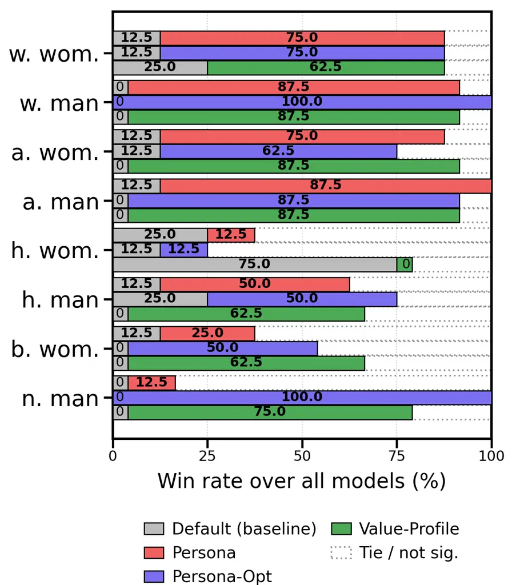
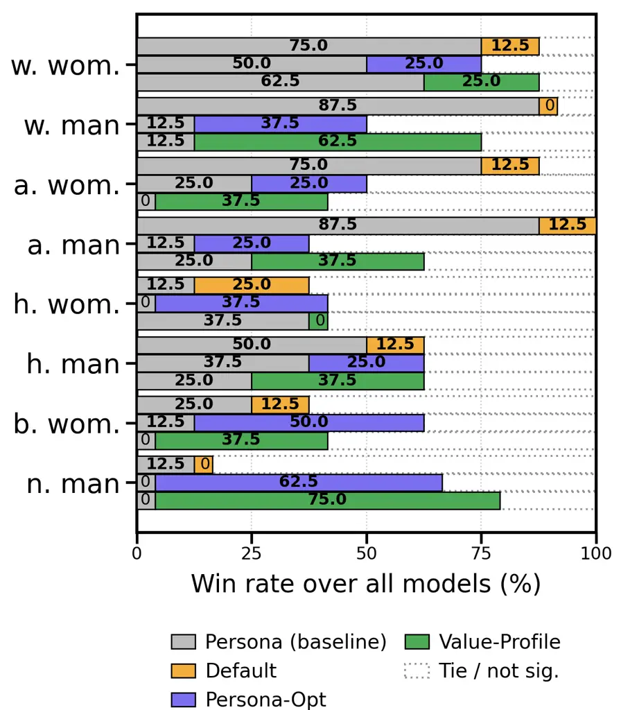
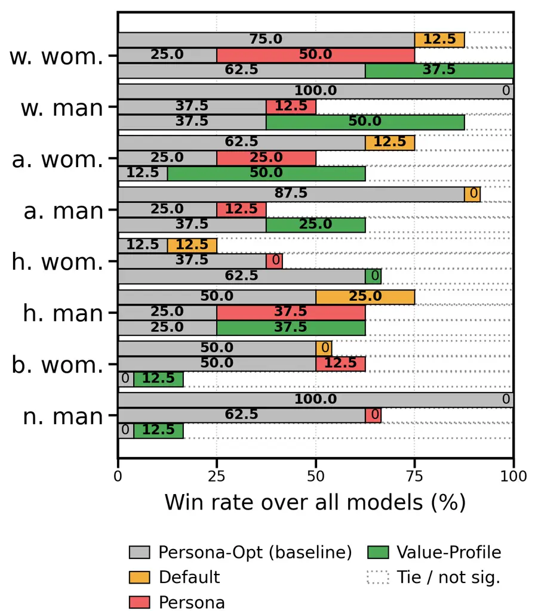
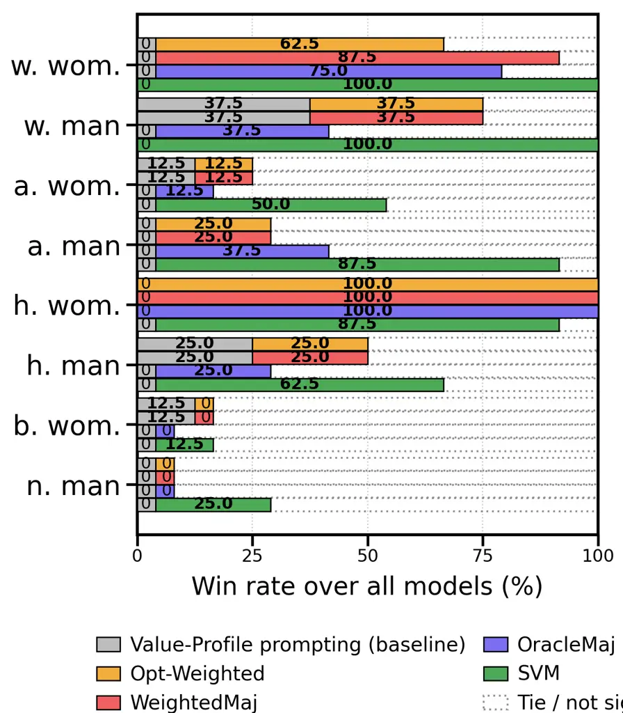
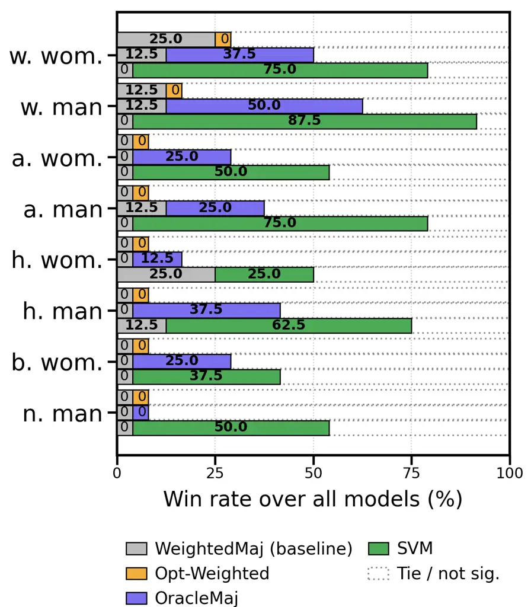
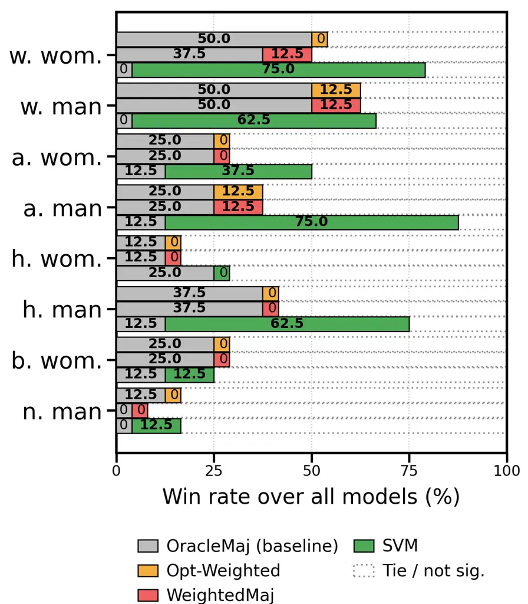
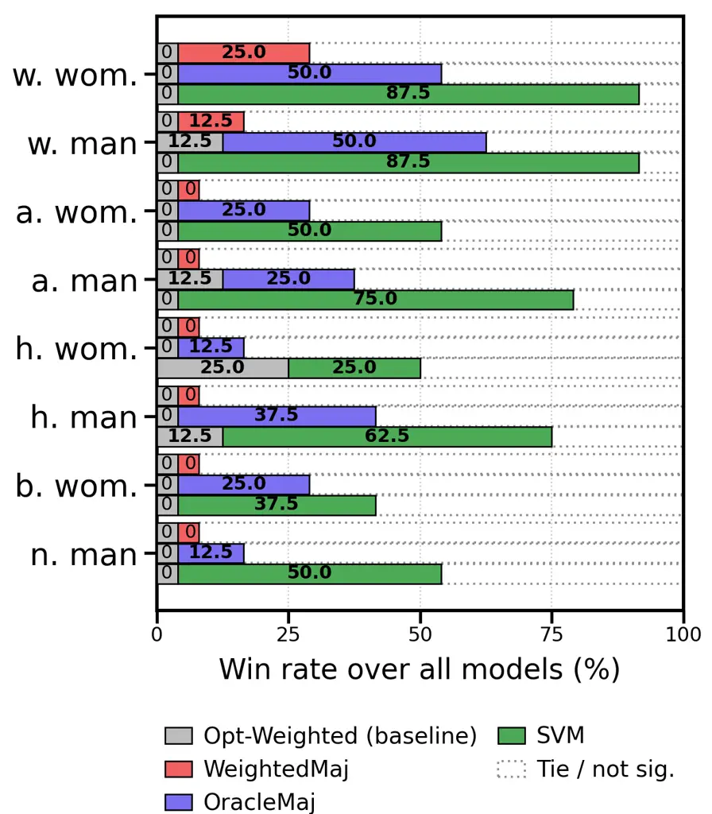
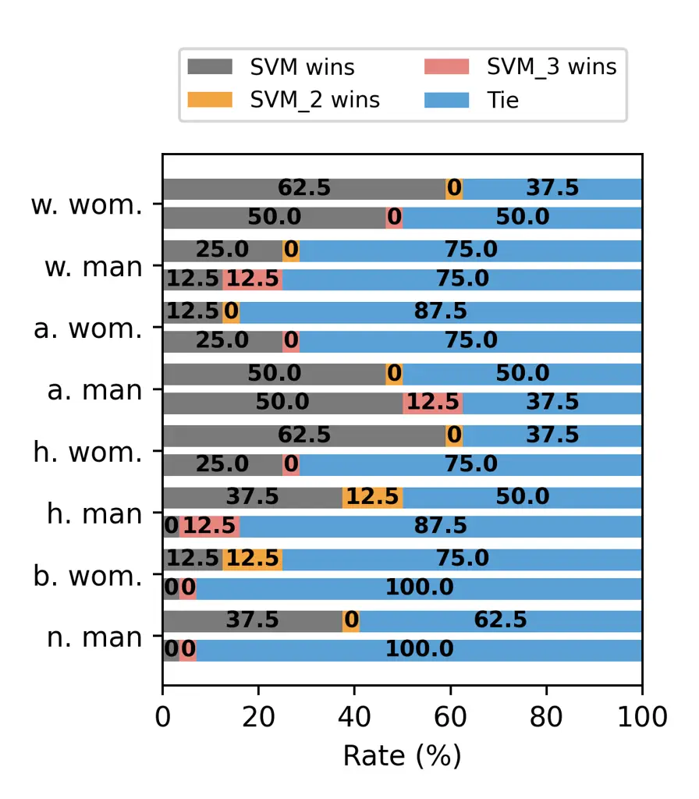

# Robust Persona-Aware Toxicity Detection with Prompt Optimization and Learned Ensembling

Berk Atil Affiliation: Pennsylvania State University
Email: [bka5352@psu.edu](mailto:)    Rebecca J. Passonneau
Affiliation: Pennsylvania State University
Email: [rjp49@psu.edu](mailto:)    Ninareh Mehrabi
Affiliation: Resolution

###### Abstract

Toxicity detection is inherently subjective, shaped by the diverse
perspectives and social priors of different demographic groups. While
“pluralistic” modeling as used in economics and the social sciences aims
to capture perspective differences across contexts, current Large
Language Model (LLM) prompting techniques have different results across
different personas and base models. In this work, we conduct a
systematic evaluation of persona-aware toxicity detection, showing that
no single prompting method, including our proposed automated prompt
optimization strategy, uniformly dominates across all model-persona
pairs. To exploit complementary errors, we explore ensembling four
prompting variants and propose a lightweight meta-ensemble: an SVM over
the 4-bit vector of prompt predictions. Our results demonstrate that the
proposed SVM ensemble consistently outperforms individual prompting
methods and traditional majority-voting techniques, achieving the
strongest overall performance across diverse personas. This work
provides one of the first systematic comparisons of persona-conditioned
prompting for toxicity detection and offers a robust method for
pluralistic evaluation in subjective NLP tasks.

## 1 Introduction

The detection of toxic and offensive language is fundamentally a
subjective task, deeply influenced by raters’ perspectives, social
priors, and the social groups targeted in the text Sap et al. (2020b);
Sorensen et al. (2025b). Further, previous work suggests that each text
should be annotated by the group of people who are targeted in the text
given demographic differences in toxicity perception Mostafazadeh Davani
et al. (2024); Fleisig et al. (2023). This motivates “pluralistic”
toxicity detection that explicitly models toxicity from the perspective
of demographic personas: instead of predicting a single majority label,
models should be able to approximate how different personas would judge
the same content Sorensen et al. (2025b). Recent work has explored
inference-time prompting to incorporate perspective-taking and other
human-centric cues into LLM behavior Xu et al. (2024); Dash et al.
(2025), and LLM-based judges are increasingly used as scalable
evaluators for subjective NLP tasks Zheng et al. (2023); Liu et al.
(2023). However, our systematic evaluation across multiple models shows
that a central practical issue remains: no single method consistently
dominates across all personas and all underlying base models.

In this work, we study two persona-conditioned prompting approaches and
a non-persona prompting method for toxicity detection and show that
their strengths are complementary across model–persona pairs. Then, we
propose a new persona prompting strategy learned via automatic prompt
optimization, using TextGrad-style textual “differentiation” to
iteratively refine prompts Yuksekgonul et al. (2024). Empirically, this
optimized prompting performs comparably to value-profile conditioning
Sorensen et al. (2025b), but the two methods disagree on a non-trivial
subset of examples, suggesting that neither is superior.

Motivated by the broader success of ensembling and aggregation for
improving reliability when individual systems have heterogeneous error
patterns Jiang et al. (2023); Yang et al. (2023); Ai et al. (2025), we
evaluate multiple ensembling techniques to combine the four prompting
approaches. While ensembles improve average performance, we still
observe patterns where a single prompting method remains preferable for
particular personas or base models. To address this, we propose a
lightweight meta-ensemble that treats the four prompting outputs as a
binary prediction vector and learns a discriminative combiner using a
support vector machine (SVM) Cortes and Vapnik (1995). Across our
experiments, this SVM-based ensemble achieves the best overall
performance and is the only approach that consistently outperforms each
individual prompting strategy.

In sum, our contributions are (i) carrying out one of the first
systematic comparisons of persona-conditioned prompting methods for
toxicity detection for different personas, showing that no single method
is superior; (ii) introducing a prompt-optimization approach for persona
prompting based on TextGrad Yuksekgonul et al. (2024) with performance
comparable to value profiles Sorensen et al. (2025b); (iii) benchmarking
a range of ensembling strategies inspired by prior LLM aggregation work
Jiang et al. (2023); Yang et al. (2023); Ai et al. (2025); and (iv)
proposing an SVM meta-ensemble over binary prompt outputs that achieves
the strongest results overall Cortes and Vapnik (1995).

## 2 Related Work

In this section, we review offensive language detection and biases of
LLMs. Then, we review work on subjectivity, concluding the section with
a discussion of work on ensembling LLMs.

#### Toxicity and offensive language detection.

Some work study the automatic detection of toxic, hateful, or offensive
language in online text, often using labeled data built from social
media and forum data. Early and widely used resources include
Twitter-based hate/offensive Davidson et al. (2017); Founta et al.
(2018); Wulczyn et al. (2017) data. Some tasks, such as OffensEval,
further attempt to standardize evaluation for offensive language
identification (Zampieri et al., 2019). More recent datasets expand
coverage and difficulty by adding spans (Mathew et al., 2021), targeting
subtle/implicit hate (ElSherief et al., 2021), or generating large-scale
synthetic toxic/benign examples about minority groups to test spurious
correlations (Hartvigsen et al., 2022). LLMs have been also explored as
automated classifiers for hateful/offensive/toxic content, often
achieving reasonably strong agreement with crowd labels but remaining
sensitive to prompt wording Li et al. (2023); Mishra and Chatterjee
(2023). Industry product deployments similarly report using LLMs to
support moderation decisions, motivating research on reliability and
bias, when LLM judgments substitute for or guide human moderation
workflows Markov et al. (2022); OpenAI (2023). Most of these work
aggregate labels into a single one, ignoring the importance of
background and culture for toxicity perception.

#### Bias and unintended correlations in toxicity models.

Machine learning models might rely on surface patterns and have biases
towards some texts, such as swear words. Dialect variation further
amplifies this issue: demographic-aligned language features (e.g.,
African-American English) differ from mainstream norms (Blodgett et al.,
2016), and insensitivity to dialect has been shown to induce racial bias
in hate-speech annotation and downstream classifiers (Sap et al.,
2019a). These findings motivate approaches that explicitly account for
contextual and social perspectives when judging offensiveness, rather
than treating toxicity as a purely lexical phenomenon.

#### Subjectivity, annotator effects, and pluralistic labeling.

Toxicity perception is inherently subjective and shaped by context,
norms, and background. More generally, annotation research argues that
disagreements can be informative rather than noise (Aroyo and Welty,
2015; Fleisig et al., 2023). Systematic reviews of abusive-language
datasets highlight that annotation guidelines, sampling strategies, and
annotator populations vary widely, affecting both model performance and
fairness (Vidgen and Derczynski, 2020). This line of work suggests
evaluation setups should consider multiple perspectives and analyze
disagreement patterns instead of aggregating labels into a single ground
truth.

| Prompt Type   | Prompt                                                                                                                                                                                                           |
| ------------- | ---------------------------------------------------------------------------------------------------------------------------------------------------------------------------------------------------------------- |
| Definition    | Offensiveness denotes the overall rudeness, disrespect, or toxicity of a post. whether a post could be considered offensive to anyone.                                                                           |
| Persona       | You are supposed to decide if the given text toxic or offensive based on the following definition: {definition} Imagine you were persona and how you would feel about the given statement if you were {persona}. |
| Value Profile | You are supposed to decide if the given text toxic or offensive based on the following definition: {definition} Value Profile: {Value Profile}                                                                   |
| Default       | You are an helpful assistant and expert in linguistic analysis. You will decide if the given statement is offensive. {definition}                                                                                |

Table 1: Prompts used in baseline methods and the definition of toxicity
used in this work in the prompts.

#### Aggregating multiple LLM judgments.

Because LLM outputs can be non-deterministic and sensitive to prompting,
aggregation can improve robustness. Self-consistency aggregates multiple
reasoning traces via sampling and voting to increase accuracy (Wang et
al., 2022). Multi-prompt ensembling works explore weighted voting and
dynamic selection to exploit complementary strengths across systems
(Yang et al., 2023; Ai et al., 2025). In toxicity detection settings
where labels are subjective, aggregation can also be viewed as
approximating a mixture of perspectives, making it especially relevant
for analyzing disagreement and bias.

Building on research in biased toxicity detection (Dixon et al., 2018;
Borkan et al., 2019; Sap et al., 2019b) and pluralistic annotation
(Aroyo and Welty, 2015; Waseem, 2016), we study how demographic
perspectives can be operationalized via prompting for offensiveness
classification and their influence on both overall performance and
subgroup behavior. We further connect this analysis to LLM aggregation
methods (Ai et al., 2025; Yang et al., 2023) to evaluate whether
combining judgments improves reliability. We believe this is one of the
first systematic work that explores LLMs as judges for toxicity
detection for different demographic perspectives.

## 3 Methods

We experiment with different prompts that help guide LLMs to think from
the perspective of a persona. We also have a “default” prompt that does
not assign any persona. In addition to these, we experiment with
ensembling techniques to combine the predictions from the same model
with different prompts. Lastly, we propose a prompting method and an
ensembling method, which, in combination, perform better than previous
methods.

### 3.1 Prompting Methods

First, we examine the effect of assigning a persona to an LLM. We
experiment with perspective-taking prompts Xu et al. (2024), where we
instruct the model to condition its toxicity judgments on the specified
persona. Further, we experiment with Value Profiles Sorensen et al.
(2025a), which are natural language descriptions of underlying values
extracted from in-context examples. The aim is to preserve the
information from in-context examples, but in a natural and explicit
description. Similar to Sorensen et al. (2025a), we used Gemini1.5 Pro
to create value profiles. For each persona, we selected 7 offensive and
7 non-offensive examples from the examples where there are disagreements
among different annotators. Each prompt can be found in Table 1.

### 3.2 Ensembling Techniques

Majority voting is common to combine predictions from different models
Ai et al. (2025); Yang et al. (2023) or humans Galton (1907). Hence, we
explore weighted and unweighted majority voting approaches and propose a
simple ensembling method. Here, we combine different prompting methods
for the same model instead of combining predictions from different
models. Because all of the ensembling approaches require training data,
we reserve 20% of the data for train, 10% for validation, and 70% for
the test for each persona. All results including single prompting
techniques are reported on the same test set.

The first ensembling approach we experiment with is Yang et al. (2023)
which is a weighted majority voting technique where the weights are
correlated with the accuracy of the approach on a “train” data. We call
this approach “Accuracy-based Weighted Majority voting”. Second, we
apply the weights proposed by Ai et al. (2025), the “optimal weight” for
a model “m” is $`log_{e}{\frac{acc_{m}}{1-acc_{m}}}`$. We call this
approach “Theoretical Optimal Weighted Majority Voting”. This is similar
to Yang et al. (2023) in terms of adjusting weights based on accuracy
but they use a different formula. Further, as a baseline we have the
Best Unweighted Majority Voting, which looks at all possible subsets of
the prompting techniques (default, persona, optimized persona, and value
profile) and chooses the best performing one on the test set (so this
approach can be considered as the oracle approach which has the
hypothetical maximum accuracy you can get with an unweighted ensembling
method). This approach gets the best possible accuracy on the test set
when an unweighted majority voting is used. When there is a tie, we
choose to be conservative so if there is at least one vote for
offensive, we aggregate them as offensive.

### 3.3 Proposed Prompting and Ensembling Approaches

Inspired by Sorensen et al. (2025a) and the potential of automated
prompt optimization Yüksekgönül et al. (2024), we suggest optimizing
persona prompts using automated prompt engineering (APE) techniques for
each persona and model so we can force the models to think from the
perspective of the corresponding persona effectively. This is a
prompting-based approach and thanks to optimization we aim to have the
most effective prompts for each persona and model. We use TextGrad
Yuksekgonul et al. (2025) as an APE which uses an additional LLM (the
’optimizer’) that criticizes and suggests new prompts based on the loss
from the current prompt. We sample 100 examples for training and 100 for
validation, our loss function is accuracy, we and use Gpt4o as an
optimizer LLM. To the best of our knowledge, no work explores APE for
toxicity detection, especially for representing the perspectives of
different personas.

Previous ensembling approaches rely mostly on the accuracy of the
methods on a training set to adjust the weights of the methods. Hence,
all of them are linear combiners. However, non-linear methods might have
a higher potential. On the other hand, the ensembling process already
has computational costs. Based on these factors, we propose a simple but
efficient classifier that takes a binary vector of 4 representing
predictions from different prompting methods (default, persona, value
profile, optimized persona) for each persona. The classifier of our
ensemble is SVM with a Gaussian Kernel to make the function non-linear.
As train and validation data, we use the same splits that we use for the
other ensembling approaches.

## 4 Dataset and Models

### 4.1 Dataset

We experiment with the Social Bias Frames dataset Sap et al. (2020a),
which has 44k unique social media posts with annotations for
offensiveness, target group etc. Also, for each post, they have multiple
annotations with demographic information of the annotator. In this work,
we focus on the combination of gender and race (we refer to each gender
and race combination as a “persona.”). We choose the personas that have
a reasonable ($`>400`$) number of examples. Table 2 gives the statistics
about the dataset for each persona.

| Persona        | \# of Examples | Offensiveness % |
| -------------- | -------------- | --------------- |
| Asian Woman    | 2829           | 51.11           |
| Asian Man      | 4468           | 36.59           |
| Black Woman    | 4414           | 54.05           |
| White Woman    | 32125          | 54.09           |
| White Man      | 31964          | 56.65           |
| Hispanic Woman | 4109           | 65.40           |
| Hispanic Man   | 3007           | 50.05           |
| Native Man     | 471            | 40.51           |

Table 2: Dataset Statistics with number of examples and percentage of
offensiveness labels.

Figure 1: Prompting comparisons with default prompting as the baseline.

### 4.2 Models

We experiment with Llama3.1 70b/8b Dubey et al. (2024), and Qwen2.5
14b/32b Qwen et al. (2025) models. Additionally, we analyze the effect
of reasoning-enhanced models. For this, we use R1-distilled models (e.g.
R1 Distilled Qwen 14b/32b and R1 Distilled Llama 8b/70b) Guo et al.
(2025).

## 5 Results

In all results, we apply McNemar’s test McNemar (1947) to compare
approaches pairwise and report percentage wins of each method against
each other. The McNemar is a paired, nonparametric test for two related
binary data, e.g., two classifiers on the same data, and checks whether
their error rates differ significantly. We analyze the effects of
reasoning models, persona prompts, and ensembling methods. We conclude
this section with an overall comparison and an ablation study of the
SVM.

### 5.1 Reasoning Effect

First, we compare the default prompts for the base models and their
reasoning-enhanced counterparts. We see that reasoning helps for smaller
models but degrades the performance for larger models (See the top
portion of Table 12 in Appendix). This might indicate that large models
are already doing some reasoning internally and enhancing their
reasoning mostly for logical and mathematical tasks hurts their social
reasoning. Also, we apply McNemar’s test to compare if the model
predictions are different for each persona, and in most cases they are
significantly different.

### 5.2 Persona-based Prompt Effects

Figure 1 shows the comparison of prompts against default (no persona)
prompt aggregated over models (see Table 4 in Appendix for all results).
Overall, all three persona-based methods outperform the default prompt
with varying success based on the models and persona. They work better
for non-reasoning models which might indicate that reasoning models
might implicitly think from the perspective of some personas, but
non-reasoning models need a trigger to do that. None of these works well
for “hispanic woman,” and value profile makes the predictions worse. In
our dataset, hispanic woman is the persona that has the most offensive
content. This motivated us to check the predictions and our analysis
shows that when a persona prompt is used, models tend to predict
non-offensive more often.

Figure 2: Prompting comparisons with persona prompt as the baseline.

#### Persona Prompt

Simply assigning persona information to reflect the offensive content
perception of that persona usually improves the performance (e.g.
compare gray and pink boxes in Figure 1). It works for most models
except Distilled Llama8b and works better for non-reasoning models (see
Table 4).

Regarding the effect on different personas, Figure 1 shows that persona
prompt degrades performance for Hispanic woman and does not have much
effect for Native man. It also does not improve results much for Black
woman. For the other personas, it boosts performance.

Figure 3: Prompting comparisons with persona optimized prompt as the
baseline.

#### Persona optimized Prompt

Similarly, when the persona prompt is optimized for each model and
persona, it mostly boosts performance (in Figure 1 purple boxes
outperform gray ones.). It also boosts performance for reasoning models;
performance improvement for non-reasoning models is still greater,
though (see Table 4 in Appendix). Optimization improves performance on
all personas except Hispanic woman.

Optimizing persona prompt outperforms the persona prompt overall. (see
Figure 2 and Table 5 in Appendix). However, it does not improve much for
Llama70b, Distilled Llama70b, Qwen14b/32b and Distilled Qwen32b models.
Further, it works better for White man, Hispanic woman, Black woman, and
Native man. For the other personas, both approaches are comparable.

#### Value Profile Prompt

Figure 1 shows that providing value profiles outperforms the default
prompt significantly in most cases. Its effect is similar to optimizing
prompts, and it improves performance for reasoning models as well,
except for Distilled Qwen14b (c.f Table 4 in Appendix). Further, it
improves performance on all personas except Hispanic woman.

Providing value profiles is also a better approach than persona prompt
(see Figure 2 and Table 5 in Appendix). However, the performances are
comparable for Qwen14b, Distilled Qwen14b and Qwen32b models. Value
profile is more effective, especially for Llama-based models. Regarding
personas, value profile is better for White man, Black woman, and Native
man. They are comparable for Asian man and Hispanic woman, but the
persona prompt is more effective for White woman and Hispanic woman.

Based on Figure 3, we can see that value profile prompting, and
optimizing prompts for each model and persona perform similarly (see
Table 6 for more details). One of the methods works better for some
models and the other one works better for the others. We have a similar
observation for personas as well. The reason behind this might be that
value profile prompting also tailors prompts for each persona.
Therefore, it somehow also “optimizes” the prompt in a more guided way.

Overall, the ordering of the methods is Optimized Prompt = Value Profile
\> Persona Prompt \> default Prompt

Figure 4: Ensembling comparisons with Value Profile prompting as the
baseline.

### 5.3 Ensembling Methods

Here, we combine the predictions of previous prompting methods for each
model in different ways and compare the effect of ensembling methods.

Figure 4 (see Table 6 in Appendix more details) compares ensembling
approaches against value profile prompting which is one of the best
performing prompting method. All ensembling methods outperform it in
most cases. Value profile prompt is better than Accuracy-based Weighted
Majority Voting for Distilled Llama8b, Asian woman, and Black woman.
They are comparable for Distilled Qwen32b, White man, and Native man.
Best Unweighted Majority Voting is similar to value profile for
Distilled Llama8b, Distilled Qwen32b, Asian woman, Black woman, and
Native man. Theoretical Optimal Weighted Majority Voting performs worse
than value profile for Distilled Llama8b, Distilled Qwen32b Asian woman,
and Black woman. They perform similarly for White man and Native man.
For the comparison to other prompting methods see Tables 4, 5, 7 in
Appendix.

Figure 5: Ensembling comparisons with Accuracy-based Weighted Majority
as the baseline.

Figure 6: Ensembling comparisons with Best Unweighted Majority as the
baseline.

Figure 7: Ensembling comparisons with Theoretical Optimal Weighted
Majority as the baseline.

#### Accuracy-based Weighted Majority Voting

This ensembling method outperforms each single prompting method in most
cases. Its effectiveness changes depending on a model and persona.

#### Best Unweighted Majority Voting

Since the purpose of this approach is to set an upper limit for an
unweighted majority voting approaches, it improves performance against
persona prompting for all models and personas as expected. There are a
few cases, where both approaches are comparable. We should note that we
choose the best combination on test set, hence this method has an
advantage over the other methods.

This ensembling method is better than Accuracy-based Weighted Majority
Voting (see Figure 5 and Table 8 in Appendix), though its effectiveness
differ based on the model and persona. They are comparable for Distilled
Qwen14b/32b, Native man and Hispanic woman.

#### Theoretical Optimal Weighted Majority Voting

This performs similar to Accuracy-based Weighted Majority Voting so it
also outperform single prompting methods in most cases; though, its
performance vary based on a model and persona. These two methods are
comparable, none of them is superior. On the other hand, this method is
worse than Best Unweighted Majority Voting in most cases (see Figure 6
and Table 9).

#### SVM

SVM trained on a binary vector of predictions from single prompting
methods is the most consistent and powerful approach. It outperforms
single prompting methods in all cases. Its effectiveness changes based
on a model and persona but it is always better.

When we compare this method against Accuracy-based Weighted Majority
Voting (Figure 5 and Table 8 in Appendix) and Theoretical Optimal
Weighted Majority Voting (Figure 7and Table 10 in Appendix), we see that
SVM outperforms both methods in most cases. SVM is comparable to both
methods for Llama70b.

Figure 6 shows that SVM is significantly better than Best Unweighted
Majority Voting too (more details are in Table 9 in Appendix). They are
comparable for Llama8b/70b and Hispanic woman. This shows that weighted
ensembling methods have a better potential than unweighted ensembling
methods for hate speech detection based on personas. Even an SVM
classifier with an input of binary vector of predictions for different
promptings can learn to predict better for a given persona.

Overall, the ordering of the methods is SVM \> Best Unweighted Majority
Voting \> Theoretical Optimal Weighted Majority Voting = Accuracy-based
Weighted Majority Voting. SVM is the only method including other
ensembling methods and single prompting techniques that is consistently
better for all models and personas.

|                   | Pers. Prompt | Pers. opt | Value Prof. | Weigh. Maj. | Best Maj. | Weigh. Maj. theo. | SVM    |
| ----------------- | ------------ | --------- | ----------- | ----------- | --------- | ----------------- | ------ |
| Default           | 7 (34)       | 5 (43)    | 8 (42)      | 0 (50)      | 0 (57)    | 0 (50)            | 0 (58) |
| Pers. Prompt      |              | 12 (23)   | 13 (25)     | 4 (37)      | 0 (40)    | 4 (36)            | 1 (51) |
| Value Prof        |              |           | 18 (19)     | 10 (25)     | 0 (24)    | 10 (23)           | 0 (47) |
| Pers. opt         |              |           |             | 4 (23)      | 0 (28)    | 6 (23)            | 1 (44) |
| Weigh. Maj.       |              |           |             |             | 2 (20)    | 3 (0)             | 3 (40) |
| Best Maj.         |              |           |             |             |           | 21 (1)            | 2 (29) |
| Weigh. Maj. theo. |              |           |             |             |           |                   | 3 (41) |

Table 3: Out of 64 combinations (8 models x 8 personas) how many times
the method on y axis is better than the method on x axis (the method on
x is better than the method on y axis)

### 5.4 Overall Comparison

Table 3 compares the significant differences among each method pairwise
and Table 12 in Appendix compares each method in terms of F1 scores.
They show that ensembling methods outperform single prompting methods
and SVM is the best method overall. In some cases, Best Unweighted
Majority Voting outperforms the others, but in most cases, they are not
significant and that method has an advantage over other methods by
choosing the best combination on test set.

Figure 8: Significant test comparison of ablation study. SVM is the
original model, SVM_2 uses two inputs and SVM_3 uses three different
inputs.

### 5.5 Ablation Study on SVM

To see the effect of using different numbers of prompts, we conduct an
ablation study where we vary the number of prompts as inputs to SVM. Our
original SVM model takes predictions from all four prompting methods and
the ablation models take either two or three. For each LLM, we pick the
best combination of two and three promptings by looking at the
accuracies of SVM trained on each combination. Figure 8 compares the
original SVM model with the best SVMs that use two or three inputs.
These results show that the combination of the four prompts is superior
to any subset, which suggests that they have complementary strengths
unmatched by any pair or triple.

## 6 Conclusion

Toxicity detection is not only a modeling problem but also a perspective
problem: demographically distinct personas can legitimately disagree on
the toxicity of the same post. In this work, we evaluated persona-aware
prompting strategies for toxicity detection and showed that while a
persona conditioned prompt usually improves over a non-persona prompt,
no single prompting method consistently dominates across all personas
and base models. We show that reasoning-enhanced models do not
inherently solve the challenge of subjective perception and can even
degrade performance in larger models for social reasoning tasks. We
further introduced an automated prompt-optimization strategy based on
TextGrad that produces persona prompts competitive with value-profile
conditioning, yet with disagreement patterns that indicate complementary
strengths. To make use of this heterogeneity, we explored ensembling
techniques and propose a meta-ensembling approach using an SVM
classifier over binary prompt outputs. This simple method is the only
method that is consistently better across the full set of model–persona
configurations. Our findings suggest that the future of pluralistic
toxicity detection lies in learned ensembling of diverse prompting
perspectives, providing a more reliable approach to model the subjective
judgments of heterogeneous groups.

## Limitations

Our study focuses on limited set of personas. We do not look at queer
gender types and some other common races. Further, we experiment with
models from two family. Our findings might differ in closed-source
models. In addition, we focus only on English but there are other
languages that the models behave differently. Last but not least,
performance disparities among different personas remain in all methods.

## References

- Ai et al. (2025) R. Ai, Y. Pan, D. Simchi-Levi, M. Tambe, and H. Xu
  Beyond majority voting: llm aggregation by leveraging higher-order
  information. arXiv preprint arXiv:2510.01499. Cited by: §1, §1, §2,
  §2, §3.2, §3.2.
- Aroyo and Welty (2015) L. Aroyo and C. Welty Truth is a lie: crowd
  truth and the seven myths of human annotation. AI Magazine 36 (1),
  pp. 15–24. External Links:
  [Document](https://dx.doi.org/10.1609/aimag.v36i1.2564),
  [Link](https://ojs.aaai.org/aimagazine/index.php/aimagazine/article/view/2564)
  Cited by: §2, §2.
- Blodgett et al. (2016) S. L. Blodgett, L. Green, and B. O’Connor
  Demographic dialectal variation in social media: a case study of
  African-American English. In Proceedings of the 2016 Conference on
  Empirical Methods in Natural Language Processing, J. Su, K. Duh,
  and X. Carreras (Eds.), Austin, Texas, pp. 1119–1130. External Links:
  [Link](https://aclanthology.org/D16-1120/),
  [Document](https://dx.doi.org/10.18653/v1/D16-1120) Cited by: §2.
- Borkan et al. (2019) D. Borkan, L. Dixon, J. Sorensen, N. Thain,
  and L. Vasserman Nuanced metrics for measuring unintended bias with
  real data for text classification. CoRR abs/1903.04561. External
  Links: [Link](http://arxiv.org/abs/1903.04561), 1903.04561 Cited by:
  §2.
- Cortes and Vapnik (1995) C. Cortes and V. Vapnik Support-vector
  networks. Machine Learning 20 (3), pp. 273–297. External Links:
  [Document](https://dx.doi.org/10.1007/BF00994018),
  [Link](https://doi.org/10.1007/BF00994018) Cited by: §1, §1.
- Dash et al. (2025) S. Dash, A. Reymond, E. S. Spiro, and A. Caliskan
  Persona-assigned large language models exhibit human-like motivated
  reasoning. arXiv preprint arXiv:2506.20020. Cited by: §1.
- Davidson et al. (2017) T. Davidson, D. Warmsley, M. Macy, and I. Weber
  Automated hate speech detection and the problem of offensive language.
  In Proceedings of the international AAAI conference on web and social
  media, Vol. 11, pp. 512–515. Cited by: §2.
- Dixon et al. (2018) L. Dixon, J. Li, J. Sorensen, N. Thain, and L.
  Vasserman Measuring and mitigating unintended bias in text
  classification. In Proceedings of the 2018 AAAI/ACM Conference on AI,
  Ethics, and Society, External Links:
  [Document](https://dx.doi.org/10.1145/3278721.3278729),
  [Link](https://dl.acm.org/doi/10.1145/3278721.3278729) Cited by: §2.
- Dubey et al. (2024) A. Dubey, A. Jauhri, A. Pandey, A. Kadian, A.
  Al-Dahle, A. Letman, A. Mathur, A. Schelten, A. Yang, A. Fan, et al.
  The llama 3 herd of models. arXiv e-prints, pp. arXiv–2407. Cited by:
  §4.2.
- ElSherief et al. (2021) M. ElSherief, C. Ziems, D. Muchlinski, V.
  Anupindi, J. Seybolt, M. De Choudhury, and D. Yang Latent hatred: a
  benchmark for understanding implicit hate speech. In Proceedings of
  the 2021 Conference on Empirical Methods in Natural Language
  Processing, M. Moens, X. Huang, L. Specia, and S. W. Yih (Eds.),
  Online and Punta Cana, Dominican Republic, pp. 345–363. External
  Links: [Link](https://aclanthology.org/2021.emnlp-main.29/),
  [Document](https://dx.doi.org/10.18653/v1/2021.emnlp-main.29) Cited
  by: §2.
- Fleisig et al. (2023) E. Fleisig, R. Abebe, and D. Klein When the
  majority is wrong: modeling annotator disagreement for subjective
  tasks. In Proceedings of the 2023 Conference on Empirical Methods in
  Natural Language Processing, H. Bouamor, J. Pino, and K. Bali (Eds.),
  Singapore, pp. 6715–6726. External Links:
  [Link](https://aclanthology.org/2023.emnlp-main.415/),
  [Document](https://dx.doi.org/10.18653/v1/2023.emnlp-main.415) Cited
  by: §1, §2.
- Founta et al. (2018) A. Founta, C. Djouvas, D. Chatzakou, I.
  Leontiadis, J. Blackburn, G. Stringhini, A. Vakali, M. Sirivianos,
  and N. Kourtellis Large scale crowdsourcing and characterization of
  twitter abusive behavior. In Proceedings of the international AAAI
  conference on web and social media, Vol. 12. Cited by: §2.
- Galton (1907) F. Galton Vox populi. Nature Publishing Group UK London.
  Cited by: §3.2.
- Guo et al. (2025) D. Guo, D. Yang, H. Zhang, J. Song, R. Zhang, R.
  Xu, Q. Zhu, S. Ma, P. Wang, X. Bi, et al. Deepseek-r1: incentivizing
  reasoning capability in llms via reinforcement learning. arXiv
  preprint arXiv:2501.12948. Cited by: §4.2.
- Hartvigsen et al. (2022) T. Hartvigsen, S. Gabriel, H. Palangi, M.
  Sap, D. Ray, and E. Kamar ToxiGen: a large-scale machine-generated
  dataset for adversarial and implicit hate speech detection. In
  Proceedings of the 60th Annual Meeting of the Association for
  Computational Linguistics (Volume 1: Long Papers), S. Muresan, P.
  Nakov, and A. Villavicencio (Eds.), Dublin, Ireland, pp. 3309–3326.
  External Links: [Link](https://aclanthology.org/2022.acl-long.234/),
  [Document](https://dx.doi.org/10.18653/v1/2022.acl-long.234) Cited by:
  §2.
- Jiang et al. (2023) D. Jiang, X. Ren, and B. Y. Lin LLM-blender:
  ensembling large language models with pairwise ranking and generative
  fusion. arXiv preprint arXiv:2306.02561. External Links:
  [Document](https://dx.doi.org/10.48550/arXiv.2306.02561),
  [Link](https://arxiv.org/abs/2306.02561) Cited by: §1, §1.
- Li et al. (2023) L. Li, L. Fan, S. Atreja, and L. Hemphill “HOT”
  chatgpt: the promise of chatgpt in detecting and discriminating
  hateful, offensive, and toxic comments on social media. External
  Links: 2304.10619, [Link](https://arxiv.org/abs/2304.10619) Cited by:
  §2.
- Liu et al. (2023) Y. Liu, D. Iter, Y. Xu, S. Wang, R. Xu, and C. Zhu
  G-eval: nlg evaluation using Gpt-4 with better human alignment. In
  Proceedings of the 2023 Conference on Empirical Methods in Natural
  Language Processing, pp. 2511–2522. External Links:
  [Document](https://dx.doi.org/10.18653/v1/2023.emnlp-main.153),
  [Link](https://aclanthology.org/2023.emnlp-main.153/) Cited by: §1.
- Markov et al. (2022) T. Markov, C. Zhang, S. Agarwal, T. Eloundou, T.
  Lee, S. Adler, A. Jiang, and L. Weng A holistic approach to undesired
  content detection in the real world. External Links: 2208.03274,
  [Link](https://arxiv.org/abs/2208.03274) Cited by: §2.
- Mathew et al. (2021) B. Mathew, P. Saha, S. M. Yimam, C. Biemann, P.
  Goyal, and A. Mukherjee Hatexplain: a benchmark dataset for
  explainable hate speech detection. In Proceedings of the AAAI
  conference on artificial intelligence, Vol. 35, pp. 14867–14875. Cited
  by: §2.
- McNemar (1947) Q. McNemar Note on the sampling error of the difference
  between correlated proportions or percentages. Psychometrika 12 (2),
  pp. 153–157. External Links:
  [Document](https://dx.doi.org/10.1007/bf02295996),
  [Link](https://doi.org/10.1007/bf02295996) Cited by: §5.
- Mishra and Chatterjee (2023) S. Mishra and A. Chatterjee Exploring
  chatgpt for toxicity detection in github. External Links: 2312.13105,
  [Link](https://arxiv.org/abs/2312.13105) Cited by: §2.
- Mostafazadeh Davani et al. (2024) A. Mostafazadeh Davani, M.
  Diaz, D. K. Baker, and V. Prabhakaran D3CODE: disentangling
  disagreements in data across cultures on offensiveness detection and
  evaluation. In Proceedings of the 2024 Conference on Empirical Methods
  in Natural Language Processing, Y. Al-Onaizan, M. Bansal, and Y. Chen
  (Eds.), Miami, Florida, USA, pp. 18511–18526. External Links:
  [Link](https://aclanthology.org/2024.emnlp-main.1029/),
  [Document](https://dx.doi.org/10.18653/v1/2024.emnlp-main.1029) Cited
  by: §1.
- OpenAI (2023) OpenAI Using GPT-4 for content moderation. Note: OpenAI
  BlogAccessed 2025-12-26 External Links:
  [Link](https://openai.com/index/using-gpt-4-for-content-moderation/)
  Cited by: §2.
- Qwen et al. (2025) Qwen, :, A. Yang, B. Yang, B. Zhang, B. Hui, B.
  Zheng, B. Yu, C. Li, D. Liu, F. Huang, H. Wei, H. Lin, J. Yang, J.
  Tu, J. Zhang, J. Yang, J. Yang, J. Zhou, J. Lin, K. Dang, K. Lu, K.
  Bao, K. Yang, L. Yu, M. Li, M. Xue, P. Zhang, Q. Zhu, R. Men, R.
  Lin, T. Li, T. Tang, T. Xia, X. Ren, X. Ren, Y. Fan, Y. Su, Y.
  Zhang, Y. Wan, Y. Liu, Z. Cui, Z. Zhang, and Z. Qiu Qwen2.5 technical
  report. External Links: 2412.15115,
  [Link](https://arxiv.org/abs/2412.15115) Cited by: §4.2.
- Sap et al. (2019a) M. Sap, D. Card, S. Gabriel, Y. Choi, and N. A.
  Smith The risk of racial bias in hate speech detection. In Proceedings
  of the 57th Annual Meeting of the Association for Computational
  Linguistics, A. Korhonen, D. Traum, and L. Màrquez (Eds.), Florence,
  Italy, pp. 1668–1678. External Links:
  [Link](https://aclanthology.org/P19-1163/),
  [Document](https://dx.doi.org/10.18653/v1/P19-1163) Cited by: §2.
- Sap et al. (2019b) M. Sap, D. Card, S. Gabriel, Y. Choi, and N. A.
  Smith The risk of racial bias in hate speech detection. In Proceedings
  of the 57th Annual Meeting of the Association for Computational
  Linguistics, Florence, Italy, pp. 1668–1678. External Links:
  [Link](https://aclanthology.org/P19-1163/),
  [Document](https://dx.doi.org/10.18653/v1/P19-1163) Cited by: §2.
- Sap et al. (2020a) M. Sap, S. Gabriel, L. Qin, D. Jurafsky, N. A.
  Smith, and Y. Choi Social bias frames: reasoning about social and
  power implications of language. In Proceedings of the 58th annual
  meeting of the association for computational linguistics,
  pp. 5477–5490. Cited by: §4.1.
- Sap et al. (2020b) M. Sap, S. Gabriel, L. Qin, D. Jurafsky, N. A.
  Smith, and Y. Choi Social bias frames: reasoning about social and
  power implications of language. In Proceedings of the 58th Annual
  Meeting of the Association for Computational Linguistics,
  pp. 5477–5490. External Links:
  [Document](https://dx.doi.org/10.18653/v1/2020.acl-main.486),
  [Link](https://aclanthology.org/2020.acl-main.486/) Cited by: §1.
- Sorensen et al. (2025a) T. Sorensen, P. Mishra, R. Patel, M. H.
  Tessler, M. A. Bakker, G. Evans, I. Gabriel, N. Goodman, and V. Rieser
  Value profiles for encoding human variation. In Proceedings of the
  2025 Conference on Empirical Methods in Natural Language Processing,
  pp. 2047–2095. Cited by: §3.1, §3.3.
- Sorensen et al. (2025b) T. Sorensen, P. Mishra, R. Patel, M. H.
  Tessler, M. A. Bakker, G. Evans, I. Gabriel, N. Goodman, and V. Rieser
  Value profiles for encoding human variation. In Proceedings of the
  2025 Conference on Empirical Methods in Natural Language Processing,
  Suzhou, China, pp. 2047–2095. External Links:
  [Document](https://dx.doi.org/10.18653/v1/2025.emnlp-main.106),
  [Link](https://aclanthology.org/2025.emnlp-main.106/) Cited by: §1,
  §1, §1.
- Vidgen and Derczynski (2020) B. Vidgen and L. Derczynski Directions in
  abusive language training data, a systematic review: garbage in,
  garbage out. PLOS ONE 15 (12), pp. e0243300. External Links:
  [Document](https://dx.doi.org/10.1371/journal.pone.0243300),
  [Link](https://journals.plos.org/plosone/article?id=10.1371/journal.pone.0243300),
  2004.01670 Cited by: §2.
- Wang et al. (2022) X. Wang, J. Wei, D. Schuurmans, Q. Le, E. Chi, S.
  Narang, A. Chowdhery, and D. Zhou Self-consistency improves chain of
  thought reasoning in language models. External Links: 2203.11171,
  [Link](https://arxiv.org/abs/2203.11171) Cited by: §2.
- Waseem (2016) Z. Waseem Are you a racist or am i seeing things?
  annotator influence on hate speech detection on twitter. In
  Proceedings of the First Workshop on NLP and Computational Social
  Science, Austin, Texas, pp. 138–142. External Links:
  [Link](https://aclanthology.org/W16-5618/),
  [Document](https://dx.doi.org/10.18653/v1/W16-5618) Cited by: §2.
- Wulczyn et al. (2017) E. Wulczyn, N. Thain, and L. Dixon Ex machina:
  personal attacks seen at scale. External Links: 1610.08914,
  [Link](https://arxiv.org/abs/1610.08914) Cited by: §2.
- Xu et al. (2024) R. Xu, Z. Zhou, T. Zhang, Z. Qi, S. Yao, K. Xu, W.
  Xu, and H. Qiu Walking in others’ shoes: how perspective-taking guides
  large language models in reducing toxicity and bias. In Proceedings of
  the 2024 Conference on Empirical Methods in Natural Language
  Processing, Y. Al-Onaizan, M. Bansal, and Y. Chen (Eds.), Miami,
  Florida, USA, pp. 8341–8368. External Links:
  [Link](https://aclanthology.org/2024.emnlp-main.476/),
  [Document](https://dx.doi.org/10.18653/v1/2024.emnlp-main.476) Cited
  by: §1, §3.1.
- Yang et al. (2023) H. Yang, M. Li, H. Zhou, Y. Xiao, Q. Fang, and R.
  Zhang One llm is not enough: harnessing the power of ensemble learning
  for medical question answering. medRxiv. Cited by: §1, §1, §2, §2,
  §3.2, §3.2.
- Yuksekgonul et al. (2024) M. Yuksekgonul, F. Bianchi, J. Boen, S.
  Liu, Z. Huang, C. Guestrin, and J. Zou TextGrad: automatic
  “differentiation” via text. arXiv preprint arXiv:2406.07496. External
  Links: [Document](https://dx.doi.org/10.48550/arXiv.2406.07496),
  [Link](https://arxiv.org/abs/2406.07496) Cited by: §1, §1.
- Yuksekgonul et al. (2025) M. Yuksekgonul, F. Bianchi, J. Boen, S.
  Liu, P. Lu, Z. Huang, C. Guestrin, and J. Zou Optimizing generative ai
  by backpropagating language model feedback. Nature 639 (8055),
  pp. 609–616. Cited by: §3.3.
- Yüksekgönül et al. (2024) M. Yüksekgönül, Y. Zhang, and M. Bansal
  TextGrad: automatic “differentiation” via text. External Links:
  2406.07496, [Link](https://arxiv.org/abs/2406.07496) Cited by: §3.3.
- Zampieri et al. (2019) M. Zampieri, S. Malmasi, P. Nakov, S.
  Rosenthal, N. Farra, and R. Kumar Semeval-2019 task 6: identifying and
  categorizing offensive language in social media (offenseval). arXiv
  preprint arXiv:1903.08983. Cited by: §2.
- Zheng et al. (2023) L. Zheng, W. Chiang, Y. Sheng, S. Zhuang, Z.
  Wu, Y. Zhuang, Z. Lin, Z. Li, D. Li, E. P. Xing, H. Zhang, J. E.
  Gonzalez, and I. Stoica Judging LLM-as-a-judge with MT-bench and
  chatbot arena. arXiv preprint arXiv:2306.05685. External Links:
  [Link](https://arxiv.org/abs/2306.05685) Cited by: §1.

## Appendix A Pairwise Comparison Tables

| Model/Persona  | Pers. Prompt | Pers. opt | Value Prof. | Weigh. Maj. | Best Maj. | Weigh. Maj. theo. | SVM    |
| -------------- | ------------ | --------- | ----------- | ----------- | --------- | ----------------- | ------ |
| llama8b        | 7 (0)        | 8 (0)     | 7 (0)       | 8 (0)       | 8 (0)     | 8 (0)             | 8 (0)  |
| dllama8b       | 0 (5)        | 4 (1)     | 4 (1)       | 3 (0)       | 5 (0)     | 3 (0)             | 8 (0)  |
| llama70b       | 4 (1)        | 5 (1)     | 3 (1)       | 5 (0)       | 8 (0)     | 5 (0)             | 6 (0)  |
| dllama70b      | 4 (0)        | 4 (1)     | 6 (2)       | 7 (0)       | 7 (0)     | 7 (0)             | 7 (0)  |
| qwen14b        | 5 (0)        | 6 (1)     | 6 (1)       | 6(0)        | 7 (0)     | 7 (0)             | 8 (0)  |
| dqwen14b       | 2 (0)        | 4 (1)     | 2 (2)       | 7 (0)       | 7 (0)     | 7 (0)             | 7 (0)  |
| qwen32b        | 7 (1)        | 6 (0)     | 7 (0)       | 7 (0)       | 7 (0)     | 7 (0)             | 7 (0)  |
| dqwen32b       | 5 (0)        | 6 (0)     | 6 (0)       | 7 (0)       | 7 (0)     | 7 (0)             | 7 (0)  |
| Total          | 34 (7)       | 43 (5)    | 42 (8)      | 50 (0)      | 57 (0)    | 50 (0)            | 58 (0) |
| white woman    | 6 (1)        | 6 (1)     | 5 (2)       | 7 (0)       | 7 (0)     | 7 (0)             | 8 (0)  |
| white man      | 7 (0)        | 8 (0)     | 7 (0)       | 8 (0)       | 8 (0)     | 8 (0)             | 8 (0)  |
| asian woman    | 6 (1)        | 5 (1)     | 7 (0)       | 7 (0)       | 8 (0)     | 8 (0)             | 8 (0)  |
| asian man      | 7 (1)        | 7 (0)     | 7 (0)       | 8 (0)       | 8 (0)     | 8 (0)             | 8 (0)  |
| hispanic woman | 1 (2)        | 1 (1)     | 0 (6)       | 3 (0)       | 3 (0)     | 5 (0)             | 3 (0)  |
| hispanic man   | 4 (1)        | 4 (2)     | 5 (0)       | 7 (0)       | 7 (0)     | 7 (0)             | 8 (0)  |
| black woman    | 2 (1)        | 4 (0)     | 5 (0)       | 4 (0)       | 4 (0)     | 6 (0)             | 8 (0)  |
| native man     | 1 (0)        | 8 (0)     | 6 (0)       | 6 (0)       | 6 (0)     | 8 (0)             | 7 (0)  |

Table 4: Out of 8 models or personas, how many times is the approach
significantly better than default prompt (how many times it is worse)
Pers. Prompt refers to persona prompt, Pers. opt refers to Persona
optimized prompt, Value Prof. refers to Value profile prompting, Weight.
Maj. refers to Accuracy-based Weighted Majority Voting, Best Maj. refers
to Best Unweighted Majority Voting, Weigh. Maj. theo. refers to
Theoretical Optimal Weighted Majority Voting

| Model/Persona  | Pers. opt | Value Prof. | Weigh. Maj. | Best Maj. | Weigh. Maj. theo. | SVM    |
| -------------- | --------- | ----------- | ----------- | --------- | ----------------- | ------ |
| llama8b        | 7 (0)     | 6 (1)       | 8 (0)       | 8 (0)     | 8 (0)             | 7 (0)  |
| dllama8b       | 5 (1)     | 7 (1)       | 7 (0)       | 7 (0)     | 7 (0)             | 7 (0)  |
| llama70b       | 2 (2)     | 4 (1)       | 2 (0)       | 3 (0)     | 2 (0)             | 3 (0)  |
| dllama70b      | 2 (4)     | 4 (1)       | 5 (0)       | 5 (0)     | 5 (0)             | 7 (0)  |
| qwen14b        | 0 (0)     | 3 (2)       | 2(2)        | 3 (0)     | 2 (2)             | 8 (0)  |
| dqwen14b       | 4 (1)     | 2 (3)       | 6 (0)       | 8 (0)     | 6 (0)             | 7 (0)  |
| qwen32b        | 1 (2)     | 1 (3)       | 1 (2)       | 2 (0)     | 1 (2)             | 4 (1)  |
| dqwen32b       | 2 (2)     | 2 (0)       | 6 (0)       | 4 (0)     | 5 (0)             | 8 (0)  |
| Total          | 23 (12)   | 25 (13)     | 37 (4)      | 40 (0)    | 36 (4)            | 51 (1) |
| white woman    | 2 (4)     | 2 (5)       | 4 (2)       | 4 (0)     | 3 (2)             | 6 (0)  |
| white man      | 3 (1)     | 5 (1)       | 6 (0)       | 7 (0)     | 6 (0)             | 8 (0)  |
| asian woman    | 2 (2)     | 3 (0)       | 4 (0)       | 4 (0)     | 4 (0)             | 6 (0)  |
| asian man      | 2 (1)     | 3 (2)       | 2 (0)       | 4 (0)     | 2 (0)             | 7 (0)  |
| hispanic woman | 3 (0)     | 0 (3)       | 6 (0)       | 5 (0)     | 6 (0)             | 5 (0)  |
| hispanic man   | 2 (3)     | 3 (2)       | 4 (1)       | 5 (0)     | 4 (1)             | 7 (1)  |
| black woman    | 4 (1)     | 3 (0)       | 5 (1)       | 5 (0)     | 5 (1)             | 6 (0)  |
| native man     | 5 (0)     | 6 (0)       | 6 (0)       | 6 (0)     | 6 (0)             | 6 (0)  |

Table 5: Out of 8 models or personas, how many times is the approach
significantly better than persona prompt (how many times it is worse)

| Model/Persona  | Pers. opt | Weigh. Maj. | Best Maj. | Weigh. Maj. theo. | SVM    |
| -------------- | --------- | ----------- | --------- | ----------------- | ------ |
| llama8b        | 4 (0)     | 3 (1)       | 4 (0)     | 2 (1)             | 4 (0)  |
| dllama8b       | 5 (1)     | 1 (2)       | 1 (0)     | 1 (2)             | 7 (0)  |
| llama70b       | 5 (1)     | 5 (1)       | 4 (0)     | 5 (1)             | 5 (0)  |
| dllama70b      | 1 (5)     | 2 (1)       | 2 (0)     | 2 (1)             | 5 (0)  |
| qwen14b        | 1 (2)     | 3 (2)       | 3 (0)     | 3 (2)             | 7 (0)  |
| dqwen14b       | 4 (1)     | 5 (0)       | 5 (0)     | 7 (0)             | 7 (0)  |
| qwen32b        | 3 (2)     | 4 (1)       | 4 (0)     | 4 (1)             | 5 (0)  |
| dqwen32b       | 0 (3)     | 2 (2)       | 1 (0)     | 1 (2)             | 7 (0)  |
| Total          | 19 (18)   | 25 (10)     | 24 (0)    | 23 (10)           | 47 (0) |
| white woman    | 5 (3)     | 7 (0)       | 6 (0)     | 5 (0)             | 8 (0)  |
| white man      | 3 (4)     | 3 (3)       | 3 (0)     | 3 (3)             | 7 (0)  |
| asian woman    | 1 (4)     | 1 (3)       | 1 (0)     | 1 (3)             | 5 (0)  |
| asian man      | 3 (2)     | 3 (1)       | 3 (0)     | 3 (1)             | 8 (0)  |
| hispanic woman | 5 (0)     | 8 (0)       | 8 (0)     | 8 (0)             | 8 (0)  |
| hispanic man   | 2 (3)     | 3 (2)       | 3 (0)     | 3 (2)             | 6 (0)  |
| black woman    | 0 (1)     | 0 (1)       | 0 (0)     | 0 (1)             | 2 (0)  |
| native man     | 0 (1)     | 0 (0)       | 0 (0)     | 0 (0)             | 3 (0)  |

Table 6: Out of 8 models or personas, how many times is the approach
significantly better than value profile prompt (how many times it is
worse)

| Model/Persona  | Weigh. Maj. | Best Maj. | Weigh. Maj. theo. | SVM    |
| -------------- | ----------- | --------- | ----------------- | ------ |
| llama8b        | 0 (2)       | 2 (0)     | 0 (4)             | 3 (0)  |
| dllama8b       | 2 (0)       | 2 (0)     | 2 (0)             | 7 (0)  |
| llama70b       | 3 (0)       | 5 (0)     | 3 (0)             | 4 (0)  |
| dllama70b      | 5 (1)       | 5 (0)     | 4 (0)             | 6 (0)  |
| qwen14b        | 4 (1)       | 5 (0)     | 4 (1)             | 8 (0)  |
| dqwen14b       | 4 (0)       | 5 (0)     | 4 (0)             | 6 (0)  |
| qwen32b        | 1 (0)       | 2 (0)     | 1 (0)             | 5 (1)  |
| dqwen32b       | 4 (0)       | 3 (0)     | 4 (0)             | 5 (0)  |
| Total          | 23 (4)      | 28 (0)    | 23 (6)            | 44 (1) |
| white woman    | 4 (2)       | 4 (0)     | 4 (3)             | 8 (0)  |
| white man      | 5 (0)       | 7 (0)     | 5 (1)             | 8 (0)  |
| asian woman    | 3 (0)       | 4 (0)     | 3 (0)             | 6 (0)  |
| asian man      | 2 (1)       | 3 (0)     | 2 (1)             | 6 (0)  |
| hispanic woman | 2 (1)       | 3 (0)     | 2 (1)             | 2 (0)  |
| hispanic man   | 3 (0)       | 3 (0)     | 3 (0)             | 5 (1)  |
| black woman    | 3 (0)       | 3 (0)     | 3 (0)             | 5 (0)  |
| native man     | 1 (0)       | 2 (0)     | 1 (0)             | 4 (0)  |

Table 7: Out of 8 models or personas, how many times is the approach
significantly better than persona optimized prompt (how many times it is
worse)

| Model/Persona  | Best Maj. | Weigh. Maj. theo. | SVM    |
| -------------- | --------- | ----------------- | ------ |
| llama8b        | 4 (0)     | 0 (2)             | 4 (0)  |
| dllama8b       | 2 (0)     | 0 (0)             | 7 (0)  |
| llama70b       | 3 (0)     | 0 (0)             | 2 (1)  |
| dllama70b      | 2 (0)     | 0 (0)             | 5 (0)  |
| qwen14b        | 4 (0)     | 0 (0)             | 8 (0)  |
| dqwen14b       | 1 (1)     | 0 (0)             | 3 (1)  |
| qwen32b        | 2 (0)     | 0 (0)             | 4 (1)  |
| dqwen32b       | 2 (1)     | 0 (1)             | 7 (0)  |
| Total          | 20 (2)    | 0 (3)             | 40 (3) |
| white woman    | 3 (1)     | 0 (2)             | 6 (1)  |
| white man      | 5 (1)     | 0 (1)             | 7 (0)  |
| asian woman    | 3 (0)     | 0 (0)             | 5 (0)  |
| asian man      | 3 (0)     | 0 (0)             | 7 (0)  |
| hispanic woman | 1 (0)     | 0 (0)             | 3 (1)  |
| hispanic man   | 3 (0)     | 0 (0)             | 5 (1)  |
| black woman    | 2 (0)     | 0 (0)             | 3 (0)  |
| native man     | 0 (0)     | 0 (0)             | 4 (0)  |

Table 8: Out of 8 models or personas, how many times is the approach
significantly better than weighted majority voting (how many times it is
worse). This compares ensembling methods

| Model/Persona  | Weigh. Maj. theo. | SVM    |
| -------------- | ----------------- | ------ |
| llama8b        | 0 (5)             | 1 (0)  |
| dllama8b       | 0 (2)             | 6 (0)  |
| llama70b       | 0 (3)             | 0 (0)  |
| dllama70b      | 0 (2)             | 4 (0)  |
| qwen14b        | 0 (4)             | 6 (0)  |
| dqwen14b       | 1 (1)             | 4 (1)  |
| qwen32b        | 0 (2)             | 3 (1)  |
| dqwen32b       | 0 (2)             | 5 (0)  |
| Total          | 1 (21)            | 29 (2) |
| white woman    | 0 (4)             | 6 (0)  |
| white man      | 1 (5)             | 4 (0)  |
| asian woman    | 0 (3)             | 4 (0)  |
| asian man      | 0 (3)             | 6 (0)  |
| hispanic woman | 0 (1)             | 0 (1)  |
| hispanic man   | 0 (3)             | 5 (1)  |
| black woman    | 0 (2)             | 2 (0)  |
| native man     | 0 (0)             | 2 (0)  |

Table 9: Out of 8 models or personas, how many times is the approach
significantly better than best majority voting (how many times it is
worse). This compares ensembling methods

| Model/Persona  | SVM    |
| -------------- | ------ |
| llama8b        | 5 (0)  |
| dllama8b       | 7 (0)  |
| llama70b       | 2 (1)  |
| dllama70b      | 5 (0)  |
| qwen14b        | 8 (0)  |
| dqwen14b       | 3 (1)  |
| qwen32b        | 4 (1)  |
| dqwen32b       | 7 (0)  |
| Total          | 41 (3) |
| white woman    | 7 (1)  |
| white man      | 7 (0)  |
| asian woman    | 5 (0)  |
| asian man      | 7 (0)  |
| hispanic woman | 3 (1)  |
| hispanic man   | 5 (1)  |
| black woman    | 3 (0)  |
| native man     | 4 (0)  |

Table 10: Out of 8 models or personas, how many times is the approach
significantly better than theoretical optimal weighted majority voting
(how many times it is worse). This compares ensembling methods

## Appendix B F1 Score Comparison Tables

|                              |        |       |         |        |         |        |         |        |
| ---------------------------- | ------ | ----- | ------- | ------ | ------- | ------ | ------- | ------ |
| Model-config                 | W Wom. | W Man | A. Wom. | A. Man | H. Wom. | H. Man | B. Wom. | N. Man |
| Reasoning Effect             |        |       |         |        |         |        |         |        |
| llama8b                      | 0.63   | 0.66  | 0.58    | 0.65   | 0.66    | 0.68   | 0.62    | 0.74   |
| dllama8b                     | 0.65   | 0.68  | 0.59    | 0.61   | 0.73    | 0.67   | 0.63    | 0.66   |
| llama70b                     | 0.75   | 0.76  | 0.68    | 0.74   | 0.77    | 0.80   | 0.70    | 0.82   |
| dllama70b                    | 0.73   | 0.75  | 0.65    | 0.68   | 0.77    | 0.76   | 0.68    | 0.77   |
| qwen14b                      | 0.70   | 0.71  | 0.62    | 0.63   | 0.77    | 0.71   | 0.67    | 0.75   |
| dqwen14b                     | 0.71   | 0.73  | 0.64    | 0.68   | 0.76    | 0.73   | 0.68    | 0.76   |
| qwen32b                      | 0.71   | 0.74  | 0.63    | 0.66   | 0.77    | 0.74   | 0.67    | 0.75   |
| dqwen32b                     | 0.70   | 0.72  | 0.62    | 0.64   | 0.76    | 0.72   | 0.66    | 0.73   |
| Persona Effect               |        |       |         |        |         |        |         |        |
| llama8b                      | 0.63   | 0.66  | 0.58    | 0.65   | 0.66    | 0.68   | 0.62    | 0.74   |
| llama8b-persona              | 0.68   | 0.69  | 0.63    | 0.71   | 0.70    | 0.71   | 0.65    | 0.77   |
| llama8b-val_prof             | 0.69   | 0.69  | 0.68    | 0.75   | 0.67    | 0.73   | 0.65    | 0.81   |
| dllama8b                     | 0.65   | 0.68  | 0.59    | 0.61   | 0.73    | 0.67   | 0.63    | 0.66   |
| dllama8b-persona             | 0.64   | 0.68  | 0.55    | 0.58   | 0.73    | 0.65   | 0.60    | 0.63   |
| dllama8b-val_prof            | 0.65   | 0.70  | 0.61    | 0.64   | 0.71    | 0.68   | 0.67    | 0.68   |
| llama70b                     | 0.75   | 0.76  | 0.68    | 0.74   | 0.77    | 0.80   | 0.70    | 0.82   |
| llama70b-persona             | 0.78   | 0.78  | 0.73    | 0.82   | 0.74    | 0.81   | 0.71    | 0.84   |
| llama70b-val_prof            | 0.77   | 0.76  | 0.74    | 0.81   | 0.75    | 0.81   | 0.71    | 0.85   |
| dllama70b                    | 0.73   | 0.75  | 0.65    | 0.68   | 0.77    | 0.76   | 0.68    | 0.77   |
| dllama70b-persona            | 0.75   | 0.77  | 0.69    | 0.78   | 0.76    | 0.76   | 0.69    | 0.79   |
| dllama70b-val_prof           | 0.72   | 0.77  | 0.70    | 0.79   | 0.76    | 0.81   | 0.70    | 0.87   |
| qwen14b                      | 0.70   | 0.71  | 0.62    | 0.63   | 0.77    | 0.71   | 0.67    | 0.75   |
| qwen14b-persona              | 0.72   | 0.74  | 0.65    | 0.70   | 0.77    | 0.76   | 0.68    | 0.75   |
| qwen14b-val_prof             | 0.70   | 0.76  | 0.66    | 0.71   | 0.75    | 0.73   | 0.67    | 0.83   |
| dqwen14b                     | 0.71   | 0.73  | 0.64    | 0.68   | 0.76    | 0.73   | 0.68    | 0.76   |
| dqwen14b-persona             | 0.71   | 0.74  | 0.63    | 0.70   | 0.76    | 0.74   | 0.66    | 0.76   |
| dqwen14b-val_prof            | 0.70   | 0.74  | 0.65    | 0.69   | 0.75    | 0.74   | 0.69    | 0.86   |
| qwen32b                      | 0.71   | 0.74  | 0.63    | 0.66   | 0.77    | 0.74   | 0.67    | 0.75   |
| qwen32b-persona              | 0.76   | 0.77  | 0.69    | 0.77   | 0.74    | 0.81   | 0.70    | 0.81   |
| qwen32b-val_prof             | 0.74   | 0.78  | 0.69    | 0.73   | 0.75    | 0.79   | 0.70    | 0.83   |
| dqwen32b                     | 0.70   | 0.72  | 0.62    | 0.64   | 0.76    | 0.72   | 0.66    | 0.73   |
| dqwen32b-persona             | 0.71   | 0.73  | 0.65    | 0.71   | 0.75    | 0.77   | 0.67    | 0.75   |
| dqwen32b-val_prof            | 0.71   | 0.76  | 0.66    | 0.72   | 0.75    | 0.78   | 0.68    | 0.82   |
| Automated Prompt Engineering |        |       |         |        |         |        |         |        |
| lama8b-persona               | 0.68   | 0.69  | 0.63    | 0.71   | 0.70    | 0.71   | 0.65    | 0.77   |
| llama8b-persona_opt          | 0.70   | 0.71  | 0.64    | 0.77   | 0.75    | 0.73   | 0.66    | 0.82   |
| dllama8b-persona             | 0.64   | 0.68  | 0.55    | 0.58   | 0.73    | 0.65   | 0.60    | 0.63   |
| dllama8b-persona_opt         | 0.63   | 0.71  | 0.60    | 0.63   | 0.73    | 0.67   | 0.56    | 0.71   |
| llama70b-persona             | 0.78   | 0.78  | 0.73    | 0.82   | 0.74    | 0.81   | 0.71    | 0.84   |
| llama70b-persona_opt         | 0.77   | 0.78  | 0.65    | 0.82   | 0.76    | 0.82   | 0.70    | 0.86   |
| dllama70b-persona            | 0.75   | 0.77  | 0.69    | 0.78   | 0.76    | 0.76   | 0.69    | 0.79   |
| dllama70b-persona_opt        | 0.76   | 0.75  | 0.65    | 0.76   | 0.77    | 0.74   | 0.68    | 0.87   |
| qwen14b-persona              | 0.72   | 0.74  | 0.65    | 0.70   | 0.77    | 0.76   | 0.68    | 0.75   |
| qwen14b-persona_opt          | 0.73   | 0.74  | 0.64    | 0.69   | 0.76    | 0.74   | 0.67    | 0.79   |
| dqwen14b-persona             | 0.71   | 0.74  | 0.63    | 0.70   | 0.76    | 0.74   | 0.66    | 0.76   |
| dqwen14b-persona_opt         | 0.72   | 0.74  | 0.69    | 0.69   | 0.77    | 0.71   | 0.68    | 0.76   |
| qwen32b-persona              | 0.76   | 0.77  | 0.69    | 0.77   | 0.74    | 0.81   | 0.70    | 0.81   |
| qwen32b-persona_opt          | 0.71   | 0.77  | 0.69    | 0.77   | 0.77    | 0.80   | 0.69    | 0.83   |
| dqwen32b-persona             | 0.71   | 0.73  | 0.65    | 0.71   | 0.75    | 0.77   | 0.67    | 0.75   |
| dqwen32b-persona_opt         | 0.69   | 0.74  | 0.65    | 0.72   | 0.76    | 0.71   | 0.69    | 0.83   |

Table 11: F1 scores of each configuration for each persona

| Model-config                | W Wom. | W Man | A. Wom. | A. Man | H. Wom. | H. Man | B. Wom. | N. Man |
| --------------------------- | ------ | ----- | ------- | ------ | ------- | ------ | ------- | ------ |
| llama8b                     | 0.63   | 0.66  | 0.58    | 0.65   | 0.66    | 0.68   | 0.62    | 0.74   |
| llama8b-persona             | 0.68   | 0.69  | 0.63    | 0.71   | 0.70    | 0.71   | 0.65    | 0.77   |
| llama8b-val_prof            | 0.69   | 0.69  | 0.68    | 0.75   | 0.67    | 0.73   | 0.65    | 0.81   |
| llama8b-persona_opt         | 0.70   | 0.71  | 0.64    | 0.77   | 0.75    | 0.73   | 0.66    | 0.82   |
| llama8b-best_majority       | 0.70   | 0.72  | 0.68    | 0.77   | 0.75    | 0.74   | 0.66    | 0.83   |
| llama8b-weighted_maj        | 0.71   | 0.71  | 0.66    | 0.75   | 0.72    | 0.74   | 0.66    | 0.82   |
| llama8b-weighted_maj_theo   | 0.71   | 0.71  | 0.66    | 0.75   | 0.72    | 0.74   | 0.66    | 0.82   |
| llama8b-SVM                 | 0.71   | 0.72  | 0.67    | 0.76   | 0.75    | 0.73   | 0.67    | 0.80   |
| dllama8b                    | 0.65   | 0.68  | 0.59    | 0.61   | 0.73    | 0.67   | 0.63    | 0.66   |
| dllama8b-persona            | 0.64   | 0.68  | 0.55    | 0.58   | 0.73    | 0.65   | 0.60    | 0.63   |
| dllama8b-val_prof           | 0.65   | 0.70  | 0.61    | 0.64   | 0.71    | 0.68   | 0.67    | 0.68   |
| dllama8b-persona_opt        | 0.63   | 0.71  | 0.60    | 0.63   | 0.73    | 0.67   | 0.56    | 0.71   |
| dllama8b-best_majority      | 0.65   | 0.71  | 0.61    | 0.64   | 0.74    | 0.68   | 0.67    | 0.71   |
| dllama8b-weighted_maj       | 0.65   | 0.71  | 0.59    | 0.63   | 0.74    | 0.68   | 0.64    | 0.69   |
| dllama8b-weighted_maj_theo  | 0.65   | 0.71  | 0.59    | 0.63   | 0.74    | 0.68   | 0.64    | 0.69   |
| dllama8b-SVM                | 0.69   | 0.73  | 0.65    | 0.71   | 0.74    | 0.72   | 0.66    | 0.76   |
| llama70b                    | 0.75   | 0.76  | 0.68    | 0.74   | 0.77    | 0.80   | 0.70    | 0.82   |
| llama70b-persona            | 0.78   | 0.78  | 0.73    | 0.82   | 0.74    | 0.81   | 0.71    | 0.84   |
| llama70b-val_prof           | 0.77   | 0.76  | 0.74    | 0.81   | 0.75    | 0.81   | 0.71    | 0.85   |
| llama70b-persona_opt        | 0.77   | 0.78  | 0.65    | 0.82   | 0.76    | 0.82   | 0.70    | 0.86   |
| llama70b-best_majority      | 0.78   | 0.79  | 0.74    | 0.82   | 0.78    | 0.83   | 0.72    | 0.87   |
| llama70b-weighted_maj       | 0.78   | 0.78  | 0.73    | 0.82   | 0.77    | 0.82   | 0.70    | 0.85   |
| llama70b-weighted_maj_theo  | 0.78   | 0.78  | 0.73    | 0.82   | 0.77    | 0.82   | 0.70    | 0.85   |
| llama70b-SVM                | 0.78   | 0.78  | 0.74    | 0.82   | 0.78    | 0.82   | 0.70    | 0.85   |
| dllama70b                   | 0.73   | 0.75  | 0.65    | 0.68   | 0.77    | 0.76   | 0.68    | 0.77   |
| dllama70b-persona           | 0.75   | 0.77  | 0.69    | 0.78   | 0.76    | 0.76   | 0.69    | 0.79   |
| dllama70b-val_prof          | 0.72   | 0.77  | 0.70    | 0.79   | 0.76    | 0.81   | 0.70    | 0.87   |
| dllama70b-persona_opt       | 0.76   | 0.75  | 0.65    | 0.76   | 0.77    | 0.74   | 0.68    | 0.87   |
| dllama70b-best_majority     | 0.76   | 0.77  | 0.70    | 0.79   | 0.77    | 0.81   | 0.70    | 0.87   |
| dllama70b-weighted_maj      | 0.75   | 0.77  | 0.69    | 0.78   | 0.77    | 0.78   | 0.70    | 0.87   |
| dllama70b-weighted_maj_theo | 0.75   | 0.77  | 0.69    | 0.78   | 0.77    | 0.78   | 0.70    | 0.87   |
| dllama70b-SVM               | 0.77   | 0.78  | 0.71    | 0.80   | 0.77    | 0.82   | 0.70    | 0.88   |
| qwen14b                     | 0.70   | 0.71  | 0.62    | 0.63   | 0.77    | 0.71   | 0.67    | 0.75   |
| qwen14b-persona             | 0.72   | 0.74  | 0.65    | 0.70   | 0.77    | 0.76   | 0.68    | 0.75   |
| qwen14b-val_prof            | 0.70   | 0.76  | 0.66    | 0.71   | 0.75    | 0.73   | 0.67    | 0.83   |
| qwen14b-persona_opt         | 0.73   | 0.74  | 0.64    | 0.69   | 0.76    | 0.74   | 0.67    | 0.79   |
| qwen14b-best_majority       | 0.73   | 0.76  | 0.66    | 0.71   | 0.78    | 0.76   | 0.68    | 0.83   |
| qwen14b-weighted_maj        | 0.72   | 0.74  | 0.65    | 0.70   | 0.78    | 0.75   | 0.68    | 0.80   |
| qwen14b-weighted_maj_theo   | 0.72   | 0.74  | 0.65    | 0.70   | 0.78    | 0.75   | 0.68    | 0.80   |
| qwen14b-SVM                 | 0.75   | 0.77  | 0.69    | 0.75   | 0.78    | 0.79   | 0.69    | 0.85   |
| dqwen14b                    | 0.71   | 0.73  | 0.64    | 0.68   | 0.76    | 0.73   | 0.68    | 0.76   |
| dqwen14b-persona            | 0.71   | 0.74  | 0.63    | 0.70   | 0.76    | 0.74   | 0.66    | 0.76   |
| dqwen14b-val_prof           | 0.70   | 0.74  | 0.65    | 0.69   | 0.75    | 0.74   | 0.69    | 0.86   |
| dqwen14b-persona_opt        | 0.72   | 0.74  | 0.69    | 0.69   | 0.77    | 0.71   | 0.68    | 0.76   |
| dqwen14b-best_majority      | 0.72   | 0.76  | 0.69    | 0.73   | 0.78    | 0.75   | 0.69    | 0.86   |
| dqwen14b-weighted_maj       | 0.72   | 0.76  | 0.68    | 0.70   | 0.78    | 0.74   | 0.69    | 0.85   |
| dqwen14b-weighted_maj_theo  | 0.72   | 0.76  | 0.68    | 0.70   | 0.78    | 0.74   | 0.69    | 0.85   |
| dqwen14b-SVM                | 0.75   | 0.76  | 0.68    | 0.76   | 0.77    | 0.78   | 0.70    | 0.86   |
| qwen32b                     | 0.71   | 0.74  | 0.63    | 0.66   | 0.77    | 0.74   | 0.67    | 0.75   |
| qwen32b-persona             | 0.76   | 0.77  | 0.69    | 0.77   | 0.74    | 0.81   | 0.70    | 0.81   |
| qwen32b-val_prof            | 0.74   | 0.78  | 0.69    | 0.73   | 0.75    | 0.79   | 0.70    | 0.83   |
| qwen32b-persona_opt         | 0.71   | 0.77  | 0.69    | 0.77   | 0.77    | 0.80   | 0.69    | 0.83   |
| qwen32b-best_majority       | 0.76   | 0.78  | 0.69    | 0.77   | 0.77    | 0.81   | 0.70    | 0.83   |
| qwen32b-weighted_maj        | 0.74   | 0.77  | 0.69    | 0.77   | 0.77    | 0.81   | 0.69    | 0.82   |
| qwen32b-weighted_maj_theo   | 0.74   | 0.77  | 0.69    | 0.77   | 0.77    | 0.81   | 0.69    | 0.82   |
| qwen32b-SVM                 | 0.76   | 0.78  | 0.69    | 0.78   | 0.77    | 0.79   | 0.70    | 0.86   |
| dqwen32b                    | 0.70   | 0.72  | 0.62    | 0.64   | 0.76    | 0.72   | 0.66    | 0.73   |
| dqwen32b-persona            | 0.71   | 0.73  | 0.65    | 0.71   | 0.75    | 0.77   | 0.67    | 0.75   |
| dqwen32b-val_prof           | 0.71   | 0.76  | 0.66    | 0.72   | 0.75    | 0.78   | 0.68    | 0.82   |
| dqwen32b-persona_opt        | 0.69   | 0.74  | 0.65    | 0.72   | 0.76    | 0.71   | 0.69    | 0.83   |
| dqwen32b-best_majority      | 0.71   | 0.76  | 0.66    | 0.72   | 0.77    | 0.78   | 0.69    | 0.83   |
| dqwen32b-weighted_maj       | 0.73   | 0.75  | 0.66    | 0.72   | 0.77    | 0.76   | 0.69    | 0.81   |
| dqwen32b-weighted_maj_theo  | 0.73   | 0.75  | 0.66    | 0.72   | 0.77    | 0.76   | 0.69    | 0.81   |
| dqwen32b-SVM                | 0.73   | 0.77  | 0.68    | 0.78   | 0.76    | 0.80   | 0.69    | 0.86   |

Table 12: F1 scores of each configuration for each persona. This table
compares all methods.
