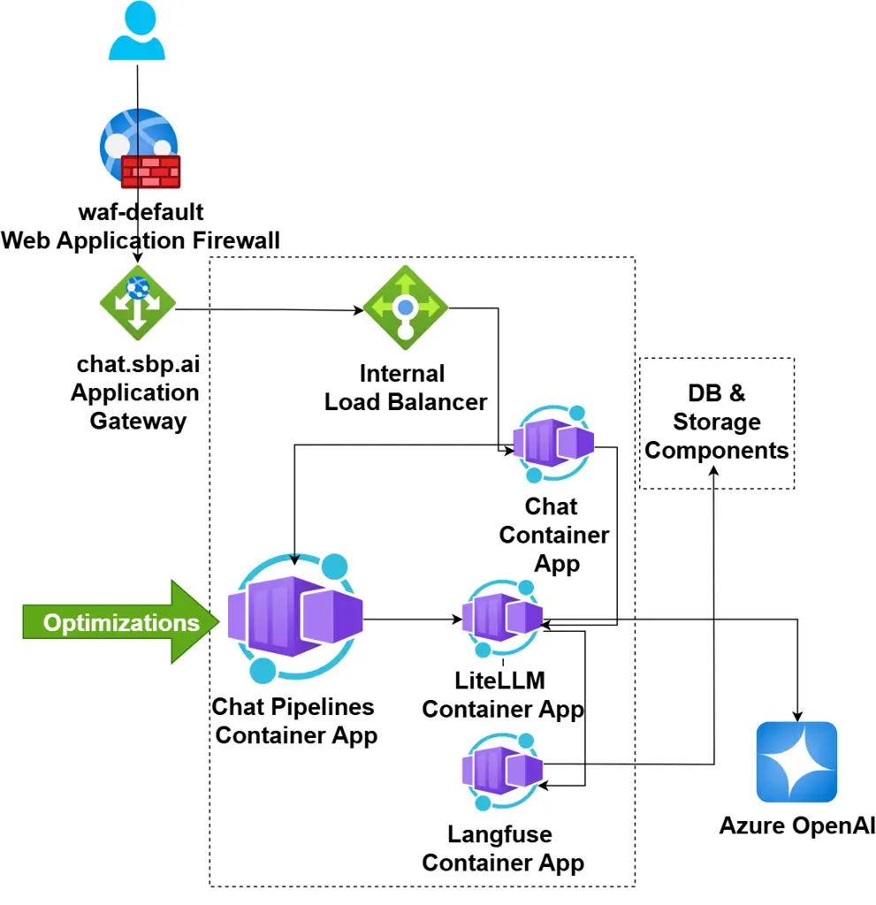
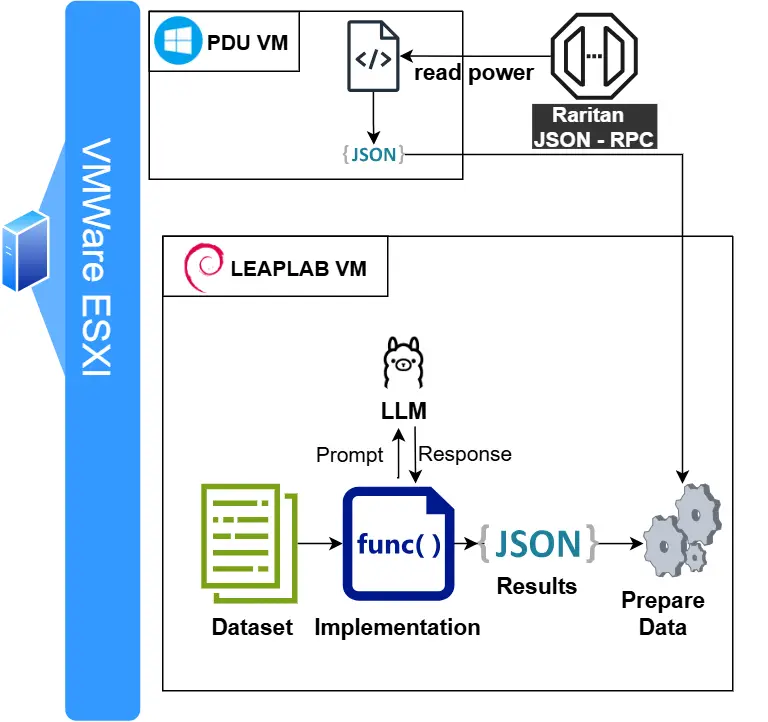
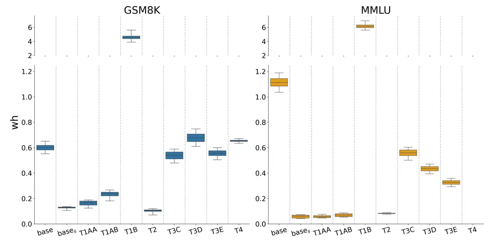
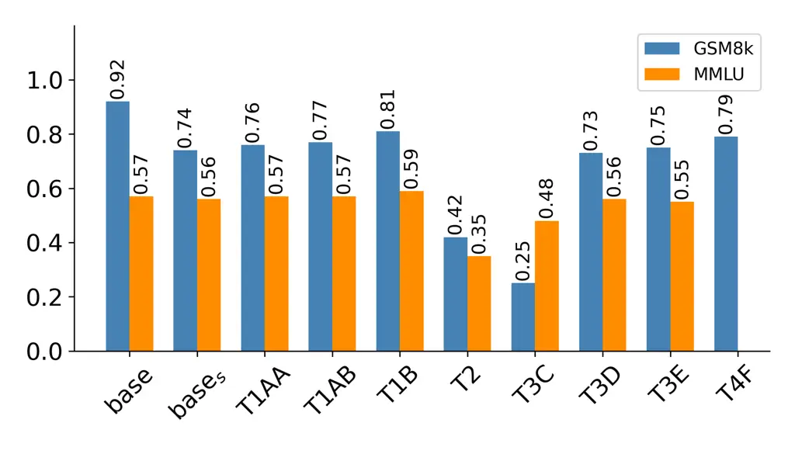
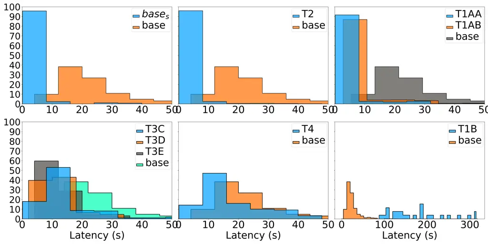
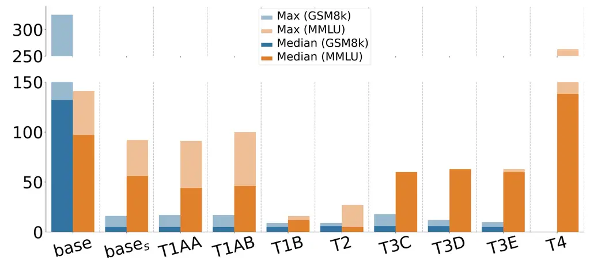
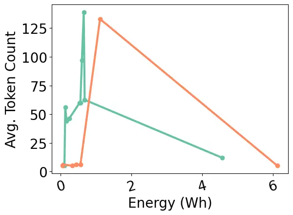
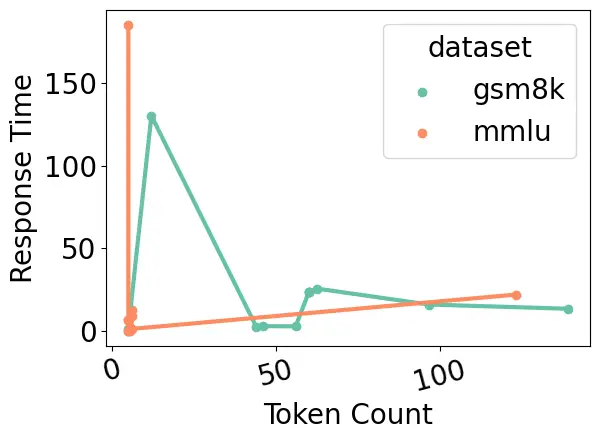
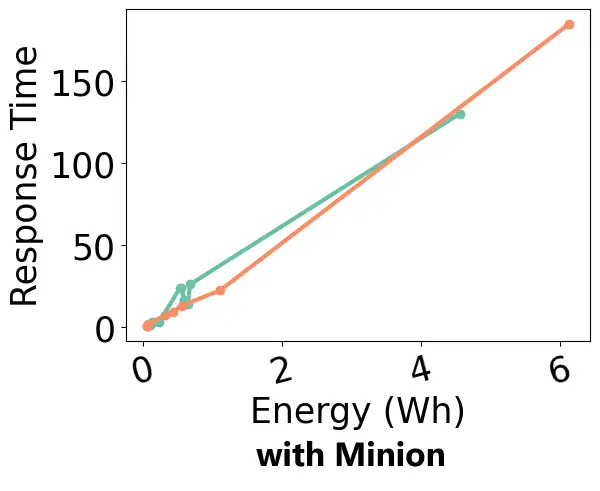
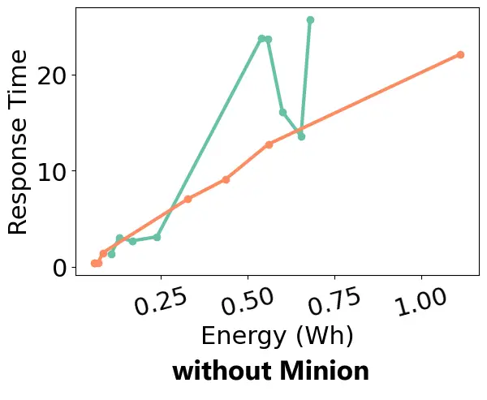

# Green LLM Techniques in Action: How Effective Are Existing Techniques for Improving the Energy Efficiency of LLM-Based Applications in Industry?

Conference: 2026 IEEE/ACM 48th International Conference on Software
Engineering; April 12–18, 2026; Rio de Janeiro, Brazil2026 IEEE/ACM 48th
International Conference on Software Engineering (ICSE-SEIP ’26), April
12–18, 2026, Rio de Janeiro,
BrazilDOI: [10.1145/3786583.3786896](https://doi.org/10.1145/3786583.3786896)ISBN: 979-8-4007-2426-8/2026/04CCS: Software
and its engineering Designing softwareCCS: Software and its
engineering Software performanceCCS: Computing methodologies Machine
learning

Pelin Rabia Kuran
[](https://orcid.org/0009-0006-0166-2569)
Affiliation: Vrije Universiteit Amsterdam, Amsterdam, The Netherlands
email: <pelinrkuran@gmail.com> , Rumbidzai Chitakunye
[](https://orcid.org/0000-0003-0165-5650)
Affiliation: Vrije Universiteit Amsterdam, Amsterdam, The Netherlands
email: <r.chitakunye@vu.nl> , Vincenzo Stoico
[](https://orcid.org/0000-0002-3681-372X)
Affiliation: Vrije Universiteit Amsterdam, Amsterdam, The Netherlands
email: <v.stoico@vu.nl> , Ilja Heitlager
[](https://orcid.org/0000-0002-6589-3730)
Affiliation: Schuberg Philis, Schiphol-Rijk, The Netherlands email:
<iheitlager@schubergphilis.com> and Justus Bogner
[](https://orcid.org/0000-0001-5788-0991)
Affiliation: Vrije Universiteit Amsterdam, Amsterdam, The Netherlands
email: <j.bogner@vu.nl>

© cc

###### Abstract.

The rapid adoption of large language models (LLMs) has raised concerns
about their substantial energy consumption, especially when deployed at
industry scale. While several techniques have been proposed to address
this, limited empirical evidence exists regarding the effectiveness of
applying them to LLM-based industry applications. To fill this gap, we
analyzed a chatbot application in an industrial context at Schuberg
Philis, a Dutch IT services company. We then selected four techniques,
namely Small and Large Model Collaboration, Prompt Optimization,
Quantization, and Batching, applied them to the application in eight
variations, and then conducted experiments to study their impact on
energy consumption, accuracy, and response time compared to the
unoptimized baseline.

Our results show that several techniques, such as Prompt Optimization
and 2-bit Quantization, managed to reduce energy use significantly,
sometimes by up to 90%. However, these techniques especially impacted
accuracy negatively, to a degree that is not acceptable in practice. The
only technique that achieved significant and strong energy reductions
without harming the other qualities substantially was Small and Large
Model Collaboration via Nvidia’s Prompt Task and Complexity Classifier
(NPCC) with prompt complexity thresholds. This highlights that reducing
the energy consumption of LLM-based applications is not difficult in
practice. However, improving their energy efficiency, i.e., reducing
energy use without harming other qualities, remains challenging. Our
study provides practical insights to move towards this goal.

###### Keywords: 

green ML engineering, LLM-based systems, energy consumption, latency,
accuracy, controlled experiment

^(†)^(†)cc-license: by

## 1. Introduction

Large language models (LLMs) have become increasingly integral to our
daily lives, facilitating a range of tasks from basic automation to
complex problem-solving (Chang et al., 2024). However, this development
comes with significant downsides, particularly in terms of their energy
consumption (Argerich and Patiño-Martínez, 2024). Besides the energy
consumption concerns, the widespread public use of online chatbot
applications such as ChatGPT and Gemini may raise data privacy and
security concerns for some organizations (Pankajakshan et al., 2024).
This may encourage these organizations to develop internal chatbot
systems that rely on publicly available LLMs within more controlled
environments.

An example of such an internal chatbot platform is ChatSBP, the
LLM-based application used as a case study object in this paper. ChatSBP
is developed by Schuberg Philis (SBP), an IT services company based in
the Netherlands focusing on building mission-critical software.¹¹ 1
https://schubergphilis.com It integrates state-of-the-art LLMs to
support a range of language-based tasks, from basic text correction to
complex problem solving. While these capabilities offer substantial
utility, the increasing usage of ChatSBP not only starts to add
substantial costs but also fuels existing concerns regarding the
environmental impact of SBP and similar LLM-using companies.

As awareness of energy consumption and carbon emissions grows,
optimizing LLM inference for sustainability has become a key
concern (Adamska et al., 2025). In response, reusable green techniques
have started to emerge (Järvenpää et al., 2024), such as model
quantization (Ma et al., 2025), batching (Yarally et al., 2023), prompt
optimization (Agarwal et al., 2024), and large and small model
collaborations (Narayan et al., 2025). However, especially for
real-world LLM-based applications, the applicability, effectiveness, and
trade-offs of these techniques, e.g., regarding response time and
accuracy, remain insufficiently examined (Argerich and Patiño-Martínez,
2024; Poddar et al., 2025).

In this case study, we therefore investigated the practical
effectiveness of selected energy optimization techniques when applied to
an LLM-based industrial chatbot application (ChatSBP). Specifically, we
analyzed how effective four existing energy optimization techniques in
several configurations are in reducing energy consumption and what
potential trade-offs exist regarding accuracy and latency, two crucial
quality concerns in most industrial settings. We accomplished this by
individually applying the techniques to ChatSBP to create several
variants and then ran controlled experiments on each variant and the
unoptimized baseline application in SBP’s industrial experiment
environment.

## 2. Related Work

LLMs have shown growing capabilities in various domains (Chang et al.,
2024), most notably in software engineering (Hou et al., 2024). However,
their continuous growth in size also contributes to increased use of
computational resources and energy. Research has shown that larger
models also consume more energy (Geens et al., 2024; Argerich and
Patiño-Martínez, 2024; Stojkovic et al., 2025; Khan et al., 2025; Rubei
et al., 2025; Kaushik et al., 2025). In an effort to promote green
artificial intelligence (AI), i.e., AI that is accurate, environmentally
friendly, and inclusive (Schwartz et al., 2020), researchers have
explored different optimization techniques to find favorable trade-offs
between energy consumption and accuracy (Stojkovic et al., 2025; Geens
et al., 2024; Argerich and Patiño-Martínez, 2024; Rubei et al., 2025).
Most research has focused on the training phase, although previous
studies have shown that more energy is consumed during inference at
scale (Argerich and Patiño-Martínez, 2024; Chien et al., 2023). We
describe selected studies looking at individual optimization techniques
for LLM inference below.

Small language models (SLMs) rely on reduced size compared to LLMs, as
their parameter count ranges only from millions to a few billions. Their
size makes them ideal for execution on resource-constrained devices, but
they may struggle to match the accuracy of LLMs (Wang et al., 2024).
Literature focuses on investigating how SLMs can be used while keeping
acceptable levels of accuracy and maintaining their lower resource
usage. For example, Kavathekar et al. (2025) studied the ability of SLMs
to generate function calls using zero- and few-shot prompting as well as
fine-tuning. They evaluated the accuracy, robustness to prompt
injection, and resource usage of multiple SLMs. Fine-tuned models
outperformed zero- and few-shot counterparts significantly. For example,
Phi-2 achieved 62.4% accuracy server-side and maintained reasonable
latency on edge devices ($`\sim`$140s). Despite the analysis of SLMs
resource usage, the work misses a discussion of their energy usage,
which we add in our study. In a similar study, Durán et al. (2024)
executed a controlled experiment on SLMs with a total of 600 inference
requests across 12 different models and 5 configurations, such as the
baseline ⟨TORCH, CUDA⟩ setup. They evaluated energy usage, execution
time, and resource usage, namely CPU, memory, and GPU usage. The results
showed that the chosen configuration has significant impact on energy
and execution time. Specifically, the configurations using CUDA
consistently reduced energy use and inference time. While their study
provides valuable insights about the green deployment of SLMs, their
testbed is largely a controlled experimental setup rather than a
real-world application. In contrast, our study takes a system
perspective and integrates SLMs into an industrial application, ChatSBP,
deployed at Schuberg Philis.

Another promising technique is the batching of inference requests. For
example, Argerich and Patiño-Martínez (2024) showed that batching can
maximize resource utilization and reduce energy consumption. Their study
evaluated the impact of model architectures and sizes as well as batch
sizes and quantization on the energy usage of 15 LLMs. The results
showed that maximizing batch size reduced the energy usage of all models
by up to 20 times, while it could increase GPU usage to its full
capacity. The strength of the energy reduction depended on the LLM
architecture. Similarly, Walkowiak (2025) implemented continuous
batching in text generation to study the effect of batch sizes on energy
consumption. Results indicate that batch sizes from 1 to 150 reduced
energy use, although they negatively affected response time.

Another proposed technique is prompt-level optimization, which entails
crafting more precise and context-aware prompts, making it possible to
obtain higher quality responses while saving other resources like time
or computation (Marvin et al., 2024; Agarwal et al., 2024; Adamska et
al., 2025). As a concrete example, Agarwal et al. (2024) introduced the
PromptWizard framework to improve task performance. PromptWizard
automates prompt optimization by using feedback-driven critique to
refine prompts and in-context examples. Trying a different angle, Rubei
et al. (2025) investigated to what extent custom tags in prompts reduce
energy consumption during inference. They compared three different
prompt engineering techniques implemented with and without custom tags.
Their results indicate that the use of custom tags in all three prompt
engineering techniques reduced LLM energy consumption. Both studies were
limited to prompt engineering with a focus on optimizing and improving
existing techniques.

Quantization reduces model size and computational demands by
representing the weights and activations with fewer bits (Argerich and
Patiño-Martínez, 2024). For example, Geens et al. (2024) implemented
weight-only quantization by comparing the two techniques W4A16 and
W1A32. Their results indicate that weight-only quantization can reduce
both energy consumption and latency. Similarly, Husom et al. (2025)
investigated the effect of quantization on energy consumption, inference
speed, and trade-offs between accuracy and energy use across different
quantization levels during LLM edge inference. Their findings showed
that quantization had notable positive impacts on both energy
consumption and inference latency, with heavy dependence on the concrete
task. Despite the empirical evidence of reduced energy consumption in
both studies, the studies were implemented on an experimental basis and
focused only on quantization.

In summary, the studies by Khan et al. (2025) and Argerich and
Patiño-Martínez (2024) exhibit some similarities with our research by
considering more than one optimization technique. Khan et al. (2025)
used post-quantization and local inference techniques to reduce the
energy consumption of an LLM by 45%. Argerich and Patiño-Martínez (2024)
measured how the size, architecture, batch size, and weight quantization
of the model affect the energy consumption and latency of LLM text
generation. Each of these studies focused on one task, thus lacking task
variety when evaluating their optimization techniques. Additionally, the
experiments conducted in both studies do not focus on the trade-offs of
reduced energy consumption and other quality attributes. Finally,
neither study takes a pronounced system perspective and applies the
techniques to real-world applications. To fill the mentioned gaps, we
apply a variety of optimization techniques to an existing industry
application to provide detailed insights into their practicality in the
real world and to investigate the trade-offs between energy consumption
and other quality attributes, specifically response time and accuracy.

## 3. Study Design

To start closing the described research gap, we formed an
academia-industry collaboration between VU Amsterdam and Schuberg Philis
(SBP)²² 2 [https://schubergphilis.com](https://schubergphilis.com), a
Dutch software & IT services company with about 450 employees. SBP
focuses on mission-critical IT systems and has a strong commitment to
digital sustainability.³³ 3
[https://schubergphilis.com/our-esg-sustainability-commitment](https://schubergphilis.com/our-esg-sustainability-commitment)
Identifying effective techniques to improve the energy efficiency of
their internal applications is therefore not only an attractive means to
save costs but a matter of principle.

Together, we designed and executed a case study (Runeson and Höst, 2009)
using ChatSBP as the central object of our investigation. We first
studied the architecture and technologies of ChatSBP and then
identified, discussed, and selected a set of green techniques to improve
the energy efficiency of ChatSBP. Finally, we conducted controlled
experimentation (Wohlin et al., 2024) to collect quantitative evidence
on the different versions of the application in the Leaplab at SBP, an
industrial experiment environment with hardware-based energy
measurement.

Our study was guided by the following research questions:

1.  RQ1:
    How effective are proposed optimization techniques in reducing the
    energy consumption of industrial LLM-based applications?
2.  RQ2:
    What are the trade-offs of the selected techniques with other
    quality attributes?

With RQ1, we wanted to investigate the real-world effectiveness of the
selected green techniques by measuring energy consumption before and
after implementing them. The objective is to assess whether these
techniques lead to tangible sustainability benefits when evaluated under
realistic application requirements. With RQ2, we explored the trade-offs
of the applied energy optimization techniques in terms of two important
quality attributes: response time and accuracy. Both of these are very
important for chatbot applications in industry, i.e., even if a
technique is effective in reducing energy consumption, it may not be
suitable for many application scenarios if it hurts accuracy and
response time substantially. Lastly, we also studied how the techniques
impacted the LLM output token counts, as this attribute is related to
costs but is also sometimes used as a predictor for response time and
energy consumption if direct measurements are not possible.

### 3.1. Case Study Object: ChatSBP

ChatSBP is the internal chatbot application used at SBP, which provides
a customized environment for using LLMs, including fine-tuned models.
Through a web user interface, SBP employees may select any of the LLMs
that the company currently offers for assistance with coding for
software development and any other tasks.⁴⁴ 4
[https://schubergphilis.com/stories/ai-and-automation](https://schubergphilis.com/stories/ai-and-automation)
The software architecture of ChatSBP consists of a dockerized web
application built on top of OpenWebUI.⁵⁵ 5
[https://github.com/open-webui/open-webui](https://github.com/open-webui/open-webui)
The application usually runs on cloud infrastructure of Microsoft Azure
⁶⁶ 6 [https://azure.microsoft.com](https://azure.microsoft.com) behind a
firewall and a load balancer. The core software architecture comprises
four components relevant to LLM inference (see Fig. 1):

- •
  Chat Container App: Frontend component where users submit their
  prompts.
- •
  Chat Pipelines Container App: Manages application logic and workflows.
  Each pipeline processes user inputs and generates outputs in a
  predefined order. Energy optimization techniques are incorporated into
  the software through this container, with each technique implemented
  as a new pipeline
- •
  Database: Stores chat history.
- •
  Azure OpenAI: Serves as the LLM inference endpoint, processing user
  prompts and generating responses.



Figure 1. ChatSBP Software Architecture and the Target of Our
Optimizations

In the production instance, LLM inference is managed externally by the
Azure OpenAI API. Therefore, we could not directly measure energy
consumption within this virtualized cloud environment. To obtain
reliable energy measurements, we deployed all versions of the
application in the local experiment environment of SBP, the Leaplab,
which enables direct power monitoring through dedicated hardware
instrumentation. We applied all optimizations to the Chat Pipelines
Container App, which was the only modified component. All other
components remained in their original state.

|                                                             |                                                                                                                                                                                                                             |                                                                                              |
| ----------------------------------------------------------- | --------------------------------------------------------------------------------------------------------------------------------------------------------------------------------------------------------------------------- | -------------------------------------------------------------------------------------------- |
| Technique                                                   | Description and Rationale                                                                                                                                                                                                   | Implementation Variations                                                                    |
| T1: Small and Large LM Collaboration (Narayan et al., 2025) | Route suitably simple prompts to a smaller, local LM instead of to the default energy-hungry LLM                                                                                                                            | T1AA: NPCC 0.6 T1AB: NPCC 0.3 T1B: Minion                                                    |
| T2: Prompt Optimization (Agarwal et al., 2024)              | Make prompts clearer and more concise to reduce the token count and therefore the latency and ideally the energy use                                                                                                        | PromptWizard                                                                                 |
| T3: Quantization (Poddar et al., 2025)                      | Reduce the precision of how model weights are represented to a smaller number of bits, which is computationally less demanding and therefore ideally requires less energy                                                   | T3C: 2-Bit Model (Phi-4 14B) T3D: 4-Bit Model (Phi-4 14B) T3E: 8-Bit Model (Phi-4-mini 3.8B) |
| T4: Batching (Argerich and Patiño-Martínez, 2024)           | Sending multiple, batched queries to the model instead of just a single one enables better parallelization and optimizes CPU/GPU utilization, which reduces latency per token and therefore ideally also energy consumption | T4: 2 queries per batch                                                                      |

Table 1. Selected Energy Optimization Techniques

### 3.2. Energy Optimization Techniques

Since there are many available green techniques for ML-enabled systems,
we followed a three-step approach to select a suitable number of
techniques for our study. First, we used the collection of techniques
described in Järvenpää et al. (2024) and more recent LLM-focused
publications (see the replication package for the complete list of
papers) to identify potential energy optimization techniques. Second, we
analyzed the software architecture of ChatSBP to understand technical
constraints and integration points. Finally, we formulated and applied a
set of inclusion and exclusion criteria to guide our selection based on
practical deployment requirements.

Inclusion Criteria: (i) the technique is compatible with the technology
stack of ChatSBP, (ii) the technique can be implemented with reasonable
effort, e.g., the implementation can be customized for another platform,
and (iii) the technique is promising to reduce the energy consumption of
the chat functionality, not of other system components.

Exclusion Criteria: (i) the technique introduces unsuitably high
computational complexity for a real-time chatbot application, and (ii)
the technique has no reusable implementation, which prevents
replicability and may create bias through a custom implementation.

One important argument from SBP was that token counts and the number of
API calls likely directly impact energy consumption but also cloud
provider costs (Microsoft Azure, 2025a; Microsoft Azure, 2025b).
Techniques that reduce token counts, the reliance on larger models, or
redundant requests were therefore prioritized. SBP colleagues also
highlighted potential inefficiencies that increase costs due to
unnecessary LLM calls, such as vague or open-ended prompts (“hello”,
“help”) or polite tokens (“please”, “thanks”). After thorough
discussion, we finally selected four energy optimization techniques (see
Table 1). The complete list of considered techniques can be found in our
replication package.⁷⁷ 7
[https://doi.org/10.5281/zenodo.16462531](https://doi.org/10.5281/zenodo.16462531)

First, Small and Large Language Model Collaboration (T1) emerged as an
attractive technique for ChatSBP. Smaller models can handle simple
queries locally, reducing unnecessary invocations of more energy-hungry
LLMs. Moreover, a decision layer that routes the query to either the
small or large model can be easily integrated into the Chat Pipelines
Container. We implemented three different T1 variants: two
implementations using Nvidia’s Prompt Task and Complexity Classifier
(NPCC) (NVIDIA NeMo Curator Team, ) with different complexity thresholds
(0.3 and 0.6) and one using the Minion framework (Narayan et al., 2025)
for language model collaboration with default parameters.

Second, Prompt Optimization (T2) improves accuracy, but there are also
indications that it could improve energy efficiency (Adamska et al.,
2025; Apsan et al., 2025). Especially for chatbot applications,
automatic prompt optimization is promising to minimize inefficient
queries, API calls, and token usage (Agarwal et al., 2024). To implement
this technique, we used the popular PromptWizard library⁸⁸ 8
[https://github.com/microsoft/PromptWizard](https://github.com/microsoft/PromptWizard)
from Microsoft with default parameters.

Third, Quantization (T3) represents the LLM weights and activations with
lower-precision data types (Argerich and Patiño-Martínez, 2024), usually
starting from 16 bits and going down to as low as 1 bit (Ma et al.,
2024). This increases their computational efficiency but may also reduce
accuracy. Nonetheless, quantized models often retain sufficient accuracy
to avoid larger models. Energy consumption is also reduced, but some
studies argue that quantization below 4 bits does not lead to
significant reductions (Argerich and Patiño-Martínez, 2024; Poddar et
al., 2025). However, recent research by Chee et al. (2023) implies
otherwise for 2-bit quantization. We therefore included three T3
variants: a 2-bit, 4-bit, and 8-bit LLM.

Lastly, Batching (T4) executes LLM inference for several prompts in
parallel (Poddar et al., 2025), which leads to better resource
utilization and ideally more energy efficiency. However, the concrete
impact of larger batch sizes on energy consumption is still
debated (Argerich and Patiño-Martínez, 2024; Yarally et al., 2023).
Since it is conveniently supported by most LLMs and easy to implement in
the Chat Pipelines Container, we therefore included batching with a
batch size of 2 queries.

### 3.3. Experimental Materials

#### 3.3.1. Language Models

To implement all ChatSBP variants, we needed one small LM, one large LM,
and the three quantized LMs. We decided to select all five models from
the same model family to allow a fairer comparison between the
treatments. For the small model, we chose Phi4-mini 3.8B, which
outperforms larger models like Llama 3.1 (Microsoft et al., 2025) and
offers a good compromise between size, energy use, and accuracy in
resource-limited settings. For the default large LM, we selected Phi4, a
GPT-like decoder-only model. Despite only having 14 billion parameters,
Phi4 showed strong benchmark performance, surpassing some
state-of-the-art models with up to 70 billion parameters (Abdin et al.,
2024). For the quantized models (2-bit, 4-bit, and 8-bit), we used
Unsloth-AI⁹⁹ 9 [https://unsloth.ai](https://unsloth.ai) as a popular
open provider for quantized models. The selected models were
Phi-4-GGUF¹⁰¹⁰ 10
[https://huggingface.co/unsloth/phi-4-GGUF](https://huggingface.co/unsloth/phi-4-GGUF)
with the formats Q2_K and Q4_K_M and Phi-4-mini-instruct-GGUF¹¹¹¹ 11
[https://huggingface.co/unsloth/Phi-4-mini-instruct-GGUF](https://huggingface.co/unsloth/Phi-4-mini-instruct-GGUF)
with the format Q8_0. We included the Phi-4-mini (base_s) model in this
study due to hardware limitations, as we could not run the 8-bit
quantized version of the full Phi-4 model on our system. Additionally,
we wanted to observe the impact of increased quantization and gain
insights by comparing the small and large models in terms of the defined
quality attributes. For all models, temperature was set to 0 to have
deterministic responses for the experiment (Renze, 2024).

#### 3.3.2. Benchmark Datasets

Since SBP did not have a custom benchmark for queries relevant to their
work, we instead selected two different datasets for the experiment. The
goal was to include tasks that are very different from each other to
understand if technique effectiveness was dependent on specific task
types, but also to use tasks with some structural similarity to queries
used at SBP, despite not being from the same domain. For reasoning
tasks, we chose GSM8K (Grade School Math 8K) (Cobbe et al., 2021), which
includes solving arithmetic problems or word problems that combine
logical reasoning with mathematical operations. These difficult
exercises test the ability of a model to reason about and solve problems
requiring mathematical operations, logical thinking, and multi-step
inference. Additionally, for Q&A-oriented prompts, we selected MMLU
(Massive Multitask Language Understanding) (Hendrycks et al., ), one of
the most commonly used datasets to evaluate a model’s ability to
generate accurate and relevant answers to multiple-choice questions.



Figure 2. Experiment Infrastructure (Leaplab)

#### 3.3.3. Experiment Infrastructure

To have full control over the experiment environment, we used the
Leaplab at SBP instead of the Azure cloud environment of the production
instance (see Fig. 2). It uses a VMware ESXi hypervisor ¹²¹² 12
[https://www.vmware.com/products/cloud-infrastructure/vsphere](https://www.vmware.com/products/cloud-infrastructure/vsphere)
powered by an Intel(R) Xeon(R) Gold 6154 CPU @ 3.00 GHz server. Two
virtual machines were used: an experiment VM (Leaplab VM) and a Power
Distribution Unit VM (PDU-VM). The experiment VM ran as the only ESXi
workload and used a dedicated GPU. We used a PDU outlet for power
reading, which could be easily converted into energy consumption data
without 3rd-party tools. Each VM used separate PDU outlets to avoid
measurement interference between them. Energy consumption data was
accessed via the Raritan JSON-RPC API. The PDU-VM has 4 GB RAM and runs
on Windows Server 2019 Standard (64-bit). The Leaplab VM runs on Debian
12 with 32 GB of RAM and is equipped with an Nvidia A2 Tensor Core GPU
with 16 GB of RAM. Lastly, we used the Ollama framework¹³¹³ 13
[https://ollama.com](https://ollama.com) v0.6.6 to deploy the LLMs for
the experiments.

### 3.4. Experiment Design and Execution

As independent variables, our experiment included the optimization
techniques with all implementation variations (8 in total as displayed
in Table 1, plus a not optimized baseline) and the two different
benchmark datasets (GSM8k and MMLU). Our dependent variables consisted
of the energy consumption of the system (Wh), accuracy, response time
(ms), and output token count. We measured the energy consumption of the
system through Raritan / Server Technology Xerus™ PDU interface via a
JSON-RPC API.¹⁴¹⁴ 14
[https://help.raritan.com/json-rpc/4.3.0/index.html](https://help.raritan.com/json-rpc/4.3.0/index.html)
Accuracy is measured using a simple string matching algorithm, as the
questions from the benchmark datasets have a single correct answer.
Response time as an indicator for energy consumption in black box models
is debated. Some argue that longer response times in LLM-based systems
always mean higher energy usage (Adamska et al., 2025; Poddar et al.,
2025), while others disagree (Argerich and Patiño-Martínez, 2024).
Gathering both metrics in a controlled environment provides insight into
their relationship, but response time is also a valuable metric on its
own: techniques that increase response time too much may not be usable
in practice, particularly for chatbots. Lastly, output token count as
more of an explanatory variable is operationalized via the HuggingFace
AutoTokenizer class.¹⁵¹⁵ 15
[https://huggingface.co/docs/transformers/main/en/model_doc/auto#transformers.AutoTokenizer](https://huggingface.co/docs/transformers/main/en/model_doc/auto#transformers.AutoTokenizer)
Collecting output token counts increases the granularity of our
performance analysis and helps to get additional insights when trying to
interpret differences between techniques.

For evaluating the effect of optimization techniques on energy
consumption (RQ1), we formulated the following hypothesis pairs, where
$`e`$ denotes energy consumption, $`x`$ a specific technique, and
$`\mu^{e}_{x}`$ the median energy consumption for technique $`x`$:

```math
H^{x}_{0}:\mu^{e}_{x}\geq\mu^{e}_{\text{baseline}}
```

```math
H^{x}_{1}:\mu^{e}_{x}<\mu^{e}_{\text{baseline}}
```

For each evaluated technique, the null hypothesis was that the median
energy consumption of the system variant that implemented the technique
was greater than or equal to the energy consumption of the baseline
system. We used the median instead of the mean because we expected our
groups to be non-normally distributed. The alternative hypothesis then
was that median energy consumption of the technique was less than the
baseline. For RQ2, we relied on visual inspection and descriptive
statistics. Thus, no formal hypotheses were formulated.

With both independent variables as factors, we used a full factorial
design (Wohlin et al., 2024) to establish the experiment configurations.
This led to 8 technique implementations plus a baseline, i.e., 9 system
variations $`\times`$ 2 datasets = 18 experiment configurations. Before
executing the experiment, non-essential background processes were
terminated to minimize potential measurement impact on dependent
variables. For additional measurement reliability, each of the 18
experiment configurations was iterated 5 times, leading to a total of 90
experiment trials. To allow the experiment environment to return closer
to the initial temperature, we also introduced a cool-down period of
five minutes between each trial. Additionally, the scheduling of
treatment trials was randomized to avoid the potential short-lived
confounders that disproportionately affected a single treatment.
Finishing all 90 trials took roughly 24 hours.

### 3.5. Data Analysis

For statistical evaluation, we first checked whether the data followed a
normal distribution using Q-Q plots for graphical evaluation (Loy et
al., 2016) and the Shapiro-Wilk test for statistical evaluation (Shapiro
and Wilk, 1965). A deviation from the expected diagonal in the Q-Q plots
and p-values below 0.05 in the Shapiro-Wilk test indicated non-normality
in the results. We also used boxplots and descriptive statistics to
understand the differences between treatments better. We observed a
non-normal distribution in our groups and therefore used a
non-parametric method for hypothesis testing, namely the Mann-Whitney U
test (McKnight and Najab, 2010), to compare energy consumption between
baseline and treatment groups, separately for each dataset. A one-sided
test was chosen to detect if a technique led to a significant decrease.
Before hypothesis testing, we applied the interquartile range (IQR)
method with the default 1.5 factor to filter out potential outliers from
the energy consumption data (Vinutha et al., 2018). This mitigated the
influence of potential extreme values occurring due to unwanted side
effects in the experiment environment, which may skew the results,
making visualizations more difficult to interpret. Since we conducted 18
hypothesis tests in total, we applied the Holm-Bonferroni correction to
adjust p-values and control the family-wise error rate (Weisstein,
2004). Lastly, we calculated effect sizes via the non-parametric Cliff’s
$`\delta`$ to assess the strength of significant effects (Macbeth et
al., 2011).



Figure 3. Energy Consumption per Prompt in Wh for Each Treatment (base:
Phi4, base\_(s): Phi4-mini (only compared to T3E), T1AA: NPCC 0.6, T1AB:
NPCC 0.3, T1B: Minion, T2: PromptWizard, T3C: 2-bit Quant., T3D: 4-bit
Quant., T3E: 8-bit Quant., T4: Batching with size 2)

## 4. Results

In this section, we present the study results structured by the research
questions. For transparency and replicability, we share all artifacts,
datasets, codebases, and experiment data on Zenodo.⁷

|         |               |      |       |      |        |      |
| ------- | ------------- | ---- | ----- | ---- | ------ | ---- |
| Dataset | Technique     | Mean | STD   | Min  | Median | Max  |
| GSM8k   | T1AA          | 0.16 | 0.02  | 0.11 | 0.16   | 0.20 |
|         | T1AB          | 0.23 | 0.02  | 0.16 | 0.23   | 0.30 |
|         | T1B           | 4.56 | 0.26  | 3.75 | 4.55   | 5.40 |
|         | T2            | 0.10 | 0.003 | 0.07 | 0.10   | 0.13 |
|         | T3C           | 0.53 | 0.04  | 0.44 | 0.53   | 0.65 |
|         | T3D           | 0.67 | 0.04  | 0.56 | 0.67   | 0.80 |
|         | T3E           | 0.56 | 0.03  | 0.49 | 0.55   | 0.63 |
|         | T4            | 0.65 | 0.008 | 0.63 | 0.65   | 0.67 |
|         | baseline      | 0.59 | 0.02  | 0.51 | 0.59   | 0.68 |
|         | baseline\_(s) | 0.13 | 0.005 | 0.11 | 0.13   | 0.14 |
| MMLU    | T1AA          | 0.05 | 0.01  | 0.04 | 0.05   | 0.08 |
|         | T1AB          | 0.07 | 0.01  | 0.05 | 0.06   | 0.11 |
|         | T1B           | 6.13 | 0.27  | 5.28 | 6.12   | 7.00 |
|         | T2            | 0.08 | 0.003 | 0.07 | 0.08   | 0.09 |
|         | T3C           | 0.55 | 0.03  | 0.46 | 0.55   | 0.65 |
|         | T3D           | 0.43 | 0.02  | 0.35 | 0.43   | 0.51 |
|         | T3E           | 0.32 | 0.02  | 0.26 | 0.32   | 0.38 |
|         | T4            | –    | –     | –    | –      | –    |
|         | baseline      | 1.11 | 0.05  | 0.98 | 1.11   | 1.25 |
|         | baseline\_(s) | 0.06 | 0.01  | 0.04 | 0.06   | 0.08 |

Table 2. Descriptive Statistics for Energy Consumption (Wh) per Prompt
and Experiment Configuration (baseline\_(s): Phi4-mini, only compared to
T3E; T4 MMLU missing due to hardware constraints)

### 4.1. Reducing Energy Consumption (RQ1)

With RQ1, we wanted to study how effective the eight technique
variations were in reducing energy consumption compared to the
unoptimized baseline. We show the energy consumption distribution for
the baseline and each selected technique separately for each dataset in
Fig. 3. Additionally, we present the respective descriptive statistics
in Table 2. Averaged per prompt, mean energy consumption ranged roughly
from 0.1 Wh to 6 Wh, which suggests substantial differences between
experiment configurations. Compared to the baseline, several techniques
achieved a visible energy reduction in both benchmarks, namely the two
NPCC configurations (T1AA and T1AB), PromptWizard (T2), and 2-bit
quantization (T3C). Other techniques like 4-bit quantization (T3D) were
only successful with the MMLU dataset. Lastly, Minion (T1B), batching
(T4), and 8-bit quantization (T3E), which was compared to the small
base\_(s), were not able to lower energy consumption at all, with T1B
even leading to a substantial increase. For batching (T4) with the MMLU
dataset, our hardware setup could not handle the context length of two
combined prompts (see Section 3.3.3), which is why Table 2 shows dashes
instead of statistics in that row.

We used the Mann-Whitney U test to confirm if these observed differences
to the baseline were statistically significant. Table 3 presents the
test results with Holm-Bonferroni-corrected p-values, effect sizes, and
percentage differences of the medians. The most impactful energy
reductions were observed for T1AA, T1AB, T2, and T3C, which were
statistically significant in both datasets and showed large effect sizes
(Cliff’s $`\delta`$ between 0.77 and 1.0), indicating substantial energy
savings compared to the baseline. Especially techniques like
PromptWizard (T2) and NPCC configurations (T1AA and T1AB) achieved
reductions of at least 60% on the reasoning dataset (GSM8k) and at least
92% on the Q&A dataset (MMLU).

In terms of individual techniques, the impact of the Small and Large LM
Collaboration technique (T1) was strongly dependent on the concrete
implementation variation. Minion (T1B) substantially increased energy
consumption in both datasets by more than 450%, which was mostly due to
several message exchanges between the small and the large model and
several cases of excessive token generation by the small model. However,
the NPCC variations were among the most effective reduction techniques.
Using a prompt complexity threshold of 0.6 (T1AA) resulted in slightly
lower energy consumption compared to the 0.3 threshold of T1AB, e.g.,
median energy consumptions within GSM8k were 0.16 Wh vs. 0.23 Wh. A
higher threshold meant that the more energy-hungry LLM was called less
often. For the reasoning dataset (GSM8k), the smaller model was used 72%
of the time with T1AB, while this increased to 86% with T1AA. For the
Q&A dataset (MMLU), the smaller model was used approximately 98% of the
time in both T1AA and T1AB, which explains why the median energy
consumption was much closer this time (0.05 Wh vs. 0.06 Wh), but also
why the NPCC techniques were even more effective within MMLU compared to
GSM8k.

The Prompt Optimization technique (T2) via PromptWizard achieved the
highest average energy reductions across both datasets, with 82% for
GSM8k (the highest) and 92.5% for MMLU (the 3rd highest, but the first
three were very close together with 92.5% to 93.7%). It also had the
lowest median (0.10 Wh) and maximum (0.13 Wh) energy consumption per
prompt for the more complex GSM8k dataset, which further demonstrates
its effectiveness.

|         |           |            |                    |                   |
| ------- | --------- | ---------- | ------------------ | ----------------- |
| Dataset | Technique | p-value    | Cliff’s $`\delta`$ | Percentage Change |
| GSM8k   | T1AA      | $`<0.001`$ | 1.00               | -72.1%            |
|         | T1AB      | $`<0.001`$ | 1.00               | -60.0%            |
|         | T1B       | $`1.0`$    | –                  | 660.1%            |
|         | T2        | $`<0.001`$ | 1.00               | -82.0%            |
|         | T3C       | $`<0.001`$ | 0.77               | -9.9%             |
|         | T3D       | $`1.0`$    | –                  | 13.3%             |
|         | T3E       | $`1.0`$    | –                  | 327.0%            |
|         | T4        | $`1.0`$    | –                  | 9.16%             |
| MMLU    | T1AA      | $`<0.001`$ | 1.00               | -94.8%            |
|         | T1AB      | $`<0.001`$ | 1.00               | -93.7%            |
|         | T1B       | $`1.0`$    | –                  | 450.1%            |
|         | T2        | $`<0.001`$ | 1.00               | -92.5%            |
|         | T3C       | $`<0.001`$ | 1.00               | -49.7%            |
|         | T3D       | $`<0.001`$ | 1.00               | -60.8%            |
|         | T3E       | $`1.0`$    | –                  | 429.1%            |
|         | T4        | –          | –                  | –                 |

Table 3. Energy Consumption Baseline Comparisons via Mann-Whitney U
Tests (Holm-Bonferroni-corrected p-values, significant effect sizes via
Cliff’s $`\delta`$, median percentage differences)

The results for Quantization (T3) were more nuanced. The base model was
a 4-bit quantized Phi-4 model loaded through Ollama and for comparison,
we also evaluated a 4-bit quantized version of the same model obtained
from Unsloth as mentioned above. Despite both models using the same
quantization scheme, potentially due to differences in architecture and
core features, the measured energy consumption differed between the two.
Unfortunately, we were unable to run the 8-bit precision Phi4 model on
our hardware due to hardware limitations. Therefore, we substituted it
with the smaller 8-bit Phi-4-mini model. To allow a fairer baseline
comparison, we used the standard Phi-4-mini model without quantization
as a second smaller baseline (baseline*(s)). Overall, T3 was not very
successful in reducing energy consumption for the reasoning tasks
(GSM8k). While the approximately 10% reduction in median energy
consumption of the 2-bit quantization (T3C) is statistically significant
with a Cliff’s $`\delta`$ of 0.75, both 4-bit (T3D) and 8-bit
quantization (T3E), with the latter being compared to baseline*(s),
actually increased energy consumption. It is possible that the
complexity of these reasoning tasks is not well-suited to using
quantization for energy optimizations. However, for the Q&A tasks
(MMLU), both 2-bit and 4-bit quantization showed significant and large
energy reductions (Cliff’s $`\delta`$ of 1.0), with around 50% and 60%
respectively. Only 8-bit quantization (T3E) led again to major increases
in energy consumption compared to the smaller baseline\_(s) (around
430%).

Lastly, Batching (T4) was one of the most challenging methods to
implement due to the hardware limitations of the Leaplab. While we were
able to use a batch size of 2 for the reasoning dataset (GSM8k), the
input sequences for the Q&A dataset (MMLU) were too long to allow
batching with the available hardware. We therefore performed the
analysis only for GSM8k. For this dataset, the technique was not
effective but even increased energy consumption by approximately 9%. A
potential reason may be that the average GPU utilization only increased
slightly from 95.5% to 96.88%. It is possible that the technique would
have been more impactful with lower GPU utilization in the baseline or
larger batch sizes, which our hardware did not allow.

### 4.2. Trade-Offs With Other QAs (RQ2)

For RQ2, we wanted to understand how the techniques impacted the
important QAs accuracy and response time and which role the output token
count played in these relationships.

#### 4.2.1. Accuracy

We show the accuracy per experiment configuration and dataset in Fig. 4.
Overall, all techniques led to at least some accuracy drops for the
GSM8k reasoning dataset (some of them substantial), while the reductions
were less pronounced for the Q&A tasks (MMLU). Notably, PromptWizard
(T2), which was one of the most effective techniques to reduce energy
consumption, also led to a substantial reduction of accuracy in both
datasets. Compared to the baseline, accuracy dropped from 0.92 to 0.42
for GSM8k and from 0.57 to 0.35 for MMLU. A similar effect is visible
for 2-bit Quantization (T3C), where accuracy dropped to 0.25 (GSM8k) and
0.48 (MMLU). Conversely, Minion (T1B), which had by far the largest
negative impact on energy consumption, achieved the best accuracy
results of all techniques, namely 0.81 for GSM8k and 0.59 for MMLU,
which even improved the baseline by 0.02. However, the NPCC
configurations (T1AA and T1AB), which were also among the most effective
energy reduction techniques, had only slight drops in accuracy for GSM8k
(0.76 and 0.77) and remarkably no accuracy reduction for MMLU (0.57),
underlining their practical Green AI relevance. Lastly, decreases in
accuracy were also less pronounced for 4-bit (T3D) and 8-bit
quantization (T3E) as well as batching (T4), but these techniques were
also not effective in reducing energy consumption.



Figure 4. Accuracy on GSM8k and MMLU Datasets (base\_(s): Phi4-mini, only
compared to T3E)

#### 4.2.2. Response Time

We show the distribution of response time for the various techniques
compared to the baseline in Fig. 5 and the respective descriptive
statistics in Table 4. Most of the treatments substantially reduced the
response time and concentrated the distribution around lower values. For
example, PromptWizard (T2) showed a sharp shift toward near-zero
response time (median of 1.28 s for GSM8k), outperforming the baseline
where response times spread over a much wider range (median of 15.75 s).
Similarly, NPCC 0.3 (T1AA) and NPCC 0.6 (T1AB) showed improved response
time distributions compared to the baseline. For the three quantization
techniques (T3C, T3D, T3E), we observe slightly left-shifted or almost
the same distributions compared to the baseline. However, these
techniques only had lower median response times in the MMLU benchmark,
not for GSM8k. Batching (T4) managed to slightly reduce median response
times compared to the baseline (from 15.75 to 13.35 s). Finally, the
Minion technique (T1B) caused a substantial response time increase, with
most of its distribution falling between 100 and 300 s per request.



Figure 5. Response Time Distribution (s) per Experiment Configuration
for Both Datasets Combined

|         |               |       |       |       |        |       |
| ------- | ------------- | ----- | ----- | ----- | ------ | ----- |
| Dataset | Technique     | Mean  | STD   | Min   | Median | Max   |
| GSM8k   | T1AA          | 3.25  | 2.06  | 0.42  | 2.60   | 10.63 |
|         | T1AB          | 3.81  | 3.12  | 0.42  | 2.64   | 15.00 |
|         | T1B           | 137.8 | 42.8  | 93.7  | 126    | 234.4 |
|         | T2            | 1.62  | 0.89  | 0.99  | 1.28   | 4.46  |
|         | T3C           | 24.33 | 0.89  | 23.49 | 23.87  | 25.79 |
|         | T3D           | 25.51 | 2.16  | 20.66 | 25.74  | 28.26 |
|         | T3E           | 18.05 | 10.88 | 1.05  | 23.70  | 28.26 |
|         | T4            | 16.43 | 8.73  | 5.18  | 13.35  | 36.88 |
|         | baseline      | 17.00 | 7.13  | 4.52  | 15.75  | 36.76 |
|         | baseline\_(s) | 3.07  | 1.67  | 0.12  | 2.88   | 7.33  |
| MMLU    | T1AA          | 0.45  | 0.24  | 0.22  | 0.34   | 1.30  |
|         | T1AB          | 0.44  | 0.23  | 0.22  | 0.34   | 1.27  |
|         | T1B           | 199   | 71.4  | 97.7  | 184.6  | 318.5 |
|         | T2            | 1.41  | 0.25  | 0.94  | 1.38   | 2.20  |
|         | T3C           | 13.23 | 6.00  | 6.26  | 11.93  | 32.93 |
|         | T3D           | 9.83  | 4.23  | 3.83  | 8.73   | 25.25 |
|         | T3E           | 7.35  | 4.58  | 0.99  | 6.49   | 23.06 |
|         | T4            | –     | –     | –     | –      | –     |
|         | baseline      | 29.91 | 24.62 | 3.76  | 21.77  | 105   |
|         | baseline\_(s) | 0.45  | 0.24  | 0.22  | 0.34   | 1.28  |

Table 4. Descriptive Statistics for Response Time per Prompt (s) and
Experiment Configuration (baseline\_(s): Phi4-mini, only compared to T3E)

#### 4.2.3. Output Token Count

As presented in Fig. 6, median and maximum output token counts varied
depending on dataset and treatment. Except for Batching (T4), which
naturally led to more tokens per prompt by combining queries, the
baseline had the highest token counts per prompt among all techniques.
While it exhibited similar median token counts for both datasets, most
techniques showed a substantially lower token count for the Q&A dataset
(MMLU). Moreover, not all techniques that reduced the token count of the
final answer compared to the baseline were also effective in reducing
the overall energy consumption of the system. For example, Minion (T1B),
as the most energy-consuming treatment, produced the shortest final
answer. However, during the interaction between the small and large
models, a large number of tokens were generated, which we did not
include in our analysis. Nonetheless, this underlines that token count
is not always a reliable proxy for energy consumption, especially not in
complex distributed systems with multiple communicating LLM components.



Figure 6. Max and Median Output Token Count Per Prompt

#### 4.2.4. Relationships Between Dependent Variables

Finally, we also analyzed the relationships between our dependent
variables for the studied system variations (see Fig. 7). Regarding
response time and energy consumption (bottom row), there first appears
to be a nearly linear relationship in both datasets. However, this
relationship is heavily skewed by the Minion (T1B) results. When we
remove T1B as an outlier (bottom right), we see contrasting patterns for
the two datasets. While the Q&A dataset (MMLU) continues to show a
nearly linear trend, the reasoning dataset (GSM8k) exhibits strong
fluctuations. This shows that response time is also not always a
reliable proxy for energy consumption, e.g., a technique that leads to
higher median response times, like T3C for GSM8k, can still consume
significantly less energy.

The relationship between response time and output token count (top
right) also exhibits distinct patterns for the two datasets. The Q&A
dataset (MMLU) mostly shows an increase in response time as the token
count rises, except for the mentioned Minion outlier. In contrast, the
graph for GSM8k is highly volatile, with significant peaks and drops in
response time even as the token count remains fairly similar. This makes
it challenging to establish a clear relationship between these two
quality attributes.

Lastly, the relationship between energy consumption and output token
count (top left) is similarly hard to characterize. In both datasets,
the graphs are fairly unpredictable, with several sudden peaks or drops,
or energy increasing while token count stays rather stable. This
reinforces our previous observation that token count is also not a fully
reliable predictor for energy reduction techniques in complex LLM-based
applications.

|                                                             |                                                              |     |
| ----------------------------------------------------------- | ------------------------------------------------------------ | --- |
|  |   |     |
|  |  |     |

Figure 7. Relationships between Output Token Count, Response Time, and
Energy Consumption

## 5. Discussion

In this section, we summarize the main findings and implications of our
research results for practitioners and researchers. When analyzing the
results for energy consumption, we found that some of the selected
optimizations, like the NPCC techniques, prompt optimization, or 2-bit
quantization, significantly reduced energy consumption, while others led
to a considerable increase. Specifically, we observed that the Minion
(T1B) technique was associated with the highest energy consumption and
response time. This outcome is primarily due to inefficient
communication between the small and large models, which requires at
least two rounds of communication for each iteration. Furthermore, we
observed that in some cases, the small model generated an excessive
number of tokens for tasks. For example, an input prompt consisting of
19 tokens made the small model generate more than 10,000 tokens for the
larger model, even when the temperature parameter was set to 0. Narayan
et al. (2025) mentioned similar issues as downsides of their technique,
but we observed that this also substantially increased energy
consumption. Based on these findings, it is important to limit the
number of tokens generated by the models and minimize the number of
communication rounds between them.

When considering accuracy and energy consumption together, Small and
Large Model Collaboration via the NPCC techniques (T1AA, T1AB) emerged
as the most energy-efficient optimization. While T1AA and T1AB achieved
significant energy reductions with large effects, they also reached the
third and fourth highest accuracy scores for GSM8k and even matched the
accuracy of the baseline on MMLU. This shows that dynamically using a
smaller model for appropriate queries does not have to lead to a
substantial decrease in system accuracy. We therefore recommend this
technique as a practical way to improve the energy efficiency of
LLM-based applications. One open question is how to find the ideal
prompt complexity threshold for specific prompt profiles. While we
included two thresholds in our study (0.3 and 0.6), conducting more
fine-grained experiments in this direction or providing actionable
guidance or tooling to help practitioners choose a threshold for their
application is a promising opportunity for future research.

Unfortunately, the results also imply that the assumed trade-off
relationship between accuracy and energy consumption still holds in many
cases, e.g., the treatments consuming the most energy, like Minion (T1B)
and the baseline, also had the highest accuracy scores. Additionally,
PromptWizard (T2) and 2-bit quantization (T3C) significantly and
strongly reduced energy usage but remain of limited practical use due to
their unacceptable reductions in accuracy. While PromptWizard was
effective at making prompts more efficient, key information was
sometimes removed, which led to a significant decrease in accuracy.
These findings highlight that the largest energy reductions are not
enough for industry usage.

Lastly, our results indicate that batching (T4) did not have a very
strong effect on any dependent variable but was also not an effective
technique to reduce energy consumption, as it even increased. However,
our hardware constraints only allowed a limited exploration of
implementation variations of this technique. GPU utilization as the
expected benefit of batching could not increase as expected, as it was
already operating above 95% utilization for the baseline. Accordingly,
the minor increase in GPU allocation was insufficient to reduce energy
consumption. This may imply that batching effectiveness for energy
optimization is highly dependent on available hardware resources and
baseline utilization levels.

Main Takeaways:  
   - Dynamically routing queries to a smaller model based on prompt
complexity can lower energy consumption without reducing accuracy for
many tasks (T1A). Large models are not always necessary.

- But: recurring communication between small and large models and
  excessive token generation increases both energy consumption and
  response times (T1B).
- Prompt optimization (T2) trades off accuracy for energy consumption,
  sometimes to an unacceptable degree.
- The success and effect of optimization techniques depend on both the
  dataset and the used hardware.
- While reducing the energy use of LLM-based applications is easy,
  optimizing energy efficiency remains difficult, i.e., reducing energy
  usage without harming other QAs.

## 6. Threats to Validity

This section discusses threats to the validity of this work according to
the categories introduced by Wohlin et al. (2024).

Internal Validity: Limitations in hardware resources could have
introduced flaws in the measurements. In fact, during experimentation
with batching configurations, we observed that memory limits were
exceeded for some prompts. We handled these cases with an exception
mechanism that helped mitigate the impact of invalid trials on the
results. Additionally, we repeated each trial five times. The execution
order of trials was randomized, and a five-minute cool-down period was
included between runs to dissipate accumulated energy and restore the
system state before the next execution. Moreover, our experimental
setting included a hypervisor, namely VMware ESXi, which could have
introduced some overhead in the energy measurement. We mitigated the
effect of such overhead on the energy values by measuring the whole
machine on which ChatSBP was deployed. Additionally, we ensured that the
testbed only ran ChatSBP and no other resource-intensive processes.
While these measures should have prevented major confounding factors in
the experiment environment, it is possible that minor random
fluctuations could have occurred. We are confident that this would not
have changed the conclusions of the analysis.

External Validity: The testbed of our experiment (LeapLab) did not fully
reflect the complexity of a real-world execution environment found in
large-scale industry deployments. One of the main limitations can be
found in the hardware resources, which could not run large-scale AI
workloads. Additionally, our study was executed for a single industry
case, ChatSBP, which does not represent the full landscape of AI-driven
industry tools. However, our investigation is meant to show the impact
of empirical software engineering in practice and to describe how it can
be applied in an industrial setting. Likewise, the selection of
optimization techniques was constrained by their suitability for ChatSBP
and their relevance to the specific problems faced by its employees.
Consequently, we cannot fully guarantee their applicability or relevance
in other contexts. Nevertheless, the addressed problem is recurrent in
modern AI-driven applications, where it is common to pre-process data
before sending it to an AI module deployed in the cloud. Lastly,
although the tasks included in the chosen datasets may not cover the
full range of complexities found in real-life industrial applications,
they were selected because they capture representative scenarios that
allow us to investigate whether the evaluated techniques have the
potential to improve the energy efficiency of ChatSBP.

Conclusion Validity: We selected appropriate statistical methods for
non-normally distributed data. We also applied the Holm-Bonferroni
correction (Weisstein, 2004) to minimize Type I errors due to multiple
comparisons. This further solidified the validity of our results.

## 7. Conclusion

In this study, we systematically evaluated the effectiveness of various
energy optimization techniques for an industrial chatbot application. By
implementing and analyzing techniques such as Small and Large Model
Collaboration, Prompt Optimization, Quantization, and Batching, we
demonstrated that the energy consumption of LLM-based applications can
be significantly reduced with most techniques. However, we also
highlighted the challenge of balancing the trade-offs between energy
consumption and other QAs, especially accuracy. While several effective
techniques like Prompt Optimization reduced accuracy to unacceptable
levels, Small and Large Model Collaboration via NPCC achieved
substantial reductions in energy usage while maintaining acceptable
accuracy scores and response time, making it a prime candidate for
industry adoption.

Our findings also highlighted limitations in both the technical
environment and the generalizability of results. The complexities of
industrial deployment, including hardware constraints, diverse workload
patterns, or even different models, may influence the impact of any
energy optimization technique. Thus, evaluation of optimization
techniques across a broader range of LLM architectures, application
domains, and production environments could provide further insights and
guidance and should be the target of future work. Many proposed
techniques, like optimizing energy-hungry prompt keywords (Adamska et
al., 2025) or using generation directives (Li et al., 2024), seem
promising and require additional research to understand potential
trade-offs better. Additionally, novel approaches, such as continuous
batching with more suitable hardware resources, could also provide
further insights regarding the impact of batching on energy efficiency.
Furthermore, an investigation into user experience metrics with absolute
real-world settings would also contribute to the practical adoption of
these energy optimization techniques. By carefully balancing energy
consumption with other QAs, the field can move closer to being more
energy-efficient. To support future studies and replications, we make
our artifacts available online.⁷

###### Acknowledgements.

We kindly thank Cornelis Mol for his support in improving the
visualizations of this study, which played an important role in making
the presentation more effective.

## References

- Abdin et al. (2024) M. Abdin, J. Aneja, H. Behl, S. Bubeck, R.
  Eldan, S. Gunasekar, M. Harrison, R. J. Hewett, M. Javaheripi, P.
  Kauffmann, J. R. Lee, Y. T. Lee, Y. Li, W. Liu, C. C. T. Mendes, A.
  Nguyen, E. Price, G. de Rosa, O. Saarikivi, A. Salim, S. Shah, X.
  Wang, R. Ward, Y. Wu, D. Yu, C. Zhang, and Y. Zhang Phi-4 technical
  report. External Links: 2412.08905,
  [Link](https://arxiv.org/abs/2412.08905) Cited by: §3.3.1.
- Adamska et al. (2025) M. Adamska, D. Smirnova, H. Nasiri, Z. Yu,
  and P. Garraghan Green prompting. External Links: 2503.10666,
  [Link](https://arxiv.org/abs/2503.10666) Cited by: §1, §2, §3.2, §3.4,
  §7.
- Agarwal et al. (2024) E. Agarwal, J. Singh, V. Dani, R. Magazine, T.
  Ganu, and A. Nambi PromptWizard: task-aware prompt optimization
  framework. External Links: 2405.18369,
  [Link](https://arxiv.org/abs/2405.18369) Cited by: §1, §2, §3.2, Table
  1.
- Apsan et al. (2025) R. Apsan, V. Stoico, M. Albonico, R. Dhar, K.
  Vaidhyanathan, and I. Malavolta Generating energy-efficient code via
  large-language models–where are we now?. arXiv preprint
  arXiv:2509.10099. Cited by: §3.2.
- Argerich and Patiño-Martínez (2024) M. F. Argerich and M.
  Patiño-Martínez Measuring and improving the energy efficiency of large
  language models inference. IEEE Access 12 (), pp. 80194–80207.
  External Links:
  [Document](https://dx.doi.org/10.1109/ACCESS.2024.3409745) Cited by:
  §1, §1, §2, §2, §2, §2, §3.2, §3.2, §3.4, Table 1.
- Chang et al. (2024) Y. Chang, X. Wang, J. Wang, Y. Wu, L. Yang, K.
  Zhu, H. Chen, X. Yi, C. Wang, Y. Wang, W. Ye, Y. Zhang, Y.
  Chang, P. S. Yu, Q. Yang, and X. Xie A Survey on Evaluation of Large
  Language Models. ACM Transactions on Intelligent Systems and
  Technology 15 (3), pp. 1–45 (en). External Links: ISSN 2157-6904,
  2157-6912, [Link](https://dl.acm.org/doi/10.1145/3641289),
  [Document](https://dx.doi.org/10.1145/3641289) Cited by: §1, §2.
- Chee et al. (2023) J. Chee, Y. Cai, V. Kuleshov, and C. M. De Sa QuIP:
  2-bit quantization of large language models with guarantees. In
  Advances in Neural Information Processing Systems, A. Oh, T.
  Naumann, A. Globerson, K. Saenko, M. Hardt, and S. Levine (Eds.), Vol.
  36, pp. 4396–4429. External Links:
  [Link](https://proceedings.neurips.cc/paper_files/paper/2023/file/0df38cd13520747e1e64e5b123a78ef8-Paper-Conference.pdf)
  Cited by: §3.2.
- Chien et al. (2023) A. A. Chien, L. Lin, H. Nguyen, V. Rao, T. Sharma,
  and R. Wijayawardana Reducing the carbon impact of generative ai
  inference (today and in 2035). In Proceedings of the 2nd Workshop on
  Sustainable Computer Systems, HotCarbon ’23, New York, NY, USA.
  External Links: ISBN 9798400702426,
  [Link](https://doi.org/10.1145/3604930.3605705),
  [Document](https://dx.doi.org/10.1145/3604930.3605705) Cited by: §2.
- Cobbe et al. (2021) K. Cobbe, V. Kosaraju, M. Bavarian, M. Chen, H.
  Jun, L. Kaiser, M. Plappert, J. Tworek, J. Hilton, R. Nakano, C.
  Hesse, and J. Schulman Training verifiers to solve math word problems.
  External Links: 2110.14168, [Link](https://arxiv.org/abs/2110.14168)
  Cited by: §3.3.2.
- Durán et al. (2024) F. Durán, M. Martinez, P. Lago, and S.
  Martínez-Fernández Energy consumption of code small language models
  serving with runtime engines and execution providers. arXiv preprint
  arXiv:2412.15441. Cited by: §2.
- Geens et al. (2024) R. Geens, M. Shi, A. Symons, C. Fang, and M.
  Verhelst Energy cost modelling for optimizing large language model
  inference on hardware accelerators. In 2024 IEEE 37th International
  System-on-Chip Conference (SOCC), Vol. , pp. 1–6. External Links:
  [Document](https://dx.doi.org/10.1109/SOCC62300.2024.10737844) Cited
  by: §2, §2.
- \[12\] D. Hendrycks, C. Burns, S. Basart, A. Zou, M. Mazeika, D. Song,
  and J. Steinhardt Measuring massive multitask language understanding.
  In International Conference on Learning Representations, Cited by:
  §3.3.2.
- Hou et al. (2024) X. Hou, Y. Zhao, Y. Liu, Z. Yang, K. Wang, L. Li, X.
  Luo, D. Lo, J. Grundy, and H. Wang Large Language Models for Software
  Engineering: A Systematic Literature Review. ACM Transactions on
  Software Engineering and Methodology, pp. 3695988 (en). External
  Links: ISSN 1049-331X, 1557-7392,
  [Link](https://dl.acm.org/doi/10.1145/3695988),
  [Document](https://dx.doi.org/10.1145/3695988) Cited by: §2.
- Husom et al. (2025) E. J. Husom, A. Goknil, M. Astekin, L. K. Shar, A.
  Kåsen, S. Sen, B. A. Mithassel, and A. Soylu Sustainable llm inference
  for edge ai: evaluating quantized llms for energy efficiency, output
  accuracy, and inference latency. ACM Trans. Internet Things. Note:
  Just Accepted External Links: [Link](https://doi.org/10.1145/3767742),
  [Document](https://dx.doi.org/10.1145/3767742) Cited by: §2.
- Järvenpää et al. (2024) H. Järvenpää, P. Lago, J. Bogner, G. Lewis, H.
  Muccini, and I. Ozkaya A Synthesis of Green Architectural Tactics for
  ML-Enabled Systems. In Proceedings of the 46th International
  Conference on Software Engineering: Software Engineering in Society,
  Lisbon Portugal, pp. 130–141 (en). External Links: ISBN 9798400704994,
  [Link](https://dl.acm.org/doi/10.1145/3639475.3640111),
  [Document](https://dx.doi.org/10.1145/3639475.3640111) Cited by: §1,
  §3.2.
- Kaushik et al. (2025) B. Kaushik, A. Taneja, and S. Dahiya Toward
  sustainable ai: a review of energy-efficient large language models. In
  2025 8th International Conference on Computing Methodologies and
  Communication (ICCMC), Vol. , pp. 944–951. External Links:
  [Document](https://dx.doi.org/10.1109/ICCMC65190.2025.11140923) Cited
  by: §2.
- Kavathekar et al. (2025) I. Kavathekar, R. Donakanti, P. Kumaraguru,
  and K. Vaidhyanathan Small models, big tasks: an exploratory empirical
  study on small language models for function calling. arXiv preprint
  arXiv:2504.19277. Cited by: §2.
- Khan et al. (2025) T. Khan, S. Motie, S. A. Kocak, and S. Raza
  Optimizing large language models: metrics, energy efficiency, and case
  study insights. In 2025 IEEE Conference on Artificial Intelligence
  (CAI), Vol. , pp. 370–375. External Links:
  [Document](https://dx.doi.org/10.1109/CAI64502.2025.00067) Cited by:
  §2, §2.
- Li et al. (2024) B. Li, Y. Jiang, V. Gadepally, and D. Tiwari Sprout:
  Green Generative AI with Carbon-Efficient LLM Inference. In
  Proceedings of the 2024 Conference on Empirical Methods in Natural
  Language Processing, Miami, Florida, USA, pp. 21799–21813 (en).
  External Links: [Link](https://aclanthology.org/2024.emnlp-main.1215),
  [Document](https://dx.doi.org/10.18653/v1/2024.emnlp-main.1215) Cited
  by: §7.
- Loy et al. (2016) A. Loy, L. Follett, and H. Hofmann Variations of q–q
  plots: the power of our eyes!. The American Statistician 70 (2),
  pp. 202–214. Cited by: §3.5.
- Ma et al. (2025) S. Ma, H. Wang, S. Huang, X. Zhang, Y. Hu, T.
  Song, Y. Xia, and F. Wei BitNet b1.58 2b4t technical report. External
  Links: 2504.12285, [Link](https://arxiv.org/abs/2504.12285) Cited by:
  §1.
- Ma et al. (2024) S. Ma, H. Wang, L. Ma, L. Wang, W. Wang, S. Huang, L.
  Dong, R. Wang, J. Xue, and F. Wei The era of 1-bit llms: all large
  language models are in 1.58 bits. External Links: 2402.17764,
  [Link](https://arxiv.org/abs/2402.17764) Cited by: §3.2.
- Macbeth et al. (2011) G. Macbeth, E. Razumiejczyk, and R. D. Ledesma
  Cliff’s delta calculator: a non-parametric effect size program for two
  groups of observations. Universitas Psychologica 10 (2), pp. 545–555.
  Cited by: §3.5.
- Marvin et al. (2024) G. Marvin, N. Hellen, D. Jjingo, and J.
  Nakatumba-Nabende Prompt engineering in large language models. In Data
  Intelligence and Cognitive Informatics, Singapore, pp. 387–402.
  External Links:
  [Document](https://dx.doi.org/10.1007/978-981-99-7962-2%5F30), ISBN
  978-981-99-7962-2 Cited by: §2.
- McKnight and Najab (2010) P. E. McKnight and J. Najab Mann-whitney u
  test. The Corsini encyclopedia of psychology, pp. 1–1. Cited by: §3.5.
- Microsoft et al. (2025) Microsoft, :, A. Abouelenin, A. Ashfaq, A.
  Atkinson, H. Awadalla, N. Bach, J. Bao, A. Benhaim, M. Cai, V.
  Chaudhary, C. Chen, D. Chen, D. Chen, J. Chen, W. Chen, Y. Chen, Y.
  Chen, Q. Dai, X. Dai, R. Fan, M. Gao, M. Gao, A. Garg, A. Goswami, J.
  Hao, A. Hendy, Y. Hu, X. Jin, M. Khademi, D. Kim, Y. J. Kim, G.
  Lee, J. Li, Y. Li, C. Liang, X. Lin, Z. Lin, M. Liu, Y. Liu, G.
  Lopez, C. Luo, P. Madan, V. Mazalov, A. Mitra, A. Mousavi, A.
  Nguyen, J. Pan, D. Perez-Becker, J. Platin, T. Portet, K. Qiu, B.
  Ren, L. Ren, S. Roy, N. Shang, Y. Shen, S. Singhal, S. Som, X.
  Song, T. Sych, P. Vaddamanu, S. Wang, Y. Wang, Z. Wang, H. Wu, H.
  Xu, W. Xu, Y. Yang, Z. Yang, D. Yu, I. Zabir, J. Zhang, L. L.
  Zhang, Y. Zhang, and X. Zhou Phi-4-mini technical report: compact yet
  powerful multimodal language models via mixture-of-loras. External
  Links: 2503.01743, [Link](https://arxiv.org/abs/2503.01743) Cited by:
  §3.3.1.
- Microsoft Azure (2025a) Microsoft Azure Pricing – azure openai
  service. Note: Accessed: 2025-06-30 External Links:
  [Link](https://azure.microsoft.com/en-us/pricing/details/cognitive-services/openai-service)
  Cited by: §3.2.
- Microsoft Azure (2025b) Microsoft Azure Pricing – phi-3 models. Note:
  Accessed: 2025-06-30 External Links:
  [Link](https://azure.microsoft.com/en-us/pricing/details/phi-3/) Cited
  by: §3.2.
- Narayan et al. (2025) A. Narayan, D. Biderman, S. Eyuboglu, A. May, S.
  Linderman, J. Zou, and C. Re Minions: cost-efficient collaboration
  between on-device and cloud language models. External Links:
  2502.15964, [Link](https://arxiv.org/abs/2502.15964) Cited by: §1,
  §3.2, Table 1, §5.
- \[30\] NVIDIA NeMo Curator Team Prompt task and complexity classifier.
  Note:
  [https://huggingface.co/nvidia/prompt-task-and-complexity-classifier](https://huggingface.co/nvidia/prompt-task-and-complexity-classifier)Accessed:
  2025-06-28 Cited by: §3.2.
- Pankajakshan et al. (2024) R. Pankajakshan, S. Biswal, Y.
  Govindarajulu, and G. Gressel Mapping llm security landscapes: a
  comprehensive stakeholder risk assessment proposal. External Links:
  2403.13309, [Link](https://arxiv.org/abs/2403.13309) Cited by: §1.
- Poddar et al. (2025) S. Poddar, P. Koley, J. Misra, S. Podder, N.
  Ganguly, and S. Ghosh Towards sustainable nlp: insights from
  benchmarking inference energy in large language models. External
  Links: 2502.05610, [Link](https://arxiv.org/abs/2502.05610) Cited by:
  §1, §3.2, §3.2, §3.4, Table 1.
- Renze (2024) M. Renze The effect of sampling temperature on problem
  solving in large language models. In Findings of the Association for
  Computational Linguistics: EMNLP 2024, Y. Al-Onaizan, M. Bansal,
  and Y. Chen (Eds.), Miami, Florida, USA, pp. 7346–7356. External
  Links: [Link](https://aclanthology.org/2024.findings-emnlp.432/),
  [Document](https://dx.doi.org/10.18653/v1/2024.findings-emnlp.432)
  Cited by: §3.3.1.
- Rubei et al. (2025) R. Rubei, A. Moussaid, C. Di Sipio, and D. Di
  Ruscio Prompt engineering and its implications on the energy
  consumption of large language models. In 2025 IEEE/ACM 9th
  International Workshop on Green and Sustainable Software (GREENS),
  Vol. , pp. 60–67. External Links:
  [Document](https://dx.doi.org/10.1109/GREENS66463.2025.00014) Cited
  by: §2, §2.
- Runeson and Höst (2009) P. Runeson and M. Höst Guidelines for
  conducting and reporting case study research in software engineering.
  Empirical Software Engineering 14 (2), pp. 131–164. Note: ISBN:
  1382325615737616 \_eprint: 9809069v1 External Links: ISSN 1382-3256,
  [Link](http://link.springer.com/10.1007/s10664-008-9102-8),
  [Document](https://dx.doi.org/10.1007/s10664-008-9102-8) Cited by: §3.
- Schwartz et al. (2020) R. Schwartz, J. Dodge, N. A. Smith, and O.
  Etzioni Green ai. Communications of the ACM 63 (12), pp. 54–63.
  External Links: [Link](https://doi.org/10.1145/3381831),
  [Document](https://dx.doi.org/10.1145/3381831) Cited by: §2.
- Shapiro and Wilk (1965) S. S. Shapiro and M. B. Wilk An analysis of
  variance test for normality (complete samples). Biometrika 52 (3/4),
  pp. 591–611. External Links: ISSN 00063444, 14643510,
  [Link](http://www.jstor.org/stable/2333709) Cited by: §3.5.
- Stojkovic et al. (2025) J. Stojkovic, C. Zhang, Í. Goiri, J.
  Torrellas, and E. Choukse Dynamollm: designing llm inference clusters
  for performance and energy efficiency. In 2025 IEEE International
  Symposium on High Performance Computer Architecture (HPCA),
  pp. 1348–1362. Cited by: §2.
- Vinutha et al. (2018) H. Vinutha, B. Poornima, and B. Sagar Detection
  of outliers using interquartile range technique from intrusion
  dataset. In Information and Decision Sciences: Proceedings of the 6th
  International Conference on FICTA, pp. 511–518. Cited by: §3.5.
- Walkowiak (2025) T. Walkowiak Energy efficiency in large language
  models: an empirical study. In Advances in Dependable Systems and
  Networks, Cham, pp. 221–228. External Links:
  [Document](https://dx.doi.org/10.1007/978-3-031-92734-8%5F22), ISBN
  978-3-031-92734-8 Cited by: §2.
- Wang et al. (2024) F. Wang, Z. Zhang, X. Zhang, Z. Wu, T. Mo, Q.
  Lu, W. Wang, R. Li, J. Xu, X. Tang, et al. A comprehensive survey of
  small language models in the era of large language models: techniques,
  enhancements, applications, collaboration with llms, and
  trustworthiness. ACM Transactions on Intelligent Systems and
  Technology. Cited by: §2.
- Weisstein (2004) E. W. Weisstein Bonferroni correction.
  https://mathworld. wolfram. com/. Cited by: §3.5, §6.
- Wohlin et al. (2024) C. Wohlin, P. Runeson, M. Höst, M. C. Ohlsson, B.
  Regnell, and A. Wesslén Experimentation in software engineering. 2nd
  edition, Springer Berlin Heidelberg, Berlin, Heidelberg. External
  Links: [Link](https://link.springer.com/10.1007/978-3-662-69306-3),
  [Document](https://dx.doi.org/10.1007/978-3-662-69306-3) Cited by:
  §3.4, §3, §6.
- Yarally et al. (2023) T. Yarally, L. Cruz, D. Feitosa, J. Sallou,
  and A. van Deursen Batching for green ai - an exploratory study on
  inference. In 2023 49th Euromicro Conference on Software Engineering
  and Advanced Applications (SEAA), Vol. , pp. 112–119. External Links:
  [Document](https://dx.doi.org/10.1109/SEAA60479.2023.00026) Cited by:
  §1, §3.2.
