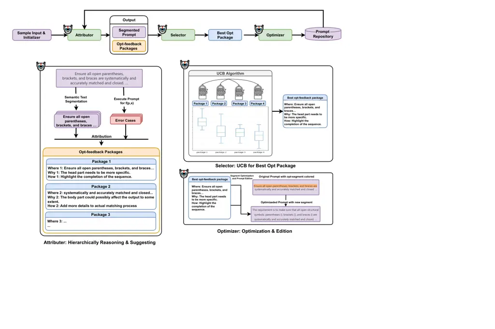

# Learning from Prompt itself: the Hierarchical Attribution Prompt Optimization

Dongyu Chen    Jian Ma    Xianpeng Zhang    Lei Zhang    Haonan Lu   
Chen Chen    Chuangchuang Wang    Kai Tang

August 2025

###### Abstract

Optimization is fundamental across numerous disciplines, typically
following an iterative process of refining an initial solution to
enhance performance. This principle is equally critical in prompt
engineering, where designing effective prompts for large language models
constitutes a complex optimization challenge. A structured optimization
approach requires automated or semi-automated procedures to develop
improved prompts, thereby reducing manual effort, improving performance,
and yielding an interpretable process. However, current prompt
optimization methods often induce prompt drift, where new prompts fix
prior failures but impair performance on previously successful tasks.
Additionally, generating prompts from scratch can compromise
interpretability. To address these limitations, this study proposes the
Hierarchical Attribution Prompt Optimization (HAPO) framework, which
introduces three innovations: (1) a dynamic attribution mechanism
targeting error patterns in training data and prompting history, (2)
semantic-unit optimization for editing functional prompt segments, and
(3) multimodal-friendly progression supporting both end-to-end LLM and
LLM-MLLM workflows. Applied in contexts like single/multi-image QA
(e.g., OCRV2) and complex task analysis (e.g., BBH), HAPO demonstrates
enhanced optimization efficiency, outperforming comparable automated
prompt optimization methods and establishing an extensible paradigm for
scalable prompt engineering.

Dongyu Chen, Jian Ma, Xianpeng Zhang, Lei Zhang, Haonan Lu, Chen Chen,
Chuangchuang Wang and Kai Tang

## Introduction

As a result of the rapid boost of modern technology, the frequency usage
of language models can be viewed as a criterion of high efficiency and
convenience(\[14\], \[9\], \[30\]). However, their generalized
functionality often remains inaccessible to nonexpert users, as
effective interaction typically requires specialized knowledge. Prompt
engineering is essential for unlocking the advanced capabilities of
large language models (LLMs) for non-expert users, serving as a critical
bridge between human intent and model performance. Consequently, the
development of methods to automatically and efficiently optimize prompts
is paramount to enhancing modern productivity. Traditional optimization,
however, is grounded in continuous mathematical processes, whereas
prompt refinement operates in a fundamentally discrete semantic space,
necessitating tailored mechanisms.

Current automated prompt optimization strategies often address this
challenge by generating new prompts or applying edits based on
performance feedback. However, these methods suffer from several
limitations. First, they frequently induce prompt drift, where iterative
refinements fix prior failures but degrade performance on tasks the
prompt previously handled successfully. In addition, generating prompts
from scratch can compromise interpretability, obscuring the rationale
behind the changes, and making the optimization process a black box.
These issues highlight a gap in approaches that can refine prompts in a
controlled, transparent, and stable manner.

To address these limitations, we propose the Hierarchical Attribution
Prompt Optimization (HAPO) framework – a novel, dynamic attribution
mechanism for prompt optimization. Unlike prior approaches that
statically correlate performance with benchmark scores or case-feedback,
our method dynamically attributes influence based on the prompt’s own
semantic features and its iterative performance history. By integrating
these attributes as dynamic variables within a gradient-influenced
framework, and supplementing them with task-expectation grading to
approximate loss, we enable a more nuanced and efficient path to better
prompt design.

Dynamic Attribution Optimization. This paper presents a novel dynamic
attribution mechanism for prompt optimization. Unlike prior approaches
that statically correlate performance with benchmark scores or
case-feedback, our method dynamically attributes influence based on the
prompt’s own semantic features and its iterative performance history. By
integrating these attributes within a gradient-influenced framework and
employing task-expectation grading to approximate loss, our method
enables a nuanced and efficient optimization path that mitigates prompt
drift.

Semantic-unit Hierarchical Segmentation. Also, compared to peer works,
our method put more weight at the modification on the discrete semantic
space, enabling targeted, interpretable edits to functional prompt
segments. To follow the procedure of prompting complex tasks, we
designed a process to change the prompt hierarchically, which is also a
simulation of the learning rate in machine learning. We also applied the
Upper Confidence Bound algorithm (UCB) \[12\] to optimize the location
and tendency of modification for long prompts.

Generalized Multimodal Adaptation. In addition, with the aim of
generalization in a modern environment, we attempted to deploy this
mechanism into a wider range of multimodal tasks and models. We managed
to apply such a strategy on tasks involving
text$`\leftrightarrow`$image, image$`\leftrightarrow`$text, etc. And our
method also achieves an obvious improvement in these tasks and
benchmarks.

In brief, our method demonstrates compelling SoTA efficacy, achieving
advanced performance in 11/12 of the evaluated scenarios while
delivering a consistent average accuracy advantage of +7.21% over the
common baseline. This robust and generalized superiority across diverse
reasoning and multimodal benchmarks conclusively validates it as a
highly effective, model-agnostic framework for instruction optimization.

## Related work

### Automatic Prompt Optimization for various tasks

Recent prior work has developed automated methods for optimizing
task-specific prompts to address the limitations of manual prompt
engineering, such as APE \[29\], which generates candidates via
forward/reverse LLM sampling, selects high-scoring prompts and
iteratively resamples using Monte Carlo search; APO \[21\], using
textual “gradients” from error analysis and bandit selection for
efficient refinement; and OPRO \[25\], employing metaprompts to guide
LLMs in generating iterative improvements. There are also evolutionary
approaches such as PromptBreeder \[7\] and EvoPrompt \[11\], evolving
prompts via genetic algorithms; and frameworks like DSPy \[15\],
TextGrad \[27\], and Automatic Prompt Engineering for Long Prompts
\[11\], which treat prompts as differentiable parameters for batched
optimization. These methods consistently outperform manual engineering
(e.g., +4–60% on benchmarks like GSM8K and TruthfulQA) but primarily
target short prompts in constrained settings, leaving complex,
multi-constraint real-world applications underexplored. Evaluation
typically relies on task-specific metrics (accuracy, F1) or LLM-based
self-assessment.

Compared to their approaches, our optimization process hierarchically
incorporates prompt outcome scores, weakness locations in complex prompt
body, and corresponding optimizing suggestion; and by plugging in the
meta-prompt, this approach enables the LLM-MLLM optimizer to follow a
more step-like gradient descent process, resulting in clustering of
common patterns for high-quality prompts.

### Prompt quality distinguishing and refining through natural language instructions

A recent line of research explores methodologies that leverage natural
language feedback within prompts to enhance LLM performance,
demonstrating effectiveness in mitigating weakness among prompting
procedure. The authors of StraGo \[23\] joined both the good and bad
cases to summarize the pro/cons through a self-trained LLM; other
methodologies include task reasoning (PromptWizard\[1\]), mutated word
replacement (EvoPrompt \[11\]), task referencing (TAPO\[18\]), and graph
optimization adapted for domain-knowledge (EGO-Prompt\[28\]). In
particular, TAPO applied a task-aware evaluation strategy that connects
output words towards task requirement scoring and optimization
reasoning. This could lead to a more detailed attribution process, but
lacks generalizability in that such word-level evaluation may only be
meaningful in text tasks, rather than in thinking or other complex
tasks.

In contrast to these approaches, our method implements a hierarchical
framework that fully leverages the attention mechanism to consistently
capture instructions. Furthermore, through iterative refinement towards
prompts, our approach maintains proximity to viable candidate responses.

### MLLM’s instruction-following capability

To address deficiencies in instruction-following capabilities within
MLLMs, several prior studies have developed novel methodologies. For
example, some works improved this capability by implementing
visual-modality token compression and cross-modality attention
inhibition to mitigate image redundancy (\[26\]), while other approaches
have incorporated image-based prompting skills and
optimization(\[3\],\[17\]). In addition, \[19\] attempted to implement
specific image consistency metrics that focus only on the instruction
compliance capacity of the image generator model.

In contrast, our method introduces a generalized strategy that
circumvents the limitations of visual-information loss and narrow task
specialization. This linguistically-grounded approach ensures robust
performance across diverse task modules by addressing the core of the
instruction-following problem, all while rigorously preserving the
original structure and fidelity of the input image.

## Method

### Problem Formulation

Let $`D=\{(x_{i},y_{i}^{*})\}_{i=1}^{N}`$ be the task dataset with $`N`$
samples, where $`x_{i}`$ represents input instances and $`y_{i}^{*}`$
represents the desired outputs.

The objective of prompt optimization is to find the improved prompt
$`p^{*}`$ that minimizes the expected loss:

```math
p^{*}=\arg\min_{p\in\mathcal{P}}\mathbb{E}_{(x,y^{*})\sim D}\left[\mathcal{L}(f(p,x),y^{*})\right], \tag{1}
```

where:

- •
  $`\mathcal{P}`$ is the space of all possible prompts
- •
  $`f(p,x)`$ is the LLM/MLLM response given prompt $`p`$ and input $`x`$
- •
  $`\mathcal{L}(\cdot,\cdot)`$ is the loss function that measures the
  discrepancy between generated and desired outputs

Analogous to gradient descent in optimization, our process iteratively
refines the prompt through gradient-based updates in the discrete
linguistic space:

```math
p_{t+1}=p_{t}-\eta\cdot\nabla_{p}^{\text{ling}}\mathcal{J}(p_{t}), \tag{2}
```

where:

- •
  $`p_{t}`$ is the prompt at iteration $`t`$
- •
  $`\eta`$ is the learning rate in the linguistic space
- •
  $`\nabla_{p}^{\text{ling}}`$ represents the linguistic gradient
  operator
- •
  $`\mathcal{J}(p)=\frac{1}{N}\sum_{i=1}^{N}\mathcal{L}(f(p,x_{i}),y_{i}^{*})`$
  is the empirical risk

The linguistic gradient is computed through prompt analysis and response
evaluation on the task-expectation grading:

```math
\nabla_{p}^{\text{ling}}\mathcal{J}(p)=\mathbb{E}_{(x,y^{*})\sim D}\left[\frac{\partial\mathcal{L}}{\partial f}\cdot\frac{\partial f}{\partial p}\right], \tag{3}
```

where $`\frac{\partial f}{\partial p}`$ represents the functional
derivative of prompt performance with respect to the LLM expectation
rating, and$`\frac{\partial f}{\partial p}`$ represents that of the LLM
response with respect to prompt variations.

On a linguistic scale, this derivative could be explained as an
attribution analysis of the impact exerted by the prompt on the LLM
output. The attribution process links the model’s loss to specific
prompt components, which directly enables a hierarchical optimization
strategy: high-attribution elements are modified first (e.g., task
structure), followed by fine-grained refinements (e.g., word choice),
guiding a targeted search for a better prompt. The generalized workflow
is shown in Figure 1; the pseudocode is Algorithm 1.



Figure 1: Workflow of HAPO.

#### Initialization Phase.

The process begins with the initialization of a meta-prompt, into which
task requirements are directly embedded. These requirements may be
professionally refined by human experts, transforming preliminary rough
project descriptions into formats more amenable to comprehension by
specific large-scale models. This step ensures clarity and alignment
with model capabilities. We also randomly selected a very small potion
from the benchmark dataset as the train set $`D_{train}`$.

### Attributor Phase

This phase deals with segmentation and the hierarchical attribution
process of the prompt performance, generating feedback packages for the
top m segments. We set $`m=4`$ here.

#### Task Result Generation.

We will use the training-free LLMs experimented before to produce the
task results $`f(p,x)`$ given prompt $`p`$ and input $`x`$. To avoid
irrelevant influences, the hyperparameters remain default:
$`temperature`$: 1.0, $`Top_{p}`$: 1.0, Presence Penalty and Frequency
Penalty: 0.0.

#### Semantic Text Segmentation.

We segment $`p`$ into semantically coherent units using a two-stage
procedure: (i) rule-based splitting by discourse markers, section
headers, list items, and delimiters; and (ii) model-assisted refinement
with a frozen instruction parser $`\Pi`$ that merges overly short
fragments and splits run-on clauses. Formally,
$`S(p)=\{u_{k}\}_{k=1}^{K}=\Pi(\mathrm{RuleSplit}(p))`$.

#### Dynamic Attribution Mechanism.

Let $`\mathcal{E}_{t}\subset\mathcal{D}_{\mathrm{train}}`$ denote the
mispredicted examples in iteration $`t`$. We estimate per-unit
contribution scores by counterfactual occlusion with exponential
smoothing:

```math
\displaystyle s_{k}^{(t)}=\lambda s_{k}^{(t-1)}+(1-\lambda)\cdot\frac{1}{|\mathcal{E}_{t}|}\!\!\sum_{(x,y^{*})\in\mathcal{E}_{t}}\!\!\Big[L\big(\mathcal{M}(x;p\setminus u_{k}),y^{*}\big) \tag{4}
```

```math
\displaystyle-L\big(\mathcal{M}(x;p),y^{*}\big)\Big],
```

where $`L`$ is a surrogate loss (e.g., $`0`$–$`1`$ loss) and
$`p\setminus u_{k}`$ masks $`u_{k}`$ with a neutral arm. We augment with
history-aware decay:

```math
\tilde{s}_{k}^{(t)}=\alpha_{t}s_{k}^{(t)}+(1-\alpha_{t})\cdot\frac{1}{|H_{k}|}\sum_{(\tau,\Delta)\in H_{k}}\Delta\,\gamma^{t-\tau}, \tag{5}
```

where $`H_{k}`$ stores past improvements attributed to edits on
$`u_{k}`$ and $`\gamma\in(0,1)`$ is a temporal decay. Top-$`m`$ units by
$`\tilde{s}_{k}^{(t)}`$ form the actionable set.

### Selector Phase

This phase runs a UCB process for the selection of the improved feedback
package.

#### UCB-based Edit Selection.

We model each arm as an edit candidate $`a=(k,o)`$ over actionable
units. Executing $`a`$ yields an updated prompt $`p^{\prime}`$ and a
scalar reward on a holdout dev split:

```math
r_{t}(a)=\mathrm{Acc}(p^{\prime};\mathcal{D}_{\mathrm{dev}})-\mathrm{Acc}(p;\mathcal{D}_{\mathrm{dev}}). \tag{6}
```

We maintain empirical means $`\hat{\mu}_{a}`$ and counts $`n_{a}`$. In
iteration $`t`$, we choose

```math
a_{t}\in\arg\max_{a}\;\hat{\mu}_{a}+c\sqrt{\frac{\ln t}{\max(1,n_{a})}}. \tag{7}
```

The procedure employs a warm-start initialization by pulling each arm
once, followed by the elimination of arms whose rewards are
non-positive. Given the well-separated reward distributions of the arms,
a maximum iteration count $`t_{max}=100`$ is sufficient.

#### Edit Operators.

We define a compact set of edit operators $`\mathcal{O}`$ applied to a
target unit $`u_{k}`$: (i) Replace; (ii) Insert; (iii) Delete; (iv)
Reorder; (v) Refine. An edit candidate is
$`a=(k,o)\in\{1,\dots,K\}\times\mathcal{O}`$ that produces
$`p^{\prime}=E_{k,o}(p)`$.

#### Multimodal Pipeline.

For MLLM settings, the inputs include images $`\{I_{j}\}`$ and question
text $`x`$. We extract the base64 value of the local image data as part
of the MLLM request.

The optimizer constructs a joint meta-prompt that preserves the original
template’s core structure, populating it with the specific task
requirements and constraints while applying an identical process of
attribution and UCB selection. Its sole modification is an explicit
annotation of the task’s multimodal background at the end of the
meta-prompt.

### Optimizer Phase

This phase receives the improved opt feedback package and will split and
incorporate it into the meta prompt to produce the next candidate. The
meta prompt will directly include the last round’s candidate, highlight
the modification location in its linguistic layer, and give suggestions
and reasons into structured modules. In the end, to maintain
consistency, the same model will be served with this meta-prompt to
generate the new candidate in the next iteration.

#### Measuring Prompt Drift.

We quantify drift as degradation on previously solved items. Let
$`\mathcal{S}_{t-1}=\{i:\mathcal{M}(x_{i};p_{t-1})\text{ correct}\}`$
and
$`\mathcal{F}_{t}=\{i\in\mathcal{S}_{t-1}:\mathcal{M}(x_{i};p_{t})\text{ incorrect}\}`$.
We define retention and drift:

```math
\mathrm{Retention}(t)=\frac{|\mathcal{S}_{t-1}\setminus\mathcal{F}_{t}|}{|\mathcal{S}_{t-1}|},\quad\mathrm{Drift}(t)=1-\mathrm{Retention}(t).
```

The global drift up to $`t`$ is the average
$`\overline{\mathrm{Drift}}=\frac{1}{t}\sum_{\tau=1}^{t}\mathrm{Drift}(\tau)`$.
We also trigger protective actions if $`\mathrm{Drift}(t)`$ exceeds a
threshold for $`S^{\prime}`$ consecutive iterations.

#### Early Stopping and Check-pointing.

We stop when (i) the upper-limit iteration number S (we set 20 here) is
reached; (ii) no positive reward more than 0.5% for consecutive
iterations of $`S^{\prime}`$ (we set 3 here); or (iii) the drift risk
exceeds a threshold (Sect. Measuring Prompt Drift.; we set it at 10%
here). We keep the improved development checkpoint and evaluate once in
the test split.

1: Initialize improved prompt $`p_{0}`$, history scores
$`\{s_{k}^{(0)}\}`$, arm stats $`\{\hat{\mu}_{a},n_{a}\}`$, calls
$`C\leftarrow 0`$, $`t\leftarrow 1`$

2: repeat

3:   Run through the training set
$`D_{train}=\{(x_{i},y_{i}^{*})\}_{i=1}^{N}`$ for $`f(p,x_{train})`$

4:   $`\{u_{k}\}_{k=1}^{K}\leftarrow Seg(p_{t-1})`$ $`\triangleright`$
Segmentation

5:   Update $`\tilde{s}_{k}^{(t)}`$ via Eqs. (4)–(5)

6:   $`\mathcal{E}_{t}\leftarrow`$ mispredicted items on a small train
slice

7:   Build candidate arms $`\mathcal{A}_{t}=\{(k,o)\}`$ over top-$`m`$
units

8:
  $`a_{t}\leftarrow\arg\max_{a\in\mathcal{A}_{t}}\hat{\mu}_{a}+c\sqrt{\tfrac{\ln t}{\max(1,n_{a})}}`$

9:   $`p^{\prime}\leftarrow E_{a_{t}}(p_{t-1})`$; evaluate reward
$`r_{t}`$ on dev

10:   Update $`\hat{\mu}_{a_{t}},n_{a_{t}}`$; update improved of
$`\{p_{t-1},p^{\prime}\}`$ by dev score

11:   $`C\leftarrow C+\text{calls used}`$; $`t\leftarrow t+1`$

12: until Early stopping, or iteration limit for $`S`$ rounds

13: return improved prompt

Algorithm 1 HAPO: the Hierarchical Attribution Prompt Optimization.

## Experiments

### Implementation and Experiment setup

#### Models.

Evaluation was conducted on three training-free large language models:
Gemini 2.5 Pro Preview 06-05 (Gemini) \[5\], GPT-4o (2025-03-26) \[20\],
and Qwen3-VL-Plus (2025-09-23) \[24\]. These models were selected for
evaluation based on three principal considerations. First, their
performance over time represents contemporary performance and stability,
suggesting strong potential for nuanced linguistic analysis and prompt
optimization. Second, each model natively supports multimodal inputs
including text and images, allowing for our experiment aim. Finally,
their respective APIs are engineered for high-throughput parallel
computation, enabling efficient processing of large-scale benchmarks
within a feasible timeframe.

#### Benchmarks.

Our benchmarks included BBH \[22\], GSM8K \[4\], OCRBench V2 (OCRV2)
\[8\], and VQA2017(VQA)\[10\]. BBH constitutes 23 challenging text-based
branches for which prior language model evaluations did not exceed
average human performance; GSM8K is a dataset of 8.5K high-quality,
linguistically diverse grade school math problems requiring multi-step
reasoning; OCRV2 represents a large-scale bilingual text-centric
benchmark of 31 diverse scenarios to evaluate visual text localization
and reasoning; and VQA is a dataset containing open-ended image-to-text
questions in 13 major types, demanding comprehension of vision,
language, and commonsense knowledge.

BBH and GSM8K serve as representative text-to-text benchmarks, involving
long-chain logical analysis and advanced mathematical problems. OCRV2
and VQA are both image-to-text benchmarks comprising high-quality visual
question-answering tasks. We selected these four benchmarks to
demonstrate the generalized capability of HAPO across distinct,
cross-modal tasks.

From each task branch, a fixed subset of 3% was randomly sampled. This
subset was utilized throughout the optimization procedure, facilitating
the computation of task accuracy at intermediate steps. These accuracy
metrics provide an estimate of performance on the complete evaluation
sets, thus balancing assessment cost with a reliable proxy for general
capability. Upon completion of the optimization, the final instructions
were evaluated on the full held-out portion of each benchmark.

#### Baseline Methods.

To rigorously evaluate HAPO, we compare it against six competitive
baseline methods, organized into three principal categories:

1. Template-Based Methods. We include the Zero-Shot CoT prompting with
   prompt “Think step by step”, and a Two-Shot CoT with two randomly
   selected samples in each branch \[16\].

2. Auto-Generation Methods. In this category, we compare with APE \[29\]
   and OPRO\[25\], which leverage LLMs as optimizers to automatically
   generate or iteratively refine prompts, though they often depend on
   task-specific demonstrations or meta-prompts.

3. Gradient-Based Methods. We encompass TextGrad \[27\] and
   EGO-Prompt\[28\], which apply gradient-informed updates or evolutionary
   search to navigate the discrete prompt space, albeit with considerations
   for computational cost or sample efficiency.

Multimodal Adjustment. The majority of these methods, while not
originally designed, were modified to process images during prompt
evaluation. However, although TextGrad can indirectly process images by
integrating external MLLMs, its prompt optimization process introduces
additional text-based task-loading and evaluation, inherently mismatched
for multimodal tasks. Thus, TextGrad was excluded from multimodal
benchmarks such as VQA and OCRV2.

#### Evaluation.

For evaluation, we will use an LLM grader following the benchmarks’
grading rules. To avoid issues such as language patterns that affect the
score performance of the grader, we chose to use a different LLM than
the previous three companies for scoring; we chose Deepseek-V3 \[6\];
since the benchmarks all have a standard target or answer, we will fit
the task, the target, and the model’s output in a meta-prompt like :

|                                                                                                                                                                                                                                                                                      |
| ------------------------------------------------------------------------------------------------------------------------------------------------------------------------------------------------------------------------------------------------------------------------------------ |
| You are a professional question-answering assessment expert. You will be given a question description (including the question itself and the answer requirements), a standard answer, and an answer; you will use this to evaluate the quality of the answer.                        |
| Question description: {task} Reference answer: {target} Answer: {output}                                                                                                                                                                                                             |
| Try to learn and understand the task description, and score the specific answer generated based on the task description and the reference answer to reflect whether the answer perfectly meets the question requirements in terms of steps and results, with a maximum score of 100. |

An open-source, minimal, runnable prototype (including a hierarchical
attributor, UCB selector, meta-hint template library, logging, and
checkpoints) will be provided in our GitHub repository, along with a
scaffold for reproducing experiments.

### Experiment Results

The comprehensive experimental results are summarized in Table 1, with
our method establishing an advantage, achieving an improved score in 11
out of 12 model-benchmark combinations. It delivers an average
performance gain of +13.28% over the Zero-Shot CoT baseline across all
tasks and models. Specifically, it outperforms the robust OPRO optimizer
by a notable margin in multimodal reasoning, such as a +2.54% and +1.80%
percentage point advantage on the VQA benchmark (48.71% vs. 51.25%) and
OCRV2 benchmark (54.43% vs. 56.23%), respectively. While TextGrad show
relatively good performance in BBH benchmark, and EGO-Prompt,
specialized for knowledge graph tasks through text-based expert
learning, shows competitive results on BBH but underperforms on visual
datasets like VQA (e.g., 41.71% for Gemini vs. our 48.40%, a 16%
relative improvement), our method exhibits generalized improvement. This
is epitomized by its scores on GSM8K, achieving 84.81% with Gemini (a
+2.06% lead over the second method, OPRO), 83.41% with GPT-4o and 80.79%
with Qwen, thereby robustly validating its versatility and superior
capability as a model-agnostic framework for prompt optimization.

### Model Call Analysis

To compare the computational efficiency of the evaluated prompt
optimization techniques, we conducted a comparative analysis of model
calls, a primary determinant of operational cost in API-dependent
environments. Beginning with the baseline, the relatively basic APE
algorithm requires an average of 453.17 calls per branch. Meanwhile,
OPRO exhibits a substantially higher overhead of 49,054.87 calls, a
consequence of its per-sample evaluation mechanism across the entire
training set. TextGrad shows significant task-dependent variance,
averaging 2,365.31 calls on normal tasks, but 31,419.33 on long dataset
like GSM8K. For EGO-Prompt, total calls range from approximately 3,440
for typical tasks such as BBH/VQA to 180,274 for large-scale benchmarks
like GSM8K. Finally, our proposed method, HAPO, occupies an efficient
position within this methodological spectrum, averaging 6.71 iterations
and 2,080.10 calls per branch, achieving a relative balance between
performance and resource expenditure.

|                  |       |       |       |       |
| ---------------- | ----- | ----- | ----- | ----- |
| Method           | BBH   | GSM8K | VQA   | OCRV2 |
| Gemini           |       |       |       |       |
|    Zero-Shot CoT | 70.23 | 62.45 | 39.68 | 50.06 |
|    Two-Shot CoT  | 71.61 | 63.81 | 41.29 | 50.48 |
|    APE           | 74.18 | 64.88 | 46.24 | 58.86 |
|    OPRO          | 86.95 | 82.75 | 44.10 | 59.34 |
|    TextGrad      | 90.19 | 76.36 | \-    | \-    |
|    EGO-Prompt    | 89.94 | 75.61 | 41.71 | 55.68 |
|    Our Method    | 89.76 | 84.81 | 48.40 | 61.45 |
| GPT-4o           |       |       |       |       |
|    Zero-Shot CoT | 77.52 | 69.73 | 44.81 | 38.64 |
|    Two-Shot CoT  | 77.08 | 70.17 | 43.25 | 39.01 |
|    APE           | 80.63 | 72.04 | 52.06 | 44.39 |
|    OPRO          | 82.86 | 78.16 | 58.94 | 47.81 |
|    TextGrad      | 84.55 | 81.88 | \-    | \-    |
|    EGO-Prompt    | 83.91 | 79.54 | 55.26 | 45.60 |
|    Our Method    | 85.94 | 83.41 | 60.17 | 48.79 |
| Qwen             |       |       |       |       |
|    Zero-Shot CoT | 64.01 | 68.02 | 32.18 | 46.20 |
|    Two-Shot CoT  | 64.46 | 69.58 | 33.63 | 45.85 |
|    APE           | 61.53 | 65.07 | 32.16 | 54.18 |
|    OPRO          | 73.33 | 79.35 | 43.09 | 56.15 |
|    TextGrad      | 73.65 | 72.11 | \-    | \-    |
|    EGO-Prompt    | 74.45 | 73.27 | 39.57 | 52.38 |
|    Our Method    | 75.70 | 80.79 | 45.19 | 58.45 |

Table 1: Mean Performance Across Benchmarks. Bold numbers indicate the
improved among four methods in each benchmark. Notice that TextGrad was
excluded from multimodal input.

## Prompt Optimization Case Study

Case 1: BBH - Date Understanding.

This task branch requires temporal reasoning by applying a time
adjustment to a given date and selecting the correct formatted output
from multiple choices. The optimization path shows a language to enforce
a more rigorous and error-resistant reasoning process.

In the second iteration, the prompt received a score of 95.40 and is
like the following:

|                                                                                                                                                                   |
| ----------------------------------------------------------------------------------------------------------------------------------------------------------------- |
| Carefully analyze the given date information, apply the specified time adjustment, and select the calculated date in MM/DD/YYYY format with the provided choices. |

In the fourth iteration with score of 96.00 it is like:

|                                                                                                                                                                                                                                    |
| ---------------------------------------------------------------------------------------------------------------------------------------------------------------------------------------------------------------------------------- |
| Carefully analyze the given date information, apply the specified time adjustment step-by-step, verify the calculated date in MM/DD/YYYY format, and select the correct option by matching it precisely with the provided choices. |

In the seventh iteration, the prompt that receives a score of 99.20 is
like the following:

|                                                                                                                                                                                                                                                                |
| -------------------------------------------------------------------------------------------------------------------------------------------------------------------------------------------------------------------------------------------------------------- |
| Accurately interpret the given date context, perform the required time adjustment through meticulous step-by-step computation, validate the resulting date in MM/DD/YYYY format, and identify the correct answer by exact alignment with the provided options. |

In this case, by incrementally enforcing a structured, multi-step
computational process and demanding exact verification, the prompt
guides the model to emulate a more reliable and deterministic algorithm,
which is crucial for tasks requiring high numerical and logical
accuracy.

Case 2: OCRV2 - Text Counting.

This task branch involves counting and outputting textual elements in an
image.

In the third iteration, the prompt, with an average grade of 28.83, is

|                                                                          |
| ------------------------------------------------------------------------ |
| Output the exact number as a numeral without any additional explanation. |

In the fifth, the prompt, with average grade 43.75, is:

|                                                                                                                                                                                                                                   |
| --------------------------------------------------------------------------------------------------------------------------------------------------------------------------------------------------------------------------------- |
| Please output the exact number without any additional explanation.                                                                                                                                                                |
| Example: Question: How many times does the character ‘e’ appear in the picture? Image description: An billboard showing “Times Square” Answer: \[‘2’, ‘two’, ‘twice’\]                                                            |
| Key note: - Ensure the generated text strictly matches one of the specified target options without introducing any unlisted alternatives. - Avoid introducing any additional explanations or unlisted alternatives in the output. |

And in the seventh iteration the prompt, with average grade 67.89, is:

|                                                                                                                                                                                                                                                                           |
| ------------------------------------------------------------------------------------------------------------------------------------------------------------------------------------------------------------------------------------------------------------------------- |
| 1. Ensure the generated text strictly matches one of the specified target options without introducing any unlisted alternatives. 2. Avoid redundant phrasing and maintain precision in alignment with the scoring rules.                                                  |
| \*\*Optimized Example:\*\* Question: How many times does the character ‘e’ appear in the picture? Image description: An billboard showing “Times Square” Answer: \[‘2’, ‘two’, ‘twice’\]                                                                                  |
| \*\*Key Notes:\*\* - The output must strictly adhere to the specified format and options. - Examples should be concise, precise, and directly aligned with the task requirements. - Avoid introducing any additional explanations or unlisted alternatives in the output. |

The optimization focused on output constraint and exemplar-based
learning. The progression from a simple command to a detailed
specification with illustrative examples and explicit guardrails (e.g.,
“strictly match,” “avoid unlisted alternatives”) provided the model with
the necessary context and constraints to align its outputs precisely
with the task’s evaluation criteria. The performance leap is dramatic,
moving from a failing to a passing grade, achieved by evolving from a
terse instruction to a richly specified prompt with demonstrations.

## Ablation Study

We conducted an in-depth ablation study to evaluate the impact of
various components in our proposed method. All experiments were
performed using GPT-4o as the base model with default parameters unless
otherwise specified. The evaluation encompasses two distinct task types:
BBH’s sports understanding (text-to-text reasoning) and OCRV2’s
reasoning VQA en (image-to-text reasoning). These datasets were selected
to represent both mathematical and non-mathematical reasoning challenges
while aligning with contemporary research on AI evaluation
methodologies.

For evaluation metrics, we used primarily accuracy for the final output
assessment to measure the stability of model performance under varying
prompt conditions.

|                                     |      |      |
| ----------------------------------- | ---- | ---- |
| Meta-Prompt Config                  | SU   | RVE  |
| Full (Prioritizing + Reasoning)     | 76.8 | 65.7 |
| $`w/o.`$ Prioritizing Weak Elements | 71.9 | 60.2 |
| $`w/o.`$ Structured Reasoning       | 73.5 | 62.1 |
| $`w/o.`$ Both Components            | 68.4 | 56.8 |

Table 2: Ablation Study of Meta-Prompt Components. Here SU means sports
understanding, RVE means reasoning VQA en.

### The Impact of Meta-Prompt Design

The meta-prompt’s construction is critical for prompt optimization. Our
default design integrates two components: Prioritizing Weak Elements
(focusing on under-performance) and Structured Reasoning (explicit
analysis of in-context examples). We performed an ablation study to
quantify each component’s contribution.

Objective. This part is designed to isolate the performance impact of
the two core meta-prompt strategies.

Setup. We systematically ablated each component from the full
meta-prompt and evaluated performance on BBH sports understanding and
OCRV2 reasoning VQA en.

Analysis of Outcomes. As shown in Table 2, the full meta-prompt achieved
the highest precision. Ablating Prioritizing Weak Elements caused
substantial drops (4.9% on BBH, 5.5% on reasoning VQA en), demonstrating
its critical role. Removing Structured Reasoning led to significant but
smaller reductions (3.3% on sports understanding, 3.6% on reasoning VQA
en). Removing both components caused the most severe performance
degradation (8.4% on sports understanding, 8.9% on reasoning VQA en),
revealing a synergistic effect.

The importance of the component varied by task; Prioritizing Weak
Elements was relatively more crucial for the text-based BBH task, while
both components contributed more evenly to the complex visual reasoning
in reasoning VQA en.

Our analytical selection strategy (utilizing the full meta-prompt) also
converged faster and more stably than a randomized baseline, achieving
higher final precision (76.8% vs. 70.2% on sports understanding; 65.7%
vs. 58.3% on reasoning VQA en) in fewer iterations (4 vs. 8) with lower
variance (±1.8% vs. ±5.2%), shown in Table 3.

|            |      |      |                     |
| ---------- | ---- | ---- | ------------------- |
| Strategy   | SU   | RVE  | $`I_{Convergence}`$ |
| Analytical | 76.8 | 65.7 | 4                   |
| Randomized | 70.2 | 58.3 | 8                   |

Table 3: Performance comparison of prompt selection strategies. Here SU
means sports understanding, RVE means reasoning VQA en, and
$`I_{Convergence}`$ means iterations to convergence.

### The Impact of Input Representation

We also noticed that the representation of visual information requires
careful design to support complex reasoning tasks, as models struggle to
extract relevant information from raw visual inputs.

Objective. This ablation experiment is designed to assess how visual
input representation forms affect OCR performance, given known AI
limitations in visual reasoning.

Setup. We compare text-only descriptions (made by aimlessly prompting
GPT-4o to caption task images, with prompt “Briefly describe the
image.”) against original images and enhanced visual representations (by
adding a red box to each input image hinting the target answer), on the
subset, reasoning VQA en, of the benchmark OCRV2.

Results. Table 4 shows that the enhanced visual features produce the
highest accuracy (65.7%), outperforming original images (61.5%) and
text-only (58.9%). The 6.8% gap between text-only and original images
confirms visual information is indispensable for this task, supporting
findings from visual mathematical reasoning research.

|                           |              |
| ------------------------- | ------------ |
| Strategy                  | Accuracy (%) |
| Text-Only                 | 58.9         |
| Original Image            | 61.5         |
| $`w/.`$ Enhanced Features | 65.7         |

Table 4: Impact of input representation on reasoning VQA en performance.

## Reproducibility

We will release anonymized code, prompts, and logs including: (i)
minimal working examples per dataset, (ii) meta-prompt templates for the
optimizer, (iii) configuration files ($`T`$, $`M`$), (iv) checkpoints
for improved prompts and intermediate trajectories, and (v) exact
preprocessing for OCR/VQA (OCR engine, box formats, resolution). All
experiments use fixed seeds; we will report the versions of OS, driver,
and libraries as well as the endpoints of the models. Dataset/model
licenses are respected and sensitive content is filtered.

## Conclusion

We introduced HAPO, a hierarchical attribution framework for prompt
optimization that combines unit-level attribution, a compact edit
operator set, and UCB-based selection, and extends naturally to
multimodal pipelines. In fair comparisons, HAPO yields consistent gains
across text and vision-language benchmarks while explicitly controlling
prompt drift. We expect HAPO to serve as a practical, extensible
paradigm for scalable prompt engineering and to inspire further work on
attribution-driven optimization in discrete semantic spaces.

Discussion. The current HAPO method is computationally intensive,
limiting its real-time use. Its evaluation also requires broader
validation in professional technical domains, while its generalization
to other AI models needs further study. Future work could focus on
improving efficiency with adaptive prompting and early stopping,
refining causal attribution methods, generalizing on domain-specific
benchmarks, and expanding cross-model testing with formal drift
controls.

## References

- \[1\] Eshaan Agarwal, Joykirat Singh, Vivek Dani, Raghav Magazine,
  Tanuja Ganu, and Akshay Nambi. Promptwizard: Task-aware prompt
  optimization framework. 2024.
- \[2\] Shuai Bai, Keqin Chen, Xuejing Liu, Jialin Wang, Wenbin Ge, Sibo
  Song, Kai Dang, Peng Wang, Shijie Wang, Jun Tang, Humen Zhong, Yuanzhi
  Zhu, Mingkun Yang, Zhaohai Li, Jianqiang Wan, Pengfei Wang, Wei Ding,
  Zheren Fu, Yiheng Xu, Jiabo Ye, and Xi Zhang et al. Qwen2.5-vl
  technical report. 2025.
- \[3\] Yumin Choi, Dongki Kim, Jinheon Baek, and Sung Ju Hwang.
  Multimodal prompt optimization: Why not leverage multiple modalities
  for mllms. 2025.
- \[4\] Karl Cobbe, Vineet Kosaraju, Mohammad Bavarian, Mark Chen,
  Heewoo Jun, Lukasz Kaiser, Matthias Plappert, Jerry Tworek, Jacob
  Hilton, Reiichiro Nakano, Christopher Hesse, and John Schulman.
  Training verifiers to solve math word problems. 2021.
- \[5\] Gheorghe Comanici, Eric Bieber, Mike Schaekermann, Ice Pasupat,
  Noveen Sachdeva, Inderjit Dhillon, Marcel Blistein, and Ori Ram et al.
  Gemini 2.5: Pushing the frontier with advanced reasoning,
  multimodality, long context, and next generation agentic capabilities. 2025.
- \[6\] DeepSeek-AI, Aixin Liu, Bei Feng, Bing Xue, Bingxuan Wang,
  Bochao Wu, Chengda Lu, and Chenggang Zhao et al. Deepseek-v3 technical
  report, 2025.
- \[7\] Chrisantha Fernando, Dylan Banarse, Henryk Michalewski, Simon
  Osindero, and Tim Rocktäschel. Promptbreeder: Self-referential
  self-improvement via prompt evolution. 2023.
- \[8\] Ling Fu, Zhebin Kuang, Jiajun Song, Mingxin Huang, Biao Yang,
  Yuzhe Li, Linghao Zhu, Qidi Luo, Xinyu Wang, Hao Lu, Zhang Li, Guozhi
  Tang, Bin Shan, Chunhui Lin, Qi Liu, Binghong Wu, Hao Feng, Hao Liu,
  Can Huang, Jingqun Tang, Wei Chen, Lianwen Jin, Yuliang Liu, and Xiang
  Bai. Ocrbench v2: An improved benchmark for evaluating large
  multimodal models on visual text localization and reasoning. 2025.
- \[9\] Tao Gong, Chengqi Lyu, Shilong Zhang, Yudong Wang, Miao Zheng,
  Qian Zhao, Kuikun Liu, Wenwei Zhang, Ping Luo, and Kai Chen.
  Multimodal-gpt: A vision and language model for dialogue with humans. 2023.
- \[10\] Yash Goyal, Tejas Khot, Douglas Summers-Stay, Dhruv Batra, and
  Devi Parikh. Making the V in VQA matter: Elevating the role of image
  understanding in Visual Question Answering. 2017.
- \[11\] Qingyan Guo, Rui Wang, Junliang Guo, Bei Li, Kaitao Song,
  Xu Tan, Guoqing Liu, Jiang Bian, and Yujiu Yang. Evoprompt: Connecting
  llms with evolutionary algorithms yields powerful prompt optimizers. 2025.
- \[12\] Qiyang Han, Koulik Khamaru, and Cun-Hui Zhang. Ucb algorithms
  for multi-armed bandits: Precise regret and adaptive inference. 2024.
- \[13\] Cho-Jui Hsieh, Si Si, Felix X. Yu, and Inderjit S. Dhillon.
  Automatic engineering of long prompts. 2023.
- \[14\] Shaohan Huang, Li Dong, Wenhui Wang, Yaru Hao, Saksham Singhal,
  Shuming Ma, Tengchao Lv, Lei Cui, Owais Khan Mohammed, Barun Patra,
  Qiang Liu, Kriti Aggarwal, Zewen Chi, Johan Bjorck, Vishrav Chaudhary,
  Subhojit Som, Xia Song, and Furu Wei. Language is not all you need:
  Aligning perception with language models. 2023.
- \[15\] Omar Khattab, Arnav Singhvi, Paridhi Maheshwari, Zhiyuan Zhang,
  Keshav Santhanam, Sri Vardhamanan, Saiful Haq, Ashutosh Sharma,
  Thomas T. Joshi, Hanna Moazam, Heather Miller, Matei Zaharia, and
  Christopher Potts. Dspy: Compiling declarative language model calls
  into self-improving pipelines. 2023.
- \[16\] Takeshi Kojima, Shixiang Shane Gu, Machel Reid, Yutaka Matsuo,
  and Yusuke Iwasawa. Large language models are zero-shot reasoners. 2023.
- \[17\] Jiang Liu, Bolin Li, Haoyuan Li, Tianwei Lin, Wenqiao Zhang,
  Tao Zhong, Zhelun Yu, Jinghao Wei, Hao Cheng, Wanggui He, Fangxun Shu,
  Hao Jiang, Zheqi Lv, Juncheng Li, Siliang Tang, and Yueting Zhuang.
  Boosting private domain understanding of efficient mllms: A
  tuning-free, adaptive, universal prompt optimization framework. 2025.
- \[18\] Wenxin Luo, Weirui Wang, Xiaopeng Li, Weibo Zhou, Pengyue Jia,
  and Xiangyu Zhao. Tapo: Task-referenced adaptation for prompt
  optimization. 2025.
- \[19\] Oscar Mañas, Pietro Astolfi, Melissa Hall, Candace Ross, Jack
  Urbanek, Adina Williams, Aishwarya Agrawal, Adriana Romero-Soriano,
  and Michal Drozdzal. Improving text-to-image consistency via automatic
  prompt optimization. 2024.
- \[20\] OpenAI and : and Aaron Hurst, Adam Lerer, Adam P. Goucher, Adam
  Perelman, Aditya Ramesh, Aidan Clark, AJ Ostrow, Akila Welihinda, Alan
  Hayes, Alec Radford, and Aleksander Mądry et al. Gpt-4o system card. 2024.
- \[21\] Reid Pryzant, Dan Iter, Jerry Li, Yin Tat Lee, Chenguang Zhu,
  and Michael Zeng. Automatic prompt optimization with "gradient
  descent" and beam search. 2023.
- \[22\] Mirac Suzgun, Nathan Scales, Nathanael Schärli, Sebastian
  Gehrmann, Yi Tay, Hyung Won Chung, Aakanksha Chowdhery, Quoc V. Le,
  Ed H. Chi, Denny Zhou, and Jason Wei. Challenging big-bench tasks and
  whether chain-of-thought can solve them. 2022.
- \[23\] Yurong Wu, Yan Gao, Bin Benjamin Zhu, Zineng Zhou, Xiaodi Sun,
  Sheng Yang, Jian-Guang Lou, Zhiming Ding, and Linjun Yang. Strago:
  Harnessing strategic guidance for prompt optimization. 2024.
- \[24\] An Yang, Anfeng Li, Baosong Yang, Beichen Zhang, Binyuan Hui,
  Bo Zheng, Bowen Yu, Chang Gao, and Chengen Huang et al. Qwen3
  technical report, 2025.
- \[25\] Chengrun Yang, Xuezhi Wang, Yifeng Lu, Hanxiao Liu, Quoc V. Le,
  Denny Zhou, and Xinyun Chen. Large language models as optimizers. 2024.
- \[26\] Te Yang, Jian Jia, Xiangyu Zhu, Weisong Zhao, Bo Wang, Yanhua
  Cheng, Yan Li, Shengyuan Liu, Quan Chen, Peng Jiang, Kun Gai, and Zhen
  Lei. Enhancing instruction-following capability of visual-language
  models by reducing image redundancy. 2024.
- \[27\] Mert Yuksekgonul, Federico Bianchi, Joseph Boen, Sheng Liu, Zhi
  Huang, Carlos Guestrin, and James Zou. Textgrad: Automatic
  "differentiation" via text. 2024.
- \[28\] Yang Zhao, Pu Wang, and Hao Frank Yang. How to auto-optimize
  prompts for domain tasks? adaptive prompting and reasoning through
  evolutionary domain knowledge adaptation. 2025.
- \[29\] Yongchao Zhou, Andrei Ioan Muresanu, Ziwen Han, Keiran Paster,
  Silviu Pitis, Harris Chan, and Jimmy Ba. Large language models are
  human-level prompt engineers. 2023.
- \[30\] Zixuan Zhou, Xuefei Ning, Ke Hong, Tianyu Fu, Jiaming Xu,
  Shiyao Li, Yuming Lou, Luning Wang, Zhihang Yuan, Xiuhong Li, Shengen
  Yan, Guohao Dai, Xiao-Ping Zhang, Yuhan Dong, and Yu Wang. A survey on
  efficient inference for large language models. 2024.
