# PrismVAU: Prompt-Refined Inference System for Multimodal Video Anomaly Understanding

Iñaki Erregue Email: <ierregal31@alumnes.ub.edu>
Affiliation: Universitat de Barcelona Affiliation: Computer Vision
Center Affiliation: Milestone Systems    Kamal Nasrollahi
Email: <kn@create.aau.dk> Affiliation: Aalborg University
Affiliation: Milestone Systems    Sergio Escalera
Email: <sescalera@ub.edu> Affiliation: Universitat de Barcelona
Affiliation: Computer Vision Center Affiliation: Aalborg University

###### Abstract

Video Anomaly Understanding (VAU) extends traditional Video Anomaly
Detection (VAD) by not only localizing anomalies but also describing and
reasoning about their context. Existing VAU approaches often rely on
fine-tuned multimodal large language models (MLLMs) or external modules
such as video captioners, which introduce costly annotations, complex
training pipelines, and high inference overhead. In this work, we
introduce PrismVAU, a lightweight yet effective system for real-time VAU
that leverages a single off-the-shelf MLLM for anomaly scoring,
explanation, and prompt optimization. PrismVAU operates in two
complementary stages: (1) a coarse anomaly scoring module that computes
frame-level anomaly scores via similarity to textual anchors, and (2) an
MLLM-based refinement module that contextualizes anomalies through
system and user prompts. Both textual anchors and prompts are optimized
with a weakly supervised Automatic Prompt Engineering (APE) framework.
Extensive experiments on standard VAD benchmarks demonstrate that
PrismVAU delivers competitive detection performance and interpretable
anomaly explanations—without relying on instruction tuning, frame-level
annotations, and external modules or dense processing—making it an
efficient and practical solution for real-world applications.

## 1 Introduction

Video Anomaly Detection (VAD) focuses on automatically identifying
unusual or abnormal events, behaviors, or patterns in video data that
deviate from what is considered “normal” or expected. It is a crucial
task in computer vision with a wide range of applications, including
surveillance \[21, 28, 34\], traffic analysis \[39, 22, 44\], and
healthcare \[9, 11, 10\]. While traditional VAD methods have shown
strong performance, they often lack interpretability, failing to provide
explanations for their predictions. This limitation reduces their
trustworthiness in safety-critical real-world applications. To address
this, recent studies have explored the integration of Large Language
Models (LLMs) and Multimodal Large Language Models (MLLMs) to generate
human-interpretable explanations alongside traditional VAD results,
transitioning to a more holistic paradigm. In Video Anomaly
Understanding (VAU), models not only detect anomalies but also describe
them and reason about their cause, effects, and context.

However, existing VAU methods typically depend on fine-tuned MLLMs,
which require costly annotations and complex training pipelines. A
growing number of studies have begun exploring the zero-shot
capabilities of these foundation models, leveraging techniques such as
adapter tuning, video captioning, and prompt optimization. While these
methods significantly reduce training overhead, they incur high
inference costs due to dense and overlapping video processing, and the
reliance on external auxiliary modules, such as video captioners or
vision encoders.

In this work, we introduce PrismVAU, a streamlined approach to VAU that
eliminates the need for fine-tuning MLLMs, using external encoders, or
video captioning, significantly reducing inference overhead and enabling
real-time accurate anomaly understanding. PrismVAU leverages a single
off-the-shelf MLLM, VideoLLaMA-3 \[48\], to perform anomaly scoring,
explanation generation, and prompt optimization. It operates in two
complementary stages: (1) a coarse anomaly scoring module, which
estimates frame-wise anomaly scores based on the similarity between
video frames and optimized textual anchors; and (2) an MLLM-based
refinement module, which contextualizes and refines these initial scores
using the corresponding video along with optimized system and user
prompts. Both textual anchors and prompts are optimized using a weakly
supervised Automatic Prompt Engineering (APE) framework, where the MLLM
itself acts as the optimizer, requiring only video-level labels.

## 2 Related Work

### 2.1 Video Anomaly Detection

VAD aims to localize frames that contain abnormal events in a given
video. Early VAD methods often approached the task as a one-class
classification problem \[13, 32, 14, 16, 29, 40\], using datasets with
only normal training samples like ShanghaiTech Campus \[13\] and CUHK
Avenue \[15\], among others \[19, 25, 2\]. These models learn to
represent normal patterns via self-supervised pretext tasks, assuming
anomalous input data would lead to poorer performance.

Other methods have explored VAD in a weakly supervised setting \[18, 28,
49, 12, 31, 35\], using datasets that provide only video-level labels
during training, such as UCF-Crime \[28\], XD-Violence \[34\],
MSAD \[53\], and TAD \[39\]. These models typically employ multiple
instance learning frameworks and deliver superior performance compared
to unsupervised one-class methods.

With advancements in vision language models like CLIP \[24\], several
VAD methods began to leverage the zero-shot capabilities of these models
as either core components or auxiliary modules \[37, 36, 23, 43, 3\].
These approaches typically integrate prompt tuning techniques, from
learnable soft prompts to concept-based hard prompts, to steer the
model’s representation space and enhance anomaly detection and
categorization.

### 2.2 Video Anomaly Understanding

Despite these advances in VAD, traditional models primarily output
anomaly scores without providing the rationale behind them, limiting
their reliability in high-stakes, real-world scenarios. To overcome
this, new studies have introduced a more holistic paradigm, VAU,
integrating MLLMs and LLMs to produce human-understandable explanations
alongside conventional VAD outputs. Among the different existing VAU
methods, we distinguish between those that fine-tune MLLM components
using instruction tuning \[30, 6, 5, 50, 51, 17\] and those that
don’t \[17, 42, 47, 8, 45\].

On the one hand, methods that update MLLM weights are trained on
multi-staged pipelines that demand extensive, fine-grained multi-modal
annotations (_e.g_., anomaly types, timestamps, and natural language
explanations), which are prohibitively expensive to obtain. Moreover,
they typically introduce custom LLM-based metrics and omit evaluation on
standard VAD benchmarks.

On the other hand, non-fine-tuned MLLM methods like AnomalyRuler \[42\]
and LAVAD \[47\] adopt a captioning-based strategy, where an MLLM
performs dense captioning, and an LLM processes these captions to
produce anomaly scores and contextual explanations, requiring multiple
forward passes through both models. Alternatively, VERA \[45\] learns
guiding questions that are used to prompt the MLLM during inference to
obtain coarse anomaly scores, which are further refined by aggregating
scores from similar video segments and applying temporal smoothing and
interpolation. While these methods generally benefit from a very
efficient training phase compared to fine-tuning MLLMs, they incur high
computational costs during inference due to their reliance on external
LLMs, vision and text encoders, and processing videos in small, dense,
and overlapping segments.

### 2.3 Automatic Prompt Engineering

Unlike traditional manual prompt engineering, which heavily relies on
expert knowledge and static few-shot or Chain-of-Though approaches \[33,
1\], APE methods like OPRO \[41\] and Promptbreeder \[7\] discover
effective prompt variants via systematic evolutionary strategies. In
these frameworks, LLMs are leveraged as optimizers, where the
optimization task is described in natural language. At each optimization
step, the LLM generates new solutions using a meta-prompt that includes
previously generated solutions and their performance scores. The
top-performing prompts are then incorporated into the next iteration.
This process not only enhances prompt effectiveness but also enables a
more faithful evaluation of an LLM’s capabilities on a given task,
eliminating the ambiguity of whether a poor result stems from the model
or from suboptimal prompting. APE techniques have been successfully
applied across multiple domains, such as natural language
processing \[38, 52, 26\], arithmetic \[7\], image generation \[20\],
and code generation \[46\]. In contrast to soft prompt tuning, where a
continuous vector is optimized in the embedding space, APE produces
natural language prompts that are fully human-readable, easily
modifiable, and transferable across models.

## 3 Methodology

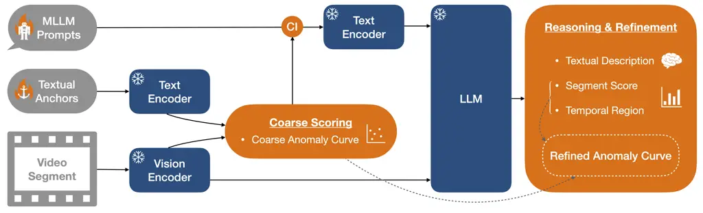

Figure 1: PrismVAU overview. Gray denotes inputs, blue indicates
off-the-shelf MLLM modules, and orange highlights our contributions. A
coarse anomaly curve is computed from the video segment and textual
anchor embeddings, then injected (“CI”) into the MLLM prompt. The MLLM
outputs a textual explanation, a segment-level anomaly score, and an
anomalous temporal region, which are used to refine the initial curve
into a temporally precise and semantically informed anomaly signal.

PrismVAU, illustrated in Fig. 1, is composed of two main modules for
performing video anomaly understanding: a coarse anomaly scoring module
and an MLLM-based reasoning and refinement module. The pipeline begins
by processing video data in non-overlapping segments of up to 30
seconds, ensuring that each segment is likely to fully encompass a
complete event, whereas shorter clips may fail to provide the temporal
context needed for reliable anomaly understanding in a single forward
pass. In the first stage, coarse anomaly scores are computed by
measuring the similarity between embeddings of the video segment frames
and a pair of optimized textual anchors. In the second stage, the MLLM
is prompted with both the coarse predictions and the corresponding video
segment to perform VAU directly, providing textual explanations and
anomalous temporal regions. Finally, the MLLM outputs are integrated
with the coarse anomaly curve to yield a temporally smoother and
semantically richer anomaly signal. A more detailed description of each
module is provided in the subsections below.

### 3.1 Coarse Anomaly Scoring via Textual Anchors

Given a video segment of duration $`D`$ seconds, frames are sampled at a
rate of $`Y`$ frames per second (FPS), resulting in
$`N=\lfloor D\times Y\rfloor`$ sampled frames. For each sampled frame
$`i`$, its visual embedding $`v_{i}`$ is computed using the vision
encoder of the MLLM, where the embedding is obtained by averaging the
embeddings of the visual patches within the frame.

Let $`t_{\text{norm}}`$ and $`t_{\text{abn}}`$ denote the textual
anchors representing generic descriptions of normal and abnormal scenes,
respectively. Their corresponding text embeddings, $`e_{\text{norm}}`$
and $`e_{\text{abn}}`$, are obtained using the text encoder of the same
MLLM by averaging the embeddings of the constituent text tokens.

The anomaly score $`a_{i}`$ of each sampled frame is computed using a
softmax function over the cosine similarities between the visual
embedding and the normal/abnormal text embeddings,
$`s_{i}^{\text{norm}}`$ and $`s_{i}^{\text{abn}}`$:

```math
a_{i}=\frac{\exp(s_{i}^{\text{abn}}/\tau)}{\exp(s_{i}^{\text{norm}}/\tau)+\exp(s_{i}^{\text{abn}}/\tau)}\,, \tag{1}
```

where $`\tau`$ is a temperature parameter that controls the sharpness of
the softmax distribution, fixed to 0.07 following common CLIP usage for
zero-shot classification \[24, 4\]. This results in an initial coarse
and sparse anomaly score sequence $`\{a_{i}\}_{i=1}^{N}`$ that reflects
the degree to which each sampled frame aligns with abnormal rather than
normal semantics.

The APE framework, depicted in Fig. 2, is used to enhance the
discriminability of the initial textual anchors (see Fig. 3(a)).
Following best practices from OPRO \[41\], a meta-prompt is constructed
including the task description, the desired output format, a history of
top-performing solutions, and a task reminder (see Supp. Material, Sec.
A). The MLLM also serves as an optimizer to generate new prompt
solutions. Each solution is then used to produce the corresponding set
of sparse, per-frame anomaly scores across a collection of videos,
$`V`$. Since only video-level labels are available during training,
these scores are aggregated at the video level. To encourage diversity
during optimization, multiple percentile functions are applied (_e.g_.,
90th, 95th, and 99th percentiles), rather than relying solely on the
maximum. The resulting video-level scores,
$`\{\hat{a_{j}}\}_{j=1}^{V}`$, are evaluated by computing the Area Under
the Curve (AUC) of the video-level Receiver Operating Characteristic
(ROC) curve. The solution that achieves the highest score is reported
for the next optimization step only if it is among the globally
top-performing solutions.

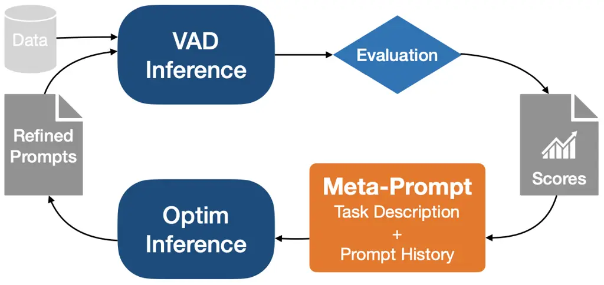

Figure 2: Diagram of the proposed APE framework for optimizing both
textual anchors and MLLM prompts. The same MLLM is used for inference
and optimization.

This process ultimately yields an optimized pair of textual prompts,
$`t_{\text{norm}}^{*}`$ and $`t_{\text{abn}}^{*}`$, which have been
inferred implicitly from the dataset distribution and not manually
defined. Rather than relying on human-written definitions of what
constitutes a “normal” or “abnormal” scene, the APE framework encourages
the model to distill these concepts directly from patterns in the video
data. As a result, the learned prompts capture more nuanced and
data-aligned representations of normality and abnormality, leading to
improved generalization and performance across diverse video samples.
This data-driven approach is particularly useful in real-world
applications, where anomalous scenes may be complex, rare, or difficult
to describe comprehensively.

### 3.2 MLLM-Based Reasoning and Refinement

While the coarse anomaly scores provide a rough estimate of the
frame-level anomaly likelihood, they lack high-level temporal reasoning,
contextual awareness, and semantic interpretability. To address these
limitations, a second-stage refinement module is introduced, leveraging
the capabilities of the MLLM to perform video anomaly understanding on
individual video segments.

The model receives the video segment and is prompted to (i) determine
whether an anomaly is present or not, (ii) localize it temporally by
predicting start and end timestamps $`u_{s}`$ and $`u_{e}`$, (iii)
assign an anomaly score $`b\in[0,1]`$ to the entire video segment, and
(iv) generate a short textual explanation that links visual evidence to
its prediction. Sparse frame-level scores are then derived by uniformly
assigning the segment score to all sampled frames within the localized
time interval, while frames outside receive a background value of 0,
producing a step-like anomaly curve:

```math
f(u)=\begin{cases}b,&u_{s}\leq u\leq u_{e}\\
0,&\text{otherwise}\end{cases}\,. \tag{2}
```

Both the system and user prompts employed for the task are optimized
using the same APE framework employed in the coarse stage. The initial
and optimized prompts, as well as the meta-prompt template, are provided
in Supp. Material, Sec. A.

Furthermore, we augmented the MLLM’s input with the coarse anomaly
predictions as additional guidance, motivated by the hypothesis that
explicit similarity priors could help refine the model’s reasoning.
Specifically, encoder-derived segment-level anomaly scores and
associated statistics were inserted as textual annotations in the user
prompt alongside the corresponding video segment. This design allows us
to test whether the MLLM benefits from explicit conditioning on
low-level similarity signals or whether such cues are already captured
implicitly by its multimodal reasoning. Results in Subsection 4.4
confirm that supplying such explicit information leads to improved MLLM
performance.

Lastly, to obtain a refined anomaly curve that is both semantically
consistent with the MLLM’s judgments and temporally smooth, both coarse
and MLLM sparse signals are processed using a Gaussian filter. The
effective temporal smoothing window spans approximately
$`\pm 2.5\sigma`$ seconds at 1 FPS, capturing 99% of the kernel’s area.
For the coarse anomaly predictions, $`\sigma=2`$ ($`\approx 5`$s
effective window) is manually selected, suppressing high-frequency noise
while preserving short-duration anomalies and maintaining stable
plateaus for longer events. This decision explicitly addresses the fact
that coarse scores are computed independently for each sampled frame
without temporal context. For the MLLM’s step-like predictions, a larger
$`\sigma=4`$ ($`\approx 10`$s effective window) is used to smooth abrupt
transitions and enforce semantic consistency across adjacent segments.
The resulting smoothed coarse and MLLM signals are combined through
simple averaging. Finally, to match the original frame rate of the
video, a parameter-free Fourier-based upsampling method is applied,
preserving frequency content and avoiding distortions or temporal lag
associated with naive frame-wise fill-forward approaches.

## 4 Experiments and Results

### 4.1 Datasets and Metrics

We conduct experiments on two large-scale VAD datasets. Our main
benchmark is UCF-Crime \[28\], which consists of 1,900 untrimmed
surveillance videos (128 hours) spanning 13 anomaly categories (_e.g_.,
robbery, fighting, vandalism) alongside normal events. UCF-Crime is
typically evaluated using the frame-level ROC AUC, which measures how
well anomalous and normal frames are separated. To further validate the
generality of our approach, we also evaluate PrismVAU on
XD-Violence \[34\], a larger dataset with nearly 5k videos (217 hours)
and 6 types of violent acts. XD-Violence is commonly evaluated using the
frame-level Average Precision (AP), _i.e_., the area under the
frame-level precision-recall curve, which focuses on measuring the
ability to identify anomalous frames.

While ROC AUC and AP are threshold-free metrics suited for smooth
anomaly curves, they are less appropriate for the MLLM outputs, which
are step-like by design. These standard metrics can overestimate
performance by emphasizing the ranking of anomalous versus normal frames
rather than the precise temporal localization of anomalies. Therefore,
the frame-level F1 score is also monitored using a fixed threshold of
0.5, allowing us to directly evaluate how well predicted segments cover
true anomalous frames in a precise and interpretable way that balances
missed detections and false alarms.

### 4.2 Implementation Details

VideoLLaMA-3-7B \[48\] has been selected as the MLLM due to its
state-of-the-art performance in video-language tasks such as long-video
understanding and temporal reasoning. Moreover, it employs a pruning
mechanism that removes temporally consecutive and visually similar
tokens, a common characteristic of static surveillance footage, thereby
improving computational efficiency.

Textual anchors are optimized using the APE framework for 100 iterations
with a population size of 10, while retaining the top 10 pairs from
previous iterations in the meta-prompt. Training is conducted on the
full training set sampled at 1 FPS, with vision embeddings cached during
the first iteration to accelerate subsequent evaluations.

Unlike anchor optimization, MLLM prompt evaluation requires a full
forward pass through the entire model rather than just the encoders,
making it considerably more expensive. To mitigate this, optimization is
performed on a reduced subset of training videos sampled at 0.5 FPS,
with a population size of 3 over 50 iterations, while retaining only the
top 5 previous pairs. To ensure balanced coverage of the anomaly space
under this computational budget, we curate a compact evaluation set with
3 randomly selected videos per anomaly type and an equal number of
normal videos, totaling 78 clips.

At test time, all components are evaluated at 1 FPS. The MLLM employs
greedy decoding to guarantee determinism and reproducibility, while
training uses stochastic sampling. All optimization experiments fit
within a single NVIDIA RTX 3090 GPU and complete in under 12 hours. On
the same hardware, PrismVAU inference runs in real time, with an average
latency of 0.13 s per processed frame and an effective throughput of 241
FPS under the 1 FPS sampling schedule.

### 4.3 Comparison to State-of-the-art Methods

A quantitative comparison with existing VAU and state-of-the-art (SOTA)
VAD methods on UCF-Crime and XD-Violence datasets is reported in Tab. 1.
Non-explainable approaches show steady gains with the adoption of weak
supervision and CLIP-based designs. Fine-tuned VAU methods achieve the
best overall results, underscoring the benefits of instruction tuning.
Meanwhile, non-fine-tuned VAU approaches remain highly competitive,
offering notable efficiency advantages alongside strong performance.

On both datasets, PrismVAU achieves the highest performance among
non-fine-tuned VAU methods. On UCF-Crime, it reaches a ROC AUC of 87.82%
and an F1 score of 41.52%, which is competitive with instruction-tuned
VAU models and surpasses all traditional VAD methods except VadCLIP. On
XD-Violence, PrismVAU obtains an AP of 78.68% and an F1 score of 70.23%,
further demonstrating its robustness across datasets. Notably, on both
benchmarks the frame-level false positive rate remains below 9% when
applying the intuitive 0.5 threshold, indicating that PrismVAU delivers
reliable anomaly predictions without sacrificing precision, which makes
it a practical and trustworthy approach for real-world applications.

|                             |               |         |
| --------------------------- | ------------- | ------- |
| Method                      | UCF (ROC AUC) | XD (AP) |
| Non-explainable VAD Methods |               |         |
| Tur _et al_. \[32\]         | 66.85         | -       |
| FPDM \[40\]                 | 74.70         | -       |
| Sultani _et al_. \[28\]     | 77.92         | 52.26   |
| RTFM \[31\]                 | 84.30         | 77.81   |
| MSL \[12\]                  | 85.62         | 78.59   |
| Zhang _et al_. \[49\]       | 86.22         | 81.43   |
| UMIL \[18\]                 | 86.75         | -       |
| OVVAD \[36\]                | 86.40         | 66.53   |
| PEL4VAD \[23\]              | 86.76         | 85.59   |
| Chen _et al_. \[3\]         | 86.83         | 88.21   |
| TPWNG \[43\]                | 87.79         | 83.68   |
| VadCLIP \[37\]              | 88.02         | 84.51   |
| Fine-tuned VAU Methods      |               |         |
| VAD-LLaMA \[17\]            | 88.13         | -       |
| Holmes-VAU \[51\]           | 88.96         | 87.68   |
| Holmes-VAD \[50\]           | 89.51         | 90.67   |
| Non-fine-tuned VAU Methods  |               |         |
| LAVAD \[47\]                | 80.28         | 62.01   |
| VERA \[45\]                 | 86.55         | 70.54   |
| PrismVAU (ours)             | 87.82         | 78.68   |

Table 1: ROC AUC (%) on UCF-Crime and AP (%) on XD-Violence datasets of
existing VAU and SOTA VAD methods. The best results per category are
displayed in bold, while the second best are underlined.

### 4.4 Ablation Studies

In the following subsection, we present and analyze the intermediate
results from both stages, coarse scoring via textual anchors and
MLLM-based reasoning and refinement, and examine their twofold
complementarity: (1) coarse predictions injected into MLLM prompts, and
(2) coarse anomaly curve post-processing influenced by the MLLM
outputs.

Textual anchors baseline. As shown in Tab. 2, the APE framework
effectively optimizes textual anchors. The initial solution performs
below random chance at the frame level, with a ROC AUC of 41.63%. After
optimization, performance improves sharply, more than doubling both ROC
AUC and F1 scores. Remarkably, this simple approach with textual anchors
already achieves competitive results, reaching a ROC AUC above 84% and
surpassing several VAD and VAU methods.

These textual prompts evolve from short descriptions and enumerations of
events into detailed scene-level narratives that emphasize environmental
cues and human behaviors (see Fig. 3). This transition from abstract
labels to visually grounded context indicates that MLLM encoders favor
naturalistic language, leading to stronger alignment with image
features. Moreover, optimized prompts provide distilled, generic
descriptions that encapsulate the defining characteristics of anomalous
and normal events in the UCF-Crime dataset.

The learning curve in Fig. 4(a) shows that early iterations yield rapid
gains in video ROC AUC, indicating that the initial anchors were poorly
aligned but quickly replaced with semantically stronger solutions. After
roughly 20 iterations, the curve begins to plateau, reflecting the
gradual refinement of existing top-performing prompts. The occasional
presence of low-scoring candidates even in later iterations suggests
that exploration is maintained throughout the process.

| Method   | ROC AUC (%) | F1 (%) |
| -------- | ----------- | ------ |
| TA       | 41.63       | 13.11  |
| TA^(∗)   | 84.53       | 35.07  |
| MLLM     | 58.72       | 27.19  |
| MLLM^(∗) | 70.78       | 39.45  |

Table 2: Baseline frame-level results on UCF-Crime. TA denotes the
textual anchors baseline, MLLM refers to VideoLLaMA-3 without the
injection of coarse priors, and ^(∗) marks the use of optimized prompts.
Both TA and MLLM predictions are upsampled using naive fill-forward.


(a)


(b)

Figure 3: Comparison of initial normal/abnormal textual anchors (a) with
their optimized counterparts (b).

MLLM baseline. As shown in Tab. 2, the APE framework is also effective
at optimizing the MLLM system and user prompts for VAU, achieving an
absolute improvement of over 10% in both ROC AUC and F1 scores.

The initial prompt pair is high-level and generalized, instructing the
model to simply detect anomalies and provide a score and description. In
contrast, the optimized prompts adopt a more systematic and detailed
approach, providing explicit guidance by listing specific behaviors to
analyze, such as motion trajectories, object interactions, and
contextual mismatches, thereby promoting temporally grounded reasoning
(see Supp. Material, Sec. A). In contrast to the base solution, the
specified output format is reinforced in both the system and user
prompts. Overall, these refinements yield richer, context-aware anomaly
detection and contribute to the observed performance gains.

Figure 4(b) depicts the corresponding learning curve of the optimization
process, which starts from a near-random solution. The curve
demonstrates rapid learning, with the best solution found in less than
15 iterations, reaching a video-level ROC AUC of nearly 90%. After this
point, the performance plateaus, indicating that the optimization has
converged to a highly effective prompt and early stopping is
triggered.

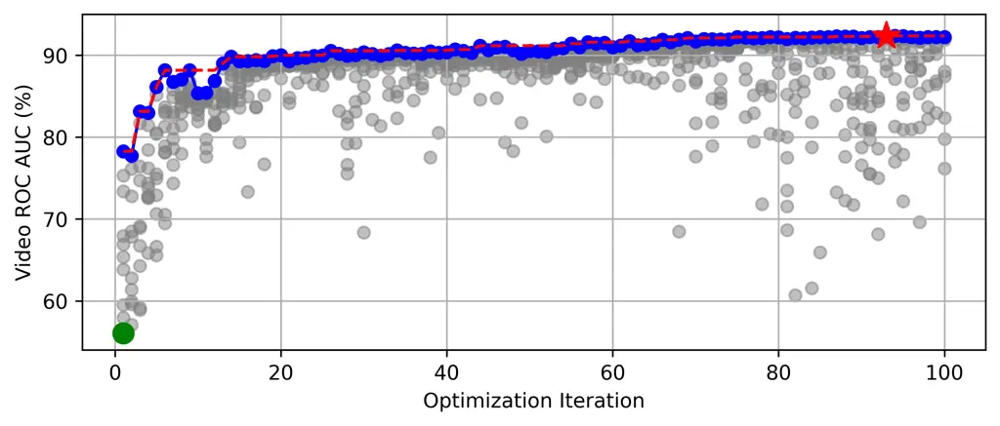

(a)

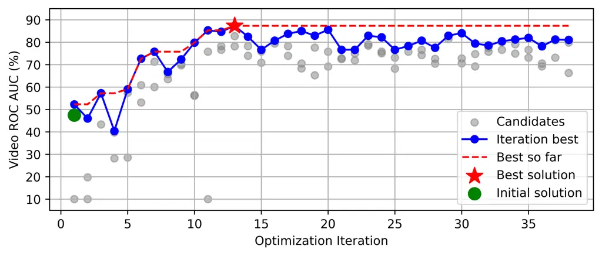

(b)

Figure 4: Learning curves produced by the APE optimization of textual
anchors (a) and of the MLLM system and user prompts (b) on UCF-Crime.

Textual anchors vs MLLM. Table 2 highlights a key trade-off between the
two approaches. Textual anchors produce smooth anomaly curves that rank
anomalous frames more reliably, yielding superior threshold-free
performance as measured by ROC AUC. In contrast, the MLLM generates
step-like predictions that more accurately capture the temporal extent
of anomalies, which improves segment-level detection performance at a
fixed threshold, as reflected in the F1 score. The Pearson correlation
between TA and MLLM predicted probabilities is moderate ($`r=0.37`$),
while their error correlation is lower ($`r=0.28`$), indicating that the
models often agree in general prediction trends but make mistakes on
different instances. These results illustrate the complementary
strengths not only of the evaluation metrics but, more importantly, of
the methods themselves: textual anchors excel in global
discriminability, while MLLM provides superior temporal precision and
detailed textual reasoning, motivating their integration in a unified
anomaly understanding system, PrismVAU. Baseline results on the
XD-Violence dataset further corroborate this complementary behavior (see
Supp. Material, Sec. B).

Building on this, we also investigate how well these components transfer
across datasets focused on criminal activity. A new pair of textual
anchors was distilled for XD-Violence, as the notion of abnormality
slightly differs between datasets. In contrast, the MLLM prompts were
reused directly from UCF-Crime, demonstrating their cross-dataset
generalizability in detecting anomalies through motion trajectories,
object interactions, and contextual mismatches.

Injection of coarse predictions. Once optimal MLLM prompts for the VAU
task were obtained, we explored the injection of coarse predictions as
an additional input to the MLLM. This approach is motivated by the
hypothesis that explicit similarity priors could complement the base
MLLM performance. At the same time, it aligns the MLLM reasoning with
the coarse anomaly curve.

We evaluated the effect of injecting coarse predictions into the MLLM
input at varying levels of granularity, all provided in JSON format. The
injected information includes the coarse video label (indicating whether
the textual anchors module detected an anomaly in the video segment),
the coarse segment-level abnormality score, and the start and end
timestamps of the most anomalous coarse region, if any. Additionally, we
incorporated frame-level statistics derived from coarse scores, such as
the maximum score and its timestamp, the median, the mean, the standard
deviation, and the total time duration exceeding the 0.5 anomaly
threshold. As shown in Tab. 3, progressively providing more detailed
coarse information consistently improves ROC AUC, with the full set of
coarse features achieving the highest performance.

| L   | S   | T   | F   | ROC AUC (%) |
| --- | --- | --- | --- | ----------- |
|     |     |     |     | 70.78       |
| ✓   |     |     |     | 72.91       |
| ✓   | ✓   |     |     | 73.68       |
| ✓   | ✓   | ✓   |     | 74.18       |
| ✓   | ✓   | ✓   | ✓   | 76.97       |

Table 3: Results of progressively injecting coarse predictions into the
MLLM input on UCF-Crime. “L” denotes video label, “S” video score, “T”
temporal region, and “F” frame statistics.

Per-category performance. PrismVAU surpasses both its components across
most anomaly categories, achieving its strongest performance in assault.
TA is most effective when anomalies exhibit distinctive visual cues,
while MLLM excels in cases requiring contextual, relational, or subtle
motion understanding. A more detailed per-category analysis is provided
in Supp. Material, Sec. C.

### 4.5 Qualitative Results

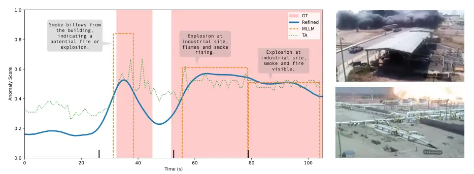

Figure 5: Results on Explosion033_x264 from UCF-Crime. Ground-truth (GT)
anomalous intervals are compared against the coarse anomaly curve from
the textual anchors (TA), the step-like MLLM predictions, and the
refined anomaly curve. Human-readable explanations generated by the MLLM
are shown as speech bubbles. Bold ticks on the x-axis indicate video
segment partitions used when processing the untrimmed video. Sample
frames on the right illustrate key anomaly events.

The coarse anomalous curves derived from the textual anchors exhibit
high-frequency noise but still capture the overall anomaly trend. The
MLLM, in turn, produces step-like predictions that align well with
ground-truth boundaries in most cases and minor offsets can be partly
attributed to annotation ambiguity, as it is not always clear when
certain behaviors begin or end (_e.g_., lingering near items may precede
the actual theft). Occasionally, the MLLM detects subtle unannotated
anomalies that plausibly precede or follow the main event. PrismVAU’s
refined curve achieves sharp temporal localization while also improving
frame-level discriminability.

PrismVAU’s generated textual explanations are representative of the
observed events, though confusions may arise between closely related
anomaly categories (_e.g_., abuse, assault, fight, and robbery), which
often co-occur within the same event. In some cases, descriptions are
enriched by leveraging textual cues in the video, such as captions or
visible signage. To further assess explanation quality, semantic
similarity is computed between the generated descriptions and the
HIVAU-70k \[51\] ground-truth annotations using MPNet \[27\] embeddings.
An average similarity of 0.56 is obtained, indicating that PrismVAU
generally captures the core semantics of the underlying anomalous
events. Additional details of this procedure are provided in Supp.
Material Sec. D.

Figure 5 showcases PrismVAU’s anomaly detection results on a test video
from UCF-Crime, where it successfully identifies and describes two
explosion events. Additional case studies on videos from both benchmarks
are presented in Supp. Material, Sec. E, further demonstrating
PrismVAU’s ability not only to detect anomalies but also to
contextualize them with semantically meaningful explanations.

Another valuable feature of PrismVAU is its interactive chat interface,
as no weight fine-tuning is applied. Users can engage with the model to
audit system errors, elaborate on correct predictions, and explore
counterfactual or hypothetical scenarios, as shown in Fig. 6 and in
Supp. Material, Sec. E. This interactive setup improves transparency and
interpretability while also demonstrating the model’s ability to reason
about cause, intent, and context, essential capabilities for trustworthy
video anomaly detection.


Figure 6: Interactive dialogue with PrismVAU on a normal scene,
Normal_Videos_877_x264 from UCF-Crime.

## 5 Summary and Future Work

We introduced PrismVAU, a lightweight and effective approach to
real-time VAU. Unlike prior methods that require fine-tuned MLLMs,
auxiliary modules, or dense and overlapping video processing, PrismVAU
operates efficiently with a single off-the-shelf MLLM. It combines a
coarse anomaly scoring module based on textual anchors with an
MLLM-driven reasoning and refinement stage that contextualizes anomalies
via prompts and lightweight post-processing. Both anchors and prompts
are optimized using a weakly supervised APE framework, with the MLLM
itself serving as the optimizer. Experimental results on standard VAD
benchmarks demonstrate that PrismVAU achieves competitive anomaly
detection performance while also providing interpretable explanations of
anomalous events.

While this work focuses on criminal behavior, PrismVAU can be extended
to detect other types of events or actions by re-optimizing both anchors
and prompts. Although we have evaluated PrismVAU using VideoLLaMA-3, the
pipeline is model-agnostic and can be adapted to other MLLMs with
minimal effort. Future work should also explore the development of
standardized benchmarks and metrics for evaluating textual explanations,
as current fine-tuned methods rely on custom datasets and ad hoc
criteria. Establishing such standards would enable more robust and
objective comparisons across methods, accelerating the development of
transparent and reliable VAU systems.

Ethical considerations. The definition of criminal actions in this work
relies on annotations from existing, recognized datasets. We acknowledge
that these annotations may be imperfect, context-dependent, and subject
to sociocultural variation. Accordingly, PrismVAU is presented as a step
toward ethical autonomous criminal activity detection and is not
intended for real-world deployment without careful ethical, practical,
and regulatory consideration.

Acknowledgements. This work has been partially supported by the Spanish
project PID2022-136436NB-I00, by ICREA under the ICREA Academia
programme, and by the Milestone Research Program at the University of
Barcelona.

## References

- \[1\] T. B. Brown, B. Mann, N. Ryder, M. Subbiah, J. Kaplan, P.
  Dhariwal, A. Neelakantan, P. Shyam, G. Sastry, A. Askell, S.
  Agarwal, A. Herbert-Voss, G. Krueger, T. Henighan, R. Child, A.
  Ramesh, D. M. Ziegler, J. Wu, C. Winter, C. Hesse, M. Chen, E.
  Sigler, M. Litwin, S. Gray, B. Chess, J. Clark, C. Berner, S.
  McCandlish, A. Radford, I. Sutskever, and D. Amodei (2020) Language
  models are few-shot learners. In Proceedings of the 34th International
  Conference on Neural Information Processing Systems, NIPS ’20, Red
  Hook, NY, USA. External Links: ISBN 9781713829546 Cited by: §2.3.
- \[2\] C. Cao, Y. Lu, P. Wang, and Y. Zhang (2023) A new comprehensive
  benchmark for semi-supervised video anomaly detection and
  anticipation. In 2023 IEEE/CVF Conference on Computer Vision and
  Pattern Recognition (CVPR), Vol. , pp. 20392–20401. External Links:
  [Document](https://dx.doi.org/10.1109/CVPR52729.2023.01953) Cited by:
  §2.1.
- \[3\] J. Chen, L. Li, L. Su, Z. Zha, and Q. Huang (2024)
  Prompt-enhanced multiple instance learning for weakly supervised video
  anomaly detection. In 2024 IEEE/CVF Conference on Computer Vision and
  Pattern Recognition (CVPR), Vol. , pp. 18319–18329. External Links:
  [Document](https://dx.doi.org/10.1109/CVPR52733.2024.01734) Cited by:
  §2.1, Table 1.
- \[4\] Z. Chen, Y. Deng, Y. Li, and Q. Gu (2024) Understanding
  transferable representation learning and zero-shot transfer in CLIP.
  In The Twelfth International Conference on Learning Representations,
  External Links: [Link](https://openreview.net/forum?id=S5yOuNfSA0)
  Cited by: §3.1.
- \[5\] H. Du, G. Nan, J. Qian, W. Wu, W. Deng, H. Mu, Z. Chen, P.
  Mao, X. Tao, and J. Liu (2024) Exploring what why and how: a
  multifaceted benchmark for causation understanding of video anomaly.
  arXiv preprint arXiv:2412.07183. Cited by: §2.2.
- \[6\] H. Du, S. Zhang, B. Xie, G. Nan, J. Zhang, J. Xu, H. Liu, S.
  Leng, J. Liu, H. Fan, D. Huang, J. Feng, L. Chen, C. Zhang, X. Li, H.
  Zhang, J. Chen, Q. Cui, and X. Tao (2024) Uncovering what, why and
  how: a comprehensive benchmark for causation understanding of video
  anomaly. In 2024 IEEE/CVF Conference on Computer Vision and Pattern
  Recognition (CVPR), Vol. , pp. 18793–18803. External Links:
  [Document](https://dx.doi.org/10.1109/CVPR52733.2024.01778) Cited by:
  §2.2.
- \[7\] C. Fernando, D. Banarse, H. Michalewski, S. Osindero, and T.
  Rocktäschel (2024) Promptbreeder: self-referential self-improvement
  via prompt evolution. In Proceedings of the 41st International
  Conference on Machine Learning, ICML’24. Cited by: §2.3.
- \[8\] T. Foltz (2025) Video anomaly detection with structured
  keywords. External Links: 2503.10653,
  [Link](https://arxiv.org/abs/2503.10653) Cited by: §2.2.
- \[9\] P. Gabriel, P. Rehani, T. Troy, T. Wyatt, M. Choma, and N.
  Singh (2025) Continuous patient monitoring with ai: real-time analysis
  of video in hospital care settings. Frontiers in Imaging Volume 4 - 2025. External Links:
  [Link](https://www.frontiersin.org/journals/imaging/articles/10.3389/fimag.2025.1547166),
  [Document](https://dx.doi.org/10.3389/fimag.2025.1547166), ISSN
  2813-3315 Cited by: §1.
- \[10\] S. S. Khan, P. K. Mishra, N. Javed, B. Ye, K. Newman, A.
  Mihailidis, and A. Iaboni (2022) Unsupervised deep learning to detect
  agitation from videos in people with dementia. IEEE Access 10 (),
  pp. 10349–10358. External Links:
  [Document](https://dx.doi.org/10.1109/ACCESS.2022.3143990) Cited by:
  §1.
- \[11\] L. Killian, M. Julien, B. Kevin, L. Maxime, B. Carolina, C.
  Mélanie, B. Nathalie, G. Sylvain, and G. Sebastien (2021) Fall
  prevention and detection in smart homes using monocular cameras and an
  interactive social robot. In Proceedings of the Conference on
  Information Technology for Social Good, GoodIT ’21, New York, NY, USA,
  pp. 7–12. External Links: ISBN 9781450384780,
  [Link](https://doi.org/10.1145/3462203.3475892),
  [Document](https://dx.doi.org/10.1145/3462203.3475892) Cited by: §1.
- \[12\] S. Li, F. Liu, and L. Jiao (2022) Self-training multi-sequence
  learning with transformer for weakly supervised video anomaly
  detection. Proceedings of the AAAI Conference on Artificial
  Intelligence 36 (2), pp. 1395–1403. External Links:
  [Link](https://ojs.aaai.org/index.php/AAAI/article/view/20028),
  [Document](https://dx.doi.org/10.1609/aaai.v36i2.20028) Cited by:
  §2.1, Table 1.
- \[13\] W. Liu, D. L. W. Luo, and S. Gao (2018) Future frame prediction
  for anomaly detection – a new baseline. In 2018 IEEE Conference on
  Computer Vision and Pattern Recognition (CVPR), Cited by: §2.1.
- \[14\] Z. Liu, Y. Nie, C. Long, Q. Zhang, and G. Li (2021) A hybrid
  video anomaly detection framework via memory-augmented flow
  reconstruction and flow-guided frame prediction. In 2021 IEEE/CVF
  International Conference on Computer Vision (ICCV), Vol. ,
  pp. 13568–13577. External Links:
  [Document](https://dx.doi.org/10.1109/ICCV48922.2021.01333) Cited by:
  §2.1.
- \[15\] C. Lu, J. Shi, and J. Jia (2013) Abnormal event detection at
  150 fps in matlab. In 2013 IEEE International Conference on Computer
  Vision, Vol. , pp. 2720–2727. External Links:
  [Document](https://dx.doi.org/10.1109/ICCV.2013.338) Cited by: §2.1.
- \[16\] H. Lv, C. Chen, Z. Cui, C. Xu, Y. Li, and J. Yang (2021)
  Learning normal dynamics in videos with meta prototype network. In
  2021 IEEE/CVF Conference on Computer Vision and Pattern Recognition
  (CVPR), Vol. , pp. 15420–15429. External Links:
  [Document](https://dx.doi.org/10.1109/CVPR46437.2021.01517) Cited by:
  §2.1.
- \[17\] H. Lv and Q. Sun (2024) Video anomaly detection and explanation
  via large language models. External Links: 2401.05702,
  [Link](https://arxiv.org/abs/2401.05702) Cited by: §2.2, Table 1.
- \[18\] H. Lv, Z. Yue, Q. Sun, B. Luo, Z. Cui, and H. Zhang (2023)
  Unbiased Multiple Instance Learning for Weakly Supervised Video
  Anomaly Detection . In 2023 IEEE/CVF Conference on Computer Vision and
  Pattern Recognition (CVPR), Vol. , Los Alamitos, CA, USA,
  pp. 8022–8031. External Links: ISSN ,
  [Document](https://dx.doi.org/10.1109/CVPR52729.2023.00775),
  [Link](https://doi.ieeecomputersociety.org/10.1109/CVPR52729.2023.00775)
  Cited by: §2.1, Table 1.
- \[19\] V. Mahadevan, W. Li, V. Bhalodia, and N. Vasconcelos (2010)
  Anomaly detection in crowded scenes. In 2010 IEEE Computer Society
  Conference on Computer Vision and Pattern Recognition, Vol. ,
  pp. 1975–1981. External Links:
  [Document](https://dx.doi.org/10.1109/CVPR.2010.5539872) Cited by:
  §2.1.
- \[20\] O. Mañas, P. Astolfi, M. Hall, C. Ross, J. Urbanek, A.
  Williams, A. Agrawal, A. Romero-Soriano, and M. Drozdzal (2024)
  Improving text-to-image consistency via automatic prompt optimization.
  Transactions on Machine Learning Research. Note: Featured
  Certification External Links: ISSN 2835-8856,
  [Link](https://openreview.net/forum?id=g12Gdl6aDL) Cited by: §2.3.
- \[21\] S. Mohammadi, A. Perina, H. Kiani, and V. Murino (2016) Angry
  crowds: detecting violent events in videos. In Computer Vision – ECCV
  2016, B. Leibe, J. Matas, N. Sebe, and M. Welling (Eds.), Cham,
  pp. 3–18. External Links: ISBN 978-3-319-46478-7 Cited by: §1.
- \[22\] S. Orlova, T. Kerssies, B. B. Englert, and G. Dubbelman (2025)
  Simplifying traffic anomaly detection with video foundation models. In
  Proceedings of the IEEE/CVF International Conference on Computer
  Vision, Cited by: §1.
- \[23\] Y. Pu, X. Wu, L. Yang, and S. Wang (2024) Learning
  prompt-enhanced context features for weakly-supervised video anomaly
  detection. IEEE Transactions on Image Processing 33 (), pp. 4923–4936.
  External Links:
  [Document](https://dx.doi.org/10.1109/TIP.2024.3451935) Cited by:
  §2.1, Table 1.
- \[24\] A. Radford, J. W. Kim, C. Hallacy, A. Ramesh, G. Goh, S.
  Agarwal, G. Sastry, A. Askell, P. Mishkin, J. Clark, G. Krueger,
  and I. Sutskever (2021) Learning transferable visual models from
  natural language supervision. In International Conference on Machine
  Learning, External Links:
  [Link](https://api.semanticscholar.org/CorpusID:231591445) Cited by:
  §2.1, §3.1.
- \[25\] B. Ramachandra and M. J. Jones (2020) Street scene: a new
  dataset and evaluation protocol for video anomaly detection. In 2020
  IEEE Winter Conference on Applications of Computer Vision (WACV), Vol.
  , pp. 2558–2567. External Links:
  [Document](https://dx.doi.org/10.1109/WACV45572.2020.9093457) Cited
  by: §2.1.
- \[26\] P. Singh, J. Choudhari, S. Nair, and D. McIlwraith (2025)
  Prompt smart, pay less: cost-aware APO for real-world applications. In
  First International KDD Workshop on Prompt Optimization, 2025,
  External Links: [Link](https://openreview.net/forum?id=zOPlFTo80v)
  Cited by: §2.3.
- \[27\] K. Song, X. Tan, T. Qin, J. Lu, and T. Liu (2020) MPNet: masked
  and permuted pre-training for language understanding. In Advances in
  Neural Information Processing Systems, H. Larochelle, M. Ranzato, R.
  Hadsell, M.F. Balcan, and H. Lin (Eds.), Vol. 33, pp. 16857–16867.
  External Links:
  [Link](https://proceedings.neurips.cc/paper_files/paper/2020/file/c3a690be93aa602ee2dc0ccab5b7b67e-Paper.pdf)
  Cited by: §4.5.
- \[28\] W. Sultani, C. Chen, and M. Shah (2018) Real-world anomaly
  detection in surveillance videos. In 2018 IEEE/CVF Conference on
  Computer Vision and Pattern Recognition, Vol. , pp. 6479–6488.
  External Links: [Document](https://dx.doi.org/10.1109/CVPR.2018.00678)
  Cited by: §1, §2.1, §4.1, Table 1.
- \[29\] S. Sun and X. Gong (2023) Hierarchical semantic contrast for
  scene-aware video anomaly detection. In 2023 IEEE/CVF Conference on
  Computer Vision and Pattern Recognition (CVPR), Vol. ,
  pp. 22846–22856. External Links:
  [Document](https://dx.doi.org/10.1109/CVPR52729.2023.02188) Cited by:
  §2.1.
- \[30\] J. Tang, H. Lu, R. Wu, X. Xu, K. Ma, C. Fang, B. Guo, J. Lu, Q.
  Chen, and Y. Chen (2024) Hawk: learning to understand open-world video
  anomalies. In Neural Information Processing Systems (NeurIPS), Cited
  by: §2.2.
- \[31\] Y. Tian, G. Pang, Y. Chen, R. Singh, J. W. Verjans, and G.
  Carneiro (2021) Weakly-supervised video anomaly detection with robust
  temporal feature magnitude learning. In 2021 IEEE/CVF International
  Conference on Computer Vision (ICCV), Vol. , pp. 4955–4966. External
  Links: [Document](https://dx.doi.org/10.1109/ICCV48922.2021.00493)
  Cited by: §2.1, Table 1.
- \[32\] A. O. Tur, N. Dall’Asen, C. Beyan, and E. Ricci (2023)
  Unsupervised video anomaly detection with diffusion models conditioned
  on compact motion representations. In Image Analysis and Processing –
  ICIAP 2023, G. L. Foresti, A. Fusiello, and E. Hancock (Eds.), Cham,
  pp. 49–62. External Links: ISBN 978-3-031-43153-1 Cited by: §2.1,
  Table 1.
- \[33\] J. Wei, X. Wang, D. Schuurmans, M. Bosma, B. Ichter, F.
  Xia, E. H. Chi, Q. V. Le, and D. Zhou (2022) Chain-of-thought
  prompting elicits reasoning in large language models. In Proceedings
  of the 36th International Conference on Neural Information Processing
  Systems, NIPS ’22, Red Hook, NY, USA. External Links: ISBN
  9781713871088 Cited by: §2.3.
- \[34\] P. Wu, J. Liu, Y. Shi, Y. Sun, F. Shao, Z. Wu, and Z.
  Yang (2020) Not only look, but also listen: learning multimodal
  violence detection under weak supervision. In Computer Vision – ECCV
  2020: 16th European Conference, Glasgow, UK, August 23–28, 2020,
  Proceedings, Part XXX, Berlin, Heidelberg, pp. 322–339. External
  Links: ISBN 978-3-030-58576-1,
  [Link](https://doi.org/10.1007/978-3-030-58577-8_20),
  [Document](https://dx.doi.org/10.1007/978-3-030-58577-8%5F20) Cited
  by: §1, §2.1, §4.1.
- \[35\] P. Wu and J. Liu (2021) Learning causal temporal relation and
  feature discrimination for anomaly detection. IEEE Transactions on
  Image Processing 30 (), pp. 3513–3527. External Links:
  [Document](https://dx.doi.org/10.1109/TIP.2021.3062192) Cited by:
  §2.1.
- \[36\] P. Wu, X. Zhou, G. Pang, Y. Sun, J. Liu, P. Wang, and Y.
  Zhang (2024) Open-Vocabulary Video Anomaly Detection . In 2024
  IEEE/CVF Conference on Computer Vision and Pattern Recognition (CVPR),
  Vol. , Los Alamitos, CA, USA, pp. 18297–18307. External Links: ISSN ,
  [Document](https://dx.doi.org/10.1109/CVPR52733.2024.01732),
  [Link](https://doi.ieeecomputersociety.org/10.1109/CVPR52733.2024.01732)
  Cited by: §2.1, Table 1.
- \[37\] P. Wu, X. Zhou, G. Pang, L. Zhou, Q. Yan, P. Wang, and Y.
  Zhang (2024) VadCLIP: adapting vision-language models for weakly
  supervised video anomaly detection. In Proceedings of the
  Thirty-Eighth AAAI Conference on Artificial Intelligence and
  Thirty-Sixth Conference on Innovative Applications of Artificial
  Intelligence and Fourteenth Symposium on Educational Advances in
  Artificial Intelligence, AAAI’24/IAAI’24/EAAI’24. External Links: ISBN
  978-1-57735-887-9, [Link](https://doi.org/10.1609/aaai.v38i6.28423),
  [Document](https://dx.doi.org/10.1609/aaai.v38i6.28423) Cited by:
  §2.1, Table 1.
- \[38\] J. Xian, S. Samuel, F. Khoubsirat, R. Pradeep, M. Sultan, R.
  Florian, S. Roukos, A. Sil, C. Potts, and O. Khattab (2024) Prompts as
  auto-optimized training hyperparameters: training best-in-class ir
  models from scratch with 10 gold labels. External Links:
  [Document](https://dx.doi.org/10.48550/arXiv.2406.11706) Cited by:
  §2.3.
- \[39\] Y. Xu, H. Hu, C. Huang, Y. Nan, Y. Liu, K. Wang, Z. Liu, and S.
  Lian (2025) TAD: a large-scale benchmark for traffic accidents
  detection from video surveillance. IEEE Access 13 (), pp. 2018–2033.
  External Links:
  [Document](https://dx.doi.org/10.1109/ACCESS.2024.3522384) Cited by:
  §1, §2.1.
- \[40\] C. Yan, S. Zhang, Y. Liu, G. Pang, and W. Wang (2023) Feature
  prediction diffusion model for video anomaly detection. In 2023
  IEEE/CVF International Conference on Computer Vision (ICCV), Vol. ,
  pp. 5504–5514. External Links:
  [Document](https://dx.doi.org/10.1109/ICCV51070.2023.00509) Cited by:
  §2.1, Table 1.
- \[41\] C. Yang, X. Wang, Y. Lu, H. Liu, Q. V. Le, D. Zhou, and X.
  Chen (2024) Large language models as optimizers. In The Twelfth
  International Conference on Learning Representations, External Links:
  [Link](https://openreview.net/forum?id=Bb4VGOWELI) Cited by: §2.3,
  §3.1.
- \[42\] Y. Yang, K. Lee, B. Dariush, Y. Cao, and S. Lo (2024) Follow
  the rules: reasoning for video anomaly detection with large language
  models. In Computer Vision – ECCV 2024: 18th European Conference,
  Milan, Italy, September 29–October 4, 2024, Proceedings, Part LXXXI,
  Berlin, Heidelberg, pp. 304–322. External Links: ISBN
  978-3-031-73003-0,
  [Link](https://doi.org/10.1007/978-3-031-73004-7_18),
  [Document](https://dx.doi.org/10.1007/978-3-031-73004-7%5F18) Cited
  by: §2.2, §2.2.
- \[43\] Z. Yang, J. Liu, and P. Wu (2024) Text prompt with normality
  guidance for weakly supervised video anomaly detection. In 2024
  IEEE/CVF Conference on Computer Vision and Pattern Recognition (CVPR),
  Vol. , pp. 18899–18908. External Links:
  [Document](https://dx.doi.org/10.1109/CVPR52733.2024.01788) Cited by:
  §2.1, Table 1.
- \[44\] Y. Yao, M. Xu, Y. Wang, D. J. Crandall, and E. M. Atkins (2019)
  Unsupervised traffic accident detection in first-person videos. In
  2019 IEEE/RSJ International Conference on Intelligent Robots and
  Systems (IROS), pp. 273–280. External Links:
  [Link](https://doi.org/10.1109/IROS40897.2019.8967556),
  [Document](https://dx.doi.org/10.1109/IROS40897.2019.8967556) Cited
  by: §1.
- \[45\] M. Ye, W. Liu, and P. He (2025) VERA: explainable video anomaly
  detection via verbalized learning of vision-language models. In
  Proceedings of the Computer Vision and Pattern Recognition Conference
  (CVPR), pp. 8679–8688. Cited by: §2.2, §2.2, Table 1.
- \[46\] S. Ye, Z. Sun, G. Wang, L. Guo, Q. Liang, Z. Li, and Y.
  Liu (2025) Prompt alchemy: automatic prompt refinement for enhancing
  code generation. IEEE Transactions on Software Engineering (),
  pp. 1–22. External Links:
  [Document](https://dx.doi.org/10.1109/TSE.2025.3589634) Cited by:
  §2.3.
- \[47\] L. Zanella, W. Menapace, M. Mancini, Y. Wang, and E.
  Ricci (2024) Harnessing Large Language Models for Training-Free Video
  Anomaly Detection . In 2024 IEEE/CVF Conference on Computer Vision and
  Pattern Recognition (CVPR), Vol. , Los Alamitos, CA, USA,
  pp. 18527–18536. External Links: ISSN ,
  [Document](https://dx.doi.org/10.1109/CVPR52733.2024.01753),
  [Link](https://doi.ieeecomputersociety.org/10.1109/CVPR52733.2024.01753)
  Cited by: §2.2, §2.2, Table 1.
- \[48\] B. Zhang, K. Li, Z. Cheng, Z. Hu, Y. Yuan, G. Chen, S. Leng, Y.
  Jiang, H. Zhang, X. Li, P. Jin, W. Zhang, F. Wang, L. Bing, and D.
  Zhao (2025) VideoLLaMA 3: frontier multimodal foundation models for
  image and video understanding. arXiv preprint arXiv:2501.13106.
  External Links: [Link](https://arxiv.org/abs/2501.13106) Cited by: §1,
  §4.2.
- \[49\] C. Zhang, G. Li, Y. Qi, S. Wang, L. Qing, Q. Huang, and M.
  Yang (2023) Exploiting completeness and uncertainty of pseudo labels
  for weakly supervised video anomaly detection. In 2023 IEEE/CVF
  Conference on Computer Vision and Pattern Recognition (CVPR), Vol. ,
  pp. 16271–16280. External Links:
  [Document](https://dx.doi.org/10.1109/CVPR52729.2023.01561) Cited by:
  §2.1, Table 1.
- \[50\] H. Zhang, X. Xu, X. Wang, J. Zuo, C. Han, X. Huang, C. Gao, Y.
  Wang, and N. Sang (2024) Holmes-vad: towards unbiased and explainable
  video anomaly detection via multi-modal llm. CoRR abs/2406.12235.
  External Links: [Link](https://doi.org/10.48550/arXiv.2406.12235)
  Cited by: §2.2, Table 1.
- \[51\] H. Zhang, X. Xu, X. Wang, J. Zuo, X. Huang, C. Gao, S.
  Zhang, L. Yu, and N. Sang (2025) Holmes-vau: towards long-term video
  anomaly understanding at any granularity. In Proceedings of the
  Computer Vision and Pattern Recognition Conference (CVPR),
  pp. 13843–13853. Cited by: §2.2, §4.5, Table 1.
- \[52\] Y. Zhou, A. I. Muresanu, Z. Han, K. Paster, S. Pitis, H. Chan,
  and J. Ba (2022) Large language models are human-level prompt
  engineers. In NeurIPS 2022 Foundation Models for Decision Making
  Workshop, External Links:
  [Link](https://openreview.net/forum?id=YdqwNaCLCx) Cited by: §2.3.
- \[53\] L. Zhu, L. Wang, A. Raj, T. Gedeon, and C. Chen (2024)
  Advancing video anomaly detection: a concise review and a new dataset.
  In Advances in Neural Information Processing Systems, A. Globerson, L.
  Mackey, D. Belgrave, A. Fan, U. Paquet, J. Tomczak, and C. Zhang
  (Eds.), Vol. 37, pp. 89943–89977. External Links:
  [Link](https://proceedings.neurips.cc/paper_files/paper/2024/file/a3c5af1f56fc73eef1ba0f442739f5ca-Paper-Datasets_and_Benchmarks_Track.pdf)
  Cited by: §2.1.

## PrismVAU: Prompt-Refined Inference System for Multimodal Video Anomaly Understanding (Supplementary Material)

## A Prompts and Meta-prompts

In this section, we provide the meta-prompt used as user prompt for
optimizing the textual anchors (see Fig. 1). The meta-prompt used for
optimizing the MLLM prompts for the VAU task (see Fig. 2). In both
cases, the red text corresponds to the placeholders representing initial
solutions and their associated scores. The initial and optimized MLLM
prompts for VAU are also reported in Fig. 3, where the blue text
corresponds to the portions manually augmented to incorporate coarse
anomaly predictions as additional context in JSON format. Finally, the
optimized textual anchors for the XD-Violence dataset are displayed
in Fig. 4.


Figure 1: Meta-prompt used for optimizing textual anchors.


Figure 2: Meta-prompt used for optimizing the VAU prompts of the MLLM.


(a)


(b)

Figure 3: Comparison of initial system and user MLLM prompts for VAU (a)
with their optimized counterparts (b).


Figure 4: Distilled textual anchors of the XD-Violence dataset.

## B Results on XD-Violence

In this section, we present the baseline results on the XD-Violence
dataset. A new pair of textual anchors was distilled to account for
dataset-specific notions of abnormality, achieving a substantial
improvement in performance over unoptimized anchors. In contrast, the
MLLM prompts from the UCF-Crime dataset were reused directly,
demonstrating their cross-dataset generalizability in detecting
anomalies through motion trajectories, object interactions, and
contextual mismatches. The results in Tab. 1 further highlight the
complementary strengths of these methods; textual anchors achieve higher
AP, reflecting stronger global discriminability, while the MLLM provides
superior temporal precision, as reflected in the F1 scores.

| Method   | AP (%) | F1 (%) |
| -------- | ------ | ------ |
| TA       | 42.15  | 39.03  |
| TA^(∗)   | 74.66  | 56.36  |
| MLLM     | 59.44  | 26.81  |
| MLLM^(∗) | 65.07  | 59.98  |

Table 1: Baseline frame-level results on XD-Violence. TA denotes the
textual anchors baseline, MLLM refers to VideoLLaMA-3 without coarse
priors, and ^(∗) marks the use of optimized prompts.

## C Performance Across Anomaly Types

As depicted in Fig. 5, PrismVAU outperforms both its components in 8 of
13 categories. Owing to its joint design, PrismVAU can compensate when
either TA or the MLLM underperforms, yielding its highest ROC AUC on
assault and lowest on explosion. The largest performance gains are
observed in vandalism and road accident relative to TA, and in stealing
relative to the MLLM.

Textual anchors tend to excel when anomalies exhibit distinctive visual
patterns or strong visual-text alignment, particularly when static cues
suffice, as in shooting (weapon, pose, and scene cues). In contrast, the
MLLM performs better when context, relational reasoning, or subtle
temporal cues are critical, such as in vandalism or robbery.

The most challenging categories are explosion, abuse, and shoplifting.
Low performance on explosion may result from missed temporal cues due to
sparse sampling and single-frame embeddings. Abuse likely suffers from
high variability and ambiguous semantics. Shoplifting may involve subtle
hand-object interactions under occlusion, making fine-grained behavior
recognition difficult.

Figure 5: Per-category ROC AUC performance comparison of PrismVAU and
its components on UCF-Crime.

## D Semantic Similarity Analysis

Directly evaluating PrismVAU’s generated explanations is challenging
because UCF-Crime does not include textual annotations. To approximate
their semantic alignment with the underlying anomalous events, we
instead leverage the HIVAU-70k dataset. Built on top of UCF-Crime and
XD-Violence, HIVAU-70k provides clip-, event-, and video-level free-text
annotations that judge, describe, and analyze the presence or absence of
anomalies.

Since the objective is to assess meaning rather than lexical overlap, an
embedding-based similarity metric has been employed to evaluate
explanation quality. Specifically, for each video $`V_{i}`$, textual
embeddings are computed for all its predicted explanations
$`\{p_{1},\ldots,p_{N}\}`$ and ground truth sentences
$`\{g_{1},\ldots,g_{M}\}`$, after which a cosine similarity matrix is
formed over all prediction-ground-truth pairs. Each prediction is
assigned its maximum similarity to any ground-truth sentence, the
video-level score is obtained by averaging these maxima, and the
dataset-level score is computed as the mean across videos. MPnet
(all-mpnet-base-v2) has been used as the text encoder due to its
superior semantic representation capabilities, which enable reliable
assessment of conceptual alignment between predicted and reference
explanations.

Cosine similarity values can be interpreted approximately as: 0.0–0.2
(unrelated), 0.2–0.4 (weakly related), 0.4–0.6 (moderately aligned),
0.6–0.8 (strongly aligned), and 0.8–1.0 (nearly identical). PrismVAU
obtains an average score of 0.5558, indicating moderate semantic
alignment between predicted anomaly descriptions and ground-truth text.
This outcome is consistent with the inherent challenges introduced by:
short (sub-100-character) anomaly-focused predictions versus
context-rich annotations, mismatches in temporal granularity and
abstraction, variation in domain-specific vocabulary, and the absence of
textual supervision during training. Despite these factors, the score
reflects that PrismVAU reliably captures the correct semantic category
of anomalous events, despite differences in phrasing or level of detail.
The metric therefore provides a principled quantitative estimate of
explanation quality and complements the anomaly-detection evaluation by
demonstrating that PrismVAU’s explanations are both plausible and
semantically meaningful.

## E Additional Qualitative Results

In this section, we present additional qualitative results and case
studies on both the UCF-Crime and XD-Violence datasets. Ground-truth
(GT) anomalous intervals are compared against the coarse anomaly curve
from the textual anchors (TA), the step-like MLLM predictions, and the
refined anomaly curve. Human-readable explanations generated by the MLLM
are shown as speech bubbles. Bold ticks on the x-axis indicate video
segment partitions used when processing the untrimmed video. Sample
frames on the right illustrate key anomaly events.

Figure 6 illustrates PrismVAU’s anomaly detection results on a UCF-Crime
test video containing an explosion event. In this example, the coarse
anomaly curve is noisy, while the MLLM predictions are both accurate and
temporally anticipatory, preceding the ground-truth labels. The
explanations demonstrate the MLLM’s ability to associate the explosion
with textual clues suggesting it is phone-related. A similar capability
to leverage captions and textual evidence for anomaly description is
observed in Fig. 7 and Fig. 8.

Figure 9 and Fig. 10 provide additional examples of how MLLM predictions
refine and complement coarse anomaly curves. While textual anchors fail
to capture the onset of the road accident or highlight the most critical
arson moments, the MLLM predictions not only localize anomalies more
precisely in time but also provide faithful descriptions of the events.
For instance, in the arson video, PrismVAU flags not only the main
anomalous event but also related aggressive behaviors.

The ability to detect subtle, non-annotated criminal behaviors is also
showcased in Fig. 11 and Fig. 12. In the former, only the assault is
annotated in the ground truth. Nonetheless, both modules of PrismVAU
identify the triggering theft that precedes the assault. In the latter,
an initial aggressive interaction between hockey players is flagged
several seconds before the final altercation. Figure 13 further
illustrates this capability: not only is the car theft detected, but
also the subsequent escape, including reckless driving.

Figure 14 highlights PrismVAU’s ability to capture a variety of distinct
anomalous activities within a single riot scenario, including car
damage, arson, vandalism, and police confrontation. Finally, in
 Fig. 15, although the MLLM provides a slightly inaccurate
description/cause (the car crashes while avoiding a person but does not
actually hit it), it correctly identifies the consequences of the
accident.

Additionally, Fig. 16 and Fig. 17 depict interactive conversations after
PrismVAU’s initial response. This interactive chat interface capability
lets users engage with the model to audit system errors, elaborate on
correct predictions, and explore counterfactual or hypothetical
scenarios.

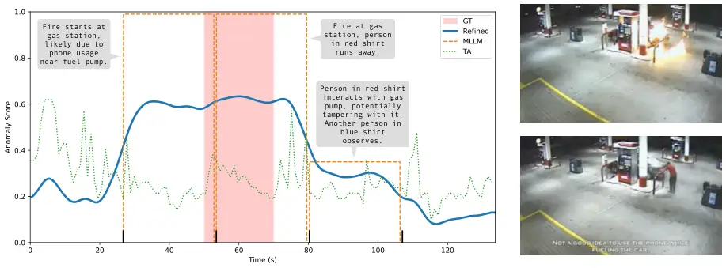

Figure 6: Results on Explosion002_x264 from UCF-Crime.

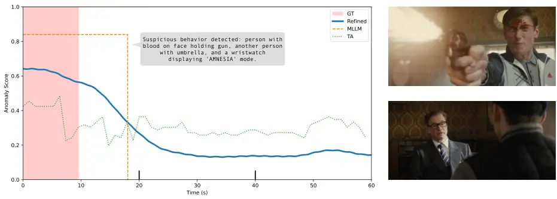

Figure 7: Results on
Kingsman.The.Secret.Service.2014\_\_#00-22-10_00-23-10_label_B2-0-0 from
XD-Violence.

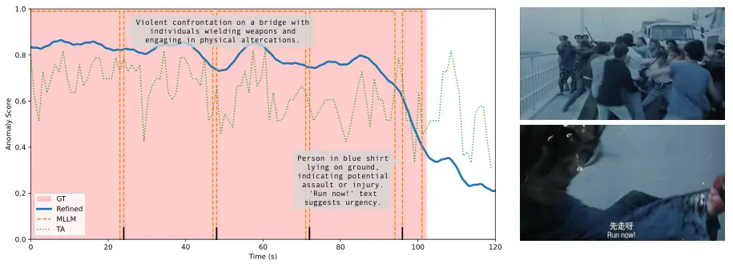

Figure 8: Results on
Young.And.Dangerous.I.1996\_\_#0-46-57_0-48-57_label_B1-0-0 from
XD-Violence.

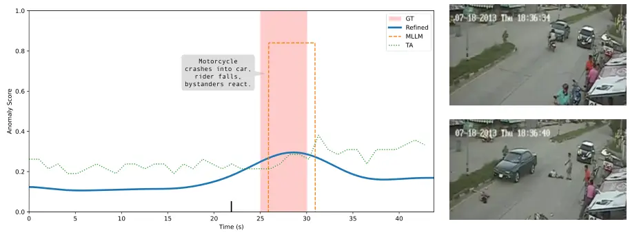

Figure 9: Results on RoadAccidents019_x264 from UCF-Crime.

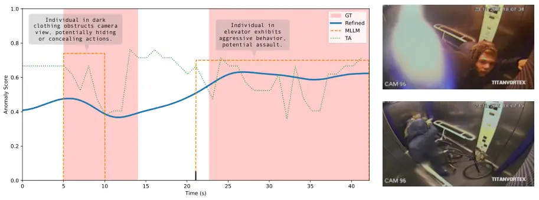

Figure 10: Results on Arson011_x264 from UCF-Crime.

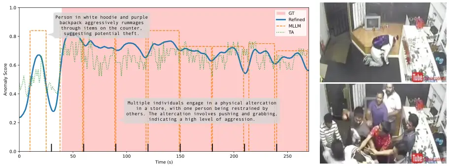

Figure 11: Results on Assault006_x264 from UCF-Crime.

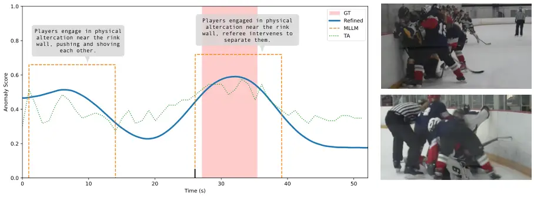

Figure 12: Results on v=pMtu7fOHdII\_\_#1_label_B1-0-0 from XD-Violence.

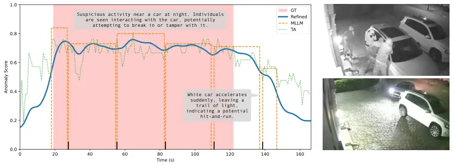

Figure 13: Results on Stealing058_x264 from UCF-Crime.

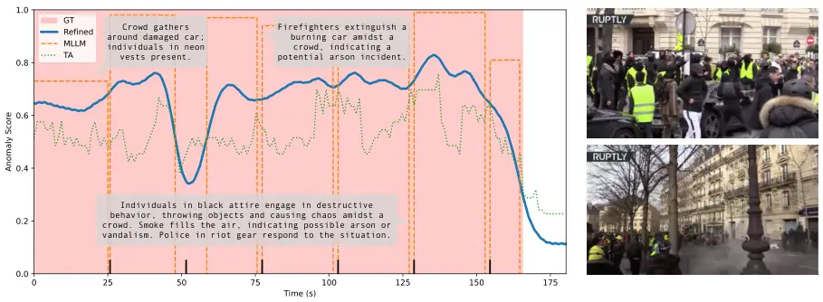

Figure 14: Results on v=ICnreR1hxP0\_\_#1_label_B4-0-0 from XD-Violence.

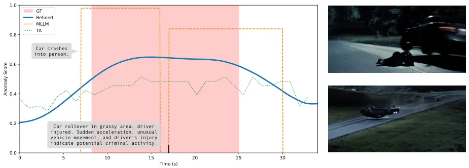

Figure 15: Results on
Casino.Royale.2006\_\_#01-46-40_01-47-14_label_B6-0-0 from XD-Violence.


Figure 16: Interactive dialogue with PrismVAU on a normal scene,
Normal_Videos_783_x264 from UCF-Crime.


Figure 17: Interactive dialogue with PrismVAU on an abnormal scene,
RoadAccidents133_x264 from UCF-Crime.
