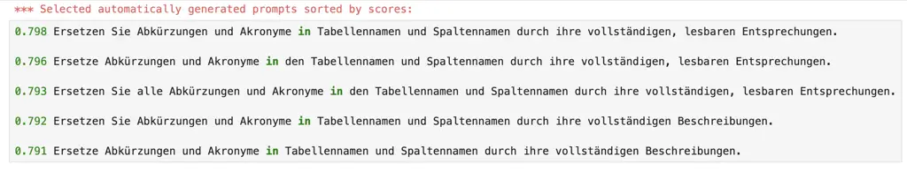

# Automatic Prompt Engineering with No Task Cues and No Tuning

Faisal Chowdhury¹, Nandana Mihindukulasooriya¹, Niharika S. D’Souza¹,
Horst Samulowitz¹,  
Neeru Gupta², Tomasz Hanusiak², Michal Kapitonow² Affiliation: ¹IBM
Research  
mchowdh@us.ibm.com, nandana@ibm.com, Niharika.DSouza@ibm.com,
samulowitz@us.ibm.com Affiliation: ²IBM  
guptaneeru@us.ibm.com, T.Hanusiak@pl.ibm.com, michal.kapitonow@ibm.com

###### Abstract

This paper presents a system for automatic prompt engineering that is
much simpler in both design and application and yet as effective as the
existing approaches. It requires no tuning and no explicit clues about
the task. We evaluated our approach on cryptic column name expansion
(CNE) in database tables, a task which is critical for tabular data
search, access, and understanding and yet there has been very little
existing work. We evaluated on datasets in two languages, English and
German. This is the first work to report on the application of automatic
prompt engineering for the CNE task. To the best of our knowledge, this
is also the first work on the application of automatic prompt
engineering for a language other than English.

###### Index Terms: 

column name expansion, CNE, automatic prompt engineering.

## I Introduction

The advent of LLMs, especially after the impressive demonstrations of
ChatGPT, led to a naive belief in many customers/companies that a new
dawn of business intelligence is on the horizon which would require very
limited effort to exploit the LLMs on their usecases. It turned out
that, more often than not, the downstream performance of LLMs is heavily
coupled with the quality of the prompt used to instruct the model.
Studies have shown that large language models (LLMs) are quite sensitive
to minor variations in prompt phrasing. For example, the addition,
removal, or reordering of just a few tokens can lead to significant
differences in task performance \[9\]. Generic prompts do not typically
produce good responses and the most effective prompts are almost always
handcrafted by humans. This makes prompt curation a labour-intensive
iterative process involving a substantial amount of manual
experimentation. This process of optimizing the prompt language to
elicit the best possible performance is referred to as “prompt
engineering”. Given the human effort involved in the practice, prompt
engineering techniques are often brittle, non-transferable, and suffer
from scalability issues  \[4\].

Currently, prompt engineering is more of an art than a science, as a
delicate balance is required in the design process to ensure clarity and
specificity in the prompts, avoid ambiguity, and steer appropriate
behavior to obtain the desired output. More importantly, the human labor
involved needs to be repeated whenever the underlying LLM is changed,
since previously optimized prompts may no longer yield optimal results.
For example, this applies when we switch to a different model, to a
different parameter-size variant of the same model, or upgrade to new
versions of the LLM trained using different strategies/additional data.
This is further complicated when the prompt has to take into account
domain specificity or a different language (direct translations of
prompts often produce poor results \[10\]).

Automatic prompt engineering and optimization are recent trends. The
core idea is that an LLM, not a human, is tasked with generating
task-specific prompts where the task is presented via output
demonstrations (with some given examples). The corresponding LLM
generates several instruction candidates, either via direct inference or
a recursive process driven by scoring metrics. The LLM executes these
instructions, and the best instruction improving the scoring metric is
retained. Automatic prompt engineering is envisaged to be applied to any
task that is solved by prompting LLMs.

However, existing approaches often require an initial human written task
specific prompt. They also need extensive number of expensive LLM calls
during the optimization process. In addition, they are not easily
adoptable due to implementation complexities. Also, all of them require
evaluation data for their scoring metrics to work to pick the best
possible prompt.

In this paper, we propose a system that is based on a new simple yet
effective approach for automatic prompt engineering that uses only a few
examples and controlled randomized sampling to generate the best
possible prompt.

To be more precise, the advantages of our approach with respect to known
solutions are as follows:

- •
  Simple approach that can be easily adopted (even for non-English
  languages) and works with only a few given examples.
- •
  No need of separate training, validation and test data.
- •
  No need of initial seed prompt or task specific cues.
- •
  No additional LLM calls for scoring or ranking.

We evaluated our approach on Cryptic column name expansion (CNE) in
database tables. We used three evaluation datasets. Two in English and
one in German.

To the best of our knowledge, this is the first work on the application
of automatic prompt engineering for a language other than English.

Furthermore, as part of this work, we are going to make available a
dataset in German for the CNE task.

We demonstrate that our system is as good as or better than the other
existing system but much easier to adopt and much simpler in design.

## II Task: Cryptic Column Name Expansion (CNE) in Tables

Tables in real world customer database often have Short or cryptic
column names such as following:

> (English example)  
> {"table": "Customer Account", "columns": \["DISCOUNT_PCT_APPLIC",
> "CURRENT_BAL_AMT"\]}  
> (German example)  
> {"table": "vbuk", "columns": \["mandt", "vbeln", "gbstk", "vbtyp",
> "aedat"\]}

The goal of the CNE task is to expand such column names and produce an
output like following:

> (English example)  
> {"table": "Customer Account", "columns": {"DISCOUNT_PCT_APPLIC":
> "Discount Percentage Applicable", "CURRENT_BAL_AMT": "Current Balance
> Amount"}}  
> (German example)  
> {"table": "vbuk", "columns": {"mandt": "Mandant", "vbeln":
> "Vertriebsbelegnummer eines CAS-Kontaktes", "gbstk":
> "Gesamtbearbeitungsstatus des Vertriebsbeleges", "vbtyp":
> "Vertriebsbelegtyp", "aedat": "Datum der letzten Änderung"}}

Column names are often not abbreviated in isolation but in the context
of the table and other column names in the corresponding table.

\[17\] showed that abbreviated column names makes it challenging for end
users to search and retrieve relevant data for many table-related tasks.
One of the widely used human-labeled text2SQL benchmark, the Spider
dataset \[18\], contains 6.6% of abbreviated column names. \[17\]
observed over ten percentage points in performance degradation on the
Spider dataset due to simple changes in abbreviated column names.
Abbreviated column names also effect table question answering (QA)
\[19\].

To the best of our knowledge, \[16\] is the only existing peer-reviewed
work so far for this task that provided experimental results. As they
noted, expanding column names has other beneficial aspects such as
increased readability of tables (especially when complex or technical
data is present), disambiguating between tables with similar column
names but different meanings, improved the efficacy of keyword based
searches for discovering related tables, etc. As a solution for this
task, they semi-automatically generated a large training dataset in
English and then fined-tuned an LLM. In contrast, our proposed system
requires no training.

## III Related Work on Automatic Prompt Optimization and Engineering

Prompt optimization aims to refine and tune of an existing or original
prompt to improve performance across multiple runs or datasets. Whereas
the goal of prompt engineering is to design a prompt structure from
scratch, often by using techniques like few-shot prompting.

\[2\] recently provided a through evaluation of of various automatic
prompt engineering and optimization approaches for the task of triple
extraction from text.

The works of \[5\] provide a comprehensive taxonomy of automatic prompt
optimization frameworks which refine prompts with no or minimal human
intervention. Broadly, these methods can be categorized along multiple
dimensions. These include: optimization space (i.e. discrete text-based
vs. soft prompting or gradient-based), optimization targets (i.e.
instructions vs. examples), optimization objective (i.e. task
performance, safety, or generalizability), operators used to generate
new prompts (e.g. purely model-based vs. iterative refinement of example
prompts), and iterative search strategies (e.g. Evolutionary vs. Monte
Carlo search). Below we mention a few notable of these approaches.

A popular prompt optimization system is the work of \[13\] called DSPy
that frames prompt as a declarative, compiler-driven optimization task.
Gradient-based approaches such as TextGrad \[6\] use gradient
descent-like algorithms to optimize prompt embeddings according to a
predefined performance objective \[14\].

With regard to automatic prompt engineering, \[3\] proposed one of the
earliest work via in-context learning that they termed as “instruction
induction”. To elicit models to generate instructions, they created a
meta-prompt presenting instruction induction as a challenge puzzle.
Their meta prompt was –

 

> I gave a friend an instruction and five inputs. The friend read the
> instruction and wrote an output for every one of the inputs. Here are
> the input-output pairs:
>
> Input: ...  
> Output: ...  
> Input: ...  
> Output: ...  
> ...
>
> The instruction was \<COMPLETE\>

 

This approach uses the greedy decoding algorithm to generate a single
prompt, effectively avoiding the need to design a mechanism for
selecting the best possible prompt of non-greedy decoding was used
during inference.

Automated Prompt Engineer (APE) \[8\] extends the approach of \[3\] with
a search and selection process through a pool of instruction candidates
proposed by an LLM to maximize a chosen score function.

A complementary approach that uses reinforcement learning-based
strategies is OIRL \[11\], which model the interaction between the
query-prompt pair via a reward model for proposing and evaluating
candidate prompts suited for arithmetic reasoning tasks. In contrast,
meta-Prompting \[12\] uses structural and syntactical aspects of tasks
to create general prompts that guide the generation of task-specific
prompts.

## IV Proposed System

Similar to \[3\], our approach uses a generic meta-prompt (independent
of task) with a few example input-output pairs. However, unlike \[3\],
we do not use greedy decoding. We use multinomial sampling decoding.
Also, unlike  \[8\], our scoring function does need additional LLM calls
to rank the generated candidate prompts.

There are two steps in our proposed approach.

### IV-A Step 1: Generate candidate prompts specific for the target task

Given a few (8-10) example pairs of input and output for the target
task, the system creates 3 samples:

1.  1.  Randomly choose a small (4-5) examples from the list. Let’s call it
        sample A
2.  2.  Randomly choose another small (4-5) examples from the list that are
        not in sample A. Let’s call it sample B.
3.  3.  Randomly choose half of the examples from sample A and half from
        sample B.
4.  4.  Put them in a new list. Let’s call it sample C.

Each of the samples above is combined with the meta-prompt to construct
three input prompts. Our task agnostic meta-prompt for English is –

 

> I gave a friend an instruction. Based on the instruction he produced
> the following input and output pairs:
>
> Input: ...  
> Output: ...  
> Input: ...  
> Output: ...  
> ...
>
> Complete the following text.  
> The instruction was to \<COMPLETE\>

 

Our task agnostic meta-prompt for German is –

 

> Ich gab einem Freund eine Anweisung. Danach erzeugte er die folgenden
> Eingabe und Ausgabepaare:
>
> Input: ...  
> Output: ...  
> Input: ...  
> Output: ...  
> ...
>
> Vervollständigen Sie den folgenden Satz. Die Anweisung lautete:
> \<COMPLETE\>

 

For each of the three input prompts, the system generates N ( 10) number
of candidate prompts using an LLM with multinomial sampling decoding.

### IV-B Step 2: Rank generated candidate prompts

For each generated prompts, the system calculates similarity scores with
respect to every other generated prompts, sums the scores and then
averages it. This would be the score for this particular generated
instruction. We use an approximate string similarity algorithm called
Jaro-Winkler similarity¹¹ 1
https://en.wikipedia.org/wiki/Jaro–Winkler_distance.

The system then ranks all the generated prompts in descending order
according to their scores. The system outputs the top ranked prompt as
the desired prompt for the target task.

Our choice of Jaro-Winkler similarity instead of LLM based scoring is
primarily due to avoid additional LLM calls both for a faster output
generation time and also to save cost of customers for making the LLM
calls and the tokens generated due to those calls.

In addition, our manual analysis showed that an approximate string
similarity approach like Jaro-Winkler similarity is able to filter out
candidate prompts which are either too verbose or contain inconsistent
task instructions.

## V Evaluation Results

We evaluate our approach against the following existing approaches:
Instruction Induction (shortened as InstInduc) \[3\], APE
Zeroshot \[8\], TextGrad \[6\], and DSPy \[13\].

For consistency, we used the Llama-3.3-70B-Instruct²² 2
https://huggingface.co/meta-llama/Llama-3.3-70B-Instruct model in all
the systems (including ours) to generate prompts.

Fig. 1: Output of our system for the German CNE task given only few
examples as input.

CNE English datasets: We use 3 datasets for English: CSTINSIGHT \[1\]
which is a database of customer insights, CDO_435 which is a database
from the chief data officer of one of our customers, and Tele_1186 which
is a database from a telecommunication customer.

The CSTINSIGHT contains 25 tables and 519 cryptic columns. Since both
DSPy and TextGrad need separate training and validation data, we used 19
of these tables for training and 6 of them for validation for those 2
systems.

For our system as well as for InstInduc, APE and APE Zeroshot, we used
only 10 of these CSTINSIGHT tables as examples (since these 3 systems do
not need any tuning).

The CDO_435 and Tele_1186 datasets were used for testing. CDO_435 has 11
tables and 424 cryptic columns, whereas Tele_1186 has 46 tables and 1140
cryptic columns.

CNE German dataset: We created this dataset from the publicly available
SAP BigQuery Dataset³³ 3
https://www.kaggle.com/datasets/mustafakeser4/sap-dataset-bigquery-dataset.
Using publicly available SAP ERP 6.0⁴⁴ 4
https://sap.erpref.com/?schema=ERP6EHP7 and SAP NetWeaver 7.4⁵⁵ 5
https://help.sap.com/doc/saphelp_nw74/7.4.16/de-DE/52/367e53f33d6359e10000000a174cb4/frameset.htm
documentation, we selected only those tables in this database that
contains at least 5 cryptic column names.

We are going to release this dataset under the same MIT license of the
SAP BigQuery Dataset. This dataset contains total 23 tables and 283
cryptic columns.

We used 15 of these 23 tables as test data and remaining 8 tables as
few-shot examples for prompt generation for our system, InstInducAPE and
APE Zeroshot. For DSPy and TextGrad, 3 of these 8 examples are used for
training and 5 used for validation.

|              |            |            |            |
| ------------ | ---------- | ---------- | ---------- |
| System       | German SAP | CDO_435    | Tele_1186  |
| name         | (Accuracy) | (Accuracy) | (Accuracy) |
| InstInduc    | 21.08      | 48.11      | 46.77      |
| APE Zeroshot | 41.13      | 79.95      | 68.92      |
| TextGrad     | 48.11      | 72.17      | 59.04      |
| DSPy         | 51.89      | 69.34      | 75.00      |
| Our system   | 51.89      | 82.61      | 70.73      |

TABLE I: Results on the German and English CNE datasets. Accuracy was
calculated using Jaro-Winkler similarity ($`>=`$0.85).

As we see in Table I, with respect to the more complex DSPy system
(which requires tuning as well initial task specific cues), our system
achieves similar results for the German SAP dataset, performs better on
the English CDO_435 and obtains lower results on the English Tele_1186
dataset. However, our system outperforms all the other existing
approaches we tested. Particularly, among the 185 cryptic columns in the
15 test tables of the German SAP dataset, both our system and DSPy got
89 of them wrong. Interestingly, for 37 of these wrong predictions, our
system and DSPy both predicted the same expansion.

## VI Conclusion

We presented a system for automatic prompt engineering that is simple,
language adaptable, task agnostic and yet can produce as good or better
results than more complex existing systems on the important but less
explored CNE task. We obtained similar results for the triple extraction
task \[2\] but could not include due to space limitation.

## References

- \[1\] J. Baek, H. Samulowitz, O. Hassanzadeh, D. Subramanian, S.
  Shirai, A. Gliozzo and D. Bhattacharjya, “Knowledge Base Construction
  for Knowledge-Augmented Text-to-SQL”, Findings of the 63rd Annual
  Meeting of the Association for Computational Linguistics, July 2025.
- \[2\] N. Mihindukulasooriya, N. S. D’Souza, F. Chowdhury and H.
  Samulowitz, “Automatic Prompt Optimization for Knowledge Graph
  Construction: Insights from an Empirical Study”, Proceedings of the
  VLDB 2025 Workshop: LLM+Graph, September 2025.
- \[3\] O. Honovich, U. Shaham, S. R. Bowman and O. Levy, “Instruction
  Induction: From Few Examples to Natural Language Task Descriptions”,
  Proceedings of the 61st Annual Meeting of the Association for
  Computational Linguistics (ACL), pp. 1935–1952, July 2023.
- \[4\] S. Arora, A. Narayan, M. F. Chen, L. Orr, N. Guha, K.
  Bhatia, I. Chami, C. Re, “Ask Me Anything: A simple strategy for
  prompting language models”, Proceedings of the 11th International
  Conference on Learning Representations (ICLR), May 2023.
- \[5\] W. Cui, J. Zhang, Z. Li, H. Sun, D. Lopez, K. Das, B. Malin
  and S. Kumar, “Automatic Prompt Optimization via Heuristic Search: A
  Survey”, Findings of the 63rd Annual Meeting of the Association for
  Computational Linguistics (ACL), pp. 22093-–22111 July, 2025.
- \[6\] M. Yuksekgonul, F. Bianchi, J. Boen, S. Liu, P. Lu, Z.
  Huang, C. Guestrin and J. Zou, James, “Optimizing generative AI by
  backpropagating language model feedback”, Nature (volume 639), pp.
  609–616, March 2025.
- \[7\] H. Hugo, T. Lavril, G. Izacard, X. Martinet, M. Lachaux, and T.
  Lacroix, “Llama: Open and efficient foundation language models”, arXiv
  preprint arXiv:2302.13971, February 2023.
- \[8\] Y. Zhou, A. I. Muresanu, Z. Han, K. Paster, S. Pitis, H. Chan,
  and J. Ba, “Large language models are human-level prompt engineers”,
  Proceedings of the 11th International Conference on Learning
  Representations (ICLR), May 2023.
- \[9\] P. Liu, W. Yuan, J. Fu, Z. Jiang, H. Hayashi, G. Neubig,
  “Pre-train, Prompt, and Predict: A Systematic Survey of Prompting
  Methods in Natural Language Processing”, ACM Computing Surveys, Volume
  55, Issue 9, pp. 1–35, January 2023.
- \[10\] I. Mondshine, T. Paz-Argaman and R. Tsarfaty,Beyond English:
  The Impact of Prompt Translation Strategies across Languages and Tasks
  in Multilingual LLMs”, Proceedings of the 8th Workshop on Technologies
  for Machine Translation of Low-Resource Languages, May 2025.
- \[11\] H. Sun, A. Hüyük and M. van der Schaar, “Query-Dependent
  Prompt Evaluation and Optimization with Offline Inverse RL”,
  Proceedings of the 12th International Conference on Learning
  Representations, 2024.
- \[12\] M. Suzgun and A. T. Kalai, “Meta-Prompting: Enhancing Language
  Models with Task-Agnostic Scaffolding”, arXiv preprint
  arXiv:2401.12954, January, 2024.
- \[13\] O Khattab, A. Singhvi, P. Maheshwari, Z. Zhang, K.
  Santhanam, S. Vardhamanan, S. Haq, A. Sharma, T. Joshi, H. Moazam, H.
  Miller, M. A.Zaharia, C. Potts, “DSPy: Compiling Declarative Language
  Model Calls into Self-Improving Pipelines”, Proceedings of the
  Workshop on robustness of zero/few-shot learning in foundation models,
  2023
- \[14\] Y. Wen, N. Jain, J. Kirchenbauer, M. Goldblum, J. Geiping, T.
  Goldstein, “Hard Prompts Made Easy: Gradient-Based Discrete
  Optimization for Prompt Tuning and Discovery”, Proceedings of the 37th
  Conference on Neural Information Processing Systems (NeurIPS), 2023.
- \[15\] M. Josifoski, M. Sakota, M. Peyrard and R. West, “Exploiting
  Asymmetry for Synthetic Training Data Generation: SynthIE and the Case
  of Information Extraction”, Proceedings of the 2023 Conference on
  Empirical Methods in Natural Language Processing, December, 2023.
- \[16\] J. Zhang, Z. Shen, B. Srinivasan, S. Wang, H. Rangwala and G.
  Karypis, “NameGuess: Column Name Expansion for Tabular Data”,
  Proceedings of the 2023 Conference on Empirical Methods in Natural
  Language Processing, pp 13276–-13290, December, 2023.
- \[17\] T. Xie, C. H. Wu, P. Shi, R. Zhong, T. Scholak, M.
  Yasunaga, C. S. Wu, M. Zhong, P. Yin, S. I. Wang, V. Zhong, B.
  Wang, C. Li, C. Boyle, A. Ni, Z. Yao, D. Radev, C. Xiong, L. Kong, R.
  Zhang, N. A. Smith, L. Zettlemoyer, and T. Yu, “Unifiedskg: Unifying
  and multi-tasking structured knowledge grounding with text-to-text
  language models”, Proceedings of the 2022 Conference on Empirical
  Methods in Natural Language Processing (EMNLP), pp.. 602–631,
  December, 2022.
- \[18\] T. Yu, R. Zhang, K. Yang, M. Yasunaga, D. Wang, Z. Li, J.
  Ma, I. Li, Q. Yao, S. Roman, Z. Zhang and D. R. Radev, “Spider: A
  large-scale human-labeled dataset for complex and cross-domain
  semantic parsing and text-to-sql task”, Proceedings of the 2018
  Conference on Empirical Methods in Natural Language Processing
  (EMNLP), October, 2018.
- \[19\] P. Yin, G. Neubig, W. Yih and S. Riedel, “TaBERT: Pretraining
  for joint understanding of textual and tabular data”, Proceedings of
  the 58th Annual Meeting of the Association for Computational
  Linguistics (ACL), pp. 8413–-8426, July, 2020.
