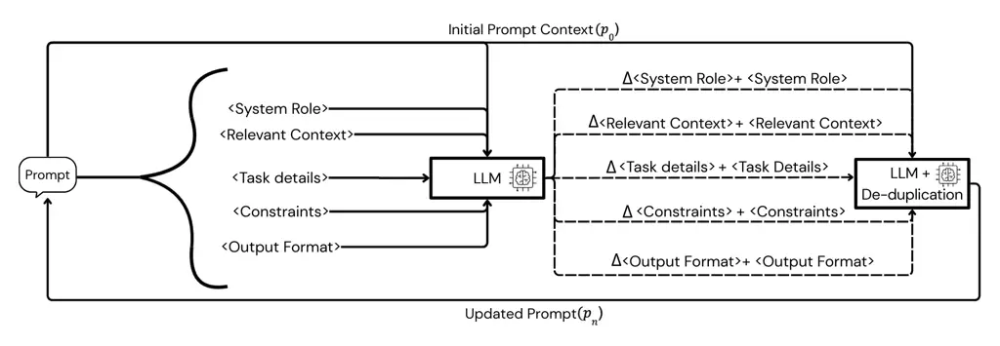
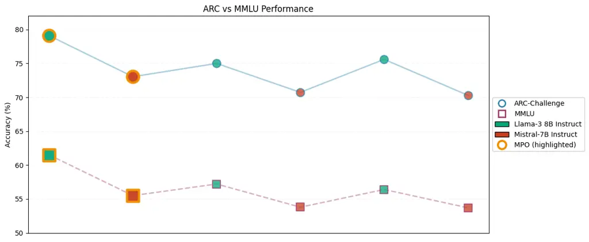

# Modular Prompt Optimization: Optimizing Structured Prompts with Section-Local Textual Gradients

Prith Sharma Affiliation: Carnegie Mellon University    Austin Z. Henley
Affiliation: priths@andrew.cmu.edu, azhenley@cmu.edu

## 1 Introduction

Large language models (LLMs) are increasingly used as general-purpose
problem solvers, where behavior is controlled primarily through
prompting rather than task-specific training \[21, 4\]. In practice,
prompt quality often becomes the main limiting factor. Small changes in
wording, order, or formatting can lead to large differences in model
performance, reliability, and even safety. This sensitivity is
especially challenging for smaller, open-source instruction-tuned
models, which typically require clearer instructions and benefit more
from explicit structure \[3\]. As a result, developing principled and
repeatable methods for improving prompts has become an important part of
building robust LLM-based systems.

Real-world prompts are rarely simple or well-structured. They are often
written as long blocks of text that mix several different purposes, such
as defining the model’s role, providing background information,
describing the task, listing constraints, and specifying the desired
output format \[26\]. When these elements are combined without clear
separation, a range of problems can occur. Constraints may be incomplete
or contradicted later in the prompt, formatting instructions may be
ignored, and changes made to fix one issue can unintentionally introduce
new ones. Over repeated rounds of refinement, prompts may also grow
longer and harder to manage. These problems are difficult to diagnose
because it is often unclear which part of the prompt is responsible for
a given error, making prompt improvement slow and largely ad hoc.

Many prior works have studied automatic prompt optimization, but
existing methods do not fully resolve these challenges. Continuous
prompt tuning approaches optimize prompts in a latent embedding space
while keeping the language model fixed \[24, 13, 14\]. Although this
makes them parameter-efficient, the resulting prompts are not directly
interpretable. More recent methods optimize prompts directly in natural
language by treating improvement as a search or self-refinement process
\[29, 20, 27\]. These approaches preserve readability and work in
black-box settings, but they typically treat the prompt as a single
piece of text and apply updates to it as a whole. As a result, it is
hard to target specific parts of the prompt, interactions between
unrelated instructions can increase, and important information may be
altered during rewriting.

At the same time, practical prompting guidelines have increasingly
adopted structured prompt formats that separate system role, context,
task description, constraints, and output format \[19, 2\]. This
practice reflects a simple but often overlooked idea that different
parts of a prompt play different roles. When prompts are structured in
this way, errors and improvements can be traced back to specific
sections, and optimization can focus on refining individual components
rather than rewriting the entire prompt at once.

In this paper, we introduce Modular Prompt Optimization (MPO), a
schema-based prompt optimization framework that treats prompts as
structured objects composed of fixed semantic sections. MPO applies
section-local textual gradients at each iteration using a critic model
which generates targeted natural-language improvements for each section
independently while keeping the overall schema fixed. Updates are then
consolidated with de-duplication to prevent prompt bloat and reduce
interference between components. This design makes optimization
localized, interpretable, and robust to uncontrolled rewriting.

We evaluate MPO on two reasoning benchmarks, ARC-Challenge \[6\] and
MMLU \[9, 8\], using LLaMA-3 8B-Instruct and Mistral-7B Instruct as
solver models. Across both benchmarks and models, MPO consistently
outperforms an untuned structured prompt and TextGrad \[27\]. These
improvements are achieved without modifying model parameters or altering
prompt structure. The results suggest that maintaining a fixed prompt
schema while optimizing semantic sections independently is an effective
and practical approach for improving reasoning performance in small
open-source LMs.

## 2 Related Works

### 2.1 Continuous Prompt Optimization

The first wave of automatic prompt optimization treated prompts as
learnable parameters rather than linguistic objects. Methods such as
\[24\], \[13\], \[14\], and \[17\] optimized continuous prompt
embeddings via gradient descent while freezing the underlying language
model. More recent work continues to explore gradient-based optimization
in embedding space \[10\].

While effective in parameter efficiency, these approaches produce
prompts that are non-interpretable, task-specific, and difficult to
audit or reuse. Because the optimized prompts exist in latent embedding
space, they do not correspond to explicit natural-language instructions.
Surveys of prompt tuning and prompt engineering highlight these
limitations, noting that embedding-based methods optimize latent control
signals rather than explicit instruction semantics \[15, 5\].

### 2.2 Discrete Prompt Optimization in Language Space

These limitations motivated a shift toward discrete prompt optimization,
where prompts are optimized directly in natural language. Early work on
prompt mining and prompt programming demonstrated that textual prompts
could be systematically searched and evaluated \[11, 22\]. Automatic
Prompt Engineer showed that LLMs themselves can generate and rank
candidate prompts, framing prompt optimization as a search problem in
language space \[29\].

Subsequent methods explored more structured optimization strategies,
including beam-search-based updates and evolutionary algorithms over
discrete prompts \[20, 23\]. Modular frameworks such as \[28\] further
formalized prompt optimization as a compositional process over prompt
components. These approaches preserve interpretability and enable
black-box optimization but typically treat the prompt as a single
monolithic block of text.

### 2.3 Textual Gradients and Self-Refinement

A parallel line of work reframed prompt optimization as an iterative
self-improvement process, where language models critique and revise
prompts using natural-language feedback. This includes self-refinement
and reflection-based methods \[18, 25\], which were later formalized
under the notion of textual gradients. In this paradigm, linguistic
feedback plays a role analogous to gradient information in continuous
optimization.

Representative methods include \[16\], \[20\], \[27\], \[7\], and
reflective prompt evolution approaches such as \[1\]. These techniques
enable model-agnostic optimization while maintaining interpretability.
However, feedback is generally applied globally to the entire prompt,
making it difficult to attribute failures to specific semantic
components or to ensure that critical information is preserved during
optimization.

### 2.4 Prompt Structure, Task Decomposition and positioning of our work

Concurrently, practitioner-oriented prompting guides have converged on a
consistent structured prompt format, typically decomposing prompts into
semantic sections \[19\], \[2\]. While these documents are not framed as
optimization research, they implicitly encode a theory of prompt
structure, suggesting that different components of a prompt serve
distinct functional roles and should be reasoned about independently.

Recent research has begun to formalize this intuition. Task Facet
Learning \[12\] proposes decomposing prompts into facets and learning
new task-specific components from labeled errors. While effective, this
approach modifies the prompt structure itself and focuses on discovering
new task knowledge from downstream performance signals.

In contrast, our work is inspired by structured prompting practices
rather than task-facet discovery. We assume a fixed,
documentation-driven prompt schema and study how optimizing each
semantic section independently using textual-gradient style feedback can
improve performance. Rather than discovering new task facets or altering
prompt topology, we focus on refining how existing task information is
organized, expressed, and constrained within a stable prompt structure.
This design is particularly motivated by small open-source LMs, which
benefit disproportionately from explicit structure and modular
instruction decomposition \[3\].



Figure 1: Overview of Modular Prompt Optimization (MPO). An initial
prompt $`p_{0}`$ is decomposed into a fixed set of semantic sections,
including system role, relevant context, task details, constraints, and
output format. Each section is evaluated independently by a critic
language model, which produces section-specific textual gradients. These
gradients are combined with their corresponding original sections and
passed through a de-duplication step to remove redundancy. The refined
sections are then reassembled into an updated prompt $`p_{n}`$,
preserving the original prompt structure while improving its content.

## 3 Approach

We propose Modular Prompt Optimization (MPO), a schema-based prompt
optimization framework that treats prompts as structured objects
composed of semantically distinct components. MPO refines prompts by
iteratively improving the content of each component independently, while
keeping the overall prompt schema fixed. An overview of the MPO
optimization process is shown in Figure 1.

#### Prompt schema.

MPO decomposes each prompt into a fixed set of semantic sections:
_System Role_, _Relevant Context_, _Task Details_, _Constraints_, and
_Output Format_. This decomposition is inspired by widely adopted
practitioner prompting guidelines and reflects the observation that
different parts of a prompt play distinct functional roles in shaping
model behavior. Throughout optimization, the schema itself is held
constant. MPO does not search over prompt structures or reorder
sections. If a section is missing in the original prompt, it is
initialized by extracting or inferring relevant content directly from
the original prompt, without introducing new task information.

#### Prompt state and optimization objective.

MPO maintains an explicit notion of prompt state. Let

```math
p_{0}=\{s_{0}^{(1)},s_{0}^{(2)},\dots,s_{0}^{(K)}\}
```

denote the initial structured prompt, where each $`s_{0}^{(k)}`$
corresponds to one semantic section. The goal of MPO is to produce a
sequence of refined prompt states

```math
p_{0}\rightarrow p_{1}\rightarrow\dots\rightarrow p_{n},
```

where each successive prompt improves task performance while preserving
interpretability and structural consistency.

#### Section-wise textual gradients.

At each iteration $`t`$, MPO evaluates each prompt section independently
using a critic language model. Rather than rewriting the entire prompt,
the critic produces textual gradients for each section. Formally, for
section $`k`$, the critic generates

```math
\Delta s_{t}^{(k)}=\mathcal{C}\!\left(s_{t}^{(k)},\,p_{t}\setminus s_{t}^{(k)}\right),
```

where $`\mathcal{C}`$ denotes the critic model and
$`p_{t}\setminus s_{t}^{(k)}`$ provides the surrounding prompt context
without modifying other sections. Each $`\Delta s_{t}^{(k)}`$ is
expressed in natural language and represents a proposed improvement in
alignment with the intended task.

#### Textual Gradients application and consolidation.

Section updates are applied additively, yielding an intermediate
section:

```math
\tilde{s}_{t+1}^{(k)}=s_{t}^{(k)}\oplus\Delta s_{t}^{(k)},
```

where $`\oplus`$ denotes textual aggregation. As repeated iterations may
introduce redundancy or semantically overlapping instructions, MPO
applies an LLM-based de-duplication and consolidation step:

```math
s_{t+1}^{(k)}=\mathcal{D}\!\left(\tilde{s}_{t+1}^{(k)}\right),
```

where $`\mathcal{D}`$ removes redundant content while preserving
everything else. The updated prompt state is then reassembled as

```math
p_{t+1}=\{s_{t+1}^{(1)},s_{t+1}^{(2)},\dots,s_{t+1}^{(K)}\}.
```

#### Iterative refinement.

This process can be repeated for a number of iterations depending on the
prompt and task as shown in Figure 1.. By restricting updates to
localized, section-specific deltas and consolidating them after each
iteration, MPO reduces interference between unrelated prompt components
and prevents uncontrolled prompt growth.

#### Experimental setup.

We evaluate MPO on LLaMA-3 8B-Instruct and Mistral-7B-Instruct as solver
models. For each model, we compare MPO-optimized prompts against
Textgrad \[27\] and a fixed baseline prompt that follows the same schema
but does not undergo iterative refinement.

Evaluation is conducted on two standard reasoning benchmarks: ARC
Challenge \[6\] and the full MMLU benchmark \[9\], \[8\]. For ARC,
performance is measured using exact-match accuracy on multiple-choice
questions. For MMLU, we report average accuracy across all subject
domains.

MPO is applied independently for each model–dataset pair, producing a
task-specific and model-specific optimized prompt. This setup allows us
to assess both absolute performance gains and the consistency of MPO
improvements across different models.



Figure 2: Accuracy on ARC-Challenge and MMLU for LLaMA-3 8B-Instruct and
Mistral-7B-Instruct under different prompt optimization methods.
Highlighted points denote MPO performance, which achieves higher
accuracy than an untuned structured prompt and TextGrad across both
benchmarks and models.

## 4 Results

We evaluate Modular Prompt Optimization (MPO) on two reasoning
benchmarks: ARC-Challenge and MMLU (all subjects). Experiments are
conducted using two open-source instruction-tuned solver models: LLaMA-3
8B-Instruct and Mistral-7B-Instruct. We compare MPO against two
baselines: (i) an untuned structured prompt that follows the same schema
but is not optimized, and (ii) TextGrad

For ARC-Challenge, we use 1,119 training examples and 1,172 test
examples. For MMLU, we use a training subset of 3,000 examples and
evaluate on a held-out test set of 1,400 examples.

### 4.1 ARC-Challenge

Table 1 reports ARC-Challenge test accuracy across models and
optimization methods. Across both LLaMA-3 8B-Instruct and
Mistral-7B-Instruct, MPO achieves the strongest ARC-Challenge
performance, consistently surpassing both the untuned prompt and
TextGrad.

| Model               | Untuned | TextGrad | MPO   |
| ------------------- | ------- | -------- | ----- |
| LLaMA-3 8B-Instruct | 75.0    | 75.6     | 79.10 |
| Mistral-7B-Instruct | 70.73   | 70.30    | 73.04 |

Table 1: ARC-Challenge test accuracy (%) across solver models and prompt
optimization methods.

### 4.2 MMLU (All Subjects)

Table 2 presents results on MMLU across all subject domains. As with
ARC-Challenge, MPO consistently improves performance across both solver
models. Notably, TextGrad degrades performance relative to the untuned
prompt on MMLU. In contrast, MPO yields stable gains across models and
tasks.

| Model               | Untuned | TextGrad | MPO   |
| ------------------- | ------- | -------- | ----- |
| LLaMA-3 8B-Instruct | 57.21   | 56.40    | 61.50 |
| Mistral-7B-Instruct | 53.79   | 53.70    | 55.50 |

Table 2: MMLU (all subjects) test accuracy (%) across solver models and
prompt optimization methods.

Across both benchmarks and solver models, MPO consistently outperforms
both the untuned prompt and TextGrad. These results suggest that
enforcing a fixed prompt schema and applying section-local textual
gradients leads to more stable and generalizable improvements than
global updates.

## 5 Conclusion and Future Work

We presented Modular Prompt Optimization (MPO), a schema-constrained
prompt optimization framework that refines prompts by independently
optimizing their semantic components using section-local textual
feedback followed by aggregation and de-duplication. By treating prompt
structure as a fixed inductive bias rather than a free-form text object,
MPO enables targeted refinement of system role, context, task
specification, constraints, and output format without altering prompt
topology or model parameters.

Across ARC-Challenge and MMLU, and over multiple open-source
instruction-tuned models, MPO consistently outperforms both untuned
structured prompts and global textual gradient-based methods such as
TextGrad. These gains are achieved through localized updates that reduce
interference between prompt components, leading to more stable and
generalizable improvements. The results suggest that explicit prompt
structure, coupled with section-wise optimization, is an effective
mechanism for improving reasoning performance in open-source language
models without additional training or task-specific data.

Future work can extend MPO along several directions. First, it would be
interesting to study whether using stronger open-source models as
critics for generating section-wise feedback leads to further
improvements and how the choice of critic model affects optimization
stability and transferability. Second, MPO offers a natural framework
for studying prompt safety and robustness, including whether prompts
that induce unsafe or jailbreak behaviors are amplified or mitigated
through structured optimization, and how section-local updates interact
with safety-aligned system roles and constraints. Finally, MPO may be
evaluated on a broader range of reasoning benchmarks and coupled with
automated validation or stopping mechanisms, and further combined with
programmatic prompting or agentic pipelines to support more complex
structured optimization workflows.

## References

- \[1\] L. A. Agrawal, S. Tan, D. Soylu, N. Ziems, R. Khare, K.
  Opsahl-Ong, A. Singhvi, H. Shandilya, M. J. Ryan, M. Jiang, et
  al. (2025) Gepa: reflective prompt evolution can outperform
  reinforcement learning. arXiv preprint arXiv:2507.19457. Cited by:
  §2.3.
- \[2\] Anthropic / Claude Docs (2025)Claude prompting guide: prompt
  engineering best practices(Website) Note: Accessed: 2025-12-17
  External Links:
  [Link](https://platform.claude.com/docs/en/build-with-claude/prompt-engineering/claude-4-best-practices)
  Cited by: §1, §2.4.
- \[3\] P. Belcak, G. Heinrich, S. Diao, Y. Fu, X. Dong, S.
  Muralidharan, Y. C. Lin, and P. Molchanov (2025) Small language models
  are the future of agentic ai. arXiv preprint arXiv:2506.02153. Cited
  by: §1, §2.4.
- \[4\] T. Brown, B. Mann, N. Ryder, M. Subbiah, J. D. Kaplan, P.
  Dhariwal, A. Neelakantan, P. Shyam, G. Sastry, A. Askell, et
  al. (2020) Language models are few-shot learners. Advances in neural
  information processing systems 33, pp. 1877–1901. Cited by: §1.
- \[5\] B. Chen, Z. Zhang, N. Langrené, and S. Zhu (2025) Unleashing the
  potential of prompt engineering for large language models. Patterns.
  Cited by: §2.1.
- \[6\] P. Clark, I. Cowhey, O. Etzioni, T. Khot, A. Sabharwal, C.
  Schoenick, and O. Tafjord (2018) Think you have solved question
  answering? try arc, the ai2 reasoning challenge. arXiv:1803.05457v1.
  Cited by: §1, §3.
- \[7\] A. Cui, P. Nandyalam, A. Rufail, E. Cheung, A. Lei, K. Zhu,
  and S. O’Brien (2024) Introducing mapo: momentum-aided gradient
  descent prompt optimization. arXiv preprint arXiv:2410.19499. Cited
  by: §2.3.
- \[8\] D. Hendrycks, C. Burns, S. Basart, A. Critch, J. Li, D. Song,
  and J. Steinhardt (2021) Aligning ai with shared human values.
  Proceedings of the International Conference on Learning
  Representations (ICLR). Cited by: §1, §3.
- \[9\] D. Hendrycks, C. Burns, S. Basart, A. Zou, M. Mazeika, D. Song,
  and J. Steinhardt (2021) Measuring massive multitask language
  understanding. Proceedings of the International Conference on Learning
  Representations (ICLR). Cited by: §1, §3.
- \[10\] X. Hou, J. Zhang, Z. Lin, D. Tao, and S. Zhang (2025)
  EmbedGrad: gradient-based prompt optimization in embedding space for
  large language models. arXiv preprint arXiv:2508.03533. Cited by:
  §2.1.
- \[11\] Z. Jiang, F. F. Xu, J. Araki, and G. Neubig (2020) How can we
  know what language models know?. Transactions of the Association for
  Computational Linguistics 8, pp. 423–438. Cited by: §2.2.
- \[12\] G. Juneja, G. Jajoo, H. Li, J. Jiao, N. Natarajan, and A.
  Sharma (2025) Task facet learning: a structured approach to prompt
  optimization. In Findings of the Association for Computational
  Linguistics: ACL 2025, pp. 23473–23496. Cited by: §2.4.
- \[13\] B. Lester, R. Al-Rfou, and N. Constant (2021) The power of
  scale for parameter-efficient prompt tuning. arXiv preprint
  arXiv:2104.08691. Cited by: §1, §2.1.
- \[14\] X. L. Li and P. Liang (2021) Prefix-tuning: optimizing
  continuous prompts for generation. arXiv preprint arXiv:2101.00190.
  Cited by: §1, §2.1.
- \[15\] Z. Li, Y. Su, and N. Collier (2025) A survey on prompt tuning.
  arXiv preprint arXiv:2507.06085. Cited by: §2.1.
- \[16\] X. Lin, Z. Dai, A. Verma, S. Ng, P. Jaillet, and B. K. H.
  Low (2024) Prompt optimization with human feedback. arXiv preprint
  arXiv:2405.17346. Cited by: §2.3.
- \[17\] X. Liu, K. Ji, Y. Fu, W. Tam, Z. Du, Z. Yang, and J.
  Tang (2022) P-tuning: prompt tuning can be comparable to fine-tuning
  across scales and tasks. In Proceedings of the 60th Annual Meeting of
  the Association for Computational Linguistics (Volume 2: Short
  Papers), pp. 61–68. Cited by: §2.1.
- \[18\] A. Madaan, N. Tandon, P. Gupta, S. Hallinan, L. Gao, S.
  Wiegreffe, U. Alon, N. Dziri, S. Prabhumoye, Y. Yang, et al. (2023)
  Self-refine: iterative refinement with self-feedback. Advances in
  Neural Information Processing Systems 36, pp. 46534–46594. Cited by:
  §2.3.
- \[19\] OpenAI (2025)GPT-5 prompting guide(Website) Note: Accessed:
  2025-12-17 External Links:
  [Link](https://cookbook.openai.com/examples/gpt-5/gpt-5_prompting_guide)
  Cited by: §1, §2.4.
- \[20\] R. Pryzant, D. Iter, J. Li, Y. T. Lee, C. Zhu, and M.
  Zeng (2023) Automatic prompt optimization with” gradient descent” and
  beam search. arXiv preprint arXiv:2305.03495. Cited by: §1, §2.2,
  §2.3.
- \[21\] A. Radford and J. Wu (2019) Rewon child, david luan, dario
  amodei, and ilya sutskever. 2019. Language models are unsupervised
  multitask learners. OpenAI blog 1 (8), pp. 9. Cited by: §1.
- \[22\] L. Reynolds and K. McDonell (2021) Prompt programming for large
  language models: beyond the few-shot paradigm. In Extended abstracts
  of the 2021 CHI conference on human factors in computing systems,
  pp. 1–7. Cited by: §2.2.
- \[23\] X. Sécheresse A. Villedieu de Torcy et al. (2025) GAAPO:
  genetic algorithmic applied to prompt optimization. Frontiers in
  Artificial Intelligence 8, pp. 1613007. Cited by: §2.2.
- \[24\] T. Shin, Y. Razeghi, R. L. Logan IV, E. Wallace, and S.
  Singh (2020) Autoprompt: eliciting knowledge from language models with
  automatically generated prompts. arXiv preprint arXiv:2010.15980.
  Cited by: §1, §2.1.
- \[25\] N. Shinn, F. Cassano, A. Gopinath, K. Narasimhan, and S.
  Yao (2023) Reflexion: language agents with verbal reinforcement
  learning. Advances in Neural Information Processing Systems 36,
  pp. 8634–8652. Cited by: §2.3.
- \[26\] H. Tian, C. Wang, B. Yang, L. Zhang, and Y. Liu (2025) A
  taxonomy of prompt defects in llm systems. arXiv preprint
  arXiv:2509.14404. Cited by: §1.
- \[27\] M. Yuksekgonul, F. Bianchi, J. Boen, S. Liu, Z. Huang, C.
  Guestrin, and J. Zou (2024) Textgrad: automatic” differentiation” via
  text. arXiv preprint arXiv:2406.07496. Cited by: §1, §1, §2.3, §3.
- \[28\] T. Zehle, T. Heiß, M. Schlager, M. Aßenmacher, and M.
  Feurer (2025) Promptolution: a unified, modular framework for prompt
  optimization. arXiv preprint arXiv:2512.02840. Cited by: §2.2.
- \[29\] Y. Zhou, A. I. Muresanu, Z. Han, K. Paster, S. Pitis, H. Chan,
  and J. Ba (2022) Large language models are human-level prompt
  engineers. In The eleventh international conference on learning
  representations, Cited by: §1, §2.2.

## Appendix A Prompt Optimization Illustration using Llama3 8B-Instruct

A   Sample Prompt Input


B   Structured Input Prompt


C   Final Refined Prompt


D   Model Responses

Response to initial prompt


Response to refined prompt


