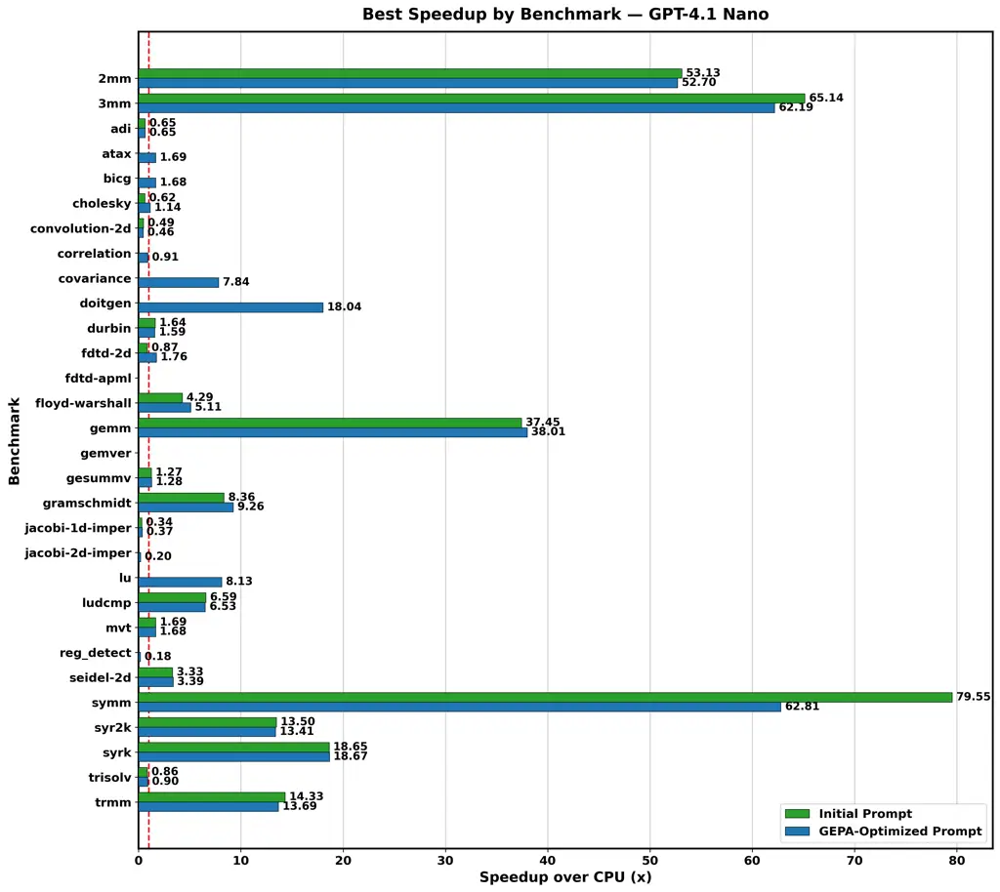
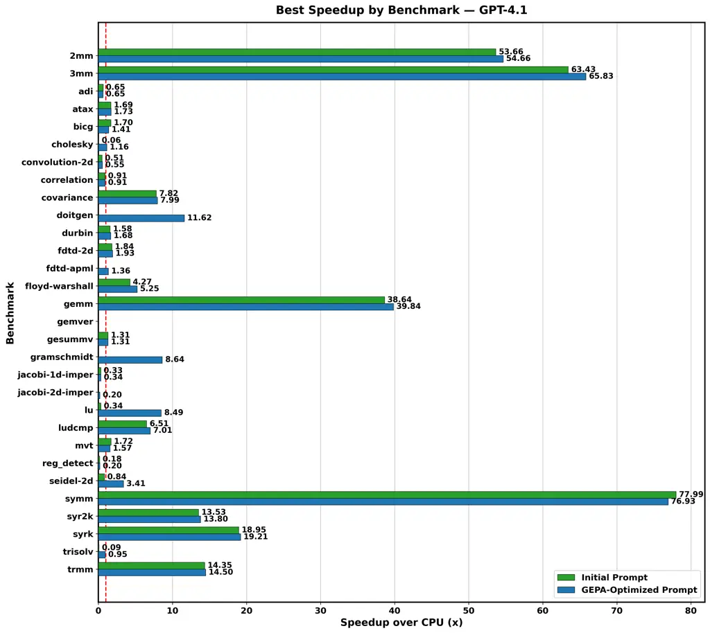
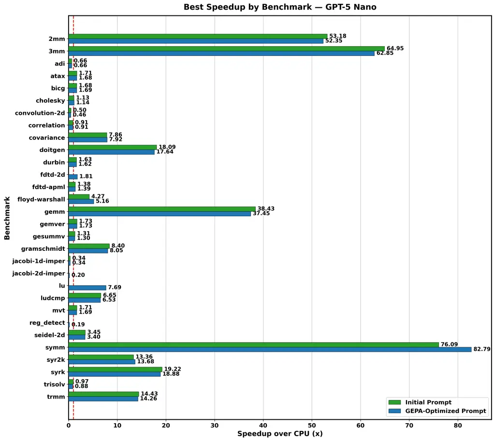
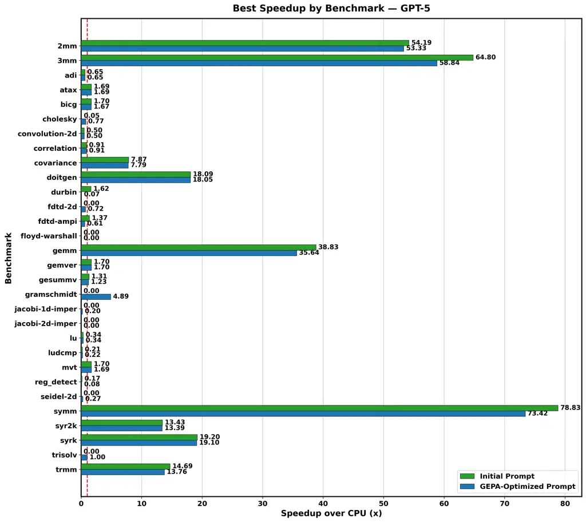

# Bridging the Gap: Empowering Small Models in Reliable OpenACC-based Parallelization via GEPA-Optimized Prompting

Samyak Jhaveri Affiliation: School of Information and Computer Science  
University of California, Irvine  
samyaknj@uci.edu    Cristina V. Lopes Affiliation: School of Information
and Computer Science  
University of California, Irvine  
lopes@uci.edu

###### Abstract

Directive-based parallel programming frameworks like OpenACC lower the
barrier to GPU-offloading by abstracting low-level programming details.
However, manually writing high-performance pragma remains a significant
challenge, which requires expertise in memory hierarchies, data
movement, and parallelization strategies. Large Language Models (LLMs)
present a promising potential solution for automated parallel code
generation, but naive prompting often results in syntactically incorrect
directives, uncompilable code, or performance that fails to exceed CPU
baselines.

In this work, we present a systematic prompt optimization approach to
enhance OpenACC pragma generation without the prohibitive computational
costs associated with LLM post-training. We leverage the GEPA
(GEnetic-PAreto) framework to iteratively evolve prompts through a
reflective feedback loop. This process uses crossover and mutation of
prompt instructions guided by expertly curating “gold” pragma examples
and structured feedback based on clause and parameter-level mismatches
between “gold” pragma and predicted pragma.

In our evaluation on the PolyBench suite, we observe a significant
increase in compilation success rates for programs annotated with
OpenACC pragma generated using the optimized prompts compared to those
annotated using the simpler initial prompts, particularly for the
smaller and cheaper ”nano”-scale models. Specifically, with optimized
prompts, the compilation success rate for GPT-4.1 Nano improved from
$`66.7\%`$ to $`93.3\%`$, and for GPT-5 Nano it improved from $`86.7\%`$
to $`100\%`$, matching or surpassing the capabilities of their
significantly larger and more expensive versions. Beyond compilation,
the optimized prompts resulted in a $`21\%`$ increase in the number of
programs that achieve functional GPU speedups over CPU baselines (i.e.
$`\text{speedup}>1.0\times`$). These results demonstrate that prompt
optimization effectively unlocks the potential of smaller, cheaper LLMs
to write stable and effective GPU-offloading directives, establishing a
cost-effective pathway and lowering the expertise barrier to automated
directive-based parallelization in HPC development workflows.

###### Index Terms: 

OpenACC, Parallel Code Generation, Large Language Models, Prompt
Optimization, High-Performance Computing, GPU Programming

There is an ever-growing demand to maximize the utilization of the
increasingly powerful and complex GPU hardware for High-Performance
scientific, research, and commercial workloads. However, achieving
strong parallelization speedups remains a significant bottleneck due to
the specialized expertise required to manage memory hierarchies, data
movement, and architecture-specific parallelization strategies.
Directive-based frameworks such as OpenACC \[11, 2\] offer a practical
middle-ground between performance and portability. By annotating their
code with OpenACC’s compiler directives (e.g., \#pragma acc), developers
can iteratively offload compute–intensive regions to the GPU without
rewriting entire applications. However, obtaining significant speedups
still requires a nuanced understanding of the data dependencies to write
the most effective clauses. This remains an error-prone, time-consuming
and iterative process that relies on frequent profiling to refine data
movement and parallelization strategies \[13, 2, 7, 5, 6\]. It becomes
more difficult with increase in scale and complexity of the codebase
often seen in many scientific HPC applications. Traditional automated
tools, such as DawnCC \[8\] and KernelGen \[9\], rely on brittle static
analysis. They are also difficult to maintain, as they are built on top
of fragile compiler infrastructure or require low-level compiler
modifications.

Large Language Models (LLMs) have recently emerged as a promising
solution for automated parallel code generation. We have observed that
while large frontier models, like GPT-5 for example, demonstrate strong
reasoning capabilities with a deep knowledge of OpenACC, still fail to
produce compilable pragmas relevant to the entire context of a program.
Furthermore, their high operational costs and latency often preclude
their use in large-scale HPC development workflows. Conversely, smaller
“nano”–scale models, like GPT-4.1 Nano or GPT-5 Nano, are far more
economically viable but fail to grasp the subtle nuances of data
dependencies and requirements of parallel operations using OpenACC
pragma, leading to poor compilability and suboptimal GPU speedups
(Figs. 7 and 9). Developers wanting to use LLMs for help with OpenACC
are then faced with the dilemma of either using expensive new models
that perform reasonably well, but not always correct, or using cheaper
models that often generate the wrong pragmas.

Our work provides both a study of OpenAI’s models’ capabilities for
OpenACC, as well as an approach that substantially improves these
models’ capabilities for generating correct and optimized OpenACC
pragmas. In this work, we demonstrate that less powerful, cost-effective
LLMs can achieve highly effective in-context knowledge of generating
OpenACC pragma through systematic prompt optimization. We leverage the
Genetic-Pareto (GEPA) framework \[1\], a reflective prompt optimizer
that employs natural language reflection to learn high-level
parallelization rules from trial and error. By evaluating the semantic
correctness of the predicted pragma compared to the “gold” pragma, and
issuing structured feedback at each iteration of the feedback loop, GEPA
evolves a simple initial prompt into a highly optimized final prompts
that specializes the “nano” models for OpenACC tasks.

Our evaluation using the PolyBench suite reveals a significant
”robustness jump,” with compilation success rate across all tested
models increasing from 78.3% to 95.8%. The impact is most pronounced for
small models: GPT-4.1 Nano’s compilation success rate improved from
66.7% to 93.3%, while GPT-5 Nano achieved a perfect 100% success rate.
Furthermore, the optimized prompts expanded the total number of
benchmarks achieving functional GPU speedup by 21%. Our results also
show that optimized prompts enhance the “nano”–scale models to surpass
the capabilities of their larger, more expensive counterparts in
generating correct pragmas that deliver substantial GPU speedups, such
as the $`82.79x\times`$ and $`38.01\times`$ gains observed in the
symm(Fig. 9) and gemm(Fig. 7) kernels, respectively. This work provides
a scalable cost-effective path for automated HPC parallelization.

The primary contributions of this work are as follows:

- •
  We introduce a pragma normalization and comparison method that
  provides clause-level and parameter-level feedback to the LLM, along
  with structured feedback to guide the reflection model towards precise
  prompt mutations that correct complex data dependency and
  parallelization errors over the GEPA optimization iterations.
- •
  We curated a dataset of 64 “gold” OpenACC examples, refined using
  NVIDIA Nsight Profiler, to serve as ground truth for training and
  evaluating the predictions made during the GEPA optimization process.
- •
  We empirically demonstrate a ”robustness jump” in compilation success
  rates, specifically for cost-effective “nano”-scale models, with GPT-5
  Nano achieving a 100% success rate on the PolyBench suite.
  Furthermore, our optimized prompts enable smaller and cost-effective
  “nano” models to generate OpenACC pragma that produced speedups at par
  with those generated by their larger more expensive versions.

The remainder of this paper is organized as follows: Section I provides
background on the GEPA prompt optimization framework. Section II details
our Approach, including the integration of GEPA with OpenACC, the
semantic similarity scoring metric, the two-stage inference process
(Data Management and Loop Parallelization), and the curation of the
“gold” pragma dataset. Section III describes the Evaluation methodology.
Section IV presents the Results. Section V discusses Related Work in
automatic pragma generation and LLM-driven synthesis. Section VI
addresses the Limitations of the current study. Section VII concludes
the paper and outlines the directions for Future Work.

## I Background: GEPA Prompt Optimization

GEPA (Genetic-Pareto) \[1\] is a prompt optimization framework that
employs a combination of natural-language feedback-driven reflection and
multi-objective evolutionary search to improve the LLM performance. This
approach treats prompts as evolvable elements and systematically refines
them based on execution traces and evaluation metrics. These metrics can
be customized to serve the needs of generation application. GEPA
optimization relies on three main principles: reflective mutation,
evolutionary candidate pool, and Pareto-optimal selection. A
lower-parameter, cost-effective “student” model serves as the inference
engine. An LLM with strong reasoning capabilities (like GPT-5) is used
as a “reflection” model to analyze execution traces, including reasoning
steps and metric evaluation results of the responses generated by the
candidate “student” model. The reflection model uses targeted, natural
language feedback from humans, which is then used to generate a new,
mutated prompt variant, thereby learning from trial-and-error.

The process of prompt optimization involves the management of a diverse
population of prompt candidates, iteratively evolving them over multiple
generations through mutation, and merging the successful candidates. In
each iteration, GEPA identifies all the prompts that achieve the highest
score on at least one task. The framework maintains a Pareto frontier of
candidate prompts that perform best, to avoid local optima. This
approach ensures that a diverse set of promising prompts is maintained.
To evolve the current prompts into new prompts, GEPA stochastically
explores prompts that excel across different problem instances. A prompt
stays on the Pareto frontier if no other prompt beats it on every
objective. If Candidate A is better than or equal to Candidate B across
all instances and strictly better on at least one, Candidate B is
”dominated” and removed from the pool to focus resources on more
promising candidates. Once the optimization budget is exhausted, the
final “best” candidate is typically chosen by ranking all prompts on the
frontier by their aggregate (mean) score across the entire validation
set. This ensures that the final prompt generalizes well by combining
lessons from multiple successful ancestors rather than just refining a
single initial approach.

This methodology contrasts with traditional Reinforcement Learning (RL)
methods by leveraging the interpretable nature of language as a learning
signal, often achieving superior performance with significantly fewer
rollouts \[1\].

## II Approach

### II-A GEPA for OpenACC Pragma Generation

Our approach leverages the GEPA framework within the DSPy library to
evolve simple initial prompts (see Appendix, List. 11 and List. 12) to
generate optimized prompts that enable the lower-parameter and smaller
“nano” models to generate syntactically and semantically correct OpenACC
pragma for a given C/C++ program.

In each iteration, the “student” model prompted with a simple initial
prompt and an example program with a single \<DM_PRAGMA\> or
\<LP_PRAGMA\> tag to indicate the what kind of pragma it needs to
generate. The quality of the predicted pragma is determined by
semantically comparing it with the “gold” pragma written by us for that
particular tagged location in the program. The pragma are also
normalized to a canonical map representation to compare them
semantically and identify clause-level and parameter-level mismatch
between the predicted pragma and the “gold” pragma. The core of our
optimization strategy lies in the structured granular feedback report
detailing clause- and parameter-specific mismatches. This feedback,
along with the semantic similarity score, is passed on to the GEPA
optimizer for the reflection model. The reflection model uses this
feedback to mutate the prompt towards better performance in the next
iteration, i.e., getting the model to predict pragma that are
semantically more similar to the corresponding “gold” pragma for a
particular tagged location in the program.

### II-B Semantic Similarity Scoring

At the heart of GEPA there is the automatic comparison between predicted
pragma and “gold” pragma (ground truth). Clearly, evaluating the
accuracy of generated OpenACC pragmas via direct textual comparison is
insufficient. Standard string-matching metrics such as BLEU\[12\] or
Exact Match are order-sensitive and do not account for the commutativity
of clauses (e.g.,
$`\texttt{copy(A) copyin(B, C)}\equiv\texttt{copyin(B, C) copy(A)}`$)
and the order-independence of variable lists within a clause. To address
this, we define a normalization function $`N:\Sigma^{*}\to\mathcal{M}`$
that maps a raw pragma string to a structured canonical representation
$`\mathcal{M}`$.

The pragma normalization process involves three stages. First, the
primary directive (e.g., parallel loop, kernels, data, etc.) is
extracted from the raw pragma string. Any mismatch between the predicted
and ground truth directive directly results in a penalty. Second, the
remaining pragma string is split into its constituent clauses using a
robust splitting algorithm that respects nested parentheses to handle
complex expressions (e.g., array slicing A\[0:N\]). Third, for each
clause $`c`$, the argument list $`P_{c}={p_{1},p_{2},...,p_{n}}`$ is
sorted lexicographically and the whitespace amongst the clause arguments
is normalized. For the reduction clause, special handling is applied by
parsing the operator and variable list into a set of tuples
$`\{(op,var_{1}),(op,var_{2}),...\}`$, ensuring that reduction(+:a, b)
and reduction(+:b,a) map to the same canonical representation. For
example, as shown in Fig. 1, the different pragma input strings map to
the same canonical representation.

```math
\displaystyle\mathcal{M}=\{ \displaystyle\text{``parallel loop''},
```

```math
\displaystyle\text{private}\to(\text{``i''}),
```

```math
\displaystyle\text{reduction}\to(\text{``+ : sum''},\ \text{``+ : temp''})\}
```

Input (Gold):  
\#pragma acc parallel loop reduction(+:sum, temp) private(i) Input
(Predicted):  
\#pragma acc parallel loop private(i) reduction(+:temp, sum)

Fig. 1: Comparison of Gold and Predicted OpenACC Pragma.

To measure the semantic similarity between predicted and ground truth
pragma, the normalized predicted pragma map $`P`$ is compared against
the gold standard pragma map $`G`$. Clause-level F1 and parameter-level
F1 scores are calculated by treating the clause names (the keys of the
maps) as sets $`K_{G}`$ and $`K_{P}`$. Let $`I=K_{G}\cap K_{P}`$,
represent the intersection of the clause sets.

```math
\mathrm{Precision}_{\textit{clause}}=\frac{\lvert I\rvert}{\lvert K_{P}\rvert},\qquad\mathrm{Recall}_{\textit{clause}}=\frac{\lvert I\rvert}{\lvert K_{G}\rvert}
```

```math
\mathrm{F1}_{\textit{clause}}=2\cdot\frac{\mathrm{Precision}_{\textit{clause}}\cdot\mathrm{Recall}_{\textit{clause}}}{\mathrm{Precision}_{\textit{clause}}+\mathrm{Recall}_{\textit{clause}}}
```

For the subset of clauses within the intersection $`I`$, we evaluate
parameter accuracy. Let $`v_{G,c}`$ and $`v_{P,c}`$ be the multi-sets of
normalized parameters for clause $`c`$ in the gold and predicted pragma
maps, respectively. The total matches (Hits) are calculated across all
shared clauses as:

```math
\mathrm{Hits}=\sum_{c\in I}\left\lvert v_{G,c}\cap v_{P,c}\right\rvert
```

```math
\mathrm{Precision}_{\textit{param}}=\frac{\mathrm{Hits}}{\sum_{c\in I}\left\lvert v_{P,c}\right\rvert},\qquad\mathrm{Recall}_{\textit{param}}=\frac{\mathrm{Hits}}{\sum_{c\in I}\left\lvert v_{G,c}\right\rvert}
```

The final score, $`\mathrm{S}_{\textit{total}}`$, is a weighted sum that
prioritizes structural correctness while heavily penalizing incorrect
data movement or privatization variables.

```math
\mathrm{S}_{\textit{total}}=0.6\cdot\mathrm{F1}_{\textit{clause}}+0.4\cdot\mathrm{F1}_{\textit{param}}
```

Scoring Examples: The following cases illustrate the metric’s behavior
across different error types:

Perfect Semantic Match (Fig. 2): Predicted and gold pragma differ only
in clause order.

```math
\mathrm{F1}_{\textit{clause}}=1.0,\mathrm{F1}_{\textit{param}}=1.0\Rightarrow\mathrm{S}_{\textit{total}}=1.0
```

Correct Structure, Incorrect Variable (Fig. 3): The clause sets match
($`\mathrm{F1}_{\textit{clause}}=1.0`$), but the parameter $`j`$ is
missing. $`\mathrm{Precision}_{\textit{param}}=1.0`$,
$`\mathrm{Recall}_{\textit{param}}=0.5\Rightarrow\mathrm{F1}_{\textit{param}}\approx 0.66`$.
Total score:

```math
\mathrm{S}_{\textit{total}}=0.6\cdot(1.0)+0.4\cdot(0.66)=0.86
```

Structural Mismatch, Incorrect Primary Directive (Fig. 4): A mismatch in
the primary directive triggers significant penalty due to structural
divergence from gold standard, resulting in
$`\mathrm{F1}_{\textit{clause}}\approx 0.5`$.

Gold:  
\#pragma acc data copyin(A\[0:N\]) copyout(B\[0:N\]) Predicted:  
\#pragma acc data copyout(B\[0:N\]) copyin(A\[0:N\])

Fig. 2: Example of Perfect Semantic Matching.

Gold:  
\#pragma acc parallel loop private(i, j) Predicted:  
\#pragma acc parallel loop private(i)

Fig. 3: Example of Correct Structure, but Incorrect Variables.

Gold:  
\#pragma acc kernels copy(A) Predicted:  
\#pragma acc parallel loop copy(A)

Fig. 4: Example of Incorrect Primary Directive.

### II-C Inference

Inference is conducted in two stages:

- •
  Stage 1: Data Management (DM) Pragma Synthesis: The model is prompted
  with a data management prompt to generate data management pragma for
  the \<DM_PRAGMA\> sites in the serial PolyBench program. The
  synthesized DM pragmas from Stage 1 are re-inserted into the source,
  forming the input context for the second stage.
- •
  Stage 2: Loop Parallelization (LP) Pragma Synthesis: The model is
  prompted with a loop parallelization prompt to generate compute pragma
  at the \<LP_PRAGMA\> sites.

By performing loop-parallelization inference in the presence of the
model-generated data management pragma rather than “gold” ground truth
pragma, the evaluation accurately reflects real-world downstream usage.
This approach ensures that the generated compute pragmas are
contextually aware of the memory orchestration established in the
preceding stage.

| Error Category                      | Prompt Hint                                                                                                                                                                                                                                                                                                                                                                                                                                                                           | Corrective Action                                                                                       |
| ----------------------------------- | ------------------------------------------------------------------------------------------------------------------------------------------------------------------------------------------------------------------------------------------------------------------------------------------------------------------------------------------------------------------------------------------------------------------------------------------------------------------------------------- | ------------------------------------------------------------------------------------------------------- |
| Missing collapse clause             | The model failed to recognize that the nested loops are tightly coupled and can be collapsed. Ensure the prompt emphasizes checking for ’tightly nested loops’ (loops with no intervening code) and apply ’collapse(N)’ to maximize parallelism.                                                                                                                                                                                                                                      | Add collapse({inner}) clause.                                                                           |
| Unnecessary collapse clause         | The prompt must explicitly forbid ’collapse’ if there are intervening statements or complex index dependencies between loops.                                                                                                                                                                                                                                                                                                                                                         | Remove collapse({inner}) clause.                                                                        |
| Missing reduction clause            | The prompt should define a ’reduction’ as a scalar accumulated across the loop (e.g. sum+=, max=) that is not re-initialized inside. Do not reduce arrays.                                                                                                                                                                                                                                                                                                                            | Add reduction({op}:{vars_txt}) clause.                                                                  |
| Unnecessary, extra reduction clause | The prompt must clarify that reduction is ONLY for scalars that are truly accumulated across the loop, and not reinitialized per outer iterations, and not for arrays or private vars. Use the correct operator for the accumulated scalar. Do not reduce arrays.                                                                                                                                                                                                                     | Remove reduction({op}:{vars_txt}) clause.                                                               |
| Missing private clause              | The prompt should explicitly state that scalars assigned within the loop body must be marked ’private’ unless they are reductions to prevent data races.                                                                                                                                                                                                                                                                                                                              | Add private({inner}) clause.                                                                            |
| Extra or incorrect private clause   | The prompt must state that loop iterators are implicitly private and read-only shared variables do not need privatization.                                                                                                                                                                                                                                                                                                                                                            | Remove private({inner}) clause.                                                                         |
| Missing present clause              | The prompt must instruct the model to use ’present’ for arrays that are already resident on the GPU (e.g., passed from a calling function or managed by an enclosing data region).                                                                                                                                                                                                                                                                                                    | Add present({inner}) clause.                                                                            |
| Unnecessary present clause          | The prompt should not use ’present’ if the data is not guaranteed to be on the device. Use data movement clauses (copy/copyin) if transfer is needed.                                                                                                                                                                                                                                                                                                                                 | Remove present({inner}) clause.                                                                         |
| Missing copyin clause               | The prompt must enforce ’copyin’ for arrays that are Read-Only inside the region and require initialization from the host.                                                                                                                                                                                                                                                                                                                                                            | Add copyin({inner}) clause.                                                                             |
| Unnecessary copyin clause           | Do not use ’copyin’ if the variable is written to (use copy/copyout) or not used at all.                                                                                                                                                                                                                                                                                                                                                                                              | Remove copyin({inner}) clause.                                                                          |
| Missing copyout clause              | The prompt must enforce ’copyout’ for arrays that are Write-Only on the device and whose results are needed back on the host.                                                                                                                                                                                                                                                                                                                                                         | Add copyout({inner}) clause.                                                                            |
| Unnecessary copyout clause          | Do not use ’copyout’ if the variable needs initial values from the host (use copy) or is not used.                                                                                                                                                                                                                                                                                                                                                                                    | Remove copyout({inner}) clause.                                                                         |
| Missing copy clause                 | The prompt must enforce ’copy’ for arrays that are Read-Write (accessed and modified) inside the region.                                                                                                                                                                                                                                                                                                                                                                              | Add copy({inner}) clause.                                                                               |
| Unnecessary copy clause             | Use more specific clauses if possible: ’copyin’ for Read-Only, ’copyout’ for Write-Only. Use ’copy’ only for true Read-Write dependencies.                                                                                                                                                                                                                                                                                                                                            | Remove copy({inner}) clause.                                                                            |
| Missing create clause               | The prompt must use ’create’ for temporary arrays used only on the device (scratchpad) that do not require host values.                                                                                                                                                                                                                                                                                                                                                               | Add create({inner}) clause.                                                                             |
| Unnecessary create clause           | Do not use ’create’ if the variable needs initialization from the host (use copyin/copy).                                                                                                                                                                                                                                                                                                                                                                                             | Remove create({inner}) clause.                                                                          |
| collapse clause parameter mismatch  | The prompt should instruct the model to list all relevant variables for the clause and verify against the variable declarations.                                                                                                                                                                                                                                                                                                                                                      | Use ’collapse(N)’ as seen in GOLD).                                                                     |
| reduction clause parameter mismatch | The prompt should instruct the model to list all relevant variables for the clause and verify against the variable declarations. Use reduction clause for the scalar that is truly accumulated across the parallelized dimension and not reinitialized per outer iteration. Do not reduce arrays. Do not duplicate variables in private() if they appear in reduction().                                                                                                              | Use reduction({gop}:{gvars}) (as seen in GOLD), instead of reduction({pop}:{pvars}) (currently in PRED) |
| private clause parameter mismatch   | The prompt should instruct the model to list all relevant variables for the clause and verify against the variable declarations. Use reduction clause for the scalar that is truly accumulated across the parallelized dimension and not reinitialized per outer iteration. Do not reduce arrays. Do not duplicate variables in private() if they appear in reduction(). List only scalars written inside the loop and not covered by reduction(); loop indices are implicit private. | Use private({g_inner}) (as seen in GOLD), instead of private({p_inner}) (currently in PRED)             |

TABLE I: Feedback Analysis from GEPA Script

### II-D Curating High-Quality Examples

We constructed a dataset of C/C++ programs with high-quality OpenACC
programs to use as “gold” examples for the GEPA prompt optimization
process.

Potential candidates were identified via the GitHub Code Search API,
targeting repositories with programs containing \#pragma acc loop and
\#pragma acc parallel loop directives. Only programs that successfully
compiled using the NVIDIA nvc or nvcc compilers were retained. We
excluded compiler unit tests (e.g., GCC, LLVM) and standard benchmarks
(e.g., PolyBench). To reduce noise, all comments and non-essential
metadata were stripped from the source files.

From the filtered corpus, we selected 64 programs based on computational
density and potential to benefit most from GPU acceleration. We
iteratively refined the pragmas for these programs using feedback from
NVIDIA Nsight Profiler to ensure optimal data movement and loop
scheduling.

Once the pragma offered satisfactory speedups, these “gold” pragmas
serve as the ground truth.

The dataset we created has two sets of examples, one set focusing on
data management pragma, and another one focusing on loop parallelization
pragma. We parse the selected programs and categorize their existing
pragma into one of the two categories. The data management pragma are
identified by strings like \#pragma acc data, enter data, update, etc.
The loop parallelization pragma are identified by strings like \#pragma
acc parallel loop, kernels, etc. Each data management pragma entry in
the dataset has the “gold” pragma, and the original source program with
a \<DM_PRAGMA\> tag replacing it in its original location in the
program. All other pragma are removed. Each loop parallelization pragma
entry has the “gold” pragma and the source program with \<LP_PRAGMA\>
tag replacing it in its original location in the program, with the
“gold” data management pragma already present. Including the “gold” data
management pragma in the source program provides context about the state
of the data region already established in the program. This structured
approach allows GEPA to learn the dependency between data movement and
compute offloading, mirroring the manual optimization workflow of HPC
developers.

## III Evaluation

We evaluated the compilation success rate and speedup over CPU baselines
on the PolyBench suite of benchmarks \[3\] with OpenACC pragma generated
by the models using the initial simple prompt as the baseline and the
GEPA-optimized prompt (see Appendix B Figures 11 and  12). We selected
the PolyBench/C 4.2.1 \[3\] suite as our primary evaluation vehicle
because it provides a standardized, diverse set of kernels representing
fundamental computational patterns in scientific computing, such as
stencil operations, linear algebra, and data mining. Although PolyBench
consists of relatively small kernels, it serves as a rigorous baseline
to isolate the ability of an LLM to correctly identify data dependencies
and manage memory movement without the confounding complexity of
large-scale inter-procedural analysis. By demonstrating success on these
”building blocks” of HPC, we establish a performance ceiling for
prompt-optimized directive generation before extending the methodology
to more complex scientific mini-apps.  
Hardware Setup: All GPU execution tests and performance measurements
were conducted on a workstation equipped with an NVIDIA GeForce RTX 4070
GPU (12GB GDDR6X VRAM, Ada Lovelace architecture). The host system
featured an AMD Ryzen 9 7900X 12-Core Processor with 32GB of system
memory. We utilized the NVIDIA HPC SDK (nvc 24.5) for compilation,
targeting the cc89 compute capability with the -acc -fast optimization
flags.

## IV Results

### IV-A Prompt Optimization Delivers a Robustness Jump

GEPA-optimized prompts enhance the models’ ability to generate
syntactically and semantically correct OpenACC pragma, significantly
improving the fraction of benchmarks that compiled successfully,
relative to the fraction of benchmarks with pragma generated using the
initial prompt with the same models. Across 120 model–benchmark
evaluations (30 benchmarks from the PolyBench suite and four model
variants: GPT-4.1, GPT-4.1 Nano, GPT-5, and GPT-5 Nano, best-of-5 runs
per setting), aggregate compilability rose from $`78.3\%`$ ($`94/120`$)
using the initial prompt to $`95.8\%`$ ($`115/120`$) with the
GEPA-optimized prompt (Table II). The use of the GEPA-optimized prompt
converted 21 previously failing cases into successful GPU compilations
and achieved zero regressions i.e. no benchmark that compiled under the
initial prompt failed under the optimized prompt.

As shown in Table III the performance gains are consistent across all
model sizes and are particularly pronounced for smaller, lower-capacity
models. For “nano”–scaled models, the optimized prompt significantly
bridged the compilation reliability gap. The compilation success rate
for GPT-4.1 Nano improved from $`66.7\%`$ ($`20/30`$) to $`93.3\%`$
($`28/30`$), and for GPT-5 Nano from $`86.7\%`$ ($`26/30`$) to $`100\%`$
($`30/30`$). A similar trend was observed for larger models, where
failures were reduced to a smaller subset of highly complex benchmarks.
The compilation success rates for GPT-4.1 improved from $`83.3\%`$
($`25/30`$) to $`96.7\%`$ ($`29/30`$), and for GPT-5 from $`76.7\%`$
($`23/30`$) to $`93.3\%`$ ($`28/30`$). Overall, using the optimized
prompt reduces syntactic/semantic errors in OpenACC pragmas even when
generated using the smaller model. This stabilization of offloading
patterns is critical for automated HPC pipelines, where compilability
serves as a primary metric for practical utility.

| Prompt           | Compilable | Compilability Rate | Speedup$`>1`$ count |
| ---------------- | ---------- | ------------------ | ------------------- |
| Initial          | 94         | 78.3%              | 67                  |
| Optimized (ours) | 115        | 95.8%              | 81                  |

TABLE II: Overall impact of optimized prompt on robustness in terms of
Compilability and Speedup.

Despite the improvements made by using optimized prompts, a small subset
of benchmarks remains intractable. As shown in Table V these failures
are mainly concentrated in specific kernels. The gemver benchmarks
failed to compile under both initial and optimized prompts for GPT-4.1
and GPT-4.1 Nano models. Furthermore, fdtd-apml was unsuccessful for
GPT-4.1 Nano in both prompt configurations. For GPT-5 (Fig. 10), the
remaining failures are floyd-warshall and jacobi-2d-imper, which produce
no valid GPU result under either prompt (Table V).

| Model        | Prompt    | Compilability (out of 30) | \# Benchmarks \[-0.2em\] with Speedup $`>1`$ |
| ------------ | --------- | ------------------------- | -------------------------------------------- |
| GPT-4.1      | Initial   | 83.3% (25)                | 16                                           |
| GPT-4.1      | Optimized | 96.7% (29)                | 22                                           |
| GPT-4.1 Nano | Initial   | 66.7% (20)                | 14                                           |
| GPT-4.1 Nano | Optimized | 93.3% (28)                | 21                                           |
| GPT-5 Nano   | Initial   | 86.7% (26)                | 21                                           |
| GPT-5 Nano   | Optimized | 100.0% (30)               | 23                                           |
| GPT-5        | Initial   | 76.7% (23)                | 16                                           |
| GPT-5        | Optimized | 93.3% (28)                | 15                                           |

TABLE III: Per-model compilability and speedup summary.

### IV-B Additional Compilation Rate Means More Chances of Functional GPU Acceleration

Among the 21 “rescued” cases (failed with the initial prompt, compiled
successfully with the GEPA-optimized prompt), over $`50\%`$ ($`11/21`$)
achieved functional speedup ($`\text{speedup}>1\times`$). The total of
accelerated model-benchmark pairs across the suite expanded by $`21\%`$
(from 67 to 81). High-impact rescues are presented in Table V. For
example, GPT-4.1 Nano rescues doitgen to $`18.03\times`$,covariance to
$`7.83\times`$, and lu to $`8.12\times`$ speedups which it failed when
using the initial prompt. GPT-5 Nano rescues fdtd-2d to $`1.81\times`$
and lu to $`7.68\times`$, which it failed when using the initial prompt.
GPT-4.1 rescues gramschmidt to $`8.63\times`$ and fdtd-apml to
$`1.35\times`$. For GPT-5 (Fig. 10), the optimized prompt enables
gramschmidt at $`4.9\times`$ where the initial prompt produced no valid
compilable OpenACC pragma. In practical terms, these examples show that
improved compilability frequently translates into useful GPU performance
rather than merely producing runnable-but-slower kernels.

| Model        | Mean Speedup (Initial Prompt) | Mean Speedup (Optimized Prompt) |
| ------------ | ----------------------------- | ------------------------------- |
| GPT-4.1      | 2.401                         | 3.669                           |
| GPT-4.1 Nano | 4.308                         | 4.606                           |
| GPT-5 Nano   | 4.143                         | 3.828                           |
| GPT-5        | 2.820                         | 2.542                           |

TABLE IV: Speedup on the Common Compiled Subset of Benchmarks.

### IV-C Prompt Optimization Preserves Speedups While Improving Compilation Reliability

For GPT-5 (Fig. 10), peak speedups remain high under both prompts, e.g.,
symm: $`78.82\times`$ (initial) versus $`73.42\times`$ (optimized), and
3mm: $`64.8\times`$ (initial) versus $`58.83\times`$ (optimized).
Similar behavior holds for other models on dense linear-algebra kernels
(e.g.symm). Prompt optimization can be slightly conservative on some
already-compiling kernels. For example, GPT-4.1 Nano’s symm drops from
$`79.55\times`$ (initial) to $`62.81\times`$ (optimized) despite both
compiling, illustrating that the optimized prompt sometimes trades
aggressiveness for safer offload patterns. This modest conservatism on a
subset of kernels is outweighed by the substantial increase in
compile-and-run coverage and the net increase in accelerated cases
across the suite.

On the subset of benchmarks that compile under both prompts, the
performance impact of the optimized prompt is model-dependent. The
optimized prompt improves the mean speedup for GPT-4.1-class models
while being close to neutral, and occasionally conservative, for
GPT-5-class models. For GPT-4.1, the mean speedup increased from
$`2.40\times`$ to $`3.67\times`$ on the common compiled set, and for
GPT-4.1 Nano from $`4.31\times`$ to $`4.61\times`$. In contrast, GPT-5
Nano shows a modest reduction ($`4.14\times\rightarrow 3.83\times`$) on
the common compiled set, consistent with safer offload choices. The
optimized prompt again primarily improves robustness while yielding
comparable or modestly reduced speedups on already-compiling kernels
(Table IV.

We observe that GEPA reflective prompt optimization is a practical and
effective mechanism for writing prompts that substantially improve the
correctness of OpenACC pragma, especially for smaller, “nano”–scale
models while preserving strong speedups on dense kernels and increasing
the end-to-end throughput of automated GPU offloading. In a practical
HPC developer setting, dramatically higher reliability with largely
preserved peak speedups on compute-dense kernels is typically preferable
to fragile high-variance behavior.

[TABLE]

TABLE V: Rescued and still failing counts for different models.

### IV-D Case Study: The Robustness-Performance Trade-off

While the GEPA-optimized prompts demonstrate superior cross-suite
compilability and semantic reliability, we observed a performance
regression in the symm (Symmetric Matrix-Matrix Multiplication) kernel
when using the GPT-4.1 Nano model. The benchmark with OpenACC pragma
generated using the initial prompt (Fig. 5) achieved a $`79.55\times`$
speedup, and the with OpenACC pragma generated using GEPA-optimized
prompt (Fig. 6) achieved $`62.81\times`$ speedup. A comparative analysis
of the generated OpenACC directives reveals that this regression is
driven by two primary factors: the transition from explicit hardware
mapping to abstract parallelization, and the “safety-bias” of the prompt
optimization framework.

1.  1.  Explicit Hardware Mapping vs. Compiler Heuristics: Program 1
        (Fig. 5) utilizes the explicit gang worker vector clause. In the
        NVIDIA Ada Lovelace architecture (the RTX 4070 used in this study),
        manually defining the decomposition of the execution resource, i.e.
        mapping blocks of iterations to gangs and threads to
        workers/vectors, can bypass conservative compiler heuristics.
        Although Program 1 includes a technically redundant reduction(+:acc)
        clause (as acc is reset per (i, j) iteration), the inclusion of
        explicit tuning clauses forced the nvc compiler into a
        high-occupancy execution configuration that maximized
        instruction-level parallelism (ILP) across the nested loops. In
        contrast, Program 2 (Fig. 6) omits these tuning clauses in favor of
        a cleaner, more portable \#pragma acc parallel loop collapse(2).
        While this is syntactically more “correct” for a directive-based
        model, it delegates the mapping of the 2D loop nest to the
        compiler’s auto-tuning logic. Our profiling suggests that without
        the explicit gang worker vector hint, the compiler selected a more
        conservative thread-block geometry that resulted in lower
        multiprocessor utilization.
2.  2.  The “Robustness over Aggression” Trade-off: The GEPA framework is
        designed to evolve prompts that minimize “hallucinated” or
        semantically risky directives. In Program 1, the model’s use of
        reduction on a variable initialized inside the loop nest is a
        semantic ambiguity; while the compiler successfully “ignored” the
        error to produce a high-performing binary, such patterns frequently
        lead to race conditions or compilation failures in other PolyBench
        kernels. The optimized GEPA prompt (Program 2) correctly identifies
        acc as a private variable, ensuring data integrity and suite-wide
        stability. However, the evolution of the prompt toward provably safe
        code, favoring private over aggressive but potentially incorrect
        reduction and manual tuning, results in a “Performance-Correctness
        Gap”. This highlights a fundamental challenge for AI-driven HPC: the
        Pareto frontier between generating the highest possible “frontier”
        speedup and ensuring that the code is robust enough to compile and
        run correctly across diverse scientific kernels.


Fig. 5: symm Benchmark with OpenACC Pragma generated by GPT-4.1 Nano
using Initial Prompt


Fig. 6: symm Benchmark with OpenACC Pragma generated by GPT-4.1 Nano
using GEPA-Optimized Prompt

## V Related Work

### V-A Automatic OpenACC Pragma Generation via Static Analysis

OpenACC provides code portability, but its performance is highly
sensitive to data-region scoping and clause selection. Early efforts to
automating GPU offloading relied on static and symbolic analysis.
DawnCC \[8\] utilizes symbolic range analysis and runtime pointer checks
to identify offloading opportunities. Though, it often fails to optimize
inter-procedural data transfers, resulting in significant CPU–GPU
communication bottlenecks. Furthermore, it has difficulty selecting
optimal pragmas, leading to poorer and slower performance on the GPU
compared to the careful manual parallelization \[14\]. KernelGen \[9\]
employs a compiler-runtime hybrid approach, JIT-generating GPU code from
LLVM IR, but it requires extensive infrastructure and lacks full support
for heterogeneous systems. Other frameworks like GENACC \[15\] achieve
speedups over serial baselines but struggle with memory-limited
workloads and data-movement parameters. These traditional tools are
characterized by: (1) high infrastructure complexity; (2) rigid
heuristics that generalize poorly to diverse, real-world codebases; and
(3) significant challenges in optimizing data motion across function
boundaries.

### V-B LLM-Driven Directive Synthesis

Recent research has increasingly focused on Large Language Models (LLMs)
for automated parallelization, primarily targeting OpenMP for CPU-based
systems. AutoParLLM \[7\] utilizes Graph Neural Networks to guide
LLM-based OpenMP pragma clause prediction, while HPC-Coder \[10\] and
Monocoder \[4\] demonstrate the viability of fine-tuning domain-specific
models for directive generation. However, LLM-driven research for
OpenACC remains sparse. Unlike OpenMP’s shared-memory model, OpenACC
necessitates explicit, correctness-preserving data movement (e.g.,
copyin, present) across host-device memory spaces, making directive
synthesis significantly more delicate and prone to failure in larger
codebases.

## VI Limitations

While our results demonstrate that prompt optimization significantly
improves compilability and often matches expert-level speedups, this
study has several limitations. First, the evaluation is limited to the
PolyBench suite, which lacks the inter-procedural data dependencies and
multi-file structures common in large-scale scientific applications.
Second, we observed that GEPA-optimized prompts can occasionally be
overly conservative, sacrificing peak performance (as seen in the symm
kernel) to ensure memory safety and compilation success. This
”safety-first” bias is a byproduct of our current multi-objective Pareto
optimization.

## VII Conclusion and Future Work

### VII-A Conclusion

This work demonstrates that systematic prompt optimization, specifically
using the Genetic-Pareto (GEPA) framework, provides a robust and
cost-effective pathway to automate OpenACC pragma generation. By
evolving prompts through a reflective feedback loop based on
expert-curated “gold” examples, we effectively bridge the performance
and reliability gap between smaller, economical “nano”-scale models and
their larger, more expensive counterparts.

Our evaluation using the PolyBench suite reveals a significant
“robustness jump”, with aggregate compilability across all tested models
increasing from $`78.3\%`$ to $`95.8\%`$. The impact is more pronounced
for small models: GPT-4.1 Nano’s compilation success rate improved from
$`66.7\%`$ to $`93.3\%`$, while GPT-5 Nano achieved a perfect $`100\%`$
compilation success rate. Furthermore, the optimized prompts expanded
the total number of benchmarks that achieved a functional GPU speedup by
21%.

Our analysis also includes “Robustness-Performance Trade-off”. The
optimization process naturally selects for ”safer” and more portable
offloading patterns, which ensures suite-wide stability and correctness
but may occasionally omit aggressive tuning clauses like gang worker
vector. While this can result in modest performance regressions on
certain dense kernels, such as a $`21\%`$ decrease in throughput for the
symm benchmark when using the optimized prompt with GPT-4.1 Nano, it
eliminates the high-variance and error-prone characteristic of naive LLM
prompting. Ultimately, for HPC developers, this increased reliability
and correctness provide a more practical foundation for automated
parallelization workflows.

### VII-B Future Work

While this study establishes the efficacy of prompt optimization for
fundamental HPC kernels, several avenues for future research remain.
Future work will extend this methodology from isolated PolyBench kernels
to large-scale scientific mini-apps characterized by complex
inter-procedural analysis and nested data regions. We aim to investigate
the transferability of optimized prompts to other directive-based
parallel programming models, such as OpenMP target offloading and
Kokkos. Integrating actual execution traces and profiling data (e.g.,
from NVIDIA Nsight) directly into the GEPA optimization loop could
mitigate the observed safety bias by explicitly rewarding prompts that
generate hardware-specific tuning hints. Incorporating raw compiler
error messages and warnings into the natural language reflection process
could further refine the model’s understanding of syntax and memory
constraints, leading to even higher reliability in complex codebases.

## References

- \[1\] L. A. Agrawal, S. Tan, D. Soylu, N. Ziems, R. Khare, K.
  Opsahl-Ong, A. Singhvi, H. Shandilya, M. J. Ryan, M. Jiang, C.
  Potts, K. Sen, A. G. Dimakis, I. Stoica, D. Klein, M. Zaharia, and O.
  Khattab (2025) GEPA: reflective prompt evolution can outperform
  reinforcement learning. External Links: 2507.19457,
  [Link](https://arxiv.org/abs/2507.19457) Cited by: §I, §I, Bridging
  the Gap: Empowering Small Models in Reliable OpenACC-based
  Parallelization via GEPA-Optimized Prompting.
- \[2\] R. Farber (2016) Parallel programming with openacc. 1st edition,
  Morgan Kaufmann Publishers Inc., San Francisco, CA, USA. External
  Links: ISBN 0124103979 Cited by: Bridging the Gap: Empowering Small
  Models in Reliable OpenACC-based Parallelization via GEPA-Optimized
  Prompting.
- \[3\] S. Grauer-Gray, L. Xu, R. Searles, S. Ayalasomayajula, and J.
  Cavazos (2012) Auto-tuning a high-level language targeted to gpu
  codes. In 2012 innovative parallel computing (InPar), pp. 1–10. Cited
  by: §III.
- \[4\] T. Kadosh, N. Hasabnis, V. A. Vo, N. Schneider, N. Krien, M.
  Capotă, A. Wasay, G. Tamir, T. Willke, N. Ahmed, Y. Pinter, T.
  Mattson, and G. Oren (2024) MonoCoder: domain-specific code language
  model for hpc codes and tasks. In 2024 IEEE High Performance Extreme
  Computing Conference (HPEC), Vol. , pp. 1–7. External Links:
  [Document](https://dx.doi.org/10.1109/HPEC62836.2024.10938441) Cited
  by: §V-B.
- \[5\] Z. Li, R. Atre, Z. Huda, A. Jannesari, and F. Wolf (2016)
  Unveiling parallelization opportunities in sequential programs.
  Journal of Systems and Software 117, pp. 282–295. External Links: ISSN
  0164-1212,
  [Document](https://dx.doi.org/https%3A//doi.org/10.1016/j.jss.2016.03.045),
  [Link](https://www.sciencedirect.com/science/article/pii/S016412121630005X)
  Cited by: Bridging the Gap: Empowering Small Models in Reliable
  OpenACC-based Parallelization via GEPA-Optimized Prompting.
- \[6\] Z. Li, A. Jannesari, and F. Wolf (2013) Discovery of potential
  parallelism in sequential programs. (), pp. 1004–1013. External Links:
  [Document](https://dx.doi.org/10.1109/ICPP.2013.119) Cited by:
  Bridging the Gap: Empowering Small Models in Reliable OpenACC-based
  Parallelization via GEPA-Optimized Prompting.
- \[7\] Q. I. Mahmud, A. TehraniJamsaz, H. D. Phan, L. Chen, M.
  Capotă, T. L. Willke, N. K. Ahmed, and A. Jannesari (2025) AutoParLLM:
  GNN-guided context generation for zero-shot code parallelization using
  LLMs. In Proceedings of the 2025 Conference of the Nations of the
  Americas Chapter of the Association for Computational Linguistics:
  Human Language Technologies (Volume 1: Long Papers), L. Chiruzzo, A.
  Ritter, and L. Wang (Eds.), Albuquerque, New Mexico, pp. 11821–11841.
  External Links: [Link](https://aclanthology.org/2025.naacl-long.593/),
  ISBN 979-8-89176-189-6 Cited by: §V-B, Bridging the Gap: Empowering
  Small Models in Reliable OpenACC-based Parallelization via
  GEPA-Optimized Prompting.
- \[8\] G. Mendonça, B. Guimarães, P. Alves, M. Pereira, G. Araújo,
  and F. M. Q. Pereira (2017) DawnCC: automatic annotation for data
  parallelism and offloading. ACM Trans. Archit. Code Optim. 14 (2).
  External Links: ISSN 1544-3566,
  [Link](https://doi.org/10.1145/3084540),
  [Document](https://dx.doi.org/10.1145/3084540) Cited by: §V-A,
  Bridging the Gap: Empowering Small Models in Reliable OpenACC-based
  Parallelization via GEPA-Optimized Prompting.
- \[9\] D. Mikushin, N. Likhogrud, E. Z. Zhang, and C. Bergstrom (2014)
  KernelGen – the design and implementation of a next generation
  compiler platform for accelerating numerical models on gpus. 2014 IEEE
  International Parallel & Distributed Processing Symposium Workshops,
  pp. 1011–1020. External Links:
  [Link](https://api.semanticscholar.org/CorpusID:9814695) Cited by:
  §V-A, Bridging the Gap: Empowering Small Models in Reliable
  OpenACC-based Parallelization via GEPA-Optimized Prompting.
- \[10\] D. Nichols, A. Marathe, H. Menon, T. Gamblin, and A.
  Bhatele (2024) HPC-coder: modeling parallel programs using large
  language models. In ISC High Performance 2024 Research Paper
  Proceedings (39th International Conference), Vol. , pp. 1–12. External
  Links: [Document](https://dx.doi.org/10.23919/ISC.2024.10528929) Cited
  by: §V-B.
- \[11\] OpenACC () Openacc.org. Note:
  https://www.openacc.org/sites/default/files/inline-images/Specification/OpenACC-3.2-final.pdf\[Accessed
  10-06-2025\] Cited by: Bridging the Gap: Empowering Small Models in
  Reliable OpenACC-based Parallelization via GEPA-Optimized Prompting.
- \[12\] K. Papineni, S. Roukos, T. Ward, and W. Zhu (2002) BLEU: a
  method for automatic evaluation of machine translation. In Proceedings
  of the 40th Annual Meeting on Association for Computational
  Linguistics, ACL ’02, USA, pp. 311–318. External Links:
  [Link](https://doi.org/10.3115/1073083.1073135),
  [Document](https://dx.doi.org/10.3115/1073083.1073135) Cited by:
  §II-B.
- \[13\] E. Urbach (2012)Automatic parallelism and data
  dependency(Website) Note: Archived 14Jul2014; accessed 21Jul2025
  External Links:
  [Link](https://web.archive.org/web/20140714111836/http://blitzprog.org/posts/automatic-parallelism-and-data-dependency)
  Cited by: Bridging the Gap: Empowering Small Models in Reliable
  OpenACC-based Parallelization via GEPA-Optimized Prompting.
- \[14\] F. Wang, W. Zhang, H. Guo, M. Hao, G. Lu, and Z. Wang (2021)
  Automatic translation of data parallel programs for heterogeneous
  parallelism through openmp offloading. The Journal of supercomputing
  77 (5), pp. 4957–4987 (eng). External Links: ISSN 0920-8542 Cited by:
  §V-A.
- \[15\] X. Wang, H. Jiang, and D. Cai (2017) A novel framework for
  serial program fully auto parallelization based on openacc. Journal of
  Theoretical and Applied Information Technology (JATIT) 95 (17),
  pp. 4089–4098. External Links: ISSN 1992-8645 Cited by: §V-A.

## Appendix A Speedup vs. CPU Baseline



Fig. 7: Speedup GPT-4.1 Nano



Fig. 8: Speedup GPT-4.1



Fig. 9: Speedup GPT-5 Nano



Fig. 10: Speedup GPT-5

## Appendix B Prompts

```ltx_verbatim

Initial Data Management Prompt


```

Fig. 11: Initial Data Management Prompt


Fig. 12: Initial Loop Parallelization Prompt


Fig. 13: GEPA-Optimized Data Management Prompt for GPT-4.1 Nano Student
Model


Fig. 14: GEPA-Optimized Data Management Prompt for GPT-4.1 Nano Student
Model (Contd.)


Fig. 15: GEPA-Optimized Data Management Prompt for GPT-5 Nano Student
Model


Fig. 16: GEPA-Optimized Data Management Prompt for GPT-5 Nano Student
Model (Contd. 1)


Fig. 17: GEPA-Optimized Data Management Prompt for GPT-5 Nano Student
Model (Contd. 2)


Fig. 18: GEPA-Optimized Loop Parallelization Prompt for GPT-4.1 Nano
Student Model


Fig. 19: GEPA-Optimized Loop Parallelization Prompt for GPT-4.1 Nano
Student Model (Contd.)


Fig. 20: GEPA-Optimized Loop Parallelization Prompt for GPT-5 Nano
Student Model
