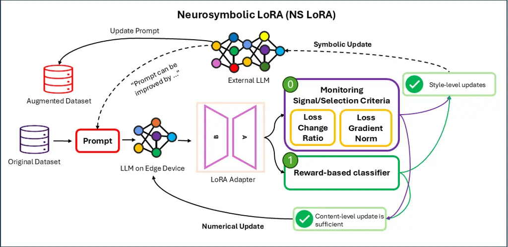
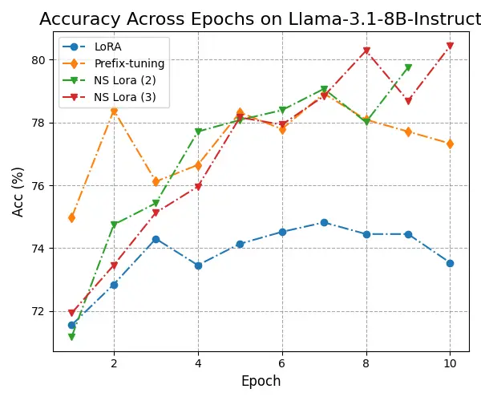
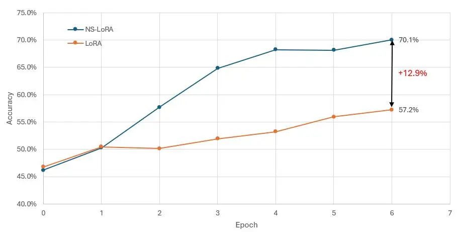
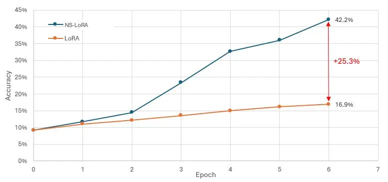
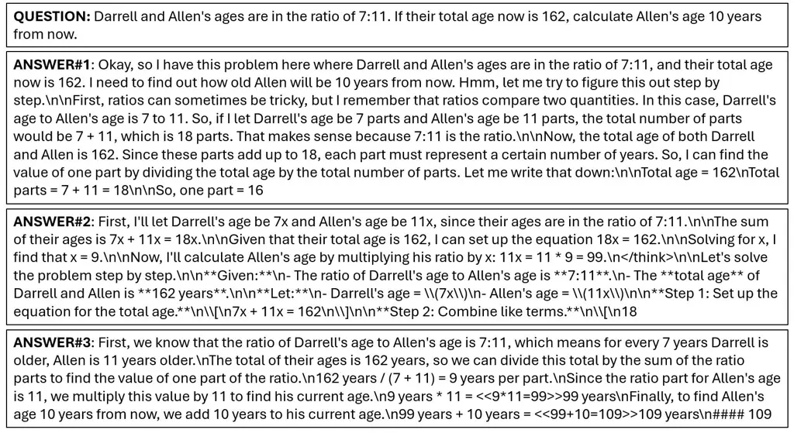

# Neurosymbolic LoRA: Why and When to Tune Weights vs. Rewrite Prompts

Kevin Wang    Neel P. Bhatt    Cong Liu    Junbo Li    Runjin Chen   
Yihan Xi    Timothy Barclay    Alvaro Velasquez    Ufuk Topcu   
Zhangyang Wang

###### Abstract

Large language models (LLMs) can be adapted either through _numerical_
updates that alter model parameters or _symbolic_ manipulations that
work on discrete prompts or logical constraints. While numerical
fine-tuning excels at injecting new factual knowledge, symbolic updates
offer flexible control of style and alignment without retraining. We
introduce a neurosymbolic LoRA framework that dynamically combines these
two complementary strategies. Specifically, we present a unified
monitoring signal and a reward-based classifier to decide when to employ
LoRA for deeper factual reconstruction and when to apply TextGrad for
token-level edits. Our approach remains memory-efficient by offloading
the symbolic transformations to an external LLM only when needed.
Additionally, the refined prompts produced during symbolic editing serve
as high-quality, reusable training data, an important benefit in
data-scarce domains like mathematical reasoning. Extensive experiments
across multiple LLM backbones show that neurosymbolic LoRA consistently
outperforms purely numerical or purely symbolic baselines, demonstrating
superior adaptability and improved performance. Our findings highlight
the value of interleaving numerical and symbolic updates to unlock a new
level of versatility in language model fine-tuning.

## Introduction

Neurosymbolic artificial intelligence (AI) (Garcez and Lamb 2023) offers
a way forward by combining the raw pattern-recognition prowess of large
language models (LLMs) with the structured constraints of symbolic
reasoning. Taking LLM fine-tuning or performance adaptation—presumably
the most popular application case in practice—for example: numerical
approaches such as Low-Rank Adaptation (Hu et al. 2021a) (LoRA) dominate
the practical pursuit of efficient adaptation: they modify model
parameters numerically, injecting factual knowledge or bridging domain
gaps. However, purely parametric updates can struggle with tasks
demanding precise logical constraints, interpretability, or strict style
alignment (Yang et al. 2022; Li et al. 2024).

Conversely, symbolic techniques—in a broad sense—can manipulate discrete
tokens, prompts, or logic-based decoding rules to steer a model’s
behavior and enforce constraints without altering the underlying
parameters. Earlier representative works include prompt tuning and
prefix tuning (Shin et al. 2020; Li and Liang 2021; Lester et al. 2021;
Liu et al. 2021; Zhang et al. 2021; Khattab et al. 2022; Çöplü et al.
2024). Latest variants of prompt tuning such as DSPy (Khattab et al. 2024) and TextGrad (Yuksekgonul et al. 2024) apply gradient-like signals
to _edit_ prompts, thereby indirectly shaping the model’s internal
activations by making token-level edits. These approaches stand as
instances of a broader class of “symbolic” approaches—one could instead
apply logic rules (Lu et al. 2020), finite-state automata (Yang et al.
2024), domain verifiers (Kambhampati et al. 2024), or other structured
constraints during generation.



Figure 1: Overview of the neurosymbolic LoRA framework: we visually
depict the workflow for our framework. In particular, there are two
primary means to alternate between numerical and symbolic updates,
either via a selection criteria that utilizes a training signal or using
a reward-based classifier.

It is precisely in the interplay between numerical parameter updates and
symbolic manipulation of discrete structures that we see complementary
strengths. Numerical adaptations (e.g., via LoRA) excel at fully
integrating new domain knowledge, especially for “content-centric” fixes
or when bridging factual gaps. Symbolic manipulation shines at style
alignment, interpretability, and discrete constraint enforcement. When
used in isolation, each has its limitations; combined judiciously, they
can yield a more robust, interpretable, and controllable system. Recent
work (Hoang et al. 2023) offers illuminating evidence about the
differences between re-training (numerical fine-tuning) and
prompting-based approaches (symbolic) in recovering the performance of
compressed LLMs. Their findings reveal an intriguing divergence in how
these methods reshape the internal dynamics of a model. Compared to
LoRA, the attention mechanism arising from prompting exhibits marked
deviations from the baseline (i.e., the pre-compressed model),
suggesting that prompting triggers a form of _contextual redirection_.
This stands in contrast to the activation patterns, which align more
closely with LoRA. Notably, LoRA incorporates residual connections at
every layer to preserve congruity with the original model, whereas
prompting modifies only the input component. Given the distinct
mechanisms between these two methods, it is unexpected to observe a high
degree of similarity in their activation patterns.

A notable recent work (Soylu et al. 2024) proposed to alternate between
fine-tuning and prompt optimization independently over the same dataset
after a fixed number of epochs. It showed noticeable accuracy gains
compared to applying only one optimization technique. Although the
simple condition triggering the switch could result in unnecessarily
expensive prompt optimization, it showed a promising direction of
combining the two optimization techniques.

These observations collectively imply that prompting-based approaches
(“symbolic”)—by focusing on attention-level redirection—can effectively
tap into _latent knowledge_ still embedded in the compressed model’s
internal representations. In other words, symbolic updates target style
alignment rather than factual inaccuracies and, hence, demonstrate
complementary benefits to numerical reconstruction (LoRA), which focuses
on re-injecting factual knowledge from external data. The observed
performance gains in (Hoang et al. 2023) indicate that prompting-based
redirection is surprisingly efficient for knowledge-related tasks,
pointing to a synergy between parametric fine-tuning and prompt
manipulation: their joint optimization can dynamically exploit internal
representations for stylistic or factual changes.

However, traditional prompt-tuning often relies on gradient signals
within the same LLM, rendering prompt edits relatively local and
constrained in both location and length (Wang et al. 2024). Moreover,
these updates remain tightly coupled to the model’s existing parameters.
In contrast, newer prompt-editing methods integrate external oracles in
the form of auxiliary LLMs or other symbolic engines to perform discrete
token-level changes. This effectively brings in an independent source of
knowledge, beyond what the target model’s gradients alone can convey,
and grants more free-form editing capacity (rather than fixed-position
or fixed-length prompts). Techniques like TextGrad exemplify this
broader flexibility, enabling more global, wide-ranging changes to the
prompt. These advances reinforce the broader theme that numerical and
symbolic updates are not mutually exclusive but rather complementary
levers for constructing more robust and adaptive LLMs.

### Our Contributions

Building on the broader aim of _adaptively_ interleaving numerical and
symbolic strategies, we instantiate our approach using LoRA (Hu et al.
2021a) as the numerical component and TextGrad (Yuksekgonul et al. 2024)
as the symbolic component. LoRA is a natural choice for memory-efficient
fine-tuning, excelling at parameter-level updates that inject or correct
factual knowledge. TextGrad, on the other hand, serves as an exemplar of
token-level editing using an external LLM as a gradient oracle to
re-write prompts, thus representing a flexible, discrete steering
mechanism. Despite focusing on LoRA and TextGrad in this paper, our
overarching methodology is not constrained to these two techniques. It
serves as a more general _neurosymbolic_ template where different
numerical approaches (e.g., full fine-tuning, low-rank adapters, or
quantization) and diverse symbolic algorithms (e.g., logic-based
constraints, chain-of-thought expansions, or finite automata) can be
seamlessly integrated.

Critically, this is _not_ a naïve “brute force” layering of LoRA and
TextGrad. Rather, we propose a structured feedback loop wherein each
approach is invoked under specific conditions. Numerical LoRA updates
perform deeper factual reconstruction if the model consistently fails
content checks, while symbolic edits (TextGrad) handle stylistic or
local re-routing tasks that do not require wholesale re-injection of
knowledge. These updates are triggered either by a monitoring signal
that tracks performance changes across epochs or by a reward-based
classifier that detects whether the input prompt is style-driven or
content-oriented. We thus avoid an uncoordinated mix-and-match of
techniques, ensuring that each algorithm is used precisely where it is
most effective. Given LoRA’s fundamental role in parameter-level
adaptation, we name our unified approach “neurosymbolic LoRA” (see
Figure 1), reflecting the synergy between the numerical (low-rank
parameter) and symbolic (prompt editing) dimensions.

Despite involving external LLM calls, our neurosymbolic pipeline remains
highly practical for real-world contexts:

- •
  First, outsourcing the symbolic updates (e.g., TextGrad prompt
  rewriting) to an external API can substantially _reduce on-device
  memory consumption_, trading off local memory usage for latency. This
  is appealing in resource-constrained or edge deployments, where the
  cost of storing additional modules is prohibitive.
- •
  Second, we deliberately structure our approach to invoke external
  symbolic edits _sparsely_, only when a monitoring or classification
  signal indicates that parametric fine-tuning has plateaued or that
  style realignment is essential. This ensures that latency overhead
  does not accumulate excessively.
- •
  Finally, a notable benefit emerges from our symbolic editing
  procedure: it “re-makes” or transforms the training data (or generated
  training examples) into forms more consumable by the target LLM. In
  data-scarce domains—such as mathematical reasoning, biomedical text,
  or legal arguments—collecting high-quality, annotated data can be
  extremely costly. Our symbolic rewriting, driven by an external LLM,
  can yield _reusable, higher-quality training sets_ for downstream or
  future models, providing a lasting resource beyond the immediate
  fine-tuning task.

Extensive experiments demonstrate the effectiveness of our neurosymbolic
LoRA approach in enhancing LLM capabilities, particularly with limited
annotated data or in tasks that demand rapid adaptation to evolving
requirements. This interwoven strategy significantly boosts both factual
fidelity and stylistic control, while remaining mindful of practical
constraints like memory, latency, and data annotation costs.

In summary, our technical contributions are outlined below:

- •
  Unified Monitoring Signal for Numerical and Symbolic Updates. We
  propose a mechanism that tracks performance indicators, such as loss
  changes across epochs, to determine when to apply numerical versus
  symbolic updates. If numerical fine-tuning (e.g., LoRA) saturates,
  symbolic rewriting (e.g., TextGrad) is triggered to refine style or
  re-route existing knowledge; likewise, if symbolic edits yield limited
  gains, the framework reverts to numerical adaptation. This principled
  switching leverages the strengths of both methods without resorting to
  a brute-force combination, and aligns with prior evidence that
  knowledge may remain “displaced” rather than deleted in compressed
  models (Hoang et al. 2023).
- •
  Reward-Based Classifier. To complement the monitoring signal, we
  develop a reward-based classifier that identifies whether an input
  primarily requires factual (content-level) updates or style/constraint
  alignment. This yields a more context-sensitive decision boundary for
  switching between parametric and symbolic manipulations.
- •
  Practical Integration with External LLMs and Data Remaking. Our
  approach remains feasible in memory-constrained environments by
  calling an external LLM for symbolic edits only when needed, thus
  offloading heavy computations. Moreover, the prompt transformations
  generated by our framework can serve as _re-made_ training data, which
  is especially beneficial in specialized or data-scarce domains (e.g.,
  math QA). These augmented datasets can be reused to train subsequent
  models, reinforcing both cost-efficiency and performance gains over
  time.
- •
  Empirical Validation and Scalability. We extensively evaluate the
  proposed hybrid framework across multiple LLM backbones and tasks. Our
  results show that the synergy of numerical (LoRA) and symbolic
  (TextGrad) updates outperforms purely numerical or purely symbolic
  methods, especially in low-data settings. The framework also offers a
  scalable blueprint for integrating a variety of numerical-symbolic
  pairs beyond LoRA and TextGrad, opening avenues for broader
  neurosymbolic AI research.

## Related Works

There has been a growing trend towards the synthesis of numerical and
symbolic approaches to align the outputs of LLMs to certain task
requirements. Fine-tuning enables the alteration of internal model
parameters that have been pre-trained to improve their performance on a
particular task. There is a wealth of research in this area showcasing
the relevance of fine-tuning pre-trained models in specific domains such
as demonstrated by (Yang et al. 2023; Bhatt et al. 2024). These works
demonstrate the enhancement of factual accuracy through injecting new
knowledge into the language models. In addition, due to the increasing
need to deploy models on edge devices, recent works such as by (Hu et
al. 2021b; Xu et al. 2023; Li and Liang 2021; Lester et al. 2021)
present memory-efficient fine-tuning methods aim at reducing the
computational burden in fine-tuning. Specifically, LoRA (Hu et al.
2021b) applies low-rank decomposition to update only a small subset of
weights offering efficient storage of swapable adapters for specific
tasks.

Prompt optimization is another important aspect of LLM alignment, which
deals with the improvement of input prompts to obtain more accurate
responses without changing the internal model parameters. Techniques
such as DSPy (Khattab et al. 2023; Khattab et al. 2024) have emerged as
important tools that provide automated methods for prompt optimization.
Similarly, TextGrad (Yuksekgonul et al. 2024) introduces gradient-based
methods to iteratively enhance prompts, thus ensuring better alignment
with desired outputs. These methods demonstrate that prompt engineering
serves as an alternative to standard model fine-tuning, emphasizing
stylistic control over language model outputs rather than the injection
of factual knowledge. Soft prompt tuning (Lester et al. 2021) is another
method that learns continuous embeddings for task-specific prompts.
Prefix-tuning (Li and Liang 2021) extends soft prompt tuning by
pre-pending continuous task-specific vectors to the input sequence,
enabling the model to condition on task-specific representations without
modifying its core parameters. Unlike discrete prompt tuning, where
prompts are manually designed, prefix-tuning optimizes a learned prefix
that serves as virtual tokens attended by a transformer.

Finally, symbolic methods for LLM adaptation add another layer of
sophistication by encoding structured reasoning and logical constraints
into model behavior. Recent works have explored the distillation of
symbolic representations from the outputs of language models and
subsequently utilize feedback from formal verification for automated
fine-tuning (Yang et al. 2024). For instance, a recent work (West et al. 2022) distills common sense knowledge from GPT-3 into a knowledge graph
and multiple neural models that are two orders of magnitude lighter and
yet achieve superior commonsense reasoning performance. Similarly,
another framework coined Ctrl-G (Zhang et al. 2024) takes symbolic logic
constraints as inputs and integrates them into the distillation of a
small language model (SLM) such that the generated text adheres to these
constraints. These methods uplift neural representations into a symbolic
space and obtain a measure of compliance with task descriptions.

By harnessing the complementary advantages of numeric and symbolic
methodologies, our framework ensures not only factual alignment of
generated text but also enforces style alignment. Moreover, it enables
the reuse of high-quality prompts for future training, especially in
data-scarce domains such as mathematical reasoning.

## Methodology

Fine-tuning LLMs, especially using LoRA, is generally performed in
memory-constrained environments and on edge devices. Performing symbolic
prompt optimization via TextGrad, for instance, is comparatively
resource intensive given the need to host both a teacher and student
model. Consequently, co-hosting LoRA and TextGrad on the same edge
device in such memory-constrained settings is infeasible without a
tradeoff on memory with latency. Accordingly, TextGrad can be hosted via
a cloud computing resource and accessed via an external API call.

### Seeking Training Signals for Switching Between Numerical and Symbolic Updates

We introduce a framework that adaptively governs the transition between
numerical and symbolic updates in model fine-tuning. At the heart of our
framework is a unified monitoring signal correlated with performance
changes in the model. This signal, derived from key performance
indicators such as training loss change ratio or gradient norm, provides
a continuous assessment of model performance at each epoch. By tracking
when this monitoring signal saturates while performing numerical
updates, a trigger to a symbolic update phase can be initiated to refine
style or re-route internal representations, echoing the concept of
“knowledge displacement” by allowing latent knowledge to be reclaimed or
redirected efficiently.

An ideal selection of the monitoring signal should ultimately inform
whether it is worthwhile for new factual knowledge to be injected (via
numerical updates) using the input sample or if contextual redirection
for style alignment (via symbolic updates) is required.

At the start of model training, we nominally initiate the numerical
update phase using LoRA in an attempt to learn new factual knowledge
from the training dataset $`\mathcal{D}`$. Consider a question and
answer problem setting which involves a textual description of the
system prompt $`P`$, a question $`Q`$ that the model $`f_{\theta}`$
attempts to answer, a ground truth answer $`A^{*}`$, and the model’s
prediction $`A`$. We want to identify a signal $`C(x)`$ such that the
saturation in the signal serves as a trigger to a sparse symbolic update
phase. Aligned with our problem setting, we perform symbolic updates
until the model predicts the correct answer or if the number of
allowable symbolic update iterations have been reached. Subsequently, we
alternate back to the numerical update phase as this is our nominal and
preferred update mode. Additionally, we incorporate an optional system
prompt learning procedure. In this stage, selected training samples
contribute to a symbolic gradient signal used to update the system
prompt globally at the end of each epoch. The updated system prompt is
then employed in the subsequent epoch, enabling the model to benefit
from accumulated symbolic insights throughout training.

1:  Input: Neural network $`f_{\theta}`$, dataset $`\mathcal{D}`$
containing text sample $`x\in\{P,Q,A\}`$, ground truth answer $`A^{*}`$,
criteria function $`C(x)`$, symbolic update ratio $`p\in[0,1]`$.

2:  for epoch do

3:   \# Numerical update

4:   for every batch in $`\mathcal{D}`$ do

5:    Update model $`f_{\theta}`$ using LoRA.

6:    Record criteria $`C(x)`$ for each sample $`x`$ in batch.

7:   end for

8:   if criteria $`C(x)`$ is not met, i.e. performance saturation has
occurred under numerical update then

9:    \# Symbolic update

10:    Select $`p`$ fraction in $`\mathcal{D}`$ with the lowest $`C(x)`$
and re-write $`Q`$ for each using TextGrad and/or $`P`$.

11:   end if

12:  end for

Algorithm 1 Neurosymbolic LoRA

The first unified signal we utilize to track saturation due to numerical
updates is the loss change ratio across consecutive epochs, defined as
$`C(x)_{1}=\frac{\mathcal{L}_{t}-\mathcal{L}_{t-1}}{\mathcal{L}_{t-1}}`$,
where $`\mathcal{L}_{t}`$ represents the training loss at epoch $`{t}`$.
To facilitate a fair comparison of loss across consecutive epochs, we
mark the data points sampled in a batch during the initial epoch and
then use these same data points for numerical updates in the following
epoch. Subsequently, we compare the model’s predictions $`A`$ with the
ground truth answers $`A^{*}`$ and identify instances in which the
model’s predictions are incorrect. Among these misclassified examples,
we further isolate those whose loss change ratio lies within a
pre-specified threshold $`k`$ from zero. Such samples derive minimal
benefit from the training data, presumably due to the absence of novel
factual information. However, the pool of these samples can still
benefit from contextual redirection via symbolic updates. Consequently,
we apply symbolic updates, via a call to TextGrad, specifically to a
fraction $`p`$ of these samples to update the question $`Q`$ and
indirectly refine internal representations and guide the model out of
the local minima. We can also apply updates to system prompt $`P`$ in
addition to updating Q. We outline the overall sequence of steps for our
framework in Algorithm 1.

Another signal to monitor the saturation of numerical updates is the
magnitude of the gradient norm of the training loss
$`C(x)_{2}=||\nabla\mathcal{L}_{t}||`$. The intuition behind its
selection as a monitoring signal is centered at the correlation between
the magnitude of the gradient norm and the effective learning of new
factual knowledge. In particular, a high magnitude of the gradient norm
implies significant changes in the model weights, indicating that the
training sample or batch of samples potentially contained new factual
knowledge that the model was otherwise not trained on. Thus, the
criteria to identify saturation during numerical updates would be to
monitor the magnitude of the gradient norm until it plummets below a
pre-specified threshold, acting as a trigger to initiate symbolic
updates in an attempt to perform context redirection given limited
knowledge gain.

### Reward-based Classifier

The criteria discussed in Section Seeking Training Signals for Switching
Between Numerical and Symbolic Updates are based on the zero-order and
first-order aspects of the loss function, meaning that they are not only
sample-dependent but also dependent on the model and the training stage
at which the criteria are evaluated. In contrast, content-centric
evaluation and style alignment should primarily focus on the
characteristics of the samples themselves. To better address this
distinction, we develop a classifier that leverages a reward model to
determine whether a particular sample is suited to be consumed under the
numerical or the symbolic update phase. This approach ensures that the
decision to perform symbolic updates is more closely aligned with the
inherent properties of each sample, rather than being influenced by the
dependencies of the model. Using a fixed-reward model also enhances the
ability to generalize across different datasets, enabling the
identification of samples that are appropriate for symbolic updates.

We examine the following reward model training approach. We initiate the
process by running neurosymbolic LoRA while applying the previously
mentioned criteria, such as the loss change ratio. These criteria are
related to improving numerical optimization, where lower values mean
less gain. After evaluating these criteria for all samples, we construct
preference pairs $`{(Q^{+},A^{+}),(Q^{-},A^{-})}`$ by designating the
sample with the higher criteria value as the positive instance
$`(Q^{+},A^{+})`$ and the sample with the lower criteria value as the
negative instance $`(Q^{-},A^{-})`$. Higher rewards indicate that the
samples are similar to those that are symbolically optimized.

With these preference pairs established, we then proceed to minimize the
loss:

```math
\min_{\theta}\quad\mathbb{E}\quad\sigma\left(r_{\theta}(Q^{+},A^{+})-r_{\theta}(Q^{-},A^{-})\right),
```

where $`\sigma(\cdot)`$ means the Sigmoid function. It is important to
note that, unlike traditional reward model training, the samples within
a preference pair in our approach may originate from different questions
because our objective is to evaluate and label the entire sample rather
than focusing solely on individual answers.

## Experimental Results

### Experimental Setup

#### Datasets

We conduct several experiments across tasks such as mathematical
reasoning, scientific factual claims, and textual understanding and
reasoning. We utilize the training and testing sets from the GSM8K,
CliniFact, and bAbi (Cobbe et al. 2021; Zhang et al. 2025; Weston et al. 2015) datasets.

#### Baselines and models

We compare the performance of our framework with two alternative
baseline frameworks: purely LoRA and prefix-tuning (Hu et al. 2021a; Li
and Liang 2021). We test our framework on both SLMs and LLMs such as
Deepseek-R1 Distill-Qwen-1.5B (Guo et al. 2025) and
Llama-3.1-8B-Instruct (Dubey et al. 2024).

#### Numerical update

We perform numerical updates using the Llama-3.1-8B-Instruct (Dubey et
al. 2024) and the Deepseek-R1-Distill-Qwen-1.5B (Guo et al. 2025) models
with 128 tokens for GSM8K and CliniFact and 2048 tokens for the bAbi
dataset, and set the learning rate to $`5\times 10^{-6}`$ and the batch
size to $`8`$. We train for a maximum of $`10`$ epochs on 8 NVIDIA A4500
GPUs for these tasks which take an average of 5 hours of training time.

#### Symbolic update

We perform symbolic updates using calls to TextGrad with GPT-4o as the
teacher model and perform at most 3 iterations.

| Dataset     | GSM8K            |                  | CliniFact        |                  | bAbi             |
| ----------- | ---------------- | ---------------- | ---------------- | ---------------- | ---------------- |
| Model       | Llama-3.1-8B-Ins | Deepseek-R1-1.5B | Llama-3.1-8B-Ins | Deepseek-R1-1.5B | Deepseek-R1-1.5B |
| Pre-trained | 71.56            | 9.2              | 58.32            | 35.54            | 13.7             |
| LoRA        | 74.45            | 16.9             | 63.21            | 37.18            | 14.3             |
| NS LoRA (3) | 80.43            | 42.2             | 67.86            | 39.33            | 15.0             |

Table 1: Performance evaluation (% accuracy) of baselines and different
configurations of our framework on three datasets: GSM8K, CliniFact, and
bAbi, for the Llama-3.1-8B-Instruct and Deepseek-R1-1.5B models.

#### Switching criteria

We utilize several distinct selection criteria to switch between
numerical and symbolic updates for our analysis. We first (1) randomly
select a subset of the training data amounting to 10% of the batch size
and perform symbolic updates, i.e. update each question $`Q`$ in the
subset using a call to TextGrad, at every epoch. Secondly, (2) we use
the gradient norm of the training loss at every epoch as the selection
criteria and update each $`Q`$ from a subset of the training data
amounting to 10% of the batch size with the least gradient norm.
Thirdly, (3) we use the loss change ratio at every epoch as the
selection criteria and update each $`Q`$ from a subset of the training
data amounting to 10% of the batch size with the least loss change
ratio. From these selected samples, we identify instances where the
model generates incorrect responses and apply symbolic updates to the
corresponding prompts to enhance performance.

### Results and Discussion

To demonstrate the effectiveness of our approach, we conduct our
experiments on GSM8K, Clinifact, and bAbi (Cobbe et al. 2021; Zhang et
al. 2025; Weston et al. 2015) datasets. We train our model on the
original training sets for 10 epochs, using a learning rate of
$`5\times 10^{-6}`$. We apply symbolic optimization to the lowest
$`10\%`$ of the training data based on specific criteria described in
Section Experimental Setup for each epoch.

The evaluation is performed via answer extraction post-generation and
subsequent verification of an exact match with the ground truth. This
setup is inspired by a state-of-the-art evaluation harness (Gao et al. 2024) with zero-shot prompting and modified instruction templates
specific to both models. However, we also note that applying correct
chat templates for each model can significantly affect the evaluation
results, which (Gao et al. 2024) does not perform for certain models. We
outline the results for the baselines as well as our framework in Table

1.

We find that implementing symbolic optimization to only $`10\%`$ of the
batch for each epoch is enough to attain 6.0% improvement in accuracy
compared to LoRA for GSM8k for the Llama-3.1-8B-Ins model and 4.6% for
CliniFact demonstrating the potential of this targeted strategy. For the
Deepseek-R1-1.5 model this enhancement was 25.3% for GSM8K, 2.1% for
CliniFact and 0.7% for bAbi.

#### Comparison with baselines

Per the results on GSM8K in Figure 2 and Table 2, solely performing
numerical updates using LoRA achieves poor results (74.45% accuracy) for
Llama-3.1-8B-Instruct. In contrast, prefix-tuning offers nearly a 3%
increase in accuracy while the reward classifier offers a 6% increase in
accuracy. However, our results demonstrate that pure numerical or pure
symbolic updates yield inferior results compared to our neurosymbolic
framework. In particular, neurosymbolic (NS) LoRA performs better than
both LoRA and prefix-tuning baselines with the loss change ratio
switching criteria (NS LoRA (3)) yields over 80% accuracy which is a 6%
enhancement in accuracy. On the other hand, the reward-based classifier
achieves comparable results with NS LoRA and is a viable alternative
method. Nonetheless, we demonstrate that our hybrid approach yields
performance gains for both models.

### Experimental Details - GSM8K

We conducted experiments in which the DeepSeek-R1- Distill-Qwen-1.5B and
Phi-3-mini-4k-Ins small language models (SLMs) were fine-tuned on the
GSM8K dataset using both standard LoRA and neurosymbolic LoRA
approaches. All models were trained for six epochs. For neurosymbolic
LoRA, the symbolic update was invoked every two epochs, with a symbolic
update ratio of 10%.

| Dataset           | GSM8K            |                   |
| ----------------- | ---------------- | ----------------- |
| Model             | Llama-3.1-8B-Ins | Phi-3-mini-4k-Ins |
| LoRA              | 74.45            | 80.60             |
| Prefix-tuning     | 77.79            | 79.23             |
| Reward Classifier | 79.76            | 81.96             |
| NS LoRA (1)       | 78.77            | 79.73             |
| NS LoRA (2)       | 79.75            | 81.45             |
| NS LoRA (3)       | 80.43            | 80.61             |

Table 2: Performance evaluation of baselines and different
configurations of our framework on GSM8K for the Llama-3.1-8B-Instruct
and Phi-3-mini-4k-Instruct models. Key methods include LoRA,
prefix-finetuning, and Neurosymbolic LoRA (NS LoRA) with 3 different
selection criteria: (1) a randomly selected subset forming 10% of
training data, (2) the 10% of samples with the lowest gradient norm, and
(3) the 10% of samples with the lowest loss rate change.



Figure 2: A depiction of the trend for accuracy on GSM8k for the
Llama-3.1-8B-Instruct model as the number of training epochs for the
baselines and our hybrid framework NS LoRA with two primary selection
criteria $`C(x)_{2}`$ and $`C(x)_{1}`$ corresponding to NS LoRA (2) and
(3) respectively.





Figure 3: Performance comparison of traditional LoRA and neurosymbolic
LoRA during training of the Phi-3-mini-4k-Ins and
DeepSeek-R1-Distill-Qwen-1.5B model on GSM8K.

We perform evaluation using the lm-evaluation-harness framework with the
gsm8k_cot_zeroshot configuration and the flexible-extract filter. We set
the output token length limit to the default value of 256. Figure 3
depicts the accuracy of traditional LoRA and neurosymbolic LoRA after
each epoch of training of Phi-3-mini-4k-Ins and
DeepSeek-R1-Distill-Qwen-1.5B.

The performance of both models show similar trends. Notably, the
accuracies of both approaches remain nearly identical during the first
two epochs, as symbolic updates are not performed during this phase.
However, starting from the third epoch, when the symbolic update is
first performed, we see an increase in the performance of our approach.
While the accuracy of traditional LoRA either plateaus or improves
marginally, the accuracy of neurosymbolic LoRA exhibits a significant
and consistent increase.

Our results confirm that knowledge remains displaced rather than deleted
and that performance can be enhanced using our hybrid framework. In
addition, the results confirm that the reward-based classifier
successfully captures a context-sensitive decision boundary by
identifying whether the input sample requires content-level updates or
style alignment.

Given that the reported gains were realized with an upper limit of 10
epochs, our hybrid approach remains applicable for edge device
deployment and in memory-constrained environments. It offers the
efficiency benefits of LoRA while making sparse calls to
externally-hosted TextGrad.

#### Effect of updating system prompt along with the specific question prompt

We observe that jointly updating the system prompt and the question
prompt yields significant gains across benchmarks. In particular, when
paired with neurosymbolic LoRA, this strategy delivers a 3.5 % accuracy
boost on GSM8K and a 4.5 % gain on CliniFact relative to the LoRA +
system-prompt update baseline. In this setting, we first fine-tune the
model via LoRA, then perform three epochs of system-prompt refinement
over the full training corpus. As detailed in Table 3, NS LoRA augmented
with system-prompt updates consistently outperforms the simple LoRA +
system-prompt combination.

Our results confirm that knowledge remains displaced rather than deleted
and that performance can be enhanced using our hybrid framework. In
addition, the results confirm that the reward-based classifier
successfully captures a context-sensitive decision boundary by
identifying whether the input sample requires content-level updates or
style alignment.

| Dataset                   | GSM8K | CliniFact |
| ------------------------- | ----- | --------- |
| NS LoRA (3)               | 80.43 | 67.86     |
| LoRA+Sys. Prmt. Update    | 79.71 | 65.87     |
| NS LoRA+Sys. Prmt. Update | 83.24 | 70.31     |

Table 3: Performance evaluation (% accuracy) of models in different
configurations on GSM8K and CliniFact for Llama-3.1-8B-Instruct.

Given that the reported gains were realized with an upper limit of 10
epochs our hybrid approach remains applicable for edge device deployment
and in memory-constrained environments. It offers the efficiency
benefits of LoRA while making sparse calls to externally hosted
TextGrad.



Figure 4: Impact of neurosymbolic LoRA on LLM response. Answer#1 is the
response of the pre-trained LLM. Answer#2 is the response of the LLM
post LoRA. Answer#3 is the response of the LLM post NS LoRA (3).

### Higher-quality Training Set Synthesis for Downstream Fine-tuning

Prompt editing via symbolic updates provides a means for the synthesis
of high-quality training data. With symbolic data augmentation alone,
downstream model performance post-fine-tuning can be substantially
enhanced. To demonstrate this capability, we applied neurosymbolic LoRA
on GSM8K with loss change ratio as the selection criteria on the
Llama-3.1-8B-Instruct model and obtained a new augmented dataset with
questions revised during the symbolic update phase. Subsequently, we
incorporate the synthesized dataset to fine-tune the Qwen2.5-7B-Instruct
model using LoRA. Both models were trained with a maximum training epoch
limit of 5 epochs, yet converged after 2–3 epochs on average.

The experimental results show that the model attains an accuracy of
70.36% on the original GSM8k dataset. On the augmented data, however,
the model attains an accuracy of 75.96%. This demonstrates not only that
our neurosymbolic framework for data augmentation can improve
performance by over 5% on GSM8k under zero-shot prompting, but also that
the generated dataset can be consumed for downstream fine-tuning and
beyond by other models. These results underscore the transferability and
reusability of the synthesized dataset obtained via symbolic updates to
other models. The results also demonstrate the potential of
neurosymbolic scaling in data-scarce domains.

#### Impact of neurosymbolic LoRA on LLM response

Neurosymbolic LoRA training appears to influence the response style and
format of the LLM. We illustrate this effect in Figure 4, which compares
outputs from three model variants: the pre-trained LLM, the LLM after
traditional LoRA training, and the LLM after neurosymbolic LoRA
training. All outputs are generated with a maximum token limit of 256,
consistent with the default configuration in the lm-evaluation-harness
framework. The first response, from the pre-trained model, is verbose
and predominantly textual, reflecting a slow and meandering reasoning
process. The second response, generated after traditional LoRA training,
is more succinct and incorporates more mathematical symbols and
calculations. However, the reasoning halts prematurely, failing to reach
a complete conclusion. In contrast, the third response, produced after
neurosymbolic LoRA training, is concise, well-structured, and exhibits a
coherent reasoning chain that efficiently leads to the correct answer.
These observations suggest that neurosymbolic LoRA is more effective
than traditional LoRA in enabling the LLM to internalize and produce
well-structured response formats and reasoning styles.

## Conclusion

We demonstrate the efficacy of integrating numerical and symbolic
updates within a unified framework, neurosymbolic LoRA, to enhance the
performance of language models. We design a hybrid framework that
performs numerical updates for factual content-level learning and
symbolic updates for precise style-level adjustments. Our method
showcases the strengths of synergistically leveraging both update modes.
Beyond performance improvements, our approach remains memory-efficient
and deployable on edge devices by sparsely making external API calls for
symbolic updates and thereby optimizing computational resources. This
capability is especially beneficial in data-scarce domains, such as
mathematical reasoning, as it enables the generation of refined,
high-quality prompts as reusable training data. Our experiments
consistently demonstrate the effectiveness of a unified, reward-based
signal for orchestrating numerical and symbolic update phases, and
confirm that our framework outperforms purely numerical, purely
symbolic, and naively combined baselines. Consequently, our findings
will enable the efficient and scalable development of hybrid frameworks
for fine-tuning language models. These results underscore promising
future directions centered at exploring other unified monitoring signals
to optimize the interplay between numerical and symbolic learning.

#### Limitations and future work

Neurosymbolic LoRA yields significant performance improvements on GSM8K
across several LLMs, but shows smaller gains on other datasets. This
discrepancy may be attributed to the detailed, step-by-step answers in
GSM8K, which likely aids in generating targeted and instructional
prompts. NS LoRA does not yet guarantee semantic preservation of
rewritten prompts, and additional mechanisms for filtering or verifying
symbolic edits would be needed to ensure robustness.

## References

- Bhatt et al. (2024) N. P. Bhatt, Y. Yang, R. Siva, D. Milan, U. Topcu,
  and Z. Wang Know where you’re uncertain when planning with multimodal
  foundation models: a formal framework. arXiv preprint
  arXiv:2411.01639. Cited by: Related Works.
- Cobbe et al. (2021) K. Cobbe, V. Kosaraju, M. Bavarian, M. Chen, H.
  Jun, L. Kaiser, M. Plappert, J. Tworek, J. Hilton, R. Nakano, et al.
  Training verifiers to solve math word problems. arXiv preprint
  arXiv:2110.14168. Cited by: Datasets, Results and Discussion.
- Çöplü et al. (2024) T. Çöplü, A. Bendiken, A. Skomorokhov, E.
  Bateiko, S. Cobb, and J. J. Bouw Prompt-time symbolic knowledge
  capture with large language models. arXiv preprint arXiv:2402.00414.
  Cited by: Introduction.
- Dubey et al. (2024) A. Dubey, A. Jauhri, A. Pandey, A. Kadian, A.
  Al-Dahle, A. Letman, A. Mathur, A. Schelten, A. Yang, A. Fan, et al.
  The llama 3 herd of models. arXiv preprint arXiv:2407.21783. Cited by:
  Baselines and models, Numerical update.
- Gao et al. (2024) L. Gao, J. Tow, B. Abbasi, S. Biderman, S. Black, A.
  DiPofi, C. Foster, L. Golding, J. Hsu, A. Le Noac’h, H. Li, K.
  McDonell, N. Muennighoff, C. Ociepa, J. Phang, L. Reynolds, H.
  Schoelkopf, A. Skowron, L. Sutawika, E. Tang, A. Thite, B. Wang, K.
  Wang, and A. Zou A framework for few-shot language model evaluation.
  Zenodo. External Links:
  [Document](https://dx.doi.org/10.5281/zenodo.12608602),
  [Link](https://zenodo.org/records/12608602) Cited by: Results and
  Discussion.
- Garcez and Lamb (2023) A. d. Garcez and L. C. Lamb Neurosymbolic ai:
  the 3 rd wave. Artificial Intelligence Review 56 (11),
  pp. 12387–12406. Cited by: Introduction.
- Guo et al. (2025) D. Guo, D. Yang, H. Zhang, J. Song, R. Zhang, R.
  Xu, Q. Zhu, S. Ma, P. Wang, X. Bi, et al. DeepSeek-r1: incentivizing
  reasoning capability in llms via reinforcement learning. arXiv
  preprint arXiv:2501.12948. Cited by: Baselines and models, Numerical
  update.
- Hoang et al. (2023) D. N. Hoang, M. Cho, T. Merth, M. Rastegari,
  and Z. Wang (Dynamic) prompting might be all you need to repair
  compressed LLMs. arXiv preprint arXiv:2310.00867. Cited by: 1st item,
  Introduction, Introduction.
- Hu et al. (2021a) E. J. Hu, Y. Shen, P. Wallis, Z. Allen-Zhu, Y.
  Li, S. Wang, L. Wang, and W. Chen Lora: low-rank adaptation of large
  language models. arXiv preprint arXiv:2106.09685. Cited by: Our
  Contributions, Introduction, Baselines and models.
- Hu et al. (2021b) E. J. Hu, Y. Shen, P. Wallis, Z. Allen-Zhu, Y.
  Li, S. Wang, L. Wang, and W. Chen Lora: low-rank adaptation of large
  language models. arXiv preprint arXiv:2106.09685. Cited by: Related
  Works.
- Kambhampati et al. (2024) S. Kambhampati, K. Valmeekam, L. Guan, M.
  Verma, K. Stechly, S. Bhambri, L. Saldyt, and A. Murthy LLMs can’t
  plan, but can help planning in LLM-modulo frameworks. arXiv preprint
  arXiv:2402.01817. Cited by: Introduction.
- Khattab et al. (2022) O. Khattab, K. Santhanam, X. L. Li, D. Hall, P.
  Liang, C. Potts, and M. Zaharia Demonstrate-search-predict: composing
  retrieval and language models for knowledge-intensive NLP. arXiv
  preprint arXiv:2212.14024. Cited by: Introduction.
- Khattab et al. (2023) O. Khattab, A. Singhvi, P. Maheshwari, Z.
  Zhang, K. Santhanam, S. Vardhamanan, S. Haq, A. Sharma, T. T.
  Joshi, H. Moazam, et al. Dspy: compiling declarative language model
  calls into self-improving pipelines. arXiv preprint arXiv:2310.03714.
  Cited by: Related Works.
- Khattab et al. (2024) O. Khattab, A. Singhvi, P. Maheshwari, Z.
  Zhang, K. Santhanam, S. Vardhamanan, S. Haq, A. Sharma, T. T.
  Joshi, H. Moazam, H. Miller, M. Zaharia, and C. Potts DSPy: compiling
  declarative language model calls into self-improving pipelines. Cited
  by: Introduction, Related Works.
- Lester et al. (2021) B. Lester, R. Al-Rfou, and N. Constant The power
  of scale for parameter-efficient prompt tuning. arXiv preprint
  arXiv:2104.08691. Cited by: Introduction, Related Works, Related
  Works.
- Li and Liang (2021) X. L. Li and P. Liang Prefix-tuning: optimizing
  continuous prompts for generation. arXiv preprint arXiv:2101.00190.
  Cited by: Introduction, Related Works, Related Works, Baselines and
  models.
- Li et al. (2024) Z. Li, Y. Huang, Z. Li, Y. Yao, J. Xu, T. Chen, X.
  Ma, and J. Lu Neuro-symbolic learning yielding logical constraints.
  Advances in Neural Information Processing Systems 36. Cited by:
  Introduction.
- Liu et al. (2021) X. Liu, K. Ji, Y. Fu, W. L. Tam, Z. Du, Z. Yang,
  and J. Tang P-tuning v2: prompt tuning can be comparable to
  fine-tuning universally across scales and tasks. arXiv preprint
  arXiv:2110.07602. Cited by: Introduction.
- Lu et al. (2020) X. Lu, P. West, R. Zellers, R. L. Bras, C.
  Bhagavatula, and Y. Choi Neurologic decoding:(un) supervised neural
  text generation with predicate logic constraints. arXiv preprint
  arXiv:2010.12884. Cited by: Introduction.
- Shin et al. (2020) T. Shin, Y. Razeghi, R. L. Logan IV, E. Wallace,
  and S. Singh Autoprompt: eliciting knowledge from language models with
  automatically generated prompts. arXiv preprint arXiv:2010.15980.
  Cited by: Introduction.
- Soylu et al. (2024) D. Soylu, C. Potts, and O. Khattab Fine-tuning and
  prompt optimization: two great steps that work better together. In
  Proceedings of the 2024 Conference on Empirical Methods in Natural
  Language Processing, Y. Al-Onaizan, M. Bansal, and Y. Chen (Eds.),
  Miami, Florida, USA, pp. 10696–10710. External Links:
  [Link](https://aclanthology.org/2024.emnlp-main.597/),
  [Document](https://dx.doi.org/10.18653/v1/2024.emnlp-main.597) Cited
  by: Introduction.
- Wang et al. (2024) Y. Wang, J. Chauhan, W. Wang, and C. Hsieh
  Universality and limitations of prompt tuning. Advances in Neural
  Information Processing Systems 36. Cited by: Introduction.
- West et al. (2022) P. West, C. Bhagavatula, J. Hessel, J. Hwang, L.
  Jiang, R. Le Bras, X. Lu, S. Welleck, and Y. Choi Symbolic knowledge
  distillation: from general language models to commonsense models. In
  Proceedings of the 2022 Conference of the North American Chapter of
  the Association for Computational Linguistics: Human Language
  Technologies, pp. 4602–4625. Cited by: Related Works.
- Weston et al. (2015) J. Weston, A. Bordes, S. Chopra, A. M. Rush, B.
  Van Merriënboer, A. Joulin, and T. Mikolov Towards ai-complete
  question answering: a set of prerequisite toy tasks. arXiv preprint
  arXiv:1502.05698. Cited by: Datasets, Results and Discussion.
- Xu et al. (2023) L. Xu, H. Xie, S. J. Qin, X. Tao, and F. L. Wang
  Parameter-efficient fine-tuning methods for pretrained language
  models: a critical review and assessment. arXiv preprint
  arXiv:2312.12148. Cited by: Related Works.
- Yang et al. (2024) Y. Yang, N. P. Bhatt, T. Ingebrand, W. Ward, S.
  Carr, A. Wang, and U. Topcu Fine-tuning language models using formal
  methods feedback: a use case in autonomous systems. Proceedings of
  Machine Learning and Systems 6, pp. 339–350. Cited by: Introduction,
  Related Works.
- Yang et al. (2023) Y. Yang, N. P. Bhatt, T. Ingebrand, W. Ward, S.
  Carr, Z. Wang, and U. Topcu Fine-tuning language models using formal
  methods feedback. arXiv preprint arXiv:2310.18239. Cited by: Related
  Works.
- Yang et al. (2022) Z. Yang, J. Lee, and C. Park Injecting logical
  constraints into neural networks via straight-through estimators. In
  International Conference on Machine Learning, pp. 25096–25122. Cited
  by: Introduction.
- Yuksekgonul et al. (2024) M. Yuksekgonul, F. Bianchi, J. Boen, S.
  Liu, Z. Huang, C. Guestrin, and J. Zou TextGrad: automatic”
  differentiation” via text. arXiv preprint arXiv:2406.07496. Cited by:
  Our Contributions, Introduction, Related Works.
- Zhang et al. (2025) B. Zhang, A. Bornet, A. Yazdani, P. Khlebnikov, M.
  Milutinovic, H. Rouhizadeh, P. Amini, and D. Teodoro A dataset for
  evaluating clinical research claims in large language models.
  Scientific Data 12 (1), pp. 86. Cited by: Datasets, Results and
  Discussion.
- Zhang et al. (2024) H. Zhang, P. Kung, M. Yoshida, G. V. d. Broeck,
  and N. Peng Adaptable logical control for large language models. arXiv
  preprint arXiv:2406.13892. Cited by: Related Works.
- Zhang et al. (2021) N. Zhang, L. Li, X. Chen, S. Deng, Z. Bi, C.
  Tan, F. Huang, and H. Chen Differentiable prompt makes pre-trained
  language models better few-shot learners. arXiv preprint
  arXiv:2108.13161. Cited by: Introduction.

## A   Comparing Neurosymbolic LoRA and Lessons Learned

### Comparing Neurosymbolic LoRA with a Two-stage Training and Prompting Approach

We conducted additional experiments to compare neurosymbolic LoRA with a
two-stage training approach that applies prompt optimization for data
augmentation prior to performing numerical updates. In this approach, an
optimal prompt is first generated for the entire training dataset. This
prompt is then prepended to each question in the dataset, effectively
augmenting the input. The resulting augmented dataset is subsequently
used for traditional LoRA fine-tuning. Our experimental results depict
that neurosymbolic LoRA achieves better performance than the two-stage
training strategy.


Figure 5: Examples of new questions generated by TextGrad during
symbolic update. The text in red were added to the original question.

### Learnings from Training

During development and experimentation, we observed that our approach
yielded insignificant results on certain datasets, including BoolQ,
bAbI, and OpenBookQA. A key factor contributing to this inconsistency
appears to be the variability in the quality of new questions generated
by TextGrad during the symbolic update step. As illustrated in Figure 5,
the nature of the generated content differs significantly across
datasets. In the first two examples, the added text is more
instructional in nature, providing explicit guidance or reasoning
strategies, which can help the model arrive at the correct answer. In
contrast, the last two examples feature additions that focus primarily
on the final answer rather than the reasoning process, making them less
effective in deriving the correct answer. We hypothesize that this
discrepancy may stem from differences in the level of detail provided in
the ground truth answers, which serve as input to TextGrad when
generating new questions.
