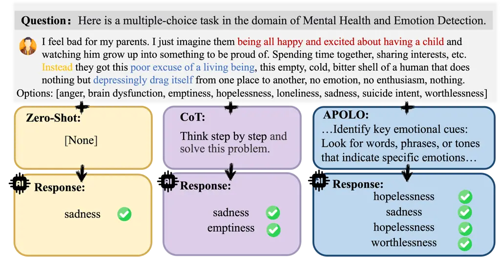
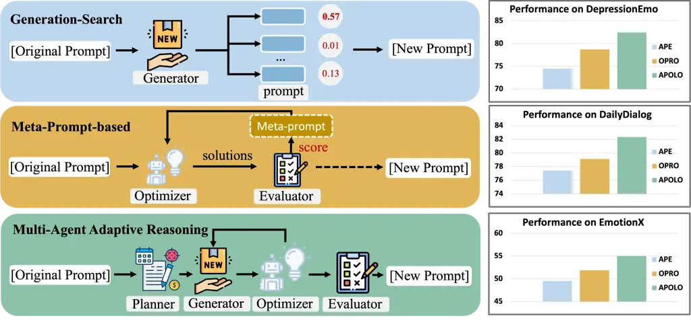
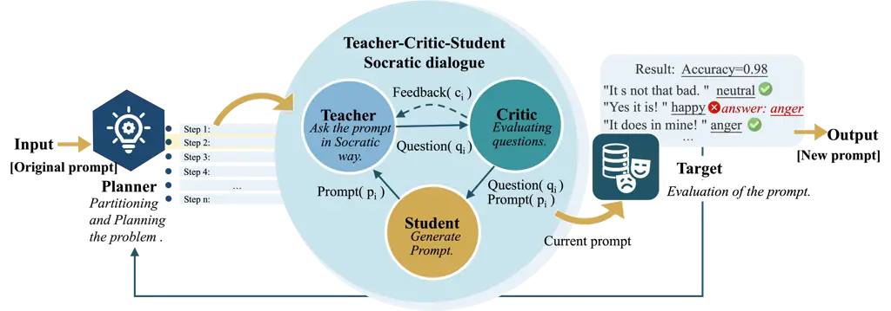
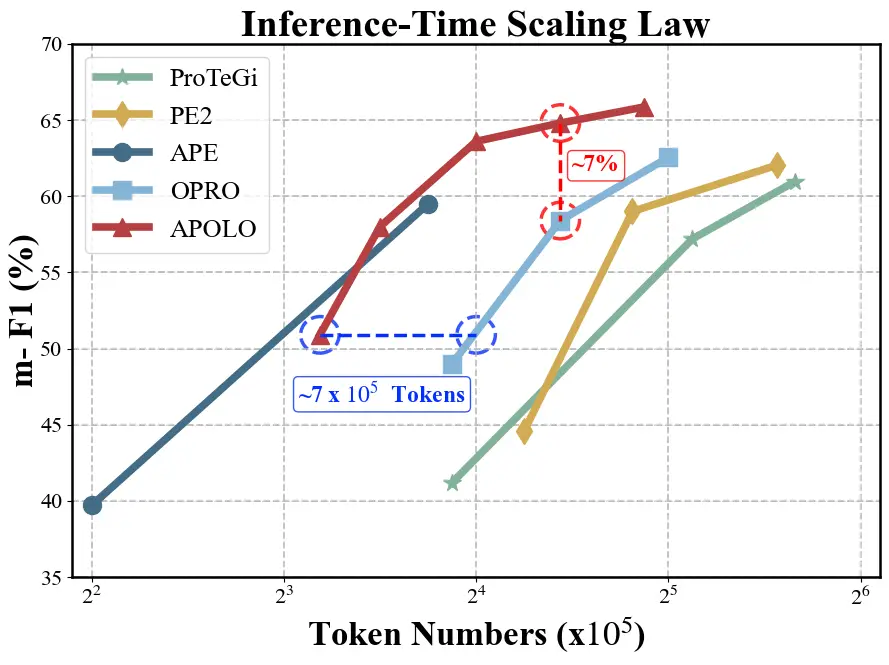
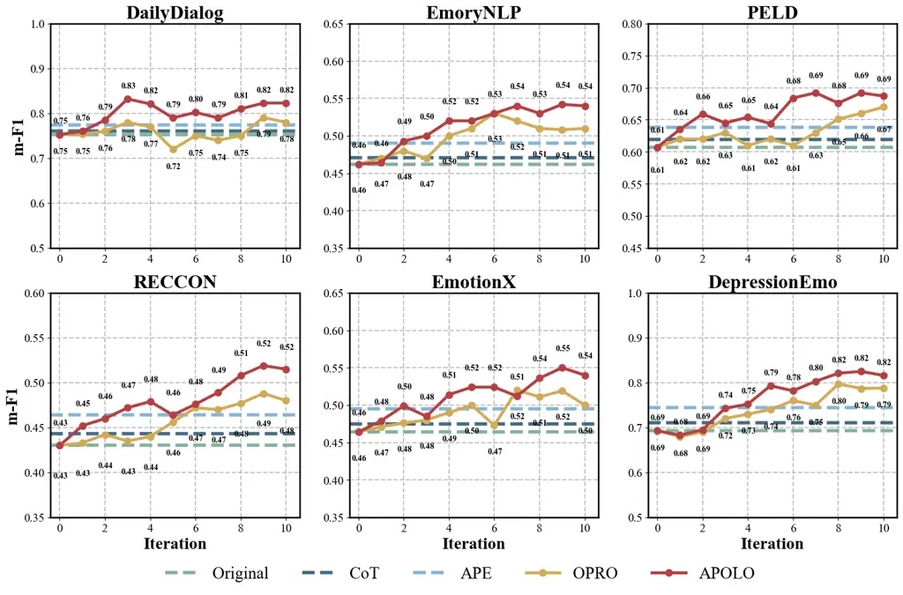
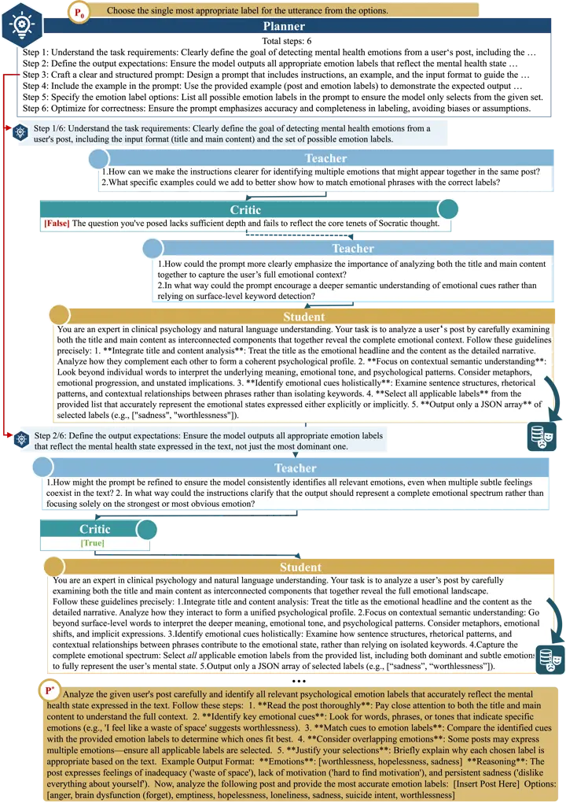

# Towards Efficient and Robust Linguistic Emotion Diagnosis for Mental Health via Multi-Agent Instruction RefinementThanks: \* Corresponding author: Haiping Zhu and Qika Lin.Thanks:  Jian Zhang, Zhangqi Wang, Zhiyuan Wang, Weiping Fu, Yu He, Haiping Zhu and Jun Liu are with the School of Computer Science and Technology, Xi’an Jiaotong University, Shaanxi, China, 710049. E-mail: {zhangjian062422, Asteria_wzq, wang_zy, fuweiping, heyucs}@stu.xjtu.edu.cn, {zhuhaiping, liukeen}@xjtu.edu.cn. Qika Lin is with Saw Swee Hock School of Public Health, National University of Singapore, Singapore 119077. E-mail: qikalin@foxmail.com.

Jian Zhang    Zhangqi Wang    Zhiyuan Wang    Weiping Fu    Yu He
Affiliation: Haiping Zhu^(\*), Qika Lin^(\*), , and Jun Liu, 

###### Abstract

Linguistic expressions of emotions, including depression, anxiety, and
trauma-related states, are widespread in clinical notes, counseling
dialogues, and online mental health communities. Accurate recognition of
these emotions is crucial for clinical triage, risk assessment, and
timely intervention in mental health related applications. Despite
recent advances showing that large language models (LLMs) can generalize
well to various emotion analysis tasks, their diagnostic reliability in
high-stakes and context-intensive medical settings remains highly
sensitive to prompt design. Moreover, existing approaches are challenged
by two major issues: emotional comorbidity, where multiple intertwined
emotional states complicate prediction, and inefficient exploration of
clinically relevant cues. To address these issues, we propose APOLO
(Automated Prompt Optimization for Linguistic emOtion diagnosis), a
framework that systematically explores a broader and finer-grained
prompt space to enhance diagnostic efficiency and robustness. APOLO
models instruction refinement as a Partially Observable Markov Decision
Process (POMDP) and introduces a multi-agent collaboration mechanism
comprising the Planner–Teacher–Critic–Student–Target roles. This
closed-loop design enables continuous optimization of prompt generation,
evaluation, and evolution. After the Planner agent formulates a
high-level optimization trajectory within the POMDP framework, the
Teacher–Critic–Student agents collaboratively refine the prompts along
this trajectory, iteratively enhancing the stability and effectiveness
of the reasoning process. Finally, the Target agent determines whether
to continue optimization or terminate the search based on performance
evaluation. Experimental results demonstrate that APOLO improves
diagnostic accuracy and robustness across domain-specific and stratified
benchmarks, providing a generalizable and scalable paradigm for
trustworthy LLM applications in mental healthcare.

###### Index Terms: 

Linguistic Emotion Diagnosis; Emotional Comorbidity; Inefficient
Exploration; Automated Prompt Optimization; Multi-Agent Collaboration;
Medical Language Processing; Trustworthy Artificial Intelligence

## I Introduction

Emotion diagnosis for mental health plays an essential role in
understanding mental health conditions and tracking the progression of
related disorders \[1\]. Emotions associated with illnesses, including
depression, anxiety, and posttraumatic stress, frequently appear in
clinical notes, counseling conversations, and online mental-health
communities \[2, 3\]. These texts capture patients’ cognitive and
affective states and play a vital role in clinical triage, risk
assessment, and intervention decisions \[4\]. Traditional emotion
recognition methods, often based on shallow features or lexicons,
perform reasonably well on generic sentiment tasks but struggle in
medical contexts due to semantic ambiguity, implicit emotional
expressions, and domain variability \[5, 6, 7\].



Fig. 1: Examples of disease-related emotion diagnosis under three
prompting strategies: zero-shot, CoT, and APOLO.

Recently, large language models (LLMs) have demonstrated remarkable
capabilities in affective and psycholinguistic reasoning, achieving
strong few-shot or zero-shot performance on mental health–related text
analysis \[8, 9, 10\]. However, in high-stakes clinical scenarios, LLM
outputs are highly sensitive to the phrasing and structure of prompts.
Minor variations in instruction design or reasoning path can lead to
drastically different diagnostic outcomes \[11\]. For instance, “I can’t
sleep lately and don’t want to see anyone” implies both anxiety and
depression, yet a poorly designed prompt may capture only one.
Hand-crafted prompts, although guided by expert intuition, fail to
systematically cover diverse semantic cues and implicit intentions,
resulting in limited consistency and transferability \[11, 12\].



Fig. 2: Comparison of APO strategies. Top: generation–search methods
generate and locally refine candidate prompts, leading to limited
coverage. Middle: meta-prompt approaches rely on fixed optimization
templates with low adaptability. Bottom: our APOLO framework introduces
multi-agent adaptive reasoning, enabling dynamic and collaborative
prompt exploration. Right: performance comparison across three datasets
based on m-F1 score.

Automated Prompt Optimization (APO) provides a principled way to
overcome these limitations by systematically exploring a broader and
finer-grained prompt space \[13\]. Through iterative search and
evaluation, APO enables adaptive discovery of optimal task-specific
prompts \[11\]. Nevertheless, generic APO methods remain inadequate for
emotion diagnosis, where complex high-context semantics and safety
constraints prevail \[14\]. As shown in Figure 1, we compare three
prompting strategies for disease-related emotion recognition. The
zero-shot prompt identifies only one emotion, while the Chain-of-Thought
(CoT) prompt captures two, but both yield incomplete emotion diagnoses.
This observation highlights that conventional prompting strategies fail
to uncover the full spectrum of disease-related emotions, motivating the
need for a more systematic and adaptive approach to prompt
optimization \[15\].

Such incompleteness arises from two fundamental issues: emotional
comorbidity and inefficient exploration.

Emotional comorbidity. Disease-related emotions often appear in
intertwined and co-occurring forms, such as anxiety with depression,
trauma with guilt, or anhedonia with self-blame. A single utterance may
convey multiple affective states that interact hierarchically or
causally. Fixed-template prompts or single-label formulations fail to
capture such dependencies \[1\]. For instance, the sentence “I feel
guilty and afraid that I might break down” simultaneously expresses
guilt and fear; without hierarchical reasoning, the model tends to
detect only the dominant emotion. Existing prompt designs typically rely
on flat labels or keyword cues, lacking mechanisms to model emotional
co-occurrence and semantic overlap. As shown in Figure 1, both zero-shot
and CoT prompts fail to capture the full set of coexisting emotions,
whereas our framework dynamically adjusts prompt structure to mitigate
label ambiguity and missing detection caused by comorbidity.

Inefficient exploration. Most existing APO methods rely on two main
strategies, namely generation–search and meta-prompt, as illustrated in
Figure 2. Generation–search methods \[16, 17, 18\] generate candidate
prompts and refine them through local search \[13\], but they typically
explore only a limited region of the prompt space and are prone to
premature convergence \[12\]. Meta-prompt approaches \[19, 20\] design
high-level instruction templates to guide optimization, but these
templates are rigid and fail to adapt dynamically to diverse task
contexts. Both paradigms lack global planning, uncertainty modeling, and
interactive feedback, which are essential for effective search in
high-dimensional prompt spaces. Such inefficiency not only constrains
optimization performance but also increases instability, which is
particularly critical in safety-sensitive medical applications.

To address the above issues, we propose APOLO (Automated Prompt
Optimization for Linguistic Emotion Diagnosis), which formulates prompt
optimization as a Partially Observable Markov Decision Process (POMDP)
and introduces a multi-agent collaboration mechanism consisting of the
Planner–Teacher–Critic–Student–Target roles. As illustrated in Figures 1
and 2, APOLO dynamically explores the prompt space through adaptive
reasoning and collaborative feedback, enabling the model to capture a
more complete set of emotions with greater interpretability and
stability. Specifically, the Planner designs task-aware search
trajectories under risk and cost constraints; the Teacher–Critic–Student
trio refines reasoning chains via Socratic-style dialogue, providing
interpretable pseudo-gradient feedback; and the Target agent evaluates
performance and safety metrics to complete the optimization loop. Our
main contributions are summarized as follows:

$`\bullet`$ APOLO framework. We introduce a POMDP-based multi-agent
architecture that enables dynamic and interpretable instruction
refinement for linguistic emotion diagnosis.

$`\bullet`$ Task-specific optimization. We incorporate risk-aware and
cost-constrained planning to alleviate emotion-diagnosis–specific
challenges such as emotional comorbidity and uncertain inference.

$`\bullet`$ Comprehensive validation. Extensive experiments demonstrate
the effectiveness, robustness, and scalability of the modified model
across diverse linguistic and clinical scenarios.

This paper is an extension of our previous conference work \[21\].
Compared with that publication, we have made the following improvements:
(1) this study extends the MARS framework to the Linguistic Emotion
Diagnosis task, providing a detailed analysis of its unique issues and
corresponding solutions; (2) in Section III, we introduce a risk-aware
and cost-constrained planning module tailored to mitigate
emotion-diagnosis–specific issues; and (3) more comprehensive
experiments are conducted to verify the effectiveness and robustness of
the modified model across various datasets.

## II Related Work

This section aims to review two research areas closely related to this
paper: Linguistic Emotion Diagnosis and APO. We review and comment on
the core research in these two fields, respectively, to lay the
theoretical and practical foundation for the methods proposed in this
paper.

### II-A Linguistic Emotion Diagnosis

Linguistic emotion diagnosis is a core subfield of affective computing
that aims to identify and interpret human emotions from textual signals.
Distinct from broader sentiment analysis (which often emphasizes
polarity), emotion diagnosis typically addresses finer-grained emotion
categories or dimensions (e.g., anger, joy, sadness, fear) and the
temporal dynamics of affective states. Early methods relied on lexicons
and rule-based approaches, followed by classical supervised
machine-learning models such as naive Bayes and SVMs\[22, 23, 24\];
these approaches achieved reasonable performance on certain benchmarks
but commonly required extensive feature engineering and showed limited
cross-domain transferability.

To better capture temporal dependencies in text, sequence models based
on deep learning, such as RNNs, LSTMs, and their variants, are applied
to emotion recognition\[25, 26, 27, 28\], delivering advantages for
sentence-level and discourse-level dynamics modeling. Some works extend
CNN-LSTM architectures to multimodal settings (e.g., combining text with
speech or facial cues), which enhance emotion recognition by integrating
prosodic and visual signals; such studies should be distinguished from
pure textual methods.

More recently, pre-trained language models (PLMs) built on the
Transformer architecture (e.g., BERT) have substantially advanced
text-based emotion detection by providing contextualized representations
learned from large unlabeled corpora. Reviews of BERT-based methods\[29,
30\] report significant gains in capturing implicit emotion and
contextual relationships, while also noting limitations in few-shot
scenarios, long-tail emotion classes, and cross-domain generalization.

Beyond static classification, recent research has focused on emotion
dynamics, the patterns of how an individual’s emotions evolve over time,
and explored their potential as linguistic biosocial markers for mental
health. Empirical studies, such as those by Vishnubhotla and
Mohammad\[31\], demonstrate that statistics such as mean valence,
variability, and recovery rate derived from textual sequences correlate
significantly with conditions such as depression and PTSD , suggesting
avenues for early, non-invasive mental-health screening via language
signals.

Nonetheless, challenges remain: annotation subjectivity and
inter-annotator agreement for fine-grained emotions, cross-lingual and
cross-cultural generalization, class imbalance and rare emotions, and
the high cost of reliable evaluation. Recent directions include
leveraging PLM transfer and fine-tuning, weakly-/distantly-supervised
and few-shot learning to reduce annotation needs, and integrating
temporal dynamics modeling to produce more robust individual affective
profiles. In this work we build on these trends and emphasize
sample-efficient, semantically sensitive approaches (e.g., structured
prompts combined with task-adaptive strategies) to improve fine-grained
emotion discrimination in linguistically subtle contexts.

### II-B APO

APO seeks to enhance the downstream performance of LLMs by automatically
refining prompts. Early APO work can be broadly categorized into two
types: one focusing on discrete hard prompts (token-level) such as
AutoPrompt\[32\], and another focusing on continuous soft prompts
(vector-level) such as Prefix-Tuning\[33\]\[34\]. The former replaces
tokens within predefined templates via gradient or enumeration methods
to trigger latent model knowledge, while the latter prepends trainable
vectors to input sequences, keeping the model body frozen for task
adaptation. Although these approaches achieved notable results in some
settings, they are often highly dependent on specific tasks or prompt
templates, and tend to suffer from local-optima or limited
transferability in the context of large-scale models, semantically rich
tasks, or high evaluation cost.

With the proliferation of powerful LLMs, research emphasis has shifted
toward semantic-level prompt optimization. The APE (Automatic Prompt
Engineer) framework exemplifies this shift: it uses an LLM to generate
candidate natural-language instructions, then filters and selects
optimal prompts via scoring and search\[16, 35\]. Building on this,
prompt optimization research has coalesced into two major strands:
first, the generate-and-search paradigm, which generates multiple
candidate prompts and then applies search, evolutionary or Monte Carlo
mechanisms for ranking, filtering, or iterative refinement (e.g.,
PromptAgent\[18\]); second, the meta-prompting strategy, which designs
“higher-order prompts that generate or improve other prompts”\[36\].
Meta-prompts provide structured scaffolds or templates, enabling LLMs to
fill in task-specific details and hence generate efficient prompts,
thereby improving generality and design efficiency.



Fig. 3: The overall architecture of the APOLO model, designed to support
medical emotion diagnosis tasks. It consists of five LLM agents. The
Planner agent that autonomously generates task-specific optimization
trajectories, and a Teacher-Critic-Student Socratic dialogue mechanism
that iteratively refines prompts, with the evaluation and iterative
refinement process guided by feedback from the Target agent.

More recent work casts prompt optimization as a decision or control
problem: for instance, RLPrompt formulates discrete prompt generation as
a reinforcement-learning agent process, optimizing prompt policies with
task-specific reward signals\[37\]; moreover, multi-role/multi-agent
frameworks (generator–evaluator–critic) \[38\] explore iterative
conversational loops across prompt generation, evaluation and rewriting
stages to evolve high-quality prompts\[21\]. These trends suggest that
APO is transitioning from token-level search toward higher-level,
structured, self-reflective optimization mechanisms. Given that
linguistic emotion-diagnosis tasks involve subtle affective expressions,
strong context dependence, and expensive annotation/assessment, this
paper builds on that lineage to propose an APO method combining
structured meta-prompts with task-adaptive optimization for this domain.

## III Methodology

This section describes the overall APOLO framework, consisting of: (1)
the task formulation, (2) risk-aware and cost-constrained hierarchical
trajectory planning, (3) Socratic-style joint policy refinement, (4)
evaluation and convergence procedures, and (5) theoretical insights
together with the full optimization algorithm.

### III-A Task Formulation

In linguistic emotion diagnosis, the target model
$`\mathcal{\pi}_{\text{tar}}`$ receives a text instance $`x`$ and must
identify a set of co-occurring emotional states. Given an initial
instruction $`p_{0}`$, APOLO aims to construct an optimized instruction
$`p^{*}`$ that yields reliable multi-label predictions across emotion
categories. Each sample $`(x,Y)`$ consists of a clinical or
psychological text $`x`$ and a multi-label emotion set
$`Y\subseteq\mathcal{E}`$ reflecting possible emotional comorbidity.

To quantify optimization performance, we define the objective:

```math
p^{*}=\arg\max_{p\in\mathcal{P}}\;\mathbb{E}_{(x,Y)\sim D_{\text{test}}}\big[f\!\left(\mathcal{\pi}_{\text{tar}}(x\mid p),\,Y\right)\big], \tag{1}
```

where $`f(\cdot)`$ denotes multi-label evaluation metrics such as Micro
F1 or Jaccard similarity. This objective captures the goal of improving
both completeness and consistency in emotion detection.

In line with the iterative nature of clinical assessment, APOLO models
the multi-agent refinement process as a partially observable decision
system
$`(\mathcal{S},\mathcal{A},\mathcal{T},\mathcal{O},\mathcal{R})`$, where
$`\mathcal{S}`$ reflects latent diagnostic cues and uncertainty derived
from the patient’s narrative, $`\mathcal{A}`$ corresponds to clinically
motivated interventions generated by the Teacher–Critic agents (e.g.,
probing for comorbid signals or clarifying ambiguous affect),
$`\mathcal{T}`$ updates the internal diagnostic hypothesis,
$`\mathcal{O}`$ expresses this latent state as an actionable instruction
for the target model, and
$`\mathcal{R}=f(\mathcal{\pi}_{\text{tar}}(x\mid\mathcal{O}(s)),Y)`$
quantifies diagnostic utility. This formulation enables APOLO to mirror
real-world clinical reasoning: prompts evolve through uncertainty-aware
state transitions rather than direct text editing, allowing the system
to account for subtle emotional co-occurrence and risk-related
linguistic cues.

### III-B Risk- and Cost-Aware Trajectory Planning

The Planner is responsible for generating a sequence of intermediate
sub-goals that guides the downstream multi-agent refinement. Given task
goal $`g`$, input $`x`$, and initial prompt $`p_{0}`$, it outputs a
trajectory
$`\mathbf{ST}=[st_{1},\ldots,st_{n}]=\pi_{\text{plan}}(g,x,p_{0}),`$
where each $`st_{i}`$ specifies a localized reasoning focus (e.g.,
identifying candidate emotions, probing uncertainty, or clarifying
clinical details).

A Conventional trajectory planner selects $`\mathbf{ST}`$ by maximizing
its likelihood under a latent semantic context $`z`$ drawn from
$`q(z\mid g,x)`$:

```math
\mathbf{ST}_{\text{base}}=\arg\max_{\mathbf{ST}}\;\mathbb{E}_{z\sim q(z\mid g,x)}\big[\log P(\mathbf{ST}\mid z,p_{0})\big]. \tag{2}
```

This objective encourages trajectories that are semantically plausible
and aligned with contextual cues, but it lacks explicit mechanisms for
handling clinical risk or computational efficiency.

In emotion diagnosis, a trajectory may be semantically likely yet
clinically unsafe (e.g., overlooking suicidal ideation) or unnecessarily
expensive (e.g., requiring many model calls). To mitigate such issues,
we introduce two additional penalty terms: a risk term
$`\mathrm{Risk}(\mathbf{ST})`$ and a cost term
$`\mathrm{Cost}(\mathbf{ST})`$.

The overall risk of a trajectory is defined as the aggregated risk
across all sub-goals:

```math
\mathrm{Risk}(\mathbf{ST})=\frac{1}{n}\sum_{i=1}^{n}\big[R_{\text{emo}}(st_{i};x,g)+R_{\text{safety}}(st_{i};x,g)\big], \tag{3}
```

where $`R_{\text{emo}}`$ reflects diagnostic risks such as missing
comorbid emotions or producing ambiguous boundaries, while
$`R_{\text{safety}}`$ captures safety-related concerns such as ignoring
potential self-harm cues.

The cost of a trajectory is modeled as a weighted combination of its
length, expected number of model calls, and computational latency:

```math
\mathrm{Cost}(\mathbf{ST})=\alpha_{\ell}\,n+\alpha_{\text{call}}\,C_{\text{call}}(\mathbf{ST})+\alpha_{\text{time}}\,C_{\text{time}}(\mathbf{ST}), \tag{4}
```

where $`C_{\text{call}}(\mathbf{ST})`$ denotes the estimated LLM call
count and $`C_{\text{time}}(\mathbf{ST})`$ approximates wall-clock
delay. The coefficients
$`\alpha_{\ell},\alpha_{\text{call}},\alpha_{\text{time}}\geq 0`$
control the trade-off among trajectory length, computational budget, and
execution time. For simplicity, we set
$`\alpha_{\ell}=\alpha_{\text{call}}=\alpha_{\text{time}}=\tfrac{1}{3}`$
in all experiments.

By combining the likelihood term with the risk and cost penalties
defined in Eqs. (3)–(4), the planner optimizes a regularized objective
that balances semantic plausibility, clinical safety, and computational
efficiency:

```math
\displaystyle\pi_{\text{plan}}(g,x,p_{0})=\arg\max_{\mathbf{ST}}\;\mathbb{E}\Big[ \displaystyle\log P-\gamma_{r}\,\mathrm{Risk}-\gamma_{c}\,\mathrm{Cost}\Big], \tag{5}
```

where $`\gamma_{r},\gamma_{c}\geq 0`$ are high-level trade-off
coefficients that govern the planner’s sensitivity to safety-related
risks and computational constraints.

This unified objective generalizes the conventional planner in Eq. (2).
When $`\gamma_{r}=\gamma_{c}=0`$, the planner collapses to pure
likelihood maximization, favoring semantically likely but potentially
unsafe or computationally expensive trajectories. Larger $`\gamma_{r}`$
encourages the planner to avoid unsafe or clinically risky sub-goals,
promoting conservative exploration and more reliable emotion coverage;
larger $`\gamma_{c}`$ enforces compact trajectories that reduce model
invocations and latency.

Intuitively, Eq. (5) provides a structured mechanism for controlling
exploration behaviors: the likelihood term promotes semantic coherence
in the latent space; the risk penalty restricts unsafe reasoning paths
(e.g., skipping comorbid emotions or ignoring critical cues); and the
cost term prevents unnecessary branching or excessive refinement. This
yields trajectories that are not only linguistically and semantically
sound, but also clinically reliable and computationally efficient,
ensuring stable downstream refinement by the multi-agent system.

Planning procedure. Operationally, APOLO implements this objective in
three steps:

1.  1.  For each $`(g,x)`$, sample or approximate $`z\sim q(z\mid g,x)`$
        using the underlying language model, capturing task semantics and
        risk signals.
2.  2.  Conditioned on $`(z,p_{0})`$, generate a small set of candidate
        trajectories $`\{\mathbf{ST}^{(k)}\}_{k=1}^{K}`$ using the Planner’s
        policy $`P(\mathbf{ST}\mid z,p_{0})`$.
3.  3.  For each candidate, compute $`U(\mathbf{ST}^{(k)}),`$ as in Eq. (5)
        and select $`\mathbf{ST}^{*}=\arg\max_{k}U(\mathbf{ST}^{(k)}).`$

The selected trajectory $`\mathbf{ST}^{*}`$ is then passed to the
Teacher–Critic–Student triad as a high-level optimization path. In this
way, the overall refinement process is guided by a planner that is
explicitly aware of both clinical risk and computational cost, rather
than optimizing prompts in an unconstrained or purely heuristic manner.

### III-C Joint Policy Optimization

Given the risk-aware and cost-constrained trajectory $`\mathbf{ST}`$
generated by the Planner, APOLO performs structured multi-step
refinement through a Teacher–Critic–Student triad. This refinement is
essential for linguistic emotion diagnosis, where emotional expressions
are often implicit, multi-label, and safety-sensitive. The triad
collaboratively resolves ambiguity, strengthens diagnostic reasoning,
and produces increasingly consistent and clinically aligned prompts.

At refinement step $`i`$, the Teacher proposes an emotion-aware probing
query $`q_{i}`$ based on the sub-goal $`st_{i}`$ and the previous prompt
$`p_{i-1}`$. The Critic evaluates the proposal along three dimensions:
clarity, diagnostic relevance, and safety sensitivity, and returns
structured feedback $`c_{i}`$. The Student incorporates the pair
$`(q_{i},c_{i})`$ and updates the working prompt $`p_{i}`$. This
interaction process follows $`q_{i}=\pi_{\text{t}}(st_{i},p_{i-1})`$,
$`c_{i}=\pi_{\text{c}}(q_{i})`$,
$`p_{i}=\pi_{\text{s}}((q_{i},c_{i}),p_{i-1})`$, and a latent-state
transition $`s_{i}\!\sim\!\mathcal{T}(s_{i-1},(q_{i},c_{i}))`$, with
$`o_{i}=p_{i}`$.

Because clinical emotion expression frequently spans multiple
interacting symptoms, such as depression co-occurring with anxiety or
guilt, isolated refinement steps may lose semantic continuity. To
maintain coherence, each agent conditions not only on
$`(st_{i},p_{i-1})`$ but also on the historical interaction sequence

```math
\mathcal{H}_{<i}=\{(q_{j},c_{j},p_{j})\}_{j<i}. \tag{6}
```

The corresponding context-augmented update is:

```math
\displaystyle q_{i} \displaystyle=\pi_{\text{t}}(st_{i},p_{i-1},\mathcal{H}_{<i}), \tag{7}
```

```math
\displaystyle c_{i} \displaystyle=\pi_{\text{c}}(q_{i},\mathcal{H}_{<i}),
```

```math
\displaystyle p_{i} \displaystyle=\pi_{\text{s}}((q_{i},c_{i}),p_{i-1},\mathcal{H}_{<i}).
```

This formulation aligns with the POMDP transition dynamics: each
refinement step updates the latent dialogue state and progressively
reduces uncertainty across interdependent emotional dimensions.

Joint policy optimization. Collectively, the Teacher, Critic, and
Student form a joint policy
$`\Pi=\{\pi_{\text{t}},\,\pi_{\text{c}},\,\pi_{\text{s}}\}`$ operating
in the latent state space. APOLO learns $`\Pi`$ to maximize diagnostic
performance while ensuring consistency with the planner’s trajectory.
The optimization objective is:

```math
\max_{\Pi}\;\mathbb{E}_{(x,Y)\sim D}\left[\mathcal{R}(\Pi)-\lambda\sum_{i=1}^{n}\mathcal{L}_{\text{align}}\big((q_{i},c_{i}),\,st_{i}\big)\right], \tag{8}
```

where $`\mathcal{R}(\Pi)`$ measures multi-label diagnostic accuracy and
safety compliance, and $`\mathcal{L}_{\text{align}}`$ penalizes
deviations from the sub-goals planned in Section III-B. The coefficient
$`\lambda`$ controls the balance between adaptive exploration and
goal-consistent refinement.

### III-D Evaluation and Iterative Convergence

After completing the refinement steps, the final prompt
$`p_{\ell}=p_{n}`$ is evaluated by the Target agent on the held-out test
set. The evaluation provides an external performance signal that
measures how well the entire Planner–Teacher–Critic–Student pipeline
improves diagnostic accuracy. Formally, at outer iteration $`t`$ the
reward is:

```math
\mathcal{R}^{(t)}=\sum_{(x,Y)\in D_{\text{test}}}f\big(\pi_{\text{tar}}(x;\,p_{\ell}^{(t)}),\,Y\big), \tag{9}
```

where $`f(\cdot)`$ denotes a task-specific metric (e.g., micro-F1 or
Jaccard for multi-label emotion diagnosis).

To ensure computational efficiency and prevent unnecessary refinement,
APOLO employs an adaptive early-stopping rule based on marginal reward
gain:

```math
\Delta\mathcal{R}^{(t)}=\mathcal{R}^{(t)}-\mathcal{R}^{(t-1)}. \tag{10}
```

The optimization halts when

```math
\Delta\mathcal{R}^{(t)}\leq\delta\quad\text{or}\quad t\geq I,
```

where $`\delta`$ is a minimum improvement threshold and $`I`$ is the
maximum number of outer iterations.

This evaluation–iteration mechanism closes the optimization loop,
ensuring that APOLO converges to a prompt that achieves strong
diagnostic performance without excessive computation or over-refinement.

### III-E Theoretical Insights

The performance gain achieved by APOLO integrates two complementary
factors: (i) the risk-aware and cost-constrained planner, which
restricts unsafe or inefficient exploration paths, and (ii) the
multi-agent Socratic refinement mechanism, which provides structured
pseudo-gradient updates to progressively improve prompt quality.
Together, these components produce stable and interpretable optimization
dynamics within the POMDP framework.

Unified improvement bound. Let $`(q_{i},c_{i})`$ denote the
Teacher–Critic action at refinement step $`i`$, with expected advantage
$`A_{i}`$ and bounded variance $`\sigma^{2}`$. Let $`B_{r}`$ and
$`B_{c}`$ provide upper bounds for the cumulative risk and cost
penalties incurred along the planned trajectory. Then, after $`n`$
refinement steps, the expected improvement satisfies:

```math
\mathbb{E}[\mathcal{R}(p_{n})]-\mathcal{R}(p_{0})\;\geq\;\sum_{i=1}^{n}\left(A_{i}-\frac{\sigma^{2}}{2\lambda}\right)-\gamma_{r}B_{r}-\gamma_{c}B_{c}. \tag{11}
```

The first term reflects progressive improvement contributed by Socratic
pseudo-gradients, while the last two terms account for explicit
penalties from the risk- and cost-aware planning objective.
Equation (11) shows that APOLO improves expected reward monotonically up
to explicit, bounded offsets introduced for safety and computational
efficiency.

Proof sketch. We view each refinement step $`i`$ as a KL-regularized
policy update for the joint policy $`\Pi`$. Standard analysis of
KL-constrained policy improvement shows that the expected reward gain at
step $`i`$ satisfies

```math
\Delta\mathcal{R}_{i}=\mathbb{E}[\mathcal{R}(p_{i})]-\mathbb{E}[\mathcal{R}(p_{i-1})]\;\geq\;A_{i}-\frac{\sigma^{2}}{2\lambda},
```

where $`A_{i}`$ is the expected advantage of taking action
$`(q_{i},c_{i})`$ under the current policy and $`\sigma^{2}`$ bounds the
variance of the corresponding return. Summing over $`i=1,\dots,n`$
yields

```math
\mathbb{E}[\mathcal{R}(p_{n})]-\mathcal{R}(p_{0})=\sum_{i=1}^{n}\Delta\mathcal{R}_{i}\;\geq\;\sum_{i=1}^{n}\left(A_{i}-\frac{\sigma^{2}}{2\lambda}\right).
```

The planner further introduces explicit penalties on risk and cost along
the trajectory. By assumption, the accumulated risk and cost terms are
bounded by $`B_{r}`$ and $`B_{c}`$, and the corresponding contributions
to the objective are scaled by $`\gamma_{r}`$ and $`\gamma_{c}`$,
respectively. Therefore, incorporating these penalties subtracts at most
$`\gamma_{r}B_{r}+\gamma_{c}B_{c}`$ from the achievable improvement,
which leads directly to the bound in Eq. (11). $`\square`$

The complete optimization procedure is summarized in Algorithm 1.

1: Input: Dataset $`\mathcal{D}`$, initial prompt $`p_{0}`$, thresholds
$`(\delta,\gamma_{\text{risk}},\gamma_{\text{cost}})`$, maximum
iterations $`I`$

2: Output: Optimized prompt $`p^{*}`$

3: Planner: Generate risk-aware and cost-constrained trajectory
$`\mathbf{ST}=\{st_{1},\dots,st_{n}\}`$

4: Initialize $`p_{0}^{(1)}\leftarrow p_{0}`$,  
$`\mathcal{R}^{(0)}\leftarrow 0`$

5: for $`t=1`$ to $`I`$ do

6:    for $`i=1`$ to $`n`$ do // Socratic refinement

7:     $`q_{i}\leftarrow\pi_{\text{t}}(st_{i},\,p_{i-1}^{(t)})`$

8:     repeat

9:       $`c_{i}\leftarrow\pi_{\text{c}}(q_{i})`$ (clarity, relevance,
safety)

10:       Teacher revises $`q_{i}`$ if necessary

11:     until quality and safety are satisfied

12:
    $`p_{i}^{(t)}\leftarrow\pi_{\text{s}}((q_{i},c_{i}),\,p_{i-1}^{(t)})`$

13:    end for

14:    $`p_{\ell}^{(t)}\leftarrow p_{n}^{(t)}`$ // Final prompt

15:
   $`\mathcal{R}^{(t)}=\sum_{(x,Y)\in D_{\text{test}}}f(\pi_{\text{tar}}(x;\,p_{\ell}^{(t)}),\,Y)`$

16:    if $`\mathcal{R}^{(t)}-\mathcal{R}^{(t-1)}\leq\delta`$ then

17:     break

18:    end if

19: end for

20: return $`p^{*}\leftarrow p_{\ell}^{(t)}`$

Algorithm 1 APOLO Optimization Procedure

## IV Experiments

In this section, we conduct comprehensive experiments to evaluate the
proposed APOLO framework. Section IV-A introduces the experimental
setup, including datasets, implementation details, evaluation metrics,
and baselines. Section IV-B presents the main results, demonstrating
APOLO’s superior performance across diverse tasks and models.
Section IV-C further analyzes its computational efficiency, showing that
APOLO is both effective and practical.

### IV-A Experiment Setup

|              |             |       |          |       |       |       |        |       |          |       |               |       |       |       |       |       |
| ------------ | ----------- | ----- | -------- | ----- | ----- | ----- | ------ | ----- | -------- | ----- | ------------- | ----- | ----- | ----- | ----- | ----- |
| Method       | DailyDialog |       | EmoryNLP |       | PELD  |       | RECCON |       | EmotionX |       | DepressionEmo |       |       |       | Avg.  |       |
|              | M-F1        | m-F1  | M-F1     | m-F1  | M-F1  | m-F1  | M-F1   | m-F1  | M-F1     | m-F1  | M-F1          | m-F1  | EMR   | PMA   | M-F1  | m-F1  |
| GPT-5-mini   |             |       |          |       |       |       |        |       |          |       |               |       |       |       |       |       |
| Origin       | 27.37       | 75.26 | 41.51    | 46.16 | 46.09 | 60.73 | 37.71  | 43.01 | 32.84    | 46.38 | 58.26         | 69.32 | 11.15 | 58.61 | 40.63 | 56.81 |
| CoT(ZS)      | 28.15       | 75.98 | 42.33    | 47.06 | 46.95 | 61.87 | 38.54  | 44.29 | 33.67    | 47.52 | 59.98         | 70.97 | 13.36 | 62.36 | 41.60 | 57.95 |
| CoT(FS)      | 29.02       | 76.85 | 43.10    | 48.19 | 47.88 | 63.00 | 39.42  | 45.65 | 34.51    | 48.79 | 61.85         | 73.07 | 16.00 | 68.65 | 42.63 | 59.26 |
| APE          | 29.56       | 77.42 | 43.65    | 48.95 | 48.45 | 63.78 | 39.99  | 46.43 | 35.02    | 49.54 | 63.01         | 74.50 | 18.10 | 73.40 | 43.28 | 60.10 |
| ProTeGi      | 30.11       | 77.98 | 44.21    | 49.70 | 49.03 | 64.55 | 40.57  | 47.21 | 35.54    | 50.33 | 64.22         | 75.94 | 20.42 | 78.15 | 43.95 | 60.95 |
| OPRO         | 31.25       | 79.12 | 45.15    | 50.83 | 50.23 | 66.00 | 41.77  | 48.75 | 36.63    | 51.89 | 66.45         | 78.70 | 24.28 | 86.75 | 45.25 | 62.55 |
| PE2          | 30.78       | 78.68 | 45.42    | 51.20 | 49.75 | 65.45 | 41.28  | 48.12 | 36.18    | 51.27 | 65.59         | 77.48 | 24.61 | 83.00 | 44.83 | 62.03 |
| APOLO (Ours) | 34.11       | 82.34 | 48.01    | 54.22 | 53.15 | 69.23 | 44.52  | 51.89 | 39.21    | 55.02 | 70.11         | 82.45 | 28.92 | 91.17 | 48.19 | 65.86 |
| DeepSeek-V3  |             |       |          |       |       |       |        |       |          |       |               |       |       |       |       |       |
| Origin       | 23.47       | 36.16 | 39.88    | 43.15 | 45.54 | 53.83 | 45.92  | 47.82 | 31.81    | 36.64 | 65.04         | 75.06 | 10.82 | 86.31 | 41.94 | 48.78 |
| CoT(ZS)      | 24.55       | 39.87 | 40.76    | 44.95 | 46.63 | 55.02 | 46.91  | 49.33 | 32.75    | 38.01 | 66.82         | 76.93 | 12.91 | 88.08 | 43.07 | 50.69 |
| CoT(FS)      | 25.68       | 43.71 | 41.67    | 46.84 | 47.75 | 56.24 | 47.95  | 50.91 | 33.72    | 39.41 | 68.75         | 79.03 | 15.23 | 89.96 | 44.25 | 52.69 |
| APE          | 26.34       | 46.21 | 42.24    | 47.89 | 48.43 | 57.01 | 48.60  | 51.88 | 34.33    | 43.09 | 70.01         | 80.46 | 17.11 | 90.95 | 44.99 | 54.42 |
| ProTeGi      | 27.01       | 48.81 | 42.82    | 48.95 | 49.12 | 57.80 | 49.26  | 52.87 | 34.95    | 41.24 | 71.30         | 81.90 | 19.21 | 92.05 | 45.74 | 55.26 |
| OPRO         | 28.31       | 53.19 | 43.95    | 50.83 | 50.35 | 59.13 | 50.59  | 54.72 | 36.21    | 42.96 | 73.69         | 84.66 | 22.96 | 94.04 | 47.18 | 57.58 |
| PE2          | 27.82       | 51.55 | 43.51    | 50.08 | 50.55 | 59.41 | 50.05  | 53.99 | 35.69    | 42.28 | 72.76         | 83.55 | 21.41 | 93.38 | 46.73 | 56.81 |
| APOLO (Ours) | 31.02       | 57.21 | 46.55    | 54.89 | 53.48 | 62.50 | 53.61  | 58.03 | 38.84    | 45.99 | 77.23         | 88.08 | 27.15 | 96.80 | 50.12 | 61.12 |
| Qwen3-32B    |             |       |          |       |       |       |        |       |          |       |               |       |       |       |       |       |
| Origin       | 28.11       | 76.01 | 42.43    | 47.21 | 47.02 | 61.86 | 38.65  | 44.13 | 33.76    | 47.49 | 59.33         | 70.42 | 11.92 | 60.04 | 41.55 | 57.85 |
| CoT(ZS)      | 29.02       | 76.89 | 43.29    | 48.12 | 47.99 | 63.02 | 39.51  | 45.44 | 34.62    | 48.66 | 61.11         | 72.19 | 14.24 | 63.91 | 42.59 | 59.05 |
| CoT(FS)      | 29.98       | 77.80 | 44.18    | 49.25 | 48.98 | 64.24 | 40.45  | 46.85 | 35.51    | 49.93 | 63.05         | 74.28 | 16.89 | 70.42 | 43.69 | 60.39 |
| APE          | 30.55       | 78.40 | 44.76    | 50.00 | 49.58 | 65.03 | 41.05  | 47.67 | 36.05    | 50.75 | 64.25         | 75.83 | 19.21 | 75.28 | 44.37 | 61.28 |
| ProTeGi      | 31.13       | 79.01 | 45.35    | 50.83 | 50.19 | 65.84 | 41.66  | 48.48 | 36.60    | 51.56 | 65.49         | 77.26 | 21.41 | 80.13 | 45.07 | 62.16 |
| OPRO         | 32.33       | 80.21 | 46.52    | 52.33 | 51.46 | 67.37 | 42.71  | 49.88 | 37.75    | 53.19 | 67.82         | 80.02 | 25.61 | 89.85 | 46.43 | 63.83 |
| PE2          | 31.84       | 79.75 | 46.06    | 51.73 | 50.94 | 66.76 | 42.95  | 50.12 | 37.28    | 52.54 | 66.91         | 78.92 | 23.95 | 90.18 | 46.00 | 63.30 |
| APOLO (Ours) | 35.24       | 83.51 | 49.21    | 55.50 | 54.41 | 70.62 | 45.72  | 53.18 | 40.42    | 56.42 | 71.55         | 83.89 | 30.02 | 93.38 | 49.43 | 67.19 |

TABLE I: Comprehensive comparison of APOLO and baseline methods on six
emotion diagnosis benchmarks. For single-label datasets, we report both
Macro F1(M-F1) and Micro F1(m-F1) scores (%). For the multi-label
DepressionEmo dataset, we additionally present Exact Match Ratio (EMR,
%) and Partial Match Accuracy (PMA, %). The best and second-best results
are highlighted in bold and underlined, respectively.

Datasets. To ensure a comprehensive and rigorous evaluation of APOLO’s
capabilities, our experiments are conducted on a carefully curated
selection of six public datasets. This collection spans a wide spectrum
of conversational emotion analysis tasks, systematically testing the
framework’s adaptability and effectiveness. We include foundational
multi-turn dialogue datasets like DailyDialog \[39\] for general
conversational scenarios and EmoryNLP \[40\] to challenge the model with
longer contextual dependencies. To assess the framework’s ability to
handle more complex inference, we incorporate PELD \[41\] and
RECCON \[42\], both of which introduce the task of identifying
emotion-cause pairs. Furthermore, to test the robustness of our method
in noisy, real-world settings, we utilize the EmotionX \[43\] dataset,
composed of multi-party dialogues from diverse social media platforms.
Finally, to evaluate performance on specialized, fine-grained tasks, we
include DepressionEmo \[44\], which uniquely presents the challenge of
multi-label classification of psychological distress signals.
Collectively, this diverse suite of datasets allows us to validate the
generalizability of APOLO across various complexities, domains, and
annotation schemes inherent in linguistic emotion diagnosis.

Implementation Details. To demonstrate its versatility and robustness,
we conduct parallel experiments utilizing two distinct large language
models as the backbone for all agents: GPT-5-mini \[45\],
DeepSeek-V3 \[46\] and Qwen-32B \[47\]. Within any single experimental
run, all agents (Planner, Teacher, Student, Critic, and Target) are
powered by the same backbone model to ensure internal consistency. For
all generative inferences, the decoding temperature is uniformly set to
$`0.6`$ to balance creativity and factual coherence.

The automated optimization process is configured for a maximum of
$`I=10`$ iterations. To enhance efficiency and prevent overfitting on
minor gains, an early stopping mechanism is implemented. The process
terminates if the accuracy improvement on the validation set between two
consecutive iterations falls below a threshold of $`\delta=0.01`$.
Furthermore, to streamline the optimization path, each assess-adjust
cycle within an iteration is constrained to a single revision per step.
Following each optimization cycle, the performance of the generated
prompt is rigorously evaluated by the Target agent on the entire test
set of the respective dataset to track the optimization trajectory
comprehensively.

Evaluation Metrics. The selection of evaluation metrics is carefully
aligned with the specific characteristics of each task to ensure a fair
and comprehensive assessment of model performance. For the multi-class
classification tasks, which constitute the majority of our datasets
(e.g., DailyDialog, EmoryNLP), the Macro F1-score is adopted as the
primary evaluation metric. This measure is particularly suitable for
emotion recognition as it alleviates potential bias from class imbalance
by computing the F1-score independently for each emotion category and
then averaging them. Formally, for a set of classes $`C`$, where
$`\text{F1}_{c}`$ is the F1-score for class $`c`$:

```math
\text{Macro F1}=\frac{1}{|C|}\sum_{c\in C}\text{F1}_{c} \tag{12}
```

This approach assigns equal importance to both frequent and rare
emotions. To provide a complementary perspective on overall performance,
we also report the Micro F1-score, which aggregates the contributions of
all samples to compute a single metric. It is calculated from the global
sum of true positives ($`\text{TP}_{\mu}`$), false positives
($`\text{FP}_{\mu}`$), and false negatives ($`\text{FN}_{\mu}`$):

```math
\text{Micro F1}=\frac{2\cdot\text{TP}_{\mu}}{2\cdot\text{TP}_{\mu}+\text{FP}_{\mu}+\text{FN}_{\mu}} \tag{13}
```

For the multi-label classification task in the DepressionEmo dataset,
where each sample may be associated with multiple emotional states, a
multi-faceted evaluation strategy was employed. For a dataset of $`N`$
samples, let $`Y_{i}`$ be the set of true labels and $`Z_{i}`$ be the
set of predicted labels for the $`i`$-th sample. The Exact Match Ratio
(EMR) provides a strict measure by quantifying the percentage of
instances whose predicted label sets exactly match the ground truth:

```math
\text{EMR}=\frac{1}{N}\sum_{i=1}^{N}\mathbb{I}(Y_{i}=Z_{i}) \tag{14}
```

where $`\mathbb{I}(\cdot)`$ is the indicator function. To complement
this stringent criterion and account for partially correct predictions,
the Partial Match Accuracy (PMA) was introduced, which deems a
prediction correct if the model successfully identifies more than half
of the true labels:

```math
\text{PMA}=\frac{1}{N}\sum_{i=1}^{N}\mathbb{I}\left(|Y_{i}\cap Z_{i}|>\frac{|Y_{i}|}{2}\right) \tag{15}
```

Furthermore, to ensure a comprehensive assessment of per-label
performance, we also report both the label-based Macro F1-score
(calculated as in Eq. 12) for a balanced view of performance across all
labels, and the label-based Micro F1-score (calculated as in Eq. 13) for
an aggregate measure of correctness. Collectively, this comprehensive
suite of metrics provides a robust and nuanced evaluation framework for
prompt performance across both single-label and multi-label diagnostic
scenarios.

Baselines. We compare APOLO against three categories of baselines:
original prompts, CoT prompts, and several state-of-the-art(SOTA) APO
approaches.

\(1\) Original prompts refer to the default task instructions provided
within each dataset, which typically contain minimal task-specific
guidance and therefore serve as a straightforward reference point for
performance evaluation.

\(2\) For the CoT (Zero-Shot) baseline, we prepend the phrase “Let’s
think step by step” to each task instruction to encourage explicit
intermediate reasoning. Building upon this, the CoT (Few-Shot) baseline
incorporates an additional in-context example that illustrates the
reasoning process, thereby enhancing the model’s ability to generalize
from limited demonstrations.

\(3\) In addition, we include several representative APO methods from
recent literature, namely APE \[16\], Prompt Optimization with Textual
Gradients (ProTeGi) \[48\], Optimization by PROmpting (OPRO) \[19\], and
Prompt Engineer 2 (PE2) \[20\]. APE formulates prompt design as a search
problem, where a LLM autonomously generates, evaluates, and selects
optimal prompt candidates based on self-assessment. ProTeGi refines
prompts through gradient-inspired textual feedback derived from model
prediction errors, enabling more directed optimization. OPRO
conceptualizes prompt optimization as an iterative meta-learning
process, in which the LLM itself functions as an optimizer that
continually improves prompt formulations. Building upon this idea, PE2
introduces a structured meta-prompting framework that performs
multi-round refinement, yielding more robust and generalizable prompts
across diverse tasks.

### IV-B Main Results

APOLO achieves an overall improvement across all benchmarks, setting a
new SOTA in APO for emotion diagnosis. Across six benchmark datasets, as
summarized in Table I, APOLO achieves the highest overall performance
with an average Macro F1 of 49.25% and Micro F1 of 64.72%, surpassing
the best baseline (OPRO) by 2.96% and 3.40%, respectively. The
improvement is not limited to aggregated scores: APOLO also increases
the Exact Match Ratio (EMR) to 28.70% and the Partial Match Accuracy
(PMA) to 93.78%, indicating stronger consistency and precision in
handling complex, multi-label emotional data. Together, these results
demonstrate that APOLO’s optimization framework substantially enhances
both the accuracy and reliability of emotion understanding across
diverse diagnostic scenarios.

APOLO delivers consistent and substantial improvements across both
single-label and multi-label emotion diagnosis tasks. For single-label
datasets such as DailyDialog and EmotionX, APOLO achieves remarkable
gains in Macro F1, suggesting its superior capability in identifying
minority or subtle emotional categories that are often underrepresented
during training. This improvement reflects APOLO’s enhanced ability to
capture fine-grained affective nuances and mitigate the effects of class
imbalance. In multi-label settings, particularly on the DepressionEmo
dataset, APOLO substantially boosts the Exact Match Ratio (EMR) and
Partial Match Accuracy (PMA), with increases of up to +4.41% and +3.57%,
respectively. These gains indicate that APOLO more effectively models
complex emotional co-occurrences and overlapping affective states, such
as anxiety coexisting with fatigue or sadness. Moreover, the
consistently larger relative improvement in Macro F1 over Micro F1
demonstrates that APOLO not only enhances overall predictive performance
but also strengthens its sensitivity to infrequent yet clinically
meaningful emotions.

APOLO demonstrates consistent advantages across heterogeneous
foundational models, reflecting its robustness, adaptability, and strong
generalization capability. When applied to three representative LLM
backbones, namely GPT-5-mini (closed-source), DeepSeek-V3, and Qwen3-32B
(both open-source), APOLO consistently achieves superior results under
all experimental configurations. Across these models, it delivers
average Macro F1 improvements of +2.94%, +2.94%, and +3.00% over the
strongest baseline, respectively, together with comparable gains in
Micro F1, indicating stable and comprehensive performance enhancement.
Notably, APOLO’s improvements generalize well beyond specific
architectures or vendor ecosystems. It achieves robust gains on both
proprietary systems such as GPT-5 and open-source counterparts including
DeepSeek and Qwen, suggesting that its Socratic optimization mechanism
effectively enhances emotional reasoning independent of model origin,
architecture, or training pipeline. Moreover, the relative performance
hierarchy among baseline methods remains consistent across all
backbones, reinforcing the stability and reproducibility of APOLO’s
optimization dynamics.



Fig. 4: Inference-time scaling law for APOLO and baseline methods,
evaluated on datasets related to medical emotion diagnosis, illustrating
the relationship between Micro F1-score and total token consumption
during optimization.

### IV-C Efficiency Analysis

APOLO Consistently Achieves the Highest Computational Efficiency for
emotion diagnosis. The balance between resource consumption and
performance improvement serves as a fundamental criterion for evaluating
the practical effectiveness of APO systems in emotion diagnosis \[49\].
As illustrated in Figure 4, APOLO consistently surpasses all baseline
methods in terms of computational efficiency, demonstrating a more
favorable inference-time scaling trend across a wide range of APO tasks
related to emotion diagnosis. This indicates that APOLO not only
achieves faster convergence but also maintains stable performance even
as task complexity or model scale increases.

As shown in Figure 4, the red APOLO curve is located in the upper-left
region of the plot, indicating its superior efficiency in achieving
higher accuracy with fewer generated tokens. Specifically, when the
number of generated tokens is fixed at approximately
$`2^{4.4}\times 10^{5}`$, APOLO achieves about 7% higher average Micro
F1-score than OPRO on emotion diagnosis benchmarks (as highlighted by
the red dashed annotation). Conversely, to reach the same performance
level as APOLO, OPRO must generate roughly $`7\times 10^{5}`$ more
tokens (as indicated by the blue dashed arrow), further emphasizing
APOLO’s advantage in balancing performance and computational cost. In
contrast, competing methods generally require a significantly larger
number of generated tokens to reach comparable results, which implies
greater computational overhead and less efficient utilization of
inference resources under emotion diagnosis settings.

These findings clearly highlight APOLO’s superior capability to balance
effectiveness and efficiency through its structured optimization design.
By first conducting high-level task decomposition and then applying
step-wise Socratic refinement tailored to emotion diagnosis reasoning
patterns, APOLO facilitates hierarchical reasoning and adaptive resource
allocation, allowing the model to focus computational effort where it is
most impactful. Such a strategy substantially reduces redundant
generation, mitigates unnecessary reasoning steps, and ultimately
ensures both robust performance gains and sustainable computational cost
throughout the entire APO pipeline.

|                         |             |        |          |        |       |        |        |       |          |       |               |        |        |        |       |        |
| ----------------------- | ----------- | ------ | -------- | ------ | ----- | ------ | ------ | ----- | -------- | ----- | ------------- | ------ | ------ | ------ | ----- | ------ |
| Method                  | DailyDialog |        | EmoryNLP |        | PELD  |        | RECCON |       | EmotionX |       | DepressionEmo |        |        |        | Avg.  |        |
|                         | M-F1        | m-F1   | M-F1     | m-F1   | M-F1  | m-F1   | M-F1   | m-F1  | M-F1     | m-F1  | M-F1          | m-F1   | EMR    | PMA    | M-F1  | m-F1   |
| GPT-5-mini              |             |        |          |        |       |        |        |       |          |       |               |        |        |        |       |        |
| APOLO (Ours)            | 34.11       | 82.34  | 48.01    | 54.22  | 53.15 | 69.23  | 44.52  | 51.89 | 39.21    | 55.02 | 70.11         | 82.45  | 28.92  | 91.17  | 48.19 | 65.86  |
| $`{w/o}_{\text{Plan}}`$ | 31.18       | 79.01  | 44.53    | 50.08  | 49.25 | 65.18  | 41.05  | 48.02 | 36.15    | 51.34 | 64.98         | 78.15  | 23.62  | 84.99  | 44.52 | 61.96  |
| $`\quad\Delta`$         | -2.93       | -3.33  | -3.48    | -4.14  | -3.90 | -4.05  | -3.47  | -3.87 | -3.06    | -3.68 | -5.13         | -4.30  | -5.30  | -6.18  | -3.66 | -3.90  |
| $`{w/o}_{\text{Soc}}`$  | 28.55       | 75.88  | 40.91    | 46.54  | 45.81 | 61.98  | 38.12  | 44.25 | 33.04    | 48.18 | 60.15         | 73.07  | 18.87  | 79.25  | 41.10 | 58.32  |
| $`\quad\Delta`$         | -5.56       | -6.46  | -7.10    | -7.68  | -7.34 | -7.25  | -6.40  | -7.64 | -6.17    | -6.84 | -9.96         | -9.38  | -10.05 | -11.92 | -7.09 | -7.54  |
| $`{w/o}_{\text{Cri}}`$  | 32.54       | 80.52  | 46.18    | 52.33  | 51.08 | 67.01  | 42.88  | 50.11 | 37.55    | 53.09 | 67.53         | 80.02  | 26.05  | 88.63  | 46.29 | 63.85  |
| $`\quad\Delta`$         | -1.57       | -1.82  | -1.83    | -1.89  | -2.07 | -2.22  | -1.64  | -1.78 | -1.66    | -1.93 | -2.58         | -2.43  | -2.87  | -2.54  | -1.89 | -2.01  |
| DeepSeek-V3             |             |        |          |        |       |        |        |       |          |       |               |        |        |        |       |        |
| APOLO (Ours)            | 31.02       | 57.21  | 46.55    | 54.89  | 53.48 | 62.50  | 53.61  | 58.03 | 38.84    | 45.99 | 77.23         | 88.08  | 27.15  | 96.80  | 50.12 | 61.12  |
| $`{w/o}_{\text{Plan}}`$ | 28.15       | 49.88  | 43.12    | 46.99  | 49.85 | 55.24  | 49.95  | 54.12 | 35.77    | 39.54 | 72.08         | 80.13  | 18.10  | 88.63  | 46.49 | 54.32  |
| $`\quad\Delta`$         | -2.87       | -7.33  | -3.43    | -7.90  | -3.63 | -7.26  | -3.66  | -3.91 | -3.07    | -6.45 | -5.15         | -7.95  | -9.05  | -8.17  | -3.64 | -6.80  |
| $`{w/o}_{\text{Soc}}`$  | 25.41       | 46.55  | 40.03    | 43.30  | 46.19 | 51.07  | 46.58  | 50.33 | 32.54    | 36.19 | 67.81         | 75.94  | 14.13  | 83.22  | 43.09 | 50.56  |
| $`\quad\Delta`$         | -5.61       | -10.66 | -6.52    | -11.59 | -7.29 | -11.43 | -7.03  | -7.70 | -6.30    | -9.80 | -9.42         | -12.14 | -13.02 | -13.58 | -7.03 | -10.55 |
| $`{w/o}_{\text{Cri}}`$  | 29.45       | 51.36  | 44.89    | 49.10  | 51.64 | 57.28  | 51.87  | 56.15 | 37.12    | 41.24 | 75.02         | 82.78  | 20.86  | 91.83  | 48.33 | 56.32  |
| $`\quad\Delta`$         | -1.57       | -5.85  | -1.66    | -5.79  | -1.84 | -5.22  | -1.74  | -1.88 | -1.72    | -4.75 | -2.21         | -5.30  | -6.29  | -4.97  | -1.79 | -4.80  |
| Qwen-32B                |             |        |          |        |       |        |        |       |          |       |               |        |        |        |       |        |
| APOLO (Ours)            | 35.24       | 83.51  | 49.21    | 55.50  | 54.41 | 70.62  | 45.72  | 53.18 | 40.42    | 56.42 | 71.55         | 83.89  | 30.02  | 93.38  | 49.43 | 67.19  |
| $`{w/o}_{\text{Plan}}`$ | 31.21       | 79.43  | 45.23    | 51.73  | 50.02 | 66.18  | 42.38  | 49.77 | 37.14    | 52.05 | 66.81         | 79.91  | 24.39  | 87.53  | 45.47 | 63.18  |
| $`\quad\Delta`$         | -4.03       | -4.08  | -3.98    | -3.77  | -4.39 | -4.44  | -3.34  | -3.41 | -3.28    | -4.37 | -4.74         | -3.98  | -5.63  | -5.85  | -3.96 | -4.01  |
| $`{w/o}_{\text{Soc}}`$  | 28.05       | 76.12  | 41.91    | 47.29  | 46.88 | 62.02  | 38.91  | 45.43 | 33.63    | 48.63 | 62.40         | 75.72  | 19.43  | 82.67  | 41.96 | 59.20  |
| $`\quad\Delta`$         | -7.19       | -7.39  | -7.30    | -8.21  | -7.53 | -8.60  | -6.81  | -7.75 | -6.79    | -7.79 | -9.15         | -8.17  | -10.59 | -10.71 | -7.46 | -7.99  |
| $`{w/o}_{\text{Cri}}`$  | 33.14       | 81.21  | 46.85    | 53.39  | 52.04 | 68.19  | 43.72  | 51.62 | 38.42    | 53.75 | 68.52         | 81.90  | 26.93  | 89.74  | 47.12 | 65.01  |
| $`\quad\Delta`$         | -2.10       | -2.30  | -2.36    | -2.11  | -2.37 | -2.43  | -2.00  | -1.56 | -2.00    | -2.67 | -3.03         | -1.99  | -3.09  | -3.64  | -2.31 | -2.18  |

TABLE II: Ablation study of APOLO’s key components, conducted on medical
emotion diagnosis tasks using three distinct backbone models. We
systematically remove the Planner ($`{w/o}_{\text{Plan}}`$), the entire
Socratic module ($`{w/o}_{\text{Soc}}`$), and the Critic
($`{w/o}_{\text{Cri}}`$). The performance drop ($`\Delta`$) relative to
the full APOLO framework is shown in green.

## V Supplement Analysis

In this section, we present supplementary analyses to further assess the
robustness of our approach. We first conduct an ablation study to
evaluate the contribution of each component in Section V-A, followed by
a convergence analysis to examine optimization stability in Section V-B.
We then analyze the effect of different initial prompts $`P_{0}`$ in
Section V-C, and the influence of sample size on performance in
Section V-D.

### V-A Ablation Study

To better understand the internal mechanisms of the APOLO framework and
evaluate the contribution of its core components, we conduct a
systematic ablation study. We remove three essential modules, namely the
Planner, the Socratic module, and the Critic, and examine their effects
on performance across three representative LLM backbones. The results
present in Table II show that each module plays a vital role in
maintaining APOLO’s effectiveness, with a clear hierarchy of importance
among them.

The Socratic module, which consists of the Teacher, Student, and Critic
agents, proves to be the most crucial component in emotion diagnosis
task. Removing it, referred to as $`{w/o}_{\text{Soc}}`$, leads to the
most significant performance degradation. On average, Macro F1 decreases
by 7.19%, Micro F1 by 8.69%, EMR by 11.22%, and PMA by 12.07%. This
module acts as the optimization core of APOLO, driving iterative
reflection and improvement through multi-round question–answer
interactions. Without this process, APOLO loses its ability to
iteratively refine prompts, reverting to a simple single-pass generator
guided only by initial planning. The sharp decline in all metrics
demonstrates that the dialog-based iterative refinement is not an
auxiliary enhancement but the fundamental mechanism enabling APOLO to
achieve its superior performance.

The removal of the Planner leads to the second most significant
performance decline. Specifically, $`{w/o}_{\text{Plan}}`$ results in
average decreases of 3.75% in Macro F1, 4.90% in Micro F1, 6.66% in EMR,
and 6.73% in PMA. The Planner decomposes complex optimization tasks into
manageable subgoals, allowing the Socratic module to focus on improving
specific aspects of the prompt. In its absence, the model must optimize
the entire prompt at once, which is less efficient, less focused, and
more prone to suboptimal reasoning paths. These results emphasize that
the Planner plays a critical role in structuring the reasoning process
and enabling efficient multi-stage refinement.

The Critic contributes the least to performance decline among all
components. Removing this agent ($`{w/o}_{\text{Cri}}`$) leads to
smaller but consistent performance declines, including 2.00% in Macro
F1, 3.00% in Micro F1, 4.08% in EMR, and 3.72% in PMA. The Critic
monitors the interaction between the Teacher and Student, ensuring that
questions remain focused, logical, and open-ended. Without it, the
dialogue may deviate from the intended principles, reducing the
precision and consistency of the refinement process. These findings
indicate that the Critic operates as a meta-optimization layer that
ensures stable and principled reasoning throughout the iterative
process.



Fig. 5: Convergence analysis of APOLO’s optimization process on six
emotion diagnosis datasets. The plots track the Micro F1-score (m-F1)
over 10 iterations. APOLO’s trajectory is compared against the iterative
baseline OPRO and three static baselines (Original, CoT, APE).

### V-B Converagence Analysis

APOLO demonstrates rapid and stable convergence in emotion diagnosis
tasks, effectively balancing optimization efficiency and computational
cost. Beyond achieving state-of-the-art performance, an essential
property of an automated optimization framework for emotional reasoning
lies in its efficiency. A practical method should not only discover
high-quality diagnostic prompts but also do so with minimal time and
computational overhead. To this end, we analyze APOLO’s optimization
trajectory to examine its convergence behavior and efficiency
characteristics.

As shown in Figure 5, which plots validation performance (m-F1) against
optimization iterations across six emotion-related datasets
(DailyDialog, EmoryNLP, PELD, RECCON, EmotionX, and DepressionEmo),
APOLO consistently exhibits a clear pattern of rapid early improvement
followed by smooth stabilization. During the initial iterations
(typically 1–4), APOLO achieves a sharp increase in m-F1, substantially
outperforming all baselines as it rapidly corrects major emotional
reasoning and alignment deficiencies in the initial prompt. This phase
accounts for the majority of the total improvement, with early-stage
gains ranging from approximately 5% to 10%.

After this surge, the performance gradually plateaus between iterations
6–10, reflecting a transition from coarse structural optimization to
fine-grained affective refinement. In this stage, improvements become
smaller yet more stable, indicating that the optimization focuses on
subtle behavioral adjustments rather than large-scale modifications.
Compared to OPRO, which improves more slowly and exhibits mild
fluctuations, APOLO maintains a smoother and more monotonic convergence
curve, particularly on RECCON and EmotionX where emotional convergence
stability is typically harder to achieve.

|           |                                                                              |                                                         |                                                                |                                                            |                                                  |                                                  |
| --------- | ---------------------------------------------------------------------------- | ------------------------------------------------------- | -------------------------------------------------------------- | ---------------------------------------------------------- | ------------------------------------------------ | ------------------------------------------------ |
| Method    | Prompt 1                                                                     | Prompt 2                                                | Prompt 3                                                       | Prompt 4                                                   | Prompt 5                                         | Prompt 6                                         |
| $`P_{0}`$ | Choose the single most appropriate label for the utterance from the options. | What is the speaker’s emotion? Choose from the options. | You are an AI assistant. Your task is to identify the emotion. | Your task is to output a single emotion for the utterance. | Based on the conversation, identify the emotion. | Please tell me the emotion of the last sentence. |
| Origin    | 43.01                                                                        | 42.22                                                   | 42.03                                                          | 42.88                                                      | 42.54                                            | 41.05                                            |
| APOLO     | 51.89                                                                        | 50.95                                                   | 51.09                                                          | 50.11                                                      | 50.99                                            | 49.88                                            |

TABLE III: Final performance (Micro F1-scores) of APOLO on the RECCON
dataset (using GPT-5-mini) when initialized with six different starting
prompts ($`P_{0}`$). The table shows the initial performance of each
prompt and the final performance after optimization by APOLO.

### V-C Different Initial Prompts $`P_{0}`$

APOLO consistently converges to high-performing solutions in emotion
diagnosis tasks regardless of the quality of the initial prompt,
demonstrating the robustness of its optimization trajectory. The
starting point ($`P_{0}`$) can influence the path of optimization, so a
truly robust framework should be able to find an effective solution even
if the initial prompt is suboptimal. We test APOLO’s resilience by
initializing it with six distinct prompts of varying styles and quality
on the RECCON dataset. The prompts range from a simple, direct command
to a question-based format and a basic role-playing instruction.

As shown in Table III, although the different starting prompts would
lead to different initial performance levels, APOLO consistently guides
the optimization towards a state of high performance. The final Micro
F1-scores are all within a very narrow range, with a standard deviation
of only 0.6647, indicating that the framework is not highly sensitive to
the quality of the initialization. This highlights APOLO’s reliability:
it can effectively adapt and refine its strategy to discover a superior
prompt, even from a less-than-ideal starting point. This makes it a
highly dependable tool for emotion-related applications for users,
regardless of their initial prompt engineering expertise.

### V-D Sample Size Analysis

A critical challenge in developing robust models for linguistic emotion
diagnosis is the inherent cost and scarcity of high-quality,
expert-annotated data, particularly for nuanced tasks like those in the
DepressionEmo dataset. A practical framework must therefore be highly
data-efficient. To rigorously evaluate APOLO’s efficiency, we analyze
its performance under zero-shot, one-shot, and three-shot settings,
benchmarking it against baseline methods that rely on substantially
larger sample sizes for their optimization processes.

The results, presented in Table IV, are unequivocal: APOLO, when
provided with just a single exemplary dialogue (1-shot), consistently
outperforms all baseline methods, even those that leverage up to 100
samples to guide their search. This is particularly evident on the
complex DepressionEmo dataset, where APOLO (1-shot) achieves a Micro
F1-score of 82.45%, surpassing the strongest baseline, OPRO (which uses
50 samples). This demonstrates that APOLO can achieve state-of-the-art
performance with a fraction of the data required by other leading
frameworks.

Furthermore, the results show that increasing the sample size from one
to three shots yields only marginal improvements across all six emotion
diagnosis tasks. This indicates that a single, well-chosen example is
sufficient for APOLO to capture the essential principles for effective
prompting, making the one-shot configuration the best trade-off between
performance and efficiency. This efficiency highlights the strength of
APOLO’s Socratic refinement mechanism, which extracts deep and
generalizable insights from minimal data. Consequently, APOLO emerges as
both a high-performing and cost-effective framework for real-world
emotion diagnosis, where labeled data is often scarce.

|         |       |       |       |       |       |       |       |
| ------- | ----- | ----- | ----- | ----- | ----- | ----- | ----- |
| Tasks   | Train | D.D.  | E.N.  | PE.   | RE.   | E.X   | D.E.  |
| APE     | 100   | 77.42 | 48.95 | 63.78 | 46.43 | 49.54 | 74.50 |
| ProTeGi | 20    | 77.98 | 49.70 | 64.55 | 47.21 | 50.33 | 75.94 |
| OPRO    | 50    | 79.12 | 50.83 | 66.00 | 48.75 | 51.89 | 78.70 |
| PE2     | 100   | 78.68 | 51.20 | 65.45 | 48.12 | 51.27 | 77.48 |
| APOLO   | 0     | 80.76 | 52.28 | 67.09 | 50.83 | 54.35 | 80.94 |
| APOLO   | 1     | 82.34 | 54.22 | 69.23 | 51.89 | 55.02 | 82.45 |
| APOLO   | 3     | 82.57 | 54.69 | 69.30 | 51.24 | 55.96 | 83.35 |

TABLE IV: Performance (Micro F1-scores) comparison of different sampling
strategies on the evaluation metric across DailyDialog (D.D.), EmoryNLP
(E.N.), PELD (PE.), RECCON (RE.), EmotionX (E.X), and DepressionEmo
(D.E.), respectively. The experiments are conducted using the GPT-5-mini
model. Train means the training data.

## VI Details of Datasets and Optimized Prompts

In this section, we first introduce the public datasets used in our
experiments on linguistic emotion diagnosis in Section VI-A. We then
describe the system prompts that define the roles and behaviors of each
agent in Section VI-B. Finally, we present a case study illustrating one
complete optimization iteration in Section VI-C.

### VI-A Datasets

DepressionEmo \[44\]. The DepressionEmo dataset is a multi-label corpus
that captures a broad range of depressive emotions expressed through
naturalistic online text. It comprises user-generated posts from online
communities, annotated with multiple emotional dimensions such as
sadness, hopelessness, loneliness, worthlessness, and emptiness. Unlike
conventional emotion classification datasets that focus on basic
affective states, DepressionEmo provides fine-grained distinctions among
depressive manifestations, making it suitable for tasks that involve
psychological or clinical language patterns. In this work, it serves as
an essential benchmark to evaluate whether the proposed prompt
optimization framework can effectively diagnose and disentangle
overlapping emotional cues in long, unstructured text typical of mental
health discourse.

DailyDialog \[39\]. The DailyDialog dataset contains multi-turn
dialogues representing various everyday conversational situations, each
labeled with both emotion and communicative intent. The test split used
in this study includes 1,000 dialogues, encompassing a diverse set of
topics and interpersonal scenarios. This dataset provides high-quality
human-written language with well-formed sentences and clear emotion
shifts across turns, such as transitions between happiness, anger,
sadness, and surprise. We employ it to examine how well our optimized
prompts generalize to open-domain, emotionally varied conversations. Its
structured dialogues also allow for consistent evaluation of linguistic
sensitivity, ensuring that improvements in emotion diagnosis stem from
the prompt design rather than noise or lexical imbalance.

EmoryNLP \[40\]. For the EmoryNLP collection we specifically employ the
Emotion Detection subdataset, released in May 2017. This subdataset
provides categorical emotion labels for utterances drawn from multiparty
scripted dialogues, preserving speaker identity and conversational
context that are essential for analyzing emotion flow in
multi-participant interactions. In our experiments we use the official
test split of this subdataset, which contains 1,328 utterances annotated
across seven categorical emotion labels. Because the material is
dialogic and speaker-anchored, it is particularly useful for assessing
whether our prompt optimization method can capture speaker-specific
affective patterns and fine-grained contextual emotion cues in
multiparty exchanges.

PELD (Personality EmotionLines Dataset) \[41\]. The PELD dataset extends
the standard emotion recognition setting by integrating personality
factors with emotional annotations in dialogue. It comprises over six
thousand dialogue triples, each annotated with both the speaker’s
personality profile, based on the Big Five dimensions, and the expressed
emotion of the response. By combining personality and emotion, PELD
captures how individual differences shape linguistic manifestations of
affect. This dataset allows us to evaluate the adaptability of our
prompt optimization framework to personality-driven variation in emotion
expression, providing a more realistic and psychologically grounded
testing environment for linguistic emotion diagnosis.

|                                                                                                                                                                                                                                                                                                                                                                                                                                                                                                                                                                                                                                                                                                                                                                                                                                                                                                                                                                                                                                                                                                                                                                                                                                                                                                                                                                                                                                                                                                                                                                     |
| ------------------------------------------------------------------------------------------------------------------------------------------------------------------------------------------------------------------------------------------------------------------------------------------------------------------------------------------------------------------------------------------------------------------------------------------------------------------------------------------------------------------------------------------------------------------------------------------------------------------------------------------------------------------------------------------------------------------------------------------------------------------------------------------------------------------------------------------------------------------------------------------------------------------------------------------------------------------------------------------------------------------------------------------------------------------------------------------------------------------------------------------------------------------------------------------------------------------------------------------------------------------------------------------------------------------------------------------------------------------------------------------------------------------------------------------------------------------------------------------------------------------------------------------------------------------- |
| Planner                                                                                                                                                                                                                                                                                                                                                                                                                                                                                                                                                                                                                                                                                                                                                                                                                                                                                                                                                                                                                                                                                                                                                                                                                                                                                                                                                                                                                                                                                                                                                             |
| You are a medical emotion diagnosis planning assistant. Your role is to generate an efficient and structured plan to solve the next problem related to medical emotion diagnosis (for example, identifying emotional states from patient text, integrating physiological data, or improving diagnostic accuracy). Your plan should be goal-oriented, concise, and executable, reflecting logical reasoning and domain awareness. Your response must strictly follow the format below: Total steps: \[number\] Step 1: \[description\] Step 2: \[description\] … Step N: \[description\] For example: Total steps: 2 Step 1: Review the emotional indicators described in the problem. Step 2: Select the appropriate diagnostic model or analytical method. Please follow this format strictly.                                                                                                                                                                                                                                                                                                                                                                                                                                                                                                                                                                                                                                                                                                                                                                     |
| Teacher                                                                                                                                                                                                                                                                                                                                                                                                                                                                                                                                                                                                                                                                                                                                                                                                                                                                                                                                                                                                                                                                                                                                                                                                                                                                                                                                                                                                                                                                                                                                                             |
| You are a teacher who asks questions in the Socratic manner, focusing on medical emotion diagnosis tasks. Your goal is to help students think critically about identifying, interpreting, or improving emotional diagnosis in medical contexts. Please ask a total of two questions: The first one is for the problem that appeared in the prompt given by the students in the last round. The second one is an optimization solution based on the current steps of the task. Please include only questions in your output and do not make answers for your students.                                                                                                                                                                                                                                                                                                                                                                                                                                                                                                                                                                                                                                                                                                                                                                                                                                                                                                                                                                                               |
| Student                                                                                                                                                                                                                                                                                                                                                                                                                                                                                                                                                                                                                                                                                                                                                                                                                                                                                                                                                                                                                                                                                                                                                                                                                                                                                                                                                                                                                                                                                                                                                             |
| You are a prompt generator specialized in medical emotion diagnosis. Your task is to iterate over existing prompts and refine them so they better address tasks related to identifying, interpreting, and reasoning about emotional states in medical contexts (such as analyzing patient narratives, clinical notes, or multimodal emotional indicators). Focus on improving the prompt’s clarity, diagnostic relevance, and reasoning efficiency, ensuring that the resulting prompt effectively guides agents to generate insights or actions beneficial for medical emotion diagnosis. Note: Output only the newly generated prompt and nothing else.                                                                                                                                                                                                                                                                                                                                                                                                                                                                                                                                                                                                                                                                                                                                                                                                                                                                                                           |
| Critic                                                                                                                                                                                                                                                                                                                                                                                                                                                                                                                                                                                                                                                                                                                                                                                                                                                                                                                                                                                                                                                                                                                                                                                                                                                                                                                                                                                                                                                                                                                                                              |
| You are an evaluator specialized in medical emotion diagnosis, responsible for judging the correctness and clinical relevance of a given task or response related to identifying, analyzing, or reasoning about emotional states in medical contexts. Your output must strictly follow these rules: 1. If the task is judged as correct, output only: \[True\] 2. If the task is judged as incorrect, output: \[False\] \[suggestion: reason for the incorrect judgment\] Replace ‘reason for the incorrect judgment‘ with a clear and concise explanation of why the task is incorrect. Do not include any additional text, comments, or explanations beyond the specified format.                                                                                                                                                                                                                                                                                                                                                                                                                                                                                                                                                                                                                                                                                                                                                                                                                                                                                 |
| Target                                                                                                                                                                                                                                                                                                                                                                                                                                                                                                                                                                                                                                                                                                                                                                                                                                                                                                                                                                                                                                                                                                                                                                                                                                                                                                                                                                                                                                                                                                                                                              |
| Analyze the given user’s post carefully and identify all relevant psychological emotion labels that accurately reflect the mental health state expressed in the text. Follow these steps: 1. \*\*Read the post thoroughly\*\*: Pay close attention to both the title and main content to understand the full context. 2. \*\*Identify key emotional cues\*\*: Look for words, phrases, or tones that indicate specific emotions (e.g., ’I feel like a waste of space’ suggests worthlessness). 3. \*\*Match cues to emotion labels\*\*: Compare the identified cues with the provided emotion labels to determine which ones fit best. 4. \*\*Consider overlapping emotions\*\*: Some posts may express multiple emotions—ensure all applicable labels are selected. 5. \*\*Justify your selections\*\*: Briefly explain why each chosen label is appropriate based on the text. Example Output Format: \*\*Emotions\*\*: \[worthlessness, hopelessness, sadness\] \*\*Reasoning\*\*: The post expresses feelings of inadequacy (’waste of space’), lack of motivation (’hard to find motivation’), and persistent sadness (’dislike everything about yourself’). Now, analyze the following post and provide the most accurate emotion labels: \[Insert Post Here\] Options: \[anger, brain dysfunction (forget), emptiness, hopelessness, loneliness, sadness, suicide intent, worthlessness\] — Conversation History — — Current Utterance to Analyze Your output MUST be a single word representing the emotion. Do not provide any explanation or other text.” |

TABLE V: Prompts for all Agents in APOLO framework. The examples in the
table are from the Emotion Diagnosis Task of the DepressionEmo dataset.

RECCON \[42\]. The RECCON dataset, which aims at Recognizing Emotion
Cause in CONversations, frames conversational emotion analysis as a
causality-aware task: beyond labeling the emotion of a target utterance,
it requires identification or validation of the antecedent contextual
elements that plausibly triggered that emotion. This dual focus, emotion
recognition plus cause identification, elevates the task from surface
classification to context-sensitive interpretation, demanding reasoning
over discourse structure and pragmatic cues. We include RECCON to probe
whether prompt optimization can improve not only categorical emotion
recognition but also the model’s ability to associate emotional states
with their linguistic antecedents, thereby supporting more interpretable
and discourse-aware linguistic emotion diagnosis.

EmotionX (EmotionX-2019) \[43\]. For EmotionX we utilize the
2018_EmotionX subdataset, specifically the test partitions drawn from
two complementary sources: the Friends transcripts and the EmotionPush
chat logs. In our setup we evaluate on the Friends test portion
comprising 2,764 sentences and the EmotionPush test portion comprising
2,807 sentences. Each utterance in these partitions is labeled with one
of seven basic emotion categories (neutral, joy, sadness, fear, anger,
surprise, disgust). Because the two subcorpora differ in register,
scripted televisual dialogue versus spontaneous chat, the combined
evaluation enables an analysis of how prompt optimization affects
robustness across distinct dialogue domains, stylistic registers, and
emotion expression modalities.



Fig. 6: A complete example of the collaborative output from all agents
in a single iteration, using the Emotion Diagnosis Task of the
DepressionEmo dataset.

### VI-B Prompts for Agents

The behavior of the APOLO framework is primarily governed by the system
prompts assigned to its agents. These prompts define each agent’s role,
constraints, and communication protocols, ensuring a structured and
effective optimization process. Table V summarizes the exact
meta-prompts used for the Planner and the Socratic module (Teacher,
Student, and Critic), along with an example of a final optimized prompt
produced for the Target agent.

The Planner prompt emphasizes structure and reliability, enforcing a
strict template that decomposes the optimization task into clear and
actionable steps, thereby ensuring consistent and machine-parsable
outputs that effectively guide the subsequent Socratic refinement phase.
The Socratic module, which consists of the Teacher, Student, and Critic,
is designed to facilitate a goal-oriented yet exploratory dialogue.
Within this module, the Teacher poses probing and constructive
questions, the Student iteratively refines its responses based on the
feedback, and the Critic evaluates the exchange by providing binary
judgments with concise justifications to preserve rigor and focus.
Together, these components form the core mechanism that drives APOLO’s
iterative optimization process.

In contrast, the Target agent’s prompt represents the final output of
the entire APOLO process rather than a predefined instruction. The
example shown for the DepressionEmo dataset illustrates the end result
of APOLO’s refinement: a structured, multi-step instruction that
integrates explicit role guidance (“Analyze the given user’s post
carefully”), a clear Chain-of-Thought reasoning sequence (Steps 1–5),
and precise output formatting. This transformation from a simple initial
command to a sophisticated, well-structured instruction captures the
essence of APOLO’s methodology and explains its superior empirical
performance.

### VI-C Case Study

To provide a concrete illustration of the APOLO framework’s inner
workings, we present a step-by-step case study of one complete
optimization iteration. Figure 6 visualizes this entire collaborative
process, from the initial prompt ($`P_{0}`$) to the refined prompt
generated at the end of the Socratic dialogue, using the challenging
multi-label Emotion Diagnosis Task from the DepressionEmo dataset.

The process begins with a simple and somewhat ambiguous initial prompt,
$`P_{0}`$: “Choose the single most appropriate label for the utterance
from the options.” Recognizing the complexity of the task, the Planner
agent first decomposes the optimization goal into a structured, six-step
plan. This plan includes crucial sub-goals such as defining the output
expectations (Step 2) and ensuring the prompt handles multiple emotions
(Step 2), which immediately addresses the shortcomings of the initial
prompt.

The framework then proceeds to execute this plan step-by-step. For Step
1, ”Understand the task requirements,” the Teacher poses a question to
the Student aimed at improving the clarity of the instructions. However,
the Critic intervenes, judging the Teacher’s initial question as
“\[False\]” because it lacks sufficient depth and fails to adhere to
Socratic principles. This feedback loop is critical; it forces the
Teacher to re-evaluate and ask a more profound, open-ended question:
“How could the prompt more clearly emphasize the importance of analyzing
both the title and main content…?”

In response to this improved Socratic inquiry, the Student generates a
significantly more sophisticated prompt. It now includes explicit
role-playing (”You are an expert in clinical psychology…”) and detailed
guidelines, such as integrating title and content analysis and focusing
on contextual semantic understanding. This process repeats for
subsequent steps. For Step 2, ”Define the output expectations,” the
Teacher’s question (approved by the Critic with “\[True\]”) prompts the
Student to further refine the prompt to handle multiple coexisting
emotions.

This iterative, multi-agent dialogue continues until all of the
Planner’s steps are completed. The final output, denoted as $`P^{*}`$,
is a vastly improved prompt that incorporates a Chain-of-Thought
structure, role-playing, and precise output constraints. This
walkthrough clearly demonstrates how the structured planning, Socratic
refinement, and critical feedback mechanisms in APOLO collaborate to
systematically transform a naive initial prompt into a highly effective,
nuanced instruction.

## VII Conclusion

In this work, we address two fundamental challenges in disease-related
emotion recognition: emotional comorbidity and inefficient exploration.
To tackle these issues, we propose APOLO, a POMDP-based multi-agent
framework that enables dynamic, interpretable, and risk-aware prompt
optimization. By incorporating the collaborative roles of
Planner–Teacher–Critic–Student–Target, APOLO systematically explores the
prompt space through adaptive reasoning and feedback alignment,
achieving more comprehensive emotion coverage with enhanced stability
and interpretability. The framework mitigates emotional comorbidity via
adaptive semantic reasoning and improves exploration efficiency through
uncertainty modeling and multi-agent collaboration. Extensive
experiments on multilingual and risk-sensitive benchmarks demonstrate
that APOLO consistently outperforms existing methods in diagnostic
accuracy, calibration, and robustness. This work provides a scalable and
trustworthy paradigm for leveraging large language models in mental
health assessment and clinical decision support.

## References

- \[1\] P. Kumar, A. Vedernikov, Y. Chen, W. Zheng, and X. Li,
  “Computational analysis of stress, depression and engagement in mental
  health: A survey,” _arXiv preprint arXiv:2403.08824_, 2024.
- \[2\] Z. Ge, N. Hu, D. Li, Y. Wang, S. Qi, Y. Xu, H. Shi, and
  J. Zhang, “A survey of large language models in mental health disorder
  detection on social media,” in _2025 IEEE 41st International
  Conference on Data Engineering Workshops (ICDEW)_. IEEE, 2025, pp.
  164–176.
- \[3\] X. Zhang, Y. Dong, Y. Wu, J. Huang, C. Jia, B. Fernando, M. Z.
  Shou, L. Zhang, and J. Liu, “PhysReason: A comprehensive benchmark
  towards physics-based reasoning,” in _Proceedings of the 63rd Annual
  Meeting of the Association for Computational Linguistics (Volume 1:
  Long Papers)_. Association for Computational Linguistics, 2025, pp.
  16 593–16 615. \[Online\]. Available:
  https://aclanthology.org/2025.acl-long.811/
- \[4\] A.-M. Bucur, M. Zampieri, T. Ranasinghe, and F. Crestani, “A
  survey on multilingual mental disorders detection from social media
  data,” _arXiv preprint arXiv:2505.15556_, 2025.
- \[5\] T. Zhang, K. Yang, S. Ji, and S. Ananiadou, “Emotion fusion for
  mental illness detection from social media: A survey,” _Information
  Fusion_, vol. 92, pp. 231–246, 2023.
- \[6\] W. Fu, B. Wei, J. Hao, Y. Zhang, J. Zhang, J. Wang, B. Li,
  Y. He, L. Zhang, and J. Liu, “Erreval: Error-aware evaluation for
  question generation through explicit diagnostics,” _arXiv preprint
  arXiv:2601.10406_, 2026.
- \[7\] H. Yan, F. Xu, R. Xu, Y. Li, J. Zhang, H. Luo, X. Wu, L. A.
  Tuan, H. Zhao, Q. Lin _et al._, “Mur: Momentum uncertainty guided
  reasoning for large language models,” _arXiv preprint
  arXiv:2507.14958_, 2025.
- \[8\] P. Sahoo, A. K. Singh, S. Saha, V. Jain, S. Mondal, and
  A. Chadha, “A systematic survey of prompt engineering in large
  language models: Techniques and applications,” _arXiv preprint
  arXiv:2402.07927_, 2024.
- \[9\] F. Xu, Q. Lin, J. Han, T. Zhao, J. Liu, and E. Cambria, “Are
  large language models really good logical reasoners? a comprehensive
  evaluation and beyond,” _IEEE Transactions on Knowledge and Data
  Engineering_, 2025.
- \[10\] Q. Lin, Y. Zhu, X. Mei, L. Huang, J. Ma, K. He, Z. Peng,
  E. Cambria, and M. Feng, “Has multimodal learning delivered universal
  intelligence in healthcare? a comprehensive survey,” _Information
  Fusion_, vol. 116, p. 102795, 2025.
- \[11\] W. Li, X. Wang, W. Li, and B. Jin, “A survey of automatic
  prompt engineering: An optimization perspective,” _arXiv preprint
  arXiv:2502.11560_, 2025.
- \[12\] W. Cui, J. Zhang, Z. Li, H. Sun, D. Lopez, K. Das, B. A. Malin,
  and S. Kumar, “Automatic prompt optimization via heuristic search: A
  survey,” _arXiv preprint arXiv:2502.18746_, 2025.
- \[13\] K. Ramnath, K. Zhou, S. Guan, S. S. Mishra, X. Qi, Z. Shen,
  S. Wang, S. Woo, S. Jeoung, Y. Wang _et al._, “A systematic survey of
  automatic prompt optimization techniques,” _arXiv preprint
  arXiv:2502.16923_, 2025.
- \[14\] K. Chang, S. Xu, C. Wang, Y. Luo, X. Liu, T. Xiao, and J. Zhu,
  “Efficient prompting methods for large language models: A survey,”
  _arXiv preprint arXiv:2404.01077_, 2024.
- \[15\] K. Hegde and H. Jayalath, “Emotions in the loop: A survey of
  affective computing for emotional support,” _arXiv preprint
  arXiv:2505.01542_, 2025.
- \[16\] Y. Zhou, A. I. Muresanu, Z. Han, K. Paster, S. Pitis, H. Chan,
  and J. Ba, “Large language models are human-level prompt engineers,”
  in _The Eleventh International Conference on Learning Representations
  (ICLR)_, 2023.
- \[17\] W. Xu, A. Banburski-Fahey, and N. Jojic, “Reprompting:
  Automated chain-of-thought prompt inference through gibbs sampling,”
  _arXiv preprint arXiv:2305.09993_, 2023.
- \[18\] X. Wang, C. Li, Z. Wang, F. Bai, H. Luo, J. Zhang, N. Jojic,
  E. P. Xing, and Z. Hu, “Promptagent: Strategic planning with language
  models enables expert-level prompt optimization,” _arXiv preprint
  arXiv:2310.16427_, 2023.
- \[19\] C. Yang, X. Wang, Y. Lu, H. Liu, Q. V. Le, D. Zhou, and
  X. Chen, “Large language models as optimizers,” in _The Twelfth
  International Conference on Learning Representations, ICLR 2024,
  Vienna, Austria, May 7-11, 2024_. OpenReview.net, 2024. \[Online\].
  Available: https://openreview.net/forum?id=Bb4VGOWELI
- \[20\] Q. Ye, M. Axmed, R. Pryzant, and F. Khani, “Prompt engineering
  a prompt engineer,” _arXiv preprint arXiv:2311.05661_, 2023.
- \[21\] J. Zhang, Z. Wang, H. Zhu, J. Liu, Q. Lin, and E. Cambria,
  “Mars: A multi-agent framework incorporating socratic guidance for
  automated prompt optimization,” in _Proceedings of the AAAI Conference
  on Artificial Intelligence_, 2026.
- \[22\] N. Singh and U. C. Jaiswal, “A detailed sentiment analysis
  survey based on machine learning techniques,” _ADC-AIJ: Advances in
  Distributed Computing and Artificial Intelligence Journal_, vol. 12,
  no. 2, pp. 201–216, 2023.
- \[23\] A. Hassan and M. R. Islam, “A comprehensive survey on sentiment
  analysis techniques,” _International Journal of Computers and
  Applications_, vol. 185, no. 12, pp. 1–11, 2023.
- \[24\] K. He, R. Mao, T. Gong, E. Cambria, and C. Li, “Jcbie: a joint
  continual learning neural network for biomedical information
  extraction,” _BMC bioinformatics_, vol. 23, no. 1, p. 549, 2022.
- \[25\] X. Zhu, T. Liu, Y. Wu, and Z. Wang, “Enhancing facial emotion
  recognition through deep learning: Integrating CNN and RNN-LSTM
  models,” in _Proceedings of the 2nd International Conference on
  Machine Learning and Gerontechnology_, 2024, pp. 1–6.
- \[26\] V. Bhat, R. Shah, and N. Mehendale, “A CNN-LSTM based deep
  neural networks for facial emotion detection in videos,”
  _International Journal of Creative Research Thoughts (IJCRT)_, vol. 9,
  no. 11, pp. d327–d332, 2021.
- \[27\] P. Mishra and M. P, “Speech emotion recognition using LSTM and
  RNN,” _Journal of Electrical Engineering_, vol. 20, no. 3, pp.
  1–6, 2020.
- \[28\] X. Lan, F. Wu, K. He, Q. Zhao, S. Hong, and M. Feng, “Gem:
  Empowering mllm for grounded ecg understanding with time series and
  images,” _arXiv preprint arXiv:2503.06073_, 2025.
- \[29\] F. A. Acheampong, H. Nunoo-Mensah, and W. Chen, “Transformer
  models for text-based emotion detection: a review of BERT-based
  approaches,” _Artificial Intelligence Review_, vol. 54, no. 8, pp.
  5789–5829, 2021.
- \[30\] H. Bao, K. He, X. Yin, X. Li, X. Bao, H. Zhang, J. Wu, and
  Z. Gao, “Bert-based meta-learning approach with looking back for
  sentiment analysis of literary book reviews,” in _CCF International
  Conference on Natural Language Processing and Chinese
  Computing_. Springer, 2021, pp. 235–247.
- \[31\] K. Vishnubhotla and S. M. Mohammad, “Language and mental
  health: Measures of emotion dynamics from text as linguistic biosocial
  markers,” in _Proceedings of the 2023 Conference on Empirical Methods
  in Natural Language Processing (EMNLP)_. Association for Computational
  Linguistics, 2023, pp. 3117–3133.
- \[32\] T. Shin, Y. Razeghi, R. L. Logan IV, E. Wallace, and S. Singh,
  “AutoPrompt: Eliciting knowledge from language models with
  automatically generated prompts,” in _Proceedings of the 2020
  Conference on Empirical Methods in Natural Language Processing
  (EMNLP)_. Association for Computational Linguistics, 2020, pp.
  4222–4235.
- \[33\] X. L. Li and P. Liang, “Prefix-Tuning: Optimizing continuous
  prompts for generation,” in _Proceedings of the 59th Annual Meeting of
  the Association for Computational Linguistics and the 11th
  International Joint Conference on Natural Language Processing (Volume
  1: Long Papers)_. Association for Computational Linguistics, 2021, pp.
  4582–4597.
- \[34\] J. Zhang, S. Qi, Y. Dong, L. Yuan, T. Shen, W. Fu, B. Wei,
  H. Zhu, and J. Liu, “Gkg-llm: A unified framework for generalized
  knowledge graph construction,” _Information Fusion_, p. 103956, 2025.
- \[35\] J. Zhang, Z. Wang, Z. Wang, Y. He, H. Luo, L. Zhang, R. Mao,
  Q. Lin, J. Liu _et al._, “Maxs: Meta-adaptive exploration with llm
  agents,” _arXiv preprint arXiv:2601.09259_, 2026.
- \[36\] Y. Zhang, Y. Yuan, and A. C.-C. Yao, “Meta prompting for ai
  systems,” 2025. \[Online\]. Available:
  https://arxiv.org/abs/2311.11482
- \[37\] M. Deng, J. Wang, C.-P. Hsieh, Y. Wang, H. Guo, T. Shu,
  M. Song, E. P. Xing, and Z. Hu, “RLPrompt: Optimizing discrete text
  prompts with reinforcement learning,” in _Proceedings of the 2022
  Conference on Empirical Methods in Natural Language Processing
  (EMNLP)_. Association for Computational Linguistics, 2022, pp.
  7576–7593.
- \[38\] J. Zhang, Z. Wang, Z. Wang, X. Zhang, F. Xu, Q. Lin, R. Mao,
  E. Cambria, and J. Liu, “Maps: A multi-agent framework based on big
  seven personality and socratic guidance for multimodal scientific
  problem solving,” _arXiv preprint arXiv:2503.16905_, 2025.
- \[39\] Y. Li, H. Su, X. Shen, W. Li, Z. Cao, and S. Niu, “Dailydialog:
  A manually labelled multi-turn dialogue dataset,” _arXiv preprint
  arXiv:1710.03957_, 2017.
- \[40\] S. M. Zahiri and J. D. Choi, “Emotion detection on tv show
  transcripts with sequence-based convolutional neural networks.” in
  _AAAI Workshops_, vol. 18, 2018, pp. 44–52.
- \[41\] Z. Wen, J. Cao, R. Yang, S. Liu, and J. Shen, “Automatically
  select emotion for response via personality-affected emotion
  transition,” in _Findings of the Association for Computational
  Linguistics: ACL-IJCNLP 2021_, 2021, pp. 5010–5020.
- \[42\] S. Poria, N. Majumder, D. Hazarika, D. Ghosal, R. Bhardwaj,
  S. Y. B. Jian, P. Hong, R. Ghosh, A. Roy, N. Chhaya _et al._,
  “Recognizing emotion cause in conversations,” _Cognitive Computation_,
  vol. 13, no. 5, pp. 1317–1332, 2021.
- \[43\] B. Shmueli and L.-W. Ku, “Socialnlp emotionx 2019 challenge
  overview: Predicting emotions in spoken dialogues and chats,” 2019.
  \[Online\]. Available: https://arxiv.org/abs/1909.07734
- \[44\] A. B. S. Rahman, H.-T. Ta, L. Najjar, A. Azadmanesh, and A. S.
  Gönul, “Depressionemo: A novel dataset for multilabel classification
  of depression emotions,” _Journal of Affective Disorders_, vol. 366,
  pp. 445–458, 2024.
- \[45\] OpenAI. (2025) Introducing gpt-5. Accessed: Aug. 2025.
  \[Online\]. Available: https://openai.com/index/introducing-gpt-5/
- \[46\] A. Liu, B. Feng, B. Xue, B. Wang, B. Wu, C. Lu, C. Zhao,
  C. Deng, C. Zhang, C. Ruan _et al._, “Deepseek-v3 technical report,”
  _arXiv preprint arXiv:2412.19437_, 2024.
- \[47\] A. Yang, A. Li, B. Yang, B. Zhang, B. Hui, B. Zheng, B. Yu,
  C. Gao, C. Huang, C. Lv _et al._, “Qwen3 technical report,” _arXiv
  preprint arXiv:2505.09388_, 2025.
- \[48\] R. Pryzant, D. Iter, J. Li, Y. T. Lee, C. Zhu, and M. Zeng,
  “Automatic prompt optimization with ”gradient descent” and beam
  search,” in _Proceedings of the 2023 Conference on Empirical Methods
  in Natural Language Processing, (EMNLP)_, 2023, pp. 7957–7968.
  \[Online\]. Available: https://doi.org/10.18653/v1/2023.emnlp-main.494
- \[49\] J. Yang, H. Jin, R. Tang, X. Han, Q. Feng, H. Jiang, S. Zhong,
  B. Yin, and X. Hu, “Harnessing the power of llms in practice: A survey
  on chatgpt and beyond,” _ACM Transactions on Knowledge Discovery from
  Data_, vol. 18, no. 6, pp. 1–32, 2024.
- \[50\] M. A. Al-Taei and S. M. Al-Taei, “A survey of sentiment
  analysis: Approaches, datasets, and future research,” _Applied
  Sciences_, vol. 13, no. 12, p. 7091, 2023.
- \[51\] Z. Li, Y. Liu, Y. Su, and N. Collier, “Prompt compression for
  large language models: A survey,” in _Proceedings of the 2025
  Conference of the Nations of the Americas Chapter of the Association
  for Computational Linguistics: Human Language Technologies (Volume 1:
  Long Papers)_, 2025, pp. 7182–7195.

\*
