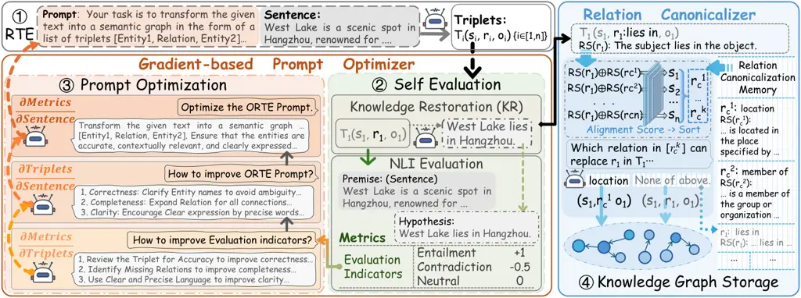

# Knowledge Restoration-driven Prompt Optimization: Unlocking LLM Potential for Open-Domain Relational Triplet Extraction

Xiaonan Jing    Gongqing Wu\corresponding    Xingrui Zhuo\corresponding
   Lang Sun    Jiapu Wang

###### Abstract

Open-domain Relational Triplet Extraction (ORTE) aims to mine structured
knowledge without predefined relation schemas. Large Language Models
(LLMs) have advanced ORTE toward a prompt-driven paradigm through
powerful in-context learning. However, adapting their extraction
behavior to varying open-domain contexts remains challenging. Existing
methods typically rely on manually crafted prompts that remain fixed
across inputs, despite substantial variation in linguistic expressions
and contextual structures. This mismatch may lead to unsupported
triplets, while the absence of ground-truth annotations makes such
deficiencies difficult to identify and correct. Moreover, free-form
relation generation produces non-canonical relation surface forms,
undermining knowledge graph consistency. To address these challenges, we
propose Knowledge Restoration-driven Prompt Optimization (KRPO), a
framework for label-free target-corpus adaptation. KRPO restores
extracted triplets into textual statements and evaluates their semantic
consistency with the source inputs, deriving intrinsic feedback without
gold annotations. This feedback is transformed into natural-language
optimization guidance for batch-wise prompt optimization and adaptation.
KRPO further introduces a Memory-augmented Relation Canonicalizer that
aligns free-form relations with a dynamically updated schema memory,
improving relation consistency. Experiments on three ORTE benchmarks
with multiple LLM backbones demonstrate strong overall performance, with
KRPO achieving the best average F1 score across the evaluated settings.

¹The Key Laboratory of Knowledge Engineering with Big Data (Ministry of
Education of China),

Hefei University of Technology, China

²School of Computer Science and Information Engineering, Hefei
University of Technology, China

³Anhui Zhongke Guojin Intelligent Technology Co., Ltd., China

⁴Nanjing University of Science and Technology, China

{jxn, zxr,sl}@mail.hfut.edu.cn, wugq@hfut.edu.cn,
jiapu.wang@njust.edu.cn

Code — https://anonymous.4open.science/r/KRPO-B26W

## Introduction

Knowledge Graphs (KGs) have become an essential foundation for modern
artificial intelligence (Hogan et al. 2021; Pan et al. 2017), providing
structured knowledge for downstream tasks such as information
retrieval (Xiong et al. 2017), logical reasoning (Zhuo et al. 2024), and
question answering systems (Zhang et al. 2018). To construct
high-quality KGs, Relational Triplet Extraction (RTE) is a core task
that formalizes unstructured text into structured triplets of the form
$`(subject,relation,object)`$. In practice, traditional RTE methods are
constrained by predefined relations and supervised annotations, making
them difficult to adapt to the unknown open domain. Therefore,
Open-domain Relational Triplet Extraction (ORTE) has emerged. By
extracting knowledge without predefined schemas, ORTE serves as a vital
infrastructure for understanding open-world knowledge (Banko et al.
2007).

The emergence of Large Language Models (LLMs) (Pan et al. 2024; Wang et
al. 2024b) has fundamentally reshaped the landscape of ORTE. Equipped
with rich parametric knowledge and strong in-context learning
capabilities, LLMs enable prompt-driven ORTE without requiring
task-specific fine-tuning on the target corpus (Wei et al. 2024; Xu et
al. 2024). With crafted prompts, LLMs have achieved promising
performance in ORTE (Zhang and Soh 2024).

Figure 1: Comparison between KRPO (Ours) and EDC+R (Zhang and Soh 2024).
KRPO dynamically optimizes prompts via knowledge restoration-based
feedback, unlocking the potential of LLMs for ORTE, whereas EDC+R relies
on static prompts and suffers from performance stagnation.

However, despite these advances, existing LLM-based ORTE methods (Zhang
and Soh 2024; Mo et al. 2025) still struggle to effectively unlock the
potential of LLMs in open-domain target corpora. A fundamental challenge
is how to adapt LLMs to ORTE across diverse contexts. Although LLMs
encode extensive relational knowledge in their parameters, whether this
knowledge can be elicited in a task-aligned manner depends heavily on
the interaction between the task instructions and the input context.
Open-domain texts vary substantially in linguistic expressions and
contextual structures, whereas their manually crafted prompts typically
remain unchanged across inputs. This mismatch may drift extraction focus
away from source-grounded relations toward generic semantic associations
or contextually salient but unsupported information, resulting in
omitted relations or hallucinated triplets. This adaptation challenge is
further compounded by the absence of ground-truth annotations, which
prevents direct evaluation and correction of extraction behavior on the
target corpus.

As illustrated in Figure 1, EDC+R (Zhang and Soh 2024) shows limited
performance gains as subsequent target samples are processed, since its
static prompt cannot adapt to varying inputs. This limitation affects
LLM-based ORTE methods (Chen et al. 2024a; Mo et al. 2025), which lack a
mechanism for optimizing prompts through source-grounded feedback. The
mismatch persists throughout inference and constrains adaptation to the
target corpus. The key challenge is therefore to derive a
source-grounded adaptation signal from the extraction process, enabling
prompt optimization to progressively adapt the extraction behavior of
LLMs to the target corpus without access to gold annotations.

Beyond extraction quality, ORTE also suffers from non-canonical relation
surface forms. Since open-domain relations are generated in free-form
language, semantically equivalent relations may appear in different
surface forms, such as “birthplace” and “born in”. Directly retaining
these variants leads to redundant relation schemas and undermines
consistency of KGs, therefore reducing their practical utility. Existing
canonicalization methods (Vashishth et al. 2018; Zhang and Soh 2024)
often rely on coarse semantic matching, which may overlook fine-grained
interactions required for relation alignment while allowing schema
expansion in open-domain scenarios.

To address this challenge, we propose Knowledge Restoration-driven
Prompt Optimization (KRPO), a source-grounded self-reflective adaptation
framework for ORTE. KRPO restores extracted triplets into textual
statements and evaluates their semantic consistency with the
corresponding inputs, thereby deriving intrinsic feedback without
ground-truth annotations. This feedback is transformed into textual
gradients, namely natural-language optimization guidance, to identify
extraction deficiencies and guide prompt rewriting. In this way, the
extraction prompt can progressively adapt to the varying contexts of the
target corpus. For improving relation consistency of the resulting KGs,
KRPO introduces a Memory-augmented Relation Canonicalizer that aligns
free-form relations with dynamic schema memory through fine-grained
semantic matching. As illustrated by the orange track in Figure 1, KRPO
replaces static prompting with a batch-wise adaptation, allowing the
extraction guidance to evolve with the target corpus, and shows
continuous improvement in performance.

In summary, we have made the following contributions:

- •
  We propose KRPO, a closed-loop prompt optimization framework for ORTE
  that enables label-free corpus adaptation by intrinsic feedback from
  knowledge restoration.
- •
  We design a Memory-augmented Relation Canonicalizer to fine-grained
  align relation expressions with dynamic schema memory, alleviating
  relation fragmentation.
- •
  Experiments on 3 benchmarks with multiple LLM backbones show strong
  overall performance, with KRPO achieving the best average F1 score.

## Related Work

Early Relational Triplet Extraction (RTE) methods rely on predefined
schemas and supervised annotations, using either pipeline
architectures (Zelenko et al. 2003; Chan and Roth 2011) that separate
entity and relation extraction (Sundheim 1995; Chinchor 1998), or joint
models (Shang et al. 2022; Wang et al. 2020; Dixit and Al-Onaizan 2019)
that mitigate error propagation. Although pre-trained models (Cabot and
Navigli 2021a) improve extraction, they still require domain-specific
supervision. Recent work has shifted toward open-domain
extraction (Banko et al. 2007), using LLMs and multi-agent systems via
multi-turn dialogue (Wei et al. 2024), code generation (Li et al. 2023),
or collaborative frameworks (Mo et al. 2025; Lu et al. 2025; Chen et al.
2024a). Despite zero- and few-shot flexibility (Zhu et al. 2024; Edge et
al. 2025), these methods remain sensitive to prompts and generate
inconsistent relations, motivating quality-aware extraction frameworks
for downstream KG reasoning (Zhuo et al. 2025a; Huang et al. 2026) and
completion (Wang et al. 2023; Wang et al. 2024a).

Traditional prompt optimization (Liu et al. 2023; Brown et al. 2020)
uses supervised discrete search (Shin et al. 2020; Jiang et al. 2020) or
continuous prompt tuning (Li and Liang 2021; Lester et al. 2021; Liu et
al. 2022), limiting interpretability and open-domain applicability.
Recent black-box methods optimize prompts using reinforcement learning
or LLM optimizers (Deng et al. 2022; Zhou et al. 2023; Yang et al.
2024), including text-based gradient approximations (Yüksekgönül et al.
2025), but they rely on task-specific rewards, labeled validation
signals, or generic critiques. In contrast, KRPO targets
supervision-deficient ORTE by deriving intrinsic feedback from
triplet-to-text restoration and source-text consistency checking. It is
therefore an ORTE-oriented instantiation of feedback-driven prompt
refinement rather than a general prompt optimizer.

Schema-extensible ORTE produces lexically diverse but semantically
redundant relations (Banko et al. 2007), further worsened by LLM
generation (Wadhwa et al. 2023). Existing methods use external
knowledge (Miller 1995), clustering (Galárraga et al. 2014; Vashishth et
al. 2018; Ganitkevitch et al. 2013), Siamese networks (Putri et al.
2019), or embedding-based matching (Zhang and Soh 2024), but may
over-generalize fine-grained distinctions or rely on shallow
similarities. KRPO integrates fine-grained relation-semantic alignment
with dynamic schema memory to reduce relation fragmentation, and couples
it with prompt optimization to improve KG consistency in the open
domain.

## Preliminaries

This section formally defines ORTE, specifies the prompt optimization
objective for mining the potential of LLMs, and outlines the problem of
relation canonicalization.

### Open Relational Triplet Extraction

Given an unstructured corpus $`X`$, ORTE aims to extract relational
triplets for constructing KGs without a predefined relation ontology.
For an input text $`x\in X`$, the goal is to extract $`M`$ triplets
$`\mathcal{T}\ =\ \{\left(s_{i},\ r_{i},\ o_{i}\right)\}_{\left\{i=1\right\}}^{M}`$,
where $`s_{i}`$ and $`o_{i}`$ are subject and object in $`x`$, and
$`r_{i}`$ is their semantic relation. These triplets represent facts
expressed in $`x`$. Unlike closed-domain extraction with fixed schemas,
the relation set
$`\mathcal{R}_{c}=\left\{r_{c}^{1},r_{c}^{2},\ldots,r_{c}^{N}\right\}`$
in open-domain settings is incomplete or empty, and can be dynamically
extensible.

### Prompt LLM-based ORTE

Recent LLM-based ORTE methods frame the task as conditional generation.
Given input text $`x`$ and prompt $`\mathcal{P}`$, an LLM
$`\mathcal{M}`$ generates triplets $`\mathcal{T}`$ by maximizing
$`\hat{\mathcal{T}}=\arg\max_{\tau}P_{\mathcal{M}}(\mathcal{T}\mid x,\mathcal{P})`$.
However, static prompts limit adaptive extraction across diverse
contexts, making triplet quality dependent on prompt expressiveness. To
better exploit LLMs in open-domain settings, we formulate a surrogate
optimization perspective from $`\mathcal{T}`$ to $`\mathcal{P}`$,
seeking an improved prompt:
$`\mathcal{P}^{*}=\arg\max_{\mathcal{P}}P_{\mathcal{M}}(\mathcal{P}\mid\mathcal{T},x)`$.
The optimized prompt is expected to induce high-quality triplet
generation for $`x`$. See Appendix C for validation.

### Semantic-based Relation Canonicalization

Triplets from the prior stage often contain redundant relations, where
distinct phrases express the same meaning. Let
$`\mathcal{R}_{\mathrm{raw}}=\{r_{1},r_{2},\ldots,r_{n}\}`$ be the
extracted relations, relation canonicalization maps them to canonical
schemas $`R_{c}`$ through
$`f:\mathcal{R}_{\mathrm{raw}}\to\mathcal{R}_{c}`$, such that similar
relations $`r_{i}`$ and $`r_{c}^{i}`$ map to the same canonical form:

```math
f(r_{i})=f\big(r_{c}^{i}\big)\Leftarrow\mathrm{sem}(r_{i})\approx\mathrm{sem}\big(r_{c}^{i}\big), \tag{1}
```

where $`sem(\cdot)`$ denotes semantic meaning. This similarity is
measured in a Cross-Encoder semantic space to ensure consistency in the
KGs.

### Task Formulation

We formulate ORTE as the composition of prompt-guided triplet extraction
and relation canonicalization:

```math
\mathcal{KG}^{*}=\text{RelCanon}\{\text{ORTE}[x,\text{P-Opt}(X,\mathcal{P})]\}, \tag{2}
```

where $`\text{P-Opt}(\cdot)`$ optimize the prompt $`\mathcal{P}`$ under
unlabeled corpus $`X`$, $`\text{RelCanon}(\cdot)`$ canonicalizes
relations extracted.



Figure 2: Overview of KRPO. Comprises four modules: (1) Relational
Triplet Extraction (RTE), extracting triplets by LLM with an optimizable
prompt; (2) Self Evaluation, assessing consistency via NLI on restored
text; (3) Prompt Optimization, optimizing the prompt using evaluation
feedback as gradients; and (4) Relation Canonicalization, aligning
relations with dynamic schemas for Knowledge Graph storage.

## Methodology

KRPO is designed for target-corpus adaptation in ORTE under a label-free
test-time setting, refining the extraction prompt from observed texts
and self-evaluation feedback without accessing ground-truth triplet
annotations. As illustrated in Figure 2, KRPO consists of two main
stages: (1) knowledge restoration-driven prompt optimization, which
derives intrinsic feedback to iteratively refine the prompt and extract
triplets again; and (2) memory-augmented relation canonicalization,
which aligns relations in extracted triplets with a dynamically updated
schema memory to improve KG consistency.

### Textual-Gradient Prompt Optimizer

This stage aims to optimize the relational triplet extraction prompt.
Starting with a task-specific initial prompt, we iteratively optimize it
over iterations.

#### LLM-based ORTE

Let $`p^{(t)}`$ be the prompt at iteration $`t`$. The LLM extracts
candidate relational triplets from text $`x`$:

```math
\hat{T}=f_{\theta}^{\text{ORTE}}\big(\big[p^{(t)};x\big]\big), \tag{3}
```

where $`f_{\theta}(\cdot)`$ denotes an LLM-based operation and
$`f_{\theta}^{\text{ORTE}}(\cdot)`$ denotes the ORTE function. Each
triplet in $`\hat{T}`$ is denoted as
$`\hat{t}=(\hat{s},\hat{r},\hat{o})`$, which represents (subject,
relation, object).

#### Knowledge Restoration-based Self-Evaluation

We evaluate the faithfulness of extracted triplets to the source text in
two steps.

First, each triplet is restored into a natural language sentence by the
knowledge restoration module:

```math
h_{\hat{t}}=\text{KR}(\hat{t})=\mathcal{KR}(\hat{s},\hat{r},\hat{o}), \tag{4}
```

where $`\mathrm{KR}(\cdot)`$ is a constrained verbalizer that preserves
only the semantics of the triplet without adding external information.
It can be implemented with an LLM (its prompt is provided in Appendix C)
or an equivalent verbalizer.

Second, an NLI evaluator compares the restored hypothesis
$`h_{\hat{t}}`$ with the source text $`x`$ as the premise:

```math
E_{\hat{t}}=\mathrm{NLI}(x,h_{\hat{t}})\!\in\!\{\text{entailment, neutral, contradiction}\}, \tag{5}
```

Anchoring the premise to the source text prevents evaluating triplets
solely against generated content. We implement the evaluator via LLM
prompting (Appendix C), while standard NLI models remain applicable. Its
output is mapped to a discrete consistency score:

```math
\text{Metrics}(\hat{t})=\begin{cases}1,&E_{\hat{t}}=\text{entailment},\\
0,&E_{\hat{t}}=\text{neutral},\\
-0.5,&E_{\hat{t}}=\text{contradiction}.\end{cases} \tag{6}
```

The scores are aggregated over all extracted triplets,
$`\mathrm{Metrics}(\hat{T})=\sum_{i=1}^{M}\mathrm{Metrics}(\hat{t}_{i})`$,
and used as self-evaluation feedback for prompt optimization.

#### Textual-Gradient Prompt Optimization

Following gradient-inspired prompt optimization (Yüksekgönül et al.
2025), we define a _textual gradient_ as natural-language feedback that
indicates a direction for prompt revision, which represents text-level
credit assignment over discrete texts rather than numerical
differentiation or backpropagation.

After extracting $`T(Triplets)`$ from $`x(Sentence)`$, KRPO performs
self-evaluation and derives textual feedback from the resulting score
$`Metrics`$. This feedback is regarded as a textual gradient that guides
prompt optimization
toward:$`\arg\max_{\mathcal{P}}P_{\mathcal{M}}(\mathcal{P}\mid\mathcal{T},x)`$.
Formally, the textual gradient is generated as:

```math
\begin{split}g_{\mathcal{P}}=f^{\mathrm{grad}}_{\theta}(\mathrm{Sentence},\hat{T},\mathrm{Metrics}(\hat{T})),\\
g_{\mathcal{P}}\propto\frac{\partial{Metrics}}{\partial{Sentence}}=\frac{\partial{Metrics}}{\partial{Triplets}}\circ\frac{\partial{Triplets}}{\partial{Sentence}}.\end{split} \tag{7}
```

First, we define instruction $`I_{1}`$ to guide the LLM to generate
feedback as a textual gradient:

```math
g_{i}^{(1)}=f_{\theta_{1}}^{\mathrm{grad}}([\>I_{1};{\hat{T}_{i};Metrics(\hat{T}_{i})}])\propto\frac{\partial{Metrics}}{\partial{Triplets}}. \tag{8}
```

Here, $`g_{p}^{(1)}`$ diagnoses deficiencies in correctness,
completeness, and clarity. While correctness is primarily assessed by
the NLI score, completeness is improved through textual gradients.
Instruction $`I_{2}`$ combined with $`p^{(t)}`$ and incorporates these
three dimensions into prompt-level guidance, encouraging comprehensive
and concise extraction while avoiding under-extraction and redundant
generation, yielding the second textual gradient:

```math
g_{i}^{(2)}=f_{\theta_{2}}^{\mathrm{grad}}([I_{2};p^{(t)};x_{i},\hat{T}_{i},g_{i}^{(1)}])\propto\frac{\partial{Triplets}}{\partial{Sentence}}. \tag{9}
```


Finally, the guidance is aggregated into a batch buffer $`\mathcal{F}`$
with $`B`$ instances, and instruction $`I_{3}`$ rewrites the prompt:

```math
p^{\prime}\!=\!f_{\theta_{3}}^{\mathrm{Opt}}\left(I_{3},p^{(t)},\mathcal{F}^{(t)}\right)\!,\mathcal{F}^{(t)}\!=\!\left\{\!(x_{i},\hat{T}_{i},g_{i}^{(2)})\right\}_{i=1}^{B}. \tag{10}
```

Batch-level aggregation could reduce the influence of isolated
restoration or NLI deviations, providing a more stable optimization
signal for feedback-driven prompt optimization.

The candidate prompt $`p^{\prime}`$ is evaluated on the same batch, and
$`p^{(t+1)}\leftarrow p^{\prime}`$ if its batch-level evaluation score
improves; otherwise, the current prompt $`p^{(t)}`$ is retained.


### Relation Canonicalization

For each extracted triplet $`\hat{t}=(\hat{s},r_{q},\hat{o})`$, we first
mask the subject and object in its restored sentence $`h_{\hat{t}}`$ to
obtain a contextual relation representation:

```math
\mathcal{RS}(r_{q})=\mathrm{MaskEntity}(h_{\hat{t}};\hat{s},\hat{o}). \tag{11}
```

A pre-fine-tuned XLM-RoBERTa Cross-Encoder (Conneau et al. 2020), whose
parameters remain frozen throughout the KRPO process, scores this
representation against each canonical schema
$`r_{c}^{i}\in\mathcal{R}_{c}`$ in the relation canonicalization memory:

```math
s_{i}=A_{\theta}\bigl(\mathcal{RS}(r_{q}),\mathcal{RS}(r_{c}^{i})\bigr), \tag{12}
```

where $`A_{\theta}`$ is the Cross-Encoder scoring function. The $`K`$
highest-scoring schemas form the candidate set
$`\mathcal{R}_{c}^{(K)}`$. Details of the pre-experimental fine-tuning
are provided in Appendix D.

|        |               |                |                |                |                |                |                |                |                |                |              |
| ------ | ------------- | -------------- | -------------- | -------------- | -------------- | -------------- | -------------- | -------------- | -------------- | -------------- | ------------ |
| Method | LLMs          | WebNLG         |                |                | REBEL          |                |                | Wiki-NRE       |                |                | Overall Avg. |
|        |               | Partial        | Strict         | Exact          | Partial        | Strict         | Exact          | Partial        | Strict         | Exact          |              |
| REGEN  |               | 76.7           | 72.0           | 72.3           | \-             | \-             | \-             | \-             | \-             | \-             | \-           |
| GenIE  |               | \-             | \-             | \-             | 38.5           | 35.6           | 36.4           | 48.4           | 46.3           | 47.8           | \-           |
| CodeIE | GPT-4o-mini   | 62.6           | 55.3           | 57.7           | 43.4           | 37.7           | 40.3           | 51.0           | 49.7           | 50.0           | 49.7         |
| ChatIE | GPT-4o-mini   | 58.1           | 53.2           | 54.4           | 45.4           | 40.8           | 42.2           | 51.8           | 49.9           | 50.9           | 49.6         |
| KARMA  | GPT-4o-mini   | 40.2           | 32.1           | 35.8           | 36.6           | 31.0           | 33.8           | 35.4           | 28.8           | 33.0           | 34.1         |
| KGGen  | GPT-4o-mini   | 48.0           | 37.6           | 41.0           | 36.2           | 30.3           | 32.5           | 31.3           | 26.3           | 29.6           | 34.8         |
| EDC    | GPT-4o-mini   | 70.8           | 63.4           | 66.0           | 49.6           | 43.5           | 46.2           | 61.8           | 60.6           | 60.8           | 58.1         |
|        | Mistral-7B    | 64.1           | 56.1           | 58.7           | 47.2           | 40.4           | 43.4           | 55.0           | 53.9           | 54.1           | 52.5         |
| EDC+R  | DeepSeek-V3   | 76.9           | 71.9           | 73.4           | 52.8           | 48.3           | 50.0           | 65.7           | 64.9           | 65.1           | 63.2         |
|        | GPT-5         | 76.3           | 69.5           | 72.2           | 51.5           | 47.5           | 48.7           | 66.2           | 65.3           | 65.6           | 62.5         |
|        | GPT-4o-mini   | 72.0           | 64.3           | 66.7           | 49.4           | 44.5           | 46.4           | 62.0           | 60.8           | 61.0           | 58.6         |
|        | Qwen3-32B     | 67.3           | 60.5           | 62.5           | 51.7           | 47.2           | 49.1           | 58.6           | 57.1           | 57.7           | 56.8         |
|        | Mistral-7B    | 66.3           | 56.7           | 59.7           | 48.4           | 41.3           | 45.0           | 56.5           | 55.2           | 55.5           | 53.8         |
| KRPO   | DeepSeek-V3   | 77.1           | 74.3           | 75.2           | 55.2           | 50.5           | 52.0           | 68.0           | 67.4           | 67.4           | 65.2         |
|        | GPT-5         | 77.7           | 72.0           | 74.2           | 55.8           | 50.4           | 52.3           | 67.1           | 65.5           | 65.8           | 64.5         |
|        | GPT-4o-mini   | 74.4$`\pm`$0.9 | 69.0$`\pm`$0.7 | 71.2$`\pm`$0.6 | 51.9$`\pm`$1.1 | 45.6$`\pm`$0.9 | 48.9$`\pm`$0.8 | 64.2$`\pm`$1.0 | 61.8$`\pm`$0.6 | 62.1$`\pm`$0.6 | 61.0         |
|        | Qwen3-32B     | 74.7$`\pm`$0.5 | 70.1$`\pm`$0.4 | 71.8$`\pm`$0.5 | 51.7$`\pm`$0.6 | 47.4$`\pm`$0.7 | 48.8$`\pm`$0.6 | 60.3$`\pm`$0.7 | 59.2$`\pm`$0.5 | 59.3$`\pm`$0.4 | 60.4         |
|        | Mistral-7B    | 70.6$`\pm`$0.2 | 65.4$`\pm`$0.3 | 67.2$`\pm`$0.3 | 51.7$`\pm`$0.4 | 44.1$`\pm`$0.5 | 47.9$`\pm`$0.7 | 59.4$`\pm`$0.5 | 58.4$`\pm`$0.5 | 58.7$`\pm`$0.5 | 58.2         |
|        | Avg. Gain (↑) | +4.4%          | +8.7%          | +7.5%          | +5.0%          | +4.0%          | +4.5%          | +3.3%          | +2.9%          | +2.8%          | +4.8%        |

Table 1: Comparison with SOTA methods on three datasets in terms of F1
score. The best results are highlighted in bold, and the second-best
results are underlined. The “Avg.” column denotes the average
performance across all datasets across all evaluation settings. The
“Avg. Gain (↑)” row reports the mean relative improvement of KRPO over
EDC+R across all LLM backbones.

An LLM then selects a semantically equivalent candidate or returns None:

```math
r^{\prime}=f_{\theta}^{\mathrm{RC}}\left(x,\hat{t},r_{q},\mathcal{R}_{c}^{(K)}\cup\{\textit{None}\}\right). \tag{13}
```

If $`r^{\prime}\neq\mathrm{None}`$, the canonicalized triplet is
$`(\hat{s},r^{\prime},\hat{o})`$. Otherwise, $`r_{q}`$ is retained and
added to the memory,
$`\mathcal{R}_{c}\leftarrow\mathcal{R}_{c}\cup\{r_{q}\}`$, allowing
subsequent relations to align with it. The decision prompt is provided
in Appendix C.

The memory could be initialized with available canonical schemas or as
an empty set when no schema is provided. According to the above
algorithm, the relations extracted by the model also expand the memory.

Overall, KRPO performs batch-wise prompt optimization through
restoration-based self-evaluation for triplet extraction, followed by
relation canonicalization on the extracted triplets. The complete
procedure is summarized in Algorithm 1 in Appendix C.

## Experiments

In this section, we conduct comprehensive experiments, including
comparisons with baselines, ablation studies, and analysis to evaluate
the effectiveness and impact of KRPO.

##### Datasets.

Following EDC (Zhang and Soh 2024), we use its processed versions of
WebNLG (Ferreira et al. 2020), REBEL (Cabot and Navigli 2021b), and
Wiki-NRE (Trisedya et al. 2019), and evaluate KRPO under a label-free
test-time adaptation protocol, each sample is extracted twice before and
after prompt optimization. Gold annotations are not used for prompt
optimization or relation-memory updates, but only for final evaluation.
Dataset details are provided in Appendix E.

##### Evaluation Metrics.

We use the official WebNLG evaluation script (Ferreira et al. 2020) to
report standard token-level Precision, Recall, and F1 under 3 matching
settings: Exact (full token match), Partial (partial token overlap), and
Strict (full subject-relation-object alignment). We have discussed these
surface-level metrics for ORTE in Appendix G.

##### Baselines.

We evaluate and compare KRPO against several state-of-the-art (SOTA)
baselines: traditional trained methods REGEN (Dognin et al. 2021) and
GenIE (Josifoski et al. 2022), as well as advanced LLM or Agent-based
methods, including EDC (Zhang and Soh 2024) and its variant EDC+R,
CodeIE (Li et al. 2023), ChatIE (Wei et al. 2024), KARMA (Lu et al.
2025), and KGGen (Mo et al. 2025). See Appendix E for detailed baseline
descriptions.

##### Implementation Details.

We evaluate KRPO with 5 LLM backbones: locally deployed Mistral-7B and
Qwen3-32B on 4 NVIDIA A16 GPUs via vLLM, and API-based GPT-4o-mini,
GPT-5, and DeepSeek-V3 (Appendix D). All models use a decoding
temperature of 0; experiments with GPT-4o-mini and smaller backbones are
repeated 3 times, with mean results reported. Relation canonicalization
uses a fine-tuned XLM-RoBERTa. We set both the prompt-optimization batch
size and canonicalization Top-$`K`$ to 5 and process samples in their
original order. For fair comparison, the initial ORTE prompt, few-shot
examples, and relation-memory initialization follow EDC (Zhang and Soh
2024); the examples are disjoint from the evaluated datasets and do not
introduce additional schema information beyond the baseline setting.

### Main Results

Table 1 shows that KRPO generally achieves stronger F1 performance than
the compared baselines, including EDC+R and recent LLM-based methods
(e.g., CodeIE, ChatIE, KARMA, KGGen), with the best performance across
datasets and evaluation settings. The gains are most pronounced under
the Strict protocol, suggesting that KRPO enhances extraction fidelity
rather than merely increasing partial surface-level matches. Although a
few individual entries are tied with or slightly below the strongest
baseline, the overall results demonstrate the effectiveness of KRPO
across benchmarks with different linguistic characteristics and relation
distributions.

We further analyze the impact of LLM backbones with different model
capacities. KRPO generally improves over EDC+R across varying model
capacities, with especially clear gains on smaller backbones like
Mistral-7B. This indicates that our prompt optimization and relation
canonicalization effectively mitigate the reasoning limits of
lightweight LLMs, narrowing their performance gap with larger models
(see Appendix E for the complete report).

### Ablation Studies

To evaluate individual components, we ablate two key modules using
GPT-4o-mini as the backbone, and omitting weaker baselines for clarity.

#### Ablation on Prompt Optimization

Figure 3: Ablation study on WebNLG, REBEL, and Wiki-NRE. We report the
Strict-F1 scores to analyze the contribution of different components
(e.g., PO and RC modules) to the final performance.

As shown in Figure 3, removing the prompt optimization module (w.o. PO)
consistently degrades performance across datasets, confirming the
necessity of iterative optimization. Replacing knowledge restoration
(KR) with naive triplet concatenation (w. KR(cat)) yields marginal gains
and still trails the full model, indicating that concatenation provides
insufficient feedback. Replacing the LLM-based NLI evaluator with
DeBERTa-v3-large (w. NLI(DB)) causes a slight performance drop,
demonstrating the benefit of stronger semantic feedback from LLMs.
Overall, the complete PO module achieves the highest F1 scores,
particularly under strict settings, highlighting KR’s effectiveness
(details in Appendix E).

#### Ablation on Relation Canonicalization

Figure 3 also shows that removing relation canonicalization (w.o. RC)
causes substantial performance drops, especially under strict evaluation
protocols. Using cosine-similarity-based embedding matching (w. RC(eme))
offers limited recovery, exposing the flaws of shallow semantic
similarity. The full RC module performs better, proving its capability
to enforce semantic consistency for extracted relations (details in
Appendix E).

These ablations suggest that the two components are complementary:
prompt optimization mainly improves triplet-level faithfulness, while
relation canonicalization improves schema-level consistency.

Figure 4: Analysis of Relation Canonicalization Accuracy under different
$`k`$. Evaluated on triplets with correct “(subject,object)” pair but
incorrect “relation”.

### Analysis

Figure 5: A case study comparing the extraction results between the
Initial and Updated prompts. The optimized prompt (right) incorporates
more detailed constraints (in blue), guiding the LLM to generate
triplets that are more precise compared to the initial prompt (left).

We further analyze KRPO from several perspectives by focusing on the
strongest baselines, EDC and EDC+R. We omit weaker baselines for
clarity.

#### Analysis of Relation Canonicalization

| Entailment Eval (Partial) | WebNLG |      | REBEL |      | Wiki-NRE |      |
| ------------------------- | ------ | ---- | ----- | ---- | -------- | ---- |
|                           | Prop.  | F1   | Prop. | F1   | Prop.    | F1   |
| EDC                       | 95%    | 68.5 | 96%   | 50.2 | 75%      | 59.7 |
| EDC+R                     | 95%    | 68.7 | 96%   | 50.5 | 76%      | 60.9 |
| KRPO                      | 98%    | 72.7 | 98%   | 52.4 | 94%      | 63.0 |

Table 2: Entailment Triplet Analysis. Best results are in bold.

To evaluate relation canonicalization, we analyze samples with correctly
predicted entity pairs but misclassified relations. As shown in
Figure 4, Cross-Encoder-based scoring consistently outperforms
embedding-based similarity across datasets and Hit@$`k`$ settings,
demonstrating stronger fine-grained relation alignment capability
(detailed statistics across triplet elements are in Appendix E).

#### Impact of Self-evaluation

To evaluate self-evaluation reliability, we analyze entailment triplets
under partial matching against static baselines EDC and EDC+R. As shown
in Table 2, KRPO retains more entailment triplets and achieves higher F1
scores across datasets, indicating that self-evaluation provides more
reliable feedback for extraction optimization (details in Appendix E).

#### Effect of Iterative Prompt Optimization

Figure 6: F1 Evolution over Samples with Prompt Optimization on WebNLG,
REBEL, and Wiki-NRE datasets.

To validate iterative prompt optimization, we tracked F1 evolution
across consecutive batches of 25 samples, corresponding to 5 consecutive
batches with $`B=5`$. As shown in Figure 6, KRPO consistently improves
over static baselines, with larger gains after iterative updates. This
demonstrates that our textual gradient-based mechanism effectively
accumulates task-level feedback. Notably, gains are most significant
under Strict and Exact metrics, indicating that iterative optimization
improves not only recall but also structural precision and schema
consistency. During this phase, KRPO incurs an average of 6.3% per
sample higher total-token consumption than EDC+R, while reducing
prompt-token usage by 9.3%, showing a favorable cost-quality trade-off
for high-fidelity KG construction. Detailed analysis is provided in
Appendix E.

### Case Study

Figure 5 compares extractions from initial and optimized prompts. For a
text describing “Pontiac Rageous”, the initial prompt yields vague,
schema-inconsistent triplets and an unclear “state” relation for
“Michigan”. By leveraging self-evaluation feedback, the iteratively
optimized prompt guides the LLM toward fine-grained and faithful
extractions. Specifically, it correctly isolates the geopolitical
relation “\[Detroit, state, Michigan\]” and standardizes relations into
“productionLocation” and “productionYear”. This reduces ambiguity and
improves KG structural consistency, benefiting downstream tasks like KG
reasoning (Zhuo et al. 2025b) (more details in Appendix F).

## Discussion

KRPO has several limitations. First, its iterative feedback loop
requires multiple LLM calls, increasing computation, latency, and token
usage. Although the optimized prompt is reusable, its initial
optimization remains costly at scale. Smaller restoration and NLI models
or model distillation could reduce this cost, although maintaining
feedback quality remains challenging.

Second, NLI mainly evaluates the faithfulness of generated triplets and
cannot directly detect missing relations. Summed scores may encourage
conservative extraction or redundant predictions, while restoration and
NLI errors may propagate to prompt updates. Experiments show that using
a smaller NLI model that can be deployed results in a small performance
degradation. Although constrained restoration, instructions, and batch
aggregation mitigate these risks, robustness to evaluation noise and
alignment with human judgments remain unverified. Future work should
incorporate coverage, redundancy, and confidence into self-evaluation.

Third, optimized prompts may capture corpus-specific patterns, and their
trajectories may depend on sample order, batch size, and random seeds.
Cross-dataset transfer and sensitivity to these factors require further
evaluation.

Finally, KRPO canonicalizes relations but not entities, potentially
creating redundant KG nodes. The relation memory also scales with schema
size. Future work will study joint entity and relation canonicalization,
scalable retrieval, and temporal knowledge modeling.

## Conclusion

In this paper, we analyze the challenges of prompt optimization and
relation canonicalization in ORTE and propose KRPO, which enables
feedback-driven prompt optimization under supervision-deficient
open-domain settings. Through knowledge restoration-based
self-evaluation, KRPO iteratively refines prompts, better unlocking the
potential of LLMs for extraction. It enhances schema consistency in
constructed KGs by memory-augmented relation canonicalization.
Experiments on multiple datasets with different LLM backbones
demonstrate the effectiveness of KRPO.

## References

- Agarwal et al. (2021) O. Agarwal, H. Ge, S. Shakeri, and R. Al-Rfou
  Knowledge graph based synthetic corpus generation for
  knowledge-enhanced language model pre-training. In North American
  Chapter of the Association for Computational Linguistics,
  pp. 3554–3565. External Links:
  [Document](https://dx.doi.org/10.18653/V1/2021.NAACL-MAIN.278) Cited
  by: Appendix D.
- Banko et al. (2007) M. Banko, M. J. Cafarella, S. Soderland, M.
  Broadhead, and O. Etzioni Open information extraction from the web. In
  International Joint Conference on Artificial Intelligence,
  pp. 2670–2676. Cited by: Introduction, Related Work, Related Work.
- Brown et al. (2020) T. B. Brown, B. Mann, N. Ryder, M. Subbiah, J.
  Kaplan, P. Dhariwal, et al. Language models are few-shot learners. In
  Neural Information Processing Systems, Cited by: Related Work.
- Cabot and Navigli (2021a) P. H. Cabot and R. Navigli REBEL: relation
  extraction by end-to-end language generation. In Findings of the
  Association for Computational Linguistics: EMNLP, pp. 2370–2381.
  External Links:
  [Document](https://dx.doi.org/10.18653/V1/2021.FINDINGS-EMNLP.204)
  Cited by: Related Work.
- Cabot and Navigli (2021b) P. H. Cabot and R. Navigli REBEL: relation
  extraction by end-to-end language generation. In Findings of the
  Association for Computational Linguistics: EMNLP, pp. 2370–2381.
  External Links:
  [Document](https://dx.doi.org/10.18653/V1/2021.FINDINGS-EMNLP.204)
  Cited by: Appendix E, Datasets..
- Chan and Roth (2011) Y. S. Chan and D. Roth Exploiting
  syntactico-semantic structures for relation extraction. In Association
  for Computational Linguistics, pp. 551–560. Cited by: Related Work.
- Chen et al. (2024a) H. Chen, X. Shen, Q. Lv, J. Wang, X. Ni, and J. Ye
  SAC-KG: exploiting large language models as skilled automatic
  constructors for domain knowledge graph. In Association for
  Computational Linguistics, pp. 4345–4360. External Links:
  [Document](https://dx.doi.org/10.18653/V1/2024.ACL-LONG.238) Cited by:
  Introduction, Related Work.
- Chen et al. (2024b) J. Chen, S. Xiao, P. Zhang, K. Luo, D. Lian,
  and Z. Liu M3-embedding: multi-linguality, multi-functionality,
  multi-granularity text embeddings through self-knowledge distillation.
  In Findings of the Association for Computational Linguistics,
  pp. 2318–2335. External Links:
  [Document](https://dx.doi.org/10.18653/V1/2024.FINDINGS-ACL.137) Cited
  by: Appendix D.
- Chinchor (1998) N. Chinchor Overview of MUC-7. In Conference on
  Message Understanding, Cited by: Related Work.
- Conneau et al. (2020) A. Conneau, K. Khandelwal, N. Goyal, V.
  Chaudhary, G. Wenzek, F. Guzmán, et al. Unsupervised cross-lingual
  representation learning at scale. In Association for Computational
  Linguistics, pp. 8440–8451. External Links:
  [Document](https://dx.doi.org/10.18653/V1/2020.ACL-MAIN.747) Cited by:
  Relation Canonicalization.
- Deng et al. (2022) M. Deng, J. Wang, C. Hsieh, Y. Wang, H. Guo, T.
  Shu, et al. RLPrompt: optimizing discrete text prompts with
  reinforcement learning. In Empirical Methods in Natural Language
  Processing, pp. 3369–3391. External Links:
  [Document](https://dx.doi.org/10.18653/V1/2022.EMNLP-MAIN.222) Cited
  by: Related Work.
- Dixit and Al-Onaizan (2019) K. Dixit and Y. Al-Onaizan Span-level
  model for relation extraction. In Association for Computational
  Linguistics, pp. 5308–5314. External Links:
  [Document](https://dx.doi.org/10.18653/V1/P19-1525) Cited by: Related
  Work.
- Dognin et al. (2021) P. L. Dognin, I. Padhi, I. Melnyk, and P. Das
  ReGen: reinforcement learning for text and knowledge base generation
  using pretrained language models. In Empirical Methods in Natural
  Language Processing, pp. 1084–1099. External Links:
  [Document](https://dx.doi.org/10.18653/V1/2021.EMNLP-MAIN.83) Cited
  by: Appendix E, Baselines..
- Edge et al. (2025) D. Edge, H. Trinh, N. Cheng, J. Bradley, A.
  Chao, A. Mody, S. Truitt, D. Metropolitansky, R. O. Ness, and J.
  Larson From local to global: a graph rag approach to query-focused
  summarization. External Links: 2404.16130 Cited by: Related Work.
- Ferreira et al. (2020) T. C. Ferreira, C. Gardent, N. Ilinykh, C. Van
  Der Lee, S. Mille, D. Moussallem, and A. Shimorina The 2020 bilingual,
  bi-directional webnlg+ shared task overview and evaluation results
  (webnlg+ 2020). In International Workshop on Natural Language
  Generation from the Semantic Web, Cited by: Appendix E, Datasets.,
  Evaluation Metrics..
- Galárraga et al. (2014) L. Galárraga, G. Heitz, K. Murphy, and F. M.
  Suchanek Canonicalizing open knowledge bases. In Conference on
  Information and Knowledge Management, pp. 1679–1688. External Links:
  [Document](https://dx.doi.org/10.1145/2661829.2662073) Cited by:
  Related Work.
- Ganitkevitch et al. (2013) J. Ganitkevitch, B. V. Durme, and C.
  Callison-Burch PPDB: the paraphrase database. In North American
  Chapter of the Association of Computational Linguistics, pp. 758–764.
  Cited by: Related Work.
- Hogan et al. (2021) A. Hogan, E. Blomqvist, M. Cochez, C. d’Amato, G.
  de Melo, C. Gutierrez, et al. Knowledge graphs. Synthesis Lectures on
  Data, Semantics, and Knowledge. External Links:
  [Document](https://dx.doi.org/10.2200/S01125ED1V01Y202109DSK022), ISBN
  978-3-031-00790-3 Cited by: Introduction.
- Huang et al. (2026) M. Huang, C. Bu, Y. He, X. Zhuo, and X. Wu Relink:
  constructing query-driven evidence graph on-the-fly for graphrag. In
  Association for the Advancement of Artificial Intelligence,
  pp. 31202–31210. External Links:
  [Document](https://dx.doi.org/10.1609/AAAI.V40I37.40382) Cited by:
  Related Work.
- Jiang et al. (2020) Z. Jiang, F. F. Xu, J. Araki, and G. Neubig How
  can we know what language models know. Trans. Assoc. Comput.
  Linguistics 8, pp. 423–438. External Links:
  [Document](https://dx.doi.org/10.1162/TACL%5FA%5F00324) Cited by:
  Related Work.
- Josifoski et al. (2022) M. Josifoski, N. D. Cao, M. Peyrard, F.
  Petroni, and R. West GenIE: generative information extraction. In
  North American Chapter of the Association for Computational
  Linguistics, pp. 4626–4643. External Links:
  [Document](https://dx.doi.org/10.18653/V1/2022.NAACL-MAIN.342) Cited
  by: Appendix E, Baselines..
- Lester et al. (2021) B. Lester, R. Al-Rfou, and N. Constant The power
  of scale for parameter-efficient prompt tuning. In Empirical Methods
  in Natural Language Processing, pp. 3045–3059. External Links:
  [Document](https://dx.doi.org/10.18653/V1/2021.EMNLP-MAIN.243) Cited
  by: Related Work.
- Li et al. (2023) P. Li, T. Sun, Q. Tang, H. Yan, Y. Wu, X. Huang,
  and X. Qiu CodeIE: large code generation models are better few-shot
  information extractors. In Association for Computational Linguistics,
  pp. 15339–15353. External Links:
  [Document](https://dx.doi.org/10.18653/V1/2023.ACL-LONG.855) Cited by:
  Appendix E, Related Work, Baselines..
- Li and Liang (2021) X. L. Li and P. Liang Prefix-tuning: optimizing
  continuous prompts for generation. In Association for Computational
  Linguistics, pp. 4582–4597. External Links:
  [Document](https://dx.doi.org/10.18653/V1/2021.ACL-LONG.353) Cited by:
  Related Work.
- Liu et al. (2023) P. Liu, W. Yuan, J. Fu, Z. Jiang, H. Hayashi, and G.
  Neubig Pre-train, prompt, and predict: A systematic survey of
  prompting methods in natural language processing. ACM Comput. Surv. 55
  (9), pp. 195:1–195:35. External Links:
  [Document](https://dx.doi.org/10.1145/3560815) Cited by: Related Work.
- Liu et al. (2022) X. Liu, K. Ji, Y. Fu, W. Tam, Z. Du, Z. Yang, and J.
  Tang P-tuning: prompt tuning can be comparable to fine-tuning across
  scales and tasks. In Association for Computational Linguistics,
  pp. 61–68. External Links:
  [Document](https://dx.doi.org/10.18653/V1/2022.ACL-SHORT.8) Cited by:
  Related Work.
- Lu et al. (2025) Y. Lu, W. Wu, X. Zhao, R. Peng, and J. Wang KARMA:
  leveraging multi-agent llms for automated knowledge graph enrichment.
  In Neural Information Processing Systems, Cited by: Appendix E,
  Related Work, Baselines..
- Miller (1995) G. A. Miller WordNet: A lexical database for english.
  Commun. ACM 38 (11), pp. 39–41. External Links:
  [Document](https://dx.doi.org/10.1145/219717.219748) Cited by: Related
  Work.
- Mo et al. (2025) B. Mo, K. Yu, J. Kazdan, P. Mpala, L. Yu, Charilaos.
  Kanatsoulis, and S. Koyejo KGGen: extracting knowledge graphs from
  plain text with language models. 38, pp. 30092–30115. Cited by:
  Appendix E, Introduction, Introduction, Related Work, Baselines..
- Pan et al. (2017) J. Z. Pan, G. Vetere, J. M. Gómez-Pérez, and H. Wu
  Exploiting linked data and knowledge graphs in large organisations.
  External Links:
  [Document](https://dx.doi.org/10.1007/978-3-319-45654-6), ISBN
  978-3-319-45652-2 Cited by: Introduction.
- Pan et al. (2024) S. Pan, L. Luo, Y. Wang, C. Chen, J. Wang, and X. Wu
  Unifying large language models and knowledge graphs: a roadmap. IEEE
  Trans. Knowl. Data Eng. 36 (7), pp. 3580–3599. Cited by: Introduction.
- Putri et al. (2019) R. A. Putri, G. Hong, and S. Myaeng Aligning open
  IE relations and KB relations using a siamese network based on word
  embedding. In International Conference on Computational Semantics,
  pp. 142–153. External Links:
  [Document](https://dx.doi.org/10.18653/V1/W19-0412) Cited by: Related
  Work.
- Shang et al. (2022) Y. Shang, H. Huang, and X. Mao OneRel: joint
  entity and relation extraction with one module in one step. In
  Association for the Advancement of Artificial Intelligence,
  pp. 11285–11293. External Links:
  [Document](https://dx.doi.org/10.1609/AAAI.V36I10.21379) Cited by:
  Related Work.
- Shin et al. (2020) T. Shin, Y. Razeghi, R. L. L. IV, E. Wallace,
  and S. Singh AutoPrompt: eliciting knowledge from language models with
  automatically generated prompts. In Empirical Methods in Natural
  Language Processing, pp. 4222–4235. External Links:
  [Document](https://dx.doi.org/10.18653/V1/2020.EMNLP-MAIN.346) Cited
  by: Related Work.
- Sundheim (1995) B. M. Sundheim Overview of results of the MUC-6
  evaluation. In Conference on Message Understanding, pp. 13–31.
  External Links: [Document](https://dx.doi.org/10.3115/1072399.1072402)
  Cited by: Related Work.
- Trisedya et al. (2019) B. D. Trisedya, G. Weikum, J. Qi, and R. Zhang
  Neural relation extraction for knowledge base enrichment. In
  Association for Computational Linguistics, pp. 229–240. External
  Links: [Document](https://dx.doi.org/10.18653/V1/P19-1023) Cited by:
  Appendix E, Datasets..
- Vashishth et al. (2018) S. Vashishth, P. Jain, and P. P. Talukdar
  CESI: canonicalizing open knowledge bases using embeddings and side
  information. In Conference on World Wide Web, pp. 1317–1327. External
  Links: [Document](https://dx.doi.org/10.1145/3178876.3186030) Cited
  by: Introduction, Related Work.
- Wadhwa et al. (2023) S. Wadhwa, S. Amir, and B. C. Wallace Revisiting
  relation extraction in the era of large language models. In
  Association for Computational Linguistics, pp. 15566–15589. External
  Links: [Document](https://dx.doi.org/10.18653/V1/2023.ACL-LONG.868)
  Cited by: Related Work.
- Wang et al. (2024a) J. Wang, Z. Cui, B. Wang, S. Pan, J. Gao, B. Yin,
  and W. Gao IME: integrating multi-curvature shared and specific
  embedding for temporal knowledge graph completion. In Conference on
  World Wide Web, pp. 1954–1962. Cited by: Related Work.
- Wang et al. (2024b) J. Wang, K. Sun, L. Luo, W. Wei, Y. Hu, A. W.
  Liew, S. Pan, and B. Yin Large language models-guided dynamic
  adaptation for temporal knowledge graph reasoning. In Neural
  Information Processing Systems, Cited by: Introduction.
- Wang et al. (2023) J. Wang, B. Wang, M. Qiu, S. Pan, B. Xiong, H.
  Liu, L. Luo, T. Liu, Y. Hu, B. Yin, et al. A survey on temporal
  knowledge graph completion: taxonomy, progress, and prospects. CoRR
  abs/2308.02457. Cited by: Related Work.
- Wang et al. (2020) Y. Wang, B. Yu, Y. Zhang, T. Liu, H. Zhu, and L.
  Sun TPLinker: single-stage joint extraction of entities and relations
  through token pair linking. In Computational Linguistics,
  pp. 1572–1582. External Links:
  [Document](https://dx.doi.org/10.18653/V1/2020.COLING-MAIN.138) Cited
  by: Related Work.
- Wei et al. (2024) X. Wei, X. Cui, N. Cheng, X. Wang, X. Zhang, S.
  Huang, P. Xie, J. Xu, Y. Chen, M. Zhang, Y. Jiang, and W. Han ChatIE:
  zero-shot information extraction via chatting with chatgpt. External
  Links: 2302.10205 Cited by: Appendix E, Introduction, Related Work,
  Baselines..
- Xiong et al. (2017) C. Xiong, R. Power, and J. Callan Explicit
  semantic ranking for academic search via knowledge graph embedding. In
  Conference on World Wide Web, pp. 1271–1279. External Links:
  [Document](https://dx.doi.org/10.1145/3038912.3052558) Cited by:
  Introduction.
- Xu et al. (2024) D. Xu, W. Chen, W. Peng, C. Zhang, T. Xu, X. Zhao, et
  al. Large language models for generative information extraction: a
  survey. Frontiers Comput. Sci. 18 (6), pp. 186357. External Links:
  [Document](https://dx.doi.org/10.1007/S11704-024-40555-Y) Cited by:
  Introduction.
- Yang et al. (2024) C. Yang, X. Wang, Y. Lu, H. Liu, Q. V. Le, D. Zhou,
  and X. Chen Large language models as optimizers. In International
  Conference on Learning Representations, External Links:
  [Link](https://openreview.net/forum?id=Bb4VGOWELI) Cited by: Related
  Work.
- Yüksekgönül et al. (2025) M. Yüksekgönül, F. Bianchi, J. Boen, S.
  Liu, P. Lu, Z. Huang, C. Guestrin, and J. Zou Optimizing generative AI
  by backpropagating language model feedback. Nat. 639 (8055),
  pp. 609–616. External Links:
  [Document](https://dx.doi.org/10.1038/S41586-025-08661-4) Cited by:
  Related Work, Textual-Gradient Prompt Optimization.
- Zelenko et al. (2003) D. Zelenko, C. Aone, and A. Richardella Kernel
  methods for relation extraction. J. Mach. Learn. Res. 3,
  pp. 1083–1106. Cited by: Related Work.
- Zhang and Soh (2024) B. Zhang and H. Soh Extract, define,
  canonicalize: an llm-based framework for knowledge graph construction.
  In Empirical Methods in Natural Language Processing, pp. 9820–9836.
  External Links:
  [Document](https://dx.doi.org/10.18653/V1/2024.EMNLP-MAIN.548) Cited
  by: Appendix E, Appendix E, Appendix E, Table 3, Figure 1,
  Introduction, Introduction, Introduction, Introduction, Related Work,
  Datasets., Baselines., Implementation Details..
- Zhang et al. (2018) Y. Zhang, H. Dai, Z. Kozareva, A. J. Smola, and L.
  Song Variational reasoning for question answering with knowledge
  graph. In Association for the Advancement of Artificial Intelligence,
  pp. 6069–6076. External Links:
  [Document](https://dx.doi.org/10.1609/AAAI.V32I1.12057) Cited by:
  Introduction.
- Zhou et al. (2023) Y. Zhou, A. I. Muresanu, Z. Han, K. Paster, S.
  Pitis, H. Chan, and J. Ba Large language models are human-level prompt
  engineers. In International Conference on Learning Representations,
  Cited by: Related Work.
- Zhu et al. (2024) Y. Zhu, X. Wang, J. Chen, S. Qiao, Y. Ou, Y. Yao, S.
  Deng, H. Chen, and N. Zhang LLMs for knowledge graph construction and
  reasoning: recent capabilities and future opportunities. World Wide
  Web 27 (5), pp. 58. External Links:
  [Document](https://dx.doi.org/10.1007/S11280-024-01297-W) Cited by:
  Related Work.
- Zhuo et al. (2025a) X. Zhuo, S. Pan, J. Wang, G. Wu, Z. Zhang, R.
  Li, Z. Wei, and X. Wu Progressive prefix-memory tuning for complex
  logical query answering on knowledge graphs. In International Joint
  Conference on Artificial Intelligence, pp. 3716–3724. External Links:
  [Document](https://dx.doi.org/10.24963/IJCAI.2025/413) Cited by:
  Related Work.
- Zhuo et al. (2025b) X. Zhuo, J. Wang, G. Wu, S. Pan, and X. Wu
  Effective instruction parsing plugin for complex logical query
  answering on knowledge graphs. In Conference on World Wide Web,
  pp. 4780–4792. External Links:
  [Document](https://dx.doi.org/10.1145/3696410.3714794) Cited by: Case
  Study.
- Zhuo et al. (2024) X. Zhuo, G. Wu, Z. Zhang, and X. Wu
  Geometric-contextual mutual infomax path aggregation for relation
  reasoning on knowledge graph. IEEE Trans. Knowl. Data Eng. 36 (7),
  pp. 3076–3090. External Links:
  [Document](https://dx.doi.org/10.1109/TKDE.2024.3360258) Cited by:
  Introduction.

## Appendix A The Use of Large Language Models

We used a large language model (LLM) solely as an editing assistant to
improve the grammar, clarity,and concision of the manuscript. All
technical contributions, experimental design, data
processing.evaluation, and conclusions reported in the paper were
authored and verified by the human authors.LLM-suggested edits were
reviewed and accepted or modified by the authors; no numerical results,
figures, or analyses were generated or approved solely by the LLM.

## Appendix B Ethics statement

We confirm that our work does not involve human subjects, sensitive
personal data, or experiments that may cause harm to individuals or
groups. The datasets used are publicly available and no personally
identifiable information is included. Our methodology and findings are
intended for academic purposes and do not pose foreseeable risks of
misuse. We have carefully considered issues of fairness, bias, and
privacy, and to the best of our knowledge, our research maintains
integrity and complies with all applicable ethical standards.

## Appendix C Method Details

### The KRPO Algorithm

We provide the comprehensive algorithmic procedure of our proposed KRPO
framework in Algorithm 1. For each batch, KRPO first performs prompt
optimization with label-free acceptance and then canonicalizes the
accepted triplets before processing the next batch.

Input: Dataset $`\mathcal{X}`$, Initial Prompt $`p`$, Relation Memory
$`\mathcal{R}_{c}`$  
Parameter: Batch Size $`B`$, Instructions $`I_{1},I_{2},I_{3}`$  
Output: Final Accepted Prompt $`p^{*}`$, Knowledge Graph $`\mathcal{G}`$

1:  Initialize $`\mathcal{G}\leftarrow\emptyset`$.

2:  for each batch $`\mathcal{B}\subset\mathcal{X}`$ with
$`|\mathcal{B}|=B`$ do

3:   Phase 1: Textual-Gradient Prompt Optimization

4:   Initialize feedback buffer $`\mathcal{F}\leftarrow\emptyset`$ and
batch score $`S_{\mathcal{B}}\leftarrow 0`$.

5:   for each sentence $`x\in\mathcal{B}`$ do

6:    $`\hat{T}_{x}\leftarrow\text{LLM}(x,p)`$ // First extraction

7:
   $`S_{x}\leftarrow\sum_{\hat{t}\in\hat{T}_{x}}\text{NLI}(x,\text{Restore}(\hat{t}))`$
// Label-free self-evaluation

8:    $`S_{\mathcal{B}}\leftarrow S_{\mathcal{B}}+S_{x}`$

9:    $`g_{p}^{(1)}\leftarrow\text{LLM}(I_{1},\hat{T}_{x},S_{x})`$ //
Evaluation feedback

10:
   $`g_{p}^{(2)}\leftarrow\text{LLM}(I_{2},p,x,\hat{T}_{x},g_{p}^{(1)})`$
// Optimization guidance

11:    Append $`(x,g_{p}^{(2)})`$ to $`\mathcal{F}`$.

12:   end for

13:   $`p^{\prime}\leftarrow\text{LLM}(I_{3},p,\mathcal{F})`$ //
Candidate prompt

14:   Initialize candidate batch score
$`S^{\prime}_{\mathcal{B}}\leftarrow 0`$.

15:   for each sentence $`x\in\mathcal{B}`$ do

16:    $`\hat{T}^{\prime}_{x}\leftarrow\text{LLM}(x,p^{\prime})`$ //
Second extraction

17:
   $`S^{\prime}_{x}\leftarrow\sum_{\hat{t}\in\hat{T}^{\prime}_{x}}\text{NLI}(x,\text{Restore}(\hat{t}))`$

18:
   $`S^{\prime}_{\mathcal{B}}\leftarrow S^{\prime}_{\mathcal{B}}+S^{\prime}_{x}`$

19:   end for

20:   if $`S^{\prime}_{\mathcal{B}}>S_{\mathcal{B}}`$ then

21:    $`p\leftarrow p^{\prime}`$

22:    for each sentence $`x\in\mathcal{B}`$ do

23:     $`\hat{T}^{acc}_{x}\leftarrow\hat{T}^{\prime}_{x}`$

24:    end for

25:   else

26:    for each sentence $`x\in\mathcal{B}`$ do

27:     $`\hat{T}^{acc}_{x}\leftarrow\hat{T}_{x}`$

28:    end for

29:   end if

30:   Phase 2: Relation Canonicalization

31:   for each sentence $`x\in\mathcal{B}`$ do

32:    for each triplet
$`\hat{t}=(\hat{s},r_{q},\hat{o})\in\hat{T}^{acc}_{x}`$ do

33:
    $`h_{\hat{t}}\leftarrow\text{MaskEntity}(\text{Restore}(\hat{t}))`$

34:
    $`\mathcal{R}_{topK}\leftarrow\text{CrossEncoder}(h_{\hat{t}},\mathcal{R}_{c})`$

35:
    $`r^{\prime}\leftarrow\text{LLM-Decision}(r_{q},\mathcal{R}_{topK})`$

36:     if $`r^{\prime}`$ is $`None`$ then

37:      $`\mathcal{R}_{c}\leftarrow\mathcal{R}_{c}\cup\{r_{q}\}`$ //
Dynamic Schema Expansion

38:      $`r^{\prime}\leftarrow r_{q}`$

39:     end if

40:     Add $`(\hat{s},r^{\prime},\hat{o})`$ to $`\mathcal{G}`$.

41:    end for

42:   end for

43:  end for

44:  Set $`p^{*}\leftarrow p`$.

45:  return $`p^{*},\mathcal{G}`$

Algorithm 1 KRPO: Knowledge Restoration-driven Prompt Optimization

For each batch $`\mathcal{B}`$, KRPO sequentially performs prompt
optimization and relation canonicalization. In Phase 1, the current
prompt $`p`$ is first used to extract triplets $`\hat{T}_{x}`$ from each
sentence. Knowledge restoration and NLI-based self-evaluation produce
the sample-level score $`S_{x}`$, while Instructions $`I_{1}`$ and
$`I_{2}`$ generate textual-gradient feedback. The feedback from the
$`B`$ samples is aggregated into $`\mathcal{F}`$, based on which
Instruction $`I_{3}`$ generates a candidate prompt $`p^{\prime}`$.

The candidate prompt is evaluated through a second extraction pass on
the same batch. Let $`S_{\mathcal{B}}`$ and $`S^{\prime}_{\mathcal{B}}`$
denote the aggregate self-evaluation scores obtained using $`p`$ and
$`p^{\prime}`$, respectively. If
$`S^{\prime}_{\mathcal{B}}>S_{\mathcal{B}}`$, the candidate prompt is
accepted and $`\hat{T}^{\prime}_{x}`$ is retained as
$`\hat{T}^{acc}_{x}`$; otherwise, the current prompt and its initial
extraction $`\hat{T}_{x}`$ are retained. Therefore, each sample
undergoes exactly two ORTE extraction passes, and no gold annotations
are used for prompt generation or prompt acceptance.

In Phase 2, the accepted triplets $`\hat{T}^{acc}_{x}`$ from the current
batch undergo relation canonicalization before the next batch is
processed. A Cross-Encoder retrieves candidate relations from the
current relation memory $`\mathcal{R}_{c}`$, and an LLM decision maker
selects the appropriate canonical relation. If no suitable candidate
exists, the raw relation is retained and added to $`\mathcal{R}_{c}`$.
Consequently, both the accepted prompt $`p`$ and the updated relation
memory $`\mathcal{R}_{c}`$ are carried forward to the next batch, while
the canonicalized triplets are incrementally added to the knowledge
graph $`\mathcal{G}`$.

### Optimization Objective Transfer Validation

In this section, we validate the feasibility of transferring the
optimization objective from the output space to the input space through
a Bayesian perspective. Specifically, according to Bayes’ theorem, for
arbitrary prompt $`\mathcal{P}`$, triplet $`\mathcal{T}`$, and input
text $`x`$, we have

```math
P_{\mathcal{M}}(\mathcal{P}\mid\mathcal{T},x)=\frac{P_{\mathcal{M}}(\mathcal{T}\mid x,\mathcal{P})P_{\mathcal{M}}(\mathcal{P}\mid x)}{P_{\mathcal{M}}(\mathcal{T}\mid x)}, \tag{14}
```

rearranging terms yields the triplet generation probability

```math
P_{\mathcal{M}}(\mathcal{T}\mid x,\mathcal{P})=\frac{P_{\mathcal{M}}(\mathcal{P}\mid\mathcal{T},x)P_{\mathcal{M}}(\mathcal{T}\mid x)}{P_{\mathcal{M}}(\mathcal{P}\mid x)}, \tag{15}
```

since $`P_{\mathcal{M}}(\mathcal{T}\mid x)`$ is independent of the
prompt $`\mathcal{P}`$, optimizing the original objective is equivalent
to
$`\arg\max_{\mathcal{P}}P_{\mathcal{M}}(\mathcal{T}\mid\mathcal{P},x)<\arg\max_{\mathcal{P}}\frac{P_{\mathcal{M}}(\mathcal{P}\mid\mathcal{T},x)}{P_{\mathcal{M}}(\mathcal{P}\mid x)}`$.
Taking the logarithm, we obtain
$`\arg\max_{\mathcal{P}}\log P_{\mathcal{M}}(\mathcal{T}\mid\mathcal{P},x)=\arg\max_{\mathcal{P}}\left[\log P_{\mathcal{M}}(\mathcal{P}\mid\mathcal{T},x)-\log P_{\mathcal{M}}\left(\mathcal{P}\mid x\right)\right]`$.

Furthermore, in our feedback-driven prompt optimization process, prompt
updates are dominated by task-level feedback induced by the generated
triplets. Consequently, the optimization dynamics are primarily driven
by the gradient
$`g_{\mathcal{P}}\log P_{\mathcal{M}}\left(\mathcal{P}\mid\mathcal{T},x\right)`$,
while the language prior $`\log P_{\mathcal{M}}(\mathcal{P}\mid x)`$
only serves as a weak regularizer that maintains linguistic fluency and
structural validity. Under this assumption, the following approximation
holds:

```math
\arg\max_{\mathcal{P}}P_{\mathcal{M}}(\mathcal{T}\mid\mathcal{P},x)\approx\arg\max_{\mathcal{P}}P_{\mathcal{M}}(\mathcal{P}\mid\mathcal{T},x). \tag{16}
```

Therefore, by optimizing the reverse probability
$`P_{\mathcal{M}}(\mathcal{T}\mid x)`$ , we can effectively substitute
the optimization of the original objective
$`P_{\mathcal{M}}(\mathcal{T}\mid x)`$. This reformulation enables us to
build higher-quality KGs by optimizing the input space to unlock the
potential of LLMs.

Strictly speaking, maximizing
$`P_{\mathcal{M}}(\mathcal{P}\mid\mathcal{T},x)`$ is not equivalent to
directly maximizing $`P_{\mathcal{M}}(\mathcal{T}\mid\mathcal{P},x)`$,
since Bayes decomposition introduces a prompt prior term P(P\|x).
Therefore, we regard this formulation as a surrogate optimization
perspective rather than an exact probabilistic equivalence. The
motivation is that textual feedback derived from extracted triplets
provides an interpretable signal for rewriting prompts toward behaviors
associated with higher-quality extraction.

The above derivation provides an intuitive motivation for shifting
optimization from output generation to prompt revision. Since prompts
and triplets are discrete texts, KRPO does not compute exact gradients
over prompt parameters; instead, it uses LLM-generated textual feedback
as a gradient-inspired approximation for iterative prompt rewriting.

### Prompt for Knowledge Restoration

In this section, we introduce a prompt designed for knowledge
restoration. The task is to convert a given factual triplet, consisting
of a subject, relation, and object, into a natural language sentence.
The prompt ensures that no information not present in the triplet is
added, while retaining the semantics of the relation. The generated
sentence should accurately reflect the meaning of the triplet,
maintaining the original context and factual integrity.


### Prompt for NLI

In this section, we present a prompt designed for Natural Language
Inference (NLI). The task is to determine the logical relation between a
given premise (a long text) and a hypothesis (a short text). The prompt
provides three possible labels for the relation: ‘entailment’, where the
hypothesis logically follows from the premise; ‘contradiction’, where
the hypothesis is logically inconsistent with the premise; and
‘neutral’, where the hypothesis is neither entailed nor contradicted by
the premise. The result is returned in a structured JSON format,
including the label, confidence score, and reasoning behind the
decision. Other NLP tools with NLI capabilities can also be used to
evaluate text relations when LLM is not available.


### Prompt for Relation Canonicalization Decision

In this section, we present a prompt designed for the Relation
Canonicalization Decision task. The goal of this task is to determine
whether a raw relation extracted from a given text can be replaced by an
existing canonical relation schema. Given an input text and its
extracted relational triplet, the prompt explicitly provides the
definition of the query relation and a set of candidate canonical
relations with their corresponding schemas. The model is required to
assess semantic equivalence and select the most appropriate canonical
relation to replace the query relation. If none of the candidates are
suitable, the model is expected to indicate that no replacement is
applicable. This prompt helps fine-grained semantic alignment of
relations and supports the dynamic expansion of the canonical relation
set.


## Appendix D Model details

### Fine-tuning Details of the Relation Canonicalizer

We construct the training data from the TEKGEN (Agarwal et al. 2021)
dataset by filtering samples whose token length is less than 20,
resulting in approximately 199,621 instances. Each instance consists of
a short text pair $`(S_{t},S_{x})`$, where $`S_{t}`$ denotes a
linearized triplet sequence and $`S_{x}`$ is the corresponding natural
language sentence.

To construct negative samples, we adopt a sentence replacement strategy.
For each positive pair $`(S_{x},S_{t},y=1)`$, we randomly sample another
instance whose triplet relation differs from that of $`S_{t}`$, and use
its sentence as a negative sentence $`S_{x}`$. This yields a negative
pair $`(S_{x}^{-},S_{t},y=0)`$, where $`r(S_{x}^{-})\neq r(S_{t})`$. The
number of negative samples is set to be equal to that of positive
samples.

Our objective is to learn a semantic consistency scoring function
$`A_{\theta}(S_{t},S_{x})\in\mathbb{R}`$. Considering the directional
nature of Relation Canonicalization, we concatenate the input sequences
and feed them into an XLM-RoBERTa encoder to obtain the joint
representation based on the $`[CLS]`$ token:

```math
h=Encoder_{\text{XLM-RoBERTa}}\left([S_{t}\oplus S_{x}\right]), \tag{17}
```

where $`\oplus`$ denotes concatenation using the $`[SEP]`$ token.

A linear layer is then applied to compute the matching score
$`s=W^{\top}h+b`$. Following the training strategy of M3 (Chen et al.
2024b), we introduce a binary cross-entropy loss to guide optimization
$`\mathcal{L}_{\mathrm{BCE}}=-\left[y\log\sigma(s)+(1-y)\log\left(1-\sigma(s)\right)\right]`$,
where $`\sigma(\cdot)`$ denotes the sigmoid function.

In addition, for positive and negative samples with scores
$`s^{+}=A_{\theta}(S_{t},S_{x}),\quad s^{-}=A_{\theta}(S_{t},S_{x}^{-})`$,
we introduce a ranking loss to explicitly enlarge the relative score
margin between positive and negative pairs:
$`\mathcal{L}_{\mathrm{rank}}=\max\left(0,m-(s^{+}-s^{-})\right)`$,
where $`m>0`$ is a margin hyperparameter. The final training objective
is defined as
$`\mathcal{L}=\mathcal{L}_{\mathrm{BCE}}+\mathcal{L}_{\mathrm{rank}}`$.

##### Role of the Fine-tuning Stage.

We emphasize that this fine-tuning stage is an offline auxiliary
procedure whose sole purpose is to adapt the Cross-Encoder to
relation-semantic alignment. It is not jointly trained with KRPO and is
independent of the knowledge restoration, self-evaluation, prompt
optimization, and dynamic memory update processes. Once fine-tuned on
TEKGEN, the Cross-Encoder remains frozen throughout all KRPO experiments
and is used only to retrieve semantically relevant candidate relations
for the subsequent LLM-based canonicalization decision. No target-corpus
annotations, gold triplets, or feedback generated during KRPO are used
to update its parameters. Therefore, the fine-tuning procedure should be
regarded as task-specific initialization of the relation retriever and
is orthogonal to the online KRPO optimization process.

### LLMs Details

To ensure fair comparison, we evaluated KRPO based on different Large
Language Models (LLMs) from the baseline. This includes a range of
models of varying sizes and architectures to evaluate the robustness of
our approach on different LLM backbones. The temperature parameter was
set to 0 across experiments. For each run, we independently restart the
whole KRPO optimization process, including extraction, knowledge
restoration, evaluation, and prompt updating. Although the LLM
temperature is set to 0, minor variations may arise from
nondeterministic serving and iterative optimization trajectories. The
specific model we used in our experiment is as follows:

- •
  Mistral-7B: https://huggingface.co/mistralai/Mistral-7B-Instruct-v0.3
- •
  Qwen3-32B: https://huggingface.co/Qwen/Qwen3-32B
- •
  GPT-4o-mini: https://platform.openai.com/docs/models/gpt-4o-mini
- •
  GPT-5: https://platform.openai.com/docs/models/gpt-5
- •
  DeepSeek-V3: https://api-docs.deepseek.com/api/deepseek-api

For the NLI evaluator ablation, we use the following encoder-based model
as a replacement for the LLM-based evaluator:

- •
  DeBERTa-v3-large: https://huggingface.co/microsoft/deberta-v3-large

## Appendix E Experimental Details

### Dataset Details

To comprehensively evaluate the performance of KRPO in open-domain
scenarios, we employ three distinct benchmarks: WebNLG (Ferreira et al.
2020), REBEL (Cabot and Navigli 2021b), and Wiki-NRE (Trisedya et al.
2019). Crucially, we utilize the versions processed by EDC (Zhang and
Soh 2024). The statistics of these processed datasets are summarized in
Table 3.

##### WebNLG.

Originally designed for Natural Language Generation (NLG), the
WebNLG+2020 (v3.0) dataset maps DBpedia triplets to text. Following the
EDC setting, we use a refined subset containing 1,165 instances that
cover 159 unique relations. This dataset serves as a gold-standard
benchmark for precise extraction capabilities due to its high-quality
human annotations.

##### REBEL.

The REBEL dataset is a large-scale silver-standard corpus derived from
Wikipedia via a BART-based extraction pipeline. To ensure experimental
consistency, we adopt the EDC-processed version, which consists of 1,000
sampled instances (filtered from the original 105k+ entries). This
subset encompasses 200 distinct relations, providing a diverse and
semantically complex testbed.

##### Wiki-NRE.

Derived from Wikipedia for neural relation extraction, Wiki-NRE is
widely used for evaluating relational generalization. Similarly, we
utilize the version processed by EDC, which contains 1,000 instances
sampled from the original corpus. With 45 relation types, it evaluates
the model’s stability on standard relational distributions.

| Dataset  | Source    | Original Size | Used Size | \# Relations |
| -------- | --------- | ------------- | --------- | ------------ |
| WebNLG   | DBpedia   | \-            | 1,165     | 159          |
| REBEL    | Wikipedia | 105,516       | 1,000     | 200          |
| Wiki-NRE | Wikipedia | 29,619        | 1,000     | 45           |

Table 3: Statistics of the experimental datasets. All datasets are
processed using the EDC framework (Zhang and Soh 2024) to ensure high
quality and consistency. “Original Size” refers to the raw corpus size,
while “Used Size” indicates the refined subset used in this work.

### Baselines Details

We compare KRPO against three representative state-of-the-art methods,
encompassing both fully supervised models and LLM-based frameworks.

REGEN (Dognin et al. 2021) (Reinforcement Learning for Text-to-Graph
Generation) represents the state-of-the-art among fully supervised
approaches on the WebNLG dataset. It is a sequence-to-sequence framework
built upon pre-trained language models (such as T5 or BART). A key
innovation of REGEN is its integration of Reinforcement Learning (RL) to
address the exposure bias problem in standard teacher forcing. By
optimizing directly for non-differentiable graph evaluation metrics
(e.g., SPICE, METEOR) during training, it achieves robust bidirectional
performance for both text-to-graph and graph-to-text tasks.

GenIE (Josifoski et al. 2022) (Generative Information Extraction) is a
fully supervised autoregressive formulation that achieves SOTA
performance on large-scale relation extraction benchmarks like REBEL and
Wiki-NRE. Unlike traditional classification-based methods, GenIE treats
extraction as a sequence generation task. Its core contribution is a
constrained decoding mechanism (trie-based beam search), which forces
the model to generate only valid entity and relation identifiers defined
in the schema. This ensures structural validity and schema compliance,
making it a strong upper bound for supervised closed-domain extraction.

CodeIE (Li et al. 2023) addresses the structural ambiguity inherent in
natural language outputs by reformulating information extraction as a
code generation task. Instead of prompting Large Language Models (LLMs)
to generate standard text, CodeIE utilizes code-style templates (such as
Python data classes or functions) to define the extraction schema. This
approach leverages the rigorous structural constraints of programming
languages and the strong code-generation capabilities of modern LLMs,
thereby improving the structural fidelity of the extracted entities and
relations.

ChatIE (Wei et al. 2024) is a zero-shot information extraction framework
that transforms the traditional extraction pipeline into a multi-turn
conversational question-answering (QA) task. By interacting with an
instruction-following LLM through a systematic two-stage dialogue—first
identifying potential element types within a sentence, and subsequently
querying for specific structural information based on those identified
types—ChatIE effectively decomposes complex extraction goals into
simpler, manageable sub-tasks without requiring task-specific
fine-tuning.

KGGen (Mo et al. 2025) is a recent LLM-powered framework aimed at
extracting dense and semantically coherent knowledge graphs directly
from plain text. While it utilizes LLMs for initial triplet extraction,
its primary contribution lies in a novel iterative entity resolution and
clustering algorithm. This posterior process dynamically consolidates
synonyms and merges semantically equivalent entities, directly
mitigating the node sparsity and semantic redundancy issues that
frequently plague standard open information extraction methods.

KARMA (Lu et al. 2025) is a multi-agent framework designed for the
automated enrichment of knowledge graphs from unstructured text. Moving
beyond single-LLM paradigms, KARMA employs a collaborative network of
specialized agents assigned to a variety of distinct roles, including
entity discovery, relation extraction, and schema alignment, and so on.
A key advantage of this framework is its built-in conflict resolution
mechanism, which utilizes multi-agent debate and multi-layer
verification to cross-check extracted facts, thereby significantly
reducing contradictory edges and maintaining high extraction accuracy.

EDC (Zhang and Soh 2024) (Extract-Define-Canonicalize) serves as the
strongest baseline for open-domain extraction without fine-tuning,
reporting SOTA results across all three datasets (WebNLG, REBEL,
Wiki-NRE) in zero-shot/few-shot settings. It operates in a three-stage
pipeline: (1) Extract: prompting a frozen LLM to generate open
information extraction (OpenIE) triplets; (2) Define: dynamically
defining relation candidates; and (3) Canonicalize: utilizing an
embedding-based retriever to map extracted raw relations to canonical
schemas via semantic similarity.

To further enhance extraction performance, the original authors also
introduced EDC+R in EDC (Zhang and Soh 2024), an augmented variant
incorporating a posterior Refinement step. Specifically, EDC+R
independently performs LLM-based entity recognition and relation
generation on the source text, feeding these decoupled structural
elements back to the LLM as supplementary context to optimize the
initial triplets. In our experiments, we comprehensively evaluate both
EDC and EDC+R across diverse LLMs to establish a robust baseline
comparison against our proposed approach. As a direct predecessor to our
work, it represents the current best practice for LLM-driven knowledge
graph construction.

### Full version of the main experiment

|        |             |           |        |      |           |        |      |           |        |      |
| ------ | ----------- | --------- | ------ | ---- | --------- | ------ | ---- | --------- | ------ | ---- |
|        |             | WebNLG    |        |      |           |        |      |           |        |      |
| Method | LLM         | Partial   |        |      | Strict    |        |      | Exact     |        |      |
|        |             | Precision | Recall | F1   | Precision | Recall | F1   | Precision | Recall | F1   |
| REGEN  |             | 75.5      | 78.8   | 76.7 | 71.3      | 73.5   | 72.0 | 71.4      | 73.8   | 72.3 |
| GenIE  |             | \-        | \-     | \-   | \-        | \-     | \-   | \-        | \-     | \-   |
| CodeIE | GPT-4o-mini | 61.0      | 64.3   | 62.6 | 54.2      | 56.4   | 55.3 | 56.6      | 58.8   | 57.7 |
| ChatIE | GPT-4o-mini | 57.6      | 58.6   | 58.1 | 52.9      | 53.5   | 53.2 | 54.0      | 54.8   | 54.4 |
| KARMA  | GPT-4o-mini | 39.3      | 41.1   | 40.2 | 31.7      | 32.5   | 32.1 | 35.3      | 36.3   | 35.8 |
| KGGen  | GPT-4o-mini | 46.6      | 49.5   | 48.0 | 36.8      | 38.4   | 37.6 | 40.1      | 41.9   | 41.0 |
| EDC    | DeepSeek-V3 | 75.2      | 78.3   | 76.7 | 69.1      | 70.9   | 70.0 | 71.8      | 73.6   | 72.7 |
|        | GPT-5       | 73.0      | 76.7   | 74.8 | 68.0      | 70.2   | 69.1 | 69.7      | 72.1   | 70.9 |
|        | GPT-4o-mini | 68.9      | 72.8   | 70.8 | 62.3      | 64.5   | 63.4 | 64.6      | 67.5   | 66.0 |
|        | Qwen3-32B   | 64.7      | 69.9   | 67.2 | 57.6      | 60.9   | 59.2 | 59.8      | 63.1   | 61.4 |
|        | Mistral-7B  | 61.7      | 66.7   | 64.1 | 54.5      | 57.8   | 56.1 | 57.1      | 60.4   | 58.7 |
| EDC+R  | DeepSeek-V3 | 74.0      | 80.0   | 76.9 | 69.7      | 74.2   | 71.9 | 71.2      | 75.7   | 73.4 |
|        | GPT-5       | 75.1      | 77.5   | 76.3 | 68.1      | 71.0   | 69.5 | 71.1      | 73.3   | 72.2 |
|        | GPT-4o-mini | 68.8      | 75.5   | 72.0 | 61.9      | 66.9   | 64.3 | 64.4      | 69.2   | 66.7 |
|        | Qwen3-32B   | 64.3      | 70.6   | 67.3 | 58.3      | 62.9   | 60.5 | 60.2      | 65.0   | 62.5 |
|        | Mistral-7B  | 63.5      | 69.4   | 66.3 | 54.9      | 58.6   | 56.7 | 57.8      | 61.7   | 59.7 |
| KRPO   | DeepSeek-V3 | 77.0      | 77.2   | 77.1 | 72.5      | 76.2   | 74.3 | 75.2      | 75.2   | 75.2 |
|        | GPT-5       | 76.7      | 78.7   | 77.7 | 71.4      | 72.6   | 72.0 | 73.5      | 74.9   | 74.2 |
|        | GPT-4o-mini | 73.7      | 75.1   | 74.4 | 68.6      | 69.4   | 69.0 | 70.8      | 71.6   | 71.2 |
|        | Qwen3-32B   | 74.2      | 75.2   | 74.7 | 69.7      | 70.5   | 70.1 | 71.5      | 72.1   | 71.8 |
|        | Mistral-7B  | 69.9      | 71.3   | 70.6 | 64.9      | 65.9   | 65.4 | 66.7      | 67.7   | 67.2 |

Table 4: Comparison with baseline methods on WebNLG. The best results
are highlighted in bold, and the second-best results are underlined

|        |             |           |        |      |           |        |      |           |        |      |
| ------ | ----------- | --------- | ------ | ---- | --------- | ------ | ---- | --------- | ------ | ---- |
|        |             | REBEL     |        |      |           |        |      |           |        |      |
| Method | LLM         | Partial   |        |      | Strict    |        |      | Exact     |        |      |
|        |             | Precision | Recall | F1   | Precision | Recall | F1   | Precision | Recall | F1   |
| REGEN  |             | \-        | \-     | \-   | \-        | \-     | \-   | \-        | \-     | \-   |
| GenIE  |             | 38.1      | 39.1   | 38.5 | 35.3      | 36.1   | 35.6 | 36.2      | 36.9   | 36.4 |
| CodeIE | GPT-4o-mini | 42.6      | 44.2   | 43.4 | 37.2      | 38.2   | 37.7 | 39.8      | 40.8   | 40.3 |
| ChatIE | GPT-4o-mini | 44.8      | 46.0   | 45.4 | 40.5      | 41.1   | 40.8 | 41.8      | 42.6   | 42.2 |
| KARMA  | GPT-4o-mini | 35.8      | 37.4   | 36.6 | 30.5      | 31.5   | 31.0 | 33.3      | 34.3   | 33.8 |
| KGGen  | GPT-4o-mini | 35.2      | 37.3   | 36.2 | 29.7      | 30.9   | 30.3 | 31.9      | 33.1   | 32.5 |
| EDC    | DeepSeek-V3 | 48.4      | 53.0   | 50.6 | 46.2      | 46.6   | 46.4 | 46.0      | 50.2   | 48.0 |
|        | GPT-5       | 49.3      | 50.1   | 49.7 | 45.3      | 45.7   | 45.5 | 44.9      | 49.1   | 46.9 |
|        | GPT-4o-mini | 47.0      | 52.5   | 49.6 | 41.6      | 45.6   | 43.5 | 45.9      | 46.5   | 46.2 |
|        | Qwen3-32B   | 48.0      | 52.6   | 50.2 | 45.3      | 45.9   | 45.6 | 45.2      | 49.8   | 47.4 |
|        | Mistral-7B  | 44.7      | 50.0   | 47.2 | 42.0      | 38.9   | 40.4 | 41.3      | 45.7   | 43.4 |
| EDC+R  | DeepSeek-V3 | 52.2      | 53.4   | 52.8 | 47.9      | 48.7   | 48.3 | 49.6      | 50.4   | 50.0 |
|        | GPT-5       | 50.7      | 52.3   | 51.5 | 47.0      | 48.0   | 47.5 | 48.2      | 49.2   | 48.7 |
|        | GPT-4o-mini | 48.5      | 50.3   | 49.4 | 43.9      | 45.1   | 44.5 | 45.7      | 47.1   | 46.4 |
|        | Qwen3-32B   | 51.0      | 52.4   | 51.7 | 46.9      | 47.5   | 47.2 | 48.6      | 49.6   | 49.1 |
|        | Mistral-7B  | 47.5      | 49.3   | 48.4 | 40.7      | 41.9   | 41.3 | 44.4      | 45.6   | 45.0 |
| KRPO   | DeepSeek-V3 | 54.7      | 55.7   | 55.2 | 50.2      | 50.8   | 50.5 | 51.6      | 52.4   | 52.0 |
|        | GPT-5       | 55.3      | 56.3   | 55.8 | 51.9      | 49.0   | 50.4 | 54.1      | 50.6   | 52.3 |
|        | GPT-4o-mini | 51.4      | 52.4   | 51.9 | 45.3      | 45.9   | 45.6 | 46.7      | 51.3   | 48.9 |
|        | Qwen3-32B   | 50.2      | 53.3   | 51.7 | 47.2      | 47.6   | 47.4 | 50.3      | 47.4   | 48.8 |
|        | Mistral-7B  | 49.0      | 54.7   | 51.7 | 41.7      | 46.8   | 44.1 | 45.9      | 50.1   | 47.9 |

Table 5: Comparison with baseline methods on REBEL. The best results are
highlighted in bold, and the second-best results are underlined

The experimental results in Tables 4, 5, and 6 show that KRPO
consistently outperforms all baselines across the three datasets in
terms of Precision, Recall, and F1-score. This trend holds under both
the “Strict” and “Exact” settings, where KRPO achieves the best overall
F1 scores and exhibits more pronounced gains than in relaxed matching
protocols.

We also include four recent baselines based on LLM or Agent, namely
CodeIE, ChatIE, KARMA, and KGGen. Although these methods adopt different
prompting or generation strategies, they remain weaker than the original
EDC and EDC+R baselines, indicating that performance is limited by the
underlying extraction formulation with static prompts. In contrast, KRPO
consistently yields the strongest results across all metrics and
datasets, demonstrating its effectiveness as a more robust structured
extraction framework.

In addition, KRPO shows particularly clear advantages on smaller
backbones such as Mistral-7B, suggesting that the proposed method is
especially effective in improving extraction quality when model capacity
is limited. Overall, these results confirm the robustness and
adaptability of KRPO across datasets, evaluation settings, and model
sizes.

|        |             |           |        |      |           |        |      |           |        |      |
| ------ | ----------- | --------- | ------ | ---- | --------- | ------ | ---- | --------- | ------ | ---- |
|        |             | Wiki-NRE  |        |      |           |        |      |           |        |      |
| Method | LLM         | Partial   |        |      | Strict    |        |      | Exact     |        |      |
|        |             | Precision | Recall | F1   | Precision | Recall | F1   | Precision | Recall | F1   |
| REGEN  |             | \-        | \-     | \-   | \-        | \-     | \-   | \-        | \-     | \-   |
| GenIE  |             | 48.2      | 48.6   | 48.4 | 46.2      | 46.4   | 46.3 | 47.7      | 47.9   | 47.8 |
| CodeIE | GPT-4o-mini | 50.4      | 51.6   | 51.0 | 49.2      | 50.2   | 49.7 | 49.5      | 50.5   | 50.0 |
| ChatIE | GPT-4o-mini | 51.5      | 52.1   | 51.8 | 49.8      | 50.0   | 49.9 | 50.7      | 51.1   | 50.9 |
| KARMA  | GPT-4o-mini | 33.4      | 37.7   | 35.4 | 27.3      | 30.5   | 28.8 | 31.5      | 34.7   | 33.0 |
| KGGen  | GPT-4o-mini | 29.8      | 33.0   | 31.3 | 25.2      | 27.5   | 26.3 | 28.5      | 30.8   | 29.6 |
| EDC    | DeepSeek-V3 | 63.8      | 67.3   | 65.5 | 66.3      | 63.0   | 64.6 | 64.9      | 64.9   | 64.9 |
|        | GPT-5       | 65.8      | 66.0   | 65.9 | 63.5      | 67.0   | 65.2 | 65.4      | 65.4   | 65.4 |
|        | GPT-4o-mini | 61.5      | 62.1   | 61.8 | 60.4      | 60.8   | 60.6 | 59.2      | 62.5   | 60.8 |
|        | Qwen3-32B   | 57.0      | 62.0   | 59.4 | 55.9      | 60.9   | 58.3 | 57.0      | 60.3   | 58.6 |
|        | Mistral-7B  | 52.7      | 57.5   | 55.0 | 52.4      | 55.5   | 53.9 | 51.8      | 56.6   | 54.1 |
| EDC+R  | DeepSeek-V3 | 65.2      | 66.2   | 65.7 | 64.7      | 65.1   | 64.9 | 64.8      | 65.4   | 65.1 |
|        | GPT-5       | 66.2      | 66.2   | 66.2 | 65.2      | 65.4   | 65.3 | 66.3      | 64.9   | 65.6 |
|        | GPT-4o-mini | 61.5      | 62.5   | 62.0 | 60.3      | 61.3   | 60.8 | 60.6      | 61.4   | 61.0 |
|        | Qwen3-32B   | 58.1      | 59.1   | 58.6 | 56.7      | 57.5   | 57.1 | 57.3      | 58.1   | 57.7 |
|        | Mistral-7B  | 56.0      | 57.0   | 56.5 | 54.8      | 55.6   | 55.2 | 55.1      | 55.9   | 55.5 |
| KRPO   | DeepSeek-V3 | 66.3      | 69.8   | 68.0 | 67.3      | 67.5   | 67.4 | 67.3      | 67.5   | 67.4 |
|        | GPT-5       | 66.9      | 67.3   | 67.1 | 65.4      | 65.6   | 65.5 | 65.8      | 65.8   | 65.8 |
|        | GPT-4o-mini | 64.2      | 64.2   | 64.2 | 63.5      | 60.2   | 61.8 | 61.9      | 62.3   | 62.1 |
|        | Qwen3-32B   | 60.3      | 60.3   | 60.3 | 61.1      | 57.4   | 59.2 | 59.3      | 59.3   | 59.3 |
|        | Mistral-7B  | 61.3      | 57.6   | 59.4 | 60.3      | 56.6   | 58.4 | 58.6      | 58.8   | 58.7 |

Table 6: Comparison with baseline methods on Wiki-NRE. The best results
are highlighted in bold, and the second-best results are underlined

| F1        | WebNLG  |        |       | REBEL   |        |       | Wiki-NRE |        |       |
| --------- | ------- | ------ | ----- | ------- | ------ | ----- | -------- | ------ | ----- |
|           | Partial | Strict | Exact | Partial | Strict | Exact | Partial  | Strict | Exact |
| w.o. PO   | 72.7    | 66.7   | 69.1  | 50.0    | 44.1   | 46.3  | 62.5     | 61.2   | 61.4  |
| w.KR(cat) | 73.9    | 68.5   | 70.7  | 50.3    | 43.8   | 47.3  | 63.3     | 61.8   | 61.9  |
| w.NLI(DB) | 74.1    | 68.9   | 70.9  | 51.5    | 44.6   | 47.8  | 63.8     | 61.8   | 62.0  |
| KRPO      | 74.4    | 69.0   | 71.2  | 51.9    | 45.6   | 48.9  | 64.2     | 61.8   | 62.1  |

Table 7: Ablation study of prompt optimizer. The best results are in
bold. “w.o.PO” denotes removing the prompt optimization module,
“w.KR(cat)” replaces the knowledge restoration component with naive
subject-relation-object concatenation, and “w.NLI(DB)” replaces the
llm-based NLI evaluator with the deployed DeBERTa-v3-large model.

| F1          | WebNLG  |        |       | REBEL   |        |       | Wiki-NRE |        |       |
| ----------- | ------- | ------ | ----- | ------- | ------ | ----- | -------- | ------ | ----- |
|             | Partial | Strict | Exact | Partial | Strict | Exact | Partial  | Strict | Exact |
| w.o. RC     | 67.8    | 60.5   | 62.8  | 46.9    | 40.3   | 43.8  | 59.3     | 57.7   | 57.9  |
| w\. RC(eme) | 73.0    | 67.4   | 69.6  | 49.5    | 43.5   | 46.8  | 62.9     | 61.4   | 61.6  |
| KRPO        | 74.4    | 69.0   | 71.2  | 51.9    | 45.6   | 48.9  | 64.2     | 61.8   | 62.1  |

Table 8: Ablation study of relation canonicalization. The best results
are in bold. “w.o. RC” means without the relation canonicalization
module; “w. RC(eme)” indicates replacing the module with a
cosine-similarity-based embedding matching strategy.

| Method | s    | r    | o    | (s,o) | tri  |
| ------ | ---- | ---- | ---- | ----- | ---- |
| EDC    | 72.2 | 64.3 | 67.5 | 66.7  | 63.4 |
| EDC+R  | 74.3 | 64.7 | 67.6 | 66.9  | 64.3 |
| KRPO   | 78.2 | 70.2 | 73.7 | 72.3  | 69.0 |

(a) Analysis of Triplet elements on WebNLG

| Method | s    | r    | o    | (s,o) | tri  |
| ------ | ---- | ---- | ---- | ----- | ---- |
| EDC    | 47.4 | 44.7 | 45.3 | 45.1  | 43.5 |
| EDC+R  | 47.8 | 44.9 | 45.5 | 45.4  | 44.5 |
| KRPO   | 49.6 | 48.5 | 48.5 | 48.2  | 45.6 |

(b) Analysis of Triplet elements on REBEL

| Method | s    | r    | o    | (s,o) | tri  |
| ------ | ---- | ---- | ---- | ----- | ---- |
| EDC    | 65.1 | 61.3 | 62.9 | 61.5  | 60.6 |
| EDC+R  | 65.3 | 61.2 | 62.9 | 61.7  | 60.8 |
| KRPO   | 67.5 | 63.2 | 65.6 | 64.6  | 61.8 |

(c) Analysis of Triplet elements on Wiki-NRE

Note: All metrics refer to Strict-F1 scores. Best in bold. “s”, “r”,
“o”, “(s,o)”, and “tri” denote subject, relation, object, subject-object
pair, and complete triplet.

Table 9: Analysis of Triplet elements across datasets.

### Ablation on Prompt Optimizer

To validate the effectiveness of the prompt optimizer, we conduct
ablation studies by removing the prompt optimization module (w.o. PO),
replacing the knowledge restoration component with naive
subject-relation-object concatenation (w. KR(cat)), and substituting the
LLM-based NLI evaluator with DeBERTa-v3-large (w. NLI(DB)). As shown in
Table 7, removing the prompt optimizer leads to performance drops across
all datasets, confirming its critical role. Replacing knowledge
restoration with simple concatenation also degrades results,
highlighting the importance of knowledge restoration for effective
prompt optimization. Replacing the LLM-based NLI evaluator with
DeBERTa-v3-large achieves comparable but slightly lower performance,
demonstrating the advantage of LLM-based semantic feedback.

### Ablation on Relation Canonicalization

To validate the effectiveness of relation canonicalization, we conduct
ablation studies by removing the relation canonicalization module (w.o.
RC). As shown in Table 8, removing the relation canonicalization module
leads to performance drops across all datasets, confirming its critical
role. Replacing the module with a cosine-similarity-based embedding
matching strategy (w. RC(eme)) also degrades results, highlighting the
importance of our designed relation canonicalization for effective
knowledge graph construction.

### Analysis of Triplet elements

To further analyze where the performance gains originate, we report
Strict-F1 scores at different granularities. Tables 9(a), 9(b) and 9(c)
shows that KRPO consistently outperforms EDC across all datasets, with
the gains on the relations indicating the effectiveness of relation
canonicalization. Improvements in subjects and objects suggest that
prompt optimization enhances extraction stability. And the gap at the
triplet level demonstrates better structural consistency under strict
evaluation.

| Entailment Eval(Partial) | WebNLG |           |        |      | REBEL |           |        |      | Wiki-NRE |           |        |      |
| ------------------------ | ------ | --------- | ------ | ---- | ----- | --------- | ------ | ---- | -------- | --------- | ------ | ---- |
|                          | Prop.  | Precision | Recall | F1   | Prop. | Precision | Recall | F1   | Prop.    | Precision | Recall | F1   |
| EDC                      | 95%    | 67.5      | 70.5   | 68.5 | 96%   | 49.7      | 51.1   | 50.2 | 75%      | 59.2      | 60.4   | 59.7 |
| EDC+R                    | 95%    | 66.7      | 70.8   | 68.7 | 96%   | 49.4      | 51.6   | 50.5 | 76%      | 60.2      | 61.6   | 60.9 |
| KRPO                     | 98%    | 72.1      | 73.7   | 72.7 | 98%   | 52.0      | 53.2   | 52.4 | 94%      | 62.7      | 63.4   | 63.0 |

Table 10: Entailment Triplet Analysis. Best results are in bold. Prop.
is the entailment proportion by self-evaluation.

### Performance analysis of self-evaluation mechanism in KRPO

To further validate the effectiveness of our proposed self-evaluation
mechanism, we conduct an in-depth analysis of the entailment triplets
generated during the extraction process. As shown in Table 10, KRPO
achieves a higher entailment proportion across all datasets compared to
EDC. This indicates that the triplets generated by KRPO are more
semantically consistent with the source text, demonstrating the
effectiveness of our self-evaluation strategy in enhancing the quality
of extracted information.

### Analysis of Token Consumption

Figure 7 breaks down the token consumption of different methods into
prompt (input) and completion (output) tokens, evaluated on the average
consumption of 25 test samples using the GPT-4o-mini backbone. Overall,
KRPO incurs the highest total token usage, slightly exceeding the
strongest baseline, EDC+R. Early LLM or Agent-based methods like CodeIE
and ChatIE are much more token-efficient, but as shown in our main
results, they perform significantly worse in open-domain extraction.

When separating the total cost, we observe a clear difference in how
KRPO and EDC+R consume resources. Interestingly, KRPO actually uses
fewer prompt tokens compared to EDC+R. While EDC+R attempts to maintain
performance by packing the context window with extensive static schema
descriptions and demonstrations, our method distills the task
instructions into a more efficient, dynamically optimized prompt,
effectively reducing the input burden. The primary source of KRPO’s
overhead lies in the completion phase, which consumes noticeably more
tokens than static methods. This increase is a direct result of the
proposed feedback loop. In essence, KRPO trades higher output generation
costs for the ability to self-reflect and self-correct. Considering the
substantial improvements in strict extraction metrics, we view this as a
reasonable trade-off for applications demanding high-quality knowledge
graphs.

Figure 7: Analysis of Token Consumption.

### Analysis of Extraction Density

Table 11 reports the average number of triplets extracted per sample,
with the values in parentheses indicating deviations from the reference
annotations. On WebNLG, both EDC+R and KRPO produce extraction densities
close to the reference value of 3.43, while KRPO remains particularly
well aligned across different LLM backbones. On REBEL and Wiki-NRE, KRPO
consistently extracts more triplets than EDC+R, suggesting that prompt
adaptation encourages the models to identify a broader set of relational
information. The increase is most evident on REBEL, where KRPO exceeds
EDC+R by approximately 0.21–1.27 triplets per sample across the three
backbones.

A larger number of extracted triplets does not necessarily indicate
better extraction, as it may also introduce unsupported relations.
However, when considered together with the F1 improvements reported in
the main results, these observations suggest that KRPO improves relation
coverage rather than merely promoting uncontrolled over-extraction. The
relatively large deviations on Wiki-NRE also indicate that both methods
tend to generate more relations than the reference annotations,
highlighting the importance of jointly considering extraction density,
precision, and recall.

| Methods     | LLM for ORTE | WebNLG       | REBEL          | Wiki-NRE     |
| ----------- | ------------ | ------------ | -------------- | ------------ |
| Reference   | \-           | 3.43         | 4              | 2.86         |
| REGEN/GENIE | \-           | \-           | 2.2(-1.80)     | 3.08(+0.22)  |
| EDC+R       | DeepSeekV3   | 3.57 (+0.14) | 4.46 (+0.46)   | 4.00 (+1.14) |
|             | GPT-4o-mini  | 3.09 (-0.34) | 4.40 (+0.40)   | 4.02 (+1.16) |
|             | Mistral7b-v3 | 3.48 (+0.05) | 4.68 (+0.68)   | 3.96 (+1.10) |
| KRPO        | DeepSeekV3   | 3.72 (+0.29) | 5.41 (+1.41)   | 4.37 (+1.51) |
|             | GPT-4o-mini  | 3.39 (-0.04) | 5.67 (+1.67)   | 4.37 (+1.51) |
|             | Mistral7b-v3 | 3.50 (+0.07) | 4.893 (+0.893) | 4.19 (+1.33) |

Table 11: Average number of extracted triplets per sample across
different ORTE methods and LLM backbones. Values in parentheses denote
the difference from the average number of reference triplets.

## Appendix F Case study of detailed KRPO process

To show our algorithm flow in more detail, we use an example in this
chapter to go step-by-step through the method details.

ORTE. Before the task starts, we need an initial Prompt to initialize
ORTE. The initial prompt $`p`$ is as follows:


Given the input sample sentence: “In the city of Detroit in the state of
Michigan, the first Pontiac Rageous was produced on the assembly line in
1997.”, we initially used the initial prompt $`p`$ to extract the
following relation triplets:

- •
  \[Pontiac Rageous, assembly, Detroit\]
- •
  \[Pontiac Rageous, buildDate, 1997\]
- •
  \[Pontiac Rageous, state, Michigan\]

Self Evaluation. In the second stage, we applied the prompt for
Knowledge Restoration to guide the LLM in reconstructing these triplets
into natural language. The reconstructed sentences are as follows:

- •
  “The Pontiac Rageous was assembled in Detroit.”
- •
  “The Pontiac Rageous was built in 1997.”
- •
  “The Pontiac Rageous is associated with the state of Michigan.”

Next, we evaluated the semantic consistency between the reconstructed
sentences and the original input text using the NLI evaluation prompt.
Detailed evaluation results are as follows:

> {  
>  “label”: “entailment”,  
>  “confidence”: 0.95,  
>  “reasoning”: “The premise explicitly states that the first Pontiac
> Rageous was produced on the assembly line in Detroit, thus confirming
> that the Pontiac Rageous was assembled in Detroit.”  
> }

> {  
>  “label”: “entailment”,  
>  “confidence”: 0.9,  
>  “reasoning”: “The premise states that the first Pontiac Rageous was
> produced on the assembly line in 1997 in Detroit. This supports the
> hypothesis that the Pontiac Rageous was built in 1997, making the
> hypothesis logically follow from the premise.”  
> }

> {  
>  “label”: “neutral”,  
>  “confidence”: 0.85,  
>  “reasoning”: “The premise states that the Pontiac Rageous was
> produced in Detroit, Michigan, in 1997, but it does not provide
> information about the current location of the Pontiac Rageous. Hence,
> the hypothesis that asks if the Pontiac Rageous is currently in
> Michigan is neither confirmed nor denied by the premise.”  
> }

Prompt Optimization. Next, we perform text gradient-based prompt
optimization based on these evaluation results. We apply the
instructions $`I_{1}`$ and $`I_{2}`$ in the optimizer to each triplet
separately. Taking these triplets, we obtain the evaluation-driven
feedback on “how to improve evaluation indicators” by $`I_{1}`$ as
follows:

> “ Correctness:  
> Ensure that all elements of the triplet are accurately derived from
> the source text. In this case, verify if the relationship ‘state’
> truly describes the connection between ‘Pontiac Rageous’ and
> ‘Michigan.’ If the extracted term is not reflective of the actual
> relation depicted in the source, it may require re-evaluation.
> Consider revising the relation to something more precise if
> applicable.  
> Completeness:  
> Ensure that all relevant context is captured within the triplet. If
> ‘Detroit, Michigan’ is the specific location mentioned, it might be
> beneficial to capture the city for more precision.  
> Clarity:  
> Clearly define the nature of the relation so that it is unambiguous.
> If ‘state’ lacks clarity, replace it with a more explicit term that
> reflects the nature of the relationship.  
> Ensure that end-users understand what the relationship describes. If
> the triplet is part of a larger dataset, maintain consistent
> terminology across entries.  
> Re-evaluation of the Context:  
> Review the source context to verify that the extracted triplet holds
> true under likely interpretations. If the premise doesn’t support the
> hypothesis concretely, consider rephrasing the triplet to match the
> available evidence in the text. ”

Based on this feedback, we obtained the following prompt optimization
guidance based on the prompts obtained by $`I_{2}`$:

> “ To enhance the system prompt for Relational Triplet Extraction,
> several targeted modifications are necessary:  
> Clarify Relationship Extraction: Encourage accuracy by specifying that
> the relationship term must directly reflect the semantic link in the
> context. Update the prompt to include examples of explicit
> relationships to guide the model toward correct interpretations,
> especially when multiple relationships might be inferred.  
> Example: ‘Transform the given text into a semantic graph of triplets,
> with relationships reflecting direct context links’  
> Emphasize Completeness: Instruct the model to prioritize capturing all
> contextually relevant details, ensuring precise location-based
> relationships are extracted. Add guidelines for interpreting nested or
> compound locations like ‘city, state’ instead of only considering
> individual elements.  
> Example: ‘Ensure completeness by evaluating compound locations and
> specific contexts thoroughly, e.g., ‘Detroit, Michigan’.  
> Enhance Clarity: Define the expected structure and context of the
> triplets more clearly. Suggest using clear and standardized
> relationship terminology within the dataset’s context, ensuring
> reliable consistency.  
> Example: ‘Maintain clarity and consistency in relationships,
> preferring standard terms within the dataset’s context.’  
> Re-evaluate Contextually: Encourage a thorough re-evaluation of the
> text to confirm that extracted relationships are contextually
> supported, preventing assumptions not rooted in the provided
> information. ”

After obtaining the prompt guidance strategies for all samples in a
batch, we integrate them into $`I_{3}`$ and guide the LLM to update the
prompts. The updated prompt is as follows:


ORTE after Prompt Optimization. Based on the optimized prompts, we guide
LLM to perform ORTE again, and the newly extracted triplets are as
follows:

- •
  \[Detroit, state, Michigan\]
- •
  \[Pontiac Rageous, productionYear, 1997\]
- •
  \[Pontiac Rageous, productionLocation, Detroit\]
- •
  \[Pontiac Rageous, productionLocation, Michigan\]

Self Evaluation after Prompt Optimization. We again apply the prompt for
Knowledge Restoration to guide the LLM in reconstructing these new
triplets into natural language and evaluate their semantic consistency
with the original input text using the NLI evaluation prompt. The
evaluation results corresponding to the four extracted triplets above
are all “entailment” with high confidence scores.

Relation Canonicalization. Finally, we perform relation canonicalization
on the extracted triplets. By calculating the semantic similarity
between the extracted relations and schemas in memory, we map them to
their canonical forms or update the memory. For instance,
“productionYear” is mapped to “buildDate”, and “productionLocation” is
added in memory as a new relation. The final canonical triplets are as
follows:

- •
  \[Detroit, state, Michigan\]
- •
  \[Pontiac Rageous, buildDate, 1997\]
- •
  \[Pontiac Rageous, productionLocation, Detroit\]
- •
  \[Pontiac Rageous, productionLocation, Michigan\]

Ultimately, these triplets are integrated into the knowledge graph.

## Appendix G Discussion on Evaluation Metrics for Open-Domain RTE

Current evaluation protocols for Relational Triplet Extraction (RTE)
predominantly rely on surface-level matching, evaluating the correctness
of extracted entities and relations based on exact string match or
character/token-level overlap. While these metrics are well-suited for
closed-domain extraction with predefined schemas, they exhibit
significant limitations in open-domain settings.

In Open Relational Triplet Extraction (ORTE), relations are
schema-extensible and highly diverse. LLM-based generators frequently
produce relations that are semantically accurate but lexically distinct
from the golden annotations. For instance, extracting “was founded by”
instead of the annotated “creator”, or “is located in” instead of
“country”. Traditional lexical metrics rigidly penalize these valid
extractions as false negatives. Consequently, these metrics fail to
reflect the true semantic fidelity of the extracted knowledge and often
severely underestimate the capabilities of generative frameworks.

This discrepancy underscores an urgent need for the community to
transition toward deep, semantic-level evaluation paradigms. Future
evaluation frameworks should incorporate semantic similarity scoring,
such as Cross-Encoder verification, dense embedding alignment, or
LLM-as-a-judge mechanisms to evaluate the underlying meaning of triplets
rather than their literal manifestations. In this work, our Relation
Canonicalization module serves as a crucial intermediate step to align
free-form generations with standard schemas, effectively mitigating the
misalignment under current rigid metrics. However, developing robust,
standardized semantic evaluation protocols remains a critical future
direction for advancing open-domain knowledge graph construction.
