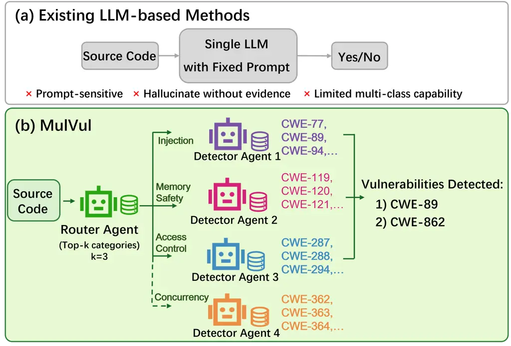
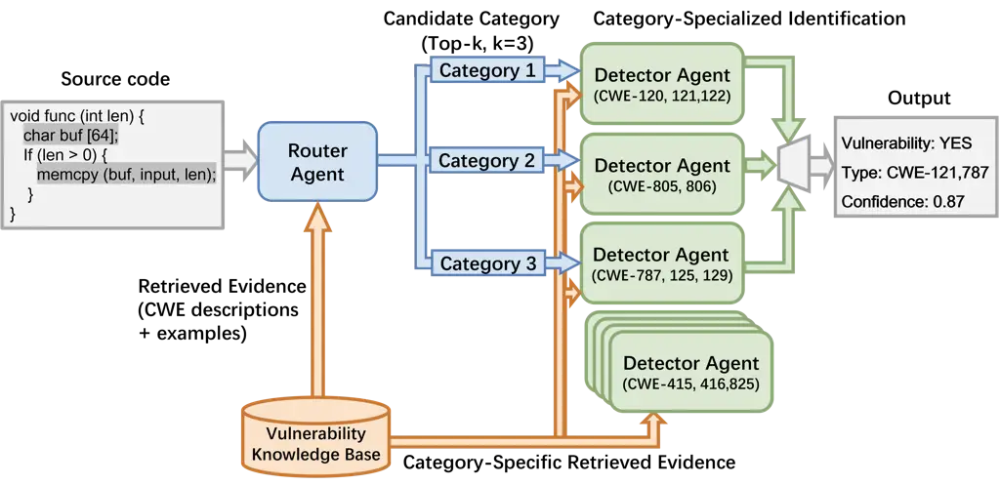
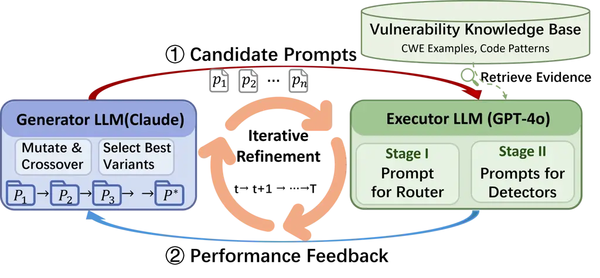
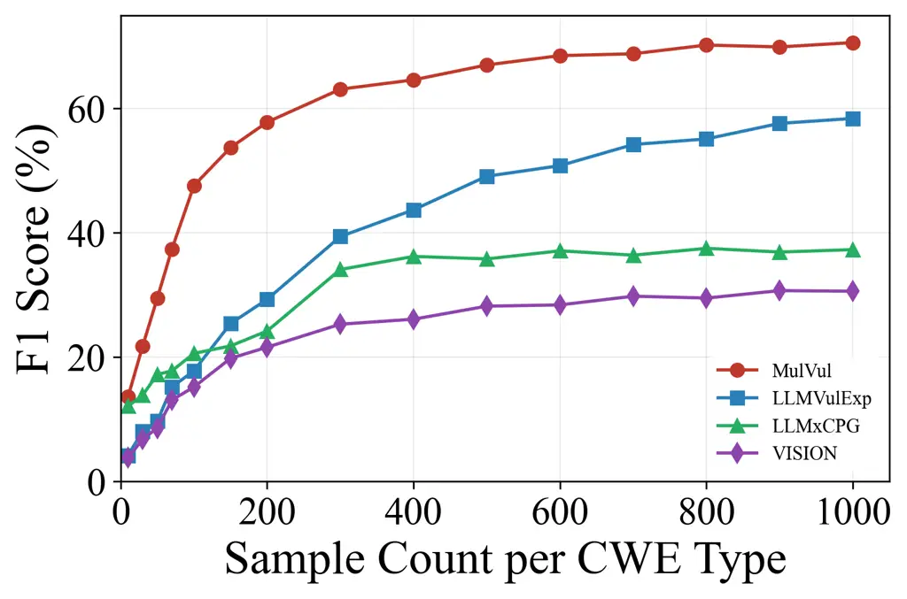
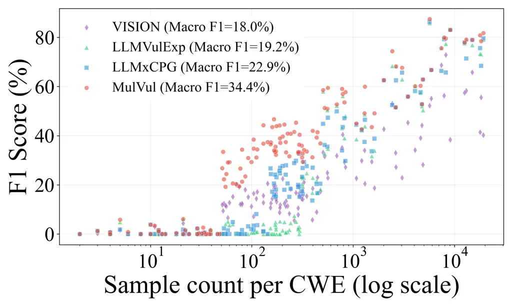

# MulVul: Retrieval-augmented Multi-Agent Code Vulnerability Detection via Cross-Model Prompt Evolution

Zihan Wu    Jie Xu    Yun Peng    Chun Yong Chong    Xiaohua Jia

###### Abstract

Large Language Models (LLMs) struggle to automate real-world
vulnerability detection due to two key limitations: the heterogeneity of
vulnerability patterns undermines the effectiveness of a single unified
model, and manual prompt engineering for massive weakness categories is
unscalable. To address these challenges, we propose MulVul, a
retrieval-augmented multi-agent framework designed for precise and
broad-coverage vulnerability detection. MulVul adopts a coarse-to-fine
strategy: a _Router_ agent first predicts the top-$`k`$ coarse
categories and then forwards the input to specialized _Detector_ agents,
which identify the exact vulnerability types. Both agents are equipped
with retrieval tools to actively source evidence from vulnerability
knowledge bases to mitigate hallucinations. Crucially, to automate the
generation of specialized prompts, we design _Cross-Model Prompt
Evolution_, a prompt optimization mechanism where a generator LLM
iteratively refines candidate prompts while a distinct executor LLM
validates their effectiveness. This decoupling mitigates the
self-correction bias inherent in single-model optimization. Evaluated on
130 CWE types, MulVul achieves 34.79% Macro-F1, outperforming the best
baseline by 41.5%. Ablation studies validate cross-model prompt
evolution, which boosts performance by 51.6% over manual prompts by
effectively handling diverse vulnerability patterns.

## 1 Introduction

Code vulnerabilities pose a fundamental threat to software reliability
and security, leading to software crashes and service interruptions Peng
et al. (2024). As modern software systems grow in complexity, manual
code auditing has become increasingly expensive, time-consuming, and
error-prone, motivating the need for automated vulnerability
detection Ghaffarian and Shahriari (2017).

Recent advances in large language models (LLMs) have sparked interest in
their application to vulnerability detection Peng et al. (2025); Zhou et
al. (2025). Previous efforts primarily focused on single-model
approaches, where a unified model is fine-tuned or prompted to identify
all vulnerability types simultaneously Gao et al. (2025); Lin and
Mohaisen (2025). However, vulnerability patterns are highly
heterogeneous Chakraborty et al. (2021). For example, buffer overflows
require reasoning about pointer arithmetic and memory bounds, while
injection attacks require tracking how untrusted inputs flow into
sensitive operations. As a result, a single unified detector struggles
to capture these diverse, type-specific patterns within a shared latent
space, leading to missed vulnerabilities or high false alarm rates.



Figure 1: Comparison between MulVul and existing LLM-based vulnerability
detection methods. (a) Existing methods rely on fixed prompts and lack
external grounding. (b) MulVul adopts a coarse-to-fine,
retrieval-augmented multi-agent framework for multi-type vulnerability
detection.

Inspired by the success of multi-agent systems that decompose complex
tasks into specialized components Wu et al. (2024), a question arises:
_Can a multi-agent architecture enhance multi-class vulnerability
detection by routing inputs to specialized experts?_

It is challenging to apply a multi-agent architecture for broad-coverage
vulnerability detection. First, it is computationally prohibitive to
invoke a specialized agent for every vulnerability type. Real-world
systems involve hundreds of Common Weakness Enumeration (CWE)
entries MITRE (2024). To ensure comprehensive coverage, querying every
corresponding agent for each input creates an impractical inference
burden. Second, manual prompt engineering becomes unscalable in
multi-agent architectures. Unlike unified models, each specialized agent
requires a unique instruction to capture distinct, fine-grained patterns
of vulnerability. Manually optimizing prompts for such a vast number of
agents is not feasible. Third, multi-agent LLM systems can amplify
hallucinations. Evidence of vulnerabilities is often dispersed across
complex control flows, causing agents to reason under uncertainty. If an
individual agent hallucinates a flaw, this error can cascade through
inter-agent communication, distorting the final consensus Hong et al.
(2023).

To address these challenges, we propose MulVul, a retrieval-augmented
multi-agent framework equipped with cross-model prompt evolution for
vulnerability detection. Figure 1 contrasts prior methods with MulVul.
MulVul adopts a coarse-to-fine Router-Detector architecture aligned with
the hierarchical structure of CWE MITRE (2024). A _Router agent_ first
predicts the Top-$`k`$ coarse categories, and only the corresponding
category-specific _Detector agents_ are invoked to identify fine-grained
vulnerability types in that category. This selective activation
drastically reduces inference costs while maintaining high recall.
Crucially, to solve the scalability bottleneck of prompt engineering,
MulVul employs a Cross-Model Prompt Evolution mechanism for prompt
optimization. A generator LLM (e.g., Claude) iteratively proposes prompt
candidates, while an executor LLM (e.g., GPT-4o) evaluates their
fitness. By decoupling prompt generation from evaluation across
different LLMs, MulVul mitigates the self-correction bias inherent in
single-model optimization, yielding robust and highly specialized
prompts. To further mitigate hallucinations, agents actively query
evidence from a SCALE-structured vulnerability knowledge base Wen et al.
(2024) to ground their reasoning. Detectors operate in isolation to
prevent error amplification across agents.

Experiments on the PrimeVul benchmark establish MulVul as the new
state-of-the-art. Evaluated across 130 CWE types, MulVul achieves a
Macro-F1 of 34.79%, surpassing the best baseline by 41.5%. With
cross-model prompt evolution, MulVul significantly reduces false
positives, ensuring detection accuracy.

The contributions are summarized as follows:

- •
  We propose MulVul, a novel retrieval-augmented multi-agent framework
  for multi-class vulnerability detection. By enabling specialized
  agents with tool-augmented reasoning, MulVul effectively handles
  vulnerability heterogeneity while balancing computational efficiency
  with detection coverage.
- •
  We design a Cross-Model Prompt Evolution mechanism that automatically
  optimizes the prompts of specialized agents. By separating generation
  from execution, this approach mitigates self-correction bias and
  solves the scalability challenge of manual prompt engineering.
- •
  Comprehensive experiments show that MulVul significantly outperforms
  baselines with a 34.79% Macro-F1. Ablation studies confirm that our
  evolutionary mechanism boosts performance by 51.6% over manual
  prompts, demonstrating its critical role in handling diverse
  vulnerability patterns.

## 2 Related Work

Learning-based vulnerability detection. Learning-based vulnerability
detection has progressed from early deep learning frameworks (e.g.,
VulDeePecker Li et al. (2018)) to neural network models that learn code
representations with sequence and graph encoders Zhou et al. (2019); Li
et al. (2021); Chakraborty et al. (2021), and more recently to
pre-trained code models such as GraphCodeBERT Guo et al. (2021) and
UniXcoder Guo et al. (2022). Recently, LLMs have dominated the field due
to their strong code understanding capabilities Zhou et al. (2025).
However, existing single-model approaches face a critical challenge: a
unified detector often struggles to simultaneously capture the diverse
and fine-grained patterns of varying vulnerability types Lin and
Mohaisen (2025); Sheng et al. (2025). While general-purpose multi-agent
frameworks (e.g., AutoGen Wu et al. (2024), MetaGPT Hong et al. (2023))
show promise in task decomposition, they have not been tailored to
multi-class vulnerability detection under tight cost and reliability
constraints. MulVul addresses this challenge by proposing a
coarse-to-fine strategy that first performs coarse-grained routing and
then type-specialized identification.

Prompt engineering and optimization for LLMs. To reduce the reliance on
manual prompt engineering Wei et al. (2022), automatic optimization
strategies have emerged, treating prompt generation as a search or
optimization problem, such as APE Zhou et al. (2022), EvoPrompt Guo et
al. (2024), and OPRO Yang et al. (2023). A major limitation of these
methods is their reliance on a single backbone for both generation and
evaluation, which risks overfitting to model-specific biases and limits
transferability across LLMs. We address this by proposing Cross-Model
Prompt Evolution, which decouples the generator and executor. This
separation provides unbiased feedback, facilitating the discovery of
robust instructions that generalize more effectively across
vulnerability types.

Retrieval-augmented generation and hallucination mitigation.
Retrieval-augmented generation (RAG) effectively grounds LLMs to
mitigate hallucinations Lewis et al. (2020), with applications extending
to code completion and repair Lu et al. (2022). However, standard code
retrieval often focuses on syntactic similarity, which is insufficient
for distinguishing subtle security flaws. MulVul advances this by
leveraging SCALE-based structured semantic representations Wen et al.
(2024) and implementing a contrastive retrieval strategy. The Router
utilizes broad evidence to identify categories, while Detectors utilize
contrastive example retrieval to distinguish vulnerabilities.

## 3 Preliminaries and Problem Definition

### 3.1 Common Weakness Enumeration (CWE)

The CWE taxonomy MITRE (2024) organizes software vulnerabilities
hierarchically. We focus on a two-level structure comprising $`M`$
coarse-grained categories $`\mathcal{C}=\{c_{1},\dots,c_{M}\}`$ (e.g.,
Memory Buffer Errors, Injection). Each category $`c_{m}`$ contains a set
of fine-grained vulnerability types $`\mathcal{Y}_{m}`$ (e.g., CWE-119
Buffer Overflow, CWE-125 Out-of-bounds Read under Memory Buffer Errors).

We define the complete label space as
$`\mathcal{Y}=\{y_{0},y_{1},\dots,y_{K}\}`$, where $`y_{0}`$ denotes
non-vulnerable code and
$`\{y_{1},\dots,y_{K}\}=\bigcup_{m=1}^{M}\mathcal{Y}_{m}`$, where
$`\mathcal{Y}_{1},\dots,\mathcal{Y}_{M}`$ are pairwise disjoint.

### 3.2 LLM-based Code Vulnerability Detection

Given an LLM $`\mathcal{M}`$ with frozen parameters, we formulate
vulnerability detection as a retrieval-augmented generation task. The
input consists of a code snippet $`x\in\mathcal{X}`$ and a textual
prompt $`p`$. Since real-world code may contain multiple
vulnerabilities, we adopt a multi-class formulation where the system
outputs a prediction set $`\hat{\mathcal{Y}}\subseteq\mathcal{Y}`$. In
practice, the LLM generates structured outputs (e.g., a list of
predicted CWE types), which are parsed to obtain $`\hat{\mathcal{Y}}`$.
As $`\mathcal{M}`$ remains frozen, detection performance relies heavily
on the prompt $`p`$, which serves as the optimizable variable.

### 3.3 SCALE: Structured Code Representation

To capture code semantics and execution flow, SCALE Wen et al. (2024)
constructs a Structured Comment Tree for vulnerability detection. Given
source code $`x`$, SCALE uses LLMs to generate natural-language comments
attached to AST nodes, then applies structured rules to encode
control-flow sequences, yielding $`T(x)=\mathrm{SCALE}(x)`$.

### 3.4 Problem Formulation

Given a code snippet $`x\in\mathcal{X}`$, our goal is to design a
multi-agent system $`\mathcal{A}`$ that outputs
$`\hat{\mathcal{Y}}=\mathcal{A}(x)\subseteq\mathcal{Y}`$. The system
should achieve: (i) high-precision detection, (ii) robustness across LLM
backbones, and (iii) computational efficiency.



Figure 2: Overview of MulVul for vulnerability detection. The router
agent first selects top-$`k`$ candidate vulnerability categories, and
category-specific detector agents then perform fine-grained
identification with retrieved CWE-specific evidence.

## 4 Method

### 4.1 Overview of MulVul

MulVul operates in two phases: offline preparation and online detection.

During offline preparation, MulVul first constructs a vulnerability
knowledge base $`\mathcal{K}`$ by converting labeled samples into SCALE
representations Wen et al. (2024). MulVul then employs cross-model
prompt evolution to optimize prompts for Router and Detector agents.
Specifically, we use two separate LLMs with distinct roles: a generator
LLM $`\mathcal{M}_{\text{evo}}`$ (e.g., Claude) that proposes and
mutates candidate prompts, and an executor LLM
$`\mathcal{M}_{\text{exec}}`$ (e.g., GPT-4o) that runs the
Router/Detector agents and returns performance feedback. Through this
process, the Router agent obtains a prompt optimized for category-level
recall, while each Detector agent receives a prompt tailored for precise
fine-grained identification.

During online detection, MulVul adopts a coarse-to-fine Router-Detector
architecture, as illustrated in Figure 2. Given a code snippet $`x`$, a
Router agent first actively invokes an analysis tool to retrieve
evidence from $`\mathcal{K}`$ and predicts the top-$`k`$ categories.
Only the corresponding Detector agents are then invoked, each employing
specialized contrastive retrieval tools to identify the exact
vulnerability. Each Detector operates in isolation without inter-agent
communication, avoiding error amplification.

### 4.2 Offline Preparation

The offline phase 1) constructs the retrieval infrastructure and 2)
optimizes prompts for Router and Detector agents.

#### 4.2.1 Knowledge Base Construction

We construct a vulnerability knowledge base $`\mathcal{K}`$ to provide
grounding evidence for both Router and Detector agents. Given the
training set $`\mathcal{D}_{tr}=\{(x_{i},y_{i})\}_{i=1}^{N}`$ where
$`x_{i}`$ is a code snippet and $`y_{i}\in\mathcal{Y}`$ is its
vulnerability label, we convert each sample into its SCALE
representation $`T(x_{i})`$ following Wen et al. (2024). We index all
transformed samples to form the knowledge base:

```math
\mathcal{K}=\{(T(x_{i}),y_{i})\}_{i=1}^{N} \tag{1}
```

For efficient retrieval, we embed each SCALE representation $`T(x_{i})`$
with UniXcoder Guo et al. (2022) and perform nearest-neighbor search by
cosine similarity. We partition the knowledge base into a clean pool
$`\mathcal{K}_{0}`$ (entries labeled $`y_{0}`$) and category-specific
vulnerability pools $`\{\mathcal{K}_{m}\}_{m=1}^{M}`$ (entries whose CWE
category is $`c_{m}`$, i.e.,
$`\mathcal{K}_{m}=\{(T(x_{i}),y_{i})\in\mathcal{K}\mid y_{i}\in\mathcal{Y}_{m}\}`$).
For Detector $`m`$, we denote
$`\mathcal{K}_{\neg m}=\bigcup_{j\neq m}\mathcal{K}_{j}`$ as the set of
out-of-category vulnerabilities.

During detection, the Router agent invokes the global retrieval tool to
access evidence across categories, while each Detector agent employs the
contrastive tool to source in-category and hard-negative examples.
During the training phases (Stage I and II), when retrieving evidence
for a training sample $`x_{i}\in\mathcal{D}_{tr}`$, we strictly exclude
$`x_{i}`$ itself to prevent data leakage.

#### 4.2.2 Cross-Model Prompt Evolution

As illustrated in Figure 3, the key idea is to decouple prompt
generation from execution across different LLMs: an evolution model
$`\mathcal{M}_{\text{evo}}`$ generates and refines candidate prompts,
while an execution model $`\mathcal{M}_{\text{exec}}`$ evaluates them on
the detection task. Both $`\mathcal{M}_{\text{evo}}`$ and
$`\mathcal{M}_{\text{exec}}`$ remain frozen throughout the optimization
process; only the textual prompts are evolved. This separation enhances
exploration of the prompt space: since $`\mathcal{M}_{\text{evo}}`$ and
$`\mathcal{M}_{\text{exec}}`$ have different internal biases, mutations
proposed by $`\mathcal{M}_{\text{evo}}`$ are less likely to exploit
superficial patterns, reducing premature convergence to locally optimal
prompts.

Algorithm 1 presents the optimization procedure, which proceeds in two
stages. Router optimizes Recall@$`k`$ for coverage; Detectors optimize
F1 for precision-recall balance.



Figure 3: Illustration of the Cross-Model Prompt Evolution Process. The
generator LLM $`\mathcal{M}_{\text{evo}}`$ (Claude ) proposes and
mutates prompts, while the executor LLM $`\mathcal{M}_{\text{exec}}`$
(GPT-4o) evaluates their fitness.

Stage I: Router Prompt Optimization. We initialize $`n`$ candidate
prompts $`\mathcal{P}_{R}`$ using manually designed templates that
specify the task format and output structure. In each generation, every
prompt $`p\in\mathcal{P}_{R}`$ is executed by
$`\mathcal{M}_{\text{exec}}`$ on training samples with retrieved
evidence from $`\mathcal{K}`$. We use Recall@$`k`$ as the fitness
function because the Router aims to ensure the correct category is
included in top-$`k`$ predictions, avoiding early filtering of true
vulnerabilities. The evolution model $`\mathcal{M}_{\text{evo}}`$ then
evolves the prompts through the Evolve procedure (Algorithm 2):
high-fitness prompts are retained, and new candidates are generated via
LLM-driven mutation (e.g., rephrasing instructions, adding constraints,
adjusting output format). Throughout evolution, fitness is computed on
the training set $`\mathcal{D}_{tr}`$. After all iterations are
complete, we evaluate each generation’s best prompt (tracked during
training) on the held-out validation set $`\mathcal{D}_{val}`$, and
select the one with the highest Recall@$`k`$ as $`p_{R}^{*}`$.

Stage II: Detector Prompt Optimization. We optimize each Detector prompt
independently and in parallel. For category $`c_{m}`$, we construct
$`\mathcal{D}_{tr}^{(m)}`$ and $`\mathcal{D}_{val}^{(m)}`$ with
in-category positives, clean negatives, and out-of-category
vulnerabilities (hard negatives). Each Detector is evaluated with F1
score using evidence from $`\mathcal{K}_{m}`$ (positives),
$`\mathcal{K}_{0}`$ (clean), and $`\mathcal{K}_{\neg m}`$ (other
categories). The evolution mirrors Stage I, and parallelization across
$`M`$ categories ensures efficiency.

1: $`\mathcal{M}_{\text{evo}}`$, $`\mathcal{M}_{\text{exec}}`$,
$`\mathcal{K}`$, $`\mathcal{D}_{tr}`$, $`\mathcal{D}_{val}`$, Categories
$`M`$, Iterations $`T`$

2: Optimized prompts $`p_{R}^{*}`$, $`\{p_{m}^{*}\}_{m=1}^{M}`$

3: // Stage I: Router Prompt Optimization

4: Initialize prompts $`\mathcal{P}_{R}\leftarrow\{p_{1},\dots,p_{n}\}`$

5: for $`t=1`$ to $`T`$ do

6:
  $`\mathcal{S}\leftarrow\{\text{Recall@}k(p,\mathcal{M}_{\text{exec}},\mathcal{D}_{tr})\mid p\in\mathcal{P}_{R}\}`$

7:
  $`\mathcal{P}_{R}\leftarrow\textsc{Evolve}(\mathcal{P}_{R},\mathcal{S},\mathcal{M}_{\text{evo}})`$

8:   Track best prompt $`p_{\text{best}}^{(t)}`$ based on
$`\mathcal{S}`$

9: end for

10: Let
$`\mathcal{P}_{\text{best}}=\{p_{\text{best}}^{(1)},\dots,p_{\text{best}}^{(T)}\}`$

11:
$`p_{R}^{*}\leftarrow\arg\max_{p\in\mathcal{P}_{\text{best}}}\text{Recall@}k(p,\mathcal{M}_{\text{exec}},\mathcal{D}_{val})`$
$`\triangleright`$ Final Selection on Val

12: // Stage II: Detector Prompt Optimization

13: for $`m=1`$ to $`M`$ in parallel do

14:   Initialize $`\mathcal{P}_{m}`$; Construct
$`\mathcal{D}_{tr}^{(m)}`$, $`\mathcal{D}_{val}^{(m)}`$

15:   for $`t=1`$ to $`T`$ do

16:
   $`\mathcal{S}\leftarrow\{\text{F1}(p,m,\mathcal{M}_{\text{exec}},\mathcal{D}_{tr}^{(m)})\mid p\in\mathcal{P}_{m}\}`$

17:
   $`\mathcal{P}_{m}\leftarrow\textsc{Evolve}(\mathcal{P}_{m},\mathcal{S},\mathcal{M}_{\text{evo}})`$

18:   end for

19:   Select $`p_{m}^{*}`$ using $`\mathcal{D}_{val}^{(m)}`$ from
evolved candidates

20: end for

21: return $`p_{R}^{*}`$, $`\{p_{m}^{*}\}_{m=1}^{M}`$

Algorithm 1 Cross-Model Prompt Evolution

1: Population $`\mathcal{P}`$, Fitness scores
$`\{\mathcal{F}(p)\}_{p\in\mathcal{P}}`$, Evolution model
$`\mathcal{M}_{\text{evo}}`$, Elite ratio $`\alpha`$

2: Updated prompts $`\mathcal{P}^{\prime}`$

3: $`\mathcal{P}^{\prime}\leftarrow`$
top-$`\lfloor\alpha|\mathcal{P}|\rfloor`$ prompts ranked by
$`\mathcal{F}`$

4: while $`|\mathcal{P}^{\prime}|<|\mathcal{P}|`$ do

5:   Sample $`p`$ via rank-based selection to maintain diversity

6:
  $`p^{\prime}\leftarrow\mathcal{M}_{\text{evo}}(\texttt{mutate},p,\mathcal{F}(p))`$

7:
  $`\mathcal{P}^{\prime}\leftarrow\mathcal{P}^{\prime}\cup\{p^{\prime}\}`$

8: end while

9: return $`\mathcal{P}^{\prime}`$

Algorithm 2 Evolve: LLM-Driven Prompt Evolution

### 4.3 Online Multi-Agent Detection

Following the two-level CWE hierarchy defined in Section 3.1, MulVul
employs a coarse-to-fine detection strategy where autonomous agents are
equipped with specialized analysis and retrieval tools to ground their
decision-making. Figure 2 illustrates this tool-augmented architecture.

Given the optimized prompts $`p_{R}^{*}`$ and
$`\{p_{m}^{*}\}_{m=1}^{M}`$ from offline preparation, MulVul performs
retrieval-augmented multi-agent detection at inference time. Algorithm 3
summarizes the procedure.

#### 4.3.1 Router agent: Global Planning

Given an input code snippet $`x`$, the Router agent acts as a dispatcher
to predict coarse-grained categories. To overcome the limitations of raw
text processing, the agent first employs a Structure Analysis Tool
(SCALE) to extract semantic features:

```math
T(x)=\textsc{Tool}_{\text{SCALE}}(x) \tag{2}
```

With this structured representation, the agent actively invokes a Global
Retrieval Tool to query the knowledge base $`\mathcal{K}`$ for $`r`$
cross-category examples:

```math
E_{R}=\textsc{Tool}_{\text{Global}}(T(x),\mathcal{K},r). \tag{3}
```

The Router agent utilizes these top-$`r`$ retrieved examples to
understand the broad semantic context. The Router agent then takes the
optimized prompt $`p_{R}^{*}`$, the original code $`x`$, and evidence
$`E_{R}`$ as input, and outputs a ranked list of top-$`k`$ category
predictions:

```math
\mathcal{C}_{\text{top-}k}=\textsc{Router}(p_{R}^{*},x,E_{R}) \tag{4}
```

#### 4.3.2 Detector agents: Fine-grained Identification

For each predicted category $`c_{m}\in\mathcal{C}_{\text{top-}k}`$, the
corresponding Detector agent performs fine-grained vulnerability type
identification. To prevent confirmation bias, the Detector agent is
equipped with a Contrastive Retrieval Tool. This tool dynamically
sources evidence from three distinct pools: in-category positives
$`\mathcal{K}_{m}`$, clean examples $`\mathcal{K}_{0}`$, and
out-of-category hard negatives $`\mathcal{K}_{\neg m}`$. The agent
allocates its retrieval budget as
$`r_{\text{pos}}=r_{\text{neg}}=\lfloor r/3\rfloor`$ and
$`r_{\text{hard}}=r-r_{\text{pos}}-r_{\text{neg}}`$.

Based on this allocation, the agent invokes the tool to construct the
context:

```math
E_{m}=\textsc{Tool}_{\text{Contrast}}(T(x),c_{m},\mathcal{K},r) \tag{5}
```

Each Detector agent then analyzes this contrastive context to produce a
prediction:

```math
(\hat{\mathcal{Y}}_{m},\hat{\mathcal{E}}_{m})=\textsc{Detector}_{m}(p_{m}^{*},x,E_{m}) \tag{6}
```

where $`\hat{\mathcal{Y}}_{m}`$ represents the identified vulnerability
types and $`\hat{\mathcal{E}}_{m}`$ contains the explanations. By
operating with isolated tools, the agents avoid error cascading. After
all invoked Detector agents return their predictions, MulVul aggregates
them to produce the final output.

1: Code snippet $`x`$, Knowledge base $`\mathcal{K}`$, Category subsets
$`\{\mathcal{K}_{m}\}_{m=1}^{M}`$, Router prompt $`p_{R}^{*}`$, Detector
prompts $`\{p_{m}^{*}\}_{m=1}^{M}`$

2: Prediction $`\hat{\mathcal{Y}}`$, Evidence $`\hat{\mathcal{E}}`$

3: // Phase I: Coarse-grained Routing

4: $`T(x)\leftarrow\textsc{Tool}_{\text{SCALE}}(x)`$ $`\triangleright`$
Structure Analysis

5: $`E_{R}\leftarrow\textsc{Tool}_{\text{Global}}(T(x),\mathcal{K},r)`$

6:
$`\mathcal{C}_{\text{top-}k}\leftarrow\textsc{Router}(p_{R}^{*},x,E_{R})`$

7:

8: // Phase II: Fine-grained Detection

9: $`\hat{\mathcal{Y}}\leftarrow\varnothing`$;
$`\hat{\mathcal{E}}\leftarrow\varnothing`$

10: for $`c_{m}\in\mathcal{C}_{\text{top-}k}`$ in parallel do

11:   // Detector invokes contrastive tool

12:
  $`E_{m}\leftarrow\textsc{Tool}_{\text{Contrast}}(T(x),m,\mathcal{K},r)`$

13:
  $`(\hat{\mathcal{Y}}_{m},\hat{\mathcal{E}}_{m})\leftarrow\textsc{Detector}_{m}(p_{m}^{*},x,E_{m})`$

14:
  $`\hat{\mathcal{Y}}\leftarrow\hat{\mathcal{Y}}\cup\hat{\mathcal{Y}}_{m}`$

15:
  $`\hat{\mathcal{E}}\leftarrow\hat{\mathcal{E}}\cup\hat{\mathcal{E}}_{m}`$

16: end for

17: // Phase III: Aggregation

18: if $`\hat{\mathcal{Y}}=\varnothing`$ then

19:   $`\hat{\mathcal{Y}}\leftarrow\{y_{0}\}`$

20: end if

21: return $`\hat{\mathcal{Y}}`$ , $`\hat{\mathcal{E}}`$

Algorithm 3 MulVul Online Detection

## 5 Evaluation

We evaluate MulVul through comprehensive experiments designed to answer
the following questions:

- •
  Q1: How does MulVul compare with existing LLM-based vulnerability
  detection methods?
- •
  Q2: How does the routing parameter $`k`$ affect the precision-recall
  trade-off?
- •
  Q3: How do different components contribute to MulVul’s performance?
- •
  Q4: How does MulVul perform on few-shot CWE types?

### 5.1 Experimental Setup

##### Dataset.

We evaluate on PrimeVul Ding et al. (2024), containing 6,968 vulnerable
and 229,764 benign C/C++ functions across 10 categories and 130 CWE
types.

##### Implementation.

We use GPT-4o as the execution model $`\mathcal{M}_{\text{exec}}`$ for
both Router and Detector agents, and Claude Opus 4.5 as the evolution
model $`\mathcal{M}_{\text{evo}}`$. We use UniXcoder Guo et al. (2022)
for embedding and FAISS for retrieval.

##### Metrics.

Following Ding et al. (2024), we report Macro-Precision, Macro-Recall,
and Macro-F1. Macro-averaging computes metrics independently for each
CWE type and then averages them, ensuring equal weight for all types and
avoiding dominance by high-frequency vulnerabilities under severe class
imbalance.

##### Baselines.

We compare our approach with four state-of-the-art methods that span
prompting, fine-tuning, and GNN paradigms. 1) GPT-4o: Prompting-based
detection without demonstration examples or fine-tuning. 2)
LLM$`\times`$CPG Lekssays et al. (2025): LoRA fine-tuned Qwen2.5-32B
with CPG-guided context. 3) LLMVulExp Mao et al. (2025): LoRA fine-tuned
CodeLlama-7B with chain-of-thought explanations. 4) VISION Egea et al.
(2025): Devign GNN with counterfactual augmentation. LLM$`\times`$CPG
and VISION are extended from binary to multi-class classification for
fair comparison.

### 5.2 Comparison of Vulnerability Detection Effectiveness (Q1)

We compare the vulnerability detection effectiveness of MulVul with
existing methods at the coarse-grained category level and fine-grained
type level.

##### Category-Level Detection.

Table 1 reports category-level results. MulVul achieves the best overall
performance with 50.41% Macro-F1, outperforming the strongest baseline
LLMVulExp by 8.91 points. MulVul also achieves the highest
Macro-Precision (44.31%) while maintaining strong Macro-Recall (58.45%),
indicating accurate category identification with fewer false positives.
By contrast, LLM$`\times`$CPG yields the highest recall (62.81%) but
substantially lower precision (27.44%), suggesting that expanding
candidates improves coverage but induces over-prediction.

| Method           | Macro-Precision | Macro-Recall | Macro-F1 |
| ---------------- | --------------- | ------------ | -------- |
| GPT-4o           | 22.20           | 13.13        | 16.50    |
| LLM$`\times`$CPG | 27.44           | 62.81        | 38.20    |
| LLMVulExp        | 37.88           | 45.88        | 41.50    |
| VISION           | 22.23           | 33.72        | 26.80    |
| MulVul (Ours)    | 44.31           | 58.45        | 50.41    |

Table 1: Category-level vulnerability detection effectiveness (%) on
PrimeVul.

##### Type-Level Detection.

Table 2 presents type-level results. The task is markedly harder: all
baselines exhibit a sharp precision drop, reflecting that fine-grained
types require discriminative evidence beyond generic vulnerability
semantics. MulVul achieves 34.79% Macro-F1, surpassing LLM$`\times`$CPG
by 10.21 points. Importantly, MulVul improves Macro-Precision to 27.90%
while keeping competitive Macro-Recall, yielding a stronger
precision–recall trade-off that is critical for practical deployment.

| Method           | Macro-Precision | Macro-Recall | Macro-F1 |
| ---------------- | --------------- | ------------ | -------- |
| GPT-4o           | 4.76            | 3.28         | 3.86     |
| LLM$`\times`$CPG | 16.80           | 45.80        | 24.58    |
| LLMVulExp        | 19.31           | 27.60        | 22.72    |
| VISION           | 14.91           | 23.12        | 18.12    |
| MulVul (Ours)    | 27.90           | 46.19        | 34.79    |

Table 2: Type-level vulnerability detection effectiveness (%) on
PrimeVul.

### 5.3 Impact of Routing Parameter $`k`$ (Q2)

The routing parameter $`k`$ controls the number of candidate categories
the Router passes to downstream Detectors, directly affecting the
precision-recall trade-off.

| Top-$`k`$ | Macro-Precision | Macro-Recall | Macro-F1 |
| --------- | --------------- | ------------ | -------- |
| 1         | 39.58           | 29.10        | 33.51    |
| 2         | 28.80           | 43.20        | 34.56    |
| 3         | 27.90           | 46.19        | 34.79    |
| 4         | 26.79           | 47.83        | 34.34    |
| 5         | 26.54           | 48.37        | 34.27    |

Table 3: Effect of routing parameter $`k`$ on PrimeVul (Type-level, %).

##### Analysis.

We observe three key patterns. First, Macro-Recall consistently
increases as $`k`$ grows. This indicates that allowing the Router to
activate multiple candidate categories substantially reduces missed
detections, as the true class is more likely to be covered by the
expanded Top-$`k`$ set. Second, Macro-Precision shows a clear downward
trend with larger $`k`$. As more detectors are triggered, incorrect
categories are increasingly introduced, leading to more false positives
and thus lower precision. This behavior reflects the inherent trade-off
between coverage and noise when expanding the routing space. Third,
Macro-F1 reaches its peak at $`k{=}3`$ and remains relatively stable
beyond this range. Although recall continues to improve for larger
$`k`$, the corresponding degradation in precision offsets these gains,
resulting in diminishing overall benefits.

### 5.4 Ablation Study (Q3)

To understand the contribution of each component in MulVul, we conduct
ablation studies by removing key modules. Table 4 presents the results.

| Variant       | RAG | Agents | Evolution | Macro-F1 | $`\Delta`$ |
| ------------- | --- | ------ | --------- | -------- | ---------- |
| GPT-4o        | ✗   | ✗      | ✗         | 3.86     | -30.70     |
| w/o Retrieval | ✗   | ✓      | ✓         | 21.80    | -12.76     |
| w/o Agents    | ✓   | ✗      | ✓         | 28.61    | -5.95      |
| w/o Evolution | ✓   | ✓      | ✗         | 22.80    | -11.76     |
| MulVul (Full) | ✓   | ✓      | ✓         | 34.56    | –          |

Table 4: Ablation study on PrimeVul (Type-level). $`\Delta`$ denotes the
Macro-F1 difference from the full model.

##### Analysis.

Retrieval augmentation is the most critical component. Removing evidence
retrieval causes the largest performance drop, reducing Macro-F1 from
34.56% to 21.80%. This confirms that grounding LLM reasoning with
retrieved vulnerability examples from the knowledge base $`\mathcal{K}`$
is essential for distinguishing semantically similar CWE types. Without
concrete code evidence, even well-structured prompts and specialized
agents struggle to make accurate fine-grained predictions. Moreover,
cross-model prompt evolution provides substantial gains. Replacing
evolved prompts with manual templates leads to an 11.76% F1 drop,
demonstrating that our cross-model evolution strategy (Section 4.2)
effectively optimizes task-specific instructions.

### 5.5 Performance on Few-Shot CWE Types (Q4)

Real-world vulnerability datasets exhibit severe class imbalance, with
many CWE types having only a small number of samples (i.e., few-shot
settings). We analyze how methods perform across CWEs grouped by sample
count. Figure 4 visualizes the relationship between CWE sample size and
detection performance.



Figure 4: F1 score vs. CWE sample count. MulVul outperforms baselines
across all data regimes, with the largest gains on few-shot CWEs.

##### Analysis.

First, MulVul has a strong few-shot performance. For CWEs with fewer
than 100 samples, MulVul achieves approximately 48% F1, nearly doubling
the performance of the best baseline LLMVulExp (25%). This demonstrates
that retrieval augmentation enables effective cross-CWE knowledge
transfer. Similar vulnerability patterns from related types provide
useful detection signals even when target-type samples are scarce.

Second, MulVul’s performance curve rises steeply and plateaus around 300
samples at approximately 63% F1, while fine-tuning methods
(LLM$`\times`$CPG, VISION) plateau much earlier at lower performance
levels (35-38%). This indicates that MulVul extracts more discriminative
information from limited samples, a crucial advantage for practical
deployment where many vulnerability types are inherently rare.

Third, the advantage persists in data-rich regimes. Even for CWE types
with over 500 samples, MulVul maintains a 12+ point F1 lead over
baselines. This demonstrates that MulVul’s coarse-to-fine strategy and
architecture are all more beneficial than existing schemes.

See Appendix A for per-CWE analysis and quantitative few-shot metrics.

## 6 Conclusion

We propose MulVul, a retrieval-augmented multi-agent framework for
vulnerability detection. The coarse-to-fine Router-Detector architecture
addresses the heterogeneity and scalability challenges in analyzing
massive weakness categories. Additionally, cross-model prompt evolution
automates the discovery of specialized instructions while mitigating
self-correction bias, and SCALE-based contrastive retrieval grounds LLM
reasoning. Experiments on PrimeVul demonstrate that MulVul achieves a
state-of-the-art 34.79% Macro-F1 (41.5% relative improvement), and our
evolutionary mechanism yields a 51.6% performance boost over manual
prompt engineering.

## Limitations

We acknowledge several limitations of our work:

- •
  MulVul is evaluated exclusively on PrimeVul containing C/C++ code.
  Effectiveness on other programming languages (e.g., Java, Python) with
  different vulnerability patterns and on other benchmarks remains
  unexplored.
- •
  MulVul requires multiple LLM API calls: iterative optimization during
  offline prompt evolution and $`1+k`$ calls per sample during online
  detection. This may limit applicability in resource-constrained or
  large-scale batch processing scenarios.
- •
  Although we claim that cross-model evolution improves generalization,
  our experiments primarily use GPT-4o as the execution model. The
  transferability of evolved prompts to other LLMs was not thoroughly
  evaluated due to scope constraints.
- •
  We recognize the potential for misuse associated with automated
  vulnerability detection tools. While MulVul is designed to aid
  developers in securing code, malicious actors could theoretically
  utilize the framework to discover zero-day vulnerabilities in software
  systems for exploitation. Furthermore, there is a risk of automation
  bias; developers might develop a false sense of security and reduce
  manual scrutiny, which is dangerous given that our model inevitably
  produces false negatives.

## References

- Chakraborty et al. (2021) S. Chakraborty, R. Krishna, Y. Ding, and B.
  Ray Deep learning based vulnerability detection: are we there yet?.
  IEEE Transactions on Software Engineering 48 (9), pp. 3280–3296. Cited
  by: §1, §2.
- Ding et al. (2024) Y. Ding, Y. Fu, O. Ibrahim, C. Sitawarin, X.
  Chen, B. Alomair, D. Wagner, B. Ray, and Y. Chen Vulnerability
  detection with code language models: how far are we?. In 2025 IEEE/ACM
  47th International Conference on Software Engineering (ICSE),
  pp. 469–481. Cited by: §5.1, §5.1.
- Egea et al. (2025) D. Egea, B. Halder, and S. Dutta Vision: robust and
  interpretable code vulnerability detection leveraging counterfactual
  augmentation. In Proceedings of the AAAI/ACM Conference on AI, Ethics,
  and Society, Vol. 8, pp. 812–823. Cited by: §5.1.
- Gao et al. (2025) J. Gao, Y. Peng, and X. Ren $`\backslash`$texttt
  $`\{`$remind$`\}`$: Understanding deductive code reasoning in llms.
  arXiv preprint arXiv:2511.00488. Cited by: §1.
- Ghaffarian and Shahriari (2017) S. M. Ghaffarian and H. R. Shahriari
  Software vulnerability analysis and discovery using machine-learning
  and data-mining techniques: a survey. ACM computing surveys (CSUR) 50
  (4), pp. 1–36. Cited by: §1.
- Guo et al. (2022) D. Guo, S. Lu, N. Duan, Y. Wang, M. Zhou, and J. Yin
  UniXcoder: unified cross-modal pre-training for code representation.
  In Proceedings of the 60th Annual Meeting of the Association for
  Computational Linguistics (Volume 1: Long Papers), pp. 7212–7225.
  Cited by: §2, §4.2.1, §5.1.
- Guo et al. (2021) D. Guo, S. Ren, S. Lu, Z. Feng, D. Tang, S. LIU, L.
  Zhou, N. Duan, A. Svyatkovskiy, S. Fu, et al. GraphCodeBERT:
  pre-training code representations with data flow. In International
  Conference on Learning Representations, Cited by: §2.
- Guo et al. (2024) Q. Guo, R. Wang, J. Guo, B. Li, K. Song, X. Tan, G.
  Liu, J. Bian, and Y. Yang Connecting large language models with
  evolutionary algorithms yields powerful prompt optimizers. In The
  Twelfth International Conference on Learning Representations, Cited
  by: §2.
- Hong et al. (2023) S. Hong, M. Zhuge, J. Chen, X. Zheng, Y. Cheng, J.
  Wang, C. Zhang, Z. Wang, S. K. S. Yau, Z. Lin, et al. MetaGPT: meta
  programming for a multi-agent collaborative framework. In The Twelfth
  International Conference on Learning Representations, Cited by: §1,
  §2.
- Lekssays et al. (2025) A. Lekssays, H. Mouhcine, K. Tran, T. Yu,
  and I. Khalil $`\{`$llmxcpg$`\}`$:$`\{`$context-Aware$`\}`$
  vulnerability detection through code property $`\{`$graph-guided$`\}`$
  large language models. In 34th USENIX Security Symposium (USENIX
  Security 25), pp. 489–507. Cited by: §5.1.
- Lewis et al. (2020) P. Lewis, E. Perez, A. Piktus, F. Petroni, V.
  Karpukhin, N. Goyal, H. Küttler, M. Lewis, W. Yih, T. Rocktäschel, et
  al. Retrieval-augmented generation for knowledge-intensive nlp tasks.
  Advances in neural information processing systems 33, pp. 9459–9474.
  Cited by: §2.
- Li et al. (2021) Z. Li, D. Zou, S. Xu, H. Jin, Y. Zhu, and Z. Chen
  Sysevr: a framework for using deep learning to detect software
  vulnerabilities. IEEE Transactions on Dependable and Secure Computing
  19 (4), pp. 2244–2258. Cited by: §2.
- Li et al. (2018) Z. Li, D. Zou, S. Xu, X. Ou, H. Jin, S. Wang, Z.
  Deng, and Y. Zhong VulDeePecker: A deep learning-based system for
  vulnerability detection. In 25th Annual Network and Distributed System
  Security Symposium, NDSS 2018, San Diego, California, USA, February
  18-21, 2018, Cited by: §2.
- Lin and Mohaisen (2025) J. Lin and D. Mohaisen From large to mammoth:
  a comparative evaluation of large language models in vulnerability
  detection. In Proceedings of the 2025 Network and Distributed System
  Security Symposium (NDSS), Cited by: §1, §2.
- Lu et al. (2022) S. Lu, N. Duan, H. Han, D. Guo, S. Hwang, and A.
  Svyatkovskiy ReACC: a retrieval-augmented code completion framework.
  In Proceedings of the 60th Annual Meeting of the Association for
  Computational Linguistics (Volume 1: Long Papers), pp. 6227–6240.
  Cited by: §2.
- Mao et al. (2025) Q. Mao, Z. Li, X. Hu, K. Liu, X. Xia, and J. Sun
  Towards explainable vulnerability detection with large language
  models. IEEE Transactions on Software Engineering. Cited by: §5.1.
- MITRE (2024) MITRE CWE List Version 4.19. Note:
  [https://cwe.mitre.org/data/index.html](https://cwe.mitre.org/data/index.html)Page
  last updated: November 19, 2024. Accessed: 2026-01-01 Cited by: §1,
  §1, §3.1.
- Peng et al. (2024) Y. Peng, S. Gao, C. Gao, Y. Huo, and M. Lyu Domain
  knowledge matters: improving prompts with fix templates for repairing
  python type errors. In Proceedings of the 46th ieee/acm international
  conference on software engineering, pp. 1–13. Cited by: §1.
- Peng et al. (2025) Y. Peng, K. Kim, L. Meng, and K. Liu ICodeReviewer:
  improving secure code review with mixture of prompts. In Proceedings
  of the 40th IEEE/ACM International Conference on Automated Software
  Engineering, Cited by: §1.
- Sheng et al. (2025) Z. Sheng, Z. Chen, S. Gu, H. Huang, G. Gu, and J.
  Huang LLMs in Software Security: A Survey of Vulnerability Detection
  Techniques and Insights. ACM Computing Surveys 58 (5), pp. 1–35. Cited
  by: §2.
- Wei et al. (2022) J. Wei, X. Wang, D. Schuurmans, M. Bosma, F. Xia, E.
  Chi, Q. V. Le, D. Zhou, et al. Chain-of-thought prompting elicits
  reasoning in large language models. Advances in neural information
  processing systems 35, pp. 24824–24837. Cited by: §2.
- Wen et al. (2024) X. Wen, C. Gao, S. Gao, Y. Xiao, and M. R. Lyu
  Scale: constructing structured natural language comment trees for
  software vulnerability detection. In Proceedings of the 33rd ACM
  SIGSOFT International Symposium on Software Testing and Analysis,
  pp. 235–247. Cited by: §1, §2, §3.3, §4.1, §4.2.1.
- Wu et al. (2024) Q. Wu, G. Bansal, J. Zhang, Y. Wu, B. Li, E. Zhu, L.
  Jiang, X. Zhang, S. Zhang, J. Liu, et al. Autogen: enabling next-gen
  llm applications via multi-agent conversations. In First Conference on
  Language Modeling, Cited by: §1, §2.
- Yang et al. (2023) C. Yang, X. Wang, Y. Lu, H. Liu, Q. V. Le, D. Zhou,
  and X. Chen Large language models as optimizers. In The Twelfth
  International Conference on Learning Representations, Cited by: §2.
- Zhou et al. (2025) X. Zhou, S. Cao, X. Sun, and D. Lo Large language
  model for vulnerability detection and repair: literature review and
  the road ahead. ACM Transactions on Software Engineering and
  Methodology 34 (5), pp. 1–31. Cited by: §1, §2.
- Zhou et al. (2019) Y. Zhou, S. Liu, J. Siow, X. Du, and Y. Liu Devign:
  effective vulnerability identification by learning comprehensive
  program semantics via graph neural networks. Advances in neural
  information processing systems 32. Cited by: §2.
- Zhou et al. (2022) Y. Zhou, A. I. Muresanu, Z. Han, K. Paster, S.
  Pitis, H. Chan, and J. Ba Large language models are human-level prompt
  engineers. In The eleventh international conference on learning
  representations, Cited by: §2.

## Appendix A Few-Shot CWE Performance Analysis

This appendix provides a detailed analysis of detection performance on
individual CWE types, complementing the aggregated results in
Section 5.5. We examine how class imbalance affects each method and
quantify MulVul’s advantages on few-shot CWE types, i.e., those with
limited training samples.

### A.1 Class Imbalance in PrimeVul

Table 5 characterizes the dataset’s long-tail distribution: 69.6% of
samples concentrate in only 12 CWE types, while 48 types (37% of all
CWEs) collectively contain less than 1% of samples. This severe
imbalance creates few-shot scenarios for many CWE types, where models
must generalize from extremely limited examples.

| Tier                | \#CWEs | Samples | Share     |
| ------------------- | ------ | ------- | --------- |
| Head ($`\geq`$5k)   | 12     | 140,080 | 69.6%     |
| Medium (1k–5k)      | 16     | 42,554  | 21.2%     |
| Low (100–1k)        | 54     | 16,735  | 8.3%      |
| Rare (50–100)       | 16     | 1,109   | 0.6%      |
| Very Rare (10–50)   | 25     | 656     | 0.3%      |
| Ext. Rare ($`<`$10) | 7      | 32      | $`<`$0.1% |
| Total               | 130    | 201,166 | 100%      |

Table 5: CWE distribution in PrimeVul. The bottom four tiers (48 CWE
types) represent few-shot scenarios with $`<`$100 samples each.

### A.2 Per-CWE Performance Visualization

Figure 5 plots each method’s F1 on every CWE type against its sample
count. This visualization reveals how performance scales with data
availability and identifies which methods handle few-shot CWEs
effectively.



Figure 5: Per-CWE F1 vs. sample count (log scale). MulVul (red)
consistently outperforms baselines, especially in the few-shot region
(left) .

### A.3 Few-Shot Performance Metrics

To quantify the few-shot detection capability, we define four metrics
focusing on CWE types with $`<`$500 samples. Table 6 presents the
results.

|                             |        |                  |        |        |
| --------------------------- | ------ | ---------------- | ------ | ------ |
| Metric                      | MulVul | LLM$`\times`$CPG | VulExp | VISION |
| Tail F1 $`\uparrow`$        | 0.228  | 0.095            | 0.036  | 0.094  |
| Fail Thresh. $`\downarrow`$ | 51     | 153              | 311    | 51     |
| Tail Cov. $`\uparrow`$      | 65.6%  | 40.9%            | 11.8%  | 55.9%  |
| Gini Coef. $`\downarrow`$   | 0.396  | 0.580            | 0.695  | 0.495  |

Table 6: Few-shot performance metrics ($`\uparrow`$: higher is better;
$`\downarrow`$: lower is better). VulExp = LLMVulExp.

Metric Definitions:

- •
  Few-Shot F1: Average F1 on CWEs with $`<`$500 samples.
- •
  Min. Samples: Minimum samples needed for F1 $`>`$ 0 (data efficiency).
- •
  Coverage: Fraction of few-shot CWEs achieving F1 $`>`$ 0.1 (detection
  breadth).
- •
  Gini Coefficient: F1 distribution inequality across CWEs (0 = uniform,
  1 = skewed).

##### Analysis

First, MulVul achieves the highest few-shot F1. MulVul achieves 0.228 F1
on few-shot CWEs, which is 2.4$`\times`$ higher than LLM$`\times`$CPG
(0.095) and 6.3$`\times`$ higher than LLMVulExp (0.036). This confirms
that retrieval augmentation enables cross-CWE knowledge transfer: when a
CWE type has few samples, MulVul leverages similar patterns from the
knowledge base. In contrast, fine-tuning methods need substantial data
to learn discriminative features, while retrieval-based methods
generalize from analogous examples.

Moreover, MulVul shows the most balanced performance. The Gini
coefficient measures how uniformly F1 scores are distributed across CWE
types. MulVul’s lowest Gini (0.396) indicates consistent performance
regardless of class frequency, while LLMVulExp’s high Gini (0.695)
reveals heavy bias toward frequent classes. This balance is essential
for Macro-F1 optimization under class imbalance.

## Appendix B Case Study: Impact of Prompt Evolution

To analyze how MulVul improves prompt robustness, Figure 6 visually
contrasts the manually designed prompt (Stage 0) with the final evolved
prompt (Stage T).


(a) Baseline prompt lacks definitions and explicit constraints.


(b) Evolved prompt incorporates negative constraints, disambiguation
rules, and specific signals.

Figure 6: Comparison of the Router agent’s prompt before and after
Cross-Model Evolution. The Initial Prompt (a) relies on generic
instructions, while the Evolved Prompt (b) introduces semantic
disambiguation (e.g., Injection vs. Input) and negative constraints
(e.g., “Do NOT speculate") to mitigate hallucinations. High-impact
additions are highlighted in bold blue.

First, MulVul enables a shift from implicit to explicit definitions. As
shown in Figure 6(a), the initial prompt lists categories without
definitions, relying entirely on the LLM’s parametric knowledge. This
often leads to confusion between conceptually similar types, such as
Injection (CWE-74) and Input Validation (CWE-20). In contrast, the
evolved prompt in Figure 6(b) explicitly injects discriminative
boundaries (e.g., “Input flaws affect data integrity but do NOT execute
code"). This change, driven by the error feedback loop during evolution,
significantly improves the Router’s classification precision.

Second, MulVul mitigates false positives through negative constraints. A
major challenge in vulnerability detection is the high false positive
rate caused by LLMs’ “hallucinating" flaws in benign code. The
evolutionary process introduced negative constraints, highlighted in
bold blue in Figure 6(b) (e.g., “Do NOT infer vulnerabilities beyond
these patterns"). These “stop words" act as guardrails, forcing the
agent to output Benign when evidence is insufficient, thereby reducing
the False Positive Rate.

Third, MulVul adds an error prevention mechanism. The evolved prompt
includes a novel “Error Prevention Hints" section. This suggests that
the Executor LLM (GPT-4o) successfully identified recurring confusion
patterns in early iterations and the Generator LLM (Claude) synthesized
these observations into explicit “Chain-of-Thought" rules (e.g., Memory
vs. Logic) to guide future reasoning.

## Acknowledgments

We used large language models (Gemini, Claude, and GPT-5.2) to assist
with grammar checking, polishing, and improving the clarity of the
writing. All technical contributions, experimental design,
implementation, and analysis were conducted entirely by the authors. The
authors take full responsibility for the content of this paper.
