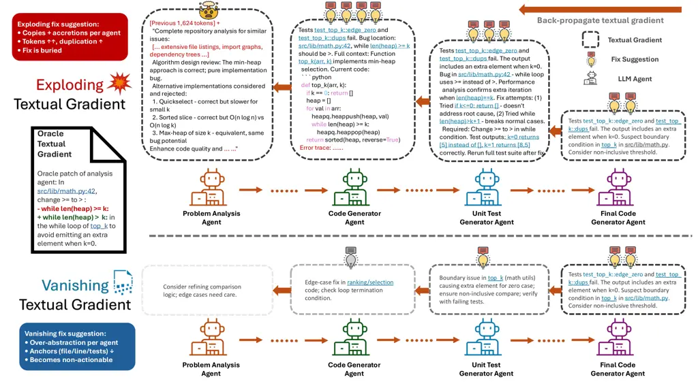
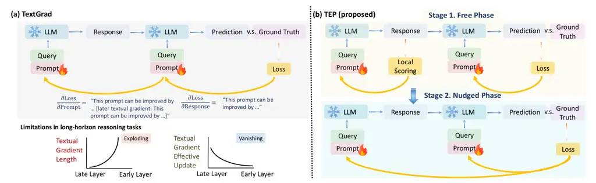

# Textual Equilibrium Propagation for Deep Compound AI Systems

Minghui Chen Affiliation: Nanyang Technological University   
Affiliation: University of British Columbia       Wenlong Deng
Affiliation: University of British Columbia    Affiliation: Vector
Institute       James Zou Affiliation: Stanford University    Han Yu
Affiliation: Nanyang Technological University       Xiaoxiao Li
^(†)^(†)thanks: Corresponding author: xiaoxiao.li@ece.ubc.ca
Affiliation: University of British Columbia    Affiliation: Vector
Institute   

###### Abstract

Large language models (LLMs) are increasingly deployed as part of
compound AI systems that coordinate multiple modules (e.g., retrievers,
tools, verifiers) over long-horizon workflows. Recent approaches that
propagate textual feedback globally (e.g., TextGrad (Yuksekgonul et al.,
2025)) make it feasible to optimize such pipelines, but we find that
performance degrades as system depth grows. In particular, long-horizon
agentic workflows exhibit two depth-scaling failure modes: (1)
_exploding textual gradient_, where textual feedback grows exponentially
with depth, leading to prohibitively long message and amplifies
evaluation biases; and (2) _vanishing textual gradient_, where limited
long-context ability causes models overemphasize partial feedback and
compression of lengthy feedback causes downstream messages to lose
specificity gradually as they propagate many hops upstream. To mitigate
these issues, we introduce Textual Equilibrium Propagation (TEP), a
local learning principle inspired by Equilibrium Propagation in
energy-based models (Scellier and Bengio, 2017). TEP includes two
phases: 1) a free phase where a local LLM critics iteratively refine
prompts until reaching equilibrium (no further improvements are
suggested); and 2) a nudged phase which applies proximal prompt edits
with bounded modification intensity, using task-level objectives that
propagate via forward signaling rather than backward feedback chains.
This design supports local prompt optimization followed by controlled
adaptation toward global goals without the computational burden and
signal degradation of global textual backpropagation. Across
long-horizon QA benchmarks and multi-agent tool-use dataset, TEP
consistently improves accuracy and efficiency over global propagation
methods such as TextGrad. The gains grows with depth, while preserving
the practicality of black-box LLM components in deep compound AI system.
Code is available on
[https://github.com/MinghuiChen43/TEP](https://github.com/MinghuiChen43/TEP).

|     |
| --- |
|     |



Figure 1: Textual gradient failure modes in deep compound AI systems, an
example bug report propagates through a multi-agent code generation
pipeline (Problem Analyzer → Code Generator → Test Generator → Final
Validator). Top–Exploding gradients: Each agent adds context to preserve
information, causing exponential token growth that buries the actionable
one-line fix beneath layers of accumulated texts. Bottom–Vanishing
gradients: Compression to manage gradient explosion strips away critical
specifics (file paths, line numbers, test cases), leaving only generic,
non-actionable advice.

## 1 Introduction

Compound artificial intelligence (AI) systems (i.e., pipelines that
coordinate large language models (LLMs), retrievers, tools, verifiers,
etc.) are becoming a popular way for deploying AI in settings that
require multi-step sequential reasoning and external tools (Yao et al.,
2023; Shinn et al., 2023). Emerging benchmarks place greater emphasis on
long-horizon behaviors such as multi-hop reasoning, iterative planning,
and multi-tool interaction at realistic scales (e.g., WebArena (Zhou et
al., 2024) for web interaction, and ToolBench (Qin et al., 2024) for
large-scale tool calls). As workflow depth and task complexity grow,
single-agent architectures reveal fundamental limitations: they lack the
specialized expertise for diverse subtasks (Khattab et al., 2024),
accumulate errors without intermediate correction (Shinn et al., 2023),
and hit context limits when handling long execution traces (Liu et al.,
2024).

TextGrad (Yuksekgonul et al., 2025) pioneered “automatic differentiation
via text” for compound AI systems. It back-propagates textual feedback
from an LLM-as-judge upstream through the computation graph to update
agent configurations (e.g., prompts and tools). This approach works well
in relatively short chains, steering LLM behaviors without numerical
gradients and enabling self-improvement at each step to better handle
specialization and error accumulation.

However, TextGrad faces depth-scaling challenges in compound AI system
analogous to deep neural networks. Like traditional backpropagation’s
vanishing and exploding gradients (Bengio et al., 1994), textual
backpropagation suffers similar instabilities: each layer may amplifie
noise or weaken useful signals. Specifically, TextGrad exhibits two
depth-dependent failures:

- •
  Exploding textual gradient: feedback accumulates across layers,
  leading to growing prompt sizes and LLM-as-judge biases (Zheng et al.,
  2023). Critical corrections get buried in long contexts, triggering
  the “lost in the middle” effect (Liu et al., 2024).
- •
  Vanishing textual gradient: limited long-context ability causes models
  to overemphasize early or recent portions (Liu et al., 2024), while
  compression strategy removes specificity (Chen et al., 2025), leaving
  early modules with diluted guidance.

Together, these failure modes reveal a fundamental limitation of global
textual backpropagation for deep compound AI systems: optimization
signals degrade exponentially as workflow depth increases.



Figure 2: Overview of Textual Equilibrium Propagation (TEP). (a)
TextGrad: Multi-step workflows as Stochastic Computation Graphs (SCGs)
where nodes are LLM agents with configurable prompts and edges represent
data flow. Global textual backpropagation suffers exploding gradients
(exponentially growing feedback) and vanishing gradients (decaying
specificity) at depth. (b) Textual Equilibrium Propagation: Free phase
optimizes each node locally until no further improvements are suggested
(equilibrium), then nudged phase applies bounded prompt modifications
guided by task objectives. This local approach avoids global feedback
chains.

#### Our proposal.

We introduce _Textual Equilibrium Propagation (TEP)_, a local learning
framework for compound systems inspired by Equilibrium Propagation in
energy-based models (Scellier and Bengio, 2017; Scellier and Bengio,
2019). As illustrated in Figure 2, TEP tackles the failure modes of
global textual backpropagation using a local, two-phased optimization.
In equilibrium propagation, numerical gradients are obtained via two
dynamics: a free phase that relaxes to an equilibrium, followed by a
nudged phase that gently pushes the system toward task targets. TEP
adapts this idea to agentic workflows:

- •
  Free phase: local LLM critics iteratively refine prompts at each node
  in the workflow until reaching an “equilibrium”, where no more
  improvement is suggested by the local critics.
- •
  Nudged phase: proximal prompt edits with bounded modification
  intensity, guided by task-level objectives propagated via forward
  signaling rather than long backward feedback chains, enabling
  controlled adaptation toward global goals.

By first achieving local optimization through equilibrium-seeking and
then applying controlled proximal edits, TEP reduces both the
computational burden and signal degradation associated with global
textual backpropagation. As shown in Figure 2, this local approach helps
maintain more stable optimization signal as workflow depth increases,
effectively mitigating both exploding and vanishing textual gradient
issues. TEP also naturally fits with the modular design of modern
compound AI frameworks while remaining model-agnostic.

#### Contributions.

This paper makes the following three key contributions:

- •
  Identification of critical gaps: We analyze fundamental limitations of
  TextGrad-style optimization in deep compound AI systems, and formalize
  exploding and vanishing textual gradients as depth-dependent failure
  modes that make global backpropagation ineffective for long agentic
  workflow.
- •
  New optimization method: We propose Textual Equilibrium Propagation
  (TEP), a novel compound AI system optimization method specifically
  designed for deep workflows, with (i) an equilibrium-seeking free
  phase for local refinement, and (ii) a node-local nudged phase with
  bounded textual perturbations.
- •
  Comprehensive empirical validation: Through extensive experiments on
  multi-step QA and multi-agent tool-use benchmarks, we demonstrate that
  TEP consistently outperforms TextGrad (Yuksekgonul et al., 2025) with
  advantages at greater depths.

## 2 Related Work

Compound AI System Optimization. Compound AI systems that orchestrate
multiple LLMs, tools, and other components (Wu et al., 2024a; Khattab et
al., 2024) have inspired new optimization approaches for multi-step
agentic workflows (Yao et al., 2023; Shinn et al., 2023).
TextGrad (Yuksekgonul et al., 2025) pioneered automatic differentiation
via text, propagating textual feedback through computation graphs to
optimize prompts without numerical gradients. While effective in shallow
pipelines, TextGrad suffers from depth-dependent issues analogous to
exploding and vanishing gradient in deep neural networks (Bengio et al.,
1994), where textual feedback grows into intractable long messages.
Limited context capacity exacerbates this, as models over-attend to
early or recent portions (Liu et al., 2024), and summarization-based
compression methods such as those in FedTextGrad (Chen et al., 2025) can
dilute feedback into generic suggestions. OPTIMAS (Wu et al., 2025)
employs locally trained rewards but requires costly parameter
fine-tuning and global evaluations. Exisitng iterative self-refinement
approaches (Madaan et al., 2023; Zhang et al., 2025) and prompt
optimization methods (Fernando et al., 2024; Dong et al., 2024) still
lack a specific design for deep compound AI systems. TEP mitigates these
issues via local equilibrium-based updates that help preserve signal
quality even with compound AI system depth increases.

Long-horizon Reasoning. Multi-hop QA benchmarks (Yang et al., 2018;
Trivedi et al., 2022; Geva et al., 2021) and tool-use datasets (Zhou et
al., 2024; Qin et al., 2024) expose fundamental depth-scaling
limitations in compound AI systems. Performance tends to drop sharply as
compound AI depth increases. This is potentially driven by compounding
effects such as the “lost in the middle” problem (Liu et al., 2024),
LLM-as-judge biases (Zheng et al., 2023) that distort evaluation, and
simple error accumulation across many steps. Self-improvement
techniques (Huang et al., 2023; Kumar et al., 2024) provide only partial
mitigation, since they fail to decouple local optimization from global
feedback chains. Thus, they are still vulnerable to the exponential
signal degradation in deep architectures. TEP tackles this limitation
through local equilibrium dynamics inspired by energy-based model
learning (Scellier and Bengio, 2017; Scellier and Bengio, 2019),
allowing effective and efficient optimization even at depths where
global propagation methods tend to fail.

## 3 The Proposed TEP Method

In this section, we formalize deep compound AI systems, define
depth-dependent failure modes for global textual feedback, and introduce
TEP as a local two-phase learning principle that avoids long-range
textual backpropagation. We then show that TEP yields a consistent
descent direction and converges under standard conditions.

### 3.1 Problem formulation via stochastic computation graphs

We define a compound AI system as a stochastic computation graph (SCG):
a directed graph $`G=(V,E)`$ whose nodes are random variables or
deterministic transforms, and whose edges encode functional dependence.
Each node $`v`$ produces an output $`z_{v}`$ and has parents
$`\mathrm{pa}(v)\subseteq V`$. We distinguish deterministic nodes
$`\mathcal{D}`$ from stochastic nodes $`\mathcal{S}`$. In LLM-based
compound AI systems, most nodes are stochastic due to the inherent
randomness of language model outputs, whereas deterministic nodes
typically correspond to simple tools (e.g., calculators, database
queries) or function calls with fixed outputs.

Compound AI system. Nodes represent LLMs, tools, or controllers with
local parameters $`\theta_{v}`$ (prompts, hyperparameters, routing
rules) and possibly internal state. For deterministic nodes
$`v\in\mathcal{D}`$, we have
$`z_{v}=f_{v}(z_{\mathrm{pa}(v)};\theta_{v})`$. For stochastic nodes
$`v\in\mathcal{S}`$, we have
$`z_{v}\sim p_{v}(\cdot\mid z_{\mathrm{pa}(v)};\theta_{v})`$. For
simplicity, we focus on predefined SCGs and optimize this fixed
structure, although the framework and method can naturally extend to
dynamic SCGs.

Problem instance. Let $`D_{\text{task}}`$ be a distribution over task
inputs $`o`$. For a fixed SCG $`G=(V,E)`$ with node-wise parameters
$`\theta=\{\theta_{v}\}_{v\in V}`$, running $`G`$ on input $`o`$ induces
a distribution $`P_{\theta}(\cdot\mid o)`$ over node outputs
$`Z=\{z_{v}\}_{v\in V}`$. A task loss $`\ell(o,Z)`$ then evaluates the
resulting output.

Objective. We aim to optimize $`\theta`$ to minimize the expected risk

```math
J(\theta)\;=\;\mathbb{E}_{o\sim D_{\text{task}}}\;\mathbb{E}_{Z\sim P_{\theta}(\cdot\mid o)}\bigl[\ell(o,Z)\bigr]. \tag{1}
```

Equivalently, with
$`L(o,\theta):=\mathbb{E}_{Z\sim P_{\theta}(\cdot\mid o)}[\ell(o,Z)]`$,
we minimize
$`J(\theta)=\mathbb{E}_{o\sim D_{\text{task}}}[L(o,\theta)]`$.

### 3.2 Textual gradient propagation and depth challenges

To understand why existing global optimization fails in deep compound AI
systems and to motivate our local approach, we first formalize the
textual gradient propagation in stochastic computation graphs. We then
define exploding and vanishing textual gradients.

Textual gradient descent in SCGs. In TextGrad-style optimization, each
node $`v\in V`$ is treated as an LLM agent with local parameters
$`\theta_{v}`$ (prompts, hyperparameters). A critic LLM evaluates node
outputs and generates textual feedback. For a single node, the update
is:

```math
\theta_{v}^{\prime}=U_{v}(g_{v},\theta_{v}),\quad g_{v}=C(z_{v},\theta_{v}), \tag{2}
```

where $`C`$ is the critic LLM that takes node output $`z_{v}`$ and
current parameters $`\theta_{v}`$ as input and generates textual
feedback $`g_{v}`$ with specific improvement suggestions (e.g.,
“increase temperature for more diversity,” “add constraint X to the
prompt,” “revise line Y in the instruction”). The update operator
$`U_{v}`$ is implemented as an LLM that takes the textual feedback
$`g_{v}`$ and current parameters $`\theta_{v}`$ as inputs, then produces
updated parameters $`\theta_{v}^{\prime}`$ by rewriting prompts,
adjusting hyperparameters, or generating new instructional text that
incorporates the critic’s suggestions.

For multi-node chains, the update at node $`v`$ depends on downstream
feedback:

```math
\theta_{v}^{\prime}=U_{v}(g_{v},\theta_{v}),\quad g_{v}=C(z_{v},\theta_{v},g^{\prime}), \tag{3}
```

where $`g^{\prime}`$ aggregates textual gradients from descendant nodes.
This coupling creates a dependency chain: updates at depth $`d`$ require
propagating feedback through all subsequent layers, leading to the
depth-scaling failure modes we formalize below.

Exploding Textual Gradient. While exploding numerical gradient manifests
as unbounded magnitudes, exploding textual gradient show up as unbounded
message length and complexity. Let $`B(g)`$ denote the token count
required to transmit feedback $`g`$ (a practical constraint that TEP’s
bounded local updates respect). Explosion occurs when maintaining useful
feedback (specificity $`S(g_{u})\geq\tau`$ for some threshold
$`\tau>0`$) across a length-$`k`$ chain requires exponentially growing
messages:

```math
\mathbb{E}[B(g_{u})]\;\geq\;c\,\gamma^{k}\quad\text{for }\gamma>1,\;c>0. \tag{4}
```

The key distinction from numerical gradients is that backpropagated
textual feedback grows exponentially with SCG depth, potentially
exceeding LLM context limits (e.g., 128K tokens). Each layer must
preserve all downstream feedback while adding its own analysis, so the
gradient message becomes not only very long but also increasingly
distorted as LLMs inject biases that compound through the chain. As a
result, exploding textual gradient can cause transmitted message to
exceed an LLM’s context window or hide essential information inside an
overly long context.

Vanishing Textual Gradient. Analogous to numerical gradients that decay
exponentially in deep networks, textual gradients can vanish when
attempts to compress exploding feedback cause specificity to degrade
over multi-hop propagation. Let $`S(g)\in[0,1]`$ measure the actionable
specificity of feedback $`g`$ (how well it guides parameter updates).
For a length-$`k`$ chain from the final output back to node $`u`$,
vanishing occurs when:

```math
\mathbb{E}\bigl[S(g_{u})\bigr]\;\leq\;C\,\alpha^{k}\quad\text{for }\alpha\in(0,1),\;C>0, \tag{5}
```

where $`g_{u}`$ is the feedback reaching $`u`$. Unlike numerical
gradients that shrink in magnitude, textual gradients lose information
density as compression and summarization attempt to manage the
exponentially growing context. This is related to the “lost in the
middle” effect, where LLMs struggle to extract information buried in
long contexts (Liu et al., 2024). For instance, actionable feedback like
”replace \>= with \> in the loop condition” may degrade into generic
suggestions such as “improve algorithm efficiency” after several
attempts to compress the message. In this paper, we quantify vanishing
textual gradients through a low effective update rate, meaning that
suggested prompt updates do not lead to performance improvements.

Implications for compound AI systems. These failure modes limit TextGrad
scalability in deep SCGs. Exploding gradients lead to context overflow
and high computational costs, while vanishing gradients leave upstream
nodes with generic, unusable feedback. In practice, even modest depths
(10 to 20 nodes) can trigger these issues, making global textual
backpropagation impractical for real systems.

This motivates our local approach. TEP uses node-local critics (avoiding
$`g^{\prime}`$ dependencies) and bounded parameter updates. As shown in
Appendix A, local evaluation can maintain feedback quality
$`S(g)\geq\tau`$ within context limits $`B(g)\ll\text{context limit}`$,
circumventing both explosion and vanishing while keeping the
effectiveness of textual optimization.

### 3.3 Our Proposed Solution: Textual Equilibrium Propagation (TEP)

To address vanishing and exploding textual gradients, we introduce
_Textual Equilibrium Propagation (TEP)_ for optimizing compound AI
systems using textual gradients. TEP adapts equilibrium propagation from
numerical networks to textual SCGs, replacing global critique
propagation with local, bounded perturbations around a node-local
equilibrium. Figure 2 (b) shows an overview of the proposed TEP, which
consists of two main phases: a free phase and a nudge phase. Note that
prompt optimization tasks we evaluated only provide global label at the
final output level. No intermediate ground-truth labels are available.
By default, the used critic model is the same as node model. These
phases are detailed below.

Free phase. In TEP, each node $`v`$ first optimizes locally to reach a
behavioral equilibrium using two learnable mechanisms: (i) an LLM critic
with a structured rubrics prompt $`\theta_{v}^{\text{critic}}`$ that
evaluates outputs using both task-independent quality metrics (clarity,
completeness, consistency) and task-dependent performance criteria, and
(ii) an actor temperature parameter
$`\theta_{v}^{\text{temp}}\sim\mathcal{U}(0.3,0.9)`$ that controls
exploration-exploitation during local refinement. The critic scores
output $`z_{v}`$ and returns feedback
$`g_{v}=C(z_{v},\theta_{v}^{\text{critic}})`$, where $`C`$ is the critic
defined in Section 3.2, now applied locally without descendant gradient
$`g^{\prime}`$. Free phase reaches equilibrium $`x^{0}_{\star}(\theta)`$
when the critic’s scores stabilize across iterations. This local
refinement removes global feedback chains with the structured critic
prompt. (See Appendix C for implementation details.)

Nudged phase. In classical equilibrium propagation, a small perturbation
is applied at the outputs to steer the system toward the desired
behavior. In TEP, the perturbation is implemented as a _minimal prompt
edit_ at each node in a SCG of deep compound AI system. Concretely,
these edits are applied to reinforce node-local criteria that align with
the global task target. After applying the edits, the system is run
again and iterate until it reaches a _nudged equilibrium_, which is
different from free equilibrium based on the local feedback signal.

Local update rule. Unlike classical EP that forms updates from numerical
gradient differences between free and nudged equilibria, TEP adopts an
LLM-defined operator to jointly combine feedback from both phases. The
update follows:
$`\theta_{v}^{\prime}=U_{v}(g^{f}_{v},g^{n}_{v},\theta_{v})`$, where
$`g^{f}_{v}`$ and $`g^{n}_{v}`$ are the feedback signals from the free
and nudged phases, respectively. Both are kept within bounded length and
specificity in Section 3.2’s definitions. $`U_{v}`$ is the LLM-defined
update operator. It maps these feedback signals to an updated node
specification (i.e., prompt edit). We apply validation-based selection
at every update (in both phases and in the final combination), keeping
only edits that do not reduce validation performance.

## 4 Experimental Evaluation

We evaluate TEP on diverse compound AI tasks that require long-horizon
reasoning, and compare it against state-of-the-art textual optimization
methods. Our experiments are designed round three key questions: (1)
Does TEP improve performance over global textual backpropagation
methods? (2) How severe are exploding/vanishing gradient issues in
practice, and does TEP mitigate them? (3) Which components of TEP
contribute most to its overall effectiveness?

### 4.1 Experiment Setup

#### Tasks and Datasets.

We evaluate on four multi-step reasoning and tool-orchestration
benchmarks:

1.  1.  PubMedQA (Jin et al., 2019) (biomedical QA). We use the original
        “expert” split and discard ambiguous samples, yielding 475/25/500
        (train/dev/test) question–abstract pairs. Metric: classification
        accuracy over {yes,no,maybe}. Base model: GPT-4o.
        Prompt-optimization modules: _Context Analyst_, _Problem Solver_.
2.  2.  STARK-PRIME (Wu et al., 2024b) (retrieval over semi-structured
        biomedical corpora). We use the original split 495/51/96 queries.
        Metric: Mean Reciprocal Rank (MRR). Base model: Claude 3 Haiku.
        Prompt-optimization modules: _Text Scorer_, _Relation Scorer_.
3.  3.  HotpotQA (Yang et al., 2018) (multi-hop QA with retrieval-augmented
        generation). We keep the official splits 1000/250/100. Metric:
        answer-level F1. Base model: GPT-4o-mini. Prompt-optimization
        modules: _Question Rewriter_, _Info Extractor_, _Hint Generator_,
        _Answer Generator_.
4.  4.  BigCodeBench (Zhuo et al., 2024) (self-verified code generation). We
        proportionally subsample to 500/25/70 coding tasks. Each item
        includes a natural-language spec and reference unit tests. Metric:
        pass@1. Base model: Claude 3 Haiku. Prompt-optimization modules:
        _Code Generator_, _Unit-Test Generator_, _Final Code Generator_.

#### Baselines.

We compare TEP against five strong baselines, summarized below.

1.  1.  Chain-of-Thought (CoT) (Wei et al., 2022): Standard prompting with
        step-by-step reasoning; no learning or prompt updates. Serves as the
        unoptimized reference.
2.  2.  DSPy (Khattab et al., 2024): A modular programmatic framework that
        learns and compiles prompts from demonstrations. We use
        task-specific modules with default DSPy tuning recipes.
3.  3.  Hierarchical Behavior Cloning (HBC) (Le et al., 2018): Hierarchical
        imitation learning that aligns sub-module outputs to high-reward
        trajectories.
4.  4.  TextGrad (Yuksekgonul et al., 2025): Global textual backpropagation
        over the full SCG. Feedback is propagated hop-by-hop without length
        constraints, following the original setup.
5.  5.  TextGrad+Summarization (Chen et al., 2025): We adapt summarization
        prompting—originally used in cross-device federated learning to
        compress stacked-layer textual gradients and to control their
        length.

#### Implementation Details.

Across all benchmarks, we refer the SCG configurations of Wu et al.
(2025). We do not include a direct comparison to OPTIMAS, as their focus
on parallel, parameter fine-tuning differs from our black-box
prompt-optimization setting. By default, TEP uses 20 iterations in the
free phase and 40 iterations in the nudged phase. We detail the
computational cost of each baselines in the Appendix D.4.

### 4.2 Main Results

| Method          | PubMedQA Medical Analysis (Acc.) | STARK-PRIME Complex Retrieval (MRR) | HotpotQA RAG (F1) | BigCodeBench Verified Code Gen. (Pass Rate) |
| --------------- | -------------------------------- | ----------------------------------- | ----------------- | ------------------------------------------- |
| CoT             | 57.34$`\pm`$1.12                 | 39.76$`\pm`$0.84                    | 33.92$`\pm`$0.76  | 34.15$`\pm`$1.43                            |
| HBC             | 58.80$`\pm`$0.58                 | 36.95$`\pm`$0.59                    | 21.16$`\pm`$0.97  | 27.78$`\pm`$2.08                            |
| DSPy            | 60.26$`\pm`$0.40                 | 41.40$`\pm`$0.04                    | 44.90$`\pm`$0.32  | 33.81$`\pm`$2.75                            |
| TextGrad        | 56.96$`\pm`$2.24                 | 41.31$`\pm`$1.67                    | 24.86$`\pm`$1.19  | 35.71$`\pm`$0.10                            |
| TextGrad w/ Sum | 56.12$`\pm`$1.85                 | 40.72$`\pm`$1.21                    | 24.12$`\pm`$1.25  | 35.12$`\pm`$0.67                            |
| TEP (Ours)      | 62.02$`\pm`$1.31                 | 42.72$`\pm`$0.65                    | 48.72$`\pm`$1.32  | 38.97$`\pm`$0.39                            |

Table 1: Performance comparison across compound AI benchmarks. Best in
bold.

#### Overall Performance Result.

Table 1 shows that TEP perform consistently well across diverse compound
AI benchmarks. It achieves the best performance on all four tasks, with
particularly strong gains on complex reasoning benchmarks: $`8.1\%`$
improvement over the next-best method on HotpotQA and $`3.4\%`$ on
BigCodeBench. TextGrad with Summarization shows modest improvements over
vanilla TextGrad on retrieval tasks (STARK-PRIME) but its performance
drops on reasoning-heavy tasks (HotpotQA, BigCodeBench), suggesting that
compression-based solutions cannot fully address textual gradient
issues. The results validate that TEP’s local optimization approach
scales effectively to real-world compound AI systems while avoiding the
fundamental limitations of global textual backpropagation.

### 4.3 Empirical Analysis of Textual Gradient Failure Modes

We empirically validate our theoretical analysis with controlled
depth-scaling experiments that isolate the effects of workflow
complexity on textual gradient propagation. Using artificially deepened
compound AI systems, we demonstrate the practical manifestation of
exploding and vanishing gradient phenomena predicted by our hypothesis.

#### Experimental Design.

We vary computational graph depth using the BigCodeBench code generation
pipeline as our base architecture. The standard pipeline contains four
sequential modules: Problem Analysis, Code Generation, Test Generation,
and Code Refinement. To study depth effects, we introduce a _scale
factor_ $`s\in\{1,2,3,4,5\}`$ that replicates each module with
intermediate refinement stages. At scale $`s`$, the graph
$`\mathcal{G}_{s}`$ contains $`4s`$ nodes performing semantically
equivalent transformations—code reformatting, documentation enhancement,
and style consistency checks—that preserve functional correctness while
extending gradient propagation paths. We measure two key metrics:
_feedback token count_ $`B(s)`$ quantifying message complexity, and
_effective update rate_ $`\rho(s)`$ measuring the fraction of nodes that
successfully improve their outputs based on received feedback.

#### Exploding Textual Gradients: Exponential Message Growth.

Figure 3(a) shows that TextGrad’s feedback messages grow roughly
exponentially with depth, and the accumulated text length can exceed an
LLM’s maximum context window as the depth increases. The token count
increases from $`2K`$ at $`s=1`$ to over $`32K`$ at $`s=5`$, approaching
the context limits of modern LLMs. This exponential scaling
($`B(s)\sim 2.2^{s}`$) matches our hypothetical prediction: to preserve
actionable information across multiple hops, messages need to become
exponentially longer.

#### Vanishing Textual Gradients: Information Decay Under Compression.

When TextGrad uses summarization to manage token budgets (TextGrad w/
Sum), gradient specificity decays quickly with depth. Figure 3(b) shows
effective update rates declining from $`36\%`$ at $`s=1`$ to merely
$`5\%`$ at $`s=5`$. Compressed feedback loses actionable
details—transforming specific corrections like “fix undefined variable
result on …” into generic suggestions like “improve code
quality”—validating our analysis of information decay under bounded
token constraints.

#### TEP’s Graceful Degradation.

TEP exhibits fundamentally different scaling behavior, keeping nearly
constant token complexity and showing only modest performance
degradation ($`37\%`$ to $`33\%`$ update success rate). By eliminating
multi-hop gradient chains and relying on local equilibrium computations,
TEP avoids the exponential failure modes while achieving consistent
optimization effectiveness across different scaling levels of workflow.

Figure 3: Textual gradient failure modes with increasing workflow depth
on BigCodeBench. (a) Exploding gradients: TextGrad feedback messages
grow exponentially, reaching context overflow at scale factor $`5`$. (b)
Vanishing gradients: Compressed feedback (TextGrad w/ Sum) loses
specificity, leading to sharp drop in effective update rates. TEP
maintains stable performance across all scales through local
optimization.

### 4.4 Solution Optimization Experiments

| Method          | GPQA (Acc.) | Object Counting (Acc.) |
| --------------- | ----------- | ---------------------- |
| CoT             | 38.5        | 72.4                   |
| TextGrad        | 41.0        | 74.2                   |
| TextGrad w/ Sum | 39.5        | 68.9                   |
| TEP (Ours)      | 44.5        | 81.6                   |

Table 2: Solution optimization performance.

#### Solution-Optimization Setting.

We evaluate TEP on _solution optimization_, where the target is to
improve the model’s _reasoning outputs_ rather than its input prompts.
We use two benchmarks: (i) GPQA (Rein et al., 2024)—expert-level
physics/biology/chemistry questions requiring multi-step reasoning
(following Yuksekgonul et al., 2025); and (ii) an adapted Object
Counting dataset with 5-step hierarchical arithmetic (e.g.,“4 pallets,
each with 3 crates, each with 5 boxes, each with 2 bags of 40 screws;
360 discarded—how many remain?”).

This setting tests whether TEP’s local, task-independent critic and
proximal prompt edits remain beneficial when optimization acts on
generated _solutions_. For GPQA, optimization targets a single node.
This does not reduce TEP to TextGrad: TEP’s task-independent critic and
proximal prompt edits remain effective even in single-node prompt
optimization. For Object Counting, intermediate, verifiable subresults
make the task well-suited to TEP’s free-phase local refinement. In
contrast, global textual backpropagation (TextGrad) continues to suffer
depth-related exploding/vanishing feedback when multi-step reasoning
induces long reformulation chains (Appendix E).

#### Setup.

We compare four methods: CoT (baseline), TextGrad (full
backpropagation), TextGrad+Summ. (100-token feedback cap), and TEP
(local refinement). Models: GPT-4 on 200 GPQA questions and Llama-3.2 on
500 Object Counting problems.

#### Results.

Table 3 shows TEP outperforms all baselines. On GPQA, TEP reaches
$`44.5\%`$ accuracy, a $`3.5`$ point gain over TextGrad; TextGrad+Summ.
falls below CoT ($`39.5\%`$), indicating that compression weakens
nuanced reasoning signals. On Object Counting, TEP attains $`81.6\%`$vs.
TextGrad’s $`74.2\%`$, while summarization leads to a larger drop
($`68.9\%`$). These results highlight TEP’s robustness for solution
optimization, where precise, depth-robust feedback is critical.

### 4.5 Ablation Studies

Figure 4: Component ablation analysis demonstrating the necessity of
both TEP phases across task types.

#### Ablation on TEP Components.

Figure 4 studies the contribution of TEP’s two phases on HotpotQA and
BigCodeBench by removing one component at a time while holding all other
settings (models, iterations, hyperparameters) fixed.

Removing the nudged phase leads to severe degradation—on HotpotQA the
score collapses to $`22.3\%`$ F1 (a $`26.4`$ point drop). This shows
that purely local equilibrium (free phase) is not enough to achieve
system-level coordination: nodes converge to isolated local optima that
fail to compose into globally coherent solutions. A similarly severe
decline is observed qualitatively on BigCodeBench, underscoring the
importance of nudged, task-aligned coordination.

Removing the free phase also hurts performance, though less
dramatically: $`-11.9`$ F1 on HotpotQA and $`-2.7`$ pass@1 on
BigCodeBench. The free phase provides high-quality local optima that
serve as stable starting points for effective nudged updates. Without
this local refinement, nudging operates from weaker initializations and
its coordinating effect is reduced. The smaller impact on BigCodeBench
suggests code generation is more tolerant to imperfect local optima than
multi-hop reasoning chains, where errors compound more easily.

Takeaway. The results support TEP’s _synergistic_ design: the free phase
establishes strong local configurations; the nudged phase aligns them
toward global objectives. Neither local refinement nor global
coordination alone suffices. Both are necessary to achieve TEP’s full
gains.

## 5 Conclusions

In this paper, we introduced Textual Equilibrium Propagation (TEP), a
local learning principle that tackles the depth-scaling limitations of
existing textual optimization methods in compound AI systems. By
formalizing exploding and vanishing textual gradients as core challenges
in deep agentic workflows, we showed how global backpropagation becomes
impractical as system depth increases. TEP adapts equilibrium
propagation to textual SCGs with a two-phase approach (free and nudged
phases) that supports bounded, node-local updates while still leveraging
LLMs’ natural reasoning capabilities for compound AI system
optimization. Our empirical evaluation demonstrates that TEP
consistently outperforms TextGrad and other iterative self-refinement
approaches across multi-step QA and multi-agent tool-use benchmarks,
with gains that become larger at greater depths. The local,
equilibrium-based approach shows a path toward optimizing deep compound
AI systems. In subsequent research, we plan to explore dynamic graph
optimization and large-scale multi-agent coordination.

## 6 Acknowledgment

The research is supported, in part, by the NSERC Discovery Grant
RGPIN-2022-05316, NSERC Alliance Grant ALLRP 602633-24, Tri-Agency
Canada; Canada CIFAR AI Chair Awards, and Canada Research Chair
Fellowship; IITP grant, the Ministry of Science and ICT
(RS-2024-00445087, RS-2025-25464461), funded by the Korea government
(MSIT); the Ministry of Education, Singapore, under its Academic
Research Fund Tier 1 (RG101/24).

## References

- Bengio et al. (1994) Y. Bengio, P. Simard, and P. Frasconi Learning
  long-term dependencies with gradient descent is difficult. IEEE
  transactions on neural networks 5 (2), pp. 157–166. Cited by: §1, §2.
- Chen et al. (2025) M. Chen, R. Jin, W. Deng, Y. Chen, Z. Huang, H. Yu,
  and X. Li Can textual gradient work in federated learning?. In The
  Thirteenth International Conference on Learning Representations, Cited
  by: 2nd item, §2, item 5.
- Dong et al. (2024) Y. Dong, K. Luo, X. Jiang, Z. Jin, and G. Li PACE:
  improving prompt with actor-critic editing for large language model.
  In Findings of the Association for Computational Linguistics: ACL
  2024, pp. 7304–7323. Cited by: §2.
- Fernando et al. (2024) C. Fernando, D. Banarse, H. Michalewski, S.
  Osindero, and T. Rocktäschel Promptbreeder: self-referential
  self-improvement via prompt evolution. In Proceedings of the 41st
  International Conference on Machine Learning, pp. 13481–13544. Cited
  by: §2.
- Geva et al. (2021) M. Geva, D. Khashabi, E. Segal, T. Khot, D. Roth,
  and J. Berant Did aristotle use a laptop? a question answering
  benchmark with implicit reasoning strategies. Transactions of the
  Association for Computational Linguistics 9, pp. 346–361. Cited by:
  §2.
- Huang et al. (2023) J. Huang, S. Gu, L. Hou, Y. Wu, X. Wang, H. Yu,
  and J. Han Large language models can self-improve. In Proceedings of
  the 2023 Conference on Empirical Methods in Natural Language
  Processing, pp. 1051–1068. Cited by: §2.
- Jin et al. (2019) Q. Jin, B. Dhingra, Z. Liu, W. W. Cohen, and X. Lu
  PubMedQA: a dataset for biomedical research question answering.
  Proceedings of the 2019 Conference on Empirical Methods in Natural
  Language Processing. Cited by: item 1.
- Khattab et al. (2024) O. Khattab, A. Singhvi, P. Maheshwari, Z.
  Zhang, K. Santhanam, S. Vardhamanan, S. Haq, A. Sharma, T. T.
  Joshi, H. Moazam, H. Miller, M. Zaharia, and C. Potts DSPy: compiling
  declarative language model calls into self-improving pipelines. Cited
  by: §1, §2, item 2.
- Kumar et al. (2024) A. Kumar, V. Zhuang, R. Agarwal, Y. Su, J. D.
  Co-Reyes, A. Singh, K. Baumli, S. Iqbal, C. Bishop, R. Roelofs, et al.
  Training language models to self-correct via reinforcement learning.
  In The Thirteenth International Conference on Learning
  Representations, Cited by: §2.
- Le et al. (2018) H. Le, N. Jiang, A. Agarwal, M. Dudík, Y. Yue, and H.
  Daumé III Hierarchical imitation and reinforcement learning. In
  International conference on machine learning, pp. 2917–2926. Cited by:
  item 3.
- Liu et al. (2024) N. F. Liu, K. Lin, J. Hewitt, A. Paranjape, M.
  Bevilacqua, F. Petroni, and P. Liang Lost in the middle: how language
  models use long contexts. Transactions of the Association for
  Computational Linguistics 11, pp. 157–173. Cited by: 1st item, 2nd
  item, §1, §2, §2, §3.2.
- Madaan et al. (2023) A. Madaan, N. Tandon, P. Gupta, S. Hallinan, L.
  Gao, S. Wiegreffe, U. Alon, N. Dziri, S. Prabhumoye, Y. Yang, et al.
  Self-refine: iterative refinement with self-feedback. Advances in
  Neural Information Processing Systems 36, pp. 46534–46594. Cited by:
  §2.
- Qin et al. (2024) Y. Qin, S. Liang, Y. Ye, K. Zhu, L. Yan, Y. Lu, Y.
  Lin, X. Cong, X. Tang, B. Qian, et al. ToolLLM: facilitating large
  language models to master 16000+ real-world apis. In The Twelfth
  International Conference on Learning Representations, Cited by: §1,
  §2.
- Rein et al. (2024) D. Rein, B. L. Hou, A. C. Stickland, J.
  Petty, R. Y. Pang, J. Dirani, J. Michael, and S. R. Bowman Gpqa: a
  graduate-level google-proof q&a benchmark. In First Conference on
  Language Modeling, Cited by: §4.4.
- Scellier and Bengio (2017) B. Scellier and Y. Bengio Equilibrium
  propagation: bridging the gap between energy-based models and
  backpropagation. In Frontiers in computational neuroscience, Vol. 11,
  pp. 24. Cited by: §1, §2, Abstract.
- Scellier and Bengio (2019) B. Scellier and Y. Bengio Equivalence of
  equilibrium propagation and recurrent backpropagation. Neural
  computation 31 (2), pp. 312–329. Cited by: §1, §2.
- Shinn et al. (2023) N. Shinn, F. Cassano, A. Gopinath, K. Narasimhan,
  and S. Yao Reflexion: language agents with verbal reinforcement
  learning. Advances in Neural Information Processing Systems 36,
  pp. 8634–8652. Cited by: §1, §1, §2.
- Trivedi et al. (2022) H. Trivedi, N. Balasubramanian, T. Khot, and A.
  Sabharwal MuSiQue: multihop questions via single-hop question
  composition. Transactions of the Association for Computational
  Linguistics 10, pp. 539–554. Cited by: §2.
- Wei et al. (2022) J. Wei, X. Wang, D. Schuurmans, M. Bosma, F. Xia, E.
  Chi, Q. V. Le, D. Zhou, et al. Chain-of-thought prompting elicits
  reasoning in large language models. Advances in neural information
  processing systems 35, pp. 24824–24837. Cited by: item 1.
- Wu et al. (2024a) Q. Wu, G. Bansal, J. Zhang, Y. Wu, B. Li, E. Zhu, L.
  Jiang, X. Zhang, S. Zhang, J. Liu, et al. Autogen: enabling next-gen
  llm applications via multi-agent conversations. In First Conference on
  Language Modeling, Cited by: §2.
- Wu et al. (2025) S. Wu, P. Sarthi, S. Zhao, A. Lee, H.
  Shandilya, A. M. Grobelnik, N. Choudhary, E. Huang, K. Subbian, L.
  Zhang, et al. Optimas: optimizing compound ai systems with globally
  aligned local rewards. arXiv preprint arXiv:2507.03041. Cited by: §2,
  §4.1.
- Wu et al. (2024b) S. Wu, S. Zhao, M. Yasunaga, K. Huang, K. Cao, Q.
  Huang, V. N. Ioannidis, K. Subbian, J. Zou, and J. Leskovec Stark:
  benchmarking llm retrieval on textual and relational knowledge bases.
  Advances in Neural Information Processing Systems 37,
  pp. 127129–127153. Cited by: item 2.
- Yang et al. (2018) Z. Yang, P. Qi, S. Zhang, Y. Bengio, W. W.
  Cohen, R. Salakhutdinov, and C. D. Manning HotpotQA: a dataset for
  diverse, explainable multi-hop question answering. Proceedings of the
  2018 Conference on Empirical Methods in Natural Language Processing,
  pp. 2369–2380. Cited by: §2, item 3.
- Yao et al. (2023) S. Yao, J. Zhao, D. Yu, N. Du, I. Shafran, K.
  Narasimhan, and Y. Cao React: synergizing reasoning and acting in
  language models. In International Conference on Learning
  Representations (ICLR), Cited by: §1, §2.
- Yuksekgonul et al. (2025) M. Yuksekgonul, F. Bianchi, J. Boen, S.
  Liu, P. Lu, Z. Huang, C. Guestrin, and J. Zou Optimizing generative ai
  by backpropagating language model feedback. Nature 639 (8055),
  pp. 609–616. Cited by: 3rd item, §1, §2, item 4, §4.4, Abstract.
- Zhang et al. (2025) P. Zhang, H. Jin, L. Hu, X. Li, L. Kang, M.
  Luo, Y. Song, and H. Wang Revolve: optimizing ai systems by tracking
  response evolution in textual optimization. In Forty-second
  International Conference on Machine Learning, Cited by: §2.
- Zheng et al. (2023) L. Zheng, W. Chiang, Y. Sheng, S. Zhuang, Z.
  Wu, Y. Zhuang, Z. Lin, Z. Li, D. Li, E. Xing, et al. Judging
  llm-as-a-judge with mt-bench and chatbot arena. Advances in neural
  information processing systems 36, pp. 46595–46623. Cited by: 1st
  item, §2.
- Zhou et al. (2024) S. Zhou, F. F. Xu, H. Zhu, X. Zhou, R. Lo, A.
  Sridhar, X. Cheng, T. Ou, Y. Bisk, D. Fried, et al. WebArena: a
  realistic web environment for building autonomous agents. In The
  Twelfth International Conference on Learning Representations, Cited
  by: §1, §2.
- Zhuo et al. (2024) T. Y. Zhuo, V. M. Chien, J. Chim, H. Hu, W. Yu, R.
  Widyasari, I. N. B. Yusuf, H. Zhan, J. He, I. Paul, et al.
  BigCodeBench: benchmarking code generation with diverse function calls
  and complex instructions. In The Thirteenth International Conference
  on Learning Representations, Cited by: item 4.

## Appendix A Analysis of Textual Gradient Failure Modes

This section analyzes why global textual backpropagation fails at depth
and how TEP avoids these issues.

### A.1 Setup and Assumptions

#### Textual feedback propagation.

In an SCG with node outputs $`\{z_{v}\}`$ and parameters
$`\{\theta_{v}\}`$, global textual signals from the final output $`F`$
pass through intermediate LLMs, creating messages
$`G^{(1)},G^{(2)},\dots,G^{(k)}`$ before reaching upstream nodes.

#### Information contraction.

Each reformulation loses task-relevant information. We model this with a
per-hop factor $`\alpha\in(0,1)`$ where mutual information about desired
improvements $`\Delta Q`$ decays geometrically across hops.

#### Bounded channel capacity.

A textual message with $`B`$ tokens carries at most $`\kappa B`$ bits of
task-relevant information. Initial information is budget-limited, and
reformulations can only maintain or reduce it.

### A.2 The Depth Tax

#### Exponential decay.

Combining contraction with bounded capacity yields

```math
I(\Delta Q;G^{(k)})\;\leq\;\kappa B\,\alpha^{k}.
```

To maintain signal quality at distance $`k`$, message length must grow
as $`B\geq\alpha^{-k}`$ (explosion); under fixed budgets, signals decay
as $`\alpha^{k}`$ (vanishing).

#### The fundamental trade-off.

Global textual backpropagation faces exponentially growing context
requirements or exponentially decaying signal quality.

### A.3 How TEP Avoids Depth Issues

#### Local contrasts replace chains.

TEP uses local two-phase contrasts (free vs. nudged) at each node.
Critics evaluate node outputs directly, producing
$`\mathcal{O}(1)`$-sized signals whose quality depends on local context,
not graph depth.

#### Depth-invariant updates.

Under mild conditions on critic informativeness, each node maintains
consistent update signal quality. TEP’s optimization quality scales with
node count, not depth.

### A.4 Convergence Properties

#### Local equilibrium.

When a node’s refinement operator $`T_{v}`$ is contractive (rate
$`\gamma<1`$), free-phase equilibrium exists, is unique, and converges
geometrically at rate $`\gamma`$—independent of graph depth.

#### Complexity comparison.

Global methods face per-iteration costs $`\rho^{d}`$ with decaying
signal quality $`\alpha^{d}`$. TEP maintains constant per-node context
and avoids multi-hop decay, achieving $`\mathcal{O}(1)`$ per-node
complexity with natural parallelization.

#### LLM-as-Judge bias and TextGrad.

Textual gradient methods treat LLM feedback as a kind of “gradient” for
optimizing a compound AI system. This relies heavily on the LLM acting
as a judge, so feedback quality is crucial for stable prompt
optimization and convergence. In practice, the critic (or judge) model
needs to be strong in the target domain, which is why we prefer frontier
LLMs for the more complex prompt-optimization tasks. In deep compound AI
systems, bias can accumulate. A small judgement error in a downstream
node can compound as it is backpropagated upstream. TEP addresses this
specifically through the Free Phase and Nudged Phase. In the free phase,
iterative local updates under a rubric-based critic stabilize each node.
In the nudged phase, proximal prompt edits are guided directly by the
final task objective (i.e., final ground truth labels). Together, these
steps reduce the avoid the systematic bias (as shown in section 4.3)
that accumulates when feedback is propagated step by step along the
chain.

#### Model Choice and Model Size.

In experiments, our choice of LLMs is driven by task difficulty and
domain: for complex prompt-optimization tasks requiring long-horizon
reasoning and reliable self-critique we use frontier models such as
GPT-4o and Claude, while for simpler solution-optimization tasks we use
lighter models such as Llama 3, which already achieve strong base
performance and are more cost-efficient. As in TextGrad, TEP assumes a
base LLM that is capable of meaningful self-correction on the target
task: very small models or models lacking domain knowledge often fail to
generate or evaluate high-quality refinements, which limits the
effectiveness of any textual optimization framework.

#### Summary.

Global textual feedback incurs exponential depth costs through
information loss and context growth. TEP generates signals locally,
maintaining stable quality and depth-robust convergence.

## Appendix B TEP Algorithm Pseudocode

This section provides a compact pseudocode for Textual Equilibrium
Propagation (TEP), highlighting the two-phase optimization and
node-local updates.


#### Key algorithmic properties.

The pseudo code illustrates several critical aspects of TEP: (1) Local
parallelism: Each node $`v`$ independently seeks equilibrium without
requiring global coordination, enabling parallel execution across all
nodes. (2) Two-phase structure: The free phase establishes high-quality
local optima through critic-guided refinement, while the nudged phase
coordinates these solutions toward global objectives through minimal
textual perturbations. (3) Bounded complexity: Each node processes only
local feedback signals $`(g^{f}_{v},g^{n}_{v})`$ of constant size
$`\mathcal{O}(1)`$, avoiding the exponential message growth that plagues
global textual backpropagation. (4) Adaptive exploration: Temperature
parameters $`\theta_{v}^{\text{temp}}`$ automatically adjust based on
local performance, balancing exploration and exploitation at each node.
(5) Parameter annealing: The nudging strength $`\beta`$ decreases over
iterations, allowing strong initial coordination that gradually
transitions to fine-tuning as the system converges.

## Appendix C Free Phase Implementation Details

This section provides concrete implementation details for TEP’s free
phase, including the structured critic prompt design and temperature
tuning strategy. Note that the descriptions and examples are meant to
illustrate the prompt-design principles. In practice, we further refine
each task prompt using frontier LLMs to better match task requirements.

### C.1 Structured Critic Prompt and Rubric System

TEP employs a two-component rubric system that separates
task-independent quality metrics from task-dependent performance
criteria. This separation enables consistent quality assessment while
allowing task-specific adaptation.

#### Task-independent quality metrics.

These metrics remain fixed across all nodes and evaluate general output
quality through six dimensions:

- •
  Structural Clarity (1–5): Output organization and unambiguity.
  - –
    1: Disorganized, ambiguous structure
  - –
    3: Basic structure present but lacks coherence
  - –
    5: Well-organized with clear logical flow and explicit sections

- •
  Specification Completeness (1–5): Coverage of input requirements.
  - –
    1: Major requirements missing
  - –
    3: Core requirements addressed, details lacking
  - –
    5: All requirements fully addressed with appropriate depth

- •
  Internal Consistency (1–5): Freedom from contradictions.
  - –
    1: Multiple contradictions present
  - –
    3: Minor inconsistencies in edge cases
  - –
    5: Fully consistent across all aspects

- •
  Context Integration (1–5): Utilization of parent node outputs.
  - –
    1: Ignores available context
  - –
    3: Uses context but misses connections
  - –
    5: Seamlessly integrates all relevant context

- •
  Reasoning Transparency (1–5): Clarity of decision rationale.
  - –
    1: No justification for choices
  - –
    3: Some reasoning provided but gaps remain
  - –
    5: Clear rationale for all significant decisions

- •
  Format Compliance (1–5): Adherence to expected output schema.
  - –
    1: Free-form, ignores format requirements
  - –
    3: Partial compliance with format
  - –
    5: Strict adherence to specified schema/structure

## Appendix D TEP Local Critic Evaluation Templates

This appendix provides concrete examples of TEP’s local critic
evaluation process. The following displays illustrate the free phase
context, nudged phase context, and local critic prompt using the
multi-agent code generation pipeline scenario from Figure 1. These
examples demonstrate how TEP’s local optimization approach handles the
specific debugging task where textual gradients would otherwise explode
or vanish through the Problem Analyzer → Code Generator → Test Generator
→ Final Validator chain.


The overall task-independent quality score is computed as:
$`Q_{indep}=\sum_{i=1}^{6}w_{i}\cdot\frac{r_{i}-1}{4}\times 10`$, where
$`r_{i}\in\{1,\ldots,5\}`$ is the rating for dimension $`i`$ and weights
$`w_{i}`$ are: Clarity (0.20), Completeness (0.20), Consistency (0.15),
Context (0.15), Reasoning (0.15), Format (0.15).

#### Task-dependent performance criteria.

These criteria are initialized generically and refined after the nudged
phase based on global performance signals:

- •
  Functional correctness (0–10): Does the output achieve the intended
  task objective?
- •
  Constraint satisfaction (0–10): Are all task-specific constraints and
  requirements met?
- •
  Quality indicators (0–10): Task-specific metrics such as test coverage
  for code generation nodes, relevance scores for retrieval nodes, or
  accuracy for reasoning nodes.

#### Comprehensive evaluation template.

The complete TEP local critic evaluation template integrates both
assessment dimensions with clear output specifications:


The key innovation is that task-dependent criteria are updated after the
nudged phase, incorporating global performance signals without requiring
multi-hop backpropagation.

### D.1 Temperature Tuning Strategy

Rather than using fixed temperatures or complex annealing schedules, TEP
employs a simple random sampling strategy:

- •
  Sample $`\theta_{v}^{\text{temp}}\sim\mathcal{U}(0.3,0.9)`$ uniformly
  for each free phase iteration
- •
  Lower temperatures (0.3–0.5) encourage exploitation of current
  knowledge and refinement of existing solutions
- •
  Higher temperatures (0.6–0.9) promote exploration of alternative
  approaches and escape from local optima
- •
  No staged approach—continuous random sampling naturally balances
  exploration and exploitation

This simple strategy avoids the complexity of adaptive temperature
schedules while maintaining sufficient diversity in the equilibrium
search.

### D.2 Equilibrium Convergence Criterion

A node $`v`$ is considered to have reached free equilibrium when one of
the following conditions is met:

1.  1.  Score stabilization: The variance of critic scores across $`k=3`$
        consecutive evaluations falls below threshold $`\epsilon=0.5`$
2.  2.  Non-substantive improvements: Suggested changes become primarily
        stylistic rather than functional (determined by keyword analysis of
        feedback)
3.  3.  Iteration budget: Maximum of 20 refinement iterations reached
        (practical constraint for efficiency)

#### Implementation efficiency.

The local nature of free phase optimization enables several
computational optimizations:

- •
  Parallel execution: All nodes can reach equilibrium independently,
  enabling parallel computation
- •
  Caching: Equilibrium states can be cached and reused when parent
  outputs remain unchanged
- •
  Early stopping: Nodes achieving high initial scores (8/10 average) can
  skip refinement

These implementation details demonstrate that TEP’s free phase provides
a practical and efficient alternative to global textual backpropagation
while maintaining optimization quality through structured local
evaluation.

### D.3 TEP Convergence Analysis

Figure 5 provides detailed convergence analysis of TEP on PubMedQA,
demonstrating distinct optimization dynamics at local and global levels.
Subplot (a) shows free phase local critic scoring over 20 iterations on
a 0-10 scale, where scores progress from initial values around 5.2
toward the equilibrium threshold of 8.0. The characteristic fluctuations
demonstrate non-smooth equilibrium-seeking behavior as the local critic
iteratively refines prompts, with temporary score decreases reflecting
the exploratory nature of local optimization that can lead to better
long-term solutions. Subplot (b) illustrates global convergence across
different TEP outer iterations, showing performance improvements from
the CoT baseline of 57.3% to the final TEP performance of 62.0%. Notable
are the steady fluctuations from outer iteration 25 onwards,
demonstrating mature optimization behavior where the system maintains
consistent performance variations while achieving incremental gains.

Figure 5: TEP convergence analysis on PubMedQA. (a) Free phase local
critic scoring over 20 iterations on 0-10 scale, showing characteristic
fluctuations during equilibrium-seeking toward threshold of 8.0. (b)
Global convergence across 40 TEP iterations with steady fluctuations
from iteration 25 onwards, demonstrating cumulative performance
improvements through repeated optimization cycles.

### D.4 Extended Experiments: TEP Advantage Across Models

| Method          | Object Counting w/ Qwen 2.5 (Acc.) | Object Counting w/ Llama 3.2 (Acc.) |
| --------------- | ---------------------------------- | ----------------------------------- |
| CoT             | 60.2                               | 72.4                                |
| TextGrad        | 64.5                               | 74.2                                |
| TextGrad w/ Sum | 58.6                               | 68.9                                |
| TEP (Ours)      | 67.1                               | 81.6                                |

Table 3: Solution optimization performance.

We extend our experiments on solution optimization. To assess whether
TEP generalizes across models on the same task, we evaluate our object
counting task with the Llama 3.2 11 B model and Qwen 2.5 7B model. As
shown in Table 3, TEP consistently outperform other baselines.

### D.5 Computation Costs Analysis

A central challenge in measuring computational cost is selecting a
metric that is both stable and comparable across settings. While latency
can provide context, it fluctuates heavily with region, time, hardware,
and provider load. Iteration counts (or API calls) are also
uninformative, as different methods may consume vastly different numbers
of tokens per iteration. As noted in Sec. 4.3, TextGrad’s token usage
grows exponentially with workflow depth.

Thus in this paper, we quantify computational cost in terms of token
usage rather than wall-clock latency or iteration counts, because it is
the most faithful and standardized measure of computational cost in
modern LLM systems. Specifically, commercial LLM API providers (e.g.,
OpenAI¹¹ 1
[https://platform.openai.com/docs/pricing](https://platform.openai.com/docs/pricing),
Google²² 2
[https://ai.google.dev/gemini-api/docs/pricing](https://ai.google.dev/gemini-api/docs/pricing),
DeepSeek³³ 3
[https://api-docs.deepseek.com/quick_start/pricing](https://api-docs.deepseek.com/quick_start/pricing))
charge strictly by token count. Also, deep compound AI system
optimization is dominated by token generation and context processing.
Moreover, the depth-scaling failure mode we identify, where textual
gradients explode or vanish, is tightly linked to the per-iteration
token usage (discussed in Sec. 4.3). Taken together, the standard bill
method and our specific motivation make token usage a natural,
deployment-relevant, and motivation-aligned measure of computational
cost in our setting.

| Scale        | CoT  | TextGrad | TextGrad w/ Sum. | TEP  |
| ------------ | ---- | -------- | ---------------- | ---- |
| $`\times 1`$ | 841  | 1856     | 1673             | 1902 |
| $`\times 2`$ | 1450 | 4224     | 2740             | 2587 |

Table 4: Computational cost (token usage per iteration) for different
methods and scales.

To better demonstrate the efficiency, we demonstrate the token usage
under task PubMedQA and shown in Table 4, TEP has comparable token usage
to TextGrad at the smaller scale, but grows much more slowly as the
scale increases, leading to substantially less token cost at most
$`\times 2`$ for TextGrad with at scale 2.

## Appendix E Solution Optimization Depth-Scaling Analysis

This section provides detailed empirical analysis of textual gradient
failure modes in solution optimization tasks, complementing the main
results presented in Section 4.4.

### E.1 Experimental Design for Depth-Dependent Analysis

To empirically validate textual gradient pathologies in solution
optimization, we conduct a controlled experiment on Object Counting with
increasing problem complexity. We design a _nesting depth_ parameter
$`d\in\{1,2,3,4,5\}`$ that controls the number of hierarchical
containment levels. At depth $`d`$, problems require $`d`$ sequential
multiplication steps followed by aggregation and subtraction operations,
creating computation graphs with $`2d+2`$ nodes.

#### Problem Structure.

For depth $`d`$, we generate problems following the template: “There are
$`n_{1}`$ containers. Each container holds $`n_{2}`$ sub-containers;
each sub-container holds $`n_{3}`$ items; … ; $`k`$ items are discarded.
How many remain?” The nesting creates a chain of $`d`$ multiplication
operations: $`n_{1}\times n_{2}\times\cdots\times n_{d}`$, followed by
subtraction. This design ensures that:

- •
  Each intermediate step produces verifiable results
- •
  Errors compound through the calculation chain
- •
  Feedback must propagate through increasingly long solution paths

### E.2 Detailed Results: Exploding and Vanishing Gradients

#### Exploding Gradients: Exponential Message Growth.

Figure 6(a) demonstrates that TextGrad’s feedback messages exhibit
exponential growth with depth. Token count increases from 3K at $`d=1`$
to over 40K at $`d=5`$—a 13× increase that exceeds most LLM context
windows. This explosion occurs because each intermediate calculation
requires detailed feedback about numerical errors, unit conversions, and
logical dependencies, which compounds multiplicatively through the
solution chain. The growth follows $`B(d)\approx 3000\times 2.1^{d}`$,
confirming our theoretical prediction of exponential scaling.

#### Vanishing Gradients: Information Decay Under Compression.

When TextGrad employs summarization to manage token budgets, gradient
specificity degrades exponentially with depth. Figure 6(b) shows
TextGrad with summarization declining from 84% at $`d=1`$ to merely 28%
at $`d=5`$. Compressed feedback loses actionable details—transforming
specific corrections like “In step 3, multiply 12 boxes by 40 screws per
box to get 480, not 120” into generic suggestions like “Check arithmetic
in multi-step calculations.” This validates our theoretical analysis of
information decay under bounded token constraints.

#### TEP’s Graceful Degradation.

TEP exhibits fundamentally different scaling behavior, maintaining
near-constant token complexity and showing only modest performance
degradation (81% to 79% accuracy from $`d=1`$ to $`d=5`$). By
eliminating multi-hop gradient chains in favor of local equilibrium
computations, TEP avoids the exponential failure modes that plague
global optimization methods while achieving consistent optimization
effectiveness across all depths.

Figure 6: Detailed analysis of textual gradient failure modes in
solution optimization. (a) Token explosion: TextGrad feedback grows
exponentially with depth ($`3K\to 40K`$ tokens). (b) Performance
collapse: TextGrad with summarization shows severe degradation, while
TEP maintains robust performance.

#### Implications for Solution Optimization.

These results confirm that solution optimization faces even more severe
gradient pathologies than prompt optimization. While prompt feedback can
be somewhat generic (“make this clearer”), solution feedback must be
mathematically precise to enable correction of specific computational
errors. The exponential degradation in both token count and specificity
makes global textual backpropagation impractical for complex reasoning
chains, validating TEP’s local approach for solution optimization tasks.

## Appendix F Large Language Model Usage Statement

Large Language Models were used to aid and polish the writing of this
paper, including improving clarity, grammar, and presentation of
technical content. LLMs assisted with refining explanations, enhancing
readability, and ensuring consistent terminology throughout the
manuscript.
