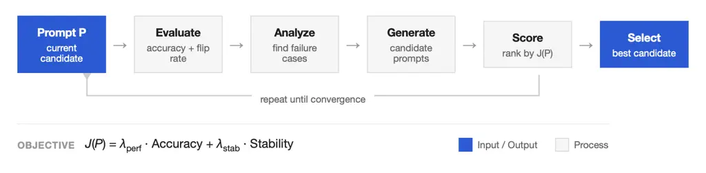
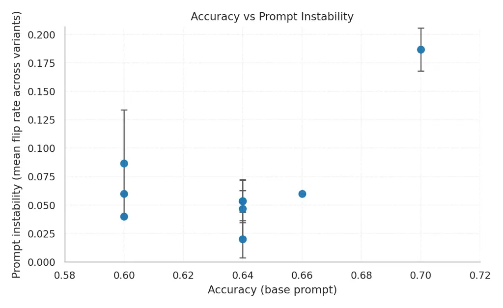
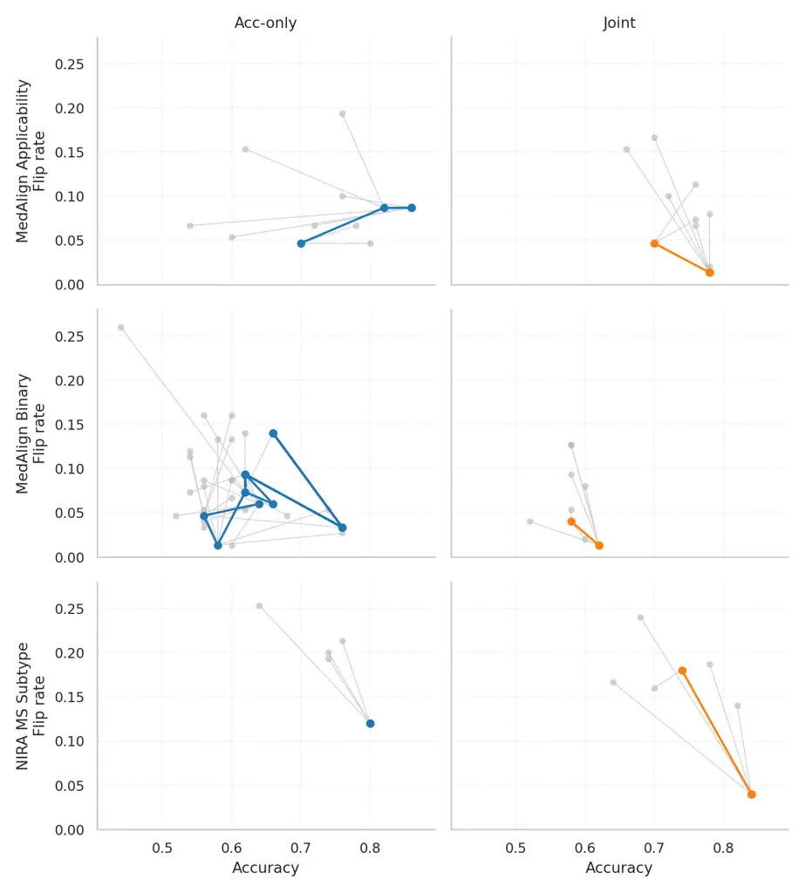
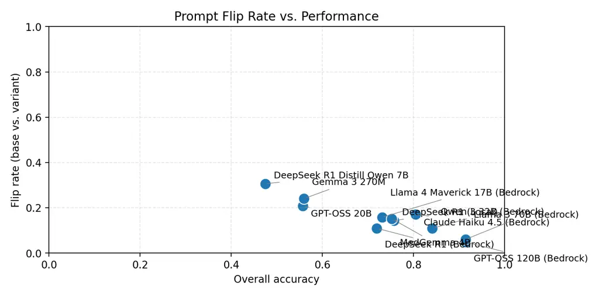
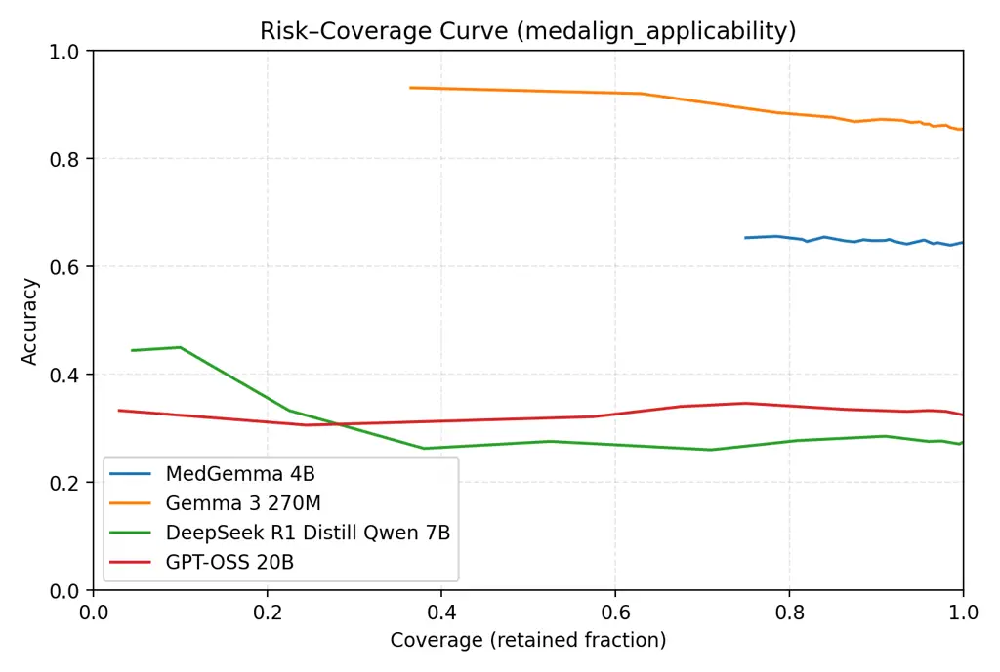

# Stability-Aware Prompt Optimization for Clinical Data Abstraction

Arinbjörn Kolbeinsson Affiliation: Century Health email:
<arinbjorn.kolbeinsson@century.health> , Daniel Timbie
Affiliation: Century Health email: <daniel.timbie@century.health> ,
Sajjan Narsinghani Affiliation: Century Health email:
<sajjan.narsinghani@century.health> and Sanjay Hariharan
Affiliation: Century Health email: <sanjay.hariharan@century.health>

###### Abstract.

Large language models used for clinical abstraction are sensitive to
prompt wording, yet most work treats prompts as fixed and studies
uncertainty in isolation. We argue these should be treated jointly.
Across two clinical tasks (MedAlign applicability/correctness and MS
subtype abstraction) and multiple open and proprietary models, we
measure prompt sensitivity via flip rates and relate it to calibration
and selective prediction. We find that higher accuracy does not
guarantee prompt stability, and that models can appear well-calibrated
yet remain fragile to paraphrases. We propose a dual-objective prompt
optimization loop that jointly targets accuracy and stability, showing
that explicitly including a stability term reduces flip rates across
tasks and models, sometimes at modest accuracy cost. Our results suggest
prompt sensitivity should be an explicit objective when validating
clinical LLM systems.

## 1. Introduction



Figure 1. Stability-aware prompt optimization loop. Starting from an
initial prompt, we evaluate accuracy and flip rate (measured across
paraphrased variants), identify failure cases, and use an LLM to
generate candidate prompts conditioned on these failures. Candidates are
scored on a joint objective balancing performance and stability, and the
best-scoring prompt is selected for the next iteration.

Large language models (LLMs) are increasingly used for clinical
abstraction over electronic health record (EHR) text, including
phenotype classification, applicability judgements, and response
correctness assessment. This work draws on our experience operating
CHARM, a production clinical abstraction system deployed at Century
Health for phenotype classification and chart review tasks. In deployed
systems, however, the model is only one part of the stack. The same
underlying model is wrapped in different prompts: vendor defaults,
institution-specific templates, and local tweaks by teams trying to
“make it behave.” In this setting, both predictive uncertainty and
prompt sensitivity, i.e., how much model behaviour changes under
semantically equivalent prompt edits, become central to safety and
trust. A system that appears well calibrated under one prompt but
becomes erratic under another is difficult to validate and harder to
monitor once deployed.

Most work on medical LLMs has focused on accuracy and, increasingly, on
calibration or abstention mechanisms, but largely treats the prompt as a
fixed design choice. Existing studies characterise calibration and
uncertainty on clinical QA or summarisation benchmarks, or explore
selective prediction policies that abstain when confidence is low, yet
they do so under a single prompt template and a single backend. As a
result, we know relatively little about how uncertainty estimates behave
when prompts change, or whether seemingly “well calibrated” models
remain reliable once the surface form of the instruction is perturbed.
This is problematic in realistic pipelines, where prompts differ between
vendors, are iteratively tweaked by domain experts, or must be adapted
to fit within product constraints.

In this paper we argue that, for clinical abstraction tasks where
correctness is judged against unstructured evidence such as note
excerpts or visit summaries, prompting and uncertainty should be treated
as a joint problem rather than as separate concerns. Concretely, we
study two grounded datasets and ask three questions: (i) how sensitive
are different open and proprietary backends to prompt wording at the
instance level on these tasks; (ii) how do standard uncertainty signals
(probabilities, conformal sets) behave under prompt perturbations; and
(iii) can we exploit sensitivity information to drive a dual-objective
prompt optimisation loop that trades off task performance against prompt
stability.

Our contributions are threefold.

- •
  We characterise prompt sensitivity across clinical abstraction tasks
  and multiple backends, measuring flip rates and calibration under
  prompt perturbations for both open-weight and proprietary models.
- •
  We analyse the relationship between prompt stability and model
  uncertainty, finding that stable predictions tend to be more
  confident, though uncertainty alone does not fully predict
  sensitivity.
- •
  We propose a dual-objective prompt optimisation loop that explicitly
  balances accuracy and stability, demonstrating that joint optimisation
  reduces flip rates across tasks and models.

## 2. Related work

### 2.1. Prompt sensitivity and multi-prompt evaluation

A growing body of work shows that LLM behaviour is highly sensitive to
seemingly minor changes in prompt wording. Zhuo et al. introduce ProSA,
a framework for prompt sensitivity analysis that operates at the
instance level, defining PromptSensiScore to quantify disagreement
across semantically equivalent prompts and relating this to decoding
confidence, model size, and task difficulty (Zhuo et al., 2024). ProSA
demonstrates that larger models are not uniformly more robust and that
subjective, judge-based evaluations are particularly vulnerable to
prompt perturbations on complex reasoning tasks.

At the task and benchmark level, Mizrahi et al. argue that single-prompt
evaluation is fundamentally unreliable, and call for multi-prompt LLM
evaluation (Mizrahi et al., 2024). They construct large sets of
paraphrased instructions for existing benchmarks and show that both
absolute scores and model rankings can change dramatically across
templates. They propose metrics such as maximum performance, average
performance and a combined score (CPS) to summarise behaviour over a
prompt set and highlight that current “state-of-the-art” claims are
highly prompt-dependent. Together, ProSA and multi-prompt evaluation
provide complementary evidence that prompt formulation is a major,
under-controlled source of variance, but they stop at measurement rather
than proposing concrete optimisation procedures.

Other work analyses prompt sensitivity in more specialised settings
(e.g. prompt engineering for natural language interfaces in software
visualisation or multimodal models), but these typically either rely on
small, domain-specific prompt sets or treat sensitivity qualitatively
rather than building an optimisation objective around it (Atzberger et
al., 2025). None of these studies connect prompt sensitivity to
uncertainty estimation or selective prediction, and none use sensitivity
signals to drive where to invest optimisation effort.

### 2.2. Prompt optimisation and robustness

A large literature targets automatic prompt optimisation for
performance, usually on standard NLP tasks, under a fixed train/test
distribution. Representative methods include RL-based optimisation of
discrete prompts (e.g. RLPrompt) and search-based or LLM-in-the-loop
rewriting approaches, which treat prompts as a policy to be tuned
against a task-specific reward. These methods almost exclusively
optimise a single metric such as accuracy, BLEU or task reward, and
ignore stability across paraphrases or distributional shifts.

More recently, several lines of work explicitly study robust prompt
optimisation. Li et al. formulate robust prompt optimisation under
distribution shift, arguing that prompts tuned on a labelled source
group often fail on an unlabelled target group; their Generalised Prompt
Optimisation (GPO) framework incorporates unlabelled target data to
improve worst-group performance while maintaining source performance (Li
et al., 2023). DRO-InstructZero treats instruction optimisation as a
distributionally robust optimisation problem, maximising worst-case
expected utility over an f-divergence ball around the evaluation
distribution to obtain prompts that are more reliable under real-world
uncertainty (Li, 2025). Closely related work in safety focuses on robust
optimisation of system prompts against jailbreaking or prompt injection
attacks, where the robustness objective is defined in terms of
adversarial success rather than semantic stability (e.g., BlackDAN: Wang
et al., 2024; AEGIS: Liu et al., 2025).

There is also an emerging strand of multi-objective prompt optimisation.
SoS (“Survival of the Safest”) introduces an evolutionary framework that
optimises prompts for both performance and safety (Sinha et al., 2024),
while ParetoPrompt formulates prompt optimisation as a multi-objective
reinforcement-learning problem, exploring a Pareto front of prompts that
trade off multiple metrics (Zhao et al., 2025). These methods show that
multi-objective formulations are useful in prompt optimisation, but they
typically focus on performance vs safety or efficiency, not on semantic
prompt stability.

Closest to our focus, Chen et al. introduce Prompt Stability Matters,
which argues that automatic prompt generators for general-purpose
multi-agent systems should account for prompt stability, defined as
consistency of model responses across repeated executions for the same
prompt (Chen et al., 2025). They propose semantic stability as a
criterion, train a LLaMA-based evaluator to score it, and build a
stability-aware prompt generation system that uses stability feedback to
improve both accuracy and output consistency. However, their notion of
stability is primarily about stochastic reproducibility of a fixed
prompt, rather than sensitivity to semantically equivalent prompt
variants for the same input, and their experiments are conducted on
general-purpose multi-agent workflows rather than clinical abstraction
tasks.

Finally, error-driven prompt refinement methods such as ProTeGi and PO2G
use feedback on model mistakes to update prompts, but still optimise a
single performance metric without explicit stability terms (Pryzant et
al., 2023; Lieander et al., 2025). We bridge these lines of work by
using instance-level sensitivity signals to guide prompt optimisation on
clinical abstraction tasks, connecting prompt stability to uncertainty
estimation in a way that existing frameworks do not.

## 3. Method

### 3.1. Problem setup and optimisation objective

In deployed clinical systems such as CHARM, prompt optimisation
typically involves iterative refinement with human feedback. Annotators
review model outputs, provide corrections, and the prompt is updated to
reduce errors on a labelled evaluation set. This process optimises for
task accuracy but does not explicitly account for prompt stability—the
extent to which predictions remain consistent under semantically
equivalent prompt rephrasings.

We extend this approach by formulating prompt optimisation as a
dual-objective problem. Let $`F(P)`$ denote the task performance (e.g.,
accuracy) of prompt $`P`$, and let $`S(P)`$ denote a stability measure
(e.g., negative flip rate). We optimise:

```math
J(P)=\lambda_{\text{perf}}\cdot F(P)+\lambda_{\text{stab}}\cdot S(P) \tag{1}
```

where $`\lambda_{\text{perf}}`$ and $`\lambda_{\text{stab}}`$ control
the trade-off between performance and stability. Setting
$`\lambda_{\text{stab}}=0`$ recovers accuracy-only optimisation; setting
both weights equal gives balanced joint optimisation.

### 3.2. Optimisation loop

We implement an LLM-in-the-loop optimisation procedure that iteratively
refines the prompt to improve the joint objective. Each iteration
proceeds as follows.

#### Evaluation.

Given the current prompt $`P`$, we run inference on a held-out
evaluation set to compute accuracy. To estimate stability, we generate
$`K`$ paraphrased variants of $`P`$ using an LLM and measure the flip
rate—the proportion of examples whose predictions change between the
base prompt and its paraphrases.

#### Failure identification.

We identify two types of failure cases: (i) high-flip examples, where
predictions are unstable across prompt variants, and (ii) misclassified
examples, where the base prompt prediction is incorrect. These cases
inform the next round of prompt generation.

#### Candidate generation.

An LLM proposes $`N`$ candidate prompts conditioned on the current
prompt, its performance metrics, and concrete failure examples. This
targeted feedback encourages edits that address specific error patterns
rather than generic rephrasings.

#### Selection.

Each candidate is scored on the joint objective $`J(P)`$. If the best
candidate improves over the current prompt, it is accepted; otherwise,
the iteration makes no update. The loop terminates after a fixed number
of iterations or when no improvement is found for several consecutive
rounds.

In our experiments, we compare accuracy-only optimisation
($`\lambda_{\text{stab}}=0`$) against joint optimisation
($`\lambda_{\text{perf}}=\lambda_{\text{stab}}=0.5`$) to isolate the
effect of the stability term.

### 3.3. Uncertainty signals and metrics

We extract uncertainty signals differently depending on model access.
For local HuggingFace models, we compute class probabilities from
per-token logprobs by taking a softmax over label scores, using the
top-class probability as a confidence estimate. For Bedrock-hosted
models, which provide only predicted labels, we rely on agreement across
prompt variants: flip rate serves as a proxy for prediction uncertainty.

For models with probability access, we construct conformal prediction
sets following standard split conformal inference. We use a
nonconformity score of $`1-P(\text{label})`$, set the coverage level to
$`\alpha=0.1`$, and partition the held-out set into calibration and
evaluation subsets (50/50 split). We report empirical coverage and
average set size.

We evaluate models along four dimensions: (i) _performance_—accuracy and
F1 by task, with log-loss and Brier score when probabilities are
available; (ii) _calibration_—reliability diagrams, expected calibration
error (ECE), and maximum calibration error (MCE); (iii)
_sensitivity_—flip rate between base and variant prompts, and
Jensen–Shannon divergence between prompt-induced distributions for
models with probability access; and (iv) _selective
prediction_—coverage–accuracy curves using probability thresholds or
conformal set size, abstaining when set size exceeds one or confidence
falls below a threshold.

### 3.4. Stability-Conditioned Uncertainty Analysis

To investigate whether prompt sensitivity manifests in model uncertainty
estimates, we analyze the relationship between per-example flip rates
and conformal prediction set sizes. This addresses a natural question:
do examples that are unstable under prompt perturbation also exhibit
higher predictive uncertainty?

#### Per-example flip indicator.

For each example $`x_{i}`$ in the evaluation set, let
$`\hat{y}_{i}^{(0)}`$ denote the prediction under the base prompt and
$`\hat{y}_{i}^{(k)}`$ the prediction under the $`k`$-th paraphrased
variant. We define the binary flip indicator and continuous flip rate
as:

```math
\text{flip}_{i}=\mathbf{1}\left[\exists k:\hat{y}_{i}^{(k)}\neq\hat{y}_{i}^{(0)}\right],\qquad\text{flip\_rate}_{i}=\frac{1}{K}\sum_{k=1}^{K}\mathbf{1}\left[\hat{y}_{i}^{(k)}\neq\hat{y}_{i}^{(0)}\right] \tag{2}
```

where $`K`$ is the number of prompt variants.

#### Conformal set size.

For models providing class probabilities, we construct conformal
prediction sets using the base prompt predictions. Following standard
split conformal inference (Vovk et al., 2005), we partition the held-out
set into calibration and evaluation subsets (50/50 split). For each
evaluation example $`x_{i}`$, the conformal set $`\mathcal{C}_{i}`$
contains all labels $`y`$ such that the nonconformity score
$`1-P(y\mid x_{i})`$ falls below the calibrated threshold at level
$`\alpha=0.1`$. We record the set size $`|\mathcal{C}_{i}|`$ and whether
the true label is covered, $`y_{i}\in\mathcal{C}_{i}`$.

#### Stratified analysis.

We partition examples into _stable_ ($`\text{flip}_{i}=0`$) and
_unstable_ ($`\text{flip}_{i}=1`$) groups and report: (i) mean conformal
set size per group, (ii) empirical coverage per group, and
(iii) Spearman rank correlation between $`\text{flip\_rate}_{i}`$ and
$`|\mathcal{C}_{i}|`$.

A positive correlation would indicate that model uncertainty, as
captured by conformal set size, reflects prompt sensitivity, suggesting
that standard uncertainty quantification partially accounts for
instability. Conversely, low or no correlation would imply that
calibration and prompt stability measure distinct phenomena, reinforcing
the need to optimize for both objectives independently.

This analysis is restricted to models with access to output
probabilities (local HuggingFace models). For API-based models providing
only predicted labels, we report group-level flip rates without
conformal conditioning.

## 4. Data

We study prompt sensitivity and uncertainty on two chart-grounded
clinical abstraction settings: MedAlign applicability and correctness,
and an internal multiple sclerosis (MS) subtype abstraction task derived
from the internal note corpus. In both cases, models must reason over
unstructured clinical text (visit notes, summaries) to produce labels
that reflect clinician judgement rather than surface form alone.

### 4.1. MedAlign

MedAlign is a clinician-generated benchmark for instruction following on
electronic medical records (EHRs) (Fleming et al., 2024). The dataset
contains 983 natural-language instructions written by 15 practising
clinicians across 7 specialties, paired with 276 longitudinal EHR
timelines. For 303 instruction-EHR pairs, clinicians provided reference
responses and ranked evaluations of six large language model outputs.
MedAlign is released as a test-only benchmark under a research data use
agreement and is designed to capture realistic information-seeking and
documentation needs rather than exam-style question answering.

We work with MedAlign v1.3, which includes two additional annotation
tables that we use to define our tasks. First, an applicability table
provides an is_applicable field indicating whether a given instruction
is actually supported by the information present in the chart. Second, a
clinician-reviewed responses table contains binary_correct labels
indicating whether a particular model response is judged correct or
incorrect given the same instruction and chart context.

From these tables we derive two binary classification tasks:

MedAlign applicability: “Is the instruction supported by the chart?”,
with labels {Yes, No} taken directly from is_applicable.

MedAlign correctness: “Does the model response align with clinician
judgement for this instruction and chart?”, with labels {Correct,
Incorrect} mapped from binary_correct $`\in\{0,1\}`$.

For each record we assemble a textual input consisting of the
instruction, the chart evidence, the clinician reference summary when
available, and the model response (for correctness). Chart evidence is
prefixed with a “Chart evidence:” header and separated from the
instruction and other sections by blank lines. When a response is
missing we insert the literal string “\<empty response\>” so that true
blanks can be distinguished from parsing errors. All text is decoded as
UTF-8 and we preserve original casing and punctuation. We drop rows with
invalid or missing labels and deduplicate records by instruction
identifier, model name and annotator, where applicable.

Because MedAlign is explicitly test-only, we do not use it for any
parameter tuning or prompt pre-training. Instead, we cap the evaluation
subset at 100 examples for applicability and 200 for correctness. For
each task we draw a single subset of labelled rows and use the same
subset and random 50/50 calibration–evaluation split across all models
and prompt variants. This design keeps comparisons fair while keeping
computational cost and manual inspection effort manageable.

### 4.2. MS subtype

Our second dataset is an internal EHR-derived corpus focusing on MS
subtype abstraction from neurology notes. Clinically, MS is commonly
described in terms of course phenotypes such as relapsing–remitting MS
(RRMS), primary progressive MS (PPMS) and secondary progressive MS
(SPMS), with clinically isolated syndrome and “not documented” or
“unspecified” categories also used in practice (Lublin et al., 2014;
Klineova and Lublin, 2018). In routine care, this information is often
encoded inconsistently across structured fields and free-text
documentation, which makes it a natural target for LLM-based
abstraction.

The MS subtype dataset is constructed from de-identified notes for
patients with a confirmed MS diagnosis. Each note, or visit-level bundle
of notes, is paired with a target label reflecting the documented
subtype at that time. For this study we formulate a six-way
classification problem with the label set: Clinically Isolated Syndrome
(CIS), Relapsing-Remitting MS (RRMS), Primary Progressive MS (PPMS),
Secondary Progressive MS (SPMS), Not Documented, and Unknown. Labels are
derived from a combination of structured phenotype modifiers and manual
review by domain experts. We do not use imaging or laboratory data, and
we do not attempt to infer latent phenotype from longitudinal
trajectories; the task is strictly to abstract what is documented in the
note.

All internal data notes are passed through an institutional
de-identification pipeline that removes direct identifiers (names, dates
of birth, contact details) and obvious quasi-identifiers. We retain
section headings and paragraph breaks but do not perform additional
clinical concept normalisation. As with MedAlign, we treat the dataset
as a held-out evaluation corpus for this study. To keep experiments
comparable in scale, we cap the internal data note evaluation subset at
100 notes per run. We again use a single held-out set shared across all
models and prompt variants, and apply a random 50/50
calibration–evaluation split for conformal prediction.

### 4.3. Task construction and edge cases

Across both datasets we focus on tasks where correctness is judged with
respect to unstructured evidence, not purely against pre-existing
structured labels. In MedAlign applicability, the ground-truth label
reflects whether the requested operation is supported by the chart as
presented. Some instructions are inherently non-applicable, for example,
tooling prompts or future protocol requests that cannot be resolved from
the current EHR snapshot, even though their phrasing appears reasonable.
These cases introduce a degree of annotation noise and highlight that
applicability judgements depend on chart coverage, not only on
linguistic plausibility.

In MedAlign correctness, labels reflect clinician assessments of
particular model outputs. Responses may be partially correct,
over-confident or hallucinated; the binary label encodes clinical
acceptability rather than exact string match to a reference. This makes
the task distribution different from generic question answering and
closer to real-world audit of model behaviour.

In the MS subtype, the “Not documented” class is intended to capture
notes where no explicit subtype is present. In practice, some notes
contain ambiguous or implicit descriptions of disease course. We retain
these borderline examples but flag them for sensitivity analyses, as
they are precisely the cases where over-interpretation by a model could
be harmful.

For all tasks we retain basic metadata such as anonymised patient or
visit identifiers, instruction identifiers and model names (for MedAlign
correctness). This enables stratified analyses by visit, instruction
type or source model, and supports future work on temporal drift and
per-patient aggregation.

### 4.4. Ethical and privacy considerations

Both tasks involve sensitive clinical information. MedAlign is
de-identified and provided under a research data use agreement by its
original authors, who explicitly position it as a test-only benchmark
(Fleming et al., 2024). We follow this guidance and do not attempt to
reconstruct or augment the underlying EHR data. The MS subtype corpus is
derived from an internal EHR system and is de-identified under the host
institution’s governance processes. Access is restricted under an
internal data-use protocol that prohibits re-identification attempts and
external sharing of raw notes. All experiments in this work are
observational and retrospective; we do not generate patient-facing
outputs, and we use the datasets solely to study model behaviour,
uncertainty and prompt sensitivity.

## 5. Experiments and results

### 5.1. E1: Stability and Model Certainty

To test whether prompt stability relates to model certainty, we analyze
the relationship between per-example flip rates and prediction margin
(the difference between top-two class probabilities). For each example,
we compute the flip rate across $`K=3`$ prompt variants and the margin
from the base prompt’s output distribution.

Figure 2 shows results for MedGemma 4B on MedAlign applicability as box
plots grouped by flip rate. Examples that never flip (flip rate = 0)
have margins concentrated near 1.0, indicating high confidence. As flip
rate increases, median margin decreases and variability grows. This
pattern supports the intuition that stable predictions are more
trustworthy: when the model is certain, it is also robust to prompt
variation.

Figure 2. Prediction margin versus flip rate for MedGemma 4B on MedAlign
applicability. Stable examples (flip rate = 0) have high margins,
indicating confident predictions. As flip rate increases, margins
decrease and become more variable, suggesting that uncertain predictions
are more prone to flipping under prompt variation.

### 5.2. E2: Accuracy Does Not Guarantee Stability

A natural question is whether improving accuracy automatically improves
prompt stability. To test this, we generate multiple semantically
equivalent prompt variants for a single task and model, evaluate each on
accuracy and flip rate, and examine whether higher-accuracy prompts are
also more stable.

Figure 3 shows results for Llama 3 70B on MedAlign applicability. Each
point represents a candidate prompt; the x-axis shows accuracy and the
y-axis shows mean flip rate across $`K=3`$ paraphrased variants. If
accuracy implied stability, we would expect a negative correlation with
points concentrated in the upper-left (low accuracy, high flip) and
lower-right (high accuracy, low flip) regions.

Instead, we observe substantial vertical spread: prompts with similar
accuracy can have very different flip rates. Some high-accuracy prompts
are unstable (upper-right region), while some lower-accuracy prompts are
relatively stable. This decoupling suggests that optimizing for accuracy
alone does not guarantee prompt robustness, motivating explicit
stability objectives. We observe similar patterns across tasks and
models.



Figure 3. Accuracy vs flip rate for MedAlign applicability using Llama 3
70B. Each point is one candidate prompt; the y-axis is the mean flip
rate across three paraphrased variants. The vertical spread at similar
accuracy levels illustrates that improving accuracy alone does not
guarantee prompt stability.

### 5.3. E3: Joint Optimization Improves Stability

We run the stability-aware prompt optimizer across three clinical tasks
(MedAlign applicability, MedAlign correctness, and MS subtype) using
three Bedrock models (Claude Haiku 4.5, Llama-4 Maverick, GPT-OSS-20B).
Each setting is repeated with three random seeds on a fixed stratified
subset ($`N=50`$). We compare accuracy-only optimization
($`\lambda_{\text{perf}}=1,\ \lambda_{\text{stab}}=0`$) against joint
optimization ($`\lambda_{\text{perf}}=\lambda_{\text{stab}}=0.5`$).
Table 1 reports mean $`\pm`$ std over seeds for end-of-run accuracy and
flip rate. Figure 4 visualizes the optimization trajectories across all
tasks and models.

Across the nine model-task combinations, joint optimization improves
stability in eight cases. The largest gains occur when baseline
stability is poor: for Llama-4 Maverick on MedAlign applicability, flip
rate drops from 0.309 to 0.036, and for GPT-OSS-20B on MedAlign
correctness, from 0.453 to 0.262. The accuracy trade-off varies: in some
cases (GPT-OSS-20B on MS subtype) accuracy slightly improves under joint
optimization, while in others (Llama-4 Maverick on applicability) it
decreases. The one exception is Haiku on MS subtype, where baseline
stability is already high and joint optimization shows no additional
benefit.

| Task / Model           | Setting  | Acc. (end)          | Flip (end)          |
| ---------------------- | -------- | ------------------- | ------------------- |
| MedAlign Applicability |          |                     |                     |
| Haiku 4.5              | Acc-only | 0.827 $`\pm`$ 0.047 | 0.078 $`\pm`$ 0.017 |
| Haiku 4.5              | Joint    | 0.787 $`\pm`$ 0.025 | 0.047 $`\pm`$ 0.025 |
| Llama-4 Maverick       | Acc-only | 0.633 $`\pm`$ 0.025 | 0.309 $`\pm`$ 0.098 |
| Llama-4 Maverick       | Joint    | 0.527 $`\pm`$ 0.009 | 0.036 $`\pm`$ 0.014 |
| GPT-OSS-20B            | Acc-only | 0.653 $`\pm`$ 0.041 | 0.249 $`\pm`$ 0.067 |
| GPT-OSS-20B            | Joint    | 0.647 $`\pm`$ 0.047 | 0.242 $`\pm`$ 0.025 |
| MedAlign Correctness   |          |                     |                     |
| Haiku 4.5              | Acc-only | 0.680 $`\pm`$ 0.059 | 0.089 $`\pm`$ 0.044 |
| Haiku 4.5              | Joint    | 0.653 $`\pm`$ 0.062 | 0.018 $`\pm`$ 0.006 |
| Llama-4 Maverick       | Acc-only | 0.607 $`\pm`$ 0.019 | 0.229 $`\pm`$ 0.090 |
| Llama-4 Maverick       | Joint    | 0.573 $`\pm`$ 0.034 | 0.169 $`\pm`$ 0.031 |
| GPT-OSS-20B            | Acc-only | 0.580 $`\pm`$ 0.043 | 0.453 $`\pm`$ 0.043 |
| GPT-OSS-20B            | Joint    | 0.533 $`\pm`$ 0.009 | 0.262 $`\pm`$ 0.041 |
| MS Subtype             |          |                     |                     |
| Haiku 4.5              | Acc-only | 0.833 $`\pm`$ 0.025 | 0.073 $`\pm`$ 0.048 |
| Haiku 4.5              | Joint    | 0.840 $`\pm`$ 0.016 | 0.082 $`\pm`$ 0.030 |
| Llama-4 Maverick       | Acc-only | 0.767 $`\pm`$ 0.062 | 0.220 $`\pm`$ 0.000 |
| Llama-4 Maverick       | Joint    | 0.680 $`\pm`$ 0.028 | 0.196 $`\pm`$ 0.047 |
| GPT-OSS-20B            | Acc-only | 0.873 $`\pm`$ 0.009 | 0.171 $`\pm`$ 0.017 |
| GPT-OSS-20B            | Joint    | 0.880 $`\pm`$ 0.016 | 0.156 $`\pm`$ 0.003 |

Table 1. E3 sweep results: accuracy-only vs joint optimization (mean
$`\pm`$ std over 3 seeds). Joint optimization consistently reduces flip
rate, with variable accuracy trade-offs depending on model and task.

Figure 4. Summary of E3 optimizer sweeps across tasks and models. Each
segment shows the mean start$`\rightarrow`$end trajectory (3 seeds) in
accuracy–flip space; endpoints include error bars. Color encodes model;
line style/marker encodes objective (accuracy-only vs joint). Adding a
stability term systematically shifts endpoints toward lower flip rates,
often with modest accuracy trade-offs.

## 6. Discussion

Our results support three main findings about prompt stability in
clinical LLM systems, which we summarize below and then discuss in terms
of their practical implications.

#### Accuracy and stability are decoupled at the prompt level.

E2 demonstrates that within a single model, prompts with similar
accuracy can have very different flip rates. This is distinct from the
model-level trend (Appendix, Figure 7) where larger models tend to be
both more accurate and more stable. The implication is that selecting a
capable model does not guarantee prompt-level robustness; prompt
engineering must explicitly account for stability.

#### Stability correlates with model certainty.

E1 shows that stable examples, those whose predictions do not flip under
prompt paraphrases, tend to have higher prediction margins (Spearman
$`\rho=0.204`$ between margin and stability). This supports the
intuition that confident predictions are more trustworthy: when the
model is certain, it is also more robust to prompt variation. However,
the correlation is modest, indicating that certainty alone is not a
reliable proxy for stability.

#### Stability is optimizable.

E3 demonstrates that adding an explicit stability term to the
optimization objective improves stability in 8 of 9 model-task
combinations, sometimes with modest accuracy trade-offs. This suggests
that prompt stability should be treated as a first-class objective
rather than assumed to follow from accuracy improvements.

#### Bridging prompt sensitivity and prompt optimization.

Prior work on prompt sensitivity (Zhuo et al., 2024; Mizrahi et al., 2024) establishes that LLM behavior varies substantially across
paraphrased instructions, but stops at measurement. Separately, prompt
optimization methods (Pryzant et al., 2023; Li et al., 2023) focus on
improving accuracy without accounting for stability. Our work bridges
these literatures by using sensitivity signals to drive optimization,
showing that stability can be explicitly targeted rather than merely
observed.

#### A complementary signal for clinical AI validation.

Current best practices for validating clinical LLM systems emphasize
accuracy, calibration, and selective prediction (Fleming et al., 2024).
Our findings suggest prompt stability should be added to this checklist.
A system may appear well-calibrated under its development prompt yet
behave erratically when that prompt is paraphrased by a downstream team.
Stability testing provides a complementary validation signal that
existing metrics do not capture.

#### Implications for multi-team deployment.

In realistic clinical deployments, the same underlying model is often
wrapped in different prompts by different stakeholders: vendor defaults,
institution-specific templates, and local modifications by clinical
informaticists. Our results suggest this practice carries hidden risk. A
prompt validated by one team may become unstable when another team makes
seemingly innocuous edits. Explicitly optimizing for stability, or at
minimum measuring it, could reduce unexpected failures when prompts
drift across teams or over time.

#### Stability as a trust signal.

The correlation between stability and model certainty (E1) suggests a
practical heuristic: predictions that are robust to prompt variation may
be more trustworthy than those that flip. This aligns with intuitions
from ensemble methods, where agreement across models signals
reliability. Here, agreement across prompts serves an analogous role.
While the correlation is modest, it provides initial evidence that
stability could inform selective prediction policies, abstaining on
examples that are both uncertain and prompt-sensitive.

#### Integration into production.

These findings have informed ongoing development of the CHARM system at
Century Health, where stability metrics are now tracked alongside
accuracy during prompt validation. When prompts are updated or new
models are evaluated, we measure flip rates across paraphrased variants
as part of the release process, flagging prompts that show high
instability for additional review before deployment.

### 6.1. Limitations

#### Scale.

Our experiments use capped evaluation sets (50–200 examples per task)
and only $`k=3`$ prompt paraphrases for flip rate estimation. The
stability-calibration correlation ($`\rho=0.204`$, $`p=0.056`$) is
borderline significant, and larger samples may reveal stronger or weaker
relationships. The E3 sweeps use $`N=50`$ examples with 3 seeds, which
limits statistical power for detecting small effects.

#### Paraphrase generation.

Flip rates depend on the paraphrases used. We generate variants via LLM
rewriting, which may not reflect the full range of prompt variations
encountered in deployment (e.g., vendor templates, institution-specific
formatting, non-native speaker phrasings). The stability we measure is
relative to our paraphrase distribution, not absolute.

#### Stability-calibration analysis restricted to HF models.

The E1 analysis joining flip rates with conformal set sizes is only
possible for models providing output probabilities (HuggingFace). For
Bedrock models (Claude, Llama, Qwen), we can measure flip rates but
cannot assess the stability-calibration relationship. This limits
generalizability to API-based deployments.

#### Single optimization method.

We evaluate one LLM-in-the-loop optimizer architecture. We did not
compare against alternative prompt optimization methods (evolutionary
search, gradient-based, random search), so we cannot claim our specific
approach is optimal, only that incorporating a stability term into
_some_ optimization objective is beneficial.

#### No downstream clinical validation.

We show that joint optimization reduces flip rates, but we do not
demonstrate that this translates to improved clinical outcomes or
reduced harm. The link between prompt stability and patient safety
remains indirect.

#### Task scope.

Our experiments cover two clinical abstraction settings (MedAlign and MS
subtype). Generalization to other clinical NLP tasks, such as entity
extraction, temporal reasoning, or multi-document summarization, remains
untested.

## References

- Atzberger et al. (2025) D. Atzberger, A. Jobst, M. Tytarenko, W.
  Scheibel, J. Döllner, and T. Schreck Analyzing the sensitivity of
  prompt engineering techniques in natural language interfaces for 2.5d
  software visualization. In WWW Companion ’25: Companion Proceedings of
  the ACM Web Conference 2025, pp. 1591–1595. Note: Appears in the WWW
  Companion proceedings (workshop context: Prompt Engineering for
  Pre-Trained Language Models). External Links:
  [Document](https://dx.doi.org/10.1145/3701716.3717813) Cited by: §2.1.
- Chen et al. (2025) K. Chen, Y. Zhou, X. Zhang, and H. Wang Prompt
  stability matters: evaluating and optimizing auto-generated prompt in
  general-purpose systems. arXiv. External Links: 2505.13546 Cited by:
  §2.2.
- Fleming et al. (2024) S. L. Fleming, A. Lozano, W. J. Habber, A. S.
  Jindal, E. P. Reis, R. Thapa, L. Blankemeier, J. Z. Genkins, E.
  Steinberg, A. Nayak, B. Patel, C. Chiang, A. Callahan, Z. Huo, S.
  Gatidis, S. J. Adams, O. Fayanju, S. J. Shah, T. Savage, E. Goh, A. S.
  Chaudhari, N. Aghaeepour, C. Sharp, M. A. Pfeffer, P. Liang, J. H.
  Hsieh, C. Piech, and N. H. Shah MedAlign: a clinician-generated
  dataset for instruction following with electronic medical records.
  Proceedings of the AAAI Conference on Artificial Intelligence 38 (20),
  pp. 22021–22030. External Links:
  [Document](https://dx.doi.org/10.1609/aaai.v38i20.30205) Cited by:
  §4.1, §4.4, §6.
- Klineova and Lublin (2018) S. Klineova and F. D. Lublin Clinical
  course of multiple sclerosis. Cold Spring Harbor Perspectives in
  Medicine 8 (9), pp. a028928. External Links:
  [Document](https://dx.doi.org/10.1101/cshperspect.a028928) Cited by:
  §4.2.
- Li et al. (2023) M. Li, W. Wang, F. Feng, Y. Cao, J. Zhang, and T.
  Chua Robust prompt optimization for large language models against
  distribution shifts. In Proceedings of the 2023 Conference on
  Empirical Methods in Natural Language Processing (EMNLP 2023),
  pp. 1539–1554. External Links:
  [Document](https://dx.doi.org/10.18653/v1/2023.emnlp-main.95) Cited
  by: §2.2, §6.
- Li (2025) Y. Li DRO-InstructZero: distributionally robust prompt
  optimization for large language models. arXiv. External Links:
  2510.15260 Cited by: §2.2.
- Lieander et al. (2025) A. J. Lieander, H. Wang, and K. Rafferty Prompt
  optimization with two gradients for classification in large language
  models. AI 6 (8), pp. 182. External Links:
  [Document](https://dx.doi.org/10.3390/ai6080182) Cited by: §2.2.
- Liu et al. (2025) T. Liu, C. Hsu, K. Lee, C. Fu, and H. Lee AEGIS:
  automated co-evolutionary framework for guarding prompt injections
  schema. arXiv. External Links: 2509.00088 Cited by: §2.2.
- Lublin et al. (2014) F. D. Lublin, S. C. Reingold, J. A. Cohen, G. R.
  Cutter, P. S. Sørensen, A. J. Thompson, J. S. Wolinsky, L. J.
  Balcer, B. Banwell, F. Barkhof, et al. Defining the clinical course of
  multiple sclerosis: the 2013 revisions. Neurology 83 (3), pp. 278–286.
  External Links:
  [Document](https://dx.doi.org/10.1212/WNL.0000000000000560) Cited by:
  §4.2.
- Mizrahi et al. (2024) M. Mizrahi, G. Kaplan, D. Malkin, R. Dror, D.
  Shahaf, and G. Stanovsky State of what art? a call for multi-prompt
  LLM evaluation. Transactions of the Association for Computational
  Linguistics 12, pp. 933–949. External Links:
  [Document](https://dx.doi.org/10.1162/tacl%5Fa%5F00681) Cited by:
  §2.1, §6.
- Pryzant et al. (2023) R. Pryzant, D. Iter, J. Li, Y. T. Lee, C. Zhu,
  and M. Zeng Automatic prompt optimization with “gradient descent” and
  beam search. In Proceedings of the 2023 Conference on Empirical
  Methods in Natural Language Processing (EMNLP 2023), pp. 7957–7968.
  External Links:
  [Document](https://dx.doi.org/10.18653/v1/2023.emnlp-main.494) Cited
  by: §2.2, §6.
- Sinha et al. (2024) A. Sinha, W. Cui, K. Das, and J. Zhang Survival of
  the safest: towards secure prompt optimization through interleaved
  multi-objective evolution. In Proceedings of the 2024 Conference on
  Empirical Methods in Natural Language Processing: Industry Track,
  pp. 1016–1027. External Links:
  [Document](https://dx.doi.org/10.18653/v1/2024.emnlp-industry.76)
  Cited by: §2.2.
- Vovk et al. (2005) V. Vovk, A. Gammerman, and G. Shafer Algorithmic
  learning in a random world. Springer. Cited by: §3.4.
- Wang et al. (2024) X. Wang, V. S. Huang, R. Chen, H. Wang, C. Pan, L.
  Sha, and M. Huang BlackDAN: a black-box multi-objective approach for
  effective and contextual jailbreaking of large language models. arXiv.
  External Links: 2410.09804 Cited by: §2.2.
- Zhao et al. (2025) G. Zhao, B. Yoon, G. Park, S. Jha, S. Yoo, and X.
  Qian Pareto prompt optimization. In International Conference on
  Learning Representations (ICLR) 2025, Note: Conference proceedings
  paper. External Links:
  [Link](https://proceedings.iclr.cc/paper_files/paper/2025/hash/13b45b44e26c353c64cba9529bf4724f-Abstract-Conference.html)
  Cited by: §2.2.
- Zhuo et al. (2024) J. Zhuo, S. Zhang, X. Fang, H. Duan, D. Lin, and K.
  Chen ProSA: assessing and understanding the prompt sensitivity of
  LLMs. In Findings of the Association for Computational Linguistics:
  EMNLP 2024, pp. 1950–1976. External Links:
  [Document](https://dx.doi.org/10.18653/v1/2024.findings-emnlp.108)
  Cited by: §2.1, §6.

## Appendix

### PSS Validation

To validate our anchor-based flip-rate metric against the published
ProSA framework, we compute the ProSA-style instance-level prompt
sensitivity score (PSS) on a small subset using a base prompt plus
$`k=3`$ paraphrases. Figure 5 shows a strong correlation between
flip-rate and PSS (5 prompts, MedAlign applicability with Haiku),
indicating our simpler anchor-based metric tracks the symmetric PSS
measure.

Figure 5. Flip-rate vs. ProSA-style PSS on a 50-example subset (5
prompts, $`k=3`$ paraphrases). The strong correlation validates our
anchor-based flip-rate as a practical proxy for the symmetric PSS
metric.

### Optimizer Trajectories

Figure 6 shows representative optimizer trajectories in
accuracy–flip-rate space, comparing accuracy-only and joint optimization
settings across tasks. Each panel traces the sequence of accepted
prompts, while faint grey candidate points and connectors illustrate the
local search space explored at each iteration. Rows correspond to tasks
and columns to the optimization setting (accuracy-only vs. joint
accuracy-stability). These trajectories visualize how the optimization
dynamics differ under the two objectives: accuracy-only runs tend to
move horizontally (improving accuracy without regard for stability),
while joint optimization traces paths that also push downward in
flip-rate.



Figure 6. Optimizer trajectories for Claude Haiku 4.5 (seed 1). Each
panel shows accepted prompts (solid line) and candidate proposals (faint
grey) in accuracy–flip-rate space. Left column: accuracy-only
optimization; right column: joint optimization. Rows: MedAlign
applicability (top), MedAlign binary (middle), MS subtype (bottom).

### Model-Level Sensitivity and Calibration

While our main experiments focus on the relationship between stability
and uncertainty at the example level, we also examined model-level
patterns. Figure 7 shows flip rate versus accuracy across models on
MedAlign applicability. Larger models tend to occupy the high-accuracy,
low-flip region, while smaller models cluster in the low-accuracy,
high-flip corner. This model-level trend suggests that capacity
improvements benefit both metrics, but does not guarantee prompt-level
stability within a given model (see E2).



Figure 7. Flip rate vs accuracy trade-off across models on MedAlign
applicability. Larger models tend to be both more accurate and more
stable at the model level, though this does not guarantee prompt-level
stability.

Figure 8 shows conformal prediction coverage and set size trade-offs
across HuggingFace models. Models achieve similar coverage targets
($`\sim`$0.90–0.97) with varying abstention costs (set sizes),
illustrating that calibration quality differs substantially across
backends.



Figure 8. Conformal prediction results on MedAlign applicability across
HuggingFace models. Coverage targets can be met with very different
abstention costs and retained accuracy.
