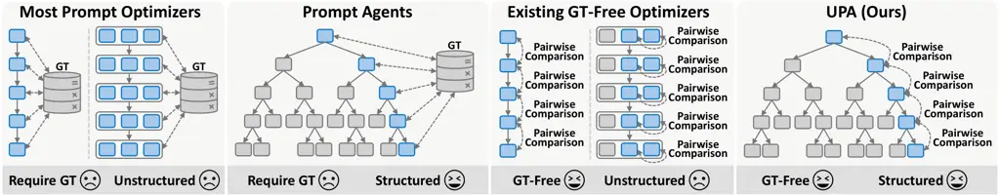
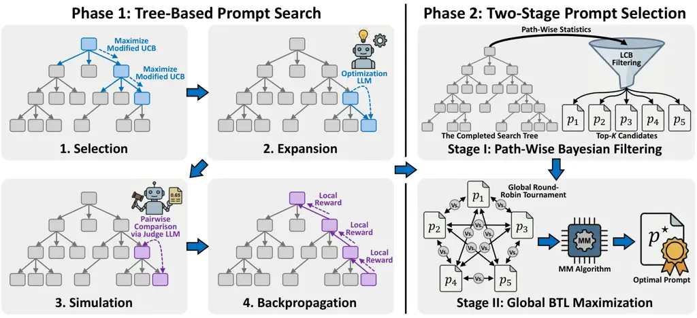
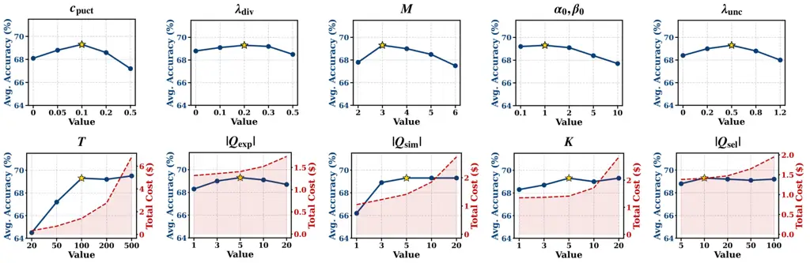
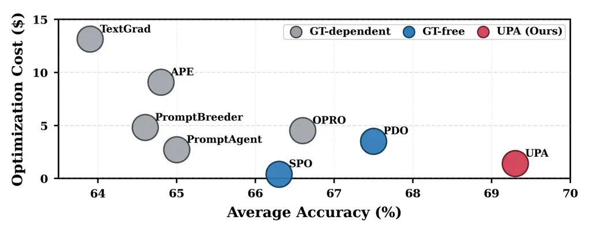
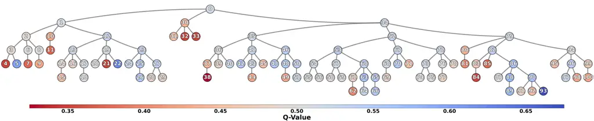
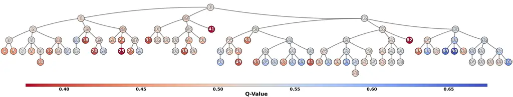
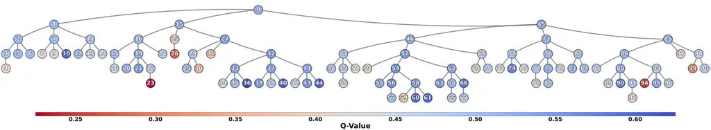
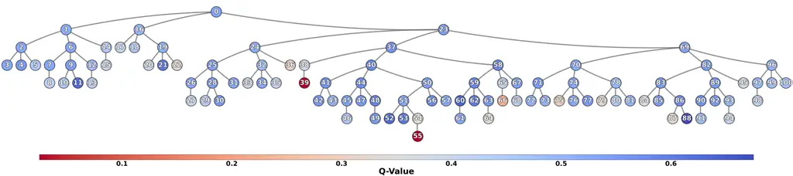
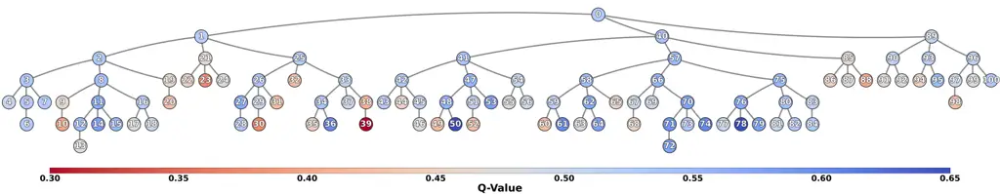

# UPA: Unsupervised Prompt Agent via Tree-Based Search and Selection

Siran Peng    Weisong Zhao    Tianyu Fu    Chenxu Zhao    Tianshuo Zhang
   Haoyuan Zhang    Xiangyu Zhu    Minghui Wu Affiliation: Equal
contribution.  Corresponding author.    Zhen Lei Affiliation: MAIS,
CASIA  SAI, UCAS  Mininglamp Technology  IIE, CAS  SCSE, FIE,
M.U.S.T{pengsiran2023, zhen.lei}@ia.ac.cn, zhaoweisong@iie.ac.cn,
{futianyu, wuminghui}@mininglamp.com Affiliation: Equal contribution.
 Corresponding author.

###### Abstract

Prompt agents have recently emerged as a promising paradigm for
automated prompt optimization, framing prompt discovery as a sequential
decision-making problem over a structured prompt space. While this
formulation enables the use of advanced planning algorithms, these
methods typically assume access to supervised reward signals, which are
often unavailable in practical scenarios. In this work, we propose UPA,
an Unsupervised Prompt Agent that realizes structured search and
selection without relying on ground-truth (GT) rewards. Specifically,
during search, UPA iteratively constructs an evolving tree structure to
navigate the prompt space, guided by fine-grained and position-debiased
pairwise comparisons from Large Language Models (LLMs). Crucially, as
these local comparisons do not inherently yield a consistent global
scale, we decouple systematic prompt exploration from final selection,
introducing a two-stage framework grounded in the Bradley-Terry-Luce
(BTL) model. This framework first performs path-wise Bayesian
aggregation of local comparisons to filter candidates under uncertainty,
followed by global tournament-style comparisons to infer latent prompt
quality and identify the optimal prompt. Experiments across multiple
tasks demonstrate that UPA consistently outperforms existing prompt
optimization methods, showing that agent-style optimization can remain
highly effective even in unsupervised settings.

## 1 Introduction

Well-designed prompts are critical for maximizing the capabilities of
Large Language Models (LLMs) \[1, 2\]. However, crafting effective
prompts often requires substantial trial-and-error and deep
task-specific expertise. To alleviate this burden, researchers have
developed a wide range of automated prompt optimization methods that
leverage LLMs themselves to iteratively improve prompt quality \[3, 4,
5, 6, 7, 8, 9, 10, 11\]. As depicted in Figure 1, most existing
approaches perform unstructured searches. Specifically, they navigate
the prompt space using either single-trajectory updates \[5, 10, 11\] or
flat exploration strategies based on candidate pools or populations \[3,
7, 8\]. In contrast, prompt agents have recently emerged as a promising
paradigm that frames the optimization process as a sequential
decision-making problem over a structured prompt space \[12, 13\]. By
maintaining explicit tree topologies and exploring diverse search
trajectories, prompt agents enable systematic planning and backtracking,
ultimately facilitating more robust and adaptive prompt discovery.



Figure 1: Comparison of prompt optimization paradigms, including most
prompt optimizers, existing prompt agents \[12, 13\], existing GT-free
optimizers \[14, 15, 16\], and the proposed UPA. Unlike prior methods,
UPA uniquely achieves structured exploration in a fully GT-free setting.

Despite the success of automated prompt optimization, most existing
methods rely heavily on ground-truth (GT) reward signals, which are
typically derived from labeled data or task-specific metrics. Such
signals are often unavailable in practical scenarios, particularly for
open-ended or user-specific tasks where prompt quality is inherently
difficult to quantify. Recent GT-free optimizers address this limitation
by replacing absolute rewards with LLM-based pairwise comparisons: SPO
\[14\] performs reference-free single-path refinement, while DEEVO
\[15\] and PDO \[16\] select and mutate prompts within flat candidate
sets. While these methods demonstrate that relative preferences can
effectively guide unstructured prompt search, it remains unclear whether
such locally defined feedback can sustain multi-path exploration and
cross-branch selection in tree-structured prompt agents.

Motivated by these observations, we ask a fundamental question: Can
prompt agents be realized in fully GT-free settings? To address this
question, we propose UPA, an Unsupervised Prompt Agent that enables
structured search and selection over the prompt space without relying on
GT rewards. Specifically, during the search phase, UPA iteratively
constructs an evolving tree structure to navigate the candidate space,
where each node denotes a candidate prompt and each edge corresponds to
a refinement step performed by an optimization LLM. This structure
allows UPA to preserve explicit parent-child refinement paths, enabling
path-aware exploration beyond unstructured search. Instead of computing
absolute rewards, UPA utilizes a judge LLM to conduct fine-grained and
position-debiased pairwise comparisons, providing relative preferences
between a child prompt and its parent based on their performance on
sampled inputs. Crucially, since these local comparisons do not
inherently yield a consistent global ranking, UPA decouples prompt
exploration from final selection. This necessitates a two-stage
selection procedure grounded in the Bradley-Terry-Luce (BTL) model \[17,
18\]. In the first stage, UPA performs path-wise Bayesian aggregation of
noisy and sparse comparison outcomes to obtain uncertainty-aware
estimates of prompt quality, filtering the tree to a promising subset of
candidates. In the second stage, UPA conducts global tournament-style
comparisons among these candidates, estimating their latent quality
scores via BTL-based maximum likelihood estimation to identify the
optimal prompt. In conclusion, the main contributions of this paper are
as follows:

- •
  We propose UPA, an Unsupervised Prompt Agent that realizes structured
  search and selection over the prompt space without relying on GT
  rewards. This addresses a critical limitation in existing agent-style
  prompt optimization, which strictly requires absolute rewards to guide
  exploration.
- •
  We develop a tree-based search procedure that systematically explores
  the candidate space via fine-grained and position-debiased pairwise
  comparisons provided by a judge LLM. This is tightly coupled with a
  novel two-stage selection framework grounded in the BTL model, which
  enables robust and accurate prompt identification under noisy and
  sparse relative feedback conditions.
- •
  Through comprehensive experiments across diverse closed-ended and
  open-ended tasks, we demonstrate that UPA consistently outperforms
  state-of-the-art (SOTA) prompt optimizers, showing that agent-style
  prompt optimization can remain highly effective even in fully GT-free
  settings.

## 2 Methodology

### 2.1 Problem Setting & Overview

Let $`\mathcal{P}`$ denote the discrete space of natural language
prompts and $`\mathcal{Q}`$ a distribution over task queries. Given a
prompt $`p\in\mathcal{P}`$ and a query $`q\sim\mathcal{Q}`$, an
execution LLM produces a response $`a=f_{\text{exec}}(p,q)`$. The goal
of prompt optimization is to identify an optimal prompt
$`p^{\star}\in\mathcal{P}`$ that maximizes the expected response
quality. In this work, we consider an unsupervised setting where no GT
reward function is available. Instead, supervision is provided
exclusively through noisy pairwise comparisons between responses. As a
result, existing prompt agents that rely on supervised rewards are not
applicable.

To address this challenge, we propose UPA, an unsupervised prompt agent
guided by fine-grained and position-debiased pairwise comparisons from a
judge LLM, $`f_{\text{judge}}`$ (Sec. 2.2). As shown in Figure 2, UPA
decouples prompt optimization into two phases: search and selection.
During the search phase, UPA explores the prompt space via a tree-based
strategy to generate candidates and accumulate sparse pairwise
comparison data (Sec. 2.3). In the selection phase, to identify the
optimal prompt $`p^{\star}`$ from these noisy observations, UPA employs
a two-stage framework grounded in the BTL model (Sec. 2.4).
Specifically, path-wise Bayesian filtering is first applied to prune the
search tree to the top-$`K`$ candidates (Sec. 2.5), followed by global
BTL maximization to infer the final prompt (Sec. 2.6). The complete
procedures for the search and selection phases are summarized in
Algorithms 1 and 2.



Figure 2: Overview of UPA. Our method decouples prompt optimization into
two phases: search and selection. During search, UPA explores the prompt
space using a tree-based framework driven by relative feedback. In the
selection phase, it employs a two-stage strategy: path-wise Bayesian
filtering to prune the search tree, followed by global BTL maximization
to infer the optimal prompt.

### 2.2 Fine-Grained and Position-Debiased Pairwise Comparison

Given two prompts $`p_{i},p_{j}\in\mathcal{P}`$ and a query $`q`$, the
execution LLM generates responses $`a_{i}=f_{\text{exec}}(p_{i},q)`$ and
$`a_{j}=f_{\text{exec}}(p_{j},q)`$. The judge LLM $`f_{\text{judge}}`$
then evaluates their relative quality as follows:

Five-Point Likert Scale. We quantify pairwise preferences using a
discrete Likert scale $`\mathcal{S}=\{1,\dots,5\}`$, following the
common practice of eliciting numerical judgments from LLM evaluators
\[19\]. Specifically, 5 signifies a strong preference for the first
response, 1 denotes a strong preference for the second, and 3 represents
a tie. Compared with coarse binary decisions, this scale retains
fine-grained preference intensity by distinguishing strong preferences,
slight preferences, and ties.

Positional Bias Mitigation. LLMs exhibit inherent positional bias, often
favoring the first-presented option regardless of response quality. To
mitigate this bias, we evaluate each candidate pair in both presentation
orders. This yields a forward score
$`s_{i,j}=f_{\text{judge}}(a_{i},a_{j},q)\in\mathcal{S}`$ and a reverse
score $`s_{j,i}=f_{\text{judge}}(a_{j},a_{i},q)\in\mathcal{S}`$. Since
the Likert scale is symmetric, the reverse score $`s_{j,i}`$ is
converted to $`6-s_{j,i}`$ from the perspective of $`a_{i}`$. Thus, the
debiased preference score $`\tilde{s}_{i,j}^{(q)}`$ is computed as:

```math
\tilde{s}_{i,j}^{(q)}=\frac{1}{2}\left(f_{\text{judge}}(a_{i},a_{j},q)+\left[6-f_{\text{judge}}(a_{j},a_{i},q)\right]\right). \tag{1}
```

Normalization and Fractional-Response Modeling. To aggregate
fine-grained preferences across queries, we first linearly rescale the
debiased score to a continuous soft-win signal on the unit interval:

```math
y_{i,j}^{(q)}=\frac{\tilde{s}_{i,j}^{(q)}-1}{4}\in[0,1]. \tag{2}
```

This min-max normalization follows the common practice of rescaling
rating-scale responses to a shared numerical range for aggregation and
comparison, while treating underlying scale levels as approximately
comparable increments of preference intensity \[20, 21\]. After
normalization, we treat $`y_{i,j}^{(q)}`$ as a bounded fractional
preference response, consistent with fractional-response modeling for
variables in $`[0,1]`$ \[22\]. Under this interpretation, each
comparison contributes $`y_{i,j}^{(q)}`$ effective wins and
$`1-y_{i,j}^{(q)}`$ effective losses. Over $`n_{i,j}`$ trials, the
cumulative effective wins $`w_{i,j}`$ and losses $`l_{i,j}`$ are:

```math
w_{i,j}=\sum_{k=1}^{n_{i,j}}y_{i,j}^{(q_{k})},\quad l_{i,j}=n_{i,j}-w_{i,j}. \tag{3}
```

These effective counts preserve the judge’s fine-grained preference
intensity and serve as fractional observations for the Beta-prior
updates used in the Bayesian filtering procedure in Sec. 2.5.

1: Initial prompt $`p_{o}`$, query pool $`\mathcal{Q}`$, budget $`T`$

2: Search tree $`\mathcal{T}`$

3: Initialize root $`o`$ with $`p_{o}`$, $`N(o)\leftarrow 0`$,
$`W(o)\leftarrow 0`$

4: for $`t=1`$ to $`T`$ do

5:    // 1. Selection

6:    $`v\leftarrow o`$

7:    while $`|\text{children}(v)|=M`$ do

8:     $`v\leftarrow\arg\max_{k\in\text{children}(v)}\mathrm{UCB}(k,v)`$

9:    end while

10:    // 2. Expansion

11:    if $`|\text{children}(v)|<M`$ then

12:     Sample $`\mathcal{Q}_{\text{exp}}\subset\mathcal{Q}`$, execute
to get outputs $`\mathcal{A}_{\text{exp}}`$

13:
    $`p_{v^{\prime}}\leftarrow f_{\text{opt}}(p_{v},\mathcal{Q}_{\text{exp}},\mathcal{A}_{\text{exp}})`$

14:     Instantiate $`v^{\prime}`$ with $`p_{v^{\prime}}`$ as a child
node of $`v`$

15:    end if

16:    // 3. Simulation

17:    Sample $`\mathcal{Q}_{\text{sim}}\subset\mathcal{Q}`$

18:    Compute soft-wins $`y_{v^{\prime},v}^{(q)}`$ via Eq. (2) for all
$`q\in\mathcal{Q}_{\text{sim}}`$

19:    Aggregate:
$`w_{v^{\prime},v}\leftarrow\sum_{q}y_{v^{\prime},v}^{(q)},\hskip 8.50012ptn_{v^{\prime},v}\leftarrow|\mathcal{Q}_{\text{sim}}|`$

20:    Compute local reward:
$`R(v^{\prime})\leftarrow w_{v^{\prime},v}/n_{v^{\prime},v}`$

21:    // 4. Backpropagation

22:    $`k\leftarrow v^{\prime}`$

23:    while $`k\neq\text{Null}`$ do

24:     $`N(k)\leftarrow N(k)+1`$

25:     $`W(k)\leftarrow W(k)+R(v^{\prime})`$

26:     $`Q(k)\leftarrow W(k)/N(k)`$

27:     $`k\leftarrow\text{parent}(k)`$

28:    end while

29: end for

30: return $`\mathcal{T}`$

Algorithm 1 Tree-Based Prompt Search

1: Search tree $`\mathcal{T}`$, selection set
$`\mathcal{Q}_{\text{sel}}\subset\mathcal{Q}`$

2: Final optimized prompt $`p^{\star}`$

3: // Stage I: Path-wise Bayesian Filtering

4: for all node $`v\in\mathcal{T}`$ do

5:    Initialize $`\mu_{v}\leftarrow 0`$, $`\sigma_{v}^{2}\leftarrow 0`$

6:    for all edge $`(u,k)`$ in path $`\mathcal{P}_{o\to v}`$ do

7:
    $`\alpha\leftarrow\alpha_{0}+w_{k,u},\hskip 8.50012pt\beta\leftarrow\beta_{0}+n_{k,u}-w_{k,u}`$

8:     $`\mu_{k,u}^{\Delta}\leftarrow\psi(\alpha)-\psi(\beta)`$

9:
    $`(\sigma_{k,u}^{\Delta})^{2}\leftarrow\psi_{1}(\alpha)+\psi_{1}(\beta)`$

10:
    $`\mu_{v}\leftarrow\mu_{v}+\mu_{k,u}^{\Delta},\hskip 8.50012pt\sigma_{v}^{2}\leftarrow\sigma_{v}^{2}+(\sigma_{k,u}^{\Delta})^{2}`$

11:    end for

12:
   $`\mathrm{LCB}(v)\leftarrow\mu_{v}-\lambda_{\text{unc}}\sqrt{\sigma_{v}^{2}}`$

13: end for

14:
$`\mathcal{C}\leftarrow\text{Top-}K\text{ nodes based on }\mathrm{LCB}(v)`$

15: // Stage II: Global BTL Maximization

16: Initialize $`W\in\mathbb{R}^{K\times K}`$ with zeros

17: for all distinct pair $`p_{i},p_{j}\in\mathcal{C}`$ do

18:    Set total trials: $`N_{i,j}\leftarrow|\mathcal{Q}_{\text{sel}}|`$

19:    Compute effective wins $`W_{i,j}`$ on
$`\mathcal{Q}_{\text{sel}}`$ via Eq. (3)

20:    Derive opponent wins: $`W_{j,i}\leftarrow N_{i,j}-W_{i,j}`$

21: end for

22: Initialize $`\boldsymbol{\gamma}^{(0)}\leftarrow\mathbf{1}`$

23: repeat$`\triangleright`$ MM Algorithm

24:    for all $`i\in\{1,\dots,K\}`$ do

25:
    $`\gamma_{i}^{(t+1)}\leftarrow\frac{\sum_{j\neq i}W_{i,j}}{\sum_{j\neq i}N_{i,j}/(\gamma_{i}^{(t)}+\gamma_{j}^{(t)})}`$

26:    end for

27: until Convergence

28: $`p^{\star}\leftarrow\arg\max_{p_{i}\in\mathcal{C}}\gamma_{i}`$

29: return $`p^{\star}`$

Algorithm 2 Two-Stage Prompt Selection

### 2.3 Tree-Based Search with Relative Feedback

UPA maintains a search tree $`\mathcal{T}`$, where each node $`v`$
corresponds to a prompt $`p_{v}`$ and each edge represents a refinement
operation. Beginning with an initial prompt $`p_{o}`$, the tree is
expanded iteratively to explore the vast and discrete prompt space. To
steer this exploration, we employ a modified Monte Carlo Tree Search
(MCTS) framework \[23\] tailored to the absence of GT reward signals.
Instead of relying on absolute rewards, the search is driven by relative
feedback obtained through pairwise comparisons between prompts. Each
search iteration proceeds through the following steps:

Selection. Starting from the root $`o`$, the algorithm follows a
root-to-node selection path to identify a node for expansion. Along this
path, if a node $`v`$ is not fully expanded (i.e., the number of its
children is less than the maximum branching factor $`M`$), the selection
process terminates, and $`v`$ is chosen. Otherwise, if $`v`$ is fully
expanded, the algorithm selects the child node that maximizes a modified
Upper Confidence Bound (UCB) score and continues along the path. This
strategy ensures a balance between deepening the search in promising
branches and widening the search at nodes that have not yet been fully
expanded. For a node $`v`$ with parent $`u`$, its modified UCB score is
defined as follows:

```math
\mathrm{UCB}(v,u)=Q(v)+c_{\text{puct}}\sqrt{\frac{\ln N(u)}{N(v)}}-\lambda_{\text{div}}\cdot D(v), \tag{4}
```

where $`Q(v)`$ is the empirical mean of pairwise comparison rewards
backpropagated to $`v`$ following descendant node expansions,
$`N(\cdot)`$ denotes the visit count, and $`c_{\text{puct}}`$ controls
the exploration-exploitation trade-off. To discourage repeated
exploration of semantically similar branches, we introduce a diversity
penalty term, $`D(v)`$. Let $`\phi(\cdot)`$ denote a pre-trained
sentence embedding function. We define:

```math
D(v)=\max\left\{0,\frac{1}{|\mathrm{sibs}(v)|}\sum_{s\in\mathrm{sibs}(v)}\cos\big(\phi(p_{v}),\phi(p_{s})\big)\right\}, \tag{5}
```

where $`\mathrm{sibs}(\cdot)`$ denotes sibling nodes,
$`\cos(\cdot,\cdot)`$ denotes cosine similarity, and
$`\lambda_{\text{div}}`$ controls the penalty.

Expansion. Upon reaching the selected node $`v`$, we perform a single
expansion step to add a new child. We sample a query batch
$`\mathcal{Q}_{\text{exp}}`$ and obtain the execution outputs
$`\mathcal{A}_{\text{exp}}`$ conditioned on $`p_{v}`$. These
input-output pairs are provided to an optimization LLM,
$`f_{\text{opt}}`$, to generate a single new refinement:

```math
p_{v^{\prime}}\leftarrow f_{\text{opt}}(p_{v},\mathcal{Q}_{\text{exp}},\mathcal{A}_{\text{exp}}). \tag{6}
```

Subsequently, this generated prompt $`p_{v^{\prime}}`$ is instantiated
as a child node $`v^{\prime}`$ of $`v`$.

Simulation. In standard MCTS, the value of a newly expanded node is
typically estimated via rollouts to a terminal state. In GT-free prompt
optimization, however, extending rollouts over multiple refinement steps
offers limited additional information. Since evaluation relies
exclusively on local parent-child comparisons, deeper rollouts do not
introduce new supervision beyond these local relations. Instead, they
consume additional evaluation budget and exacerbate estimation
uncertainty under finite samples. We therefore replace traditional
rollouts with a fixed-budget local relative evaluation. Specifically,
the newly instantiated child node $`v^{\prime}`$ is compared against its
parent node $`v`$ on a batch of queries $`\mathcal{Q}_{\text{sim}}`$.
For each query $`q\in\mathcal{Q}_{\text{sim}}`$, we conduct a pairwise
comparison following the protocol in Sec. 2.2 to obtain a soft-win
signal $`y_{v^{\prime},v}^{(q)}`$. The local reward is then computed as
follows:

```math
R(v^{\prime})=\frac{1}{|\mathcal{Q}_{\text{sim}}|}\sum_{q\in\mathcal{Q}_{\text{sim}}}y_{v^{\prime},v}^{(q)}. \tag{7}
```

In addition to the local reward $`R(v^{\prime})`$, we record the
effective wins $`w_{v^{\prime},v}`$ and trials $`n_{v^{\prime},v}`$ on
the edge $`(v,v^{\prime})`$. These quantities serve as the sufficient
statistics for path-wise Bayesian filtering in Sec. 2.5.

Backpropagation. The local reward $`R(v^{\prime})`$ is propagated upward
along the entire path from $`v^{\prime}`$ to the root $`o`$ to update
the corresponding search statistics. For each node $`k`$ on this path,
we update:

```math
N(k)\leftarrow N(k)+1,\quad W(k)\leftarrow W(k)+R(v^{\prime}). \tag{8}
```

The node value is computed as the empirical mean $`Q(k)=W(k)/N(k)`$.
This backpropagation mechanism aggregates local relative improvement
signals into node-level statistics, guiding future selection toward
refinement paths that have consistently yielded favorable pairwise
outcomes.

### 2.4 Latent Quality Modeling via BTL

To compare prompts discovered across different branches of the search
tree, we adopt the Bradley-Terry-Luce (BTL) model to map local relative
feedback onto a common latent scale. Each prompt $`p_{v}`$ is associated
with a latent quality parameter $`\theta_{v}\in\mathbb{R}`$, which
captures its underlying performance across queries. Let $`\pi_{v,u}`$
denote the soft-win probability of prompt $`p_{v}`$ over prompt
$`p_{u}`$, i.e., the expected fractional preference response induced by
the pairwise comparison protocol in Sec. 2.2. Under the BTL model, this
probability is given by the sigmoid of their latent quality difference:

```math
\pi_{v,u}=\frac{e^{\theta_{v}}}{e^{\theta_{v}}+e^{\theta_{u}}}=\sigma(\theta_{v}-\theta_{u}), \tag{9}
```

where $`\sigma(x)=1/(1+e^{-x})`$ is the sigmoid function. Inverting this
relationship, the difference in latent quality corresponds to the
log-odds (logit) of the pairwise soft-win rate:

```math
\theta_{v}-\theta_{u}=\ln\frac{\pi_{v,u}}{1-\pi_{v,u}}\triangleq\mathrm{logit}(\pi_{v,u}). \tag{10}
```

This logit parameterization converts each local soft-win probability
into an additive quality increment. Since the tree topology guarantees a
unique path $`\mathcal{P}_{o\to v}`$ from the root $`o`$ to any node
$`v`$, these increments can be telescoped along the path. Thus, the
root-relative latent quality of a node decomposes as:

```math
\theta_{v}-\theta_{o}=\sum_{(u,k)\in\mathcal{P}_{o\to v}}\underbrace{(\theta_{k}-\theta_{u})}_{\Delta\theta_{k,u}}=\sum_{(u,k)\in\mathcal{P}_{o\to v}}\mathrm{logit}(\pi_{k,u}), \tag{11}
```

where each term $`(u,k)`$ in the summation represents a directed
refinement edge from parent $`u`$ to child $`k`$, and
$`\Delta\theta_{k,u}`$ denotes the local quality increment associated
with that refinement step.

### 2.5 Stage I Selection: Path-Wise Bayesian Filtering

While Eq. (11) decomposes root-relative latent quality into local
increments, directly summing empirical estimates can be statistically
unstable. During search, each edge $`(u,v)`$ is evaluated using a fixed
and limited sampling budget to control computational cost, which results
in high-variance estimates of the local increment
$`\Delta\theta_{v,u}`$. When such noisy estimates are accumulated along
a path, uncertainty compounds with depth, leading to poorly calibrated
quality estimates for deeper nodes.

To address this, we propose a path-wise Bayesian filtering algorithm.
For each edge $`(u,v)`$, we place a Beta prior on the unknown soft-win
probability $`\pi_{v,u}`$. Following the fractional-response
interpretation in Sec. 2.2, the effective wins and losses
$`\mathcal{D}_{v,u}=\{w_{v,u},l_{v,u}\}`$ serve as fractional
pseudo-counts. This remains conjugate because the fractional likelihood
is proportional to $`\pi_{v,u}^{w_{v,u}}(1-\pi_{v,u})^{l_{v,u}}`$, and
the Beta distribution admits positive real-valued shape parameters. The
posterior distribution is:

```math
\pi_{v,u}\mid\mathcal{D}_{v,u}\sim\mathrm{Beta}(\alpha_{v,u},\beta_{v,u}), \tag{12}
```

where $`\alpha_{v,u}=\alpha_{0}+w_{v,u}`$ and
$`\beta_{v,u}=\beta_{0}+l_{v,u}`$. We adopt a non-informative uniform
prior by setting $`\alpha_{0}=\beta_{0}=1`$. With the posterior
established, we characterize the local quality increment
$`\Delta\theta_{v,u}=\mathrm{logit}(\pi_{v,u})`$ through its first two
moments. Specifically, the mean $`\mu_{v,u}^{\Delta}`$ and variance
$`(\sigma_{v,u}^{\Delta})^{2}`$ admit closed-form expressions involving
the Digamma $`\psi(\cdot)`$ and Trigamma $`\psi_{1}(\cdot)`$ functions:

```math
\displaystyle\mu_{v,u}^{\Delta} \displaystyle=\mathbb{E}[\mathrm{logit}(\pi_{v,u})]=\psi(\alpha_{v,u})-\psi(\beta_{v,u}), \tag{13}
```

```math
\displaystyle(\sigma_{v,u}^{\Delta})^{2} \displaystyle=\mathrm{Var}[\mathrm{logit}(\pi_{v,u})]=\psi_{1}(\alpha_{v,u})+\psi_{1}(\beta_{v,u}).
```

To aggregate these local estimates, we compute path-wise posterior
statistics along $`\mathcal{P}_{o\to v}`$. By linearity of expectation,
the path-wise posterior mean $`\mu_{v}`$ is the sum of local posterior
means. To quantify total uncertainty, we require an assumption about
correlations among edge-level estimation errors.

###### Assumption 2.1.

Conditioned on the edge-level soft-win probabilities, the estimation
errors of the local logit increments along a refinement path are
statistically independent.

We discuss the rationale, potential violations, and empirical diagnostic
of this assumption in Appendix B.1. Under Assumption 2.1, the variances
of the local increments along a refinement path become additive. Thus,
the path-wise posterior mean $`\mu_{v}`$ and total variance
$`\sigma_{v}^{2}`$ are as follows:

```math
\mu_{v}=\sum_{(u,k)\in\mathcal{P}_{o\to v}}\mu_{k,u}^{\Delta},\quad\sigma_{v}^{2}=\sum_{(u,k)\in\mathcal{P}_{o\to v}}(\sigma_{k,u}^{\Delta})^{2}. \tag{14}
```

To conservatively identify promising prompts while accounting for
accumulated uncertainty, we rank candidate nodes using an
uncertainty-penalized Lower Confidence Bound (LCB) score, defined as:

```math
\mathrm{LCB}(v)=\mu_{v}-\lambda_{\text{unc}}\sqrt{\sigma_{v}^{2}}, \tag{15}
```

where $`\lambda_{\text{unc}}`$ is a hyperparameter controlling risk
aversion. This formulation penalizes nodes that have high posterior
means but also high accumulated uncertainty. Based on this ranking, we
retain the top-$`K`$ candidates. The following proposition characterizes
the asymptotic behavior of this filtering:

###### Proposition 2.2.

Under the fractional-response BTL model, the path-wise posterior mean
$`\mu_{v}`$ provides a consistent estimate of the latent quality
difference $`\theta_{v}-\theta_{o}`$. Moreover, under Assumption 2.1,
for any finite path, as the sampling budget on each edge increases, the
path-wise variance $`\sigma_{v}^{2}`$ vanishes. Consequently, the
uncertainty penalty in $`\mathrm{LCB}(v)`$ vanishes asymptotically, and
the induced ranking concentrates around the BTL latent quality ordering
when the quality gaps are nonzero.

### 2.6 Stage II Selection: Global BTL Maximization

While Stage I efficiently prunes the search space via path-wise
inference, the resulting quality estimates are inherently path-dependent
and not directly comparable across candidates from different refinement
trajectories. To identify the optimal prompt $`p^{\star}`$ using
path-independent evidence, we conduct a global round-robin tournament
over the top-$`K`$ candidates, denoted as
$`\mathcal{C}=\{p_{1},\dots,p_{K}\}`$.

To ensure robust quality estimation for the final selection, we
introduce a separately sampled selection set
$`\mathcal{Q}_{\text{sel}}`$, where
$`|\mathcal{Q}_{\text{sel}}|>|\mathcal{Q}_{\text{sim}}|`$. For every
pair of candidates $`p_{i},p_{j}\in\mathcal{C}`$, we perform pairwise
comparisons on $`\mathcal{Q}_{\text{sel}}`$ following the protocol in
Sec. 2.2. Let $`N_{i,j}=|\mathcal{Q}_{\text{sel}}|`$ denote the number
of effective comparison trials between $`p_{i}`$ and $`p_{j}`$, and let
$`W_{i,j}`$ represent the cumulative effective wins of $`p_{i}`$ over
$`p_{j}`$. By construction, the effective wins of $`p_{j}`$ satisfy
$`W_{j,i}=N_{i,j}-W_{i,j}`$. We estimate the latent quality parameters
$`\boldsymbol{\theta}=[\theta_{1},\dots,\theta_{K}]^{\top}`$ by
maximizing the fractional BTL log-likelihood:

```math
\mathcal{L}(\boldsymbol{\theta})=\sum_{i=1}^{K}\sum_{j\neq i}W_{i,j}\ln\frac{e^{\theta_{i}}}{e^{\theta_{i}}+e^{\theta_{j}}}. \tag{16}
```

This optimization problem is solved using the standard
Minorization-Maximization (MM) algorithm \[24\]. Reparameterizing the
quality score as $`\gamma_{i}=e^{\theta_{i}}`$, the update rule at
iteration $`t`$ is:

```math
\gamma_{i}^{(t+1)}=\frac{\sum_{j\neq i}W_{i,j}}{\sum_{j\neq i}\frac{N_{i,j}}{\gamma_{i}^{(t)}+\gamma_{j}^{(t)}}}. \tag{17}
```

After convergence, we select the prompt with the highest estimated
quality: $`p^{\star}=\arg\max_{p_{i}\in\mathcal{C}}\hat{\theta}_{i}`$.

|                       |            |              |              |      |      |              |      |
| --------------------- | ---------- | ------------ | ------------ | ---- | ---- | ------------ | ---- |
| Method                | Venue      | Accuracy (%) |              |      |      |              | Avg. |
|                       |            | GPQA         | AGIEval-MATH | LIAR | WSC  | BBH-Navigate |      |
| IO                    | \-         | 38.9         | 42.1         | 63.5 | 72.4 | 91.3         | 61.6 |
| CoT \[26\]            | NeurIPS 22 | 41.6         | 44.5         | 65.4 | 77.8 | 89.7         | 63.8 |
| RaR \[1\]             | arXiv 23   | 40.2         | 42.1         | 50.5 | 79.1 | 93.5         | 61.1 |
| APE \[27\]            | ICLR 23    | 41.1         | 44.4         | 65.9 | 80.2 | 92.5         | 64.8 |
| OPRO \[5\]            | ICLR 24    | 43.3         | 46.1         | 67.6 | 80.2 | 95.8         | 66.6 |
| PromptAgent \[12\]    | ICLR 24    | 41.3         | 41.4         | 64.1 | 82.7 | 95.7         | 65.0 |
| PromptBreeder \[8\]   | ICML 24    | 40.9         | 45.9         | 63.2 | 76.7 | 96.3         | 64.6 |
| TextGrad \[10\]       | Nature 25  | 40.2         | 44.4         | 65.7 | 78.0 | 91.3         | 63.9 |
| SPO \[14\]            | EMNLP 25   | 41.8         | 45.3         | 66.9 | 81.1 | 96.3         | 66.3 |
| PDO^($`\ast`$) \[16\] | ACL 26     | 43.6         | 47.7         | 67.9 | 82.0 | 96.2         | 67.5 |
| UPA (Ours)            | -          | 45.5         | 52.1         | 68.2 | 82.7 | 98.0         | 69.3 |

Table 1: Performance comparison on closed-ended benchmarks. The method
marked with $`\ast`$ is reproduced by us, while other baseline results
are sourced from \[14\]. The best and second-best scores are highlighted
in bold and underlined. All methods use GPT-4o-mini \[25\] as the
execution LLM and are evaluated on the same test sets, with results
averaged over three independent runs.

## 3 Experiments

### 3.1 Setup

Datasets. We evaluate UPA on both closed-ended and open-ended tasks. For
closed-ended assessment, we use five widely adopted benchmarks: GPQA
\[28\], AGIEval-MATH \[29\], LIAR \[30\], WSC \[31\], and BBH-Navigate
\[32\]. These datasets provide concise and verifiable reference answers,
enabling accuracy-based evaluation. To ensure fair and controlled
comparisons with prior works, we follow the same data partitioning and
subset selection protocols as \[14\]. For open-ended assessment, we
select the Writing, Roleplay, and Humanities sub-tasks from MT-Bench
\[19\], which emphasize instruction adherence, coherence, and generative
quality. For MT-Bench, we retain the original benchmark questions
exclusively for evaluation and construct 10 auxiliary questions per
sub-task, disjoint from the test set and used solely for optimization.
Additional dataset details are provided in Appendix C.1.

Baselines. For closed-ended tasks, we compare UPA with three categories
of baselines. The first includes conventional prompting strategies:
Input-Output (IO), Chain-of-Thought (CoT) \[26\], and
Rephrase-and-Respond (RaR) \[1\]. The second covers GT-dependent prompt
optimization methods: APE \[27\], OPRO \[5\], PromptAgent \[12\],
PromptBreeder \[8\], and TextGrad \[10\]. The third includes GT-free
prompt optimizers: SPO \[14\] and PDO \[16\]. For open-ended tasks, we
compare UPA with conventional prompting strategies and GT-free
optimizers, including IO, CoT, RaR, SPO, and PDO.

Evaluation Metrics. We employ standard accuracy as the evaluation metric
for all closed-ended benchmarks. For the open-ended MT-Bench, we adopt
the LLM-as-a-judge framework to perform pairwise comparisons following
\[14\]. Results are reported as UPA’s pairwise win rate against each
baseline, where a win rate exceeding 50% signifies an overall preference
for our approach.

|                   |            |              |              |      |      |              |      |
| ----------------- | ---------- | ------------ | ------------ | ---- | ---- | ------------ | ---- |
| Execution LLM     | Method     | Accuracy (%) |              |      |      |              | Avg. |
|                   |            | GPQA         | AGIEval-MATH | LIAR | WSC  | BBH-Navigate |      |
| GPT-5             | SPO \[14\] | 82.5         | 94.9         | 78.0 | 98.2 | 98.5         | 90.4 |
|                   | PDO \[16\] | 83.3         | 95.2         | 78.3 | 97.6 | 99.0         | 90.7 |
|                   | UPA (Ours) | 84.2         | 95.7         | 78.8 | 98.5 | 100.0        | 91.4 |
| Claude-4.5-Sonnet | SPO \[14\] | 73.7         | 84.7         | 74.1 | 97.3 | 99.8         | 85.9 |
|                   | PDO \[16\] | 74.7         | 85.8         | 74.2 | 97.1 | 99.5         | 86.3 |
|                   | UPA (Ours) | 75.8         | 86.6         | 74.7 | 98.0 | 100.0        | 87.0 |
| DeepSeek-V3.2     | SPO \[14\] | 73.6         | 86.3         | 68.2 | 93.1 | 99.3         | 84.1 |
|                   | PDO \[16\] | 75.1         | 87.8         | 68.3 | 93.3 | 99.3         | 84.8 |
|                   | UPA (Ours) | 78.3         | 93.1         | 68.6 | 93.8 | 99.7         | 86.7 |

Table 2: Cross-model generalization results for GT-free prompt
optimizers on frontier execution LLMs. Full average-accuracy comparisons
with all baselines are provided in Appendix C.5.

Implementation Details. Consistent with \[14\], UPA uses GPT-4o-mini
\[25\] as both the execution LLM ($`f_{\text{exec}}`$, temperature
$`0.0`$) and judge LLM ($`f_{\text{judge}}`$, temperature $`0.3`$), and
GPT-4o \[25\] as the optimization LLM ($`f_{\text{opt}}`$, temperature
$`0.7`$). All methods use the same execution template, {p}{q}{req}: the
query {q} and formatting requirement {req} are fixed across methods,
while only the prompt {p} varies. Starting from a CoT prompt $`p_{o}`$,
UPA runs for $`T=100`$ search iterations with $`c_{\text{puct}}=0.1`$ to
balance exploration and exploitation. To reduce semantic redundancy, we
use a diversity penalty $`\lambda_{\text{div}}=0.2`$ with
text-embedding-3-small \[33\] as the embedding function $`\phi(\cdot)`$.
We set the branching factor to $`M=3`$, expansion batch size to
$`|\mathcal{Q}_{\text{exp}}|=5`$, and simulation batch size to
$`|\mathcal{Q}_{\text{sim}}|=5`$. In the selection phase, we use an
uncertainty coefficient $`\lambda_{\text{unc}}=0.5`$ and retain the top
$`K=5`$ candidates for a global round-robin tournament on a selection
set of size $`|\mathcal{Q}_{\text{sel}}|=10`$. Finally, the MM algorithm
follows standard convergence criteria, with a maximum of $`100`$
iterations and a threshold of $`10^{-4}`$.

|             |         |          |            |                   |          |            |               |          |            |
| ----------- | ------- | -------- | ---------- | ----------------- | -------- | ---------- | ------------- | -------- | ---------- |
| Comparison  | GPT-5   |          |            | Claude-4.5-Sonnet |          |            | DeepSeek-V3.2 |          |            |
|             | Writing | Roleplay | Humanities | Writing           | Roleplay | Humanities | Writing       | Roleplay | Humanities |
| UPA vs. IO  | 55.0    | 62.5     | 68.3       | 60.0              | 62.5     | 85.0       | 71.7          | 70.0     | 75.0       |
| UPA vs. CoT | 52.5    | 64.2     | 61.7       | 56.7              | 55.8     | 64.2       | 55.8          | 54.2     | 63.3       |
| UPA vs. RaR | 53.3    | 68.3     | 65.0       | 57.5              | 70.8     | 88.3       | 66.7          | 73.3     | 70.0       |
| UPA vs. SPO | 50.8    | 66.7     | 57.5       | 53.3              | 50.8     | 58.3       | 53.3          | 55.8     | 70.0       |
| UPA vs. PDO | 51.7    | 56.7     | 58.3       | 51.7              | 61.7     | 55.0       | 52.5          | 53.3     | 66.7       |

Table 3: Pairwise win rates (%) of UPA against conventional prompting
strategies and GT-free optimizers on open-ended MT-Bench sub-tasks.
GT-dependent optimizers are excluded because MT-Bench lacks GT labels. A
win rate $`>50\%`$ indicates that UPA is preferred by the judge LLM.



Figure 3: Sensitivity analysis of hyperparameters. The top and bottom
rows show strategy-oriented and scale-oriented parameters, respectively.
Our default settings balance performance and efficiency.

### 3.2 Performance

Closed-ended Tasks. Results in Table 1 show that UPA consistently
outperforms recent SOTA prompt optimization baselines. To evaluate the
robustness of our method, we further conduct experiments across three
frontier execution LLMs: GPT-5 \[34\], Claude-4.5-Sonnet \[35\], and
DeepSeek-V3.2 \[36\]. Notably, the prompts are optimized under the
GPT-4o-mini/GPT-4o configuration and directly applied to these target
models without re-optimization. As shown in Table 2, UPA maintains the
best performance across executors, demonstrating strong cross-model
generalizability. Cost analysis, optimized prompts, and search tree
visualizations are provided in Appendices C.3, C.8, and C.10.

Open-ended Tasks. We evaluate UPA on open-ended tasks using the same
frontier executors: GPT-5, Claude-4.5-Sonnet, and DeepSeek-V3.2. As
shown in Table 3, UPA outperforms all conventional prompting strategies
and GT-free optimizers. These results demonstrate the practical
effectiveness of our method. The optimized prompts for MT-Bench
sub-tasks are provided in Appendix C.8.

### 3.3 Ablation Studies

Comparison Protocols & Search Strategies. As shown in Table 5, the
ablation study results validate the effectiveness of our comparison
protocols and search strategies. For comparison protocols, replacing the
Five-Point Likert Scale with binary scores or removing positional
debiasing consistently reduces accuracy, highlighting the need for
fine-grained and unbiased feedback. For search strategies, removing the
diversity penalty or exploration term in the modified UCB score also
degrades performance. Notably, replacing parent-child relative
comparisons with static comparisons against the initial root prompt
causes a substantial performance drop ($`-3.4\%`$). Without local
relative feedback, the search tree tends to degenerate into a
breadth-first structure: since most refined candidates easily outperform
the naive root prompt, the search becomes dominated by the exploration
term.

Selection Strategies. To validate our selection framework, we
systematically ablate the LCB ranking (using posterior means only),
Bayesian modeling (replacing posterior inference with empirical
averages), and Stage II selection. As summarized in Table 5, removing
any component leads to a notable performance decline. Furthermore, we
compare UPA against two standard baselines: choosing the candidate with
the maximum $`Q(v)`$ or the highest local win rate. These alternatives
cause significant degradation ($`-4.2\%`$ and $`-4.6\%`$), demonstrating
that raw statistics from the search phase are insufficient for robust
identification. This underscores the necessity of our two-stage
selection in mitigating sampling noise and path-dependent estimates
through mathematical design.

|                           |              |      |      |      |      |      |
| ------------------------- | ------------ | ---- | ---- | ---- | ---- | ---- |
| Method                    | Accuracy (%) |      |      |      |      | Avg. |
|                           | GPQA         | MATH | LIAR | WSC  | BBH  |      |
| w/o Likert Scale (Binary) | 43.7         | 51.8 | 67.0 | 82.4 | 97.3 | 68.4 |
| w/o Positional Debiasing  | 44.6         | 52.0 | 67.9 | 81.2 | 96.8 | 68.5 |
| w/o Diversity Penalty     | 44.8         | 52.8 | 67.5 | 81.5 | 97.5 | 68.8 |
| w/o Exploration in UCB    | 44.9         | 49.9 | 68.4 | 80.2 | 97.0 | 68.1 |
| w/o Local Comparison      | 42.6         | 49.3 | 65.9 | 77.3 | 94.3 | 65.9 |
| The Proposed              | 45.5         | 52.1 | 68.2 | 82.7 | 98.0 | 69.3 |

Table 4: Ablation study on comparison protocols and search strategies.
Our method performs best.

|                        |              |      |      |      |      |      |
| ---------------------- | ------------ | ---- | ---- | ---- | ---- | ---- |
| Method                 | Accuracy (%) |      |      |      |      | Avg. |
|                        | GPQA         | MATH | LIAR | WSC  | BBH  |      |
| w/o LCB (Mean-only)    | 44.1         | 51.2 | 68.1 | 82.5 | 96.0 | 68.4 |
| w/o Bayesian Modeling  | 45.3         | 50.8 | 67.0 | 79.8 | 97.7 | 68.1 |
| w/o Stage II Selection | 45.8         | 51.4 | 67.2 | 82.2 | 95.0 | 68.3 |
| Max $`Q(v)`$           | 42.4         | 45.7 | 66.4 | 78.2 | 93.0 | 65.1 |
| Max Local Win Rate     | 40.2         | 48.0 | 65.9 | 77.1 | 92.3 | 64.7 |
| The Proposed           | 45.5         | 52.1 | 68.2 | 82.7 | 98.0 | 69.3 |

Table 5: Ablation study on selection strategies. Our two-stage selection
outperforms all others.

Hyperparameters. We categorize the hyperparameters into
strategy-oriented (cost-independent) and scale-oriented (cost-dependent)
groups. The former, including $`c_{\text{puct}}`$,
$`\lambda_{\text{div}}`$, $`M`$, $`(\alpha_{0},\beta_{0})`$, and
$`\lambda_{\text{unc}}`$, governs the search and selection logic without
directly changing the number of LLM calls. The latter, including $`T`$,
$`|\mathcal{Q}_{\text{exp}}|`$, $`|\mathcal{Q}_{\text{sim}}|`$, $`K`$,
and $`|\mathcal{Q}_{\text{sel}}|`$, directly scales the computational
budget. As depicted in Figure 3, our default configuration provides a
favorable balance between performance and efficiency. We further provide
an ablation study on the judge and optimization LLMs in Appendix C.6.

## 4 Conclusion

In this paper, we propose UPA, an unsupervised prompt agent that enables
structured search and selection in the absence of GT rewards. During
search, UPA iteratively constructs an evolving tree structure to explore
the prompt space, guided by fine-grained and position-debiased pairwise
comparisons. In the selection phase, UPA employs a two-stage framework
grounded in the BTL model to identify the optimal prompt from noisy and
sparse comparison outcomes. Experiments across multiple tasks show that
UPA consistently outperforms SOTA prompt optimization methods, proving
that agent-style prompt optimization remains highly effective even in
fully GT-free settings.

## References

- \[1\] Yihe Deng, Weitong Zhang, Zixiang Chen, and Quanquan Gu.
  Rephrase and respond: Let large language models ask better questions
  for themselves. arXiv preprint arXiv:2311.04205, 2023.
- \[2\] Huaixiu Steven Zheng, Swaroop Mishra, Xinyun Chen, Heng-Tze
  Cheng, Ed H Chi, Quoc V Le, and Denny Zhou. Take a step back: Evoking
  reasoning via abstraction in large language models. In Proceedings of
  the Twelfth International Conference on Learning Representations
  (ICLR), 2024.
- \[3\] Reid Pryzant, Dan Iter, Jerry Li, Yin Tat Lee, Chenguang Zhu,
  and Michael Zeng. Automatic prompt optimization with" gradient
  descent" and beam search. In Proceedings of the 2023 Conference on
  Empirical Methods in Natural Language Processing (EMNLP), 2023.
- \[4\] Yuxin Wen, Neel Jain, John Kirchenbauer, Micah Goldblum, Jonas
  Geiping, and Tom Goldstein. Hard prompts made easy: Gradient-based
  discrete optimization for prompt tuning and discovery. In Advances in
  Neural Information Processing Systems (NeurIPS), volume 36, pages
  51008–51025, 2023.
- \[5\] Chengrun Yang, Xuezhi Wang, Yifeng Lu, Hanxiao Liu, Quoc V Le,
  Denny Zhou, and Xinyun Chen. Large language models as optimizers. In
  Proceedings of the Twelfth International Conference on Learning
  Representations (ICLR), 2024.
- \[6\] Han Zhou, Xingchen Wan, Yinhong Liu, Nigel Collier, Ivan Vulić,
  and Anna Korhonen. Fairer preferences elicit improved human-aligned
  large language model judgments. In Proceedings of the 2024 Conference
  on Empirical Methods in Natural Language Processing (EMNLP), pages
  1241–1252, 2024.
- \[7\] Yongchao Chen, Jacob Arkin, Yilun Hao, Yang Zhang, Nicholas Roy,
  and Chuchu Fan. Prompt optimization in multi-step tasks (promst):
  Integrating human feedback and heuristic-based sampling. In
  Proceedings of the 2024 Conference on Empirical Methods in Natural
  Language Processing (EMNLP), pages 3859–3920, 2024.
- \[8\] Chrisantha Fernando, Dylan Banarse, Henryk Michalewski, Simon
  Osindero, and Tim Rocktäschel. Promptbreeder: self-referential
  self-improvement via prompt evolution. In Proceedings of the 41st
  International Conference on Machine Learning (ICML), pages
  13481–13544, 2024.
- \[9\] Han He, Qianchu Liu, Lei Xu, Chaitanya Shivade, Yi Zhang,
  Sundararajan Srinivasan, and Katrin Kirchhoff. Crispo: Multi-aspect
  critique-suggestion-guided automatic prompt optimization for text
  generation. In Proceedings of the AAAI Conference on Artificial
  Intelligence (AAAI), volume 39, pages 24014–24022, 2025.
- \[10\] Mert Yuksekgonul, Federico Bianchi, Joseph Boen, Sheng Liu, Pan
  Lu, Zhi Huang, Carlos Guestrin, and James Zou. Optimizing generative
  ai by backpropagating language model feedback. Nature,
  639:609–616, 2025.
- \[11\] Cilin Yan, Jingyun Wang, Lin Zhang, Ruihui Zhao, Xiaopu Wu, Kai
  Xiong, Qingsong Liu, Guoliang Kang, and Yangyang Kang. Efficient and
  accurate prompt optimization: the benefit of memory in exemplar-guided
  reflection. In Proceedings of the 63rd Annual Meeting of the
  Association for Computational Linguistics (ACL), pages 753–779, 2025.
- \[12\] Xinyuan Wang, Chenxi Li, Zhen Wang, Fan Bai, Haotian Luo,
  Jiayou Zhang, Nebojsa Jojic, Eric Xing, and Zhiting Hu. Promptagent:
  Strategic planning with language models enables expert-level prompt
  optimization. In Proceedings of the Twelfth International Conference
  on Learning Representations (ICLR), 2024.
- \[13\] Fei Xu Yu, Gina Adam, Nathaniel D Bastian, and Tian Lan.
  Optimizing prompt sequences using monte carlo tree search for
  llm-based optimization. arXiv preprint arXiv:2508.05995, 2025.
- \[14\] Jinyu Xiang, Jiayi Zhang, Zhaoyang Yu, Fengwei Teng, Jinhao Tu,
  Xinbing Liang, Sirui Hong, Chenglin Wu, and Yuyu Luo. Self-supervised
  prompt optimization. arXiv preprint arXiv:2502.06855, 2025.
- \[15\] Anirudh Nair, Adi Banerjee, Laurent Mombaerts, Matthew Hagen,
  and Tarik Borogovac. Tournament of prompts: Evolving llm instructions
  through structured debates and elo ratings. In First International KDD
  Workshop on Prompt Optimization, 2025.
- \[16\] Yuanchen Wu, Saurabh Verma, Justin Lee, Fangzhou Xiong, Poppy
  Zhang, Amel Awadelkarim, Xu Chen, Yubai Yuan, and Shawndra Hill. Llm
  prompt duel optimizer: Efficient label-free prompt optimization. arXiv
  preprint arXiv:2510.13907, 2025.
- \[17\] Ralph Allan Bradley and Milton E Terry. Rank analysis of
  incomplete block designs: I. the method of paired comparisons.
  Biometrika, 39(3/4):324–345, 1952.
- \[18\] R Duncan Luce. Individual choice behavior: A theoretical
  analysis. John Wiley & Sons, 1959.
- \[19\] Lianmin Zheng, Wei-Lin Chiang, Ying Sheng, Siyuan Zhuang,
  Zhanghao Wu, Yonghao Zhuang, Zi Lin, Zhuohan Li, Dacheng Li, Eric
  Xing, Hao Zhang, Joseph E Gonzalez, and Ion Stoica. Judging
  llm-as-a-judge with mt-bench and chatbot arena. In Advances in Neural
  Information Processing Systems (NeurIPS), volume 36, pages
  46595–46623, 2023.
- \[20\] John Dawes. Do data characteristics change according to the
  number of scale points used? an experiment using 5-point, 7-point and
  10-point scales. International journal of market research,
  50(1):61–104, 2008.
- \[21\] Jonas MB Haslbeck, Alberto Jover Martínez, Anne J Roefs, Eiko I
  Fried, Lotte HJM Lemmens, Esmee Groot, and Peter A Edelsbrunner.
  Comparing likert and visual analogue scales in ecological momentary
  assessment. Behavior Research Methods, 57(8):217, 2025.
- \[22\] Leslie E Papke and Jeffrey M Wooldridge. Econometric methods
  for fractional response variables with an application to 401 (k) plan
  participation rates. Journal of applied econometrics,
  11(6):619–632, 1996.
- \[23\] Rémi Coulom. Efficient selectivity and backup operators in
  monte-carlo tree search. In Proceedings of the International
  Conference on Computers and Games (CG), pages 72–83. Springer, 2006.
- \[24\] David R Hunter. Mm algorithms for generalized bradley-terry
  models. The annals of statistics, 32(1):384–406, 2004.
- \[25\] Aaron Hurst, Adam Lerer, Adam P Goucher, Adam Perelman, Aditya
  Ramesh, Aidan Clark, AJ Ostrow, Akila Welihinda, Alan Hayes, Alec
  Radford, et al. Gpt-4o system card. arXiv preprint
  arXiv:2410.21276, 2024.
- \[26\] Jason Wei, Xuezhi Wang, Dale Schuurmans, Maarten Bosma, brian
  ichter, Fei Xia, Ed Chi, Quoc V Le, and Denny Zhou. Chain-of-thought
  prompting elicits reasoning in large language models. In S. Koyejo,
  S. Mohamed, A. Agarwal, D. Belgrave, K. Cho, and A. Oh, editors,
  Advances in Neural Information Processing Systems (NeurIPS),
  volume 35, pages 24824–24837, 2022.
- \[27\] Yongchao Zhou, Andrei Ioan Muresanu, Ziwen Han, Keiran Paster,
  Silviu Pitis, Harris Chan, and Jimmy Ba. Large language models are
  human-level prompt engineers. In Proceedings of the Eleventh
  International Conference on Learning Representations (ICLR), 2023.
- \[28\] David Rein, Betty Li Hou, Asa Cooper Stickland, Jackson Petty,
  Richard Yuanzhe Pang, Julien Dirani, Julian Michael, and Samuel R
  Bowman. Gpqa: A graduate-level google-proof q&a benchmark. In
  Proceedings of the First Conference on Language Modeling (COLM), 2024.
- \[29\] Wanjun Zhong, Ruixiang Cui, Yiduo Guo, Yaobo Liang, Shuai Lu,
  Yanlin Wang, Amin Saied, Weizhu Chen, and Nan Duan. Agieval: A
  human-centric benchmark for evaluating foundation models. In Findings
  of the Association for Computational Linguistics: NAACL 2024, pages
  2299–2314, 2024.
- \[30\] William Yang Wang. A new benchmark dataset for fake news
  detection. In Proceedings of the 55th Annual Meeting of the
  Association for Computational Linguistics (ACL), volume 2, 2021.
- \[31\] Hector J Levesque, Ernest Davis, and Leora Morgenstern. The
  winograd schema challenge. In Proceedings of the Thirteenth
  International Conference on Principles of Knowledge Representation and
  Reasoning (KR), pages 552–561, 2012.
- \[32\] Mirac Suzgun, Nathan Scales, Nathanael Schärli, Sebastian
  Gehrmann, Yi Tay, Hyung Won Chung, Aakanksha Chowdhery, Quoc Le,
  Ed Chi, Denny Zhou, et al. Challenging big-bench tasks and whether
  chain-of-thought can solve them. In Findings of the Association for
  Computational Linguistics: ACL 2023, pages 13003–13051, 2023.
- \[33\] OpenAI. New embedding models and api updates.
  [https://openai.com/index/new-embedding-models-and-api-updates/](https://openai.com/index/new-embedding-models-and-api-updates/),
  January 2024. Accessed: 2026-1-20.
- \[34\] OpenAI. Introducing GPT-5.
  [https://openai.com/index/introducing-gpt-5/](https://openai.com/index/introducing-gpt-5/),
  August 2025. Accessed: 2026-01-25.
- \[35\] Anthropic. Introducing Claude Sonnet 4.5.
  [https://www.anthropic.com/news/claude-sonnet-4-5](https://www.anthropic.com/news/claude-sonnet-4-5),
  September 2025. Accessed: 2026-01-25.
- \[36\] Aixin Liu, Aoxue Mei, Bangcai Lin, Bing Xue, Bingxuan Wang,
  Bingzheng Xu, Bochao Wu, Bowei Zhang, Chaofan Lin, Chen Dong, et al.
  Deepseek-v3.2: Pushing the frontier of open large language models.
  arXiv preprint arXiv:2512.02556, 2025.
- \[37\] Takeshi Kojima, Shixiang (Shane) Gu, Machel Reid, Yutaka
  Matsuo, and Yusuke Iwasawa. Large language models are zero-shot
  reasoners. In Advances in Neural Information Processing Systems
  (NeurIPS), volume 35, pages 22199–22213, 2022.
- \[38\] Guhao Feng, Bohang Zhang, Yuntian Gu, Haotian Ye, Di He, and
  Liwei Wang. Towards revealing the mystery behind chain of thought: A
  theoretical perspective. In Advances in Neural Information Processing
  Systems (NeurIPS), volume 36, pages 70757–70798, 2023.
- \[39\] Yu Xia, Rui Wang, Xu Liu, Mingyan Li, Tong Yu, Xiang Chen,
  Julian McAuley, and Shuai Li. Beyond chain-of-thought: A survey of
  chain-of-x paradigms for llms. In Proceedings of the 31st
  International Conference on Computational Linguistics (COLING), pages
  10795–10809, 2025.
- \[40\] Shunyu Yao, Dian Yu, Jeffrey Zhao, Izhak Shafran, Tom
  Griffiths, Yuan Cao, and Karthik Narasimhan. Tree of thoughts:
  Deliberate problem solving with large language models. In Advances in
  Neural Information Processing Systems (NeurIPS), volume 36, pages
  11809–11822, 2023.
- \[41\] Leonardo Ranaldi, Giulia Pucci, Federico Ranaldi, Elena Sofia
  Ruzzetti, and Fabio Massimo Zanzotto. A tree-of-thoughts to broaden
  multi-step reasoning across languages. In Findings of the Association
  for Computational Linguistics: NAACL 2024, pages 1229–1241, 2024.
- \[42\] Maciej Besta, Nils Blach, Ales Kubicek, Robert Gerstenberger,
  Michal Podstawski, Lukas Gianinazzi, Joanna Gajda, Tomasz Lehmann,
  Hubert Niewiadomski, Piotr Nyczyk, et al. Graph of thoughts: Solving
  elaborate problems with large language models. In Proceedings of the
  AAAI conference on artificial intelligence (AAAI), volume 38, pages
  17682–17690, 2024.
- \[43\] Sirui Hong, Mingchen Zhuge, Jonathan Chen, Xiawu Zheng, Yuheng
  Cheng, Jinlin Wang, Ceyao Zhang, Zili Wang, Steven Ka Shing Yau,
  Zijuan Lin, et al. Metagpt: Meta programming for a multi-agent
  collaborative framework. In Proceedings of the Twelfth International
  Conference on Learning Representations (ICLR), 2024.
- \[44\] Tal Ridnik, Dedy Kredo, and Itamar Friedman. Code generation
  with alphacodium: From prompt engineering to flow engineering. arXiv
  preprint arXiv:2401.08500, 2024.
- \[45\] Muntasir Adnan, Zhiwei Xu, and Carlos CN Kuhn. Large language
  model guided self-debugging code generation. arXiv preprint
  arXiv:2502.02928, 2025.
- \[46\] Jiayi Pan, Xingyao Wang, Graham Neubig, Navdeep Jaitly, Heng
  Ji, Alane Suhr, and Yizhe Zhang. Training software engineering agents
  and verifiers with swe-gym. In Proceedings of the 42nd International
  Conference on Machine Learning (ICML), 2025.
- \[47\] Yifan Wu, Lutao Yan, Leixian Shen, Yunhai Wang, Nan Tang, and
  Yuyu Luo. Chartinsights: Evaluating multimodal large language models
  for low-level chart question answering. In Findings of the Association
  for Computational Linguistics: EMNLP 2024, pages 12174–12200, 2024.
- \[48\] Sirui Hong, Yizhang Lin, Bang Liu, Bangbang Liu, Binhao Wu,
  Ceyao Zhang, Danyang Li, Jiaqi Chen, Jiayi Zhang, Jinlin Wang, et al.
  Data interpreter: An llm agent for data science. In Findings of the
  Association for Computational Linguistics: ACL 2025, pages
  19796–19821, 2025.
- \[49\] Ran Zhang and Mohannad Elhamod. Data-to-dashboard: Multi-agent
  llm framework for insightful visualization in enterprise analytics.
  arXiv preprint arXiv:2505.23695, 2025.
- \[50\] Zirui Tang, Weizheng Wang, Zihang Zhou, Yang Jiao, Bangrui Xu,
  Boyu Niu, Dayou Zhou, Xuanhe Zhou, Guoliang Li, Yeye He, et al.
  Llm/agent-as-data-analyst: A survey. arXiv preprint
  arXiv:2509.23988, 2025.
- \[51\] Guanzhi Wang, Yuqi Xie, Yunfan Jiang, Ajay Mandlekar, Chaowei
  Xiao, Yuke Zhu, Linxi Fan, and Anima Anandkumar. Voyager: An
  open-ended embodied agent with large language models. Transactions on
  Machine Learning Research, 2024.
- \[52\] Samuel Schmidgall, Yusheng Su, Ze Wang, Ximeng Sun, Jialian Wu,
  Xiaodong Yu, Jiang Liu, Zicheng Liu, and Emad Barsoum. Agent
  laboratory: Using llm agents as research assistants. arXiv preprint
  arXiv:2501.04227, 2025.
- \[53\] Rongwu Xu, Xiaojian Li, Shuo Chen, and Wei Xu. Nuclear
  deployed: Analyzing catastrophic risks in decision-making of
  autonomous llm agents. arXiv preprint arXiv:2502.11355, 2025.

## Appendix A Related Works

### A.1 Prompt Engineering

Prompt engineering studies how human-designed instructions and inference
procedures improve LLM performance. Existing works can be broadly
categorized into task-agnostic reasoning frameworks and domain-specific
applications. The first category focuses on task-agnostic techniques
that enhance general reasoning capabilities. Beyond foundational
Chain-of-Thought (CoT) prompting, which elicits stepwise intermediate
outputs \[26, 37, 38, 39\], subsequent work organizes model inference
into richer computational structures. Techniques such as Tree of
Thoughts (ToT) \[40, 41\] and Graph of Thoughts (GoT) \[42\] allocate
additional test-time compute to branching, comparison, and aggregation
of intermediate states, supporting more systematic problem solving on
complex tasks. The second category addresses domain-specific prompting
tailored to distinct task types. In software engineering, prompt and
agent workflows support planning, self-debugging, and modular program
synthesis \[43, 44, 45, 46\]. For data analysis and question answering,
prompt designs emphasize structured analysis, tool use, and contextual
reasoning \[47, 48, 49, 50\]. In decision-making and interactive
settings, prompts specify roles, objectives, and action constraints to
facilitate agentic behaviors and environment interaction \[51, 52, 53\].
While these manually designed prompting frameworks, ranging from general
reasoning patterns to domain-specific workflows, are effective, their
design relies heavily on expert intuition and iterative trial-and-error.
Moreover, these approaches primarily structure reasoning or task
execution under fixed prompts, rather than systematically searching the
prompt space itself. This scalability limitation motivates research in
automated prompt optimization.

### A.2 Prompt Optimization

Automated prompt optimization aims to algorithmically search for prompts
that improve model performance over a task distribution. Existing
methods differ along two key dimensions: the feedback signal used for
selection and the topology used to organize search. GT-dependent methods
typically rely on labeled validation data or task-specific metrics to
guide optimization. Some methods perform sequential refinement, where an
optimization LLM proposes new prompts based on historical scores or
textual feedback, as in OPRO \[5\] and TextGrad \[10\]. Others maintain
flat candidate pools or populations, generating and selecting prompts
through scoring, mutation, or evolutionary operations, as in APE \[27\]
and PromptBreeder \[8\]. Beyond these unstructured searches, prompt
agents formulate prompt optimization as a decision-making problem over a
structured prompt space. PromptAgent \[12\] and MCTS-OPS \[13\]
instantiate this paradigm with MCTS-based, reward-guided planning over
explicit search trees. However, these structured prompt agents still
rely on GT-derived rewards, limiting their applicability in fully
GT-free settings. Recent GT-free prompt optimizers replace absolute
rewards with LLM-based pairwise preferences. SPO \[14\] performs
reference-free single-path refinement, while DEEVO \[15\] and PDO \[16\]
extend GT-free optimization to flat pool-based or population-based
search. These methods show that relative preferences can guide GT-free
prompt search, but they either follow a single refinement trajectory or
operate over flat candidate sets without an explicit structured prompt
topology. In contrast, UPA studies whether GT-free feedback can support
agent-style structured exploration, path-wise aggregation, and
cross-branch selection.

Importantly, prompt optimization is methodologically distinct from
test-time compute methods in prompt engineering, such as ToT and GoT
\[40, 42\]. Test-time compute approaches allocate additional inference
budget to each input, for example by sampling, branching, comparing, or
aggregating multiple reasoning paths during answer generation. In
contrast, prompt optimization amortizes computation during an offline
optimization phase: once a prompt is optimized, it is executed as a
fixed prompt on future inputs. Therefore, prompt optimization algorithms
must address different challenges, including prompt-space exploration,
noisy prompt-level evaluation, candidate selection under limited
optimization budgets, and generalization of the optimized prompt across
inputs.

## Appendix B Additional Information on Methodology

### B.1 Discussion on Assumption 2.1

In this section, we discuss the rationale, potential violations, and
supporting empirical diagnostics of Assumption 2.1, which assumes that,
conditioned on edge-level soft-win probabilities, the estimation errors
of the local logit increments along a refinement path are statistically
independent.

Rationale. This assumption is introduced to make path-wise uncertainty
estimation feasible in a fully GT-free setting. Without independence,
the variance of a path-wise sum would require covariance terms between
edge-level estimation errors. However, without GT-derived quality
measurements, these covariance terms are not identifiable from pairwise
preference observations alone, creating a structural limitation for
covariance estimation. Assumption 2.1 therefore provides a tractable
additive approximation for path-wise variance. Methodologically, this
approximation is supported by UPA’s simulation design: each refinement
edge is evaluated on a separately sampled query batch
$`\mathcal{Q}_{\text{sim}}`$ from the optimization pool $`\mathcal{Q}`$,
which reduces direct observation reuse across successive edges.

Potential Violations. We acknowledge that strict independence may be
violated due to semantic dependencies between prompts. Since a child
prompt is derived by refining its parent, the two prompts may share
similar strengths or failure modes on certain query types. Consequently,
estimation errors along a refinement path may exhibit positive
correlations; for example, if a parent prompt is overestimated on a
particular subset of queries, its child may inherit a similar
overestimation pattern.

Empirical Diagnostic. To examine this concern, we conduct a post-hoc
diagnostic over all generated prompts from the 15 search trees in our
closed-ended experiments, corresponding to five closed-ended tasks
across three independent runs. Using test-set accuracy increments as an
external proxy for true edge-level improvement, we standardize local
logit estimates and accuracy increments across edges and measure the
Pearson correlation between successive estimation errors. The resulting
correlation is low ($`0.06`$), suggesting that error dependence along
refinement paths is weak in our experiments. This supports the use of
the additive variance approximation for Stage I filtering in our
setting.

### B.2 Proof of Proposition 2.2

Restatement of Proposition 2.2. Under the fractional-response BTL model,
the path-wise posterior mean $`\mu_{v}`$ provides a consistent estimate
of the latent quality difference $`\theta_{v}-\theta_{o}`$. Moreover,
under Assumption 2.1, for any finite path, as the sampling budget on
each edge increases, the path-wise variance $`\sigma_{v}^{2}`$ vanishes.
Consequently, the uncertainty penalty in $`\mathrm{LCB}(v)`$ vanishes
asymptotically, and the induced ranking concentrates around the BTL
latent quality ordering when the gaps are nonzero.

###### Proof.

The proof has two parts: consistency of the posterior mean and vanishing
variance.

Consistency of the Path-Wise Posterior Mean. Recall from Eq. (11) that
the root-relative latent quality difference decomposes into a sum of
local log-odds:
$`\theta_{v}-\theta_{o}=\sum_{(u,k)\in\mathcal{P}_{o\to v}}\mathrm{logit}(\pi_{k,u})`$.
Under the fractional-response BTL model, each $`\pi_{k,u}`$ denotes the
soft-win probability associated with the directed refinement edge
$`(u,k)`$. In the Bayesian filtering procedure, the local posterior mean
$`\mu_{k,u}^{\Delta}`$ derived in Eq. (13) is the posterior expectation
of the local logit increment
$`\Delta\theta_{k,u}=\mathrm{logit}(\pi_{k,u})`$. By linearity of
expectation, the path-wise posterior mean defined in Eq. (14) aggregates
these local posterior means:
$`\mu_{v}=\sum_{(u,k)\in\mathcal{P}_{o\to v}}\mu_{k,u}^{\Delta}`$.
Although the posterior mean of the logit can exhibit finite-sample bias
due to the nonlinearity of the logit transformation, this bias vanishes
asymptotically as the posterior over each $`\pi_{k,u}`$ concentrates
around its true soft-win probability. Therefore, for any finite path,
$`\mu_{v}`$ converges asymptotically to $`\theta_{v}-\theta_{o}`$ as the
edge-level sampling budgets increase.

Vanishing Variance and Convergence. We next examine the path-wise
variance $`\sigma_{v}^{2}`$. Under Assumption 2.1, edge-level estimation
errors along a refinement path are independent conditioned on their
soft-win probabilities, so for a finite path, the total variance is
additive as in Eq. (14):
$`\sigma_{v}^{2}=\sum_{(u,k)\in\mathcal{P}_{o\to v}}(\sigma_{k,u}^{\Delta})^{2}`$.
The local edge-wise variance term in Eq. (13) is
$`(\sigma_{k,u}^{\Delta})^{2}=\psi_{1}(\alpha_{k,u})+\psi_{1}(\beta_{k,u})`$,
where $`\psi_{1}(\cdot)`$ is the Trigamma function. Since
$`\psi_{1}(z)\sim 1/z`$ for large $`z`$, and since $`\alpha_{k,u}`$ and
$`\beta_{k,u}`$ grow linearly with the number of comparison trials
$`n_{k,u}`$, we obtain the asymptotic limit:

```math
\lim_{n_{k,u}\to\infty}(\sigma_{k,u}^{\Delta})^{2}=\lim_{n_{k,u}\to\infty}\left(\psi_{1}(\alpha_{k,u})+\psi_{1}(\beta_{k,u})\right)=0. \tag{18}
```

Because the path length is finite, summing over finitely many local
variances that vanish for every edge gives $`\sigma_{v}^{2}\to 0`$.
Finally, Eq. (15) defines
$`\mathrm{LCB}(v)=\mu_{v}-\lambda_{\text{unc}}\sqrt{\sigma_{v}^{2}}`$.
As $`\mu_{v}\to\theta_{v}-\theta_{o}`$ and $`\sigma_{v}^{2}\to 0`$, the
uncertainty penalty vanishes and $`\mathrm{LCB}(v)`$ therefore converges
in probability to the latent quality difference
$`\theta_{v}-\theta_{o}`$. Consequently, when latent quality gaps among
candidate nodes are nonzero, the ranking induced by $`\mathrm{LCB}`$
concentrates around the BTL latent quality ordering. ∎

### B.3 Prompts for the Judge and Optimization LLMs

We present the prompts for the judge and optimization LLMs below, using
only simple instructions.

"""

Evaluate the two responses (A and B) based on the question and
requirements.

\<instruction\>

Compare the two responses and determine which one better meets the
requirements and accurately answers the question.

Do NOT blindly favor the first response. Compare strictly based on
content.

You must choose one of the following decisions:

\- "A_MUCH_BETTER": Response A is SIGNIFICANTLY better than B.

\- "A_BETTER": Response A is SLIGHTLY better than B.

\- "TIE": Both are equally good or equally bad.

\- "B_BETTER": Response B is SLIGHTLY better than A.

\- "B_MUCH_BETTER": Response B is SIGNIFICANTLY better than A.

\</instruction\>

\<requirement\>

{req}

\</requirement\>

\<question\>

{q}

\</question\>

\<response_a\>

{a}

\</response_a\>

\<response_b\>

{b}

\</response_b\>

Please strictly follow this XML format for your output:

\<analyse\>

Brief comparison analysis.

\</analyse\>

\<decision\>

One of \[A_MUCH_BETTER, A_BETTER, TIE, B_BETTER, B_MUCH_BETTER\]

\</decision\>

"""

"""

You are optimizing a prompt to better satisfy the given task
requirement.

The goal is to improve the prompt while preserving its ability to
generalize across diverse inputs.

\<context\>

The reference prompt has performed well in a previous iteration.

You must further refine it, making meaningful improvements.

The optimized prompt must differ from the reference prompt.

\</context\>

\<requirement\>

{req}

\</requirement\>

\<reference_prompt\>

{p}

\</reference_prompt\>

\<execution_results\>

The following are example outputs produced by the reference prompt on
sampled inputs:

{ex}

\</execution_results\>

Output Format:

You MUST follow the XML format below.

\<analyse\>

Briefly analyze the limitations of the reference prompt and identify
concrete ways to address them.

\</analyse\>

\<modification\>

Summarize the key improvement in one concise sentence.

\</modification\>

\<prompt\>

Write the full text of the optimized prompt here.

\</prompt\>

"""

## Appendix C Additional Information on Experiments

### C.1 Dataset Details

|                  |              |              |      |     |              |               |
| ---------------- | ------------ | ------------ | ---- | --- | ------------ | ------------- |
| Partition        | Sample Count |              |      |     |              |               |
|                  | GPQA         | AGIEval-MATH | LIAR | WSC | BBH-Navigate | MT-Bench      |
| Evaluation Set   | 198          | 256          | 461  | 150 | 200          | 30            |
| Optimization Set | 250          | 232          | 3681 | 50  | 50           | 30^($`\ast`$) |

Table 6: Statistics of the evaluation and optimization subsets used in
our experiments. The $`\ast`$ indicates that MT-Bench optimization
samples are auxiliary questions constructed outside the standard
benchmark test set (10 per selected sub-task) and used solely for
optimization purposes.

We evaluate UPA on a diverse set of benchmarks covering closed-ended
reasoning and decision-making tasks as well as open-ended generation
scenarios. Following \[14\], we adopt the same data partitioning and
subset selection protocols to ensure a fair and consistent comparison,
with sample counts summarized in Table 6. Specifically, GPQA \[28\]
contains graduate-level multiple-choice questions across biology,
physics, and chemistry, and is used to assess expert-level reasoning.
AGIEval-MATH \[29\] evaluates mathematical problem solving with
challenging questions from standardized exams. LIAR \[30\] targets
truthfulness classification, requiring models to determine the veracity
of statements with contextual metadata. WSC \[31\] evaluates commonsense
reasoning through Winograd Schema pronoun resolution.
BBH-Navigate \[32\], from BIG-Bench Hard, assesses navigational
reasoning by asking whether an agent returns to its starting point after
a sequence of steps. Finally, for open-ended assessment, we use the
Writing, Roleplay, and Humanities sub-tasks from MT-Bench \[19\] to
evaluate instruction following, coherence, and generative quality. For
MT-Bench, we retain the original benchmark questions exclusively for
evaluation and construct 10 auxiliary questions per selected sub-task,
disjoint from the test set and used solely for optimization purposes.

### C.2 Conventional Prompting Baselines

This section clarifies the conventional baselines used in our
experiments. IO denotes direct input-output prompting, where the prompt
{p} is empty. The CoT and RaR prompts are shown below.

Let’s think step by step.

Please rephrase the question in a way that is easier to understand,
minimizing ambiguity and considering edge cases.

And then provide a solution step by step for the question.

### C.3 Optimization Cost Analysis



Figure 4: Cost-performance trade-off among prompt optimizers on
closed-ended benchmarks.

|           |              |            |            |            |          |                 |       |          |       |
| --------- | ------------ | ---------- | ---------- | ---------- | -------- | --------------- | ----- | -------- | ----- |
| Metric    | Search Phase |            |            |            |          | Selection Phase |       |          | Total |
|           | Exp. Opt.    | Exp. Exec. | Sim. Exec. | Sim. Eval. | Subtotal | Exec.           | Eval. | Subtotal |       |
| Cost (\$) | 0.79         | 0.11       | 0.23       | 0.22       | 1.35     | 0.01            | 0.05  | 0.06     | 1.41  |
| Ratio (%) | 56.0         | 7.8        | 16.3       | 15.6       | 95.7     | 0.7             | 3.6   | 4.3      | 100.0 |

Table 7: Detailed cost breakdown of UPA per dataset run. The majority of
the budget is allocated to the search phase to ensure sufficient
exploration of the prompt space. Abbreviations: Exp. (Expansion), Sim.
(Simulation), Opt. (Optimization), Exec. (Execution), and Eval.
(Evaluation).

To evaluate the economic efficiency of UPA, we conduct an optimization
cost analysis using standard API pricing as of early 2026. Specifically,
we use GPT-4o-mini (\$0.15/\$0.60 per 1M input/output tokens) for
execution and evaluation, and GPT-4o (\$2.50/\$10.00 per 1M input/output
tokens) for optimization. For baseline optimizers except PDO, we report
the costs from \[14\], since the unit prices of the involved models
(GPT-4o-mini, GPT-4o, and Claude-3.5-Sonnet) have remained unchanged.
The cost of PDO is computed from our reproduction. As shown in Figure 4,
UPA achieves the best average accuracy with a relatively low
optimization cost. Compared with other optimizers except SPO, UPA is
substantially less expensive while delivering stronger performance.
Although SPO is cheaper, it follows a single-path refinement strategy
and shows substantially lower accuracy in our experiments. Moreover,
when SPO is scaled to a comparable optimization budget, it reaches only
65.2% average accuracy, well below UPA’s 69.3%, highlighting the
limitation of single-path refinement. Notably, the cost differences
arise only during prompt optimization, while all methods use fixed
prompts at test time and therefore incur roughly the same inference
cost. A detailed breakdown of UPA’s cost is presented in Table 7. The
majority of the budget (95.7%) is allocated to the search phase, with
56.0% dedicated to expansion optimization. This design concentrates
GPT-4o usage on prompt refinement, where stronger reasoning is most
useful, while keeping the selection phase efficient (4.3% of the total
budget). Overall, this cost structure supports robust candidate
discovery while avoiding expensive global comparisons over all generated
prompts during final selection. The cost of embedding generation is
omitted as it remains negligible at approximately \$0.0002 per dataset.

### C.4 Evaluation Stability and Calibration

|            |                                              |                          |                          |                          |                           |
| ---------- | -------------------------------------------- | ------------------------ | ------------------------ | ------------------------ | ------------------------- |
| Method     | Mean Accuracy (%) $`\pm`$ Standard Deviation |                          |                          |                          |                           |
|            | GPQA                                         | AGIEval-MATH             | LIAR                     | WSC                      | BBH-Navigate              |
| SPO \[14\] | $`82.5\pm 2.3`$                              | $`94.9\pm 1.4`$          | $`78.0\pm 0.9`$          | $`98.2\pm 0.8`$          | $`98.5\pm 0.5`$           |
| UPA (Ours) | $`\textbf{84.2}\pm 2.1`$                     | $`\textbf{95.7}\pm 1.4`$ | $`\textbf{78.8}\pm 0.8`$ | $`\textbf{98.5}\pm 0.4`$ | $`\textbf{100.0}\pm 0.0`$ |

Table 8: Mean accuracy (%) $`\pm`$ standard deviation over three runs
under the GPT-5 executor.

To further assess evaluation stability, we report the mean and standard
deviation across three independent runs for SPO and UPA under the GPT-5
executor. As shown in Table 8, UPA outperforms SPO across all
closed-ended benchmarks, while its standard deviation is no larger than
SPO’s on every dataset. This indicates that UPA effectively maintains
stable performance across independent runs.

We also examine the calibration between the two selection stages. Across
all 15 runs, corresponding to five closed-ended benchmarks and three
runs, the average Spearman correlation between the top-5 candidates’
Stage I LCB rankings and Stage II BTL rankings is $`0.618`$. This
positive correlation suggests that Stage I provides an effective
directional filter before the final global tournament.

### C.5 Full Cross-Model Generalization Results

|                   |                      |      |      |      |      |      |      |          |      |      |      |
| ----------------- | -------------------- | ---- | ---- | ---- | ---- | ---- | ---- | -------- | ---- | ---- | ---- |
| Executor          | Average Accuracy (%) |      |      |      |      |      |      |          |      |      |      |
|                   | IO                   | CoT  | RaR  | APE  | OPRO | PA   | PB   | TextGrad | SPO  | PDO  | UPA  |
| GPT-5             | 90.0                 | 90.7 | 89.6 | 90.2 | 90.8 | 91.1 | 90.5 | 90.5     | 90.4 | 90.7 | 91.4 |
| Claude-4.5-Sonnet | 86.2                 | 85.8 | 85.1 | 85.5 | 86.6 | 86.5 | 85.8 | 86.1     | 85.9 | 86.3 | 87.0 |
| DeepSeek-V3.2     | 82.9                 | 85.3 | 83.4 | 84.8 | 86.3 | 85.8 | 86.1 | 85.5     | 84.1 | 84.8 | 86.7 |

Table 9: Full cross-model generalization results on frontier LLMs. We
report average accuracy across all closed-ended benchmarks. PA and PB
denote PromptAgent and PromptBreeder, respectively.

Table 9 provides the full comparison with all baseline methods under
frontier execution LLMs. UPA achieves the highest average accuracy on
all executors, demonstrating strong cross-model robustness.

### C.6 Ablation Study on the Judge and Optimization LLMs

|              |                            |         |             |                        |         |             |                          |         |             |
| ------------ | -------------------------- | ------- | ----------- | ---------------------- | ------- | ----------- | ------------------------ | ------- | ----------- |
| Metric       | Judge: Mini (\$0.15/\$0.6) |         |             | Judge: 4o (\$2.5/\$10) |         |             | Judge: Sonnet (\$3/\$15) |         |             |
|              | Opt: Mini                  | Opt: 4o | Opt: Sonnet | Opt: Mini              | Opt: 4o | Opt: Sonnet | Opt: Mini                | Opt: 4o | Opt: Sonnet |
| Avg. Acc (%) | 66.5                       | 69.3    | 69.2        | 66.7                   | 69.4    | 69.3        | 66.8                     | 69.3    | 69.5        |
| Cost (\$)    | 0.65                       | 1.41    | 1.71        | 4.76                   | 5.51    | 5.82        | 6.02                     | 6.77    | 7.08        |

Table 10: Ablation study on the judge and optimization LLMs. We report
the average accuracy and cost for $`3\times 3`$ combinations. The
results indicate that our default configuration, using GPT-4o-mini as
the judge and GPT-4o for optimization, achieves a favorable
performance-cost balance. Abbreviations: Opt (Optimization), Mini
(GPT-4o-mini), 4o (GPT-4o), and Sonnet (Claude-4.5-Sonnet).

To validate the rationale behind our default configuration (judge LLM:
GPT-4o-mini, optimization LLM: GPT-4o), we conduct a comprehensive
ablation study over $`3\times 3`$ combinations of judge and optimization
LLMs, including the frontier Claude-4.5-Sonnet. We adopt GPT-4o and
GPT-4o-mini primarily to maintain consistency with prior works, ensuring
a fair and controlled comparison. Beyond this protocol-level
consideration, the results in Table 10 further demonstrate that, under
this standardized setup, our configuration lies on a favorable trade-off
between performance and cost. For the judge LLM, upgrading from
GPT-4o-mini to GPT-4o or Claude-4.5-Sonnet leads to a multi-fold
increase in cost ($`>3\times`$) while yielding negligible performance
improvements ($`\leq 0.3\%`$). This observation suggests that, under our
fine-grained and position-debiased pairwise comparison design, even the
relatively lightweight GPT-4o-mini is sufficient as a judge model. For
the optimization LLM, GPT-4o emerges as the practical “sweet spot”,
substantially outperforming GPT-4o-mini (69.3% vs. 66.5%) while
remaining more cost-effective than Claude-4.5-Sonnet. Notably,
substituting the optimizer with the more expensive Claude-4.5-Sonnet
does not improve performance (69.2% vs. 69.3%) and increases the overall
cost by 21%. We attribute this saturation effect to an execution
bottleneck: since task execution is performed by GPT-4o-mini, the
achievable performance is inherently constrained by the executor’s
capabilities, which GPT-4o is already able to fully exploit.
Consequently, further increasing the optimizer’s model capacity yields
diminishing returns, validating our default configuration as an
economically efficient and methodologically consistent design choice.

### C.7 Illustration of LLM-Based Pairwise Comparison

To illustrate LLM-based pairwise comparison, we provide an example from
GPQA below. Given two candidate responses to the same question, the
judge LLM compares their reasoning quality and final decisions,
identifying Response A as better because it follows clearer
problem-solving steps to match the closest option, whereas Response B
exhibits logical inconsistency and guesses the answer.

\<question\>

Arrange the following carbocations in decreasing order of stability:

1. CH3OCH2(+)

2. CH2(+)-NO2

3. CH2(+)-CHO

4. CH3COCH2(+)

5. CH2(+)-OH

6. CH3CH2(+)

7. CH2(+)CH2Cl

Options:

A. 5\>6\>7\>1\>2\>3\>4

B. 1\>5\>7\>6\>4\>3\>2

C. 5\>1\>6\>7\>4\>3\>2

D. 4\>3\>2\>5\>1\>6\>7

\</question\>

\<response_a\>

\[Excerpt\] …The order of stability from most to least stable based on
the analysis is: 1 \> 5 \> 4 \> 6 \> 7 \> 3 \> 2… Now, we will match
this order with the provided options… The closest match to our derived
order is option C.

Conclusion: \<answer\>C\</answer\>

\</response_a\>

\<response_b\>

\[Excerpt\] …After careful analysis, the correct order of stability is
not represented in the provided options. Since none of the options match
the derived stability order, we conclude that the provided options may
contain an error.

Final Answer: \<answer\>A\</answer\>

\</response_b\>

\<judge_evaluation\>

\<analyse\>

Response A provides a detailed analysis of each carbocation’s stability…
It clearly outlines the reasoning behind the stability order and matches
it with the provided options, ultimately identifying option C as the
closest match. Response B also analyzes the carbocations but concludes
that none of the options accurately represent the derived stability
order, which may indicate a lack of confidence in the provided choices.
While both responses are informative, Response A is more structured and
directly addresses the question with a clear conclusion.

\</analyse\>

\<decision\>

A_BETTER

\</decision\>

\</judge_evaluation\>

### C.8 List of Optimized Prompts

In this section, we present the optimized prompts generated by UPA
utilizing the default GPT-4o-mini/GPT-4o configuration. We cover both
closed-ended tasks (GPQA, AGIEval-MATH, LIAR, WSC, and BBH-Navigate) and
open-ended MT-Bench sub-tasks (Writing, Roleplay, and Humanities).
Notably, the resulting prompts exhibit substantial diversity in content
and structure, suggesting that effective instruction strategies likely
differ markedly depending on specific task requirements.

To address the problem effectively, break it down into logical, concise
steps with clear explanations at each stage. Consider alternative
methods or perspectives that could lead to the correct solution, and
analyze how each step contributes to the final choice.

When faced with multiple potential answers, evaluate each thoroughly by
verifying calculations and assumptions. Cross-reference results with
given answer choices to ensure alignment with the final answer.
Emphasize accuracy by double-checking intermediate steps and considering
all interpretations of the problem to avoid errors.

Prioritize presenting the final answer strictly in XML format as
follows: \<answer\>A\</answer\>, \<answer\>B\</answer\>,
\<answer\>C\</answer\>, or \<answer\>D\</answer\>.

Decompose the problem into distinct, clearly defined steps. Provide
detailed mathematical explanations using LaTeX for each step, ensuring
clarity and understanding.

Highlight any special conditions or edge cases encountered during the
solution process, and validate the final result for precision.

Format the final answer consistently in XML LaTeX as specified, ensuring
accuracy.

To improve the accuracy of fact-checking a statement, adhere to these
refined steps:

1. Gather evidence from a diverse array of credible sources such as
   official documents, statistical data, and expert analyses, and ensure to
   cite these sources appropriately. Focus on recent and primary sources
   that directly relate to the statement.

2. Critically assess the consistency and reliability of the collected
   evidence, considering any conflicting information and alternative
   interpretations with an objective lens.

3. Contextualize the statement to differentiate between subjective
   opinions and verifiable factual claims.

4. Address any ambiguous or contradictory evidence explicitly, providing
   a thorough explanation of why it complicates the conclusion, and be
   prepared to reassess the evidence if new, credible information arises.

Deliver a concise rationale for your conclusion, detailing how the
evidence supports or refutes the statement. Finally, present the
statement’s truthfulness in the specified XML format, using
\<answer\>True\</answer\> or \<answer\>False\</answer\>.

Examine the sentence by identifying the main subjects and actions, and
determine the logical relationships and context that clarify the pronoun
in question.

Consider the consequences of each action and the typical roles of the
entities involved, ensuring that each step addresses potential
ambiguities and how the overall context informs the pronoun’s reference.

Analyze each instruction by systematically mapping direction changes,
steps taken, and calculating net displacement from the starting point.

Clarify directional conventions, such as ‘left’ and ‘right’ relative to
the current orientation, to maintain accurate tracking.

Ensure all movement sequences are tracked in a clear, structured format
to accurately assess if the endpoint coincides with the starting point.

Craft a response that is not only clear, well-structured, and
captivating but also finely attuned to the user’s specific context and
needs.

Infuse the response with creativity and emotional engagement, ensuring
it resonates deeply with the audience. Address the key elements of the
question with sufficient detail, employing vivid language to create a
strong emotional connection.

Strive for a balance between thoroughness and readability, making the
response both informative and engaging while ensuring it aligns with the
user’s unique situation or inquiry.

Respond directly to the user’s request with detailed, context-aware
answers that creatively address the nuances of the query.

Incorporate diverse stylistic elements and imaginative storytelling to
enhance engagement and enrich the user experience.

When responding to the user’s request, deliver an answer that is both
direct and comprehensive, integrating a diverse array of perspectives
such as cultural, philosophical, and interdisciplinary insights. Ensure
your explanations are clear and supported by relevant examples,
including contemporary cases and emerging trends where applicable.

Tailor the depth and complexity to suit the audience’s understanding,
explicitly balancing detail with accessibility to maintain engagement
without overwhelming the reader.

Maintain a logical flow and structure for enhanced readability and
coherence, while also incorporating relevant historical, contemporary,
and other contexts to provide a balanced analysis that effectively
informs and engages the audience.

### C.9 Sample Outputs on MT-Bench

In this section, we present sample outputs from MT-Bench, executed on
GPT-5. We compare responses generated using standard IO prompting
against those produced with UPA-optimized prompts (see Appendix C.8 for
the full text of the prompts). As illustrated in the following examples,
the responses derived from UPA exhibit superior quality, coherence, and
adherence to instructions compared to the IO baseline, qualitatively
demonstrating the effectiveness of our method.

(\*\\textbf{Instruction:}\*)

Draft a professional email seeking your supervisor’s feedback on the
‘Quarterly Financial Report’ you prepared. Ask specifically about the
data analysis, presentation style, and the clarity of conclusions drawn.
Keep the email short and to the point.

(\*\\textbf{Response (IO):}\*)

Subject: Feedback Request: Quarterly Financial Report

Hi \[Supervisor’s Name\],

I’ve attached the draft of the Quarterly Financial Report and would
value your feedback on:

\- Data analysis: approach, accuracy, and key insights

\- Presentation style: structure, visuals, and readability

\- Clarity of conclusions: whether they’re well-supported and actionable

If convenient, please share comments or a time for a brief 15-minute
review this week. I can incorporate revisions by \[date\].

Thank you,

\[Your Name\]

(\*\\textbf{Response (UPA):}\*)

Subject: Requesting your quick feedback on the Quarterly Financial
Report

Hi \[Supervisor Name\],

I’ve attached the Quarterly Financial Report and would value your quick
feedback before I share it wider. I want to ensure the narrative is
sharp and the numbers tell a clear story. Could you please weigh in on:

\- Data analysis: Are the methods, assumptions, and variance drivers
sound and complete?

\- Presentation style: Do the visuals and layout make the key points
easy to grasp?

\- Conclusions: Are the takeaways and recommended actions clear,
balanced, and defensible?

I can turn revisions around today and am happy to walk through
highlights if helpful. Thanks so much for your guidance.

Best regards,

\[Your Name\]

(\*\\textbf{Instruction:}\*)

Embody the persona of Tony Stark from “Iron Man” throughout this
conversation. Bypass the introduction “As Stark”. Our first question is:
“What’s your favorite part about being Iron Man?”

(\*\\textbf{Response (IO):}\*)

Heads-up: Stark-mode simulation engaged.

Favorite part? The moment a problem meets a prototype. Sure, punching
holes in the sky at Mach whatever with a HUD that thinks faster than a
room full of CEOs is addictive. The arc reactor hums, the repulsors
sing, and gravity becomes a polite suggestion. But the real high is
agency—turning a sketch into a lifesaver before the coffee gets cold,
course-correcting bad outcomes in real time, and proving that
engineering beats inevitability.

Also: the view from 40,000 feet doesn’t disappoint, the mid-air banter
is top-tier, and yes, the applause is… acceptable. Let’s call it
responsibility with style. And thrusters.

(\*\\textbf{Response (UPA):}\*)

Favorite part? The moment I punch through the cloud tops and the world
goes quiet. It’s just me, a gold-titanium alloy, and a sunrise that
looks like it’s been Photoshopped by the cosmos. Gravity sends me a
cease-and-desist, I ignore it, and we have ourselves a thrilling little
misunderstanding at Mach whatever-I-feel-like.

Look, the flight is the showstopper. There’s a purity to it—your HUD
paints reality in vectors and probabilities, micro-thrusters whispering
corrections so subtle they feel like instincts. You tilt your wrist and
continents shift under your palm. You bank hard enough to make a fighter
jet blush, and for a heartbeat every complicated thing—press
conferences, board meetings, bad headlines—falls away.

But here’s the truth beneath the chrome: building is my real addiction.
The favorite part about being Iron Man happens long before takeoff, in a
lab that smells like machine oil and ozone. It’s the instant a sketch on
a napkin becomes a prototype, a prototype becomes a mess, and that mess
becomes something that shouldn’t work—but does, because I refused to
accept “impossible” and bribed physics with better math. R\\D stands for
“Rinse and Do-over.” You iterate until the universe gives up arguing.

There’s a moral circuitry to it too. Power used to be something I
shipped in crates with serial numbers; now it’s something I answer for
in person. I put the suit on, I take the calls, I make the promises I
intend to keep. Favorite part? Having the agency to show up where it
matters and the technology to make “too late” obsolete. When a bad day
is barreling toward good people, the exclamation point at the end of
that sentence is me, hovering, repulsors warm, saying, “Not today.”

And the little things. The HUD calling out a micro-fracture right before
it becomes a headline. FRIDAY deadpanning through a new flight routine
while I’m pretending I didn’t just black out at 9 Gs. The way the arc
reactor’s hum threads into your ribcage until it’s less a power source
and more a heartbeat that refuses to quit. Catching a kid’s eye through
a cracked visor and watching fear drain away because the walking jet
engine showed up. That never gets old.

Also, the failures—I love them. The icing problem that froze a Mark into
a very expensive lawn dart. The paint that boiled off at re-entry
because I thought “ceramic” and “plasma” were on speaking terms. Every
scar on a suit is a breadcrumb to a smarter version of me I haven’t met
yet. That chase is intoxicating.

So, favorite part about being Iron Man? The view, the velocity, the
redemption arc in engineering form. The freedom to push past the horizon
and the responsibility to land where someone needs a hand more than I
need applause. And, fine, occasionally the applause—mostly when the
garage tools start clapping because I forgot to turn off the magnetic
couplers. Don’t tell anyone; I have a reputation.

(\*\\textbf{Instruction:}\*)

Suggest five award-winning documentary films with brief background
descriptions for aspiring filmmakers to study.

(\*\\textbf{Response (IO):}\*)

\- Hoop Dreams (1994, dir. Steve James) — A five-year longitudinal
portrait of two Chicago high school basketball players navigating
ambition, family, and systemic obstacles. Awards include Sundance
Audience Award and multiple critics’ prizes. Study for: deep access,
character-driven structure built from hundreds of hours of footage, and
how editing shapes a coming-of-age narrative in nonfiction.

\- The Thin Blue Line (1988, dir. Errol Morris) — An investigation into
a Texas murder case that used stylized reenactments, precise interviews,
and a Philip Glass score to question a wrongful conviction—ultimately
contributing to the subject’s release. Winner of major critics’ awards
and IDA honors. Study for: persuasive storytelling, ethical use of
reenactments, and how form can alter real-world outcomes.

\- The Act of Killing (2012, dir. Joshua Oppenheimer) — Former
Indonesian death squad leaders re-stage their crimes in the cinematic
styles they admire, exposing memory, denial, and complicity. Winner of
BAFTA Best Documentary and European Film Award. Study for:
reflexive/performative techniques, ethical complexity, participant-led
staging, and cultivating trust while confronting power.

\- Citizenfour (2014, dir. Laura Poitras) — A tense, real-time account
of Edward Snowden’s NSA revelations, largely unfolding in a Hong Kong
hotel room. Winner of the Academy Award for Best Documentary Feature.
Study for: access under legal and security risk, v\\erit\\e intimacy,
journalist–filmmaker collaboration, and pacing that builds suspense from
procedural moments.

\- Free Solo (2018, dirs. Elizabeth Chai Vasarhelyi & Jimmy Chin) —
Documents Alex Honnold’s ropeless climb of El Capitan, balancing human
portraiture with high-stakes adventure. Winner of the Academy Award for
Best Documentary Feature. Study for: safety-versus-story
decision-making, multi-camera logistics on sheer rock faces, sound/image
design for scale and vertigo, and capturing internal psychology
alongside spectacle.

(\*\\textbf{Response (UPA):}\*)

\- Hoop Dreams (1994, dir. Steve James)

Background: A landmark longitudinal documentary following two Black
teenagers in Chicago over five years as they pursue basketball careers
amid shifting family, school, and economic realities. Winner of the
Sundance Audience Award and numerous critics’ prizes, it’s often cited
as one of the greatest documentaries ever made. For filmmakers: study
its patient observational method, the narrative complexity carved from
hundreds of hours of footage, and the ethical responsibilities that come
with deep, long-term access. Interdisciplinary lenses—from sociology and
education to the political economy of college sports—help reveal how
systems shape individual dreams. Contemporary relevance: its approach
prefigures today’s long-form docuseries and the expectation that
documentaries can marry intimate character arcs with structural
critique.

\- The Act of Killing (2012, dir. Joshua Oppenheimer)

Background: Former Indonesian death squad leaders reenact their own
crimes in fanciful film genres, exposing how spectacle, memory, and
power distort truth. It won BAFTA Best Documentary, the European Film
Award, and scores of international honors. For filmmakers: examine its
hybrid form (staged reenactments, reflexive interviews) to understand
how form can interrogate moral questions—what representation does to
memory, how performance surfaces denial and guilt, and how a camera can
both reveal and complicate power dynamics. Philosophical and
psychological frames—Hannah Arendt’s “banality of evil,” performance
studies, trauma research—deepen the film’s implications. Ethical note:
the production’s security protocols and local partnerships model best
practices when working in sensitive political contexts.

\- Citizenfour (2014, dir. Laura Poitras)

Background: An on-the-ground chronicle of Edward Snowden’s 2013
disclosures about mass surveillance, unfolding in real time in a Hong
Kong hotel room and beyond. It won the Academy Award for Best
Documentary Feature and became a touchstone for journalistic cinema. For
filmmakers: learn from its access-driven storytelling, clear narrative
stakes, and meticulous risk management (secure communications, legal
counsel), as well as its spare aesthetic that amplifies tension without
theatricality. Interdisciplinary insights span law (civil liberties),
cybersecurity, and media ethics—highlighting how documentaries can
function as public-interest interventions. Emerging trend: the blending
of investigative reporting with documentary craft, and the growing
importance of digital security for crews and sources.

\- Honeyland (2019, dirs. Tamara Kotevska and Ljubomir Stefanov)

Background: An intimate portrait of Hatid\\v{z}e, a Macedonian beekeeper
sustaining an ancient ecological balance, disrupted when new neighbors
arrive. It won the Sundance World Cinema Documentary Grand Jury Prize
and earned double Oscar nominations (for Documentary and International
Feature). For filmmakers: observe the power of small crews, patient
observational shooting, and sensory-rich sound design in crafting a
quiet, ethically attentive story about land, livelihood, and resilience.
Cross-disciplinary angles—ecology, anthropology, and rural
economics—show how local practices intersect with global environmental
pressures. Trendspotting: art-house ethnographic storytelling,
international co-productions, and the rise of cinematic nonfiction that
bridges natural history and human rights.

\- Summer of Soul (…Or, When the Revolution Could Not Be Televised)
(2021, dir. Questlove)

Background: A revelatory assembly of long-lost footage from the 1969
Harlem Cultural Festival, reframing Black music, joy, and political
consciousness as central to American cultural history. It won the
Academy Award for Best Documentary and both the Grand Jury and Audience
Awards at Sundance. For filmmakers: analyze archival restoration
workflows, rights clearance strategies, and the editorial interweaving
of performance with contemporary testimony to animate cultural memory.
Cultural and historical lenses—musicology, civil rights history, media
studies—clarify how curation can correct historical erasures. Current
trend: the renaissance of archive-based documentaries enabled by
digitization, platform support, and community-driven impact campaigns.

Why these five together: They span observational, hybrid, investigative,
ethnographic, and archival approaches; traverse different cultures and
eras; and model the interplay between craft and ethics. Studying them
offers aspiring filmmakers a toolkit—from access and trust-building to
structure, security, and rights management—while illuminating how
documentaries can shape public discourse across sport, politics,
ecology, and culture.

### C.10 Visualization of Search Trees

Figure 5 visualizes the completed search trees for five closed-ended
tasks. The distinct asymmetric structures demonstrate that UPA
effectively balances exploration and exploitation. Rather than searching
uniformly, the agent allocates computational budget to deepen
high-potential branches while pruning suboptimal paths, ensuring a
thorough yet efficient traversal of the prompt space.



Completed Search Tree for GPQA



Completed Search Tree for AGIEval-MATH



Completed Search Tree for LIAR



Completed Search Tree for WSC



Completed Search Tree for BBH-Navigate

Figure 5: Visualization of search trees across five closed-ended tasks.
Nodes are indexed by expansion iteration. The asymmetric structures
reflect UPA’s adaptive exploration-exploitation balance.

## Appendix D Discussion

### D.1 Value of GT-Free Prompt Optimization

Prompt optimization adapts instructions to a target task type, such as
mathematical reasoning or factual verification. Its practical value is
especially pronounced in batch-inference settings, where a one-time
offline optimization yields stable and scalable gains for future queries
of the same type. GT-free prompt optimization further broadens this
utility by requiring only raw task queries, bypassing the need for
labeled data or task-specific reward functions. This makes it applicable
to real-world settings where GT annotations are costly, ambiguous, or
unavailable. For instance, in our MT-Bench experiments, UPA optimizes
prompts using only 10 unlabeled auxiliary questions per sub-task, yet
consistently improves open-ended generation quality over conventional
prompting baselines.

### D.2 Limitations

First, since UPA optimizes prompts for a target query distribution, its
sustained effectiveness depends on whether the optimization queries
remain representative of future inputs. Under severe distribution
shifts, periodic re-optimization or prompt refresh may be needed to
maintain performance. Second, like automated prompt optimization methods
in general, UPA introduces computational overhead during the
optimization phase compared with conventional prompting baselines. This
cost is amortized in repeated-use scenarios, since the optimized prompt
is executed as a fixed prompt at test time, but the method may be less
suitable for one-off queries where no future reuse is expected.
