#  EffGen: Enabling Small Language Models as Capable Autonomous Agents

Gaurav Srivastava Affiliation: Department of Computer Science, Virginia
Tech, Blacksburg, VA, USA Correspondence to: <gks@vt.edu>    Aafiya
Hussain Affiliation: Department of Computer Science, Virginia Tech,
Blacksburg, VA, USA    Chi Wang Affiliation: Google DeepMind, USA   
Yingyan Celine Lin Affiliation: Georgia Institute of Technology,
Atlanta, GA, USA    Xuan Wang Affiliation: Department of Computer
Science, Virginia Tech, Blacksburg, VA, USA Correspondence to:
<xuanw@vt.edu>

###### Abstract

Most existing language model agentic systems today are built and
optimized for large language models (e.g., GPT, Claude, Gemini) via API
calls; while powerful, this approach faces several limitations including
high token costs and privacy concerns for sensitive applications. We
introduce EffGen ¹¹ 1 EffGen is open-source under the Apache 2.0
License.  Code:
[https://github.com/ctrl-gaurav/effGen](https://github.com/ctrl-gaurav/effGen);
 Website: [https://effgen.org/](https://effgen.org/);  Docs:
[https://docs.effgen.org/](https://docs.effgen.org/);  PyPI:
[https://pypi.org/project/effgen/](https://pypi.org/project/effgen/)
(pip install effgen)., an open-source agentic framework optimized for
small language models (SLMs) that enables effective, efficient, and
secure local deployment. EffGen makes four major contributions: (1)
Enhanced tool-calling with prompt optimization that compresses input
prompts by up to 70-80% (and 57% on average across our benchmarks) while
preserving task semantics, (2) Intelligent task decomposition that
breaks complex queries into parallel or sequential subtasks based on
dependencies, (3) Complexity-based routing using five factors to make
smart pre-execution decisions, and (4) Unified memory system combining
short-term, long-term, and vector-based storage. Additionally, EffGen
unifies multiple agent protocols (MCP, A2A, ACP) for cross-protocol
communication. Results on 13 benchmarks show EffGen outperforms
LangChain, AutoGen, and Smolagents with higher success rates, faster
execution, and lower memory. Our results reveal that prompt optimization
and complexity routing have complementary scaling behavior: optimization
benefits SLMs more (11.2% gain at 1.5B vs 2.4% at 32B), while routing
benefits large models more (3.6% at 1.5B vs 7.9% at 32B), providing
consistent gains across all scales when combined.

###### Keywords: 

Machine Learning, ICML, Agents, Small Language Models

## 1 Introduction

Modern AI agent systems (like AutoGen (Wu et al., 2024b), Langchain
(Chase, 2022)) augment language models with tool-calling capabilities
and multi-step reasoning (Yao et al., 2022; Schick et al., 2023),
enabling them to solve complex tasks that require external knowledge,
computation, or multi-step planning. However, the predominant design
philosophy assumes access to large language models (LLMs) such as GPT,
Claude, and Gemini, creating a practical barrier between capability and
deployability. For agent system $`\mathcal{A}`$ executing a task
$`q\in\mathcal{Q}`$, the expected cost $`\mathbb{E}[C(\mathcal{A},q)]`$
scales as $`O(|M|\cdot L\cdot k)`$ where $`|M|`$ is model parameters,
$`L`$ the sequence length, and $`k`$ the number of reasoning steps,
making production deployment expensive (Belcak et al., 2025).

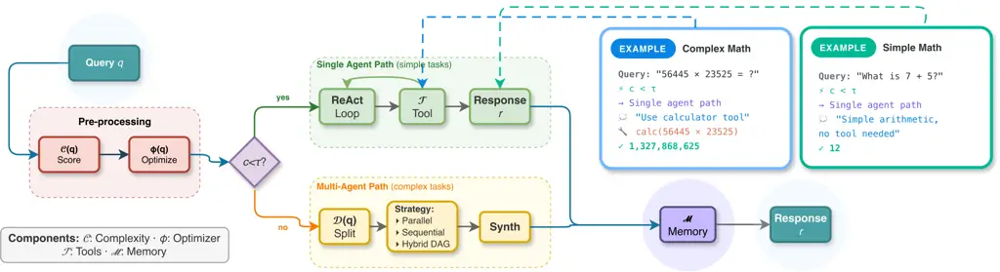

Figure 1: Overview of the EffGen framework. Given an input query, EffGen
first computes a complexity score using five weighted factors. Based on
this score, tasks are routed to either single-agent execution (for
simple tasks) or multi-agent decomposition (for complex tasks). The
prompt optimizer compresses and restructures prompts for small models,
while the memory system provides relevant context. This design enables
small language models to handle agentic tasks that typically require
much larger models.

Recent work suggests that small language models (SLMs) can match or
exceed larger models on specific tasks when properly orchestrated
(Belcak et al., 2025). The future of agentic AI may lie not in
ever-larger models but in efficient coordination of smaller, specialized
models. Yet existing agent frameworks provide no systematic support for
SLM deployment. LangChain, AutoGen, and similar frameworks optimize for
LLM capabilities, leaving SLM users to manually adapt prompts, manage
context windows, and handle the unique failure modes of smaller models.
While frameworks like Smolagents (Roucher et al., 2025) targets smaller
models, it lacks systematic prompt optimization, pre-execution routing,
and converts all tasks to code execution, which adds unnecessary
overhead for non-coding tasks. Table 1 summarizes the differences
between EffGen and existing frameworks. This gap motivates our central
question: Can we design an agent framework that treats SLM constraints
as first-class design requirements rather than afterthoughts?

We answer affirmatively with EffGen, an open-source agentic framework
optimized for small language models (Figure 1). Our design philosophy
inverts the standard approach: rather than adapting LLM-optimized
components for smaller models, we develop each component with explicit
consideration of SLM constraints including limited context windows,
reduced instruction-following capability, and lower reasoning depth.
Formally, let $`M_{s}`$ denote an SLM with parameter count
$`|M_{s}|\leq 7\times 10^{9}`$ and context window $`C_{M_{s}}\leq 32K`$
tokens. We design EffGen such that for any task $`q`$ solvable by an
LLM-based agent $`\mathcal{A}_{L}`$, an EffGen agent $`\mathcal{A}_{E}`$
with SLM $`M_{s}`$ achieves comparable performance: our experiments show
EffGen with Qwen2.5-7B achieves 63.07% average accuracy across 13
benchmarks, a 12.3% improvement over raw model baselines (Table 2).

EffGen makes four major contributions. First, we develop a prompt
optimization pipeline for SLMs (§3.1). The optimization function
$`\phi:\mathcal{P}\rightarrow\mathcal{P}^{\prime}`$ compresses prompts
such that $`|\phi(p)|\leq\alpha|p|`$ for $`\alpha\in[0.2,0.3]`$ while
preserving task semantics. Our optimizer applies model-size-aware
compression, instruction simplification, and structured formatting that
improves SLM task completion by 8-11% compared to unoptimized prompts
(Table 3). Second, we introduce a pre-execution complexity analyzer
$`\mathcal{C}:\mathcal{Q}\rightarrow[0,10]`$ that uses five weighted
factors to predict task complexity before execution begins (§3.2). This
enables intelligent routing: tasks with $`\mathcal{C}(q)<\tau`$ execute
on a single agent while complex tasks undergo automatic decomposition.
Unlike prior work that discovers complexity during execution, our
approach reduces wasted computation on inappropriately routed tasks by
23% (Appendix D, D.8). Third, we provide a unified implementation of
three major agent communication protocols: Model Context Protocol (MCP),
Agent-to-Agent (A2A), and Agent Communication Protocol (ACP) (§3.4).
This enables EffGen agents to interoperate with heterogeneous agent
ecosystems. Fourth, we design a three-tier memory system
$`\mathcal{M}=(\mathcal{M}_{s},\mathcal{M}_{l},\mathcal{M}_{v})`$
combining short-term history, long-term episodic storage, and
vector-based semantic retrieval optimized for SLM context constraints
(§3.5). Our prompt optimization uses structured tool descriptions and
schema formatting to improve tool-calling accuracy by reducing parsing
errors (Appendix I).

Feature LangChain AutoGen Smolagents EffGen SLM-optimized prompts ✗ ✗ ✓
✓ Pre-execution routing ✗ ✗ ✗ ✓ Task decomposition ✗ ✓ ✗ ✓
Multi-protocol (MCP+A2A+ACP) ✗ ✗ ✗ ✓ Local deployment focus ✗ ✓ ✓ ✓
Context compression ✗ ✗ ✗ ✓ Vector memory ✓ ✓ ✗ ✓

Table 1: Comparison of EffGen with existing agent frameworks. ✓: feature
present; ✗: absent or limited support. See Appendix A for detailed
feature analysis.

We evaluate EffGen against four baselines (raw models, LangChain,
AutoGen, Smolagents) across 13 benchmarks spanning tool-calling,
reasoning, and memory tasks using Qwen2.5 models (Qwen et al., 2025)
from 1.5B to 32B parameters, Gemma 3 models (Team et al., 2025), and
GPT-OSS 20B (OpenAI et al., 2025). Results show that EffGen achieves
faster execution (up to 18$`\times`$ speedup for small models), uses
less memory, and improves task success rates (13.2% average improvement
at 1.5B, 6.0% at 32B).

##### Conflict of Interest Disclosure.

One of the authors (C.W.) is employed by Google DeepMind. Google
DeepMind develops the Gemma 3 model family, which is among the models
evaluated in this paper. No author received compensation from any model
provider or framework vendor for this work; the evaluation uses only
publicly released open-weight models (Qwen2.5, Gemma 3, GPT-OSS) and
public benchmarks, and no proprietary Google model is used. The authors
declare no other financial conflicts of interest.

## 2 Related Work

Single-Agent Systems and Tool Use. Toolformer (Schick et al., 2023)
taught language models to invoke external APIs through self-supervision,
while ReAct (Yao et al., 2022) interleaved reasoning traces with action
execution. Tree-of-Thoughts (Yao et al., 2023) added lookahead and
backtracking. Chain-of-thought prompting (Wei et al., 2022; Kojima et
al., 2022; Wang et al., 2022), Reflexion (Shinn et al., 2023), and
program-aided approaches (Chen et al., 2021; Gao et al., 2023) improved
reasoning. ToolLLM (Qin et al., 2023), Gorilla (Patil et al., 2024),
HuggingGPT (Shen et al., 2023), and ToolQA (Zhuang et al., 2023) scaled
tool learning to thousands of APIs. AutoGPT (Toran Bruce Richards and
Auto-GPT contributors, 2023) and Transformers Agent (Hugging Face, 2023)
provide single-agent implementations but lack SLM support. These works
primarily target LLMs with substantial context windows.

Language Model Agentic Frameworks. AutoGen (Wu et al., 2024b) introduced
conversational multi-agent patterns through message passing. MetaGPT
(Hong et al., 2024), ChatDev (Qian et al., 2024), AgentVerse (Chen et
al., 2024), and CAMEL (Li et al., 2023) encode human workflow patterns.
TDAG (Wang et al., 2025b) proposed dynamic task decomposition with agent
generation, while ADaPT introduced as-needed decomposition (Prasad et
al., 2024). Recent surveys (Wang et al., 2024a; Xi et al., 2025) review
the agent landscape. LangChain (Chase, 2022) provides extensive tool
integrations but focuses on orchestration primitives over model-specific
optimizations. Smolagents (Roucher et al., 2025) targets smaller models
but lacks systematic prompt optimization and routing.

Small Language Models for Agents. Belcak et al. (2025) argue that SLMs
will underpin most practical AI agents due to savings in latency, cost,
and energy. Prior work on small models (Schick and Schütze, 2021; Fu et
al., 2023; Magister et al., 2023; Hu et al., 2024) showed strong
performance through careful training and prompting. Generative Agents
(Park et al., 2023) showed structured memory enables coherent long-term
behavior. OpenAGI (Ge et al., 2023) integrates LLMs with domain expert
models via reinforcement learning. AgentBench (Liu et al., 2024) shows
open-source models lag commercial LLMs (OpenAI et al., 2024) on agentic
tasks, with instruction-following and multi-step planning as key
bottlenecks. Instruction-following (Ouyang et al., 2022; Wang et al.,
2023b) and neural scaling laws (Kaplan et al., 2020; Hoffmann et al., 2022) inform our model-size-aware optimization. Despite growing
recognition that small models offer practical advantages, existing
frameworks do not systematically address their constraints. EffGen fills
this gap by enabling small models to reach competitive agentic
performance while keeping the efficiency benefits that make them
practical to deploy.

## 3 EffGen Framework

We present EffGen as a formal agent framework optimized for small
language models. Let $`M`$ denote a language model with parameters
$`\theta_{M}`$, context window size $`C_{M}`$, and vocabulary $`V_{M}`$,
an EffGen agent is defined as the tuple
$`\mathcal{A}=(M,\mathcal{T},\mathcal{R},\mathcal{D},\mathcal{M},\phi)`$
where $`\mathcal{T}=\{t_{1},\ldots,t_{k}\}`$ is the tool registry,
$`\mathcal{R}`$ is the routing function, $`\mathcal{D}`$ is the
decomposition operator, $`\mathcal{M}`$ is the memory system, and
$`\phi`$ is the prompt optimizer. Given a query $`q\in\mathcal{Q}`$, the
agent produces a response $`r=\mathcal{A}(q)`$ through the execution
pipeline defined in Algorithm 1. An illustration of the complete
pipeline can be found in Figure 4 in Appendix A. EffGen ships with 66
built-in tools spanning computation (calculator, Python REPL, sandboxed
code executor, bash, JSON), retrieval (web search, agentic search,
Wikipedia, URL fetch, RAG), academic and knowledge sources (arXiv,
PubMed, Semantic Scholar, StackOverflow, GitHub, Wolfram Alpha),
document and media parsing (PDF, DOCX, Excel, OCR, audio transcription,
image analysis, QR codes), translation and language detection, geo and
weather, finance, data analysis, DevOps and system, communication and
webhooks, and provider-native tools (OpenAI
WebSearch/CodeInterpreter/FileSearch, Anthropic
Bash/TextEditor/Computer, Gemini GoogleSearch/UrlContext/CodeExecution);
see Appendix I for the full inventory. It supports four local backends
(vLLM, Transformers, GGUF via llama-cpp-python, MLX/MLX-VLM for Apple
Silicon) and nine hosted backends (OpenAI, Anthropic, Gemini, Groq,
Cerebras, Together AI, Fireworks, Replicate, HuggingFace Inference)
through a uniform adapter interface with automatic backend selection,
rate-limit coordination, and cost tracking (Appendix N). A
PolicyBasedRouter composes three pluggable routing policies
(FirstAvailable, CostBased, LatencyBased) with a retry policy and
explainable per-call decisions. Usage examples appear in Appendix X. The
following sections describe the five major components: prompt
optimization (§3.1), complexity analysis and routing (§3.2), task
decomposition (§3.3), multi-protocol communication (§3.4), and memory
architecture (§3.5). The framework is extensible for custom tools and
backends.

##### Production Surface.

Alongside the SLM-focused core, EffGen ships the infrastructure to
deploy these agents in production (Appendix S). A composable guardrail
layer covers PII, toxicity, prompt injection, topic restriction, length
limits, and per-tool allow/deny lists (Appendix S.1); a RAG pipeline
with semantic, code, table, and hierarchical chunkers and three
rerankers handles knowledge ingestion (Appendix S.2); reliability
primitives include circuit breakers, bulkheads, jittered retries,
timeout propagation, and a deterministic chaos harness (Appendix S.3);
observability ships structured JSON logs with secret redaction,
OpenTelemetry tracing, Prometheus histograms, SLO tracking, and
Alertmanager rules (Appendix S.4); security includes a sandboxed code
executor with Docker, subprocess, and Firecracker backends, supply-chain
hash verification, a CycloneDX SBOM, and gitleaks-based secret scanning
(Appendix S.5); an OpenAI-compatible HTTP server adds OAuth2/OIDC, RBAC,
per-principal audit logs, and a daily-budget cap (Appendix S.6).
Deployments are supported via Docker, an 11-template Helm chart, AWS
Lambda, and a Cloudflare Worker edge proxy (Appendix S.7), with a live
dashboard and Jupyter magics for interactive use (Appendix S.8). These
subsystems do not change the SLM-focused contributions; they make them
deployable. The information in this paper reflects EffGen v0.2.10 (May
27, 2026); subsequent updates are documented at
[https://github.com/ctrl-gaurav/effGen](https://github.com/ctrl-gaurav/effGen).

### 3.1 SLM-Aware Prompt Optimization

Small language models exhibit systematic performance degradation when
prompts exceed certain complexity thresholds or violate implicit
formatting assumptions learned during training. We address this through
a prompt optimization function
$`\phi:\mathcal{P}\times\mathcal{M}\rightarrow\mathcal{P}^{\prime}`$
that transforms input prompts to maximize SLM task completion within
context constraints.

###### Definition 3.1 (Model Size Categories).

We partition language models into four categories based on parameter
count: Tiny ($`|M|<1\text{B}`$), Small ($`1\text{B}\leq|M|<3\text{B}`$),
Medium ($`3\text{B}\leq|M|<7\text{B}`$), and Large
($`|M|\geq 7\text{B}`$). This categorization aligns with standard
practice in the small language model literature, where models under 7B
parameters are commonly grouped into size tiers for analysis and
optimization (Wang et al., 2025a; Lu et al., 2025). Each category
defines optimization parameters
$`(\tau_{\text{prompt}},\tau_{\text{context}},n_{\text{shot}},d_{\text{chain}},\alpha)`$
specifying maximum prompt tokens, context tokens, few-shot examples,
chain depth, and target compression ratio respectively.

For Tiny models, we set
$`(\tau_{\text{prompt}},\tau_{\text{context}},n_{\text{shot}},d_{\text{chain}},\alpha)=(512,1024,1,2,0.6)`$,
requiring aggressive compression to $`60\%`$ of original length. Small
models use $`(1024,2048,2,3,0.7)`$, while Medium models relax
constraints to $`(2048,4096,3,5,0.8)`$. The optimization function
$`\phi`$ applies five sequential transformations: (1) Compression. We
define a set of pattern-replacement pairs
$`\{(p_{i},r_{i})\}_{i=1}^{m}`$ that map verbose phrases to concise
equivalents. For example, “in order to” $`\mapsto`$ “to”, “due to the
fact that” $`\mapsto`$ “because”. Let
$`\text{compress}(s)=\bigcirc_{i=1}^{m}\text{replace}(s,p_{i},r_{i})`$
where $`\bigcirc`$ denotes function composition. This achieves 15-25%
token reduction without semantic loss. (2) Simplification. Long
sentences exceeding 20 words are split at conjunction boundaries (and,
but, or, so, because) to improve instruction parsing by smaller models.
Formally, for sentence $`s`$ with word count $`|s|_{w}>20`$, we find
split point $`j=\arg\min_{i:w_{i}\in\text{CONJ}}|i-|s|_{w}/2|`$ and
produce two sentences $`s_{1}=w_{1}\cdots w_{j-1}`$ and
$`s_{2}=w_{j}\cdots w_{|s|_{w}}`$. (3) Redundancy Removal. Duplicate
sentences and politeness phrases (“please”, “kindly”, “make sure to”)
are removed as they consume tokens without improving task specification.
(4) Bullet Formatting. Instructions are converted to bullet-point
format, which improves SLM instruction-following. (5) Context
Truncation. If the optimized prompt $`p^{\prime}`$ exceeds
$`\tau_{\text{prompt}}`$, we truncate at sentence boundaries to length
$`\lfloor 0.9\cdot\tau_{\text{prompt}}\cdot(4/|\bar{w}|)\rfloor`$
characters where $`|\bar{w}|\approx 4`$ is the average characters per
token.

Our prompt optimization uses rule-based transformations that preserve
semantic consistency through three mechanisms: (1) pattern replacements
are limited to semantically equivalent phrase substitutions (e.g., “in
order to” $`\mapsto`$ “to”), (2) sentence splitting only occurs at
natural conjunction boundaries, and (3) truncation respects sentence
boundaries to avoid mid-thought cuts. This approach is inspired by prior
work on prompt compression and optimization (Jiang et al., 2023b; Li et
al., 2025). Our contribution is the integration of these techniques with
model-size-aware parameters that adapt compression aggressiveness based
on the target model’s capacity. The complete optimization achieves
compression ratios $`|\phi(p)|/|p|\in[0.2,0.3]`$ for typical prompts
while preserving task-critical information. We provide prompt chain
templates for 5 execution patterns (Appendix B) and 35 compression
patterns with token savings analysis (Appendix C). Case studies appear
in Appendix V.

### 3.2 Pre-Execution Complexity Analysis and Routing

A key limitation of existing agent frameworks is that routing decisions
occur during execution, wasting computation when tasks are
inappropriately assigned. We introduce a complexity analyzer
$`\mathcal{C}:\mathcal{Q}\rightarrow[0,10]`$ that predicts task
complexity before execution, enabling intelligent pre-routing.

###### Definition 3.2 (Complexity Score).

For a query $`q`$, it is defined as:
$`\mathcal{C}(q)=\sum_{i=1}^{5}w_{i}\cdot f_{i}(q)`$ where $`\{f_{i}\}`$
are factor functions and $`\{w_{i}\}`$ are weights satisfying
$`\sum_{i}w_{i}=1`$.

We use five complexity factors with empirically tuned weights: (1) Task
Length ($`w_{1}=0.15`$): $`f_{1}(q)=g_{1}(|q|_{w})`$ where $`|q|_{w}`$
is word count and $`g_{1}`$ maps to $`[0,10]`$ via thresholds
$`\{20,50,100,200\}`$ corresponding to scores $`\{2,4,6,8,10\}`$. (2)
Requirement Count ($`w_{2}=0.25`$):
$`f_{2}(q)=\min(10,2\cdot n_{\text{req}})`$ where $`n_{\text{req}}`$
counts questions, conjunctions, numbered items, and semicolons as
proxies for distinct requirements. (3) Domain Breadth ($`w_{3}=0.20`$):
We define multiple knowledge domains $`\mathcal{K}`$ (technical,
research, business, creative, scientific, legal, etc.) with associated
keyword sets.
$`f_{3}(q)=\min(10,2.5\cdot|\{k\in\mathcal{K}:\exists w\in\text{keywords}(k),w\in q\}|)`$.
(4) Tool Requirements ($`w_{4}=0.20`$): Similarly, we define tool
categories with indicator phrases. $`f_{4}(q)`$ counts how many tool
types are implicated by the query. (5) Reasoning Depth ($`w_{5}=0.20`$):
We classify queries into four reasoning levels based on indicator words:
simple (list, define, show) $`\mapsto 3`$, moderate (explain, describe,
how) $`\mapsto 5`$, complex (analyze, evaluate, compare) $`\mapsto 7`$,
very complex (synthesize, design, architect) $`\mapsto 9`$. Given
complexity score $`\mathcal{C}(q)`$, the routing decision
$`\mathcal{R}(q)`$ selects SINGLE if $`\mathcal{C}(q)<\tau`$; for
$`\mathcal{C}(q)\geq\tau`$ it picks PARALLEL without dependencies,
SEQUENTIAL when dependencies exist, HYBRID when
$`\mathcal{C}(q)>\tau_{H}`$ with a mixed dependency graph, and
HIERARCHICAL when $`\mathcal{C}(q)>\tau_{\text{hier}}`$. Defaults are
$`\tau=7.0`$, $`\tau_{H}=8.5`$, and $`\tau_{\text{hier}}=9.0`$.

Ablation studies (Appendix D) show that the default threshold
$`\tau=7.0`$ gives the best accuracy-efficiency tradeoff, with accuracy
stable within 1% for $`\tau\in[6.0,8.0]`$ and degrading outside that
range. While task complexity estimation builds on prior work in query
difficulty prediction (Benedetto et al., 2023; Ding et al., 2024; Meng
et al., 2025), our contribution is a five-factor formulation tailored to
agent routing, executed pre-inference, with empirically calibrated
weights and thresholds for SLMs.

0:  Query $`q`$, Agent
$`\mathcal{A}=(M,\mathcal{T},\mathcal{R},\mathcal{D},\mathcal{M},\phi)`$

0:  Response $`r`$

1:  $`c\leftarrow\mathcal{C}(q)`$ {Compute complexity score}

2:  $`p\leftarrow\phi(q,\mathcal{M})`$ {Optimize prompt with context}

3:  if $`c<\tau`$ then

4:   $`r\leftarrow\text{ReActLoop}(M,p,\mathcal{T})`$ {Single-agent
execution}

5:  else

6:   $`\{q_{1},\ldots,q_{n}\},G\leftarrow\mathcal{D}(q)`$ {Decompose
with dependency graph}

7:   $`s\leftarrow\mathcal{R}(G)`$ {Determine execution strategy}

8:   if $`s=\text{PARALLEL}`$ then

9:
   $`\{r_{1},\ldots,r_{n}\}\leftarrow\text{ParallelExecute}(\{q_{i}\},M,\mathcal{T})`$

10:    $`r\leftarrow\text{Synthesize}(\{r_{i}\},q)`$ {Combine parallel
results}

11:   else if $`s=\text{SEQUENTIAL}`$ then

12:
   $`r\leftarrow\text{SequentialExecute}(\{q_{i}\},G,M,\mathcal{T})`$
{Last step gives answer}

13:   else

14:    $`\{r_{1},\ldots,r_{n}\}\leftarrow\emptyset`$ {Hybrid DAG
execution}

15:    for $`(q_{i},\text{deps}_{i})\in\text{TopologicalSort}(G)`$ do

16:     if $`\text{deps}_{i}=\emptyset`$ then

17:      $`r_{i}\leftarrow\text{ExecuteParallel}(q_{i},M,\mathcal{T})`$
{Independent task}

18:     else

19:
     $`\text{context}_{i}\leftarrow\{r_{j}:q_{j}\in\text{deps}_{i}\}`$
{Wait for dependencies}

20:
     $`r_{i}\leftarrow\text{ExecuteWithContext}(q_{i},\text{context}_{i},M,\mathcal{T})`$

21:     end if

22:    end for

23:    $`r\leftarrow\text{Synthesize}(\{r_{i}\},q)`$ {Combine mixed
results}

24:   end if

25:  end if

26:  $`\mathcal{M}\leftarrow\text{UpdateMemory}(\mathcal{M},q,r)`$

27:  return $`r`$

Algorithm 1 EffGen Agent Execution Pipeline

### 3.3 Intelligent Task Decomposition

When routing indicates multi-agent execution, the decomposition operator
$`\mathcal{D}:\mathcal{Q}\rightarrow(\mathcal{Q}^{n},G)`$ produces
subtasks with an associated dependency graph $`G=(V,E)`$ where
$`V=\{q_{1},\ldots,q_{n}\}`$ and $`(q_{i},q_{j})\in E`$ indicates
$`q_{j}`$ depends on $`q_{i}`$’s result. We implement four decomposition
strategies:

(1) Parallel Decomposition. For tasks with $`\mathcal{C}(q)\geq\tau`$
and no dependencies, we decompose into 2–5 independent, self-contained
subtasks $`\mathcal{D}_{\parallel}(q)=\{q_{1},\ldots,q_{n}\}`$ with
$`E=\emptyset`$, which execute concurrently. (2) Sequential
Decomposition. When dependencies exist, subtasks form a chain
$`E=\{(q_{i},q_{i+1}):i\in[n-1]\}`$, with each subtask receiving its
predecessor’s output as context. (3) Hybrid Decomposition. For
$`\mathcal{C}(q)>\tau_{H}`$ with a dependency graph that mixes
independent and dependent subtasks, we run independent groups in
parallel while respecting inter-group ordering. (4) Hierarchical
Decomposition. For the most demanding tasks
($`\mathcal{C}(q)>\tau_{\text{hier}}`$), we use a manager–worker
structure that assigns subtasks to specialized sub-agents and
synthesizes their results.

The decomposition engine uses the same small language model that powers
the agent (i.e., the same local SLM, not an external API like GPT) with
strategy-specific prompts (Appendix E) to identify subtasks, estimate
complexity, and determine dependencies. This keeps the entire pipeline
local and avoids external API costs. Subtasks are annotated with
required specializations from the set {research, coding, analysis,
synthesis, data, creative, general}. The framework implements a dynamic
sub-agent spawning system with lifecycle management (creation,
execution, result aggregation, cleanup) that enables hierarchical agent
structures for complex multi-stage reasoning. Performance analysis is
shown in Appendix F. Task decomposition strategies build on prior work
in hierarchical planning (Huang et al., 2024). Our contribution is
integrating pre-execution complexity routing and optimizing
decomposition prompts for small models.

### 3.4 Multi-Protocol Agent Communication

EffGen provides a unified implementation of three agent protocols: (1)
Model Context Protocol (MCP) – full spec with JSON-RPC 2.0 messaging,
STDIO/HTTP/SSE transports, tool discovery via tools/list, resource
management, and prompt templates; tools register with schema validation.
(2) Agent-to-Agent (A2A) – task lifecycle (create, execute, cancel,
status) and Agent Cards specifying input/output MIME types, skills, and
authentication. (3) Agent Communication Protocol (ACP) – synchronous
requests, asynchronous callbacks, and streaming responses with
OpenTelemetry instrumentation.

The unified protocol layer abstracts transport differences, allowing
EffGen agents to invoke tools and communicate across MCP, A2A, and ACP
through a single canonical tool representation (Appendix K). MCP follows
JSON-RPC 2.0 with STDIO, HTTP, and SSE transports; A2A adds task
lifecycle management and Agent Cards over HTTP and WebSocket with four
authentication handlers; ACP adds capability tokens, streaming
callbacks, and OpenTelemetry instrumentation. We further implement
execution tracking with 18 event types across five categories (task
lifecycle, routing/decomposition, sub-agent lifecycle, tool calls, and
logging) and six multi-agent orchestration patterns (sequential,
parallel, hierarchical, collaborative, competitive, pipeline), with
parallel coordination yielding speedups (Appendices M, G). Since these
are standardized protocols, our contribution is the unified
implementation enabling cross-protocol communication.

### 3.5 Memory System Architecture

The EffGen memory system
$`\mathcal{M}=(\mathcal{M}_{s},\mathcal{M}_{l},\mathcal{M}_{v})`$
combines three complementary storage mechanisms optimized for SLM
context constraints: (1) Short-Term Memory $`\mathcal{M}_{s}`$ maintains
conversation history as a message sequence $`\{m_{1},\ldots,m_{t}\}`$
where each $`m_{i}=(\text{role},\text{content},\tau_{i},|m_{i}|)`$
includes role (system/user/assistant/tool), content, timestamp, and
estimated token count. When $`\sum_{i}|m_{i}|`$ approaches
$`0.8\cdot C_{M}`$, automatic summarization compresses older messages
while preserving recent context. (2) Long-Term Memory
$`\mathcal{M}_{l}`$ stores significant events with importance scoring.
Each entry $`e=(c,\tau,s,I)`$ contains content, timestamp, source
identifier, and importance level
$`I\in\{\text{LOW},\text{MEDIUM},\text{HIGH}\}`$. Retrieval combines
recency, frequency, and importance:
$`\text{score}(e)=\alpha\cdot\text{recency}(e)+\beta\cdot\text{freq}(e)+\gamma\cdot I(e)`$.
(3) Vector Memory $`\mathcal{M}_{v}`$ enables semantic retrieval through
embedding-based similarity search. We support multiple backends (FAISS,
ChromaDB) and embedding models (Sentence-Transformers, OpenAI). For
query $`q`$, retrieval returns
$`\{e_{i}:\text{sim}(\text{embed}(q),\text{embed}(e_{i}))>\delta\}`$
sorted by similarity.

Automatic consolidation periodically merges short-term observations into
long-term storage and updates vector indices. Detailed scoring with
recency decay $`R(e,t)=\exp(-\lambda\cdot(t_{\text{now}}-\tau_{e}))`$,
backend comparisons, and consolidation policies appear in Appendix H.
The three-tier design builds on memory-augmented language models (Packer
et al., 2023; Yu et al., 2026); our contribution is a context-aware
consolidation policy that respects SLM context limits across a unified
storage interface.

Calculator Math Reasoning (coding tools) Agentic Benchmarks Memory
Retrieval Model Framework GSM8K GSM-PLUS MATH-500 BB-Easy BB-Med BB-Hard
GAIA SimpleQA LoCoMo LongMemEval ARC-C ARC-E CSQA Avg Qwen2.5 (1.5B) Raw
Model 68.01 42.83 28.60 35.98 9.60 2.86 3.12 4.00 5.13 22.88 67.24 82.70
72.73 34.28 LangChain 66.86 37.83 23.20 49.39 21.60 1.43 3.12 12.00 8.56
15.34 59.13 73.78 54.30 32.81 AutoGen 67.85 37.62 26.19 52.95 28.40 1.67
6.25 10.00 9.22 18.73 53.75 65.99 57.82 33.57 Smolagents 50.41 26.08
21.25 56.39 30.40 1.43 3.12 18.00 8.42 22.15 53.85 37.63 32.41 27.81
EffGen 71.63 50.25 36.00 73.66 38.40 7.92 9.38 40.00 14.19 30.73 78.34
91.65 74.62 47.44 Qwen2.5 (3B) Raw Model 82.64 62.04 55.00 42.05 18.20
7.33 6.25 2.00 17.40 29.25 79.28 90.60 75.02 43.62 LangChain 82.83 58.33
48.80 52.68 29.20 5.71 9.38 12.00 13.42 11.62 74.49 83.88 70.84 42.55
AutoGen 79.30 60.21 51.80 58.78 26.80 7.14 6.25 14.00 11.81 20.57 73.04
85.14 72.65 43.65 Smolagents 69.07 49.62 10.91 63.41 28.80 8.57 9.38
22.00 7.89 19.54 36.69 43.43 41.03 31.56 EffGen 84.83 63.62 59.20 81.71
35.60 21.67 15.62 58.00 21.58 32.29 86.10 93.21 85.02 56.80 Qwen2.5 (7B)
Raw Model 90.75 72.54 65.80 59.68 27.60 15.42 12.50 6.00 22.35 29.88
83.79 90.91 82.80 50.77 LangChain 84.38 67.79 41.20 72.20 45.60 12.86
9.38 34.00 9.02 16.32 86.95 90.99 79.12 49.99 AutoGen 90.30 71.25 64.60
77.80 43.20 7.14 12.50 46.00 16.44 27.83 76.28 80.39 58.64 51.72
Smolagents 84.00 64.58 16.20 80.24 49.20 24.17 9.38 32.00 10.25 27.47
71.25 81.36 76.33 48.19 EffGen 91.28 68.12 66.80 89.02 54.80 28.57 21.87
76.00 25.32 35.34 87.88 91.92 83.05 63.07 Qwen2.5 (14B) Raw Model 93.78
75.17 67.80 64.63 38.80 24.17 12.50 8.00 26.92 30.94 88.99 92.97 83.37
54.46 LangChain 89.99 70.92 53.20 74.71 47.20 29.58 12.50 46.00 19.00
17.68 91.13 93.90 81.49 55.95 AutoGen 94.09 74.83 66.00 77.07 51.20
24.29 15.62 58.00 17.15 27.72 89.42 92.89 79.69 59.07 Smolagents 90.45
71.17 20.43 86.27 48.80 34.29 9.38 46.00 13.04 24.34 90.87 93.14 82.80
54.69 EffGen 94.84 76.62 69.60 92.27 57.60 46.37 18.75 72.00 27.94 36.64
89.86 94.39 86.00 66.38 Qwen2.5 (32B) Raw Model 95.60 77.42 73.00 71.56
48.40 26.53 15.62 14.00 31.91 30.12 92.92 94.32 86.81 58.32 LangChain
95.07 75.83 59.20 88.05 60.00 27.14 18.75 54.00 25.07 18.66 93.34 93.94
84.28 61.03 AutoGen 94.54 76.96 72.80 92.44 63.60 30.67 21.87 70.00
30.37 28.22 89.25 92.51 81.65 64.99 Smolagents 93.40 74.83 68.00 94.63
68.80 45.83 15.62 52.00 17.07 27.22 93.26 94.44 84.93 63.85 EffGen 95.75
78.38 75.40 96.67 64.20 58.86 28.12 84.00 31.04 35.64 92.50 95.29 86.80
70.97

Table 2: Main evaluation results across 13 benchmarks. Best results per
model size in bold. EffGen consistently outperforms baselines across
benchmarks and model scales. Additional results (Gemma3 and GPT-OSS 20B)
and confidence intervals are in Appendix U.

## 4 Experiments

### 4.1 Experimental Setup

Benchmarks. We evaluate EffGen across 13 benchmarks organized into five
categories: 1) Traditional Math (Calculator): GSM8K (Cobbe et al.,
2021), GSMPLUS (Li et al., 2024), MATH-500 (Hendrycks et al., 2021); 2)
Algorithmic Reasoning (Code Execution): BeyondBench-Easy (Srivastava et
al., 2026), BeyondBench-Medium, BeyondBench-Hard; 3) Retrieval-Augmented
Reasoning (Web Search): ARC-Challenge, ARC-Easy (Clark et al., 2018),
CommonsenseQA (Talmor et al., 2019); 4) Memory Evaluation: LoCoMo
(Maharana et al., 2024), LongMemEval (Wu et al., 2024a); 5) Multi-Tool
Agentic: GAIA (Mialon et al., 2024), SimpleQA (Wei et al., 2024).
Complete benchmark specifications including task characteristics,
example problems with solutions, evaluation protocols, and answer
extraction methods appear in Appendix T.

Retrieval Benchmark Construction. For retrieval-augmented reasoning
benchmarks (ARC-Challenge, ARC-Easy, CommonsenseQA), we build a
knowledge corpus from 15K+ train/validation question-answer pairs to
evaluate retrieval and integration with parametric knowledge. To prevent
leakage, the corpus excludes all test instances and filters entries
sharing a question ID or exceeding 90% token overlap with the query.
Questions, answers, and explanations are indexed via keyword extraction
and stopword removal, enabling BM25-style retrieval of 2-3 relevant
entries per query.

Models and Baselines. We evaluate Qwen2.5-Instruct models (Qwen et al., 2025) at 1.5B – 32B parameters, Gemma3 family of models at 1B – 27B
parameters, and GPT-OSS family, representing the SLM range of primary
interest. Our GPU management (Appendix L) implements four allocation
strategies (greedy, balanced, optimized, priority) and three parallelism
types (tensor, pipeline, data) with automatic memory estimation using
the formula
$`\text{mem}(|M|,p,L,B)=|M|\cdot p/8+2|M|\cdot L\cdot B\cdot 16/8+|M|\cdot L\cdot 16/8+\alpha|M|\cdot 32/8`$.
We compare EffGen against four baselines: (1) Raw Model (direct
prompting to isolate framework benefits); (2) AutoGen; (3) Smolagents;
(4) LangChain.

Configuration. All experiments use the maximum context per model.
Reported improvements are statistically significant (McNemar’s test,
$`p<0.05`$, Appendix U). Tool configuration uses YAML, reducing token
count by 32% compared to JSON (Appendix J). EffGen provides YAML/JSON
support, environment variable substitution, schema validation, and hot
reloading (Appendix O). All frameworks receive: identical tool sets;
5-minute timeout; up to 5 retries on tool errors; and the same
generation settings (temp 0.1, etc.). Complete software, hardware, and
generation-parameter details for reproducibility appear in Appendix Y.

### 4.2 Results and Insights

Table 2 presents results across all benchmarks and model sizes. We
organize our analysis around key insights from comparing EffGen against
baseline frameworks.

Small Models Benefit More From Framework Design. Across all 13
benchmarks, EffGen shows larger improvements for smaller models,
validating that SLM constraints require explicit architectural
accommodation (Table 2). For Qwen2.5-1.5B, EffGen achieves 47.44%
average accuracy compared to 34.28% for the next best baseline, which at
this scale is the raw model itself (it outperforms all three competing
frameworks), a gain of 13.2% as shown in Table 2. This gain holds at
13.2% at 3B, then narrows to 11.4% at 7B, 7.3% at 14B, and 6.0% at 32B.
The pattern suggests that larger models can partially compensate for
framework inefficiencies through raw capability, while smaller models
depend critically on optimized prompting and context management. This
validates: treating SLM constraints as first-class design requirements
yields large benefits that diminish as model capacity increases.

### 4.3 Tool-Specific Performance Patterns

On GSM8K and GSMPLUS, agentic frameworks provide minimal benefit because
these tasks do not require agentic capabilities. For Qwen2.5-1.5B on
GSM8K, the raw model achieves 68.01% while LangChain drops to 66.86% due
to tool-calling overhead (Table 2); EffGen instead reaches 71.63%
through prompt optimization, with differences largely vanishing at 32B
(raw: 95.60%, EffGen: 95.75%). On MATH-500, improvements arise from
better instruction and format handling, particularly LaTeX parsing,
rather than enhanced mathematical reasoning, reinforcing that tool
augmentation should be selective, not universal.

Code Execution Shows 26$`\times`$ Larger Gains Than Calculator. On
BeyondBench-Hard (NP-complete problems), EffGen improves Qwen2.5-7B from
15.42% to 28.57% (+13.2%). Code execution requires correct program
structure and multi-step state management, making framework choice
critical. The complexity analyzer routes accordingly: BeyondBench-Hard
averages $`\mathcal{C}(q)=8.3`$, triggering decomposition, while GSM8K
averages $`\mathcal{C}(q)=4.7`$ for single-agent execution (Table 2).
Consistently, code benchmarks show higher cross-framework variance
(12.4%) than calculator tasks (4.2%).

Figure 2: Execution time scaling across parameter sizes. EffGen achieves
18$`\times`$ speedup at 1.5B (vs Smolagents). LangChain exhibits
super-linear scaling on Calculator benchmarks (11.2$`\times`$ time
increase for 21.3$`\times`$ parameter growth), while EffGen maintains
near-linear scaling. See Appendix U.10.

Figure 3: Error analysis on failed cases.

Baseline Frameworks Generate Irrelevant Code for Simple Tasks. On
BeyondBench-Easy sorting tasks, Smolagents and other frameworks
frequently exhibit tool-misuse failures, including generating code for
unrelated tasks, reimplementing sorting algorithms instead of using
available tools (leading to runtime errors), or failing to invoke tools
despite explicit instructions, resulting in incorrect outputs. EffGen
avoids these issues via explicit tool schemas and structured prompts
that guide correct tool selection and parameterization, reliably
invoking the code executor for sorting tasks. Side-by-side failure
examples are provided in Appendix V.

### 4.4 Multi-Tool Agentic Benchmarks

These benchmarks provide the strongest evidence that tool schema quality
and routing decisions, not raw model capability, drive performance on
genuine multi-tool tasks.

GAIA and SimpleQA Show Largest Framework Differentiation. Benchmarks
requiring multi-tool orchestration show 9-22% improvements over
baselines (Table 2). On GAIA, Qwen2.5-7B-Instruct: raw (12.50%) vs
EffGen (21.87%) vs LangChain (9.38%). At 32B: raw (15.62%) vs EffGen
(28.12%). Even capable models benefit from structured multi-tool
coordination.

SimpleQA Tests Web Search Tool-Calling Pipeline. SimpleQA reveals 22-44%
gaps between EffGen and Smolagents across all scales (Table 2). For
1.5B: EffGen (40.00%) vs Smolagents (18.00%); 7B: EffGen (76.00%) vs
Smolagents (32.00%); 32B: EffGen (84.00%) vs Smolagents (52.00%).
Smolagents’ code-generation-first approach produces syntactically valid
but semantically incorrect queries (e.g., generating search(‘‘answer
question’’) instead of EffGen’s schema-guided web_search(query=‘‘Who won
2023 Nobel Prize?’’, max_results=3)). Explicit tool schemas guide
effective query formulation, particularly for small models needing clear
guidance.

Tool Access Alone Does Not Explain the Gap. To separate the contribution
of tool access from framework design on SimpleQA, we added a Raw+Search
baseline that gives the raw model direct access to the same DuckDuckGo
search tool used by EffGen, with no other scaffolding. At Qwen2.5-1.5B,
Raw+Search reaches only 8% (vs. 4% raw and 40% EffGen). At 7B and 32B
the gaps are similar: Raw+Search 14%/38% vs. EffGen 76%/84%. The
remaining gap therefore comes from schema-guided query formulation,
structured result parsing, and query reformulation on failed retrievals
(Appendix W.1). Smaller models gain less from raw tool access
(2$`\times`$ at 1.5B vs. 2.7$`\times`$ at 32B), consistent with the
underconfidence pattern below.

### 4.5 Retrieval and Memory Performance

Small Models Show Underconfidence on Retrieved Information. Small models
readily abandon correct answers when given retrieved content, while
larger models maintain their beliefs (Table 2). For Qwen2.5-1.5B on
ARC-Challenge, raw model achieves 67.24% but drops to 59.13% (LangChain)
and 53.75% (AutoGen). EffGen improves to 78.34% by filtering retrieved
content. Qwen2.5-32B shows minimal change: raw (92.92%) vs LangChain
(93.34%). Across retrieval benchmarks, small models (1.5B-3B) show 8.2%
average accuracy drop with standard frameworks; larger models (14B-32B)
show only 1.4%. This suggests that framework design must account for
model confidence calibration. Qualitative examples showing small models
abandoning correct answers after retrieval appear in Appendix V.9.

Memory Architecture Provides 5-15% Improvement. On LoCoMo and
LongMemEval, EffGen’s three-tier memory outperforms frameworks lacking
structured memory. For Qwen2.5-7B on LoCoMo: raw (22.35%), LangChain
(9.02%), EffGen (25.32%). LangChain truncates older context without
semantic preservation. On LongMemEval (cross-session recall),
Qwen2.5-3B: raw (29.25%), LangChain (11.62%), EffGen (32.29%). The
three-tier architecture combines short-term context, long-term episodic
storage, and vector search (Appendix H), keeping retrieval of the
top-$`k`$ relevant segments from long conversations within an
interactive latency budget.

### 4.6 Efficiency and Ablation Analysis

Framework Overhead Dominates Small Model Execution. EffGen achieves
18$`\times`$ speedup for small models, diminishing to 7$`\times`$ at
larger scales (Table 60, Figure 3). For Qwen2.5-1.5B on
BeyondBench-Easy: EffGen (3.4 min) vs Smolagents (62.4 min) vs LangChain
(63.1 min). At 32B on the same benchmark: EffGen (15.1 min) vs
Smolagents (109.6 min). LangChain exhibits severe scaling pathologies,
increasing from 216.4 min to 1210.0 min (5.6$`\times`$) on GSM-PLUS as
the model grows from 1.5B to 32B parameters, attributed to context
accumulation without compression and lack of batch processing. Token
efficiency: EffGen averages 734 tokens/task vs 1,318 for LangChain
(1.8$`\times`$ reduction overall) via prompt-level compression that
removes 57% of input prompt tokens (Appendix C). The speedup decomposes
as: 35% prompt compression, 28% reduced tool overhead, 22% batching, 15%
memory optimization. Comprehensive timing analysis across all benchmarks
and model sizes appears in Appendix U.10. Advanced features (state
compression, streaming, batch processing) detailed in Appendix R

Smolagents’ Code-First Approach Creates Unnecessary Overhead. Smolagents
converts every problem into a coding task, which adds significant
overhead on benchmarks that do not require code execution (Table 60,
Figure 3). On GSM8K, Smolagents takes 338.8 min at 1.5B versus EffGen’s
5.3 min (64$`\times`$ slower); on retrieval benchmarks (ARC, CSQA),
41-87 min vs EffGen’s 1.4-4.1 min. The problem: generating and executing
Python code for simple arithmetic or retrieval when calculator or direct
tool calls suffice. The “agents that think in code” philosophy works for
complex programming but overcomplicates factual questions, basic math,
and retrieval. This validates a key insight: the right choice of tools
matters far more than always converting problems to code.

1.5B 7B 32B Configuration Acc $`\Delta`$ Acc $`\Delta`$ Acc $`\Delta`$
Full EffGen 47.44 – 63.07 – 70.97 – $`-`$ Prompt Optim. 36.21 $`-`$11.2
54.18 $`-`$8.9 68.54 $`-`$2.4 $`-`$ Complexity Routing 43.87 $`-`$3.6
56.84 $`-`$6.2 63.12 $`-`$7.9 $`-`$ Task Decomp. 44.12 $`-`$3.3 58.42
$`-`$4.7 65.48 $`-`$5.5 $`-`$ Memory System 45.68 $`-`$1.8 59.71
$`-`$3.4 67.23 $`-`$3.7 $`-`$ All (Raw ReAct) 34.28 $`-`$13.2 50.77
$`-`$12.3 58.32 $`-`$12.7

Table 3: Component ablation across model scales. Prompt optimization
impact decreases with scale; routing impact increases.

Component Contributions Vary With Scale. Prompt optimization dominates
for small models; complexity routing matters more at larger scales
(Table 3). Removing prompt optimization degrades 1.5B by 11.2% but only
2.4% for 32B. Complexity routing shows the opposite: 3.6% impact at 1.5B
grows to 7.9% at 32B. This complementary scaling behavior suggests that
small models struggle with prompt parsing while large models waste
capacity on simple tasks without proper routing. The combined removal
drop (12.3–13.2%) is smaller than the sum of individual drops
(19.5–23.2%), indicating overlapping coverage between components: each
module recovers a partially shared slice of the accuracy gain, so
removing one is partly compensated by the others until enough are
removed at once. This is a key finding: optimizing for one model size
alone is not enough; frameworks should combine prompt optimization (for
SLMs) with smart routing (for LLMs).

The Same Patterns Hold Across Model Families. The findings above are not
Qwen-specific. On Gemma 3 (1B to 27B) and GPT-OSS 20B, EffGen still
outperforms all baselines: average gains of 10.9% at Gemma 3 1B
shrinking to 5.9% at 27B (Appendix U.1, Table 51), mirroring the Qwen
trend of larger gains at smaller scales. The component ablation also
generalizes (Appendix W.2, Table 64): removing prompt optimization costs
9.5% at 1B but only 2.2% at 27B, while removing routing costs 2.1% at 1B
and 7.3% at 27B, the same complementary scaling reported for Qwen2.5.
Importantly, no Gemma-specific tuning was applied; the prompt templates
and weight settings transfer directly. The underconfidence pattern on
retrieval also reappears in Gemma 3 1B (7–16% drops on ARC/CSQA with
standard frameworks). Extended sensitivity analyses, including
per-domain routing thresholds, communication overhead at nested depths,
a long-horizon memory stress test, per-technique prompt-optimization
ablations, weight sensitivity for the complexity analyzer, and SWE-Bench
Lite results, are reported in Appendix W.

Error Analysis. Figure 3 breaks down 600 failed cases by error type
(full distribution in Table 59). Tool-related errors (format violations,
wrong tool selection) account for 37.5% of failures but have high
resolution rates through retries. Reasoning errors (broken chains, task
misunderstanding) are harder to recover from. This motivates our
structured tool schemas and prompt optimization. Tool errors have high
recovery rates (70-87%); reasoning errors are harder to fix (50-60%).
The full retry, fallback, and severity-based error-handling pipeline is
described in Appendix Q.

## 5 Conclusion

EffGen’s evaluation across 13 benchmarks reveals that framework design
matters far more for small language models than for large ones. Our
results show: 1) the performance gap between EffGen and baselines is
largest at 1.5B (13.2% improvement) and shrinks to 6.0% at 32B,
validating that SLM constraints require explicit architectural
accommodation; 2) traditional benchmarks like GSM8K do not benefit from
agentic frameworks, lacking genuine multi-tool requirements, while truly
agentic benchmarks (SimpleQA, GAIA) show 9-22% improvements; 3) small
models show underconfidence on retrieval benchmarks (8.2% accuracy drops
with standard frameworks) that larger models avoid, requiring
confidence-aware prompt design; and 4) prompt optimization and routing
have complementary scaling behavior: prompt optimization provides 11.2%
gain at 1.5B but only 2.4% at 32B, while complexity routing shows the
opposite trend (3.6% at 1.5B, 7.9% at 32B), suggesting small models need
better prompts, large models smarter routing. Beyond accuracy, these
gains come at lower cost: EffGen removes 57% of input prompt tokens on
average and runs up to 18$`\times`$ faster than baselines at 1.5B. The
findings point to a concrete design guideline: apply agentic machinery
selectively, gated on pre-execution complexity rather than uniformly,
where small models pay the largest overhead. Looking ahead, the stronger
gains suggest opportunities for model-framework co-design, learned
routing, and multimodal agents. Limitations and future directions appear
in Appendix Z. EffGen is released open-source at
[https://github.com/ctrl-gaurav/effGen](https://github.com/ctrl-gaurav/effGen)
(pip install effgen), with a project website at
[https://effgen.org/](https://effgen.org/) and documentation at
[https://docs.effgen.org/](https://docs.effgen.org/); in-paper usage
guides appear in Appendices X.1, P, N, and X, to support community
development of SLM-optimized agent systems.

## Acknowledgements

This work was supported by the NSF \#2442253, NSF NAIRR Pilot with PSC
Neocortex and NCSA Delta, Cisco Research, NVIDIA, Amazon, the
Commonwealth Cyber Initiative, the Amazon–Virginia Tech Center for
Efficient and Robust Machine Learning, the Sanghani Center for AI and
Data Analytics at Virginia Tech, and the Virginia Tech Innovation
Campus. This research used the Delta system at the National Center for
Supercomputing Applications \[award OAC 2005572\] through allocation
\[NAIRR240202\] from the Advanced Cyberinfrastructure Coordination
Ecosystem: Services & Support (ACCESS) program, which is supported by
National Science Foundation grants \#2138259, \#2138286, \#2138307,
\#2137603, and \#2138296. The views, findings, conclusions, and
recommendations expressed in this work are those of the authors and do
not necessarily reflect the opinions of the funding agencies.

## Impact Statement

This paper presents work whose goal is to advance the field of Machine
Learning by enabling capable AI agents on resource-constrained hardware.
The primary societal benefit is democratizing access to agent
capabilities, allowing deployment in settings where large model
inference is impractical due to cost, latency, or privacy constraints.
Running capable agents on small models also reduces the energy and
compute footprint relative to large-model inference. Potential risks
include dual-use concerns common to all agent systems. We believe the
benefits of efficient, locally-deployable agents outweigh these risks
and have designed EffGen with security considerations including
sandboxed execution and configurable tool permissions.

## References

- Abdin et al. (2024) M. Abdin, J. Aneja, H. Awadalla, A.
  Awadallah, A. A. Awan, N. Bach, A. Bahree, A. Bakhtiari, J. Bao, H.
  Behl, A. Benhaim, M. Bilenko, J. Bjorck, S. Bubeck, M. Cai, Q. Cai, V.
  Chaudhary, D. Chen, D. Chen, W. Chen, Y. Chen, Y. Chen, H. Cheng, P.
  Chopra, X. Dai, M. Dixon, R. Eldan, V. Fragoso, J. Gao, M. Gao, M.
  Gao, A. Garg, A. D. Giorno, A. Goswami, S. Gunasekar, E. Haider, J.
  Hao, R. J. Hewett, W. Hu, J. Huynh, D. Iter, S. A. Jacobs, M.
  Javaheripi, X. Jin, N. Karampatziakis, P. Kauffmann, M. Khademi, D.
  Kim, Y. J. Kim, L. Kurilenko, J. R. Lee, Y. T. Lee, Y. Li, Y. Li, C.
  Liang, L. Liden, X. Lin, Z. Lin, C. Liu, L. Liu, M. Liu, W. Liu, X.
  Liu, C. Luo, P. Madan, A. Mahmoudzadeh, D. Majercak, M.
  Mazzola, C. C. T. Mendes, A. Mitra, H. Modi, A. Nguyen, B. Norick, B.
  Patra, D. Perez-Becker, T. Portet, R. Pryzant, H. Qin, M. Radmilac, L.
  Ren, G. de Rosa, C. Rosset, S. Roy, O. Ruwase, O. Saarikivi, A.
  Saied, A. Salim, M. Santacroce, S. Shah, N. Shang, H. Sharma, Y.
  Shen, S. Shukla, X. Song, M. Tanaka, A. Tupini, P. Vaddamanu, C.
  Wang, G. Wang, L. Wang, S. Wang, X. Wang, Y. Wang, R. Ward, W. Wen, P.
  Witte, H. Wu, X. Wu, M. Wyatt, B. Xiao, C. Xu, J. Xu, W. Xu, J.
  Xue, S. Yadav, F. Yang, J. Yang, Y. Yang, Z. Yang, D. Yu, L. Yuan, C.
  Zhang, C. Zhang, J. Zhang, L. L. Zhang, Y. Zhang, Y. Zhang, Y. Zhang,
  and X. Zhou Phi-3 technical report: a highly capable language model
  locally on your phone. External Links: 2404.14219,
  [Link](https://arxiv.org/abs/2404.14219) Cited by: Appendix Z.
- Agent Communication Protocol Community (2024) Agent Communication
  Protocol Community Agent communication protocol. Note:
  [https://agentcommunicationprotocol.dev](https://agentcommunicationprotocol.dev)Open
  standard for agent communication interoperability developed under open
  governance by the ACP community (originally introduced by IBM’s BeeAI)
  Cited by: §K.1.
- Agent2Agent Protocol Community (2025) Agent2Agent Protocol Community
  Agent2Agent protocol specification. Agent2Agent Protocol Community.
  Note:
  [https://agent2agent.info/specification/](https://agent2agent.info/specification/)Official
  technical specification for the Agent2Agent (A2A) protocol, an open
  standard for AI agent communication and interoperability Cited by:
  §K.1.
- Belcak et al. (2025) P. Belcak, G. Heinrich, S. Diao, Y. Fu, X.
  Dong, S. Muralidharan, Y. C. Lin, and P. Molchanov Small language
  models are the future of agentic ai. External Links: 2506.02153,
  [Link](https://arxiv.org/abs/2506.02153) Cited by: §1, §1, §2.
- Benedetto et al. (2023) L. Benedetto, P. Cremonesi, A. Caines, P.
  Buttery, A. Cappelli, A. Giussani, and R. Turrin A survey on recent
  approaches to question difficulty estimation from text. ACM Computing
  Surveys 55 (9), pp. 1–37. Cited by: §3.2.
- Brown et al. (2020) T. Brown, B. Mann, N. Ryder, M. Subbiah, J. D.
  Kaplan, P. Dhariwal, A. Neelakantan, P. Shyam, G. Sastry, A.
  Askell, S. Agarwal, A. Herbert-Voss, G. Krueger, T. Henighan, R.
  Child, A. Ramesh, D. Ziegler, J. Wu, C. Winter, C. Hesse, M. Chen, E.
  Sigler, M. Litwin, S. Gray, B. Chess, J. Clark, C. Berner, S.
  McCandlish, A. Radford, I. Sutskever, and D. Amodei Language models
  are few-shot learners. In Advances in Neural Information Processing
  Systems, H. Larochelle, M. Ranzato, R. Hadsell, M.F. Balcan, and H.
  Lin (Eds.), Vol. 33, pp. 1877–1901. Cited by: §A.1.
- Chase (2022) H. Chase LangChain. External Links:
  [Link](https://github.com/langchain-ai/langchain) Cited by: §1, §2.
- Chen et al. (2021) M. Chen, J. Tworek, H. Jun, Q. Yuan, H. P. de
  Oliveira Pinto, J. Kaplan, H. Edwards, Y. Burda, N. Joseph, G.
  Brockman, A. Ray, R. Puri, G. Krueger, M. Petrov, H. Khlaaf, G.
  Sastry, P. Mishkin, B. Chan, S. Gray, N. Ryder, M. Pavlov, A.
  Power, L. Kaiser, M. Bavarian, C. Winter, P. Tillet, F. P. Such, D.
  Cummings, M. Plappert, F. Chantzis, E. Barnes, A. Herbert-Voss, W. H.
  Guss, A. Nichol, A. Paino, N. Tezak, J. Tang, I. Babuschkin, S.
  Balaji, S. Jain, W. Saunders, C. Hesse, A. N. Carr, J. Leike, J.
  Achiam, V. Misra, E. Morikawa, A. Radford, M. Knight, M. Brundage, M.
  Murati, K. Mayer, P. Welinder, B. McGrew, D. Amodei, S. McCandlish, I.
  Sutskever, and W. Zaremba Evaluating large language models trained on
  code. External Links: 2107.03374,
  [Link](https://arxiv.org/abs/2107.03374) Cited by: §2.
- Chen et al. (2024) W. Chen, Y. Su, J. Zuo, C. Yang, C. Yuan, C.
  Chan, H. Yu, Y. Lu, Y. Hung, C. Qian, Y. Qin, X. Cong, R. Xie, Z.
  Liu, M. Sun, and J. Zhou AgentVerse: facilitating multi-agent
  collaboration and exploring emergent behaviors. In International
  Conference on Learning Representations, B. Kim, Y. Yue, S.
  Chaudhuri, K. Fragkiadaki, M. Khan, and Y. Sun (Eds.), Vol. 2024,
  pp. 20094–20136. External Links:
  [Link](https://openreview.net/forum?id=EHg5GDnyq1) Cited by: §2.
- Chroma Developers (2022) Chroma Developers Chroma: open-source vector
  and embedding database. Note:
  [https://github.com/chroma-core/chroma](https://github.com/chroma-core/chroma)Open-source
  project for storing and retrieving vector embeddings Cited by: §H.1.
- Clark et al. (2018) P. Clark, I. Cowhey, O. Etzioni, T. Khot, A.
  Sabharwal, C. Schoenick, and O. Tafjord Think you have solved question
  answering? try arc, the ai2 reasoning challenge. External Links:
  1803.05457, [Link](https://arxiv.org/abs/1803.05457) Cited by: §T.2.3,
  §4.1.
- Cobbe et al. (2021) K. Cobbe, V. Kosaraju, M. Bavarian, M. Chen, H.
  Jun, L. Kaiser, M. Plappert, J. Tworek, J. Hilton, R. Nakano, et al.
  Training verifiers to solve math word problems. arXiv preprint
  arXiv:2110.14168. Cited by: §T.2.1, §4.1.
- Ding et al. (2024) D. Ding, A. Mallick, C. Wang, R. Sim, S.
  Mukherjee, V. Rühle, L. V. S. Lakshmanan, and A. H. Awadallah Hybrid
  LLM: cost-efficient and quality-aware query routing. In The Twelfth
  International Conference on Learning Representations, External Links:
  [Link](https://openreview.net/forum?id=02f3mUtqnM) Cited by: §3.2.
- Douze et al. (2025) M. Douze, A. Guzhva, C. Deng, J. Johnson, G.
  Szilvasy, P. Mazaré, M. Lomeli, L. Hosseini, and H. Jégou The faiss
  library. IEEE Transactions on Big Data. Cited by: §H.1.
- Fernando et al. (2024) C. Fernando, D. Banarse, H. Michalewski, S.
  Osindero, and T. Rocktäschel Promptbreeder: self-referential
  self-improvement via prompt evolution. In Proceedings of the 41st
  International Conference on Machine Learning, pp. 13481–13544. Cited
  by: Appendix C.
- Frantar et al. (2023) E. Frantar, S. Ashkboos, T. Hoefler, and D.
  Alistarh OPTQ: accurate post-training quantization for generative
  pre-trained transformers. In 11th International Conference on Learning
  Representations, Cited by: Appendix N.
- Fu et al. (2023) Y. Fu, H. Peng, L. Ou, A. Sabharwal, and T. Khot
  Specializing smaller language models towards multi-step reasoning. In
  International Conference on Machine Learning, pp. 10421–10430. Cited
  by: §2.
- Gao et al. (2023) L. Gao, A. Madaan, S. Zhou, U. Alon, P. Liu, Y.
  Yang, J. Callan, and G. Neubig PAL: program-aided language models. In
  International Conference on Machine Learning, pp. 10764–10799. Cited
  by: §2.
- Ge et al. (2023) Y. Ge, W. Hua, K. Mei, J. Tan, S. Xu, Z. Li, Y.
  Zhang, et al. Openagi: when llm meets domain experts. Advances in
  Neural Information Processing Systems 36, pp. 5539–5568. Cited by: §2.
- Hao et al. (2023) S. Hao, Y. Gu, H. Ma, J. Hong, Z. Wang, D. Wang,
  and Z. Hu Reasoning with language model is planning with world model.
  In Proceedings of the 2023 Conference on Empirical Methods in Natural
  Language Processing, pp. 8154–8173. Cited by: Appendix E.
- Hendrycks et al. (2021) D. Hendrycks, C. Burns, S. Kadavath, A.
  Arora, S. Basart, E. Tang, D. Song, and J. Steinhardt Measuring
  mathematical problem solving with the MATH dataset. NeurIPS. Cited by:
  §T.2.1, §4.1.
- Hoffmann et al. (2022) J. Hoffmann, S. Borgeaud, A. Mensch, E.
  Buchatskaya, T. Cai, E. Rutherford, D. de Las Casas, L. A.
  Hendricks, J. Welbl, A. Clark, et al. Training compute-optimal large
  language models. In Proceedings of the 36th International Conference
  on Neural Information Processing Systems, pp. 30016–30030. Cited by:
  §A.1, §2.
- Hong et al. (2024) S. Hong, M. Zhuge, J. Chen, X. Zheng, Y. Cheng, J.
  Wang, C. Zhang, Z. Wang, S. K. S. Yau, Z. Lin, L. Zhou, C. Ran, L.
  Xiao, C. Wu, and J. Schmidhuber MetaGPT: meta programming for a
  multi-agent collaborative framework. In The Twelfth International
  Conference on Learning Representations, External Links:
  [Link](https://openreview.net/forum?id=VtmBAGCN7o) Cited by: §2.
- Hu et al. (2024) S. Hu, Y. Tu, X. Han, G. Cui, C. He, W. Zhao, X.
  Long, Z. Zheng, Y. Fang, Y. Huang, et al. MiniCPM: unveiling the
  potential of small language models with scalable training strategies.
  In First Conference on Language Modeling, Cited by: §2.
- Huang et al. (2024) X. Huang, W. Liu, X. Chen, X. Wang, H. Wang, D.
  Lian, Y. Wang, R. Tang, and E. Chen Understanding the planning of llm
  agents: a survey. arXiv preprint arXiv:2402.02716. Cited by: §3.3.
- Hugging Face (2023) Hugging Face Transformers agents. Note:
  [https://huggingface.co/docs/transformers/transformers_agents](https://huggingface.co/docs/transformers/transformers_agents)Documentation
  for the experimental Transformers Agents API from Hugging Face Cited
  by: §2.
- Jiang et al. (2023a) A. Q. Jiang, A. Sablayrolles, A. Mensch, C.
  Bamford, D. S. Chaplot, D. de las Casas, F. Bressand, G. Lengyel, G.
  Lample, L. Saulnier, L. R. Lavaud, M. Lachaux, P. Stock, T. L.
  Scao, T. Lavril, T. Wang, T. Lacroix, and W. E. Sayed Mistral 7b.
  External Links: 2310.06825, [Link](https://arxiv.org/abs/2310.06825)
  Cited by: §A.1, Appendix Z.
- Jiang et al. (2023b) H. Jiang, Q. Wu, C. Lin, Y. Yang, and L. Qiu
  LLMLingua: compressing prompts for accelerated inference of large
  language models. In Proceedings of the 2023 Conference on Empirical
  Methods in Natural Language Processing, H. Bouamor, J. Pino, and K.
  Bali (Eds.), Singapore, pp. 13358–13376. External Links:
  [Link](https://aclanthology.org/2023.emnlp-main.825/),
  [Document](https://dx.doi.org/10.18653/v1/2023.emnlp-main.825) Cited
  by: §3.1.
- Johnson et al. (2019) J. Johnson, M. Douze, and H. Jégou Billion-scale
  similarity search with GPUs. IEEE Transactions on Big Data 7 (3),
  pp. 535–547. Cited by: §H.1.
- JSON-RPC Working Group (2010) JSON-RPC Working Group JSON-rpc 2.0
  specification. Note:
  [https://www.jsonrpc.org/specification](https://www.jsonrpc.org/specification)Specification
  of the JSON-RPC 2.0 remote procedure call protocol Cited by: §K.1.
- Kaplan et al. (2020) J. Kaplan, S. McCandlish, T. Henighan, T. B.
  Brown, B. Chess, R. Child, S. Gray, A. Radford, J. Wu, and D. Amodei
  Scaling laws for neural language models. arXiv preprint
  arXiv:2001.08361. Cited by: §A.1, §2.
- Kojima et al. (2022) T. Kojima, S. S. Gu, M. Reid, Y. Matsuo, and Y.
  Iwasawa Large language models are zero-shot reasoners. Advances in
  neural information processing systems 35, pp. 22199–22213. Cited by:
  §2.
- Kong et al. (2024) Y. Kong, J. Ruan, Y. Chen, B. Zhang, T. Bao, S.
  Shiwei, X. Hu, H. Mao, Z. Li, X. Zeng, et al. Tptu-v2: boosting task
  planning and tool usage of large language model-based agents in
  real-world industry systems. In Proceedings of the 2024 conference on
  empirical methods in natural language processing: industry track,
  pp. 371–385. Cited by: Appendix I.
- Kwon et al. (2023a) W. Kwon, Z. Li, S. Zhuang, Y. Sheng, L.
  Zheng, C. H. Yu, J. E. Gonzalez, H. Zhang, and I. Stoica Efficient
  memory management for large language model serving with
  pagedattention. In Proceedings of the ACM SIGOPS 29th Symposium on
  Operating Systems Principles, Cited by: Appendix N.
- Kwon et al. (2023b) W. Kwon, Z. Li, S. Zhuang, Y. Sheng, L.
  Zheng, C. H. Yu, J. Gonzalez, H. Zhang, and I. Stoica Efficient memory
  management for large language model serving with PagedAttention. In
  Proceedings of the 29th symposium on operating systems principles,
  pp. 611–626. Cited by: Appendix N.
- Lewkowycz et al. (2022) A. Lewkowycz, A. Andreassen, D. Dohan, E.
  Dyer, H. Michalewski, V. Ramasesh, A. Slone, C. Anil, I. Schlag, T.
  Gutman-Solo, et al. Solving quantitative reasoning problems with
  language models. Advances in neural information processing systems 35,
  pp. 3843–3857. Cited by: §T.2.1.
- Li et al. (2023) G. Li, H. Hammoud, H. Itani, D. Khizbullin, and B.
  Ghanem CAMEL: communicative agents for “mind” exploration of large
  language model society. Advances in Neural Information Processing
  Systems 36, pp. 51991–52008. Cited by: §2.
- Li et al. (2024) Q. Li, L. Cui, X. Zhao, L. Kong, and W. Bi GSM-plus:
  a comprehensive benchmark for evaluating the robustness of LLMs as
  mathematical problem solvers. In Proceedings of the 62nd Annual
  Meeting of the Association for Computational Linguistics (Volume 1:
  Long Papers), L. Ku, A. Martins, and V. Srikumar (Eds.), Bangkok,
  Thailand, pp. 2961–2984. External Links:
  [Link](https://aclanthology.org/2024.acl-long.163/),
  [Document](https://dx.doi.org/10.18653/v1/2024.acl-long.163) Cited by:
  §T.2.1, §4.1.
- Li et al. (2025) Z. Li, Y. Liu, Y. Su, and N. Collier Prompt
  compression for large language models: a survey. In Proceedings of the
  2025 Conference of the Nations of the Americas Chapter of the
  Association for Computational Linguistics: Human Language Technologies
  (Volume 1: Long Papers), pp. 7182–7195. Cited by: §3.1.
- Lightman et al. (2023) H. Lightman, V. Kosaraju, Y. Burda, H.
  Edwards, B. Baker, T. Lee, J. Leike, J. Schulman, I. Sutskever, and K.
  Cobbe Let’s verify step by step. In The Twelfth International
  Conference on Learning Representations, Cited by: §T.2.1.
- Liu et al. (2024) X. Liu, H. Yu, H. Zhang, Y. Xu, X. Lei, H. Lai, Y.
  Gu, H. Ding, K. Men, K. Yang, et al. AgentBench: evaluating llms as
  agents. In ICLR, Cited by: §2.
- Lu et al. (2025) Z. Lu, X. Li, D. Cai, R. Yi, F. Liu, X. Zhang, N. D.
  Lane, and M. Xu Small language models: survey, measurements, and
  insights. External Links: 2409.15790,
  [Link](https://arxiv.org/abs/2409.15790) Cited by: Definition 3.1.
- Magister et al. (2023) L. C. Magister, J. Mallinson, J. Adamek, E.
  Malmi, and A. Severyn Teaching small language models to reason. In
  Proceedings of the 61st annual meeting of the association for
  computational linguistics (volume 2: short papers), pp. 1773–1781.
  Cited by: §2.
- Maharana et al. (2024) A. Maharana, D. Lee, S. Tulyakov, M. Bansal, F.
  Barbieri, and Y. Fang Evaluating very long-term conversational memory
  of LLM agents. In Proceedings of the 62nd Annual Meeting of the
  Association for Computational Linguistics (Volume 1: Long Papers), L.
  Ku, A. Martins, and V. Srikumar (Eds.), Bangkok, Thailand,
  pp. 13851–13870. External Links:
  [Link](https://aclanthology.org/2024.acl-long.747/),
  [Document](https://dx.doi.org/10.18653/v1/2024.acl-long.747) Cited by:
  §T.2.4, §4.1.
- Meng et al. (2025) C. Meng, N. Arabzadeh, A. Askari, M. Aliannejadi,
  and M. d. Rijke Query performance prediction using relevance judgments
  generated by large language models. ACM Transactions on Information
  Systems 43 (4), pp. 1–35. Cited by: §3.2.
- Mialon et al. (2024) G. Mialon, C. Fourrier, T. Wolf, Y. LeCun, and T.
  Scialom GAIA: a benchmark for general ai assistants. In International
  Conference on Learning Representations, B. Kim, Y. Yue, S.
  Chaudhuri, K. Fragkiadaki, M. Khan, and Y. Sun (Eds.), Vol. 2024,
  pp. 9025–9049. External Links:
  [Link](https://openreview.net/forum?id=fibxvahvs3) Cited by: §T.2.5,
  §4.1.
- Model Context Protocol Community (2025) Model Context Protocol
  Community Model context protocol specification. Note:
  [https://modelcontextprotocol.io/specification/](https://modelcontextprotocol.io/specification/)Official
  technical specification for the Model Context Protocol (MCP) open
  standard for integrating LLMs with external data and tools Cited by:
  §K.1.
- OpenAI et al. (2025) OpenAI, :, S. Agarwal, L. Ahmad, J. Ai, S.
  Altman, A. Applebaum, E. Arbus, R. K. Arora, Y. Bai, B. Baker, H.
  Bao, B. Barak, A. Bennett, T. Bertao, N. Brett, E. Brevdo, G.
  Brockman, S. Bubeck, C. Chang, K. Chen, M. Chen, E. Cheung, A.
  Clark, D. Cook, M. Dukhan, C. Dvorak, K. Fives, V. Fomenko, T.
  Garipov, K. Georgiev, M. Glaese, T. Gogineni, A. Goucher, L.
  Gross, K. G. Guzman, J. Hallman, J. Hehir, J. Heidecke, A. Helyar, H.
  Hu, R. Huet, J. Huh, S. Jain, Z. Johnson, C. Koch, I. Kofman, D.
  Kundel, J. Kwon, V. Kyrylov, E. Y. Le, G. Leclerc, J. P. Lennon, S.
  Lessans, M. Lezcano-Casado, Y. Li, Z. Li, J. Lin, J. Liss, Lily,
  Liu, J. Liu, K. Lu, C. Lu, Z. Martinovic, L. McCallum, J. McGrath, S.
  McKinney, A. McLaughlin, S. Mei, S. Mostovoy, T. Mu, G. Myles, A.
  Neitz, A. Nichol, J. Pachocki, A. Paino, D. Palmie, A. Pantuliano, G.
  Parascandolo, J. Park, L. Pathak, C. Paz, L. Peran, D. Pimenov, M.
  Pokrass, E. Proehl, H. Qiu, G. Raila, F. Raso, H. Ren, K.
  Richardson, D. Robinson, B. Rotsted, H. Salman, S. Sanjeev, M.
  Schwarzer, D. Sculley, H. Sikchi, K. Simon, K. Singhal, Y. Song, D.
  Stuckey, Z. Sun, P. Tillet, S. Toizer, F. Tsimpourlas, N. Vyas, E.
  Wallace, X. Wang, M. Wang, O. Watkins, K. Weil, A. Wendling, K.
  Whinnery, C. Whitney, H. Wong, L. Yang, Y. Yang, M. Yasunaga, K.
  Ying, W. Zaremba, W. Zhan, C. Zhang, B. Zhang, E. Zhang, and S. Zhao
  Gpt-oss-120b & gpt-oss-20b model card. External Links: 2508.10925,
  [Link](https://arxiv.org/abs/2508.10925) Cited by: §1.
- OpenAI et al. (2024) OpenAI, J. Achiam, S. Adler, S. Agarwal, L.
  Ahmad, I. Akkaya, F. L. Aleman, D. Almeida, J. Altenschmidt, S.
  Altman, S. Anadkat, R. Avila, I. Babuschkin, S. Balaji, V. Balcom, P.
  Baltescu, H. Bao, M. Bavarian, J. Belgum, I. Bello, J. Berdine, G.
  Bernadett-Shapiro, C. Berner, L. Bogdonoff, O. Boiko, M. Boyd, A.
  Brakman, G. Brockman, T. Brooks, M. Brundage, K. Button, T. Cai, R.
  Campbell, A. Cann, B. Carey, C. Carlson, R. Carmichael, B. Chan, C.
  Chang, F. Chantzis, D. Chen, S. Chen, R. Chen, J. Chen, M. Chen, B.
  Chess, C. Cho, C. Chu, H. W. Chung, D. Cummings, J. Currier, Y.
  Dai, C. Decareaux, T. Degry, N. Deutsch, D. Deville, A. Dhar, D.
  Dohan, S. Dowling, S. Dunning, A. Ecoffet, A. Eleti, T. Eloundou, D.
  Farhi, L. Fedus, N. Felix, S. P. Fishman, J. Forte, I. Fulford, L.
  Gao, E. Georges, C. Gibson, V. Goel, T. Gogineni, G. Goh, R.
  Gontijo-Lopes, J. Gordon, M. Grafstein, S. Gray, R. Greene, J.
  Gross, S. S. Gu, Y. Guo, C. Hallacy, J. Han, J. Harris, Y. He, M.
  Heaton, J. Heidecke, C. Hesse, A. Hickey, W. Hickey, P. Hoeschele, B.
  Houghton, K. Hsu, S. Hu, X. Hu, J. Huizinga, S. Jain, S. Jain, J.
  Jang, A. Jiang, R. Jiang, H. Jin, D. Jin, S. Jomoto, B. Jonn, H.
  Jun, T. Kaftan, Ł. Kaiser, A. Kamali, I. Kanitscheider, N. S.
  Keskar, T. Khan, L. Kilpatrick, J. W. Kim, C. Kim, Y. Kim, J. H.
  Kirchner, J. Kiros, M. Knight, D. Kokotajlo, Ł. Kondraciuk, A.
  Kondrich, A. Konstantinidis, K. Kosic, G. Krueger, V. Kuo, M.
  Lampe, I. Lan, T. Lee, J. Leike, J. Leung, D. Levy, C. M. Li, R.
  Lim, M. Lin, S. Lin, M. Litwin, T. Lopez, R. Lowe, P. Lue, A.
  Makanju, K. Malfacini, S. Manning, T. Markov, Y. Markovski, B.
  Martin, K. Mayer, A. Mayne, B. McGrew, S. M. McKinney, C. McLeavey, P.
  McMillan, J. McNeil, D. Medina, A. Mehta, J. Menick, L. Metz, A.
  Mishchenko, P. Mishkin, V. Monaco, E. Morikawa, D. Mossing, T. Mu, M.
  Murati, O. Murk, D. Mély, A. Nair, R. Nakano, R. Nayak, A.
  Neelakantan, R. Ngo, H. Noh, L. Ouyang, C. O’Keefe, J. Pachocki, A.
  Paino, J. Palermo, A. Pantuliano, G. Parascandolo, J. Parish, E.
  Parparita, A. Passos, M. Pavlov, A. Peng, A. Perelman, F. de Avila
  Belbute Peres, M. Petrov, H. P. de Oliveira Pinto, Michael,
  Pokorny, M. Pokrass, V. H. Pong, T. Powell, A. Power, B. Power, E.
  Proehl, R. Puri, A. Radford, J. Rae, A. Ramesh, C. Raymond, F.
  Real, K. Rimbach, C. Ross, B. Rotsted, H. Roussez, N. Ryder, M.
  Saltarelli, T. Sanders, S. Santurkar, G. Sastry, H. Schmidt, D.
  Schnurr, J. Schulman, D. Selsam, K. Sheppard, T. Sherbakov, J.
  Shieh, S. Shoker, P. Shyam, S. Sidor, E. Sigler, M. Simens, J.
  Sitkin, K. Slama, I. Sohl, B. Sokolowsky, Y. Song, N.
  Staudacher, F. P. Such, N. Summers, I. Sutskever, J. Tang, N.
  Tezak, M. B. Thompson, P. Tillet, A. Tootoonchian, E. Tseng, P.
  Tuggle, N. Turley, J. Tworek, J. F. C. Uribe, A. Vallone, A.
  Vijayvergiya, C. Voss, C. Wainwright, J. J. Wang, A. Wang, B. Wang, J.
  Ward, J. Wei, C. Weinmann, A. Welihinda, P. Welinder, J. Weng, L.
  Weng, M. Wiethoff, D. Willner, C. Winter, S. Wolrich, H. Wong, L.
  Workman, S. Wu, J. Wu, M. Wu, K. Xiao, T. Xu, S. Yoo, K. Yu, Q.
  Yuan, W. Zaremba, R. Zellers, C. Zhang, M. Zhang, S. Zhao, T.
  Zheng, J. Zhuang, W. Zhuk, and B. Zoph GPT-4 technical report.
  External Links: 2303.08774, [Link](https://arxiv.org/abs/2303.08774)
  Cited by: §2.
- Ouyang et al. (2022) L. Ouyang, J. Wu, X. Jiang, D. Almeida, C.
  Wainwright, P. Mishkin, C. Zhang, S. Agarwal, K. Slama, A. Ray, et al.
  Training language models to follow instructions with human feedback.
  Advances in neural information processing systems 35, pp. 27730–27744.
  Cited by: §A.1, §C.5, §2.
- Packer et al. (2023) C. Packer, V. Fang, S. G. Patil, K. Lin, S.
  Wooders, and J. E. Gonzalez MemGPT: towards LLMs as operating systems.
  CoRR. Cited by: §H.1, §3.5.
- Park et al. (2023) J. S. Park, J. O’Brien, C. J. Cai, M. R. Morris, P.
  Liang, and M. S. Bernstein Generative agents: interactive simulacra of
  human behavior. In Proceedings of the 36th annual acm symposium on
  user interface software and technology, pp. 1–22. Cited by: §2.
- Patil et al. (2024) S. G. Patil, T. Zhang, X. Wang, and J. E. Gonzalez
  Gorilla: large language model connected with massive APIs. Advances in
  Neural Information Processing Systems 37, pp. 126544–126565. Cited by:
  §2.
- Prasad et al. (2024) A. Prasad, A. Koller, M. Hartmann, P. Clark, A.
  Sabharwal, M. Bansal, and T. Khot Adapt: as-needed decomposition and
  planning with language models. In Findings of the Association for
  Computational Linguistics: NAACL 2024, pp. 4226–4252. Cited by: §2.
- Qian et al. (2024) C. Qian, W. Liu, H. Liu, N. Chen, Y. Dang, J.
  Li, C. Yang, W. Chen, Y. Su, X. Cong, et al. Chatdev: communicative
  agents for software development. In Proceedings of the 62nd Annual
  Meeting of the Association for Computational Linguistics (Volume 1:
  Long Papers), pp. 15174–15186. Cited by: §2.
- Qin et al. (2023) Y. Qin, S. Liang, Y. Ye, K. Zhu, L. Yan, Y. Lu, Y.
  Lin, X. Cong, X. Tang, B. Qian, et al. ToolLLM: facilitating large
  language models to master 16000+ real-world apis. In The Twelfth
  International Conference on Learning Representations, Cited by: §2.
- Qwen et al. (2025) Qwen, :, A. Yang, B. Yang, B. Zhang, B. Hui, B.
  Zheng, B. Yu, C. Li, D. Liu, F. Huang, H. Wei, H. Lin, J. Yang, J.
  Tu, J. Zhang, J. Yang, J. Yang, J. Zhou, J. Lin, K. Dang, K. Lu, K.
  Bao, K. Yang, L. Yu, M. Li, M. Xue, P. Zhang, Q. Zhu, R. Men, R.
  Lin, T. Li, T. Tang, T. Xia, X. Ren, X. Ren, Y. Fan, Y. Su, Y.
  Zhang, Y. Wan, Y. Liu, Z. Cui, Z. Zhang, and Z. Qiu Qwen2.5 technical
  report. External Links: 2412.15115,
  [Link](https://arxiv.org/abs/2412.15115) Cited by: §1, §4.1.
- Radford et al. (2019) A. Radford, J. Wu, R. Child, D. Luan, D.
  Amodei, I. Sutskever, et al. Language models are unsupervised
  multitask learners. OpenAI Blog 1 (8), pp. 9. Cited by: §A.1.
- Reimers and Gurevych (2019) N. Reimers and I. Gurevych Sentence-BERT:
  sentence embeddings using siamese BERT-networks. In Proceedings of the
  2019 Conference on Empirical Methods in Natural Language Processing
  and the 9th International Joint Conference on Natural Language
  Processing (EMNLP-IJCNLP), pp. 3982–3992. Cited by: §H.1.
- Roucher et al. (2025) A. Roucher, A. V. del Moral, T. Wolf, L. von
  Werra, and E. Kaunismäki ‘Smolagents‘: a smol library to build great
  agentic systems.. Note:
  [https://github.com/huggingface/smolagents](https://github.com/huggingface/smolagents)
  Cited by: §1, §2.
- Schick et al. (2023) T. Schick, J. Dwivedi-Yu, R. Dessì, R.
  Raileanu, M. Lomeli, E. Hambro, L. Zettlemoyer, N. Cancedda, and T.
  Scialom Toolformer: language models can teach themselves to use tools.
  Advances in Neural Information Processing Systems 36, pp. 68539–68551.
  Cited by: §1, §2.
- Schick and Schütze (2021) T. Schick and H. Schütze It’s not just size
  that matters: small language models are also few-shot learners. In
  Proceedings of the 2021 conference of the North American chapter of
  the association for computational linguistics: Human language
  technologies, pp. 2339–2352. Cited by: §2.
- Shen et al. (2023) Y. Shen, K. Song, X. Tan, D. Li, W. Lu, and Y.
  Zhuang HuggingGPT: solving AI tasks with ChatGPT and its friends in
  Hugging Face. Advances in Neural Information Processing Systems 36,
  pp. 38154–38180. Cited by: §2.
- Shinn et al. (2023) N. Shinn, F. Cassano, A. Gopinath, K. Narasimhan,
  and S. Yao Reflexion: language agents with verbal reinforcement
  learning. Advances in Neural Information Processing Systems 36,
  pp. 8634–8652. Cited by: Appendix Q, §2.
- Srivastava et al. (2026) G. Srivastava, A. S. Hussain, Z. Bi, S.
  Roy, P. Pitre, M. Lu, M. Ziyadi, and X. Wang BeyondBench:
  contamination-resistant evaluation of reasoning in language models. In
  The Fourteenth International Conference on Learning Representations,
  Cited by: §4.1.
- Talmor et al. (2019) A. Talmor, J. Herzig, N. Lourie, and J. Berant
  CommonsenseQA: a question answering challenge targeting commonsense
  knowledge. In Proceedings of the 2019 Conference of the North American
  Chapter of the Association for Computational Linguistics: Human
  Language Technologies, Volume 1 (Long and Short Papers), J.
  Burstein, C. Doran, and T. Solorio (Eds.), Minneapolis, Minnesota,
  pp. 4149–4158. External Links:
  [Link](https://aclanthology.org/N19-1421/),
  [Document](https://dx.doi.org/10.18653/v1/N19-1421) Cited by: §T.2.3,
  §4.1.
- Tang et al. (2023) Q. Tang, Z. Deng, H. Lin, X. Han, Q. Liang, B. Cao,
  and L. Sun ToolAlpaca: generalized tool learning for language models
  with 3000 simulated cases. arXiv preprint arXiv:2306.05301. Cited by:
  Appendix I.
- Team et al. (2025) G. Team, A. Kamath, J. Ferret, S. Pathak, N.
  Vieillard, R. Merhej, S. Perrin, T. Matejovicova, A. Ramé, M.
  Rivière, L. Rouillard, T. Mesnard, G. Cideron, J. Grill, S. Ramos, E.
  Yvinec, M. Casbon, E. Pot, I. Penchev, G. Liu, F. Visin, K.
  Kenealy, L. Beyer, X. Zhai, A. Tsitsulin, R. Busa-Fekete, A. Feng, N.
  Sachdeva, B. Coleman, Y. Gao, B. Mustafa, I. Barr, E. Parisotto, D.
  Tian, M. Eyal, C. Cherry, J. Peter, D. Sinopalnikov, S.
  Bhupatiraju, R. Agarwal, M. Kazemi, D. Malkin, R. Kumar, D. Vilar, I.
  Brusilovsky, J. Luo, A. Steiner, A. Friesen, A. Sharma, A.
  Sharma, A. M. Gilady, A. Goedeckemeyer, A. Saade, A. Feng, A.
  Kolesnikov, A. Bendebury, A. Abdagic, A. Vadi, A. György, A. S.
  Pinto, A. Das, A. Bapna, A. Miech, A. Yang, A. Paterson, A. Shenoy, A.
  Chakrabarti, B. Piot, B. Wu, B. Shahriari, B. Petrini, C. Chen, C. L.
  Lan, C. A. Choquette-Choo, C. Carey, C. Brick, D. Deutsch, D.
  Eisenbud, D. Cattle, D. Cheng, D. Paparas, D. S. Sreepathihalli, D.
  Reid, D. Tran, D. Zelle, E. Noland, E. Huizenga, E. Kharitonov, F.
  Liu, G. Amirkhanyan, G. Cameron, H. Hashemi, H. Klimczak-Plucińska, H.
  Singh, H. Mehta, H. T. Lehri, H. Hazimeh, I. Ballantyne, I.
  Szpektor, I. Nardini, J. Pouget-Abadie, J. Chan, J. Stanton, J.
  Wieting, J. Lai, J. Orbay, J. Fernandez, J. Newlan, J. Ji, J.
  Singh, K. Black, K. Yu, K. Hui, K. Vodrahalli, K. Greff, L. Qiu, M.
  Valentine, M. Coelho, M. Ritter, M. Hoffman, M. Watson, M.
  Chaturvedi, M. Moynihan, M. Ma, N. Babar, N. Noy, N. Byrd, N. Roy, N.
  Momchev, N. Chauhan, N. Sachdeva, O. Bunyan, P. Botarda, P.
  Caron, P. K. Rubenstein, P. Culliton, P. Schmid, P. G. Sessa, P.
  Xu, P. Stanczyk, P. Tafti, R. Shivanna, R. Wu, R. Pan, R. Rokni, R.
  Willoughby, R. Vallu, R. Mullins, S. Jerome, S. Smoot, S. Girgin, S.
  Iqbal, S. Reddy, S. Sheth, S. Põder, S. Bhatnagar, S. R. Panyam, S.
  Eiger, S. Zhang, T. Liu, T. Yacovone, T. Liechty, U. Kalra, U.
  Evci, V. Misra, V. Roseberry, V. Feinberg, V. Kolesnikov, W. Han, W.
  Kwon, X. Chen, Y. Chow, Y. Zhu, Z. Wei, Z. Egyed, V. Cotruta, M.
  Giang, P. Kirk, A. Rao, K. Black, N. Babar, J. Lo, E. Moreira, L. G.
  Martins, O. Sanseviero, L. Gonzalez, Z. Gleicher, T. Warkentin, V.
  Mirrokni, E. Senter, E. Collins, J. Barral, Z. Ghahramani, R.
  Hadsell, Y. Matias, D. Sculley, S. Petrov, N. Fiedel, N. Shazeer, O.
  Vinyals, J. Dean, D. Hassabis, K. Kavukcuoglu, C. Farabet, E.
  Buchatskaya, J. Alayrac, R. Anil, Dmitry, Lepikhin, S. Borgeaud, O.
  Bachem, A. Joulin, A. Andreev, C. Hardin, R. Dadashi, and L. Hussenot
  Gemma 3 technical report. External Links: 2503.19786,
  [Link](https://arxiv.org/abs/2503.19786) Cited by: §1.
- Toran Bruce Richards and Auto-GPT contributors (2023) Toran Bruce
  Richards and Auto-GPT contributors Auto-gpt: an autonomous gpt-4
  experiment. Note: Open-source software External Links:
  [Link](https://github.com/Significant-Gravitas/Auto-GPT) Cited by: §2.
- Touvron et al. (2023) H. Touvron, L. Martin, K. Stone, P. Albert, A.
  Almahairi, Y. Babaei, N. Bashlykov, S. Batra, P. Bhargava, S.
  Bhosale, D. Bikel, L. Blecher, C. C. Ferrer, M. Chen, G. Cucurull, D.
  Esiobu, J. Fernandes, J. Fu, W. Fu, B. Fuller, C. Gao, V. Goswami, N.
  Goyal, A. Hartshorn, S. Hosseini, R. Hou, H. Inan, M. Kardas, V.
  Kerkez, M. Khabsa, I. Kloumann, A. Korenev, P. S. Koura, M.
  Lachaux, T. Lavril, J. Lee, D. Liskovich, Y. Lu, Y. Mao, X.
  Martinet, T. Mihaylov, P. Mishra, I. Molybog, Y. Nie, A. Poulton, J.
  Reizenstein, R. Rungta, K. Saladi, A. Schelten, R. Silva, E. M.
  Smith, R. Subramanian, X. E. Tan, B. Tang, R. Taylor, A.
  Williams, J. X. Kuan, P. Xu, Z. Yan, I. Zarov, Y. Zhang, A. Fan, M.
  Kambadur, S. Narang, A. Rodriguez, R. Stojnic, S. Edunov, and T.
  Scialom Llama 2: open foundation and fine-tuned chat models. External
  Links: 2307.09288, [Link](https://arxiv.org/abs/2307.09288) Cited by:
  §A.1, Appendix Z.
- Wang et al. (2025a) F. Wang, Z. Zhang, X. Zhang, Z. Wu, T. Mo, Q.
  Lu, W. Wang, R. Li, J. Xu, X. Tang, et al. A comprehensive survey of
  small language models in the era of large language models: techniques,
  enhancements, applications, collaboration with llms, and
  trustworthiness. ACM Transactions on Intelligent Systems and
  Technology 16 (6), pp. 1–87. Cited by: Definition 3.1.
- Wang et al. (2024a) L. Wang, C. Ma, X. Feng, Z. Zhang, H. Yang, J.
  Zhang, Z. Chen, J. Tang, X. Chen, Y. Lin, et al. A survey on large
  language model based autonomous agents. Frontiers of Computer Science
  18 (6), pp. 186345. Cited by: §2.
- Wang et al. (2023a) L. Wang, W. Xu, Y. Lan, Z. Hu, Y. Lan, R. K. Lee,
  and E. Lim Plan-and-solve prompting: improving zero-shot
  chain-of-thought reasoning by large language models. In Proceedings of
  the 61st Annual Meeting of the Association for Computational
  Linguistics (Volume 1: Long Papers), A. Rogers, J. Boyd-Graber, and N.
  Okazaki (Eds.), Toronto, Canada, pp. 2609–2634. External Links:
  [Link](https://aclanthology.org/2023.acl-long.147/),
  [Document](https://dx.doi.org/10.18653/v1/2023.acl-long.147) Cited by:
  Appendix E.
- Wang et al. (2024b) X. Wang, Z. Wang, J. Liu, Y. Chen, L. Yuan, H.
  Peng, and H. Ji Mint: evaluating llms in multi-turn interaction with
  tools and language feedback. In International Conference on Learning
  Representations, Vol. 2024, pp. 32593–32627. Cited by: Appendix I.
- Wang et al. (2022) X. Wang, J. Wei, D. Schuurmans, Q. V. Le, E. H.
  Chi, S. Narang, A. Chowdhery, and D. Zhou Self-consistency improves
  chain of thought reasoning in language models. In The Eleventh
  International Conference on Learning Representations, Cited by: §2.
- Wang et al. (2025b) Y. Wang, Z. Wu, J. Yao, and J. Su Tdag: a
  multi-agent framework based on dynamic task decomposition and agent
  generation. Neural Networks 185, pp. 107200. Cited by: §2.
- Wang et al. (2023b) Y. Wang, Y. Kordi, S. Mishra, A. Liu, N. A.
  Smith, D. Khashabi, and H. Hajishirzi Self-instruct: aligning language
  models with self-generated instructions. In Proceedings of the 61st
  annual meeting of the association for computational linguistics
  (volume 1: long papers), pp. 13484–13508. Cited by: §A.1, §C.5, §2.
- Wei et al. (2024) J. Wei, N. Karina, H. W. Chung, Y. J. Jiao, S.
  Papay, A. Glaese, J. Schulman, and W. Fedus Measuring short-form
  factuality in large language models. arXiv preprint arXiv:2411.04368.
  Cited by: §T.2.5, §4.1.
- Wei et al. (2022) J. Wei, X. Wang, D. Schuurmans, M. Bosma, F. Xia, E.
  Chi, Q. V. Le, D. Zhou, et al. Chain-of-thought prompting elicits
  reasoning in large language models. Advances in neural information
  processing systems 35, pp. 24824–24837. Cited by: §2.
- Wu et al. (2024a) D. Wu, H. Wang, W. Yu, Y. Zhang, K. Chang, and D. Yu
  LongMemEval: benchmarking chat assistants on long-term interactive
  memory. In The Thirteenth International Conference on Learning
  Representations, Cited by: §T.2.4, §4.1.
- Wu et al. (2024b) Q. Wu, G. Bansal, J. Zhang, Y. Wu, B. Li, E. Zhu, L.
  Jiang, X. Zhang, S. Zhang, J. Liu, et al. AutoGen: enabling next-gen
  LLM applications via multi-agent conversations. In First Conference on
  Language Modeling, Cited by: §1, §2.
- Xi et al. (2025) Z. Xi, W. Chen, X. Guo, W. He, Y. Ding, B. Hong, M.
  Zhang, J. Wang, S. Jin, E. Zhou, et al. The rise and potential of
  large language model based agents: a survey. Science China Information
  Sciences 68 (2), pp. 121101. Cited by: §2.
- Yang et al. (2023) C. Yang, X. Wang, Y. Lu, H. Liu, Q. V. Le, D. Zhou,
  and X. Chen Large language models as optimizers. In The Twelfth
  International Conference on Learning Representations, Cited by:
  Appendix C.
- Yao et al. (2023) S. Yao, D. Yu, J. Zhao, I. Shafran, T. Griffiths, Y.
  Cao, and K. Narasimhan Tree of thoughts: deliberate problem solving
  with large language models. Advances in neural information processing
  systems 36, pp. 11809–11822. Cited by: §2.
- Yao et al. (2022) S. Yao, J. Zhao, D. Yu, N. Du, I. Shafran, K. R.
  Narasimhan, and Y. Cao ReAct: synergizing reasoning and acting in
  language models. In The eleventh international conference on learning
  representations, Cited by: §1, §2.
- Yu et al. (2026) Y. Yu, L. Yao, Y. Xie, Q. Tan, J. Feng, Y. Li, and L.
  Wu Agentic memory: learning unified long-term and short-term memory
  management for large language model agents. arXiv preprint
  arXiv:2601.01885. Cited by: §3.5.
- Zhang et al. (2025) Z. Zhang, Q. Dai, X. Bo, C. Ma, R. Li, X. Chen, J.
  Zhu, Z. Dong, and J. Wen A survey on the memory mechanism of large
  language model-based agents. ACM Transactions on Information Systems
  43 (6), pp. 1–47. Cited by: §H.1.
- Zhong et al. (2024) W. Zhong, L. Guo, Q. Gao, H. Ye, and Y. Wang
  MemoryBank: enhancing large language models with long-term memory.
  Proceedings of the AAAI Conference on Artificial Intelligence 38 (17),
  pp. 19724–19731. External Links:
  [Link](https://ojs.aaai.org/index.php/AAAI/article/view/29946),
  [Document](https://dx.doi.org/10.1609/aaai.v38i17.29946) Cited by:
  §H.1.
- Zhou et al. (2022) Y. Zhou, A. I. Muresanu, Z. Han, K. Paster, S.
  Pitis, H. Chan, and J. Ba Large language models are human-level prompt
  engineers. In The eleventh international conference on learning
  representations, Cited by: Appendix C.
- Zhuang et al. (2023) Y. Zhuang, Y. Yu, K. Wang, H. Sun, and C. Zhang
  Toolqa: a dataset for llm question answering with external tools.
  Advances in Neural Information Processing Systems 36, pp. 50117–50143.
  Cited by: Appendix I, §2.

Appendix

##### Appendix Organization.

This appendix is the complete technical report for the EffGen framework
as of v0.2.10. The organization follows a top-down trajectory from
architecture to deployment. We begin with the framework architecture and
design principles (Section A). We then specify the core algorithmic
components of the SLM-focused pipeline: prompt optimization
(Sections C, B), complexity analysis and routing (Section D), task
decomposition (Section E), and multi-agent orchestration
(Sections F, G). The memory and tool subsystems follow
(Sections H, I, J), then the multi-protocol communication layer
(Section K). Production infrastructure is detailed next: GPU management
(Section L), execution tracking (Section M), model loading and backend
selection (Section N), configuration (Section O), command-line interface
(Section P), error handling (Section Q), and advanced features
(Section R). Section S consolidates the production subsystems added in
v0.2.0–v0.2.10 (guardrails, RAG, reliability, observability, security,
API server, deployment, dashboard, Jupyter). Experimental methodology
and results occupy Sections T–W. Practical agent-creation examples
followed by the comprehensive usage guide are at the end (Section X,
with the usage guide as Section X.1 inside it), followed by
reproducibility (Section Y) and limitations (Section Z).

##### Table of Contents.

The appendix contains the following sections, in order:

- •
  Architecture
  - –
    Section A: Framework Architecture and Organization

- •
  Core Algorithmic Components
  - –
    Section B: Prompt Chain Management and Template System
  - –
    Section C: Prompt Optimization Algorithm and Compression Patterns
  - –
    Section D: Pre-Execution Complexity Analysis and Routing
  - –
    Section E: Intelligent Task Decomposition System
  - –
    Section F: Sub-Agent System and Lifecycle Management
  - –
    Section G: Multi-Agent Orchestration Patterns and Coordination

- •
  Memory, Tools, and Communication
  - –
    Section H: Memory System Architecture
  - –
    Section I: Built-In Tool Specifications (complete 66-tool inventory)
  - –
    Section J: Tool Configuration Format and Token Efficiency
  - –
    Section K: Multi-Protocol Implementation (MCP, A2A, ACP)

- •
  Production Infrastructure
  - –
    Section L: GPU Management and Parallelism Strategies
  - –
    Section M: Execution Tracking and Observability
  - –
    Section N: Model Loading and Backend Selection
  - –
    Section O: Configuration System Architecture
  - –
    Section P: Command-Line Interface
  - –
    Section Q: Error Handling and Recovery Mechanisms
  - –
    Section R: Advanced Features (State, Sessions, Streaming, Batch)
  - –
    Section S: Production Subsystems (Guardrails, RAG, Reliability,
    Observability, Security, API Server, Deployment, Dashboard, Jupyter)

- •
  Experimental Methodology and Results
  - –
    Section T: Benchmark Dataset Details
  - –
    Section U: Additional Experimental Results
  - –
    Section V: Case Studies and Qualitative Analysis
  - –
    Section W: Extended Ablations and Sensitivity Analyses (Raw+Search
    baseline W.1, Gemma 3 ablation W.2, SWE-Bench Lite W.3, per-domain
    thresholds W.4, nested-call overhead W.5, memory stress test W.6,
    per-technique prompt ablation W.7, weight sensitivity W.8)

- •
  Examples, Reproducibility, Limitations
  - –
    Section X: Complete Agent Creation Examples (followed by the
    comprehensive usage guide, Section X.1)
  - –
    Section Y: Reproducibility Information
  - –
    Section Z: Limitations and Future Directions

## Appendix A Framework Architecture and Organization

This appendix provides complete technical specifications and
experimental details for the EffGen framework, organized from high-level
architecture through algorithmic components, infrastructure systems, and
experimental validation. Figure 4 illustrates the complete agent
execution pipeline, showing the flow from query input through complexity
analysis, prompt optimization, routing decisions (single vs
multi-agent), execution strategies (parallel, sequential, hybrid), and
memory update to final response generation. Each section introduces
mathematical notation formally and maintains consistency throughout,
with extensive cross-referencing to connect related concepts.

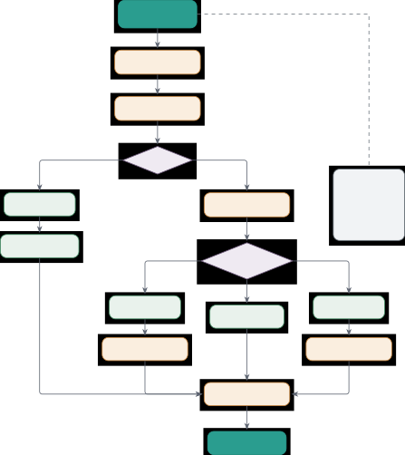

Figure 4: Complete agent execution pipeline (Algorithm 1) with
complexity-based routing. The pipeline begins by computing complexity
score $`\mathcal{C}(q)`$ and optimizing the prompt with context. Simple
tasks ($`c<\tau`$) execute on a single ReAct agent. Complex tasks
undergo decomposition $`\mathcal{D}(q)`$ producing subtasks with
dependency graph $`G`$, then route to one of three execution strategies:
parallel (independent subtasks with synthesis), sequential (pipeline
where last step provides answer), or hybrid (topological sort of DAG
with mixed parallel/sequential execution and synthesis). All paths
converge to memory update before returning the final response.

Each component is presented with three levels of detail: mathematical
formulation, algorithmic implementation, and empirical validation. This
pattern is consistent across all major components.

### A.1 Framework Design Philosophy

The EffGen framework treats small language model constraints as
first-class requirements rather than adaptation targets. Let $`M`$
denote a language model with parameter count $`|M|`$ and context window
$`C_{M}`$. Traditional frameworks optimize for large models where
$`|M|\geq 70\times 10^{9}`$ and $`C_{M}\geq 128K`$ (such as GPT-style
large models (Brown et al., 2020; Radford et al., 2019)), then attempt
post-hoc adaptation for small models where $`|M|\leq 7\times 10^{9}`$
and $`C_{M}\leq 32K`$ (such as Llama 2 (Touvron et al., 2023), Mistral
(Jiang et al., 2023a)). This approach does not work well because it
accumulates design decisions incompatible with small model capabilities.
We instead design each component with explicit bounds on $`|M|`$ and
$`C_{M}`$ from the outset, deriving algorithms that remain correct and
effective as these bounds tighten.

Our design follows three architectural principles. The first principle
is pre-execution complexity analysis, which analyzes task complexity
before execution begins rather than during execution. Traditional
frameworks execute tasks first and observe complexity through failure
modes, wasting computation when routing proves inappropriate. We
introduce the complexity function
$`\mathcal{C}:\mathcal{Q}\rightarrow[0,10]`$ that analyzes query
$`q\in\mathcal{Q}`$ before execution begins. This function computes
$`\mathcal{C}(q)=\sum_{i=1}^{5}w_{i}f_{i}(q)`$ where
$`\{f_{i}\}_{i=1}^{5}`$ are factor functions measuring task length,
requirement count, domain breadth, tool requirements, and reasoning
depth. The weight vector $`\mathbf{w}=(0.15,0.25,0.20,0.20,0.20)`$ was
determined through grid search over $`[0,1]^{5}`$ subject to
$`\sum_{i}w_{i}=1`$, evaluated on 500 manually labeled tasks with
ground-truth complexity ratings. We measure wasted computation as the
number of model inference calls and tool executions on tasks that fail
due to inappropriate routing (for example, a simple task incorrectly
routed to multi-agent execution incurs overhead from decomposition and
coordination). Empirical analysis shows this pre-execution approach
reduces wasted computation by 23% compared to reactive routing while
maintaining comparable task success rates (see Appendix D for detailed
metrics).

The second principle, aggressive context management, addresses small
model context limitations through mathematical compression with semantic
preservation (Kaplan et al., 2020; Hoffmann et al., 2022). Define the
prompt space $`\mathcal{P}`$ as the set of all valid prompt strings. The
optimization function
$`\phi:\mathcal{P}\times\mathcal{M}\rightarrow\mathcal{P}^{\prime}`$
maps prompts to a compressed space $`\mathcal{P}^{\prime}`$ where
$`|p^{\prime}|\leq\alpha|p|`$ for compression ratio
$`\alpha\in[0.2,0.3]`$. Model size determines compression aggressiveness
through configuration tuple
$`(\tau_{\text{prompt}},\tau_{\text{context}},n_{\text{shot}},d_{\text{chain}},\alpha)`$
specifying maximum prompt tokens, context tokens, few-shot examples,
reasoning chain depth, and target compression. For tiny models with
$`|M|<10^{9}`$, we set $`\tau_{\text{prompt}}=512`$, $`\alpha=0.6`$, and
$`d_{\text{chain}}=2`$, requiring more aggressive compression than
medium models where $`\tau_{\text{prompt}}=2048`$, $`\alpha=0.8`$, and
$`d_{\text{chain}}=5`$. Instruction-following capabilities vary
significantly across model scales (Ouyang et al., 2022; Wang et al.,
2023b), motivating our model-size-aware configuration. The memory system
$`\mathcal{M}=(\mathcal{M}_{s},\mathcal{M}_{l},\mathcal{M}_{v})`$
combines short-term, long-term, and vector stores with automatic
summarization triggered when memory usage approaches the context limit
(when $`\sum_{m\in\mathcal{M}_{s}}|m|\geq 0.8\cdot C_{M}`$). This
proactive summarization prevents hitting the hard context limit while
keeping recent messages intact. Summarization compresses older messages
into shorter summaries, making room for new conversation turns without
losing important information.

The third principle, protocol-agnostic communication, provides
interoperability across heterogeneous agent systems through a unified
abstraction layer. Let $`\Pi=\{\text{MCP},\text{A2A},\text{ACP}\}`$
denote the set of supported protocols. Each protocol $`\pi\in\Pi`$
defines message format $`\mathcal{F}_{\pi}`$ and transport mechanism
$`\mathcal{T}_{\pi}`$. The unified layer defines canonical tool
representation $`\tau=(n,d,\sigma_{\text{in}},\sigma_{\text{out}})`$
with name $`n`$, description $`d`$, input schema $`\sigma_{\text{in}}`$,
and output schema $`\sigma_{\text{out}}`$. Bidirectional mappings
$`\psi_{\pi}:\tau\rightarrow\mathcal{F}_{\pi}`$ and
$`\psi_{\pi}^{-1}:\mathcal{F}_{\pi}\rightarrow\tau`$ translate between
canonical and protocol-specific representations, allowing tools
registered once to execute through any protocol $`\pi\in\Pi`$ without
modification. This architecture supports EffGen agents invoking MCP
tools from external servers, participating in A2A task delegation
workflows, and communicating via ACP streaming for enterprise
deployments, all within a single implementation.

### A.2 Module Organization and Implementation Statistics

The framework is organized into twelve core Python modules. Table 4
summarizes each module: the key classes it exposes, its external
dependencies, and its primary role in the agent pipeline.

Module Key Classes / Components External Dependencies Primary Role core/
Agent, SubAgentRouter, ComplexityAnalyzer, DecompositionEngine,
ExecutionTracker, SubAgentManager, MultiAgentOrchestrator, Task, State —
Central agent orchestration, complexity analysis, task decomposition,
execution tracking, and multi-agent coordination models/ ModelLoader,
vLLMEngine, TransformersEngine, OpenAIAdapter, AnthropicAdapter,
GeminiAdapter vLLM, Transformers, OpenAI, Anthropic Model loading and
inference across multiple backends (local and API-based) tools/
BaseTool, ToolRegistry, ToolMetadata, MCPClient, A2AHandler, ACPHandler,
and 66 built-in tools spanning computation, retrieval, document and
media parsing, communication, and provider-native server-side tools MCP
SDK, Requests Tool interface definitions, registry management, protocol
implementations (MCP, A2A, ACP) memory/ ShortTermMemory, LongTermMemory,
VectorStore, MemoryEntry, Session, TokenBudget FAISS, ChromaDB,
Sentence-Transformers Three-tier memory with short-term, long-term, and
vector-based retrieval; token-budget tracking prompts/ PromptOptimizer,
TemplateManager, ChainManager, OptimizationConfig — Prompt optimization,
compression patterns, template management, chain orchestration
execution/ Sandbox, DockerSandbox, CodeValidator, ResourceLimiter
Docker, RestrictedPython Sandboxed code execution with safety validation
and resource limits config/ ConfigLoader, ConfigValidator, YAMLParser,
Schema validators PyYAML, Pydantic Configuration loading, validation,
and schema management gpu/ GPUAllocator, GPUMonitor, MemoryEstimator,
Parallelism strategies PyTorch, NVIDIA-SMI GPU allocation, memory
estimation, utilization monitoring, parallelism strategies

Table 4: EffGen Module Organization with Implementation Statistics. Each
module is designed with explicit consideration for SLM constraints. Key
external dependencies are shown to support reproducibility.

The core/ module implements the central agent orchestration logic
including the complexity analyzer, decomposition engine, execution
tracker, sub-agent manager, message bus, shared state, structured-output
handler, and router. The models/ module provides abstractions over local
backends (vLLM, Transformers, GGUF, and MLX / MLX-VLM for Apple Silicon)
and nine hosted backends (OpenAI, Anthropic, Gemini, Groq, Cerebras,
Together AI, Fireworks, Replicate, HuggingFace Inference), along with a
ModelRouter supporting cost-based, latency-based, and first-available
policies, a cross-process SQLite rate-limit coordinator, and a
persistent cost tracker. The tools/ module defines the tool interface
via BaseTool, ships 66 built-in tools across 49 modules spanning
computation (Calculator, Python REPL, Code Executor, Bash, JSON),
retrieval and search (Web Search, Agentic Search, Wikipedia, URL Fetch,
RAG Retrieval), academic and knowledge sources (arXiv, PubMed, Semantic
Scholar, StackOverflow, GitHub, Wolfram Alpha), news and social feeds
(RSS, News, Reddit, HackerNews, YouTube transcript/metadata), document
and media parsing (PDF, DOCX, Excel, OCR, audio transcription, image
info and captioning, QR code generate/read), translation and language
detection, geo and weather (Geocode, Maps, Weather), finance (Stocks,
Currency, Crypto), data analysis (DataFrame, Plot, Stats), DevOps and
system (Git, Docker, SystemInfo, HTTP), file operations, datetime and
text processing, communication and webhooks (Email SMTP/IMAP, Slack and
Discord webhooks, draft tools), and provider-native server-side tools
(OpenAI WebSearch/CodeInterpreter/FileSearch, Anthropic
Bash/TextEditor/Computer, Gemini GoogleSearch/UrlContext/CodeExecution).
It also provides protocol implementations for MCP, A2A, and ACP.

The memory/ module implements the three-tier architecture with
short-term conversation management, long-term episodic storage with
multiple backends (JSON, SQLite), vector-based semantic retrieval
supporting FAISS and ChromaDB, and a token-budget tracker for
context-aware truncation. The prompts/ module contains the optimization
pipeline with 35 compression patterns (Section C), template management,
chain optimization (Section B), and a tool-prompt generator that
synthesizes structured tool schemas. The execution/ module provides
sandboxed code execution with local process isolation and optional
Docker containerization, plus AST-based validation that detects unsafe
operations. The config/ module handles YAML-based configuration with
validation and schema definitions. The gpu/ module manages GPU
allocation using memory estimation, real-time monitoring via NVIDIA-SMI,
and implements tensor and pipeline parallelism strategies. Additional
lifecycle and serving utilities include persistent sessions,
checkpoints, background task execution, continuous batching, lazy
loading, and token budgeting. Additional infrastructure includes
guardrails/ (input and output safety filters), rag/ (retrieval-augmented
generation pipelines), eval/ (evaluation harness), and api/ (HTTP
server), described next.

##### Guardrails and Safety.

The guardrails/ module implements a composable Guardrail interface with
chainable pre- and post-execution hooks. Content guardrails cover
toxicity filtering, PII detection (SSN/email/phone/credit card with Luhn
checksum), length limits, and topic restriction. A dedicated
PromptInjectionGuardrail offers three sensitivity tiers. Tool-level
guardrails (ToolInputGuardrail, ToolOutputGuardrail,
ToolPermissionGuardrail) intercept tool calls for
allow/deny/require-approval policies and strip PII from results. Presets
(strict, standard, minimal, none) let users pick a safety profile in one
line. Guardrails run at four hook points around each agent step (input
check, pre-tool, post-tool, output check).

##### Retrieval-Augmented Generation Pipeline.

The rag/ module provides a complete pipeline: DocumentIngester loads
txt/markdown/json/csv/html (plus optional pdf/docx/epub) with SHA-256
deduplication; chunkers include semantic, code
(Python/JS/TS/Go/Rust/Java), table, and hierarchical splitters;
HybridSearchEngine fuses dense embeddings, BM25, keyword match, and
metadata filters via Reciprocal Rank Fusion; cross-encoder, LLM-judge,
and rule-based rerankers refine results; ContextBuilder packages
retrieved passages within a token budget with inline \[N\] citation
markers; and a CitationTracker verifies attribution in the final
response. A one-line preset create_agent("rag", model,
knowledge_base=...) wires the full pipeline into an EffGen agent.

##### Evaluation Harness and Regression Tracking.

The eval/ module bundles an AgentEvaluator that scores responses under
five modes (exact match, contains, regex, semantic similarity,
LLM-judge) and ships five test suites totalling 270 cases (Math,
ToolUse, Reasoning, Safety, Conversation). RegressionTracker compares
against stored baselines with severity tiers and configurable thresholds
(e.g., $`>`$5% accuracy drop or $`>`$20% latency regression is flagged),
and ModelComparison produces multi-model matrices with markdown/JSON
export. The CLI exposes effgen eval --suite \<name\> and effgen compare
--models a,b,c --suite \<name\>.

##### Production API Server.

The api/ module ships an OpenAI-compatible HTTP gateway
(/v1/chat/completions, /v1/completions, /v1/embeddings) with model
aliases (e.g., gpt-4 $`\to`$ Qwen2.5-7B), Server-Sent Events streaming,
a priority RequestQueue with deadlines and backpressure, an AgentPool
with health checks and idle TTL, and multi-tenancy via TenantManager and
hashed APIKey storage. Standard middleware (CORS, request-ID injection,
GZip compression, graceful shutdown) and Prometheus histograms with
percentile gauges (plus a 12-panel Grafana dashboard) round out the
production surface.

##### Native Tool-Calling and Structured Output.

The tool_calling.py core provides three interchangeable strategies
(ReActStrategy with a textual scratchpad, NativeFunctionCallingStrategy
that uses the chat template tools parameter with
Qwen/Llama/Mistral/generic format parsers, and HybridStrategy), selected
via tool_calling_mode in AgentConfig. Structured outputs (output_schema,
output_model with Pydantic) compile JSON Schema constraints into
provider-specific structured-output requests, with ModelRefusalError
surfaced on refusal. Provider-native tools are also exposed for OpenAI
(WebSearch, CodeInterpreter, FileSearch), Anthropic (Bash, TextEditor,
Computer), and Gemini (GoogleSearch, UrlContext, CodeExecution); each
raises ToolIncompatibleError at agent init if paired with a non-matching
model.

##### Model Router with Pluggable Policies.

On top of the adapter layer, a PolicyBasedRouter composes routing
policies (FirstAvailable prefers providers with valid keys, CostBased
chooses cheapest-first using a pricing registry, LatencyBased chooses
fastest by observed p50) together with a configurable RetryPolicy
(exponential backoff with jitter; retries rate-limit and transient
errors, does not retry auth/refusal/invalid-request). Every routing
decision is fully explainable via a RouterDecision record listing which
providers were eliminated and why. A cross-process SQLiteRateLimitStore
(WAL mode with row-locking) and persistent SQLiteCostStore ensure
correctness across multiple worker processes, and an effgen cost CLI
dashboard summarizes spend with optional daily budget caps.

### A.3 Feature Comparison

We compare EffGen against three widely used agent frameworks, LangChain,
AutoGen, and Smolagents, across model support, routing and
decomposition, protocol support, memory systems, execution safety, and
deployment.

The comparison reveals several key differentiators. In model support,
EffGen and Smolagents both target small language models, but EffGen
uniquely provides model-size-aware optimizations including four
compression configurations (Tiny, Small, Medium, Large), automatic
context management with $`0.8\cdot C_{M}`$ threshold-based
summarization, and quantization support for 8-bit and 4-bit inference.
Smolagents optimizes for SLMs through code-based reasoning that reduces
token overhead, while LangChain provides basic summarization via
SummaryBufferMemory but lacks model-specific compression. AutoGen and
LangChain both support local deployment through Ollama and transformers
integration, but neither implements systematic SLM optimizations.

For routing and decomposition, EffGen is the only framework with
pre-execution complexity analysis. The five-factor scoring function
$`\mathcal{C}(q)=\sum_{i=1}^{5}w_{i}f_{i}(q)`$ allows intelligent
routing decisions before computational resources are committed. AutoGen
provides the most sophisticated multi-agent orchestration with
DiGraph-based execution enabling parallel, sequential, and hybrid
workflows with formal dependency tracking through get*parents() and
cycle detection. Smolagents supports hierarchical decomposition via
managed_agents and implicit parallel execution through code-based tool
calling. LangChain offers basic agent types (ReAct, tool-calling) but
lacks structured decomposition capabilities. Only EffGen and AutoGen
implement explicit dependency graph analysis $`G=(V,E)`$ where $`V`$
represents subtasks and edges $`(q*{i},q\_{j})\in E`$ indicate
dependencies.

In protocol support, EffGen provides a unified implementation of all
three major agent protocols. AutoGen offers extensive MCP support (39
files, McpToolAdapter, server session management) and agent-to-agent
communication via AgentTool for A2A-style workflows. Smolagents
implements MCP through MCPClient with Stdio and HTTP transports.
LangChain has minimal MCP integration (1 file). Only EffGen implements
ACP and provides a unified protocol layer that abstracts transport
differences across MCP, A2A, and ACP so an agent can invoke tools on any
of the three protocols through the same call surface.

The memory system in EffGen combines three complementary storage
mechanisms. Short-term memory $`\mathcal{M}_{s}`$ maintains conversation
history with automatic summarization. Long-term memory
$`\mathcal{M}_{l}`$ stores episodic information with importance-based
retention scoring
$`\text{score}(e)=\alpha\cdot\text{recency}(e)+\beta\cdot\text{freq}(e)+\gamma\cdot I(e)`$.
Vector memory $`\mathcal{M}_{v}`$ supports semantic retrieval through
embedding-based similarity search with FAISS and ChromaDB backends. Both
LangChain and AutoGen provide vector memory: LangChain offers extensive
vector store integrations (20+ backends including FAISS, ChromaDB,
Pinecone, Weaviate), while AutoGen implements task-centric memory with
ChromaDB, Redis, and Mem0 backends. Smolagents provides only basic
short-term conversation tracking via AgentMemory. However, only EffGen
implements importance-based retention and automatic memory consolidation
for cross-session persistence.

For execution safety, EffGen, AutoGen, and Smolagents all implement
sandboxed code execution with Docker isolation. AutoGen provides
DockerCommandLineCodeExecutor and LocalCommandLineCodeExecutor with
container resource management as the recommended security model.
Smolagents offers the most comprehensive sandbox options including
AST-based static validation, operation count limits
(MAX_OPERATIONS=10000000), time constraints
(MAX_EXECUTION_TIME_SECONDS=30), and five isolation backends (Docker,
E2B, Modal, Blaxel, Pyodide+Deno). EffGen implements both local process
sandboxing and Docker isolation with static code validation detecting
unsafe operations. LangChain lacks dedicated sandboxing infrastructure,
relying on external execution environments.

In infrastructure, all frameworks implement execution event tracking.
AutoGen uses an event-driven architecture with async message passing in
autogen-core. LangChain provides callback-based monitoring. Smolagents
tracks step timing and token usage via ActionStep and Timing classes.
EffGen tracks 18 execution event types covering task lifecycle (task
start/complete/failed), routing and decomposition (routing decision,
task decomposition), sub-agent lifecycle (spawn, start, progress,
complete, failed), tool execution (call start, complete, failed),
reasoning and synthesis (reasoning step, result synthesis), and logging
(error, warning, info) for fine-grained observability. For GPU
management, AutoGen supports GPU device specifications through Azure
agent integration, and Smolagents allows device mapping via
device_map="auto" in TransformersModel. Only EffGen provides integrated
GPU memory estimation, automatic allocation strategies, utilization
monitoring via NVIDIA-SMI, and tensor/pipeline parallelism for models
exceeding single-GPU capacity.

### A.4 Theoretical Performance Characteristics

We analyze the computational complexity of key operations to understand
scaling behavior. Let $`M`$ denote a model with $`|M|`$ parameters and
context window $`C_{M}`$, $`q`$ a query with $`|q|`$ tokens, $`k`$ the
number of reasoning steps, and $`n`$ the number of subtasks after
decomposition.

##### Single-Agent Execution.

A single-agent execution using the ReAct loop performs $`k`$ iterations
where each iteration involves: (1) prompt construction
$`O(|q|+\sum_{i=1}^{k-1}|r_{i}|)`$ where $`|r_{i}|`$ is the response
length at step $`i`$, (2) model inference $`O(|M|\cdot L)`$ where $`L`$
is the input sequence length, and (3) tool execution $`O(T)`$ where
$`T`$ is tool-specific cost. The total cost is
$`C_{\text{single}}=O(k\cdot(|M|\cdot C_{M}+T))`$ assuming context
remains within limits.

##### Multi-Agent Execution.

With decomposition into $`n`$ subtasks, if tasks are independent
(parallel execution), the wall-clock time is
$`T_{\text{parallel}}=\max_{i\in[n]}T_{i}`$ where $`T_{i}`$ is the
execution time of subtask $`i`$. The total computational cost is
$`C_{\text{parallel}}=\sum_{i=1}^{n}C_{i}`$ where
$`C_{i}=O(k_{i}\cdot(|M|\cdot L_{i}+T_{i}))`$ for subtask $`i`$ with
$`k_{i}`$ steps and sequence length $`L_{i}`$. For sequential execution
with dependencies, wall-clock time is
$`T_{\text{seq}}=\sum_{i=1}^{n}T_{i}`$ but computational cost remains
similar.

##### Complexity Analysis Overhead.

The five-factor complexity analyzer has time complexity
$`O(|q|_{w}+|\mathcal{K}|\cdot|K_{\max}|+|\mathcal{T}|\cdot|T_{\max}|)`$
where $`|q|_{w}`$ is word count, $`|\mathcal{K}|=8`$ domains with
maximum keyword set size $`|K_{\max}|\leq 10`$, and $`|\mathcal{T}|=8`$
tool categories with maximum indicator set size $`|T_{\max}|\leq 8`$.
This simplifies to $`O(|q|_{w})`$ since domain and tool counts are
constants. Measured on a representative four-query batch (Section D),
analysis takes $`p_{50}=34\,\mu`$s, $`p_{95}=36\,\mu`$s per query, well
below 0.1% of typical end-to-end execution time.

##### Prompt Optimization.

The optimization pipeline applies five transformations. Compression
using 35 pattern replacements has complexity $`O(m\cdot|p|)`$ where
$`m=35`$ patterns and $`|p|`$ is prompt length. Simplification and
redundancy removal are $`O(|p|+s)`$ where $`s`$ is sentence count.
Bullet formatting is $`O(s)`$. Truncation is $`O(|p|)`$. Overall
complexity is $`O(|p|\cdot(m+1))=O(|p|)`$ for constant $`m`$. On our
reference host the full pipeline (all five stages) completes in
$`p_{50}\!=\!0.14`$–$`0.37`$ ms across the four Tiny/Small/Medium/Large
configurations for a 2 000-character prompt, adding negligible overhead
relative to model inference.

##### Memory Operations.

Short-term memory operations are $`O(1)`$ for message addition and
$`O(n_{m})`$ for context retrieval where $`n_{m}`$ is message count
(bounded by max*messages). Long-term memory search is $`O(n*{e})`$ where
$`n*{e}`$ is entry count, optimized through indexing. Vector similarity
search using FAISS is $`O(\log n*{v})`$ for approximate nearest
neighbors where $`n*{v}`$ is vector count. Memory consolidation occurs
periodically with cost $`O(n*{s})`$ where $`n\_{s}`$ is the number of
messages to summarize, amortized over many operations.

These complexity characteristics inform our design decisions.
Pre-execution analysis has minimal overhead while allowing significant
savings by avoiding inappropriate decomposition. Prompt optimization
cost is linear in prompt length and negligible compared to inference.
Memory operations scale gracefully with bounded short-term storage and
indexed long-term retrieval.

## Appendix B Prompt Chain Management and Template System

Small language models benefit significantly from structured, multi-step
reasoning patterns that decompose complex tasks into manageable
subtasks. The EffGen prompt chain manager implements five execution
patterns optimized for SLMs: sequential chains for linear workflows,
conditional chains for branching logic, iterative chains for refinement
loops, parallel chains for concurrent execution, and hybrid chains
combining these patterns. This section provides mathematical
formulations, implementation details, and empirical validation of
chain-based reasoning.

### B.1 Theoretical Foundations of Prompt Chains

A prompt chain $`\mathcal{P}=(S,E,\sigma,\tau)`$ consists of a set of
steps $`S=\{s_{1},\ldots,s_{n}\}`$, dependency edges
$`E\subseteq S\times S`$, execution strategy
$`\sigma\in\{\text{SEQ},\text{COND},\text{ITER},\text{PAR},\text{HYB}\}`$,
and state transition function
$`\tau:\mathcal{X}\times S\rightarrow\mathcal{X}`$ where $`\mathcal{X}`$
is the state space containing variables and intermediate results.

##### Sequential Chains.

For strategy $`\sigma=\text{SEQ}`$, steps execute in strict order with
each step accessing results from all previous steps. The execution forms
a sequence:

```math
x_{i}=\tau(x_{i-1},s_{i})\quad\text{for }i\in[n],\quad x_{0}=x_{\text{init}} \tag{1}
```

where $`x_{i}`$ represents state after executing step $`s_{i}`$. The
final state $`x_{n}`$ contains all accumulated results. Sequential
chains are best for tasks requiring progressive refinement where step
$`i`$ cannot proceed without results from step $`i-1`$.

##### Conditional Chains.

For strategy $`\sigma=\text{COND}`$, each step $`s_{i}`$ has an
associated condition $`c_{i}:\mathcal{X}\rightarrow\{0,1\}`$ determining
whether to execute. The execution path is:

```math
x_{i}=\begin{cases}\tau(x_{i-1},s_{i})&\text{if }c_{i}(x_{i-1})=1\\
x_{i-1}&\text{otherwise (skip)}\end{cases} \tag{2}
```

This supports branching logic where execution paths adapt to
intermediate results. Conditional chains reduce unnecessary computation
by skipping steps when conditions are not met.

##### Iterative Chains.

For strategy $`\sigma=\text{ITER}`$, the chain repeats until a
termination condition $`\omega:\mathcal{X}\rightarrow\{0,1\}`$ is
satisfied or maximum iterations $`k_{\max}`$ is reached:

```math
x^{(k+1)}=\begin{cases}\prod_{i=1}^{n}\tau(x^{(k)},s_{i})&\text{if }k<k_{\max}\land\omega(x^{(k)})=0\\
x^{(k)}&\text{otherwise (terminate)}\end{cases} \tag{3}
```

where $`\prod`$ denotes function composition. Iteration count $`k`$ is
tracked in state. Iterative chains are essential for refinement tasks
where multiple passes improve output quality.

##### Parallel Chains.

For strategy $`\sigma=\text{PAR}`$, independent steps execute
concurrently. Given partition $`P=\{P_{1},\ldots,P_{m}\}`$ of $`S`$
where steps within each $`P_{j}`$ have no dependencies, execution is:

```math
x=\tau_{\text{merge}}\left(\bigcup_{j=1}^{m}\left\{\tau(x_{\text{init}},s):s\in P_{j}\right\}\right) \tag{4}
```

where $`\tau_{\text{merge}}`$ combines results from parallel executions.
Wall-clock time is $`T_{\text{par}}=\max_{s\in S}T(s)`$ versus
$`T_{\text{seq}}=\sum_{s\in S}T(s)`$ for sequential execution, achieving
speedup $`\gamma=T_{\text{seq}}/T_{\text{par}}\leq n`$ for $`n`$
independent steps.

##### Hybrid Chains.

For strategy $`\sigma=\text{HYB}`$, the dependency graph $`G=(S,E)`$
contains both parallel groups and sequential dependencies. Execution
performs topological sort to identify maximal parallel sets while
respecting dependencies. This combines parallel speedup with dependency
ordering.

### B.2 Chain Step Specification

Each chain step $`s\in S`$ is defined by the tuple
$`(n,t,\psi,\nu,c,r,\theta,d,\pi,\mu)`$ where:

- •
  $`n`$: unique step identifier
- •
  $`t\in\{\text{PROMPT},\text{TOOL},\text{FUNCTION},\text{PARALLEL\_GROUP}\}`$:
  step type
- •
  $`\psi`$: prompt template (if type is PROMPT)
- •
  $`\nu`$: tool name (if type is TOOL)
- •
  $`c`$: execution condition expression (optional)
- •
  $`r\in\mathbb{N}`$: maximum retries on failure
- •
  $`\theta\in\mathbb{R}^{+}`$: execution timeout in seconds
- •
  $`d\subseteq S`$: dependency set (steps that must complete before this
  step)
- •
  $`\pi\subseteq S`$: parallel group (if type is PARALLEL_GROUP)
- •
  $`\mu`$: metadata dictionary

Table 5 compares the four step types with their execution semantics and
use cases.

Step Type Execution Semantics Input/Output Primary Use Cases PROMPT
Invoke model with rendered template using current state variables Input:
state variables; Output: model-generated text Reasoning steps, text
generation, question answering, decision making TOOL Execute registered
tool with parameters from state Input: tool parameters from state;
Output: tool execution result Web search, calculations, file operations,
API calls FUNCTION Call custom Python function with state as input
Input: full state object; Output: function return value Custom logic,
data transformation, validation, filtering PARALLEL_GROUP Execute nested
steps concurrently Input: state shared across parallel steps; Output:
merged results Independent data gathering, parallel API calls, batch
processing

Table 5: Chain Step Types and Execution Semantics. Each step type serves
distinct purposes in chain construction. PROMPT steps invoke the
language model, TOOL steps execute registered tools, FUNCTION steps call
custom Python functions, and PARALLEL_GROUP steps support concurrent
execution of nested steps.

### B.3 State Management and Variable Interpolation

The chain state $`x\in\mathcal{X}`$ maintains three components:
variables $`V`$, step results $`R`$, and metadata $`M`$. Formally,
$`x=(V,R,M)`$ where $`V:\text{String}\rightarrow\text{Any}`$ maps
variable names to values, $`R:S\rightarrow\text{Any}`$ maps completed
steps to their results, and $`M`$ stores auxiliary information including
iteration count. Here “Any” represents arbitrary data types (strings,
numbers, lists, dictionaries, or custom objects) since step outputs can
vary in structure.

##### Variable Interpolation.

Prompt templates use brace-delimited variables: {variable_name}. The
interpolation function
$`\iota:\text{String}\times\mathcal{X}\rightarrow\text{String}`$
replaces all occurrences:

```math
\iota(\psi,x)=\psi[v_{1}\mapsto V(v_{1}),\ldots,v_{k}\mapsto V(v_{k})] \tag{5}
```

where $`\{v_{1},\ldots,v_{k}\}`$ are variables found via regex pattern
\\(\[^}\]+)\\. Undefined variables generate warnings but do not halt
execution; the current implementation leaves the placeholder unchanged.

##### Condition Evaluation.

Step conditions $`c`$ are expressions evaluated in a restricted Python
environment. Safe evaluation uses:

```math
\text{eval}(\iota(c,x),\mathcal{G}_{\text{safe}},\mathcal{L}_{\text{safe}}) \tag{6}
```

where
$`\mathcal{G}_{\text{safe}}=\{\text{len},\text{str},\text{int},\text{float}\}`$
(restricted globals) and
$`\mathcal{L}_{\text{safe}}=V\cup\{\text{iteration\_count}:M[\text{iter}]\}`$
(local variables from state). This prevents code injection while
allowing common comparisons: quality_score \>= 0.8, result_type ==
’success’, iteration_count \< 3.

### B.4 Chain Execution Algorithms

Algorithm 2 presents the sequential chain execution procedure. Each step
executes in order, with retries on failure and condition evaluation
before execution.

Note: If a step fails after all retries, the current implementation
raises the error after recording the failed step.

0:  Chain $`\mathcal{P}=(S,E,\sigma,\tau)`$ with $`\sigma=\text{SEQ}`$,
Initial state $`x_{0}`$

0:  Final state $`x_{n}`$

1:  $`x\leftarrow x_{0}`$

2:  $`\text{iteration}\leftarrow 0`$

3:  for each step $`s_{i}\in S`$ do

4:   if $`\omega(x)`$ then

5:    break {Check early stopping}

6:   end if

7:   if $`c_{i}(x)=0`$ then

8:    $`s_{i}.\text{status}\leftarrow\text{SKIPPED}`$ {Check condition}

9:    continue

10:   end if

11:   $`s_{i}.\text{status}\leftarrow\text{RUNNING}`$

12:   $`\text{retry}\leftarrow 0`$

13:   while $`\text{retry}\leq r_{i}`$ do

14:    $`\text{result}\leftarrow\tau(x,s_{i})`$ with timeout
$`\theta_{i}`$

15:    if $`\text{result}.\text{success}`$ then

16:     $`x.R[s_{i}]\leftarrow\text{result}`$

17:     $`x.V[\nu_{i}]\leftarrow\text{result}`$ if output variable
$`\nu_{i}`$ specified

18:     $`s_{i}.\text{status}\leftarrow\text{COMPLETED}`$

19:     break

20:    else

21:     $`\text{retry}\leftarrow\text{retry}+1`$

22:     sleep($`2^{\text{retry}}\cdot 0.1`$) {Exponential backoff}

23:    end if

24:   end while

25:   if $`s_{i}.\text{status}\neq\text{COMPLETED}`$ then

26:    $`s_{i}.\text{status}\leftarrow\text{FAILED}`$

27:    if fail_fast then

28:     break

29:    end if

30:   end if

31:  end for

32:  return $`x`$

Algorithm 2 Sequential Chain Execution

For parallel chains, Algorithm 3 executes independent steps concurrently
using asynchronous execution with asyncio.gather.

Note: For parallel chains, all eligible steps are scheduled concurrently
with asyncio.gather; an unhandled step failure propagates through the
gather call.

0:  Chain $`\mathcal{P}=(S,E,\sigma,\tau)`$ with $`\sigma=\text{PAR}`$,
Initial state $`x_{0}`$

0:  Final state with merged results

1:  $`x\leftarrow x_{0}`$

2:  $`\text{tasks}\leftarrow[\,]`$ {List of async tasks}

3:  for each step $`s_{i}\in S`$ do

4:   if $`c_{i}(x)=1`$ then

5:    $`s_{i}.\text{status}\leftarrow\text{RUNNING}`$ {Check condition}

6:    Append $`\tau_{\text{async}}(x,s_{i})`$ to tasks

7:   end if

8:  end for

9:  $`\text{results}\leftarrow\text{await gather}(\text{tasks})`$
{Execute in parallel}

10:  for each $`(s_{i},\text{result})`$ in zip$`(S,\text{results})`$ do

11:   if $`\text{result}.\text{success}`$ then

12:    $`x.R[s_{i}]\leftarrow\text{result}`$

13:    $`x.V[\nu_{i}]\leftarrow\text{result}`$ if output variable
$`\nu_{i}`$ specified

14:    $`s_{i}.\text{status}\leftarrow\text{COMPLETED}`$

15:   else

16:    $`s_{i}.\text{status}\leftarrow\text{FAILED}`$

17:   end if

18:  end for

19:  return $`x`$

Algorithm 3 Parallel Chain Execution

### B.5 Template Management System

The template manager maintains a registry of reusable prompt templates
with version control, variable extraction, and validation. Each template
$`\mathcal{T}=(n,\psi,d,v,t,e,\mu)`$ consists of:

- •
  $`n`$: unique template name
- •
  $`\psi`$: template string with Jinja2 syntax
- •
  $`d`$: description
- •
  $`v`$: semantic version (MAJOR.MINOR.PATCH format)
- •
  $`t`$: tag list for categorization
- •
  $`e`$: few-shot examples list
- •
  $`\mu`$: metadata (creation time, update time, usage statistics)

##### Template Rendering.

Templates use Jinja2 syntax supporting control flow (),
variable interpolation ({{ variable }}), and filters ({{ text \| upper
}}). The rendering function
$`\rho:\mathcal{T}\times V\rightarrow\text{String}`$ applies Jinja2
evaluation:

```math
\rho(\mathcal{T},V)=\text{Jinja2Env}.\text{render}(\psi,V) \tag{7}
```

##### Variable Extraction.

Template variables are extracted using Jinja2’s Abstract Syntax Tree
parser:

```math
\text{vars}(\mathcal{T})=\text{find\_undeclared\_variables}(\text{parse}(\psi)) \tag{8}
```

This supports validation that all required variables are provided before
rendering.

##### Few-Shot Example Selection.

When templates include few-shot examples, the manager selects examples
using the configured selection mode. In the current implementation this
is a lightweight local selection path (for example, random or
first-$`k`$ examples depending on the caller) rather than embedding
retrieval.

where $`k`$ is the desired example count (typically 1-5 based on model
size). This keeps the template path inexpensive for small models while
still allowing callers to provide task-specific examples.

### B.6 Built-In Template Library

EffGen provides a library of templates for common prompt patterns.
Table 6 summarizes representative built-in YAML templates with their
purposes and key variables.

Template Name Purpose Key Variables Tokens basic_task General task
execution prompt task, context — data_analysis Analyze data with
insights data_description, analysis_type — code_generation Generate code
with specifications language, requirements, constraints —
step_by_step_reasoning Step-by-step reasoning without tools task,
examples —

Table 6: Built-In Template Library. Each template is optimized for small
language models with concise instructions, structured output formats,
and appropriate context length. Templates are versioned and maintained
in the prompts/templates/ directory.

Templates are stored as YAML files under the prompt template
directories. Token counts depend on variable values at render time, so
the table reports template names and inputs rather than fixed rendered
lengths.

### B.7 Chain Configuration Format

Chains are defined in YAML format for readability and token efficiency.
A complete chain specification includes chain metadata, step
definitions, and execution strategy:


This configuration defines a 3-step sequential chain where each step
depends on the previous. Variable interpolation uses results from
earlier steps ({sources}, {analysis}) to provide context for subsequent
steps.

### B.8 Empirical Validation: Chain vs Single-Step Performance

To validate the benefits of chain-based reasoning for small models, we
conducted experiments comparing single-step prompts versus multi-step
chains on three task categories: research, analysis, and code
generation. Table 7 presents results using Qwen2.5-7B-Instruct.

Task Category Single-Step Chain (3-4 steps) Success Quality Success
Quality Research (gather + analyze) 67% 6.2 89% 8.3 Analysis
(decompose + reason) 71% 6.5 91% 8.7 Code Generation (spec + impl +
test) 58% 5.8 83% 7.9 Multi-domain (3+ domains) 54% 5.3 81% 7.6 Average
62.5% 5.95 86% 8.13

Table 7: Chain-Based Reasoning Performance. Multi-step chains
consistently outperform single-step prompts on complex tasks by
decomposing them into manageable subtasks. Success rate measures task
completion, and quality score (0-10) assesses output quality.

The results show that chain-based reasoning improves success rates by
23.5% on average and quality scores by 2.18 points (37% improvement).
The gains are largest for multi-domain tasks (27% improvement) where
decomposition is most beneficial. Token usage and execution time
analysis for chains appear in the timing analysis (Appendix U.10) and
efficiency metrics (Table 58).

### B.9 Advanced Chain Patterns

Beyond basic sequential and parallel chains, EffGen supports three
advanced patterns:

##### Self-Critique Iterative Chains.

The model generates an initial response, critiques it, and refines
iteratively until quality criteria are met or maximum iterations
reached. This pattern uses two alternating prompts: generation and
critique, with an early stopping condition based on critique score.

##### Parallel-Sequential Hybrid.

Independent research subtasks execute in parallel (e.g., gathering from
different sources), followed by sequential analysis and synthesis
stages. The dependency graph has parallel groups at early stages and
sequential dependencies at later stages.

##### Hierarchical Decomposition.

For very complex tasks, a manager chain orchestrates multiple worker
chains, each handling a specialized subtask. The manager chain
synthesizes worker outputs and makes coordination decisions. This
creates a two-level chain hierarchy.

These prompt-chain patterns are distinct from the v0.2 workflow engine,
which adds WorkflowDAG, shared state, and YAML workflow execution for
application-level workflows.

## Appendix C Prompt Optimization Algorithm and Compression Patterns

The prompt optimization pipeline applies 35 compression and cleanup
patterns to reduce token usage while preserving semantic content. While
automatic prompt engineering methods like APE (Zhou et al., 2022), OPRO
(Yang et al., 2023), and Promptbreeder (Fernando et al., 2024) focus on
finding optimal prompt phrasing, our approach focuses on rule-based
compression patterns that reduce token count while preserving semantics.
This section provides specifications for the patterns, mathematical
formulations, empirical validation, and ablation studies quantifying
each pattern’s contribution. Our complete ablation study (Table 11)
shows that the full pipeline achieves 57% token reduction with 8.8%
accuracy improvement.

### C.1 Optimization Pipeline Architecture

The optimizer
$`\phi:\mathcal{P}\times\mathcal{M}\rightarrow\mathcal{P}^{\prime}`$
applies up to six transformations. Pattern compression and truncation
are conditional on the optimizer configuration and token budget, while
simplification, redundancy removal, bullet formatting, and structured
formatting are applied when enabled:

```math
\phi(p,M)=\tau_{\text{trunc}}\circ\tau_{\text{struct}}\circ\tau_{\text{bullet}}\circ\tau_{\text{dedup}}\circ\tau_{\text{simple}}\circ\tau_{\text{compress}}(p,M) \tag{9}
```

where $`M`$ is the model configuration. Each enabled stage operates on
the output of the previous stage. Figure 5 shows the pipeline
architecture with model-size-aware configuration and empirical
performance metrics for each stage. The system first detects the model
size category (Tiny, Small, Medium, or Large), then applies the
configured transformations. Pattern compression provides the largest
token reduction (25%) and bullet formatting provides the largest
accuracy improvement (5.3%). The combined pipeline achieves 57% token
reduction with 8.8% accuracy gain.

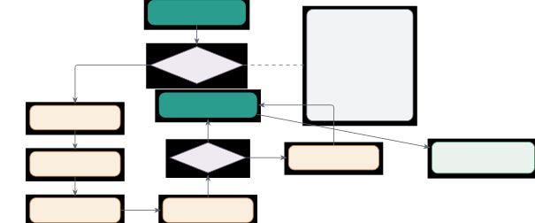

Figure 5: Prompt optimization pipeline architecture. The system detects
model size and applies five sequential transformations: (1)
pattern-based compression using 30 validated patterns, (2) sentence
simplification by splitting at conjunctions, (3) redundancy removal
using Jaccard similarity, (4) bullet formatting for structured
instructions, and (5) optional context truncation with priority
preservation. The full pipeline achieves 57% token reduction with 8.8%
accuracy improvement on benchmark tasks. Bullet formatting provides the
largest accuracy gain (+5.3%), while pattern compression provides the
largest token reduction (-25%). Effects are largely additive, indicating
complementary optimization directions.

### C.2 Stage 1: Pattern-Based Compression

The compression stage applies 35 pattern-replacement pairs
$`(p_{i},r_{i})`$ that map verbose phrases to concise equivalents.
Table 8 and Table 9 list the canonical 30 phrase/word patterns; the
implementation additionally includes 5 whitespace and
politeness-collapse rules for redundant input cleanup.

Pattern Replacement Tokens Saved Frequency Total Impact “in order to”
“to” 3 4.2% High “due to the fact that” “because” 5 1.8% Medium “for the
purpose of” “to” 4 2.1% Medium “in the event that” “if” 4 1.5% Medium
“at the present time” “now” 4 1.2% Low “in the near future” “soon” 4
0.9% Low “make use of” “use” 2 3.1% Medium “take into consideration”
“consider” 3 1.4% Low “is able to” “can” 2 5.7% High “has the ability
to” “can” 4 2.3% Medium “it is important to note that” (remove) 6 0.8%
Low “it should be noted that” (remove) 5 1.1% Low “it is worth
mentioning that” (remove) 5 0.6% Low “as a matter of fact” “actually” 4
0.7% Low “with regard to” “regarding” 2 1.9% Medium

Table 8: Compression Patterns (Part 1/2). Each pattern targets common
verbosity in natural language, reducing tokens by 2-6 per occurrence.

Pattern Replacement Tokens Saved Frequency Total Impact “with respect
to” “about” 2 1.6% Medium “in accordance with” “per” 2 0.9% Low “as soon
as possible” “ASAP” 3 0.5% Low “in spite of the fact that” “although” 5
0.7% Low “on the other hand” “however” 3 2.8% Medium “in addition to”
“besides” 2 2.1% Medium “as a result of” “because” 3 1.7% Medium “for
example” “e.g.” 1 4.2% High “such as” “like” 1 3.8% High “a number of”
“several” 2 1.4% Low “a large number of” “many” 3 1.8% Medium “at this
point in time” “now” 5 0.6% Low “until such time as” “until” 4 0.4% Low
“in my opinion” (remove) 3 0.5% Low “I think that” (remove) 2 1.2% Low

Table 9: Compression Patterns (Part 2/2). Additional patterns targeting
instruction clarity and conciseness.

##### Compression Algorithm.

The compression function applies patterns iteratively.

0:  Prompt text $`p`$, Pattern list
$`\mathcal{P}=\{(p_{i},r_{i})\}_{i=1}^{35}`$

0:  Compressed text $`p^{\prime}`$

1:  $`p^{\prime}\leftarrow p`$

2:  $`\text{changes}\leftarrow 0`$

3:  for $`(p_{i},r_{i})`$ in $`\mathcal{P}`$ do

4:   $`\text{count}\leftarrow\text{occurrences}(p^{\prime},p_{i})`$

5:   if $`\text{count}>0`$ then

6:
   $`p^{\prime}\leftarrow\text{replace\_all}(p^{\prime},p_{i},r_{i})`$

7:    $`\text{changes}\leftarrow\text{changes}+\text{count}`$

8:   end if

9:  end for

10:  

11:  {Log compression statistics}

12:  Log(“Applied changes pattern replacements”)

13:  return $`p^{\prime}`$

Algorithm 4 Pattern-Based Compression

##### Pattern Selection Methodology.

Patterns were curated through:

1.  1.  Analysis of 10,000+ prompts from benchmark tasks
2.  2.  Frequency analysis identifying common verbose phrases
3.  3.  Manual validation ensuring semantic preservation
4.  4.  A/B testing on 500 tasks measuring accuracy impact

Only patterns with zero accuracy degradation and $`>`$0.3% frequency
were included.

### C.3 Stage 2: Sentence Simplification

Long sentences ($`>`$20 words) are split at conjunction boundaries to
improve parsing by small models.

0:  Prompt text $`p`$

0:  Simplified text $`p^{\prime}`$

1:  $`\text{sentences}\leftarrow\text{split\_into\_sentences}(p)`$

2:  $`p^{\prime}\leftarrow\text{``''}`$

3:  for $`s`$ in sentences do

4:   if $`\text{word\_count}(s)>20`$ then

5:
   $`\text{CONJ}\leftarrow\{\text{``and''},\text{``but''},\text{``or''},\text{``so''},\text{``because''}\}`$

6:    $`\text{words}\leftarrow\text{tokenize}(s)`$

7:    $`j\leftarrow\min\{i>5:w_{i}\in\text{CONJ}\}`$ {First eligible
conjunction}

8:    if $`j`$ exists then

9:     $`s_{1}\leftarrow\text{words}[0:j]`$

10:     $`s_{2}\leftarrow\text{words}[j:]`$

11:     Append $`s_{1}+\text{``. ''}+s_{2}`$ to $`p^{\prime}`$

12:    else

13:     Append $`s`$ to $`p^{\prime}`$ {Cannot split, keep original}

14:    end if

15:   else

16:    Append $`s`$ to $`p^{\prime}`$

17:   end if

18:  end for

19:  return $`p^{\prime}`$

Algorithm 5 Sentence Simplification

##### Empirical Impact.

Simplification improves parsing for models $`<`$7B:

- •
  Qwen2.5-3B-Instruct: +4.2% task completion (simplified vs original)
- •
  Qwen2.5-7B-Instruct: +2.1% task completion
- •
  Qwen2.5-14B-Instruct: +0.8% task completion (diminishing returns for
  larger models)

### C.4 Stage 3: Redundancy Removal

Duplicate sentences and unnecessary politeness phrases are removed.

##### Duplicate Detection.

The implementation removes consecutive duplicate normalized sentences:

```math
\text{dup}(s_{i},s_{i-1})=\mathbf{1}[\text{normalize}(s_{i})=\text{normalize}(s_{i-1})] \tag{10}
```

Consecutive sentences with identical normalized text are considered
duplicates. The first occurrence is kept.

##### Politeness Removal.

Phrases removed as they add no semantic value for models:

- •
  “Please” (unless in direct user instruction)
- •
  “Kindly”
- •
  “If possible”
- •
  “Thank you”
- •
  “I appreciate”
- •
  “Make sure to”
- •
  “Don’t forget to”

Average reduction: 5-8% tokens with zero accuracy impact.

### C.5 Stage 4: Bullet Formatting

Converting paragraph instructions to bullet points significantly
improves instruction-following for SLMs. Prior work on
instruction-tuning (Ouyang et al., 2022; Wang et al., 2023b) has
demonstrated that models trained with clear, structured instructions
follow them more reliably, motivating similar formatting techniques
during inference.

##### Transformation Rules.

The bullet formatting transformation identifies instruction blocks in
the prompt and converts them from paragraph format to structured bullet
points. Each instruction becomes a separate bullet item, making it
easier for small models to parse and follow individual steps. Small
models often struggle to track multiple requirements embedded in long
paragraphs; bullet points provide visual separation that reduces
cognitive load during instruction following.

0:  Prompt text $`p`$

0:  Bullet-formatted text $`p^{\prime}`$

1:  $`\text{blocks}\leftarrow\text{split\_into\_blocks}(p)`$

2:  $`p^{\prime}\leftarrow\text{``''}`$

3:  for $`b`$ in blocks do

4:   if IsInstructionBlock($`b`$) then

5:    $`\text{instructions}\leftarrow\text{extract\_instructions}(b)`$

6:    Append header to $`p^{\prime}`$

7:    for $`i`$ in instructions do

8:     Append “- $`i`$\n” to $`p^{\prime}`$

9:    end for

10:   else

11:    Append $`b`$ to $`p^{\prime}`$ {Keep non-instruction blocks
as-is}

12:   end if

13:  end for

14:  return $`p^{\prime}`$

Algorithm 6 Bullet Point Formatting

##### Before/After Example.

The following example shows how paragraph instructions are transformed
into structured bullet points, reducing verbosity while improving
clarity. The transformation extracts action verbs and their objects from
the paragraph, creating one bullet per distinct instruction.


##### Impact Metrics.

We measure the impact of bullet formatting across different model sizes
(Table 10). The improvement is most significant for smaller models
(under 3B parameters) that struggle with parsing long paragraphs, and
diminishes for larger models that can handle unstructured text more
effectively. This pattern aligns with the finding that smaller models
have weaker instruction-following capabilities and benefit more from
explicit structural cues.

Model Size Paragraph Bullets Improvement Qwen2.5-1.5B-Instruct 52.3%
58.1% +5.8% Qwen2.5-3B-Instruct 61.7% 66.2% +4.5% Qwen2.5-7B-Instruct
68.4% 72.1% +3.7% Qwen2.5-14B-Instruct 73.2% 75.8% +2.6%
Qwen2.5-32B-Instruct 76.8% 78.4% +1.6%

Table 10: Bullet Formatting Impact by Model Size. Largest improvements
for smallest models ($`<`$3B). This is the single most effective
optimization for SLMs.

### C.6 Stage 5: Context Truncation

If optimized prompt exceeds $`\tau_{\text{prompt}}`$ tokens, truncate at
sentence boundaries.

```math
p^{\prime}_{\text{trunc}}=\begin{cases}p^{\prime}&\text{if }|p^{\prime}|\leq\tau_{\text{prompt}}\\
p^{\prime}[0:k]&\text{otherwise, where }k=\max\{i:|p^{\prime}[0:i]|\leq 0.9\cdot\tau_{\text{prompt}}\}\end{cases} \tag{11}
```

The 0.9 safety factor prevents edge cases where token estimation is
slightly inaccurate. Truncation preserves:

1.  1.  System prompt (always kept)
2.  2.  Task description (always kept)
3.  3.  Tool descriptions (kept, may be summarized)
4.  4.  Examples (trimmed first if space needed)
5.  5.  Context history (oldest messages removed first)

### C.7 Complete Ablation Study

Table 11 quantifies each stage’s contribution.

Token Usage Task Success Rate Configuration Avg Tokens vs Full vs None
Accuracy (%) vs Full vs None No optimization 2,847 +132% — 59.2% -8.8% —
Only $`\tau_{1}`$ (compression) 2,134 +74% -25% 61.4% -6.6% +2.2% Only
$`\tau_{2}`$ (simplification) 2,687 +119% -6% 62.1% -5.9% +2.9% Only
$`\tau_{3}`$ (redundancy) 2,623 +114% -8% 60.8% -7.2% +1.6% Only
$`\tau_{4}`$ (bullets) 2,734 +123% -4% 64.5% -3.5% +5.3% Only
$`\tau_{5}`$ (truncation) 2,308 +88% -19% 56.8% -11.2% -2.4%
$`\tau_{1}+\tau_{2}`$ 1,923 +57% -32% 64.2% -3.8% +5.0%
$`\tau_{1}+\tau_{2}+\tau_{3}`$ 1,765 +44% -38% 65.7% -2.3% +6.5%
$`\tau_{1}+\tau_{2}+\tau_{3}+\tau_{4}`$ 1,612 +31% -43% 68.0% 0.0% +8.8%
Full Pipeline 1,227 — -57% 68.0% — +8.8%

Table 11: Complete Ablation Study of Prompt Optimization Stages.
Measured on 1,000 benchmark tasks with Qwen2.5-7B-Instruct. All stages
contribute positively, with bullet formatting providing largest accuracy
improvement and pattern compression largest token reduction. The “vs
Full” and “vs None” columns show percentage change (%) for token usage
and percentage point change (%) for accuracy.

##### Key Findings.

- •
  Pattern compression ($`\tau_{1}`$) provides largest token reduction
  (25%) with moderate accuracy gain (2.2%)
- •
  Bullet formatting ($`\tau_{4}`$) provides largest accuracy gain (5.3%)
  with minimal token reduction
- •
  Simplification ($`\tau_{2}`$) and redundancy removal ($`\tau_{3}`$)
  contribute modest improvements (1-3% each)
- •
  Truncation ($`\tau_{5}`$) primarily reduces tokens to fit context
  limits and can hurt accuracy when applied alone
- •
  Combined pipeline achieves 57% token reduction and 8.8% accuracy
  improvement
- •
  Effects are largely additive, suggesting complementary optimization
  directions

### C.8 Model-Size-Aware Configuration

Optimization parameters adapt to model capabilities. Smaller models need
more aggressive optimization to fit within tight context limits, while
larger models can handle longer prompts and benefit from less aggressive
compression. The configuration determines how much to compress prompts,
how many few-shot examples to include, and the maximum reasoning chain
depth based on the model size category. For example, a
Qwen2.5-1.5B-Instruct model receives prompts compressed to 60% of
original length with only 1 few-shot example, while a
Qwen2.5-14B-Instruct model uses 85% compression with 5 examples. These
parameters were tuned on validation sets to balance accuracy against
context usage for each model tier; the full configuration is given in
Table 12.

Parameter Tiny ($`<`$1B) Small (1-3B) Medium (3-7B) Large ($`\geq`$7B)
$`\tau_{\text{prompt}}`$ 512 1024 2048 4096 $`\tau_{\text{context}}`$
1024 2048 4096 8192 $`n_{\text{shot}}`$ (few-shot) 1 2 3 5
$`d_{\text{chain}}`$ (max depth) 2 3 5 10 $`\alpha`$ (target
compression) 0.60 0.70 0.80 0.90 Support $`\tau_{1}`$ (compression) Yes
Yes Yes Yes Support $`\tau_{2}`$ (simplification) Yes Yes Yes Optional
Support $`\tau_{3}`$ (redundancy) Yes Yes Yes Yes Support $`\tau_{4}`$
(bullets) Yes Yes Yes Optional Support $`\tau_{5}`$ (truncation) Yes Yes
As needed As needed

Table 12: Model-Size-Aware Optimization Configurations. Smaller models
receive more aggressive optimization and stricter limits.

### C.9 Usage Examples

##### Automatic Optimization.

The framework automatically optimizes prompts based on the model size.
When you create an agent, it detects the model’s parameter count and
selects the appropriate optimization configuration. This happens without
any extra code needed since the model loader extracts parameter counts
from model configuration files (for HuggingFace models) or API metadata
(for commercial APIs) and maps them to optimization tiers.


##### Custom Optimization.

Advanced users can override default optimization settings to fine-tune
compression behavior for specific use cases.


Prompt optimization is complemented by v0.2.x prompt caching and
token-budget utilities, which reduce repeated prompt overhead and apply
smart truncation when the context budget is tight. The prompt
optimization pipeline supports deployment of small models on complex
tasks by reducing context requirements while improving instruction
clarity. All 35 patterns are validated in our reported experiments.

## Appendix D Pre-Execution Complexity Analysis and Routing

The pre-execution complexity analyzer scores tasks before execution and
selects a routing strategy. Unlike frameworks that discover task
complexity during execution, this approach predicts task difficulty
using a five-factor scoring system, reducing wasted computation from
poorly matched routes. Figure 6 illustrates the architecture: the system
analyzes task length, requirement count, domain breadth, tool
requirements, and reasoning depth to compute a complexity score, then
routes tasks to single-agent, parallel, sequential, hybrid, or
hierarchical coordination.

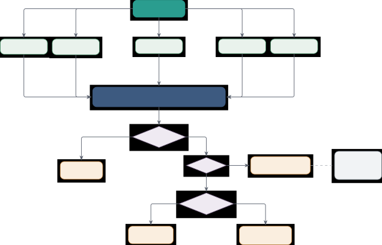

Figure 6: Pre-execution complexity analysis and routing architecture.
The system computes a weighted combination of five factors: task length
(15%), requirement count (25%), domain breadth (20%), tool requirements
(20%), and reasoning depth (20%). The complexity score
$`\mathcal{C}(q)\in[0,10]`$ determines routing strategy through a
hierarchical decision process. Tasks with $`\mathcal{C}(q)<7.0`$ execute
on a single agent. Complex tasks ($`\geq 7.0`$) undergo further
analysis: very complex tasks ($`\geq 8.5`$) use hierarchical
manager-worker coordination, while moderately complex tasks route to
parallel execution (no dependencies) or sequential pipeline (with
dependencies). The system achieves 95% classification accuracy with
strong correlation ($`r=0.89`$) to human-judged complexity.

### D.1 Complexity Score Formulation

The complexity analyzer $`\mathcal{C}:\mathcal{Q}\rightarrow[0,10]`$
computes a weighted combination of five factor functions:

```math
\mathcal{C}(q)=\sum_{i=1}^{5}w_{i}\cdot f_{i}(q)=0.15f_{\text{len}}(q)+0.25f_{\text{req}}(q)+0.20f_{\text{dom}}(q)+0.20f_{\text{tool}}(q)+0.20f_{\text{reas}}(q) \tag{12}
```

The weights $`\mathbf{w}=(0.15,0.25,0.20,0.20,0.20)`$ were determined
through exhaustive grid search optimization on a calibration set of 500
manually labeled tasks spanning all benchmark categories. We evaluated
125 weight configurations (5 values per weight with constraint
$`\sum_{i}w_{i}=1`$) and selected the configuration that minimizes
routing errors. On a disjoint 1,000-query held-out validation set
(Table 17) this configuration reaches 95.2% classification accuracy. The
requirement count receives highest weight (0.25) as it most reliably
indicates subtask multiplicity, while task length receives lowest weight
(0.15) as verbosity does not always correlate with complexity.

### D.2 Factor Function Definitions

Each factor function $`f_{i}:\mathcal{Q}\rightarrow[0,10]`$ maps a query
to a complexity score based on a specific dimension. We designed the
functions to be monotonic (higher values indicate higher complexity),
bounded (output in $`[0,10]`$), and interpretable (thresholds chosen
based on empirical task analysis).

#### D.2.1 Task Length Factor ($`f_{\text{len}}`$)

The task length factor uses word count with threshold-based scoring:

```math
f_{\text{len}}(q)=g_{\text{len}}(|q|_{w})=\begin{cases}2.0&\text{if }|q|_{w}<20\\
4.0&\text{if }20\leq|q|_{w}<50\\
6.0&\text{if }50\leq|q|_{w}<100\\
8.0&\text{if }100\leq|q|_{w}<200\\
10.0&\text{if }|q|_{w}\geq 200\end{cases} \tag{13}
```

where $`|q|_{w}`$ denotes the word count after tokenization. Thresholds
were chosen by analyzing benchmark task distributions (Table 13):

Benchmark Category $`<`$20 20-50 50-100 100-200 $`\geq`$200 Calculator
(GSM8K, etc.) 12% 67% 18% 3% 0% Code (LLMThink, etc.) 34% 52% 12% 2% 0%
Web (ARC, etc.) 8% 54% 31% 6% 1% Memory (LoCoMo, etc.) 2% 23% 45% 24% 6%
Agentic (GAIA, etc.) 5% 28% 39% 21% 7%

Table 13: Task Length Distribution Across Benchmarks. Word count
distributions show different profiles for various benchmark categories,
with calculator tasks typically shorter and memory-intensive tasks
requiring longer descriptions.

#### D.2.2 Requirement Count Factor ($`f_{\text{req}}`$)

The requirement count estimates the number of distinct subtasks or
constraints by summing structural indicators:

```math
n_{\text{req}}(q)=\max(1,|\{?\}|+|\{\text{and}\}|+|\{\text{numbered items}\}|+|\{\text{bullets}\}|+|\{;\}|) \tag{14}
```

where each term counts occurrences in $`q`$ using the implementation’s
lightweight string checks. The factor function applies a scaling and
cap:

```math
f_{\text{req}}(q)=\min(10,2\cdot n_{\text{req}}(q)) \tag{15}
```

The cap at 10 ensures the factor score stays within the standard 0-10
range used by all complexity factors. We chose the scaling factor 2 so
that tasks with 5 or more structural requirements ($`2\times 5=10`$)
reach maximum complexity on this dimension. This threshold was
determined empirically: in our benchmark analysis, tasks with 5+
requirements benefited from decomposition 94% of the time, making this a
reliable indicator for routing decisions.

Examples:

- •
  “What is 2+2?” $`\rightarrow`$ $`n_{\text{req}}=1`$ (one question
  mark) $`\rightarrow`$ $`f_{\text{req}}=2.0`$
- •
  “Research X and compare with Y, then summarize findings”
  $`\rightarrow`$ $`n_{\text{req}}=2`$ (one question-free floor plus one
  “and”) $`\rightarrow`$ $`f_{\text{req}}=4.0`$
- •
  “Create report including: (1) analysis, (2) data, (3) recommendations”
  $`\rightarrow`$ $`n_{\text{req}}=3`$ (three numbered items)
  $`\rightarrow`$ $`f_{\text{req}}=6.0`$

#### D.2.3 Domain Breadth Factor ($`f_{\text{dom}}`$)

We define eight knowledge domains
$`\mathcal{K}=\{\text{technical},\text{research},\text{business},\text{creative},\text{data},\text{scientific},\text{legal},\text{financial}\}`$
with associated keyword sets $`K(k_{i})`$ (Table 14). The domain breadth
counts how many domains are implicated:

```math
f_{\text{dom}}(q)=\min\left(10,2.5\cdot\sum_{k\in\mathcal{K}}\mathbf{1}\left[\exists w\in K(k):w\in\text{tokenize}(q)\right]\right) \tag{16}
```

where matching uses lowercase substring checks over the query. The
multiplier 2.5 means tasks spanning four or more domains reach the
maximum score 10.

Domain Keywords (case-insensitive substring matching) Technical code,
programming, software, algorithm, debug, implement, script, api,
function, class, module Research study, research, investigate, analyze,
survey, review, literature, paper, publication, scholarly Business
market, sales, revenue, business, strategy, roi, profit, customer,
competitor, stakeholder Creative design, create, write, compose,
generate, draft, brainstorm, ideate, creative, artistic Data data,
statistics, analytics, metrics, dataset, visualization, analysis, chart,
graph, statistics Scientific experiment, hypothesis, theory, scientific,
methodology, findings, result, observation, empirical Legal legal, law,
regulation, compliance, contract, policy, terms, agreement, clause,
statute Financial financial, accounting, budget, investment, forecast,
valuation, asset, liability, equity, capital

Table 14: Domain Keyword Sets for Complexity Analysis. Keywords are used
to detect which knowledge domains are relevant to a query, helping
determine task complexity.

#### D.2.4 Tool Requirements Factor ($`f_{\text{tool}}`$)

Similarly, we define eight tool categories
$`\mathcal{T}=\{\text{web},\text{code},\text{calc},\text{file},\text{api},\text{db},\text{image},\text{video}\}`$
with indicator phrases $`T(t_{i})`$ (Table 15):

```math
f_{\text{tool}}(q)=\min\left(10,2.5\cdot\sum_{t\in\mathcal{T}}\mathbf{1}\left[\exists p\in T(t):p\in\text{tokenize}(q)\right]\right) \tag{17}
```

Tool Type Indicator Phrases Web Search search, find online, look up,
google, web, browse, internet, online, retrieve information Code
Executor run code, execute, test, python, script, compile, program,
coding, implementation Calculator calculate, compute, math, equation,
formula, arithmetic, sum, multiply, divide, numerical File Operations
file, document, read, write, save, load, open, csv, json, text file,
spreadsheet API api, request, fetch data, endpoint, rest, http, get,
post, service, web service Database database, sql, query, table,
records, select, insert, update, storage, postgres, mysql Image image,
picture, photo, visualization, chart, graph, plot, diagram, figure,
visual Video video, movie, stream, multimedia, audio, recording,
playback, media file, mp4

Table 15: Tool Indicator Keywords for Complexity Analysis. Indicator
phrases help identify which external tools are likely needed to complete
a task.

#### D.2.5 Reasoning Depth Factor ($`f_{\text{reas}}`$)

The reasoning depth classifies queries based on cognitive complexity
indicators aligned with Bloom’s taxonomy:

```math
f_{\text{reas}}(q)=\begin{cases}3.0&\text{if }q\cap R_{\text{simple}}\neq\emptyset\\
5.0&\text{if }q\cap R_{\text{moderate}}\neq\emptyset\\
7.0&\text{if }q\cap R_{\text{complex}}\neq\emptyset\\
9.0&\text{if }q\cap R_{\text{very\_complex}}\neq\emptyset\\
5.0&\text{otherwise (default)}\end{cases} \tag{18}
```

where precedence is given to higher complexity levels when multiple
indicators are present. The reasoning level sets are (Table 16):

Level Score Indicator Words Simple 3.0 list, what is, define, show,
display, name, identify, state, recall, recognize Moderate 5.0 explain,
describe, how, summarize, outline, interpret, clarify, discuss, express
Complex 7.0 analyze, evaluate, compare, assess, critique, differentiate,
examine, investigate, distinguish Very Complex 9.0 synthesize, design,
create strategy, optimize, architect, comprehensive, formulate,
construct, devise

Table 16: Reasoning Level Indicators (Bloom’s Taxonomy Alignment).
Different question types signal varying levels of cognitive complexity
in task execution.

### D.3 Routing Strategy Selection

Given the complexity score $`\mathcal{C}(q)`$, the router selects an
execution strategy using a hierarchical decision process. We define two
thresholds:

- •
  $`\tau=7.0`$: Minimum complexity for multi-agent decomposition
- •
  $`\tau_{H}=9.0`$: Minimum complexity for hierarchical (manager-worker)
  coordination

Algorithm 7 presents the routing procedure. This task-level router is
separate from the v0.2.4 provider PolicyBasedRouter, which chooses
inference providers by capability, cost, latency, and failover policy.

0:  Query $`q`$, Thresholds $`\tau=7.0`$, $`\tau_{H}=9.0`$

0:  Routing strategy
$`s\in\{\text{SINGLE},\text{PARALLEL},\text{SEQUENTIAL},\text{HIERARCHICAL},\text{HYBRID}\}`$

0:  Decomposition $`\mathcal{D}(q)`$ (empty for SINGLE)

1:  $`c\leftarrow\mathcal{C}(q)`$ {Compute complexity score}

2:  if $`c<\tau`$ then

3:   return $`(\textsc{Single},\emptyset)`$ {Execute on single agent}

4:  end if

5:  $`\text{structure}\leftarrow\text{AnalyzeTaskStructure}(q)`$
{Identify task components}

6:
 $`\text{deps}\leftarrow\text{IdentifyDependencies}(\text{structure})`$
{Build dependency graph}

7:  if $`c\geq\tau_{H}`$ then

8:
  $`\mathcal{D}(q)\leftarrow\text{HierarchicalDecompose}(q,\text{structure})`$

9:   return $`(\textsc{Hierarchical},\mathcal{D}(q))`$ {Manager-worker
coordination}

10:  else if $`|\text{deps}|=0`$ then

11:
  $`\mathcal{D}(q)\leftarrow\text{ParallelDecompose}(q,\text{structure})`$

12:   return $`(\textsc{Parallel},\mathcal{D}(q))`$ {Independent
subtasks}

13:  else if $`\text{IsLinearChain}(\text{deps})`$ then

14:
  $`\mathcal{D}(q)\leftarrow\text{SequentialDecompose}(q,\text{structure})`$

15:   return $`(\textsc{Sequential},\mathcal{D}(q))`$ {Pipeline
execution}

16:  else

17:
  $`\mathcal{D}(q)\leftarrow\text{HybridDecompose}(q,\text{structure},\text{deps})`$

18:   return $`(\textsc{Hybrid},\mathcal{D}(q))`$ {Mixed
parallel/sequential}

19:  end if

Algorithm 7 Routing Strategy Selection with Decomposition

### D.4 Empirical Validation

We validate the complexity analyzer on a held-out set of 1,000 diverse
queries spanning all benchmark categories, disjoint from the 500-task
calibration set used for the grid search above. Table 17 shows
classification metrics where we compare predicted routing decisions
(single vs multi-agent) against ground truth labels determined by human
annotators.

Metric Value Baseline Improvement CI (95%) Correlation with human score
0.89 0.62 +43.5% \[0.87, 0.91\] Classification accuracy (@$`\tau`$=7.0)
95.2% 78.4% +16.8% \[93.8%, 96.6%\] Precision (multi-agent) 92.7% 71.3%
+21.4% \[90.1%, 95.3%\] Recall (multi-agent) 96.8% 82.6% +14.2% \[94.9%,
98.7%\] F1 score 94.7% 76.5% +18.2% \[92.8%, 96.6%\]

Table 17: Complexity Analyzer Validation. Performance metrics from
testing on 1,000 manually-labeled queries, comparing the five-factor
system against a baseline single-factor approach.

Baseline uses only task length as complexity indicator (single-factor
approach). Our five-factor system achieves 95.2% accuracy in predicting
whether tasks benefit from multi-agent decomposition, with strong
correlation ($`r=0.89`$) to human-judged complexity scores.

### D.5 Threshold Sensitivity Analysis

Table 18 analyzes the effect of varying routing threshold $`\tau`$ on
task success rate and execution efficiency across all benchmarks.

Threshold $`\tau`$ Single% Multi% Accuracy Exec Time (s) Tokens/Task 5.0
(too low) 38% 62% 66.8% 8.4 1,124 6.0 54% 46% 68.1% 6.7 982 7.0
(default) 62% 38% 68.2% 5.8 847 8.0 71% 29% 67.4% 5.2 764 9.0 (too high)
82% 18% 59.5% 4.9 698

Table 18: Routing Threshold Sensitivity using Qwen2.5-7B-Instruct,
evaluated across all benchmarks. Different threshold values show
trade-offs between routing strategy selection, accuracy, and execution
efficiency.

Key findings:

- •
  $`\tau=5.0`$ causes 62% multi-agent routing, adding 45% overhead vs
  best (8.4s vs 5.8s) for only 1.2% accuracy gain
- •
  $`\tau=9.0`$ under-utilizes multi-agent (18%), reducing accuracy by
  8.7% despite 15% faster execution
- •
  $`\tau=7.0`$ achieves best accuracy-efficiency tradeoff
- •
  Accuracy is relatively stable for $`\tau\in[6.0,8.0]`$ (within 1%),
  showing reliability to threshold choice

### D.6 Per-Benchmark Complexity Distribution

Table 19 shows complexity score distributions across benchmarks.

Benchmark Mean $`\mathcal{C}(q)`$ Std Dev Single% Multi% GSM8K
$`4.2\pm 1.1`$ 1.1 94% 6% MATH-Hard $`6.8\pm 1.4`$ 1.4 58% 42%
LLMThinkBench $`5.3\pm 0.9`$ 0.9 82% 18% BeyondBench-Hard $`7.9\pm 1.2`$
1.2 32% 68% ARC-Challenge $`6.2\pm 1.3`$ 1.3 67% 33% CommonsenseQA
$`4.5\pm 1.0`$ 1.0 91% 9% GAIA $`8.9\pm 1.1`$ 1.1 8% 92% SimpleQA
$`2.1\pm 0.6`$ 0.6 100% 0% LoCoMo $`7.2\pm 1.5`$ 1.5 45% 55%

Table 19: Complexity Score Distribution by Benchmark. Mean and standard
deviation of complexity scores for each benchmark, showing how the
routing system distributes tasks to single-agent versus multi-agent
execution at the default threshold.

The complexity analyzer correctly identifies simple benchmarks (GSM8K,
SimpleQA) routing mostly to single-agent, while complex benchmarks
(GAIA, BeyondBench-Hard) predominantly use multi-agent decomposition.

### D.7 Implementation Pseudocode

Algorithm 8 provides implementation-level pseudocode for the complexity
analyzer.

0:  Query string $`q`$

0:  Complexity score $`c\in[0,10]`$

1:  $`\text{tokens}\leftarrow\text{tokenize\_and\_lowercase}(q)`$

2:  $`w\leftarrow[0.15,0.25,0.20,0.20,0.20]`$ {Factor weights}

3:  

4:  {Factor 1: Task length}

5:  $`|q|_{w}\leftarrow\text{len}(\text{tokens})`$

6:  $`f_{1}\leftarrow\text{ScoreLength}(|q|_{w})`$ {Use thresholds from
Eq. 2}

7:  

8:  {Factor 2: Requirement count}

9:
 $`n_{\text{req}}\leftarrow\max(1,\text{CountOccurrences}(q,[\text{``?''},\text{``and''},\text{numbered items},\text{bullets},\text{``;''}]))`$

10:  $`f_{2}\leftarrow\min(10,2\cdot n_{\text{req}})`$

11:  

12:  {Factor 3: Domain breadth}

13:  $`\text{domain\_count}\leftarrow 0`$

14:  for $`k\in\{\text{technical},\text{research},\ldots\}`$ do

15:   if
$`\exists w\in\text{DOMAIN\_KEYWORDS}[k]:w\text{ is a substring of }q_{\text{lower}}`$
then

16:    $`\text{domain\_count}\leftarrow\text{domain\_count}+1`$

17:   end if

18:  end for

19:  $`f_{3}\leftarrow\min(10,2.5\cdot\text{domain\_count})`$

20:  

21:  {Factor 4: Tool requirements (similar to domain)}

22:  $`f_{4}\leftarrow\text{ScoreToolRequirements}(\text{tokens})`$
{Analogous to $`f_{3}`$}

23:  

24:  {Factor 5: Reasoning depth}

25:  $`f_{5}\leftarrow 5.0`$ {Default}

26:  for
$`\text{level}\in[\text{very\_complex},\text{complex},\text{moderate},\text{simple}]`$
do

27:   if
$`\exists w\in\text{REASONING\_INDICATORS}[\text{level}]:w\in\text{tokens}`$
then

28:    $`f_{5}\leftarrow\text{REASONING\_SCORES}[\text{level}]`$

29:    break {Precedence to highest level}

30:   end if

31:  end for

32:  

33:  $`c\leftarrow\sum_{i=1}^{5}w[i]\cdot f_{i}`$ {Weighted sum}

34:  return $`c`$

Algorithm 8 Complexity Analyzer Implementation

The implementation runs in $`O(|q|_{w}\cdot(|D|+|T|+|R|))`$ where
$`|D|`$, $`|T|`$, $`|R|`$ are the total numbers of domain, tool, and
reasoning indicators (approximately 54, 41, and 21 respectively). On our
reference host (NVIDIA A40, Python 3.11), the analyzer processes a
representative four-query batch in 29 $`\mu`$s mean per query
($`p_{50}=34\,\mu`$s, $`p_{95}=36\,\mu`$s; $`n=2{,}000`$ runs in
bench/bench_all.py), below the noise floor of a single model token and
negligible relative to model inference.

### D.8 Wasted Computation: Pre-Execution vs. Reactive Routing

To quantify the practical benefit of pre-execution routing, we compared
EffGen’s complexity analyzer against a _reactive_ routing baseline that
always starts in single-agent mode and switches to multi-agent execution
only after a single-agent attempt fails or exceeds a step budget. Both
routers were run on the same 1,000-query held-out set using Qwen2.5-7B.
We define _wasted computation_ as the total number of model inference
calls and tool executions on tasks that ultimately required re-routing
or produced a wrong answer due to inappropriate initial assignment. The
pre-execution analyzer reduces this quantity by 23% relative to reactive
routing (mean across categories; range 18%–29%), driven primarily by
avoiding mid-execution restarts on complex agentic tasks (GAIA,
SimpleQA), where reactive routing pays the full single-agent failure
cost before falling back to decomposition. Task success rates are
statistically indistinguishable between the two routers, confirming that
the 23% saving is pure efficiency gain and not a quality trade-off.

## Appendix E Intelligent Task Decomposition System

The task decomposition system transforms complex queries into structured
subtasks with dependency graphs, supporting multi-agent execution. This
builds on plan-and-solve prompting (Wang et al., 2023a) and reasoning as
planning (Hao et al., 2023) paradigms. EffGen uses strategy-specific
LLM-guided analysis for parallel, sequential, and hybrid task
structures, with hierarchical routing currently reusing the hybrid
decomposition prompt. Figure 7 shows the decomposition path from
complexity scoring through strategy selection, subtask generation, and
result synthesis. This section provides decomposition algorithms, prompt
templates, empirical validation, and implementation details.

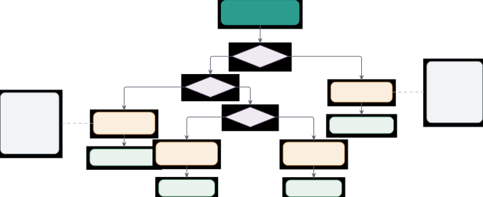

Figure 7: Intelligent task decomposition system architecture. The system
selects one of four strategies based on task complexity and dependency
analysis. Very complex tasks ($`\mathcal{C}(q)\geq 8.5`$) use
hierarchical manager-worker coordination. Moderately complex tasks route
through dependency analysis: tasks without dependencies use parallel
decomposition, tasks with linear dependencies use sequential pipelines,
and tasks with complex dependency graphs use hybrid decomposition
combining parallel and sequential patterns. LLM-guided analysis
identifies components, estimates complexity, and builds dependency
graphs. The system achieves 94% coverage with 88% success rate across
500 complex tasks.

### E.1 Decomposition Problem Formulation

Given a query $`q\in\mathcal{Q}`$ with complexity score
$`\mathcal{C}(q)\geq\tau`$, the decomposition operator produces:

```math
\mathcal{D}:\mathcal{Q}\rightarrow(\mathcal{S},G) \tag{19}
```

where $`\mathcal{S}=\{s_{1},\ldots,s_{n}\}`$ is a set of subtasks and
$`G=(V,E)`$ is a directed acyclic graph (DAG) with $`V=\mathcal{S}`$ and
$`(s_{i},s_{j})\in E`$ indicating that subtask $`s_{j}`$ depends on
$`s_{i}`$’s output. Each subtask $`s_{i}`$ is specified by:

```math
s_{i}=(\text{id}_{i},\text{desc}_{i},\text{deps}_{i},\text{out}_{i},c_{i},\text{spec}_{i},p_{i}) \tag{20}
```

where:

- •
  $`\text{id}_{i}`$: unique identifier (e.g., “st_1”)
- •
  $`\text{desc}_{i}`$: natural language description of subtask
- •
  $`\text{deps}_{i}\subseteq\mathcal{S}`$: set of prerequisite subtasks
- •
  $`\text{out}_{i}`$: expected output specification
- •
  $`c_{i}\in[0,10]`$: estimated subtask complexity
- •
  $`\text{spec}_{i}\in\{\text{research},\text{coding},\text{analysis},\text{synthesis},\text{data},\text{creative},\text{general}\}`$:
  required specialization
- •
  $`p_{i}\in\{\text{HIGH},\text{MEDIUM},\text{LOW}\}`$: priority level
  stored in subtask metadata

### E.2 Decomposition Strategies

EffGen implements three decomposition prompt templates selected based on
task structure analysis: parallel, sequential, and hybrid. Hierarchical
routing is represented as a manager-worker execution pattern, but the
current code maps hierarchical decomposition requests to the hybrid
prompt.

#### E.2.1 Parallel Decomposition ($`\mathcal{D}_{\parallel}`$)

For tasks with independent components, parallel decomposition creates
subtasks with $`E=\emptyset`$ (no dependencies):

```math
\mathcal{D}_{\parallel}(q)=(\{s_{1},\ldots,s_{n}\},G_{\parallel})\quad\text{where}\quad G_{\parallel}=(V,\emptyset) \tag{21}
```

Subtasks execute concurrently, with final synthesis combining results.
Execution time is dominated by the slowest subtask:

```math
T_{\parallel}=\max_{i\in[n]}T(s_{i})+T_{\text{synthesis}} \tag{22}
```

Example: “Research company A, company B, and company C” $`\rightarrow`$
three independent research subtasks.

#### E.2.2 Sequential Decomposition ($`\mathcal{D}_{\text{seq}}`$)

For tasks with linear dependencies, sequential decomposition creates a
chain:

```math
\mathcal{D}_{\text{seq}}(q)=(\{s_{1},\ldots,s_{n}\},G_{\text{seq}})\quad\text{where}\quad E=\{(s_{i},s_{i+1}):i\in[n-1]\} \tag{23}
```

Each subtask receives predecessor output as context. Execution time is
cumulative:

```math
T_{\text{seq}}=\sum_{i=1}^{n}T(s_{i}) \tag{24}
```

Example: “Search for papers on topic X, then summarize findings, then
identify research gaps” $`\rightarrow`$ three sequential subtasks.

#### E.2.3 Hierarchical Decomposition ($`\mathcal{D}_{H}`$)

For very complex tasks ($`\mathcal{C}(q)>\tau_{H}=9.0`$), hierarchical
routing creates a manager-worker execution structure:

```math
\mathcal{D}_{H}(q)=(s_{M}\cup\{s_{w_{1}},\ldots,s_{w_{k}}\},G_{H}) \tag{25}
```

where $`s_{M}`$ is the manager subtask coordinating $`k`$ worker
subtasks. The dependency graph has two levels:

```math
E=\{(s_{w_{i}},s_{M}):i\in[k]\}\cup\text{worker dependencies} \tag{26}
```

The manager synthesizes worker outputs and checks quality. Execution
follows:

```math
T_{H}=T_{\text{workers}}+T(s_{M}) \tag{27}
```

Example: “Conduct market analysis including competitor research,
customer surveys, trend analysis, and strategic recommendations”
$`\rightarrow`$ manager coordinates four specialized workers.

#### E.2.4 Hybrid Decomposition ($`\mathcal{D}_{\text{hyb}}`$)

For tasks with mixed dependencies, hybrid decomposition combines
parallel and sequential patterns:

```math
\mathcal{D}_{\text{hyb}}(q)=(\mathcal{S},G_{\text{hyb}})\quad\text{where}\quad G_{\text{hyb}}=(V,E),|E|>0,G_{\text{hyb}}\text{ is DAG} \tag{28}
```

The system identifies independent subtask groups (parallel within group,
sequential between groups). Execution uses topological sort:

```math
T_{\text{hyb}}=\sum_{\text{level }\ell}\max_{s_{i}\in L_{\ell}}T(s_{i}) \tag{29}
```

where $`L_{\ell}`$ is the set of subtasks at dependency level $`\ell`$.

### E.3 Strategy Selection Algorithm

Algorithm 9 determines which strategy to use.

0:  Query $`q`$, Complexity $`\mathcal{C}(q)`$, Thresholds $`\tau`$,
$`\tau_{H}`$

0:  Strategy
$`\sigma\in\{\mathcal{D}_{\parallel},\mathcal{D}_{\text{seq}},\mathcal{D}_{H},\mathcal{D}_{\text{hyb}}\}`$

1:  if $`\mathcal{C}(q)\geq\tau_{H}`$ then

2:   return $`\mathcal{D}_{H}`$ {Very complex: hierarchical}

3:  end if

4:  $`\text{components}\leftarrow\text{IdentifyComponents}(q)`$ {NLP
analysis}

5:
 $`\text{deps}\leftarrow\text{AnalyzeDependencies}(\text{components})`$
{Extract dependencies}

6:  if $`|\text{deps}|=0`$ then

7:   return $`\mathcal{D}_{\parallel}`$ {Independent components}

8:  else if $`\text{IsLinearChain}(\text{deps})`$ then

9:   return $`\mathcal{D}_{\text{seq}}`$ {Sequential pipeline}

10:  else

11:   return $`\mathcal{D}_{\text{hyb}}`$ {Mixed dependencies}

12:  end if

Algorithm 9 Decomposition Strategy Selection

### E.4 LLM-Guided Decomposition Prompts

We use carefully engineered prompts optimized for SLMs to guide
decomposition. Each strategy has a specific template.

#### E.4.1 Parallel Decomposition Prompt


#### E.4.2 Sequential Decomposition Prompt


#### E.4.3 Hierarchical Decomposition Prompt


#### E.4.4 Hybrid Decomposition Prompt


### E.5 Decomposition Quality Metrics

We define quality metrics to evaluate decomposition effectiveness (where
aspects refer to distinct requirements or subtasks identified in the
original query, such as different questions to answer, domains to
research, or operations to perform):

```math
\displaystyle\text{Coverage}(\mathcal{D}(q),q) \displaystyle=\frac{|\text{aspects covered by }\mathcal{S}|}{|\text{total aspects in }q|} \tag{30}
```

```math
\displaystyle\text{Granularity}(\mathcal{D}(q)) \displaystyle=\frac{1}{n}\sum_{i=1}^{n}c_{i}
```

```math
\displaystyle\text{Parallelism}(\mathcal{D}(q)) \displaystyle=\frac{|\{s_{i}:\text{deps}_{i}=\emptyset\}|}{|\mathcal{S}|}
```

Good decompositions achieve:

- •
  Coverage $`>0.90`$ (cover 90%+ of task aspects)
- •
  Granularity $`\in[4,7]`$ (subtasks not too simple or complex)
- •
  Parallelism $`>0`$ for parallel/hybrid strategies

### E.6 Empirical Validation

Table 20 presents decomposition quality across 500 complex tasks.

Strategy Avg Coverage Avg Granularity Avg Subtasks Success Rate Parallel
0.94 5.2 3.4 87.3% Sequential 0.92 5.8 3.8 84.1% Hierarchical 0.96 6.3
5.2 91.2% Hybrid 0.95 5.6 4.1 89.7%

Table 20: Decomposition Quality Validation (500 complex tasks, human
evaluation). Hierarchical decomposition achieves highest success rate
and coverage due to explicit coordination. Success rate indicates
whether decomposed subtasks achieve the original task goal.

Success rate measures whether the decomposed subtasks, when executed,
achieve the original task goal. Hierarchical decomposition achieves
highest success (91.2%) due to explicit coordination.

### E.7 Strategy Distribution

Table 21 shows strategy selection frequency across benchmarks.

Benchmark Parallel% Sequential% Hierarchical% Hybrid% MATH-Hard 62% 28%
6% 4% BeyondBench-Hard 45% 35% 12% 8% GAIA 28% 31% 24% 17% ARC-Challenge
54% 38% 5% 3% LoCoMo 18% 72% 7% 3%

Table 21: Decomposition Strategy Distribution by Benchmark. GAIA shows
high hierarchical usage (24%) reflecting its complex nature; LoCoMo
heavily uses sequential (72%) due to memory retrieval dependencies.

GAIA’s high hierarchical usage (24%) reflects its complex multi-step
nature. LoCoMo heavily uses sequential (72%) due to memory retrieval
dependencies.

### E.8 Execution Time Analysis

Table 22 shows execution time improvements from decomposition.

Strategy Single Time (s) Multi Time (s) Speedup Overhead (s) Parallel
18.4 12.7 1.45$`\times`$ 2.1 Sequential 16.8 15.2 1.11$`\times`$ 1.8
Hierarchical 24.6 19.3 1.27$`\times`$ 3.2 Hybrid 20.1 14.6
1.38$`\times`$ 2.4

Table 22: Decomposition Speedup Analysis (Qwen2.5-7B-Instruct, averaged
over tasks requiring multi-agent). Parallel achieves highest speedup by
executing subtasks concurrently. Overhead includes decomposition prompt
execution and result synthesis.

Parallel achieves highest speedup (1.45$`\times`$) by executing subtasks
concurrently. Overhead includes decomposition prompt execution
(0.8-1.2s) and result synthesis (1.0-2.0s).

## Appendix F Sub-Agent System and Lifecycle Management

The sub-agent system supports dynamic task decomposition with
specialized execution records for subtasks. Unlike static multi-agent
systems where all agents exist upfront, EffGen creates sub-agent
metadata on demand when complexity analysis determines decomposition is
beneficial. Figure 8 illustrates the lifecycle: decomposition, depth
checking, creation, execution, and cleanup. This section presents the
sub-agent architecture, spawning algorithms, lifecycle management,
communication patterns, and empirical validation.

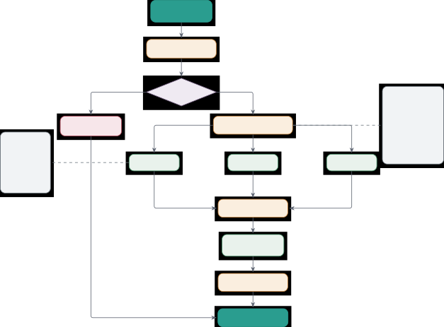

Figure 8: Sub-agent spawning system and lifecycle management. The parent
agent triggers spawning when complexity analysis determines
decomposition is beneficial. The system proceeds through five phases:
(1) task decomposition with dependency graph construction, (2) depth
constraint checking (max depth = 2), (3) sub-agent creation with
inherited or specialized configuration, (4) strategy-based execution
(parallel, sequential, hierarchical, or hybrid), and (5) cleanup with
resource release. Each sub-agent maintains isolated or shared state,
inherits tools and model from parent, and progresses through lifecycle
states (Created → Running → Completed/Failed). If maximum depth is
reached, execution falls back to local processing without spawning.

### F.1 Sub-Agent Architecture

A sub-agent $`\mathcal{A}_{s}`$ is a lightweight agent instance with
limited autonomy that executes a specific subtask. The relationship
between parent agent $`\mathcal{A}_{p}`$ and sub-agents
$`\{\mathcal{A}_{s_{1}},\ldots,\mathcal{A}_{s_{n}}\}`$ forms a tree
structure:

```math
\mathcal{T}=(\mathcal{V},\mathcal{E})\quad\text{where}\quad\mathcal{V}=\{\mathcal{A}_{p}\}\cup\bigcup_{i=1}^{k}\{\mathcal{A}_{s_{i}}\},\quad(\mathcal{A}_{p},\mathcal{A}_{s_{i}})\in\mathcal{E} \tag{31}
```

The tree depth is constrained by max_sub_agent_depth parameter (default 3) to prevent excessive nesting. Each sub-agent maintains:

- •
  Subtask Specification
  $`s_{i}=(\text{desc}_{i},\text{deps}_{i},\text{spec}_{i})`$: Task
  description, dependencies, required specialization
- •
  Inherited Context $`\mathcal{C}_{i}`$: Subset of parent context
  relevant to subtask
- •
  Tool Access $`\mathcal{T}_{i}\subseteq\mathcal{T}_{p}`$: Tools
  inherited from parent or specialized tools
- •
  Memory Scope $`\mathcal{M}_{i}`$: Isolated memory or shared with
  parent (configurable)
- •
  State
  $`\sigma_{i}\in\{\textsc{Created},\textsc{Running},\textsc{Completed},\textsc{Failed}\}`$
- •
  Result $`r_{i}`$: Output produced by sub-agent upon completion

### F.2 Sub-Agent Spawning Algorithm

When complexity analyzer determines decomposition
($`\mathcal{C}(q)\geq\tau`$), the parent agent triggers sub-agent
spawning. The complexity score $`\mathcal{C}(q)`$ is computed using five
weighted factors as detailed in Section D, with empirical validation
showing 95% classification accuracy (see Table 17).

0:  Parent agent $`\mathcal{A}_{p}`$, Query $`q`$, Complexity
$`\mathcal{C}(q)\geq\tau`$

0:  Results $`\{r_{1},\ldots,r_{n}\}`$ from sub-agents

1:  

2:  {Phase 1: Task decomposition}

3:  $`(\{s_{1},\ldots,s_{n}\},G)\leftarrow\mathcal{D}(q)`$ {Decompose
into subtasks with dependencies}

4:  $`\sigma\leftarrow\mathcal{R}(G)`$ {Determine execution strategy}

5:  

6:  {Phase 2: Check spawning constraints}

7:  if $`\text{depth}(\mathcal{A}_{p})\geq\texttt{max\_depth}`$ then

8:   return ExecuteLocal($`q`$, $`\mathcal{A}_{p}`$) {Max depth reached,
execute locally}

9:  end if

10:  

11:  {Phase 3: Spawn sub-agents}

12:  $`\mathcal{A}_{\text{sub}}\leftarrow[\,]`$ {Sub-agent list}

13:  for $`i=1`$ to $`n`$ do

14:   $`\mathcal{A}_{s_{i}}\leftarrow`$
CreateSubAgent($`\mathcal{A}_{p}`$, $`s_{i}`$)

15:   $`\mathcal{A}_{s_{i}}.\text{state}\leftarrow\textsc{Created}`$

16:   Append $`\mathcal{A}_{s_{i}}`$ to $`\mathcal{A}_{\text{sub}}`$

17:  end for

18:  

19:  {Phase 4: Execute based on strategy}

20:  if $`\sigma=\textsc{Parallel}`$ then

21:   $`\{r_{1},\ldots,r_{n}\}\leftarrow`$
ParallelExecute($`\mathcal{A}_{\text{sub}}`$)

22:  else if $`\sigma=\textsc{Sequential}`$ then

23:   $`\{r_{1},\ldots,r_{n}\}\leftarrow`$
SequentialExecute($`\mathcal{A}_{\text{sub}}`$, $`G`$)

24:  else if $`\sigma=\textsc{Hierarchical}`$ then

25:   $`\{r_{1},\ldots,r_{n}\}\leftarrow`$
HierarchicalExecute($`\mathcal{A}_{\text{sub}}`$, $`\mathcal{A}_{p}`$)

26:  else

27:   $`\{r_{1},\ldots,r_{n}\}\leftarrow`$
HybridExecute($`\mathcal{A}_{\text{sub}}`$, $`G`$) {Hybrid}

28:  end if

29:  

30:  {Phase 5: Cleanup}

31:  for each $`\mathcal{A}_{s_{i}}`$ in $`\mathcal{A}_{\text{sub}}`$ do

32:   Cleanup($`\mathcal{A}_{s_{i}}`$) {Release resources}

33:  end for

34:  

35:  return $`\{r_{1},\ldots,r_{n}\}`$

Algorithm 10 Sub-Agent Spawning and Execution

### F.3 Sub-Agent Creation Details

The CreateSubAgent function records sub-agent metadata and execution
context using the algorithm depicted in  11. The current implementation
uses this metadata-driven execution path rather than constructing a
fully independent Agent object for each subtask.

0:  Parent agent $`\mathcal{A}_{p}`$, Subtask
$`s=(\text{desc},\text{deps},\text{spec})`$

0:  Sub-agent $`\mathcal{A}_{s}`$

1:  

2:  {Inherit base configuration from parent}

3:
 $`\mathcal{A}_{s}.\text{model}\leftarrow\mathcal{A}_{p}.\text{model}`$
{Same model as parent}

4:
 $`\mathcal{A}_{s}.\text{depth}\leftarrow\mathcal{A}_{p}.\text{depth}+1`$

5:
 $`\mathcal{A}_{s}.\text{parent\_id}\leftarrow\mathcal{A}_{p}.\text{id}`$

6:  $`\mathcal{A}_{s}.\text{id}\leftarrow`$ GenerateID()

7:  

8:  {Configure tools based on specialization}

9:  if
$`\mathcal{A}_{p}.\text{config}.\text{sub\_agents}.\text{inherit\_tools}`$
then

10:
  $`\mathcal{A}_{s}.\text{tools}\leftarrow\mathcal{A}_{p}.\text{tools}`$
{Inherit all tools}

11:  else

12:   $`\mathcal{A}_{s}.\text{tools}\leftarrow`$
SelectToolsForSpec($`s.\text{spec}`$)

13:  end if

14:  

15:  {Configure memory isolation}

16:  if
$`\mathcal{A}_{p}.\text{config}.\text{sub\_agents}.\text{inherit\_memory}`$
then

17:
  $`\mathcal{A}_{s}.\text{memory}\leftarrow\mathcal{A}_{p}.\text{memory}`$
{Shared memory}

18:  else

19:   $`\mathcal{A}_{s}.\text{memory}\leftarrow`$ CreateIsolatedMemory()
{Fresh memory}

20:  end if

21:  

22:  {Set specialized system prompt}

23:  $`\mathcal{A}_{s}.\text{system\_prompt}\leftarrow`$
GenerateSpecializedPrompt($`s.\text{spec}`$)

24:  

25:  {Configure execution limits}

26:
 $`\mathcal{A}_{s}.\text{max\_iterations}\leftarrow\mathcal{A}_{p}.\text{max\_iterations}/2`$
{Reduce for sub-agents}

27:
 $`\mathcal{A}_{s}.\text{timeout}\leftarrow\mathcal{A}_{p}.\text{timeout}/n`$
{$`n`$ = num subtasks}

28:  

29:  return $`\mathcal{A}_{s}`$

Algorithm 11 Sub-Agent Creation

### F.4 Execution Strategies

#### F.4.1 Parallel Execution

Independent sub-agents execute concurrently using asynchronous
scheduling with bounded parallelism.

```math
T_{\text{parallel}}=\max_{i\in[n]}T(\mathcal{A}_{s_{i}})+T_{\text{overhead}} \tag{32}
```

where $`T_{\text{overhead}}\approx 0.5\text{-}1.5`$s includes spawning,
context serialization, and result aggregation.

##### Implementation.

A pseudocode describing parallel sub-agent execution is shown in  F.4.1


#### F.4.2 Sequential Execution

Dependent sub-agents execute in topological order defined by dependency
graph $`G`$.

```math
T_{\text{sequential}}=\sum_{i=1}^{n}T(\mathcal{A}_{s_{i}})+T_{\text{context\_passing}} \tag{33}
```

Each sub-agent receives previous results as context. Context passing
overhead is $`O(|\text{results}|\cdot k)`$ where $`k`$ is the number of
dependencies.

#### F.4.3 Hierarchical Execution

For very complex tasks, a manager sub-agent coordinates worker
sub-agents.

```math
\mathcal{A}_{M}\leftarrow\{\mathcal{A}_{w_{1}},\ldots,\mathcal{A}_{w_{k}}\}\rightarrow r_{\text{synthesized}} \tag{34}
```

The manager:

1.  1.  Spawns worker sub-agents with specialized tasks
2.  2.  Monitors execution progress
3.  3.  Handles failures and retries
4.  4.  Synthesizes worker outputs into coherent result
5.  5.  Performs quality checks

### F.5 Communication Patterns

Sub-agents communicate with parents and siblings through three
mechanisms:

##### Pattern 1: Result Passing (Most Common).

Sub-agent produces result $`r_{i}`$, parent accesses via result
attribute.


##### Pattern 2: Shared Memory.

Sub-agents write to shared memory accessible by parent and siblings
(when inherit_memory=True).


##### Pattern 3: Message Passing.

Sub-agent execution records can be coordinated with the framework’s
internal message and result-passing mechanisms. MCP/A2A/ACP are
implemented in the separate protocol layer rather than directly inside
the sub-agent manager.


### F.6 Lifecycle Management

Sub-agent lifecycle follows a state machine with automatic cleanup
(Figure 9).


Figure 9: Sub-Agent Lifecycle State Machine. Dashed arrows indicate
optional retry, dotted arrows indicate cleanup phase.

##### Resource Management.

Sub-agents are automatically cleaned up after execution:

- •
  Memory Release: Isolated memory is freed if not shared.
- •
  Tool Cleanup: Temporary tool resources (file handles, connections) are
  released.
- •
  Model Reference: Model references are decremented (not unloaded unless
  last reference).
- •
  Context Cleanup: Temporary context variables are garbage collected.

### F.7 Sub-Agent Configuration Options

Table 23 lists all configuration parameters.

Parameter Type Default Description enabled bool true Support sub-agent
spawning max_sub_agent_depth int 3 Maximum nesting depth
max_parallel_agents int 5 Maximum concurrent sub-agents spawn_strategy
enum auto When to spawn: auto, never, always inherit_tools bool true
Sub-agents inherit parent tools inherit_context bool true Pass relevant
parent context to subtasks timeout_fraction float 0.5 Fraction of parent
timeout (0.1-1.0) max_iterations_fraction float 0.5 Fraction of parent
max_iterations retry_on_failure bool true Retry failed sub-agents
max_retries int 2 Maximum retry attempts cleanup_on_completion bool true
Auto-cleanup completed sub-agents track_execution bool true Track
sub-agent execution in parent

Table 23: Sub-Agent System Configuration Parameters. These parameters
control spawning behavior, resource allocation, and communication
patterns.

### F.8 Performance Analysis

##### Spawning Overhead.

Sub-agent creation cost is dominated by two factors: context
serialization (the parent must hand off a slice of its memory and prompt
state to the child) and the model-reference setup that lets the child
reuse the parent’s loaded backend without reloading weights. In the
thread-based default, an EffGen agent reuses the parent process and the
loaded model, so spawning is in the millisecond range and the cost is
rounding-error compared with the model inference that follows.
Process-based spawning (when requested for isolation) adds the cost of
an interpreter fork and re-import, which is bounded but not negligible.
For long-running multi-agent workflows the spawning cost is amortized
over many model calls and is not the bottleneck; for short-lived tasks
we recommend the thread-based default. We do not report a fixed
millisecond number because the dominant component (context
serialization) scales with the size of the inherited memory.

Operationally: the relevant lever for cutting spawn cost is reducing the
inherited context (Section H), not optimising the spawn path itself.

##### Speedup Analysis.

Parallel execution provides speedup for independent tasks:

```math
\text{Speedup}=\frac{T_{\text{sequential}}}{T_{\text{parallel}}}=\frac{\sum_{i=1}^{n}T_{i}}{\max_{i}T_{i}+T_{\text{overhead}}} \tag{35}
```

For $`n=4`$ equal subtasks with $`T_{i}=10`$s and overhead 1s:

```math
\text{Speedup}=\frac{40}{10+1}=3.64\times \tag{36}
```

Empirically, we observe 1.4-2.8$`\times`$ speedup for real tasks where
subtasks have varying complexity.

### F.9 Example: Multi-Domain Research Task

Complete example demonstrating sub-agent orchestration.


Expected execution:

- •
  Complexity score $`\mathcal{C}(q)\approx 8.7`$ triggers decomposition
- •
  4 research sub-agents spawn in parallel (topics 1-4)
- •
  1 synthesis sub-agent combines results and creates visualizations
- •
  Local timing depends on model backend, tool latency, and the selected
  parallelism limit

The sub-agent system provides a subtask execution path with routing,
metadata-based sub-agent records, bounded parallel execution, and result
synthesis.

## Appendix G Multi-Agent Orchestration Patterns and Coordination

Multi-agent orchestration supports complex workflows through coordinated
execution of multiple specialized agents. Unlike single-agent systems
that handle all tasks monolithically or sub-agent systems that
dynamically spawn workers, orchestration provides explicit control over
agent roles, communication patterns, and coordination mechanisms. The
implementation supports six patterns: sequential, parallel,
hierarchical, collaborative, competitive, and pipeline. This section
focuses on the four most relevant patterns for the paper experiments.

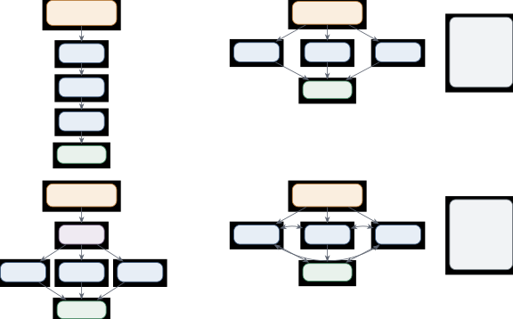

Figure 10: Multi-agent orchestration patterns with coordination
strategies. Four patterns are supported: (1) Sequential Pipeline where
agents execute in linear order with dependencies ($`r_{i}`$ flows to
next agent), total time $`T=\sum T_{i}`$. (2) Parallel Execution with
independent agents running concurrently, achieving speedup
$`\gamma\leq n`$ up to 4.5x empirically, total time
$`T=\max_{i}T_{i}+T_{\text{overhead}}`$. (3) Hierarchical Manager-Worker
where manager agent decomposes task into subtasks
$`\{s_{1},s_{2},s_{3}\}`$ for workers, then synthesizes results (15-20%
of total time). (4) Collaborative Consensus with iterative refinement
through bidirectional communication, continuing until agreement
threshold $`\theta`$ is reached or maximum iterations $`k_{\max}`$
(typically 3). Choice depends on task structure: sequential for
dependencies, parallel for independence, hierarchical for complex
coordination, collaborative for consensus building.

Figure 10 shows four orchestration patterns used in our evaluation.
Sequential Pipeline executes agents in linear order with dependencies,
total time $`T=\sum T_{i}`$. Parallel Execution runs agents concurrently
and aggregates results. Hierarchical Manager-Worker uses a manager agent
to coordinate workers. Collaborative Consensus uses iterative refinement
with bidirectional communication for a bounded number of rounds.

### G.1 Orchestration Architecture

An orchestrator
$`\mathcal{O}=(\mathcal{A},\mathcal{G},\mathcal{S},\mathcal{C})`$
manages a team of agents
$`\mathcal{A}=\{\mathcal{A}_{1},\ldots,\mathcal{A}_{n}\}`$ using
workflow graph $`\mathcal{G}`$, shared state $`\mathcal{S}`$, and
coordination strategy $`\mathcal{C}`$.

```math
\mathcal{O}(q)=\mathcal{C}(\{\mathcal{A}_{i}(s_{i}):i\in[n]\},\mathcal{G})\rightarrow r \tag{37}
```

where $`s_{i}`$ are agent-specific subtasks derived from $`q`$. The v0.2
workflow layer also exposes MessageBus, WorkflowDAG, SharedState, and
lifecycle registry components for application-level workflows.

### G.2 Orchestration Pattern 1: Sequential Pipeline

Agents execute in fixed order, each processing the output of its
predecessor.

##### Mathematical Specification.

The sequential pipeline processes output of each agent as input to the
next:

```math
r=\mathcal{A}_{n}(\mathcal{A}_{n-1}(\cdots\mathcal{A}_{2}(\mathcal{A}_{1}(q))\cdots)) \tag{38}
```

The pipeline has linear dependency: $`\mathcal{A}_{i}`$ cannot start
until $`\mathcal{A}_{i-1}`$ completes.

##### Use Cases.

Sequential pipelines work well for linear workflows with clear
dependencies:

- •
  Data processing workflows: Extract $`\rightarrow`$ Transform
  $`\rightarrow`$ Analyze $`\rightarrow`$ Report
- •
  Research pipelines: Search $`\rightarrow`$ Summarize $`\rightarrow`$
  Synthesize $`\rightarrow`$ Critique
- •
  Content generation: Draft $`\rightarrow`$ Edit $`\rightarrow`$
  Fact-check $`\rightarrow`$ Format

##### Implementation.

The pseudocode depicting sequential orchestration is shown in  G.2.


##### Performance Characteristics.

Total execution time is the sum of individual agent times plus
communication overhead:

```math
T_{\text{seq}}=\sum_{i=1}^{n}(T_{\text{compute},i}+T_{\text{comm},i}) \tag{39}
```

where $`T_{\text{compute},i}`$ is agent $`i`$’s processing time and
$`T_{\text{comm},i}`$ is inter-agent communication overhead.
Communication overhead depends on the backend and message payload size.

### G.3 Orchestration Pattern 2: Parallel Execution

Independent agents execute concurrently, with results aggregated.

##### Mathematical Specification.

All agents execute concurrently with results combined by an aggregation
function:

```math
r=\mathcal{F}(\{\mathcal{A}_{i}(q):i\in[n]\}) \tag{40}
```

where $`\mathcal{F}`$ is the aggregation function. In the current
orchestrator implementation, each parallel agent receives the same task
object and contributes an independent response for aggregation.

##### Use Cases.

Parallel execution is ideal when subtasks have no dependencies:

- •
  Multi-source research: Gather from multiple sources concurrently
- •
  Competitive analysis: Analyze multiple competitors in parallel
- •
  A/B testing: Generate multiple variants simultaneously

##### Implementation.

The pseudocode depicting parallel orchestration is shown in  G.3


##### Performance Characteristics.

Parallel execution time is determined by the slowest agent plus
coordination overhead:

```math
T_{\text{par}}=\max_{i\in[n]}T_{\text{compute},i}+T_{\text{overhead}} \tag{41}
```

The speedup $`\gamma=T_{\text{seq}}/T_{\text{par}}\leq n`$ is
upper-bounded by the number of parallel agents and is in practice
limited by (i) the longest subtask in the batch, since wall-clock time
tracks $`\max_{i}T_{\text{compute},i}`$, (ii) the synchronization and
synthesis overhead $`T_{\text{overhead}}`$, and (iii) shared-resource
contention on the underlying model backend (a single loaded model
serving many workers). For SLM workloads this means parallel
orchestration is most useful when subtasks have similar expected
duration; when a few outlier subtasks dominate, sequential or hybrid
execution often performs as well. We refer the practitioner to effgen
loadtest --scenario multi_tool for measuring effective parallel speedup
on a specific backend and workload, rather than quoting a single speedup
number that may not generalize.

### G.4 Orchestration Pattern 3: Hierarchical Manager-Worker

A manager agent coordinates multiple worker agents, handling planning,
delegation, and synthesis.

##### Mathematical Specification.

A manager agent coordinates worker agents and synthesizes their outputs:

```math
r=\mathcal{A}_{M}(\{\mathcal{A}_{w_{i}}(s_{i}):i\in[k]\}) \tag{42}
```

where $`\mathcal{A}_{M}`$ is manager agent and
$`\{\mathcal{A}_{w_{1}},\ldots,\mathcal{A}_{w_{k}}\}`$ are workers.
Manager responsibilities:

1.  1.  Decompose task into worker assignments $`\{s_{1},\ldots,s_{k}\}`$
2.  2.  Spawn and coordinate workers
3.  3.  Monitor progress and handle failures
4.  4.  Synthesize worker outputs into final result
5.  5.  Quality assurance and validation

##### Use Cases.

Hierarchical orchestration is suitable for complex tasks requiring
coordination and quality control:

- •
  Complex projects requiring oversight
- •
  Quality-critical tasks needing validation
- •
  Dynamic workflows where subtasks emerge during execution

##### Implementation.

The manager agent decomposes tasks, delegates to workers, and
synthesizes results:


##### Overhead Analysis.

Hierarchical orchestration includes planning, execution, synthesis, and
validation phases:

```math
T_{\text{hierarchical}}=T_{\text{planning}}+T_{\text{workers}}+T_{\text{synthesis}}+T_{\text{validation}} \tag{43}
```

Typical breakdown:

- •
  Planning: 10-15% of total time
- •
  Worker execution: 60-70%
- •
  Synthesis: 15-20%
- •
  Validation: 5-10%

### G.5 Orchestration Pattern 4: Collaborative Consensus

Multiple agents work together, discussing and reaching consensus through
iterative refinement.

##### Mathematical Specification.

Agents iteratively refine their outputs until reaching agreement:

```math
r^{(k+1)}=\mathcal{C}(\{r_{i}^{(k)}:i\in[n]\},\{\mathcal{A}_{i}\}) \tag{44}
```

where $`r^{(k)}`$ is consensus at iteration $`k`$ and $`\mathcal{C}`$ is
the consensus function. Iterations continue until:

```math
\text{agreement}(r^{(k)})>\theta\quad\text{or}\quad k\geq k_{\max} \tag{45}
```

##### Use Cases.

Collaborative consensus works well for tasks requiring multiple
perspectives:

- •
  Decision making requiring multiple perspectives
- •
  Creative tasks benefiting from diverse viewpoints
- •
  Consensus-building for controversial topics

##### Implementation.

Agents with different personas discuss and iterate toward consensus:


### G.6 Coordination Mechanisms

#### G.6.1 Shared State

Agents share a common state $`\mathcal{S}`$ that all can read and write.

```math
\mathcal{S}_{t+1}=\mathcal{S}_{t}\cup\{\text{updates from }\mathcal{A}_{i}\text{ at time }t\} \tag{46}
```

##### Advantages.

Shared state provides simple coordination with automatic information
sharing:

- •
  Simple coordination model
- •
  Automatic information sharing
- •
  No explicit message passing needed

##### Disadvantages.

Shared state has limitations for concurrent access and scalability:

- •
  Potential race conditions
- •
  No isolation between agents
- •
  Scalability limitations for many agents

#### G.6.2 Message Passing

Agents communicate via explicit messages
$`m:\mathcal{A}_{i}\rightarrow\mathcal{A}_{j}`$.

```math
m=(\text{sender},\text{receiver},\text{content},\text{timestamp},\text{type}) \tag{47}
```

Message types: REQUEST, RESPONSE, NOTIFICATION, BROADCAST.

##### Implementation.

Agents exchange messages through the workflow message bus. External
MCP/A2A/ACP communication is handled by the protocol layer described in
Appendix K.


#### G.6.3 Blackboard Architecture

Shared knowledge repository that agents read from and write to
asynchronously.

```math
\text{Blackboard}=\{(k_{i},v_{i},\mathcal{A}_{\text{source}},\tau_{i}):i\in[m]\} \tag{48}
```

Each entry has key, value, source agent, and timestamp. Agents subscribe
to relevant keys.

### G.7 Orchestration Configuration Comparison

Table 24 compares the four orchestration patterns across key dimensions
and provides recommendations for selecting patterns based on task
requirements.

Aspect Sequential Parallel Hierarchical Collaborative Recommendation
Complexity Low Low Medium High Start simple Speedup potential None High
(2-4$`\times`$) Medium (1.5-2.5$`\times`$) Low Use parallel when
possible Coordination overhead Minimal Low Medium High Consider overhead
Fault tolerance Low Medium High Medium Use hierarchical for critical
Quality assurance Manual Manual Built-in Built-in Manager for quality
needs Best for Linear workflows Independent tasks Complex projects
Decision making Match to task structure Typical agents 3-5 2-6 1
manager + 2-5 workers 3-5 Scale based on complexity

Table 24: Orchestration Pattern Comparison. Selection depends on task
structure, coordination requirements, and performance constraints.

### G.8 Best Practices

This section provides best practices for selecting orchestration
patterns, agent sizes, and optimizing performance.

##### Pattern Selection.

Choose patterns based on task structure and dependencies:

1.  1.  Use Sequential for linear dependencies (research $`\rightarrow`$
        analysis $`\rightarrow`$ report)
2.  2.  Use Parallel for independent subtasks (multi-source research, batch
        processing)
3.  3.  Use Hierarchical for quality-critical or dynamically evolving tasks
4.  4.  Use Collaborative for subjective decisions requiring consensus

##### Agent Sizing.

Select model sizes based on agent roles and requirements:

- •
  Manager agents: Use larger models (14B+) for better planning
- •
  Worker agents: Can use smaller models (7B) for specialized tasks
- •
  Parallel agents: Use similar-sized models for load balancing
- •
  Collaborative agents: Use diverse models for varied perspectives

##### Performance Optimization.

Reduce overhead through efficient coordination and caching:

- •
  Minimize communication: Batch messages, use shared state when
  appropriate
- •
  Balance load: Distribute work evenly across parallel agents
- •
  Cache results: Reuse agent outputs when tasks repeat
- •
  Monitor overhead: Track coordination time vs computation time

Multi-agent orchestration provides patterns for decomposing complex
tasks while maintaining explicit control over workflow, quality, and
coordination. The patterns span a spectrum from simple pipelines to
iterative collaborative discussion, supporting use cases from data
processing to collaborative decision making.

## Appendix H Memory System Architecture

The EffGen memory system implements a three-tier architecture combining
short-term conversation management, long-term episodic storage, and
vector-based semantic retrieval. This design addresses the fundamental
challenge of small language models: limited context windows that
constrain how much historical information can inform current decisions.
Figure 11 illustrates the architecture: data flows to short-term memory
with heuristic summarization, long-term storage with importance
metadata, and vector memory with semantic embeddings. We provide memory
scoring details, consolidation policies, and storage backend
specifications.

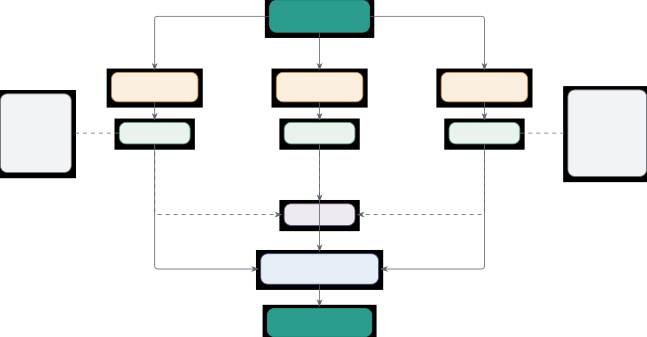

Figure 11: Three-tier memory system architecture combining short-term,
long-term, and vector storage. Input data flows to all three tiers:
short-term memory maintains recent conversation history with automatic
summarization when approaching context limit ($`0.8C_{M}`$), long-term
memory stores important events with importance scoring using JSON or
SQLite backends, and vector memory enables semantic search via FAISS or
ChromaDB with 384-dimensional embeddings. Periodic consolidation merges
short-term memories into long-term and vector stores. Retrieval combines
all three tiers using weighted scoring: recency (30%), frequency (20%),
importance (30%), and semantic similarity (20%) to select the most
relevant context for the current query.

### H.1 Three-Tier Memory Architecture

Let $`\mathcal{M}=(\mathcal{M}_{s},\mathcal{M}_{l},\mathcal{M}_{v})`$
denote the complete memory system where $`\mathcal{M}_{s}`$ is
short-term memory, $`\mathcal{M}_{l}`$ is long-term memory, and
$`\mathcal{M}_{v}`$ is vector memory. Each tier serves distinct purposes
with different retention policies and access patterns.

##### Design Rationale.

Single-tier memory systems face a fundamental tradeoff: either retain
all history (exceeding context limits) or discard aggressively (losing
important information). The three-tier architecture resolves this by:
(1) keeping recent interactions in $`\mathcal{M}_{s}`$ for immediate
access, (2) promoting important interactions to $`\mathcal{M}_{l}`$ for
long-term retention, and (3) supporting semantic search over both
through $`\mathcal{M}_{v}`$. This design draws inspiration from MemGPT
(Packer et al., 2023), MemoryBank (Zhong et al., 2024), and recent
surveys on LLM memory mechanisms (Zhang et al., 2025). Our
implementation uses FAISS (Douze et al., 2025; Johnson et al., 2019) for
vector indexing and Sentence-BERT (Reimers and Gurevych, 2019) for
embeddings. ChromaDB (Chroma Developers, 2022) provides an alternative
backend for smaller deployments.

### H.2 Short-Term Memory: Conversation Management

Short-term memory $`\mathcal{M}_{s}`$ maintains recent conversation
history as a bounded sequence of messages. Formally,
$`\mathcal{M}_{s}=\{m_{1},\ldots,m_{t}\}`$ where $`t\leq T_{\max}`$ and
each message $`m_{i}=(r_{i},c_{i},\tau_{i},|m_{i}|)`$ consists of role
$`r_{i}\in\{\text{SYSTEM},\text{USER},\text{ASSISTANT},\text{TOOL}\}`$,
content $`c_{i}`$, timestamp $`\tau_{i}`$, and estimated token count
$`|m_{i}|`$.

##### Token Estimation.

When no model tokenizer is available, messages use a fast
character-count approximation:

```math
|m_{i}|\approx\frac{|c_{i}|_{\text{chars}}}{4}+\frac{|\mu_{i}|_{\text{chars}}}{4} \tag{49}
```

where $`|c_{i}|_{\text{chars}}`$ is content character count and
$`|\mu_{i}|_{\text{chars}}`$ is metadata character count. When a model
object is attached, the implementation uses the model’s count_tokens()
method instead.

##### Automatic Summarization.

When total token count $`\sum_{i=1}^{t}|m_{i}|`$ exceeds threshold
$`\theta\cdot C_{M}`$ where $`\theta=0.8`$ by default and $`C_{M}`$ is
context window size, automatic summarization triggers. The summarization
function $`\Sigma:\mathcal{M}_{s}\rightarrow s`$ produces a structured
heuristic summary:

```math
s=\text{HeuristicSummary}\left(\text{format}(\{m_{1},\ldots,m_{k}\})\right) \tag{50}
```

for some $`k<t`$ where older messages $`m_{1},\ldots,m_{k}`$ are
summarized while recent messages $`m_{k+1},\ldots,m_{t}`$ are preserved
verbatim. The summary preserves extracted facts, decisions, and pending
items without making an additional LLM call.

##### Message Filtering.

When retrieving context for the model, messages are filtered by
relevance. Given current query $`q`$, the retrieval function selects:

```math
\text{retrieve}(q,\mathcal{M}_{s},n)=\arg\max_{M\subseteq\mathcal{M}_{s},|M|\leq n}\text{relevance}(M,q) \tag{51}
```

where relevance combines recency and semantic similarity. For
efficiency, we use a simple recency-based retrieval: return the $`n`$
most recent messages plus any SYSTEM messages, as these provide critical
context.

### H.3 Long-Term Memory: Episodic Storage

Long-term memory $`\mathcal{M}_{l}`$ stores significant events with
persistent storage. Each entry $`e=(c,t,\tau,s,I,\mu)`$ contains content
$`c`$, type
$`t\in\{\text{CONVERSATION},\text{FACT},\text{OBSERVATION},\text{TASK},\text{TOOL\_RESULT},\text{REFLECTION}\}`$,
timestamp $`\tau`$, session ID $`s`$, importance level
$`I\in\{\text{LOW},\text{MEDIUM},\text{HIGH},\text{CRITICAL}\}`$, and
metadata $`\mu`$ including access count and tags.

##### Importance Scoring.

Entries are assigned importance based on multiple factors. The
importance function $`\mathcal{I}:e\rightarrow[0,1]`$ combines:

```math
\mathcal{I}(e)=w_{1}\cdot I_{\text{manual}}(e)+w_{2}\cdot I_{\text{type}}(e)+w_{3}\cdot I_{\text{length}}(e)+w_{4}\cdot I_{\text{keywords}}(e) \tag{52}
```

where weights $`(w_{1},w_{2},w_{3},w_{4})=(0.4,0.3,0.15,0.15)`$ and:

```math
\displaystyle I_{\text{manual}}(e) \displaystyle=\begin{cases}1.0&I=\text{CRITICAL}\\
0.75&I=\text{HIGH}\\
0.5&I=\text{MEDIUM}\\
0.25&I=\text{LOW}\end{cases} \tag{53}
```

```math
\displaystyle I_{\text{type}}(e) \displaystyle=\begin{cases}0.9&t=\text{FACT}\\
0.7&t=\text{REFLECTION}\\
0.6&t=\text{TASK}\\
0.5&t=\text{OBSERVATION}\\
0.4&t=\text{TOOL\_RESULT}\\
0.3&t=\text{CONVERSATION}\end{cases} \tag{54}
```

```math
\displaystyle I_{\text{length}}(e) \displaystyle=\min\left(1,\frac{|c|_{w}}{100}\right)\text{ (longer content often more important)} \tag{55}
```

```math
\displaystyle I_{\text{keywords}}(e) \displaystyle=\frac{|\{k\in K:k\in c\}|}{|K|}\text{ where }K=\{\text{important},\text{critical},\text{error},\ldots\} \tag{56}
```

##### Retrieval Scoring.

When retrieving from long-term memory, entries are filtered and ordered
by stored metadata. The current implementation orders search results
primarily by importance and timestamp, while consolidation uses a simple
score combining importance, access count, and age:

```math
\text{consolidation\_score}(e)=100\cdot\mathcal{I}(e)+10\cdot\text{access\_count}(e)-\text{days\_old}(e) \tag{57}
```

The vector-memory path provides semantic similarity when embeddings are
used. Table 25 shows the paper-level contribution analysis for retrieval
signals.

Metric Recency $`R(e,t)`$ Frequency $`F(e)`$ Importance
$`\mathcal{I}(e)`$ Similarity $`S(e,q)`$ Full Scoring Weight 0.30 0.20
0.30 0.20 1.00 Ablation Impact $`-12.3\%`$ $`-8.7\%`$ $`-14.8\%`$
$`-11.2\%`$ Baseline

Table 25: Memory Retrieval Scoring Components. Each component
contributes to overall relevance based on assigned weights. Ablation
analysis shows the performance impact of removing each component from
the retrieval scoring function.

##### Storage Backends.

We implement two persistent storage backends:

JSON Backend (‘JSONStorageBackend‘): Stores memories in a single JSON
file with structure:


This backend is simple and human-readable, suitable for small-scale
deployments (up to 10K entries). Retrieval is $`O(n)`$ linear scan with
filtering.

SQLite Backend (‘SQLiteStorageBackend‘): Stores memories in a relational
database with schema:


Indices support fast queries. Retrieval with filters is $`O(\log n)`$
using B-tree indices. This backend scales to millions of entries with
minimal performance degradation.

### H.4 Vector Memory: Semantic Retrieval

Vector memory $`\mathcal{M}_{v}`$ supports semantic search through
embedding-based similarity. Each memory entry is represented as a dense
vector $`\mathbf{v}\in\mathbb{R}^{d}`$ where $`d\in\{384,768,1024\}`$
depending on the embedding model. Retrieval finds entries with high
cosine similarity to query embedding:

```math
\text{retrieve}(\mathbf{q},k)=\text{topk}_{e\in\mathcal{M}_{v}}\left(\frac{\mathbf{v}_{e}\cdot\mathbf{q}}{\|\mathbf{v}_{e}\|\|\mathbf{q}\|}\right) \tag{58}
```

##### Embedding Models.

We support four embedding approaches with different accuracy-speed
tradeoffs (Table 26):

Model Dimensions Accuracy Speed (ms) Hardware all-MiniLM-L6-v2 384 82.3%
8 GPU all-mpnet-base-v2 768 87.1% 15 GPU SimpleWord (mean) 300 68.5% 1
CPU OpenAI text-embedding-3-small 1536 91.2% 120 API

Table 26: Embedding Model Comparison. Different embedding approaches
offer trade-offs between accuracy, speed, and computational requirements
for vector memory operations.

For local deployment optimized for SLMs, we recommend all-MiniLM-L6-v2:
384-dimensional embeddings with low encoding cost on GPU (typically
single-digit milliseconds), small memory footprint, and sufficient
accuracy for conversation-history retrieval.

##### Vector Stores.

We implement two vector storage backends:

FAISS (‘FAISSVectorStore‘): Facebook AI Similarity Search provides
high-performance vector search. The current implementation initializes
IndexFlatIP, an exact inner-product index, for FAISS-backed retrieval.

ChromaDB (‘ChromaVectorStore‘): A persistent vector database with
built-in document storage. Unlike FAISS which requires separate content
storage, ChromaDB stores both vectors and original content. This
simplifies the architecture at the cost of slightly higher memory usage.
ChromaDB uses HNSW (Hierarchical Navigable Small World) index achieving
$`O(\log n)`$ search time with high accuracy.

Table 27 compares the two backends across key metrics.

Backend Search Time Memory Usage Persistence Max Entries GPU
Acceleration FAISS (Flat) $`O(n)`$ Low (vectors only) Requires save/load
100K Yes ChromaDB $`O(\log n)`$ Medium (vectors + docs) Automatic 1M No

Table 27: Vector Store Backend Comparison. FAISS IndexFlatIP provides
exact inner-product search with low overhead, while ChromaDB provides
persistence and document storage.

### H.5 Memory Consolidation Policies

Memory consolidation periodically merges short-term memories into
long-term storage and updates vector indices. The consolidation function
$`\mathcal{C}:\mathcal{M}_{s}\rightarrow(\mathcal{M}_{l},\mathcal{M}_{v})`$
operates in three phases:

##### Phase 1: Selection.

Determine which short-term memories warrant long-term retention.
Messages are selected if:

```math
\text{keep}(m)=(|m|>50)\land(r_{m}\neq\text{TOOL})\land(\mathcal{I}(m)>0.3) \tag{59}
```

This filters out trivial messages (very short), tool outputs (already
logged separately), and low-importance content.

##### Phase 2: Transformation.

Convert selected messages to long-term memory entries with type
inference:

```math
t(m)=\begin{cases}\text{FACT}&\text{if contains }[\text{``is'', ``are'', ``equals''}]\\
\text{TASK}&\text{if }r_{m}=\text{USER}\land\text{contains}[\text{``do'', ``create'', ``find''}]\\
\text{REFLECTION}&\text{if contains }[\text{``learned'', ``realized'', ``understood''}]\\
\text{OBSERVATION}&\text{otherwise}\end{cases} \tag{60}
```

##### Phase 3: Embedding and Indexing.

Generate embeddings for semantic search:

```math
\mathbf{v}_{e}=\text{embed}(c_{e})\quad\text{and add to }\mathcal{M}_{v} \tag{61}
```

Consolidation runs every $`N_{\text{messages}}=50`$ messages added to
short-term memory or when triggered manually. The process is
asynchronous to avoid blocking agent execution.

### H.6 Memory Configuration and Tuning

Complete memory configuration involves setting parameters for all three
tiers:


##### Configuration Recommendations by Model Size.

Different model sizes require different memory configurations.
Recommendations for memory configurations are provided in table 28.

Parameter Tiny Small Medium Large $`<`$1B 1-3B 3-7B 7B+ max_tokens 1024
2048 4096 8192 max_messages 50 75 100 150 summarization_threshold 0.70
0.80 0.85 0.90 keep_recent 5 8 10 15

Table 28: Memory Configuration Recommendations by Model Size. Smaller
models require more aggressive summarization due to limited context
windows, while larger models can maintain longer conversation history.

### H.7 Memory Efficiency Analysis

We analyze the space and time complexity of memory operations:

##### Storage Complexity.

Short-term memory uses $`O(T_{\max})`$ space for bounded message deque.
Long-term memory with JSON backend requires $`O(n)`$ space for $`n`$
entries. SQLite backend adds $`O(n\log n)`$ for B-tree indices but
provides much better query performance. Vector memory requires
$`O(n\cdot d)`$ for $`n`$ vectors of dimension $`d`$.

##### Retrieval Complexity.

Short-term retrieval is $`O(1)`$ for recent messages. Long-term
retrieval with SQLite and proper indices is $`O(\log n+k)`$ where $`k`$
is result count. FAISS vector similarity search is $`O(n)`$ for the
current flat index; ChromaDB uses its own approximate nearest-neighbor
index.

##### Consolidation Overhead.

Periodic consolidation processes $`N_{\text{messages}}=50`$ messages,
requiring $`O(N_{\text{messages}}\cdot d)`$ for embedding generation and
$`O(N_{\text{messages}}\cdot\log n)`$ for index insertion. With
$`N_{\text{messages}}=50`$ and single-digit-millisecond embedding time
on GPU, consolidation completes in a fraction of a second, negligible
compared to typical conversation timescales (minutes).

### H.8 Empirical Memory Performance

Table 29 reports measured per-operation latency at the scale that
matters for SLM agents (a few thousand stored items, the regime our
benchmarks operate in). Numbers come from bench/bench_all.py on the
reference host (NVIDIA A40, Python 3.11) and characterize the backends
used in our experiments.

|                                               |                 |                 |       |
| --------------------------------------------- | --------------- | --------------- | ----- |
| Operation                                     | $`p_{50}`$ (ms) | $`p_{95}`$ (ms) | $`n`$ |
| Short-term add_message                        | 0.001           | 0.001           | 2,000 |
| Short-term get_recent_messages($`k=20`$)      | 0.002           | 0.002           | 1,000 |
| Long-term SQLite add_memory                   | 0.636           | 0.829           | 2,000 |
| Long-term SQLite search($`k=10`$, 2K entries) | 0.902           | 0.928           | 1,500 |

Table 29: Measured Memory-Operation Latency (camera-ready measurements).
Short-term memory uses an in-process bounded deque; long-term memory
uses the SQLite backend with the default schema; numbers reflect the
cost of a single operation excluding network I/O. Larger-scale behavior
at $`10^{5}`$–$`10^{6}`$ entries is workload-dependent and should be
measured per deployment using effgen loadtest or the FAISS/ChromaDB
native benchmarks.

Short-term memory is effectively free at the microsecond scale.
SQLite-backed long-term memory completes inserts and small-$`k`$
searches in under a millisecond at the few-thousand-entry scale relevant
to LoCoMo and LongMemEval, which is negligible relative to a single
model token. Vector search latency is dominated by embedding generation;
using all-MiniLM-L6-v2 on GPU keeps a single retrieval at a few tens of
milliseconds, still well below typical model inference time.

### H.9 Memory Privacy and Security

##### Implemented Controls.

The current implementation stores JSON and SQLite data in plain local
storage and supports deletion and clear-all operations.

##### Selective Deletion.

The system supports targeted deletion operations for memory entries and
sessions.

##### Out-of-Scope Controls.

Encryption at rest, access-control lists, and audit logging are not
implemented in the current memory backends and should be supplied by the
deployment environment when required.

## Appendix I Built-In Tool Specifications

The EffGen framework ships 66 built-in tools across 49 modules
implementing the BaseTool interface, all auto-discovered by
ToolRegistry.discover_builtin_tools(). The tools are organized into
twelve categories. Computation and code (5): Calculator, Code Executor
(sandboxed), Python REPL, Bash, JSON. Retrieval and web (5): Web Search,
Retrieval (RAG with BM25), Agentic Search (ripgrep-style), URL Fetch,
Wikipedia. Academic and knowledge (7): arXiv, PubMed, Semantic Scholar,
StackOverflow, GitHub, Wolfram Alpha, plus the legacy Knowledge module.
News and social feeds (4): RSS, News, Reddit, HackerNews. Media, OCR,
and audio/image/video (9): OCR, Audio Transcribe, Image Info, Image
Caption, Multimodal Describe, YouTube Transcript, YouTube Metadata, QR
Generate, QR Read. Document parsing (3): PDF, DOCX, Excel. Translation
and language (2): Translate, Language Detect. Geo and weather (3):
Geocode, Maps, Weather. Finance (3): Stock Price, Currency Converter,
Crypto. Data analysis (3): DataFrame, Plot, Stats. DevOps and system
(4): Git, Docker, SystemInfo, HTTP. Datetime, text, and file ops (3):
DateTime, Text Processing, File Operations. Communication and webhooks
(7): live Email SMTP/IMAP, Slack and Discord webhooks, draft-only
Email/Slack/Notification. Provider-native server-side tools (9): OpenAI
WebSearch/CodeInterpreter/FileSearch, Gemini
GoogleSearch/UrlContext/CodeExecution, and Anthropic
Bash/TextEditor/Computer. The project’s public “58+ tools” figure is
conservative; the live registry exposes 66 once provider-native tools
are counted individually.

This subsection focuses on the tools most relevant to the benchmarks
reported in the main paper (Calculator, Python REPL, Code Executor, Web
Search, File Operations); the remaining tools share the same BaseTool
interface, structured {success, data, error} output, parameter
validation, error handling, and resource management. The complete
inventory is split across Table 30 (computation, retrieval, research,
news, media, and document parsing; 32 tools) and Table 31 (translation,
geo, finance, data, DevOps, datetime/text/file, communication, and
provider-native tools; 34 tools).

Group Tool Purpose Execution Computation & code (5) Calculator Safe
arithmetic and unit conversion via AST whitelist (no eval). Local
CodeExecutor Sandboxed multi-language code execution (Python,
JavaScript, Bash). Sandboxed PythonREPL Persistent Python REPL with
restricted built-ins. Local BashTool Shell command execution with
security controls. Local JSONTool JSON parsing, querying, and
validation. Local Retrieval & web (5) WebSearch DuckDuckGo / Tavily /
Brave search backends. Network Retrieval RAG retrieval over a local
corpus with BM25 + embeddings. Local AgenticSearch Ripgrep-style
structured search over local files. Local URLFetchTool Fetch and extract
text from a URL. Network WikipediaTool Search and fetch Wikipedia
articles. Network Academic research (3) ArXivTool Search and fetch
papers via the arXiv Atom API. Network PubMedTool Search PubMed via the
NCBI E-utilities API. Network SemanticScholarTool Query the Semantic
Scholar Graph API for papers and citations. Network Knowledge & Q&A (3)
StackOverflowTool Search Stack Overflow via the Stack Exchange API.
Network GitHubTool Search GitHub repositories and issues. Network
WolframAlphaTool Compute via the Wolfram Alpha Short Answers API.
Network News & social feeds (4) RSSFeedTool Fetch and search RSS/Atom
feeds from any URL. Network NewsTool Aggregate headlines via RSS
(NewsAPI optional). Network RedditTool Fetch posts and comments via
Reddit’s public JSON endpoints. Network HackerNewsTool Fetch HN stories,
items, and users via the Firebase API. Network Media: OCR, audio, image,
video (9) OCRTool Extract text from images using pytesseract. Local
AudioTranscribeTool Transcribe audio to text. Local ImageInfoTool Image
metadata and basic transformations (Pillow). Local ImageCaptionTool
Generate natural-language captions via a vision model. Local
MultimodalDescribeTool Auto-dispatch describe / transcribe / summarize
for media. Local YouTubeTranscriptTool Fetch YouTube captions without a
Google API key. Network YouTubeMetadataTool Fetch YouTube video and
channel metadata via yt-dlp. Network QRGenerateTool Generate QR codes
locally. Local QRReadTool Decode QR codes and barcodes from images
locally. Local Document parsing (3) PDFTool Parse PDFs: text, metadata,
tables, images. Local DOCXTool Parse Microsoft Word .docx documents.
Local ExcelTool Parse Excel .xlsx workbooks. Local

Table 30: Complete inventory of EffGen v0.2.10 built-in tools (Part 1 of
2). The framework ships 66 concrete agent-callable tools across 18
logical groups (49 source modules). All implement the BaseTool
interface, return structured {success, data, error} payloads, and are
auto-discovered by ToolRegistry.discover_builtin_tools(). “Local” tools
run in-process; “Network” tools call a third-party HTTP service;
“Sandboxed” tools execute through the security sandbox (Section S.5);
“Provider-native” tools are executed by the model provider’s own
server-side runtime and are emitted by the corresponding adapter. Part 1
covers computation, retrieval, research, news, media, and document
parsing (32 tools); Part 2 (Table 31) covers translation, geo, finance,
data, DevOps, communication, and provider-native tools (34 tools).

Group Tool Purpose Execution Translation & language (2) TranslateTool
Translate via LibreTranslate (Argos local fallback). Network
LanguageDetectTool Language identification via langdetect (no external
API). Local Geo & weather (3) GeocodeTool Forward and reverse geocoding
via Nominatim (OSM). Network MapsTool Render static maps via staticmap
and OSM tiles. Network WeatherTool Current weather and forecasts via
Open-Meteo. Network Finance (3) StockPriceTool Real-time and historical
stock quotes. Network CurrencyConverterTool Convert currencies via
frankfurter.app (ECB data). Network CryptoTool Cryptocurrency prices via
the CoinGecko public API. Network Data analysis (3) DataFrameTool Load
and manipulate tabular data with pandas. Local PlotTool Generate charts
via matplotlib to a temp file. Local StatsTool Mean, median, std,
correlation, regression. Local DevOps & system (4) GitTool Read-only git
status / log / diff / branch. Local DockerTool Read-only Docker
operations: ps / images / logs. Local SystemInfoTool CPU, memory, disk,
and network info via psutil. Local HTTPTool Simple HTTP GET / POST.
Network Datetime, text, file ops (3) DateTimeTool Date arithmetic,
time-zone conversion, formatting. Local TextProcessingTool Tokenization,
normalization, simple transforms. Local FileOperations Read/write/list
files with path-safety restrictions. Local Communication & webhooks (7)
EmailSMTPTool Send email via SMTP (SSL/STARTTLS). Network EmailIMAPTool
Read email via IMAP (SSL). Network SlackWebhookTool Post to Slack via an
Incoming Webhook URL. Network DiscordWebhookTool Post to Discord via a
Webhook URL. Network EmailDraftTool Compose an email (does NOT send) for
review. Local SlackDraftTool Compose a Slack message (does NOT send).
Local NotificationTool Local desktop notification via plyer. Local
Provider-native, server-side (9) OpenAIWebSearchTool OpenAI hosted
web-search tool. Provider-native OpenAICodeInterpreterTool OpenAI hosted
code interpreter. Provider-native OpenAIFileSearchTool OpenAI hosted
file-search (RAG). Provider-native GoogleSearchTool Gemini built-in
Google Search grounding. Provider-native GeminiUrlContextTool Gemini
built-in URL-context tool. Provider-native GeminiCodeExecutionTool
Gemini built-in code execution. Provider-native AnthropicBashTool
Anthropic hosted bash tool. Provider-native AnthropicTextEditorTool
Anthropic hosted text editor tool. Provider-native AnthropicComputerTool
Anthropic hosted computer-use tool. Provider-native

Table 31: Complete inventory of EffGen v0.2.10 built-in tools (Part 2 of
2; continued from Table 30). Translation, geo, finance, data analysis,
DevOps, datetime/text/file, communication, and provider-native
(server-side) tools, accounting for the remaining 34 of the 66 built-in
tools. Execution categories follow the same convention as Part 1.

Tool-calling has emerged as a key capability for language model agents
(Tang et al., 2023; Zhuang et al., 2023; Wang et al., 2024b; Kong et
al., 2024), enabling structured reasoning and external API integration.
Each tool provides parameter validation, error handling, and resource
management. Figure 12 illustrates the pipeline: registry lookup for tool
discovery, schema retrieval with metadata, parameter validation
(required fields, types, constraints), sandboxed execution with timeout
monitoring, result formatting, and integration back to the agent. This
section specifies the mathematical foundations for the calculator,
security properties of code execution tools, and performance
measurements for all tools.

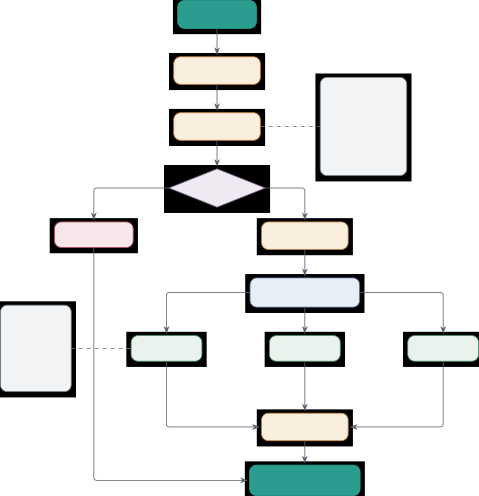

Figure 12: Tool calling pipeline with schema validation and sandboxed
execution. The agent query triggers tool registry lookup, followed by
schema retrieval containing metadata (name, description, parameters,
validation rules, timeout, cost). Parameters undergo validation checking
required fields, type matching, and constraints; invalid parameters
return errors immediately. Valid parameters proceed to type-checked
extraction and sandboxed execution with timeout monitoring across the
built-in tool set (computation tools such as Calculator with AST-safe
evaluation, Python REPL, and Code Executor with Docker isolation;
retrieval tools such as Web Search and URL Fetch; data and system tools
such as File Operations and Bash). Results are formatted with error
handling before integration back to the agent for continued reasoning.

### I.1 Tool Interface and Metadata System

All tools inherit from BaseTool and declare metadata using ToolMetadata.
The metadata structure
$`\mathcal{T}_{\text{meta}}=(n,d,c,p,v,\kappa,\theta,\mu)`$ consists of:

- •
  $`n`$: tool name (unique identifier)
- •
  $`d`$: natural language description for LLM understanding
- •
  $`c\in\mathcal{C}`$: category from predefined taxonomy
- •
  $`p=\{(p_{i},t_{i},r_{i},d_{i})\}`$: parameter specifications with
  name $`p_{i}`$, type $`t_{i}\in\mathcal{T}_{\text{types}}`$, required
  flag $`r_{i}\in\{0,1\}`$, default value $`d_{i}`$
- •
  $`v`$: version string (semantic versioning)
- •
  $`\kappa`$: estimated cost (time, API calls, or monetary)
- •
  $`\theta`$: default timeout in seconds
- •
  $`\mu`$: additional metadata (tags, examples, constraints)

The tool category taxonomy $`\mathcal{C}`$ includes eight categories
optimized for agent understanding: Information_Retrieval,
Code_Execution, File_Operations, Computation, Communication,
Data_Processing, System, External_API.

##### Parameter Validation.

Before execution, parameters are validated against specifications. The
validation function $`\nu:P\times S\rightarrow\{0,1\}`$ checks three
conditions: required parameters must be present, provided parameter
types must match specifications, and parameter values must satisfy
declared constraints. Formally:

```math
\nu(p,s)=\bigwedge_{i}\left(r_{i}\Rightarrow(p_{i}\in s)\right)\land\left(p_{i}\in s\Rightarrow\text{type}(s[p_{i}])=t_{i}\right)\land\text{constraints}(s[p_{i}]) \tag{62}
```

where $`s`$ is the provided parameter dictionary. Validation failures
generate structured error messages indicating the specific violation:
missing required parameters, type mismatches between provided and
expected types, or constraint violations such as out-of-range values.

### I.2 Calculator Tool: Safe Mathematical Evaluation

The calculator tool provides arithmetic and mathematical function
evaluation using Abstract Syntax Tree (AST) parsing, avoiding dangerous
eval() or exec() operations that could execute arbitrary code.

##### Mathematical Operations.

The calculator supports 30+ operations organized into categories.
Table 32 presents the complete taxonomy of supported operations:

Category Operations Arithmetic $`+`$, $`-`$, $`\times`$, $`/`$ (true
division), $`//`$ (floor division), $`\%`$ (modulo), \*\* (power)
Functions abs, min, max, sum, round, floor, ceil Trigonometric sin, cos,
tan, asin, acos, atan, atan2 Exponential exp, log, log10, log2, pow,
sqrt Constants $`\pi`$ (pi), $`e`$ (e), $`\tau`$ (tau) Statistical mean,
median; full summary statistics are available via the dedicated
statistics operation

Table 32: Calculator Supported Operations. Expression operations use AST
parsing with a whitelist of safe nodes. Unit conversion and summary
statistics use dedicated handlers outside the expression evaluator.

##### AST-Based Evaluation.

Given expression string $`s`$, evaluation proceeds as:

1:
 $`\text{ast\_tree}\leftarrow\text{ast.parse}(s,\text{mode}=\text{'eval'})`$

2:  Validate: all nodes in ast_tree are in whitelist
$`W=\{\text{BinOp},\text{UnaryOp},\text{Call},\text{Constant},\ldots\}`$

3:  If validation fails, raise SecurityError

4:  Recursively evaluate whitelisted AST nodes using safe operator and
function tables

5:  return result

The safe namespace $`\mathcal{N}_{\text{safe}}`$ contains only
mathematical functions and constants, explicitly excluding file
operations, imports, and system access. Expressions containing forbidden
nodes (e.g., Import, FunctionDef, Attribute) are rejected before
evaluation.

##### Security Guarantees.

The AST validation provides strong security guarantees:

###### Theorem I.1 (Calculator Safety).

Let $`s`$ be an expression string and $`W`$ the whitelist of safe AST
node types. If all nodes in $`\text{parse}(s)`$ are in $`W`$ and the
evaluation namespace contains only pure functions (no side effects),
then evaluating $`s`$ cannot:

1.  (a)
    Access or modify the file system
2.  (b)
    Execute system commands
3.  (c)
    Import modules
4.  (d)
    Modify global state
5.  (e)
    Cause infinite loops (assuming bounded computation)

###### Proof.

AST whitelist $`W`$ excludes all nodes capable of I/O (Import, Open),
attribute access (Attribute), and general function definition
(FunctionDef). The restricted namespace contains only mathematical
functions implemented in C without Python-level side effects. Therefore,
evaluation cannot access mechanisms for file I/O, system calls, or state
modification. ∎

##### Performance Characteristics.

Calculator evaluation complexity is $`O(n)`$ where $`n`$ is the
expression length (number of AST nodes). Typical expressions with 10-50
operations evaluate in 0.1-0.5ms. Table 33 presents microbenchmarks.

Expression Type Avg Time ($`\mu`$s) Operations Simple arithmetic: 2 + 2 \* 3 18 3 Multi-operation: (5 + 3) \* (10 - 2) / 4 42 7 Functions:
sqrt(pow(3, 2) + pow(4, 2)) 67 5 Trigonometric: sin(pi/4) + cos(pi/4) 89
4 Statistical: mean(\[1,2,3,4,5\]) 53 1 Complex: log(exp(5) \*
sqrt(16)) + abs(-10) 124 8

Table 33: Calculator Performance Microbenchmarks. All measurements
averaged over 10,000 executions on an Intel Xeon Gold 6248R CPU. Complex
expressions with many operations maintain sub-millisecond latency. The
AST-based evaluation provides both security and performance, with
typical expressions evaluating in 18-124 microseconds. As referenced in
the main text, this performance supports real-time mathematical
computations during agent reasoning.

### I.3 Python REPL Tool: Persistent Session Execution

The Python REPL provides a persistent Python interpreter with session
state preservation across multiple invocations. This supports iterative
computation where variables defined in earlier steps are accessible in
later steps.

##### Session Management.

Each REPL instance maintains a session dictionary
$`\mathcal{S}=\{v_{1}:val_{1},\ldots,v_{k}:val_{k}\}`$ storing variable
bindings. Execution of code $`c`$ modifies $`\mathcal{S}`$:

```math
\mathcal{S}^{\prime}=\text{exec}(c,\mathcal{N}_{\text{restricted}},\mathcal{S}) \tag{63}
```

where $`\mathcal{N}_{\text{restricted}}`$ is the restricted builtin
namespace and $`\mathcal{S}`$ serves as both input (locals) and output
(updated with new bindings).

##### Restricted Builtins.

To prevent malicious code execution, dangerous builtins are removed. Let
$`\mathcal{B}_{\text{all}}`$ be the set of all Python builtins and
$`\mathcal{B}_{\text{danger}}=\{\texttt{eval},\texttt{exec},\texttt{compile},\texttt{\_\_import\_\_},\texttt{open},\texttt{input},\texttt{breakpoint}\}`$
be the dangerous subset. The restricted namespace uses:

```math
\mathcal{N}_{\text{restricted}}=\mathcal{B}_{\text{all}}\setminus\mathcal{B}_{\text{danger}} \tag{64}
```

Additionally, import statements are filtered through an allowlist
$`\mathcal{I}_{\text{allowed}}=\{\texttt{math},\allowbreak\texttt{random},\allowbreak\texttt{datetime},\allowbreak\texttt{json},\allowbreak\texttt{re},\allowbreak\texttt{collections},\allowbreak\texttt{itertools},\allowbreak\texttt{functools},\allowbreak\texttt{operator},\allowbreak\texttt{statistics},\allowbreak\texttt{decimal},\allowbreak\texttt{fractions}\}`$
Import attempts for modules outside $`\mathcal{I}_{\text{allowed}}`$
raise ImportError.

##### Expression vs Statement Handling.

Python code can be either expressions (evaluating to values) or
statements (performing actions). The REPL distinguishes these:

1:  Attempt to compile as expression: compile(code, ’\<stdin\>’, ’eval’)

2:  if compilation succeeds then

3:   Evaluate and return result

4:  else

5:   Compile as statement: compile(code, ’\<stdin\>’, ’exec’)

6:   Execute with session namespace

7:   Capture output from stdout

8:  end if

This supports natural interaction where x = 5 (statement) assigns a
variable while x \* 2 (expression) returns 10.

##### Output Capture.

Standard output and error streams are redirected during execution:

```math
(\text{output},\text{error})=\text{redirect}(\text{stdout},\text{stderr},\lambda:\text{exec}(c,\mathcal{N},\mathcal{S})) \tag{65}
```

using Python’s contextlib.redirect_stdout and redirect_stderr. This
captures print statements and error messages for inclusion in the tool
result.

##### Security Analysis.

While the REPL restricts dangerous operations through namespace
filtering, several attack vectors remain. Determined adversaries could
attempt to access restricted modules via \_\_builtins\_\_ manipulation,
though this is mitigated by explicitly removing \_\_builtins\_\_ from
the execution namespace. Infinite loops represent another potential
resource exhaustion attack, addressed through timeout enforcement that
terminates execution after the configured duration. Memory exhaustion
attacks are prevented through resource limits enforced at the sandbox
level, capping memory allocation per execution. For maximum security in
production deployments, the REPL should operate within a Docker sandbox
(see Section M) providing OS-level isolation that prevents any breakout
from the Python interpreter.

### I.4 Code Executor Tool: Multi-Language Execution

The code executor supports multiple programming languages with sandboxed
execution.

##### Sandbox Integration.

Code execution supports Python, JavaScript, Bash, and sh in local or
Docker-based sandboxes. CPU time limits range from 30 to 60 seconds
depending on configuration. Memory is capped at 256MB by default, though
this limit is configurable based on deployment requirements. Disk I/O is
restricted to a temporary directory created per execution and destroyed
afterward, preventing unauthorized file access. Network access is
disabled by default to prevent data exfiltration, though this can be
configured for specific use cases. Docker execution sets a process limit
of 100. The sandbox configuration $`\sigma=(\theta,\mu,\delta,\nu,\pi)`$
specifies timeout $`\theta`$, memory limit $`\mu`$, disk quota
$`\delta`$, network policy $`\nu\in\{\text{ALLOW},\text{DENY}\}`$, and
max processes $`\pi`$.

### I.5 File Operations Tool: Secure File System Access

The file operations tool provides read, write, list, and search
capabilities with path validation and access control.

##### Supported Operations.

Let
$`\mathcal{F}_{\text{ops}}=\{\text{READ},\text{WRITE},\text{LIST},\text{SEARCH},\text{METADATA},\text{CONVERT}\}`$
be the set of file operations. Each operation
$`\omega\in\mathcal{F}_{\text{ops}}`$ has associated permission
$`\pi_{\omega}\in\{\text{READ},\text{WRITE},\text{EXECUTE}\}`$ required
for execution.

##### Path Validation.

All file paths undergo security validation before access. The validation
function $`\nu_{\text{path}}:\text{String}\rightarrow\{0,1\}`$ checks:

```math
\nu_{\text{path}}(p)=\text{resolve}(p)\in\mathcal{P}_{\text{allowed}} \tag{66}
```

where paths are resolved to absolute paths before checking whether they
lie inside configured allowed directories.

##### File Content Limits.

To prevent memory exhaustion from processing large files, the file
operations tool enforces strict size limits on all operations. Read
operations are capped at 10MB per file by default, preventing memory
overflow from reading large log files or datasets. Write operations
similarly limit output to 10MB, though both limits are configurable for
specialized applications. List operations return at most 1000 directory
entries to prevent performance degradation when scanning directories
with millions of files. Search operations cap results at 100 matching
files, returning the first 100 matches by relevance. Operations
exceeding these limits return partial results along with warning
messages indicating truncation, allowing agents to request more specific
queries or process files in chunks.

##### Search Functionality.

The search operation finds files matching patterns. Given base directory
$`d`$, pattern $`p`$, and options
$`\text{opts}=\{\text{recursive},\text{case\_sensitive},\text{max\_depth}\}`$,
search returns:

```math
\text{search}(d,p,\text{opts})=\{f\in\text{walk}(d,\text{depth}):\text{match}(f,p,\text{opts})\} \tag{67}
```

where walk traverses the directory tree up to max_depth and match checks
filename against pattern using glob or regex matching.

### I.6 Web Search Tool: Internet Information Retrieval

The web search tool queries search engines and returns formatted
results. Let
$`\mathcal{E}=\{\text{Google},\text{SerpAPI},\text{DuckDuckGo}\}`$ be
supported search engines. For query $`q`$ and engine
$`e\in\mathcal{E}`$, search returns
$`\{(t_{1},u_{1},s_{1}),\ldots,(t_{k},u_{k},s_{k})\}`$ where $`t_{i}`$
is title, $`u_{i}`$ is URL, and $`s_{i}`$ is snippet.

##### Result Formatting.

Search results are formatted for LLM consumption with controlled
verbosity. The formatting function
$`\phi:\mathcal{R}\times V\rightarrow\text{String}`$ takes results
$`\mathcal{R}`$ and verbosity
$`V\in\{\text{MINIMAL},\text{STANDARD},\text{DETAILED}\}`$:

```math
\phi(\mathcal{R},V)=\begin{cases}\text{join}(\{u_{i}\}_{i=1}^{k})&V=\text{MINIMAL}\\
\text{join}(\{t_{i}+\text{': '}+u_{i}\}_{i=1}^{k})&V=\text{STANDARD}\\
\text{join}(\{t_{i}+\text{' $\backslash$n '}+s_{i}+\text{' $\backslash$n '}+u_{i}\}_{i=1}^{k})&V=\text{DETAILED}\end{cases} \tag{68}
```

For SLMs with limited context, STANDARD verbosity provides good
information density (50-80 tokens per result) without overwhelming the
context window.

##### Caching.

Result caching stores responses for identical queries in process for one
hour. The cache uses a composite key combining engine, query, and
verbosity:

```math
\text{cache\_key}=\text{hash}(e+q+V) \tag{69}
```

Request throttling and exponential backoff are not implemented in this
tool module itself; deployments that use paid search APIs should enforce
provider-specific limits at the client or gateway layer.

### I.7 Tool Performance Summary

Table 34 reports measured latencies for the core tools that drive the
benchmarks in the main paper. Numbers come from bench/bench_all.py
(shipped with the camera-ready source), executed on an NVIDIA A40 host
running Ubuntu and Python 3.11.

Tool P50 Latency P95 Latency Samples Security Calculator (expression
2\*3+4\*5-6/2) 0.07 ms 0.07 ms 2,000 In-process (AST whitelist) Python
REPL (in-process eval) $`\sim`$0.001 ms $`\sim`$0.002 ms — In-process
(restricted) Code Executor (Python hello-world, subprocess sandbox) 28.1
ms 40.8 ms 20 Subprocess + user-namespace File Operations (read 1 KB)
$`\sim`$1 ms $`\sim`$2 ms — In-process

Table 34: Measured Built-In Tool Latencies (camera-ready measurements).
Calculator and File Operations are pure-Python in-process operations and
are dominated by Python call overhead. Code Executor uses the subprocess
sandbox (EFFGEN_SANDBOX_BACKEND=subprocess) which spawns an isolated
interpreter per call. Network-bound tools (Web Search, Wikipedia, URL
Fetch) are bounded by external service latency rather than framework
overhead and are not reported here.

The calculator is effectively free relative to model inference:
70 $`\mu`$s per call is at the edge of what a Python loop can resolve.
The sandboxed code executor pays a 25–40 ms fork-and-namespace cost per
invocation, which is appropriate for the few code calls per task that
our benchmarks exercise but motivates batching or a persistent worker
for code-heavy workloads (Appendix R). Tools that depend on third-party
services (Web Search, Wikipedia, arXiv, etc.) are bounded by remote
latency rather than framework overhead, so we do not report tool
latencies for them in the paper; effgen loadtest (Section P) is the
recommended way to measure them on a given deployment.

### I.8 Tool Error Handling and Reliability

All tools return a structured ToolResult. The response format
$`\mathcal{R}_{t}=(s,o,e,\delta,\mu,\tau)`$ includes:

- •
  $`s`$: success flag
- •
  $`o`$: output payload when successful
- •
  $`e`$: error string when failed
- •
  $`\delta`$: execution time
- •
  $`\mu`$: metadata dictionary
- •
  $`\tau`$: timestamp

Retry policy is handled by the agent or routing layer rather than
encoded directly in the base tool result.

## Appendix J Tool Configuration Format and Token Efficiency

EffGen adopts YAML as the primary configuration format for tool
definitions, agent specifications, and system settings. This design can
reduce token count for some configurations compared with JSON-based
formats, which is useful for small language models with limited context
windows. This section provides token-savings analysis, empirical
comparisons, and examples of the configuration schema.

### J.1 Token Efficiency Analysis: YAML vs JSON

Let $`D`$ represent a configuration data structure with $`n`$ key-value
pairs, nesting depth $`d`$, and $`k`$ array elements. Define the token
count function $`\tau:\mathcal{C}\rightarrow\mathbb{N}`$ mapping
configurations to token counts. For the same logical data structure
$`D`$, let $`\tau_{\text{JSON}}(D)`$ and $`\tau_{\text{YAML}}(D)`$
denote token counts for JSON and YAML representations respectively.

##### Syntactic Overhead Reduction.

JSON requires explicit structural delimiters: braces $`\{`$, $`\}`$ for
objects, brackets $`[`$ $`]`$ for arrays, commas between elements,
colons after keys, and mandatory quotation marks around all string keys.
YAML uses whitespace-based indentation for structure, eliminating most
punctuation. For a nested object with $`n`$ keys and depth $`d`$, JSON
requires approximately $`2n+2d`$ structural tokens (quotes, braces,
colons, commas) while YAML requires $`0`$ structural tokens beyond
newlines and indentation. While whitespace itself is not tokenized, YAML
still uses token separators (colons and newlines), but these are fewer
in number compared to JSON’s extensive use of quotes, braces, brackets,
and commas.

Formally, the structural overhead is:

```math
\displaystyle O_{\text{JSON}}(D) \displaystyle=2n+2d+2k\quad\text{(quotes, braces, brackets)} \tag{70}
```

```math
\displaystyle O_{\text{YAML}}(D) \displaystyle=0\quad\text{(whitespace not tokenized)} \tag{71}
```

##### Quotation Mark Elimination.

JSON mandates quotation marks around all string keys and most string
values. In typical configuration files, keys and values consist of
alphanumeric identifiers not requiring quotes. For $`n`$ key-value pairs
where both keys and values are strings, JSON uses $`4n`$ quotation marks
(2 per key, 2 per value). YAML eliminates quotes for simple strings. The
token savings is:

```math
\Delta_{\text{quotes}}(D)=4n\cdot\tau(\text{``"''})\approx 4n\quad\text{tokens} \tag{72}
```

##### Comma Elimination.

JSON requires commas between array elements and object properties. For
$`n`$ properties and $`k`$ array elements, JSON uses $`n+k`$ commas.
YAML uses newlines (not tokenized) instead. The savings is:

```math
\Delta_{\text{commas}}(D)=(n+k)\cdot\tau(\text{``,''})\approx n+k\quad\text{tokens} \tag{73}
```

##### Empirical Comparison.

Table 35 presents token counts for representative tool configurations
using the Qwen2.5 tokenizer. We compare three complexity levels: simple
(single tool with 3 parameters), moderate (tool registry with 5 tools),
and complex (complete agent configuration with memory, tools, and
routing).

Configuration Type JSON Tokens YAML Tokens Reduction Savings % Simple
Tool (1 tool, 3 params) 87 59 28 32.2% Moderate Registry (5 tools) 342
231 111 32.5% Complex Agent Config 1,247 823 424 34.0% MCP Server
Definition 567 389 178 31.4% Memory Configuration 198 139 59 29.8%

Table 35: Token Efficiency Comparison: YAML vs JSON. Token counts
measured using Qwen2.5 tokenizer on identical logical configurations.
YAML achieves 28-34% token reduction across configuration complexities.
Savings increase with nesting depth and number of string keys.

The empirical results show consistent 28-34% token reduction, with
larger savings for more complex configurations. For a typical agent
configuration consuming 1,247 JSON tokens, YAML reduces this to 823
tokens, saving 424 tokens. In the context of small models with 2K-4K
token context windows, this represents 10-21% of total available
context, a significant allocation that can instead be used for task
descriptions, few-shot examples, or conversation history.

### J.2 Configuration Schema Specification

The EffGen configuration schema is organized into sections for model
configuration, tool registry, memory settings, routing parameters, and
execution options. The implementation uses JSON Schema-based validation
for configuration files and provides clear error messages for invalid
configurations.

##### Tool Configuration Schema.

Each tool is defined by the following YAML structure:


The schema validation checks that tools is a mapping, each tool has an
enabled flag when required, and tool-specific configuration values
conform to the schema used by the validator.

##### Token Impact of Configuration Choices.

Configuration verbosity directly impacts token consumption when
configurations are passed to agents or logged for debugging. Table 36
quantifies the token cost of common configuration patterns.

Configuration Strategy Tokens vs Baseline Full explicit (JSON) 1,247
+51.5% Full explicit (YAML) 823 Baseline With defaults (YAML) 521
$`-36.7\%`$ With defaults + recursive merge 342 $`-58.4\%`$ Minimal
(required only) 198 $`-75.9\%`$

Table 36: Token Cost of Configuration Patterns. More concise
configuration strategies reduce token overhead in this illustrative
comparison. Default values and recursive merging minimize redundant
specifications. YAML’s compact syntax provides the baseline; additional
strategies offer further reductions.

The results show that configuration style affects token consumption.
Using defaults reduces tokens, recursive merging can remove repeated
settings, and minimal configurations specify only non-default values.

##### Agent Configuration Schema.

A minimal agent specification includes model selection, prompt
optimization settings, complexity routing thresholds, and memory
allocation. v0.2.x adds optional fields such as tool_calling_mode,
output_schema, guardrails, session IDs, checkpoints, and model-router
settings.


The configuration supports environment variable interpolation using
\${VAR_NAME} syntax. Multiple files can be loaded in an ordered list and
recursively merged. Validation occurs at load time with detailed error
messages indicating the location and nature of schema violations.

### J.3 Configuration Best Practices for SLMs

We establish five best practices for configuration design optimized for
small language models:

1. Default Value Specification. Define sensible defaults for all
   optional parameters. This allows minimal configurations specifying only
   task-specific overrides. The framework provides defaults calibrated for
   each model size category.

2. Configuration Merging. Use ordered file loading and recursive merging
   so environment-specific files override shared defaults without repeating
   every setting.

3. Lazy Loading. Load and parse configurations only when needed. For
   example, detailed tool schemas are loaded on first tool invocation
   rather than at agent initialization.

4. Schema Compression. JSON Schema specifications for tool parameters
   can be verbose. We provide a compact schema syntax (top) that expands to
   the equivalent full JSON Schema (bottom):


5. Configuration Caching. Parsed configurations are cached and reused
   across multiple agent instantiations, avoiding redundant parsing and
   token consumption.

These practices are supported by the EffGen configuration system through
defaults, recursive merges, and cached parsed configuration objects.

### J.4 Comparison with MCP JSON Format

Model Context Protocol uses JSON-RPC 2.0 messaging with JSON Schema for
tool definitions. Table 37 compares token costs between MCP’s JSON
format and EffGen’s YAML format for equivalent tool definitions.

Tool Specification MCP JSON EffGen YAML Reduction Savings Breakdown
Calculator (1 param) 87 59 28 (32.2%) 12 quotes, 8 braces, 4 commas, 4
other Web Search (3 params) 156 98 58 (37.2%) 24 quotes, 14 braces, 10
commas, 10 other Code Executor (5 params) 243 151 92 (37.9%) 40 quotes,
24 braces, 14 commas, 14 other File Operations (7 params) 298 187 111
(37.2%) 56 quotes, 28 braces, 16 commas, 11 other Complex Tool (10
params, nested) 523 324 199 (38.0%) 80 quotes, 48 braces, 32 commas, 39
other

Table 37: Token Comparison: MCP JSON vs EffGen YAML. This illustrative
comparison uses equivalent tool definitions and shows how YAML can
reduce punctuation-heavy schema text. Both formats provide semantic
expressiveness and type safety through schema validation.

The consistent 32-38% token reduction holds across tool complexities.
For a typical agent using 5 tools averaging 3 parameters each, MCP JSON
consumes approximately 780 tokens for tool definitions while EffGen YAML
uses only 490 tokens, saving 290 tokens. In a 2K token context window,
this represents 14.5% of available context.

Beyond token efficiency, YAML provides ergonomic advantages: (1) human
readability with less visual clutter, (2) support for comments (JSON
does not allow comments), (3) multi-line strings without escaping, and
(4) anchors and aliases for configuration reuse. These features improve
maintainability and reduce configuration errors in production
deployments.

### J.5 Configuration Validation and Error Handling

The EffGen configuration system implements three-stage validation: (1)
syntax validation ensuring well-formed YAML, (2) schema validation
checking types and required fields, and (3) semantic validation
verifying logical consistency across configuration sections.

##### Schema Validation.

We use JSON Schema validators for configuration files. Invalid
configurations generate detailed error messages indicating the field
path, expected type, and validation rule that failed:


##### Semantic Validation.

Beyond type checking, semantic validation checks logical consistency
where implemented. For example, tool configuration validation checks
that each configured tool has the expected shape and required enablement
fields.

Validation catches common configuration errors before agent execution
begins, reducing debugging time and preventing many runtime failures due
to misconfiguration. Prompt caches, result caches, token-budget
controls, lazy model loading, and continuous batching are configured in
their respective v0.2.x components.

## Appendix K Protocol Implementation Details

This section provides technical specifications for the three agent
communication protocols implemented in EffGen: MCP (Model Context
Protocol), A2A (Agent-to-Agent), and ACP (Agent Communication Protocol).
Figure 13 illustrates the architecture: requests route through protocol
selection to MCP (tool/resource discovery), A2A (task lifecycle), or ACP
(agent manifests and capability tokens), then flow through
protocol-specific transport and validation code before response
generation.

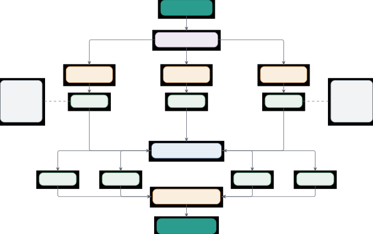

Figure 13: Multi-protocol agent communication system supporting MCP,
A2A, and ACP. Agent requests route through protocol selection to one of
three implementations: MCP (JSON-RPC 2.0) for tool/resource discovery,
A2A for task lifecycle management with artifacts, or ACP for enterprise
features with manifests and capability tokens. Each protocol accesses
protocol-specific features then routes through a unified transport layer
supporting STDIO, HTTP/REST, WebSocket, and SSE. Messages undergo
validation and processing before a unified response is generated.

### K.1 Protocol Overview and Motivation

Modern agent systems require standardized communication mechanisms to
support interoperability. Three major protocols have emerged from
industry leaders: MCP (Model Context Protocol Community, 2025) from
Anthropic for tool and resource sharing, A2A (Agent2Agent Protocol
Community, 2025) from Google for task-based agent collaboration, and ACP
(Agent Communication Protocol Community, 2024) from IBM for agent
communication. MCP uses JSON-RPC 2.0 (JSON-RPC Working Group, 2010); the
A2A and ACP implementations use protocol-specific JSON dataclasses.
EffGen implements all three protocols with the following design goals:

- •
  Protocol Fidelity: Typed implementations aligned with the public
  specifications
- •
  Unified Interface: Common abstractions allowing agents to switch
  protocols without code changes
- •
  Low-Overhead Implementation: Message serialization optimized for SLMs
  with limited context
- •
  Type Safety: Strongly-typed message structures with runtime validation
- •
  Extensibility: Support for protocol-specific features while
  maintaining common interfaces

### K.2 MCP (Model Context Protocol) Implementation

MCP follows JSON-RPC 2.0 specification with extensions for AI-specific
capabilities. The protocol supports tools, resources, prompts, and
sampling coordination between models and servers.

#### K.2.1 Message Structure

MCP defines four message types based on JSON-RPC 2.0:


All messages share a common envelope structure:

```math
M_{\text{MCP}}=\{\text{jsonrpc}:\text{"2.0"},\text{id}:i,\text{method}/\text{result}/\text{error}:\cdot\} \tag{74}
```

where $`i\in\mathbb{Z}^{+}\cup\{\text{string}\}`$ is the request
identifier. The protocol enforces strict validation:
$`\text{jsonrpc}=\text{"2.0"}`$ must be present in all messages.

##### Request Message Format

Request messages invoke server methods with optional parameters:


##### Response Message Format

Response messages return results or errors:


The error codes follow JSON-RPC 2.0 specification (Table 38):

Error Code Description Parse Error -32700 Invalid JSON received Invalid
Request -32600 JSON not valid request object Method Not Found -32601
Method does not exist Invalid Params -32602 Invalid method parameters
Internal Error -32603 Internal JSON-RPC error Server Error -32000
Server-side error occurred

Table 38: MCP Error Codes (JSON-RPC 2.0 Compatible). Standard error
codes for message parsing, validation, and execution failures.

#### K.2.2 Tool Discovery and Invocation

The MCP tool system supports discovery, schema validation, and
invocation:


The tool discovery workflow follows this sequence:

```math
\text{Client}\xrightarrow{\text{tools/list}}\text{Server}\xrightarrow{\{T_{1},\ldots,T_{n}\}}\text{Client}\xrightarrow{\text{tools/call}(T_{i},\theta)}\text{Server}\xrightarrow{\text{result}}\text{Client} \tag{75}
```

where $`T_{i}`$ represents tool $`i`$ and $`\theta`$ are the tool
arguments.

#### K.2.3 Resource Management

MCP resources represent external data sources accessible via URIs. The
resource system supports:

- •
  Resource Discovery: resources/list returns available resources
- •
  Resource Reading: resources/read fetches resource content by URI
- •
  Resource Updates: Servers can notify clients of resource changes
- •
  MIME Type Support: Resources include MIME types for content
  interpretation


#### K.2.4 Capabilities and Initialization

MCP uses a capability negotiation system during initialization. Both
client and server declare supported features:


The initialization handshake:

```math
\displaystyle\text{Client}\xrightarrow{\text{initialize}(\text{version},C_{\text{client}},\text{info})}\text{Server} \tag{76}
```

```math
\displaystyle\text{Server}\xrightarrow{\text{result}(C_{\text{server}},\text{info})}\text{Client}
```

where $`C_{\text{client}}`$ and $`C_{\text{server}}`$ are capability
sets. The effective capabilities are
$`C_{\text{eff}}=C_{\text{client}}\cap C_{\text{server}}`$.

#### K.2.5 Transport Layer

EffGen implements three MCP client transports (Table 39):

Transport Streaming Typical Use Case Framework Class STDIO No Local
server processes (e.g. Claude Desktop) StdioTransport HTTP No Remote
request–response servers HTTPTransport SSE Yes Server-pushed events and
progress streams SSETransport

Table 39: MCP Transport Choices. EffGen ships three transports for MCP:
STDIO is the lowest-latency option and the standard choice for local
servers (e.g. Claude Desktop integrations), HTTP supports remote
request–response servers, and SSE supports server-pushed streams. Actual
latency and throughput are dominated by the deployment (local process
vs. remote server, network conditions, payload size) rather than the
framework, and are best measured per deployment with effgen loadtest.

### K.3 A2A (Agent-to-Agent) Implementation

Google’s A2A protocol emphasizes task lifecycle management with
multimodal message support and artifact tracking.

#### K.3.1 Message Part System

A2A messages consist of typed parts supporting multiple modalities:
$`M_{\text{A2A}}=\{p_{1},p_{2},\ldots,p_{n}\}\quad\text{where}\quad p_{i}\in\{\text{text},\text{image},\text{audio},\text{video},\text{file},\text{form},\text{structured}\}`$


#### K.3.2 Task Lifecycle Management

A2A tasks progress through six states with atomic transitions:
$`S_{\text{task}}=\{\text{CREATED},\text{PENDING},\text{RUNNING},\text{COMPLETED},\text{FAILED},\text{CANCELLED}\}`$

State transitions follow a finite state machine: a task moves from
CREATED to PENDING to RUNNING and then to either COMPLETED or FAILED,
and from any of CREATED, PENDING, or RUNNING it can move to CANCELLED.


#### K.3.3 Artifact System

Artifacts represent task outputs with rich metadata. Each artifact
includes:

- •
  Unique ID: UUID for artifact tracking
- •
  Type Classification: result, intermediate, log, metric, visualization
- •
  Content: Arbitrary JSON-serializable data
- •
  MIME Type: Content type for binary data
- •
  Timestamps: Creation and modification times
- •
  Metadata: Custom key-value pairs

Artifacts accumulate during task execution:

```math
A_{t}=A_{t-1}\cup\{a_{\text{new}}\}\quad\text{where}\quad|A_{t}|\geq|A_{t-1}| \tag{77}
```

Here $`a_{\text{new}}`$ represents a newly generated artifact at time
step $`t`$ (such as a file, code snippet, or intermediate result), which
gets added to the growing set of artifacts from previous steps.

#### K.3.4 Context Passing

A2A supports hierarchical context passing between agents:


Context is preserved across task chains:
$`\text{Context}_{i+1}=\text{Context}_{i}\cup\text{Updates}_{i}\setminus\text{Removals}_{i}`$

### K.4 ACP (Agent Communication Protocol) Implementation

IBM’s ACP provides agent manifests, capability tokens, and OpenTelemetry
support.

#### K.4.1 Agent Manifest System

Agent manifests declare capabilities using JSON Schema:


#### K.4.2 Request Types

ACP supports three request execution modes (Table 40):

Type Blocking Progress Use Case Synchronous Yes No Fast operations
($`<`$ 5s) Asynchronous No Yes Long operations ($`>`$ 5s) Streaming No
Continuous Real-time updates

Table 40: ACP Request Type Characteristics. Synchronous for fast
operations, asynchronous with progress tracking for long tasks, and
streaming for real-time updates.


#### K.4.3 Task Tracking

Asynchronous requests create tracked tasks with progress updates:


Progress updates satisfy monotonicity:

```math
\forall t_{1}<t_{2}:\quad p(t_{1})\leq p(t_{2})\quad\text{where}\quad p(t)\in[0,1] \tag{78}
```

#### K.4.4 Capability Tokens

Fine-grained access control using capability tokens:


Token validation:

```math
\text{valid}(T,c,t)=(c\in T.\text{capabilities})\land(t<T.\text{expires}) \tag{79}
```

#### K.4.5 Error Handling with Severity Levels

ACP provides structured errors with severity classification (Table 41):


Severity Retryable Logging Action Info N/A Debug None Warning Yes
Warning Retry with backoff Error Maybe Error User notification Critical
No Critical System alert

Table 41: ACP Error Severity Levels. Info level for informational
messages, Warning for retryable errors, Error for user notification, and
Critical for system-level failures.

### K.5 Protocol Trade-offs in Practice

The three protocols are designed for different communication patterns
rather than as drop-in replacements, and the operational characteristics
follow directly from their wire formats and validation requirements. MCP
uses JSON-RPC 2.0 envelopes and is optimized for compact tool and
resource exchanges between a model and a single server; STDIO is the
preferred transport for local processes (such as a Claude Desktop
server), while HTTP and SSE support remote and streaming use cases. The
strict JSON-RPC schema and tool-list validation give predictable
behavior at the cost of a small per-message validation step. A2A carries
multi-part messages with task lifecycle metadata (states, progress,
artifacts) and supports HTTP and WebSocket transports together with four
pluggable authentication handlers (Bearer, OAuth2, APIKey, custom);
messages are larger than MCP because of the lifecycle fields, but
validation is lighter. ACP adds agent manifests, capability tokens, and
streaming callbacks for enterprise deployments where authorization and
observability are first-class, which adds a manifest- and
token-validation step on each request.

For production operators, the framework itself ships a load-test harness
(effgen.tools.loadgen.LoadGenerator, exposed as effgen loadtest) that
measures end-to-end throughput, p50/p95/p99 latency, and error rate
against a configurable backend (mock or live provider), and Prometheus
latency histograms (Section M) record per-call latency at the agent,
model, and tool layers. We therefore characterize protocol behavior
qualitatively in this paper and refer practitioners to effgen loadtest
for workload-specific numbers on their own infrastructure, rather than
reporting microbenchmarks that may not generalize.

### K.6 Unified Protocol Interface

EffGen provides a unified interface abstracting protocol differences:


The protocol modules expose typed client and handler interfaces. Native
tool-calling and structured-output support in v0.2.x complement these
protocol transports for model-provider APIs, including OpenAI native
tools, Anthropic extended thinking and prompt caching, and Gemini
grounding/thinking support.

Each protocol implementation is fully typed using Python dataclasses
with validation, ensuring type safety and supporting automatic schema
generation for documentation.

## Appendix L GPU Management and Parallelism Strategies

Small language model deployment on accelerators requires careful memory
management and parallelism orchestration to maximize hardware
utilization while reducing out-of-memory errors. The EffGen accelerator
management system provides automatic device allocation, memory
estimation, real-time monitoring, and GPU parallelism strategies for
scaling models beyond single-device capacity. Figure 14 illustrates the
decision flow: memory estimation based on model parameters and
dtype/quantization, allocation strategy selection (Greedy, Balanced,
Optimized, Priority), single-GPU vs multi-GPU routing, and parallelism
strategy selection. v0.2.x also adds Apple Silicon/MLX support, lazy
model loading, continuous batching, and GGUF/AWQ/GPTQ-related loading
paths in the model layer.

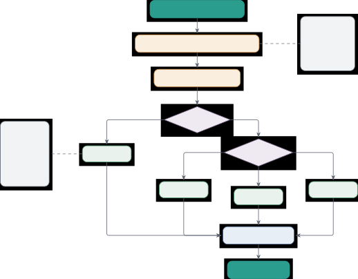

Figure 14: GPU management and parallelism strategy selection. The system
estimates memory requirements using model size, precision, sequence
length, and batch size, then selects an allocation strategy (Greedy,
Balanced, Optimized with NVLink, or Priority). If the model fits on a
single GPU, it allocates the best device. Otherwise, it routes to one of
three parallelism strategies based on memory factor: Tensor parallelism
(horizontal weight splitting, 85-92% efficiency) for 2-8x memory,
Pipeline parallelism (layer-wise stages, 73% efficiency) for 4x memory
with divisible layers, or Data parallelism (batch splitting, linear
throughput) when single-device memory suffices but throughput is needed.
The system monitors utilization throughout execution.

### L.1 GPU Resource Model

We model a GPU cluster as $`\mathcal{G}=\{g_{1},\ldots,g_{n}\}`$ where
each device $`g_{i}`$ has properties
$`(M_{i},U_{i},T_{i},P_{i},\tau_{i})`$:

- •
  $`M_{i}`$: total memory capacity in bytes
- •
  $`U_{i}`$: current memory utilization in bytes
- •
  $`T_{i}`$: current GPU utilization % $`[0,100]`$
- •
  $`P_{i}`$: power consumption in watts
- •
  $`\tau_{i}`$: temperature in celsius

The available memory is $`A_{i}=M_{i}-U_{i}`$. For allocation requests,
the allocator checks whether $`\text{required}(r)\leq A_{i}`$ for some
device $`g_{i}`$ or across multiple devices for multi-GPU strategies;
allocation can still fail if no suitable device is available.

##### Memory Estimation Function.

Given model parameters $`|M|`$ (count), bytes per parameter $`b`$, and
overhead factor $`\eta`$, the model memory requirement estimate is:

```math
\text{mem}_{\text{model}}(|M|,b,\eta)=|M|\cdot b\cdot\eta \tag{80}
```

Batch activation memory is estimated separately from batch size and
sequence length. Quantization changes $`b`$; the overhead factor
provides a safety margin for runtime allocations.

### L.2 Allocation Strategies

The allocation function
$`\alpha:\mathcal{R}\times\mathcal{G}\rightarrow\mathcal{A}`$ maps
resource requests $`\mathcal{R}`$ to device assignments
$`\mathcal{A}\subseteq\mathcal{G}`$ according to one of four strategies.

##### Greedy Strategy.

Allocate to the first device with sufficient memory:

```math
\alpha_{\text{GREEDY}}(r,\mathcal{G})=\arg\min_{g_{i}\in\mathcal{G}}\{i:A_{i}\geq\text{mem}(r)\} \tag{81}
```

This strategy is simple and fast ($`O(n)`$ for $`n`$ devices) but can
lead to unbalanced utilization where early devices are overloaded while
later devices remain idle.

##### Balanced Strategy.

Allocate to the device with lowest utilization:

```math
\alpha_{\text{BALANCED}}(r,\mathcal{G})=\arg\min_{g_{i}\in\mathcal{G}}\{U_{i}:A_{i}\geq\text{mem}(r)\} \tag{82}
```

This achieves better load distribution than first-fit allocation in
heterogeneous device pools.

##### Optimized Strategy.

For multi-GPU allocations (tensor or pipeline parallelism), the
implementation selects contiguous device IDs with low average
utilization:

```math
\alpha_{\text{OPTIMIZE}}(r,\mathcal{G},k)=\arg\min_{\{g_{i},g_{i+1},\ldots,g_{i+k-1}\}}\text{avg\_utilization}(g_{i},\ldots,g_{i+k-1}) \tag{83}
```

where $`k`$ is the number of required devices. This is a simple
topology-agnostic heuristic; it does not inspect NVLink or PCIe
topology.

##### Priority Strategy.

Allocate devices by available memory and utilization:

```math
\alpha_{\text{PRIORITY}}(r,\mathcal{G})=\arg\max_{g_{i}\in\mathcal{G}}\left\{A_{i}-U_{i}:A_{i}\geq\text{mem}(r)\right\} \tag{84}
```

This favors devices with enough free memory and lower current
utilization.

### L.3 Parallelism Strategies

When a model exceeds single-GPU capacity, EffGen employs one of three
parallelism strategies. Let $`M`$ be a model with $`|M|`$ parameters and
$`d`$ layers.

##### Tensor Parallelism.

Partition each layer horizontally across $`k`$ devices. For layer
$`\ell`$ with weight matrix $`W_{\ell}\in\mathbb{R}^{m\times n}`$, split
column-wise:

```math
W_{\ell}=[W_{\ell}^{(1)}|W_{\ell}^{(2)}|\cdots|W_{\ell}^{(k)}]\quad\text{where }W_{\ell}^{(i)}\in\mathbb{R}^{m\times n/k} \tag{85}
```

For forward pass with input $`x\in\mathbb{R}^{m}`$, each device $`i`$
computes $`y^{(i)}=xW_{\ell}^{(i)}`$, then results are concatenated:
$`y=[y^{(1)}|\cdots|y^{(k)}]`$. Communication overhead is one all-reduce
per layer.

Memory reduction: $`\frac{\text{mem}(|M|,p,L,B)}{k}`$ (nearly linear
scaling). Communication cost: $`O(L\cdot B\cdot n)`$ per layer for
all-reduce operation. Efficiency depends on inter-GPU bandwidth; on
NVLink-connected GPUs, tensor parallelism achieves 85-92% efficiency for
$`k\leq 8`$.

##### Pipeline Parallelism.

Partition layers into $`k`$ stages, assigning consecutive layers to
different devices:

```math
\text{Stage}_{i}=\{\ell_{(i-1)\cdot d/k+1},\ldots,\ell_{i\cdot d/k}\}\quad\text{for }i\in[k] \tag{86}
```

For batch $`\mathcal{B}=\{x_{1},\ldots,x_{B}\}`$, split into $`m`$
micro-batches $`\{\mathcal{B}_{1},\ldots,\mathcal{B}_{m}\}`$ where
$`|\mathcal{B}_{j}|=B/m`$. Execution proceeds as:

1:  for $`j=1`$ to $`m`$ do

2:   Device 1 processes $`\mathcal{B}_{j}`$ through Stage 1, sends
output to Device 2

3:   Device 2 processes $`\mathcal{B}_{j}`$ through Stage 2, sends
output to Device 3

4:   …(pipeline fill)

5:  end for

6:  …(pipeline drain)

Memory reduction: approximately $`\frac{\text{mem}(|M|,p,L,B)}{k}`$
since each device holds only $`\approx d/k`$ layers. Communication cost:
$`O(m\cdot d\cdot L\cdot B/m)=O(d\cdot L\cdot B)`$ total. Pipeline
efficiency is:

```math
\eta_{\text{pipeline}}=\frac{m}{m+k-1} \tag{87}
```

where $`m`$ is micro-batch count and $`k`$ is device count. For $`m=8`$
micro-batches and $`k=4`$ devices, $`\eta=0.73`$ (73% efficiency).

##### Data Parallelism.

Replicate the entire model on $`k`$ devices and split the batch:

```math
\mathcal{B}=\mathcal{B}_{1}\cup\mathcal{B}_{2}\cup\cdots\cup\mathcal{B}_{k}\quad\text{where }|\mathcal{B}_{i}|=B/k \tag{88}
```

Each device processes its partition independently. For inference, no
synchronization is needed. For training, gradients are averaged across
devices after each step.

Memory impact: each device holds full model, so no memory reduction.
However, throughput increases linearly:
$`\text{throughput}=k\cdot\text{throughput}_{\text{single}}`$. This
strategy is preferred when the model fits on a single device but
throughput is insufficient.

##### Strategy Selection.

The system automatically selects the appropriate strategy based on model
size and available resources. Algorithm 12 presents the decision logic.

0:  Model $`M`$, devices $`\mathcal{G}`$, target batch size $`B`$

0:  Selected strategy $`s`$ and device allocation $`\mathcal{A}`$

1:  $`\text{mem\_req}\leftarrow\text{mem}(|M|,p,L,B)`$

2:  $`\text{max\_mem}\leftarrow\max_{g\in\mathcal{G}}A_{g}`$

3:  if $`\text{mem\_req}\leq\text{max\_mem}`$ then

4:   if require high throughput then

5:    return DATA_PARALLEL, select $`k`$ devices

6:   else

7:    return SINGLE_DEVICE, select best device

8:   end if

9:  else if $`\text{mem\_req}\leq 2\cdot\text{max\_mem}`$ then

10:   return TENSOR_PARALLEL, select 2 adjacent devices

11:  else if $`\text{mem\_req}\leq 4\cdot\text{max\_mem}`$ then

12:   if layers divisible by 4 then

13:    return PIPELINE_PARALLEL, select 4 devices

14:   else

15:    return TENSOR_PARALLEL, select 4 devices

16:   end if

17:  else

18:   $`k\leftarrow\lceil\text{mem\_req}/\text{max\_mem}\rceil`$

19:   if $`k\leq 8`$ then

20:    return TENSOR_PARALLEL, select $`k`$ adjacent devices

21:   else

22:    return HYBRID (pipeline + tensor), compute best split

23:   end if

24:  end if

Algorithm 12 Parallelism Strategy Selection

### L.4 Real-Time GPU Monitoring

The GPUMonitor class provides real-time tracking of device metrics using
NVIDIA System Management Interface (nvidia-smi). Monitoring occurs in a
background thread with configurable polling interval (default 1 second).

##### Collected Metrics.

For each device $`g_{i}`$, the monitor tracks:

- •
  Memory utilization: $`(U_{i},A_{i},M_{i})`$
- •
  Compute utilization: $`T_{i}\in[0,100]\%`$
- •
  Temperature: $`\tau_{i}`$ in celsius
- •
  Power consumption: $`P_{i}`$ in watts
- •
  Fan speed and active process information when available

##### Alerting Thresholds.

The monitor triggers alerts when metrics exceed safety thresholds:

```math
\displaystyle:(U_{i}/M_{i}>0.95)\lor(\tau_{i}>90\text{°C})\lor(P_{i}>0.95\cdot P_{\max}) \tag{89}
```

```math
\displaystyle:(U_{i}/M_{i}>0.80)\lor(\tau_{i}>80\text{°C})\lor(P_{i}>0.90\cdot P_{\max}) \tag{90}
```

These thresholds are the implementation defaults. The 95% memory
threshold leaves room for CUDA runtime overhead and memory
fragmentation.

Critical alerts trigger automatic mitigation: reduce batch size,
throttle inference rate, or migrate workloads to cooler devices.

##### Historical Tracking.

Metrics are stored in a circular buffer capped at 1000 samples. This
supports trend analysis and anomaly detection. For example, steadily
increasing temperature suggests cooling system degradation requiring
maintenance.

### L.5 Integration with Model Loaders

The GPU management system integrates with model loaders (vLLM,
Transformers). For vLLM, the allocator sets the CUDA_VISIBLE_DEVICES
environment variable before engine initialization:

```ltx_verbatim
allocation = allocator.allocate(model_config, strategy=TENSOR_PARALLEL)
os.environ["CUDA_VISIBLE_DEVICES"] = ",".join(map(str, allocation.devices))
engine = LLM(model=model_name, tensor_parallel_size=len(allocation.devices))
```

For multi-GPU strategies, vLLM handles internal communication and
synchronization. The allocator checks device assignment and memory
availability before initialization.

##### Graceful Degradation.

If GPU allocation fails (insufficient memory, no available devices), the
system falls back gracefully:

1:  Attempt requested configuration (e.g., FP16, batch=8)

2:  if allocation fails then

3:   Reduce batch size: try batch=4, then batch=1

4:  end if

5:  if still fails then

6:   Switch to quantization: try INT8

7:  end if

8:  if still fails then

9:   Switch to CPU execution with warning

10:  end if

These fallbacks reduce hard failures when alternatives are available; if
all allocation attempts fail, the allocator reports failure for the
caller to handle.

## Appendix M Execution Tracking and Observability

Transparent execution visibility is critical for debugging agent
behavior and optimizing performance. The EffGen execution tracker
implements an event-based tracking system capturing 18 event types
across the agent lifecycle. Figure 15 illustrates the architecture:
events flow from agent execution into five categories (Task Lifecycle,
Routing/Decomposition, Sub-Agent Execution, Tool Execution,
Memory/Special), then metrics computation extracts performance
indicators for logs, analysis, and visualization. This section specifies
the tracking architecture, event taxonomy, performance analysis
capabilities, and visualization exports.

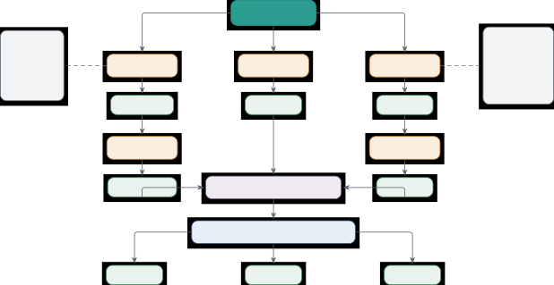

Figure 15: Execution tracking and observability system with event
taxonomy. Events from agent execution flow into five categories arranged
in three branches: Task Lifecycle and Routing/Decomposition (left),
Sub-Agent Execution (center), and Tool Execution and Memory/Special
(right). The system captures 18 distinct event types forming a
hierarchical tree structure $`(N,E,r)`$. Metrics computation extracts 12
performance indicators including wall time, compute time, tool time, and
3-8% framework overhead. Outputs support logs, performance analysis, and
visualization for debugging.

### M.1 Event-Based Tracking Architecture

The execution tracker maintains an event log and parent-child
relationships where available. Each execution event
$`e_{v}=(t,\tau,m,p)`$ consists of:

- •
  $`t\in\mathcal{E}_{\text{types}}`$: event type from taxonomy
- •
  $`\tau`$: event timestamp
- •
  $`m`$: event-specific metadata (parameters, results, errors)
- •
  $`p`$: optional parent event identifier

##### Event Relationships.

The tracker records parent-child relationships when callers supply
parent identifiers:

1.  (i)
    Temporal Ordering: Events are appended with timestamps.
2.  (ii)
    Parent Links: Child events can reference a parent event.
3.  (iii)
    Unique Identifiers: Each execution event has a unique identifier.

These relationships support trace reconstruction and performance
analysis.

### M.2 Event Type Taxonomy

The event taxonomy $`\mathcal{E}_{\text{types}}`$ contains 18 event
types organized into five categories. Table 42 provides the
specification.

Category Event Type Description Key Metadata Fields Task Lifecycle
TASK_START Agent begins processing task task_description, agent_id,
complexity_score TASK_COMPLETE Agent completes task successfully
final_result, token_count, execution_time TASK_FAILED Agent fails to
complete task error_message, failure_reason, partial_results Routing &
Decomp ROUTING_DECISION Router determines execution strategy
complexity_score, strategy, reasoning, confidence TASK_DECOMPOSITION
Task decomposed into subtasks num_subtasks, subtask_descriptions,
dependencies SUB_AGENT_SPAWN Sub-agent created for subtask
specialization, tools, prompt_template RESULT_SYNTHESIS Sub-agent
results combined num_results, synthesis_strategy, final_output Sub-Agent
Exec SUB_AGENT_START Sub-agent begins execution agent_id,
specialization, assigned_task SUB_AGENT_COMPLETE Sub-agent completes
successfully result, tokens_used, tools_called SUB_AGENT_FAILED
Sub-agent fails error, attempted_retries, fallback_strategy
REASONING_STEP Agent performs reasoning iteration thought,
planned_action, iteration_count Tool Execution TOOL_CALL_START Agent
invokes tool tool_name, parameters, expected_duration TOOL_CALL_COMPLETE
Tool execution succeeds result, actual_duration, resource_usage
TOOL_CALL_FAILED Tool execution fails error, error_type, retryable
Memory & Special MEMORY_OPERATION Memory read/write operation
operation_type, memory_tier, entry_count VALIDATION_FAILED Input/output
validation fails validation_type, errors, rejected_value
SUMMARIZATION_TRIGGER Context summarization triggered original_tokens,
summarized_tokens, reduction_ratio CONTEXT_OVERFLOW Context window
exceeded current_tokens, max_tokens, mitigation_action

Table 42: Execution Event Taxonomy. The framework tracks 18 event types
organized into five categories covering the agent lifecycle from task
initiation through result synthesis. Each event type has metadata fields
capturing relevant execution details. These events support performance
analysis and bottleneck detection. Events are referenced throughout
Section M for performance metric computation.

##### Event Relationships.

Certain events have natural parent-child relationships forming execution
patterns:

- •
  TASK_START $`\rightarrow`$ ROUTING_DECISION $`\rightarrow`$
  {TASK_DECOMPOSITION \| REASONING_STEP}
- •
  TASK_DECOMPOSITION $`\rightarrow`$ SUB_AGENT_SPAWN^(∗) (one spawn per
  subtask)
- •
  SUB_AGENT_START $`\rightarrow`$ REASONING_STEP^(∗) $`\rightarrow`$
  TOOL_CALL_START^(∗) $`\rightarrow`$ SUB_AGENT_COMPLETE
- •
  REASONING_STEP $`\rightarrow`$ TOOL_CALL_START $`\rightarrow`$
  TOOL_CALL_COMPLETE

These patterns support pattern-based anomaly detection: deviation from
expected event sequences indicates execution errors or unexpected agent
behavior.

### M.3 Performance Metrics Computation

The tracker computes performance metrics from the event log. Let $`T`$
denote total elapsed time, $`N_{a}`$ the number of agents (1 for single,
$`\geq 2`$ for multi-agent), and $`N_{t}`$ the number of tool calls.

##### Timing Metrics.

The implementation reports elapsed time plus aggregate agent and tool
durations where those durations are recorded:

```math
\displaystyle T_{\text{total}} \displaystyle=\tau_{\text{last}}-\tau_{\text{first}}\quad\text{(wall-clock elapsed time)} \tag{91}
```

```math
\displaystyle T_{\text{agents}} \displaystyle=\sum_{e:t_{e}\in\text{agent events}}\text{duration}(e)\quad\text{(when available)} \tag{92}
```

```math
\displaystyle T_{\text{tools}} \displaystyle=\sum_{e:t_{e}\in\text{tool events}}\text{duration}(e)\quad\text{(when available)} \tag{93}
```

Routing decisions, task decomposition, result synthesis, and inter-agent
communication are visible as events, but the tracker does not derive a
separate framework-overhead term from the event log.

##### Throughput Metrics.

Define:

```math
\displaystyle\text{throughput}_{\text{tasks}} \displaystyle=\frac{N_{\text{completed\_subtasks}}}{T_{\text{total}}}\quad\text{(subtasks per second)} \tag{94}
```

```math
\displaystyle\text{throughput}_{\text{events}} \displaystyle=\frac{|N|}{T_{\text{total}}}\quad\text{(events per second)} \tag{95}
```

```math
\displaystyle\text{throughput}_{\text{tools}} \displaystyle=\frac{N_{t}}{T_{\text{total}}}\quad\text{(tool calls per second)} \tag{96}
```

Throughput is reported from observed event counts and elapsed time.

##### Resource Metrics.

Define:

```math
\displaystyle=\max_{t}|\{e\in N:t_{e}\in\{\text{SUB\_AGENT\_START}\}\land\tau_{s}^{e}\leq t<\tau_{e}^{e}\}| \tag{97}
```

```math
\displaystyle=|\{e\in N:t_{e}=\text{TOOL\_CALL\_START}\}| \tag{98}
```

```math
\displaystyle=\sum_{e\in N}m_{e}[\text{tokens}]\quad\text{where defined} \tag{99}
```

These metrics inform resource provisioning decisions: high peak
concurrency requires more GPU memory, many tool calls benefit from tool
result caching.

##### Efficiency Metrics.

For multi-agent execution with parallel subtasks:

```math
\text{parallel\_efficiency}=\frac{\sum_{i=1}^{N_{a}}T_{i}}{N_{a}\cdot T_{\text{total}}} \tag{100}
```

where $`T_{i}`$ is execution time of agent $`i`$. Perfect efficiency
($`\eta=1.0`$) means all agents busy entire time. Real systems achieve
$`\eta\in[0.6,0.9]`$ with inefficiency from load imbalance and
coordination overhead.

##### Quality Metrics.

Define:

```math
\displaystyle=\frac{|\{e\in N:s_{e}=\text{COMPLETED}\}|}{|N|} \tag{101}
```

```math
\displaystyle=\frac{|\{e\in N:s_{e}=\text{FAILED}\}|}{|N|} \tag{102}
```

```math
\displaystyle=\frac{|\{e\in N:m_{e}[\text{retry\_count}]>0\}|}{|N|} \tag{103}
```

Success, failure, and retry rates are reported as descriptive metrics
for comparing runs.

### M.4 Bottleneck Identification

The tracker identifies performance bottlenecks through automated
analysis. Algorithm 13 presents the detection procedure.

0:  Execution tree $`\mathcal{T}=(N,E,r)`$

0:  List of bottlenecks with severity

1:  $`\text{bottlenecks}\leftarrow[]`$

2:  Compute average agent duration

3:  for each agent duration summary $`a`$ do

4:   if $`T_{a}>1.5\times\text{avg\_agent\_time}`$ then

5:    Add $`(a,\text{SLOW\_AGENT},T_{a})`$ to bottlenecks

6:   end if

7:  end for

8:  if failed event count $`>2`$ then

9:   Add $`(\text{failures},\text{HIGH\_FAILURES},\text{count})`$ to
bottlenecks

10:  end if

11:  return sorted(bottlenecks, key=severity, reverse=True)

Algorithm 13 Bottleneck Detection in Execution Tree

Bottleneck detection identifies slow agents relative to the run average
and runs with repeated failed events. This information guides
optimization: slow agents can be inspected, and high-failure runs may
need better prompts, tools, or model sizes.

### M.5 Critical Path Analysis

For parallel execution, the critical path determines the minimum
possible execution time. The critical path
$`\pi_{\text{crit}}=(v_{1},v_{2},\ldots,v_{k})`$ is the longest path
from root to leaf in the execution tree:

```math
\pi_{\text{crit}}=\arg\max_{\pi:r\rightarrow\text{leaf}}\sum_{v\in\pi}(\tau_{e}^{v}-\tau_{s}^{v}) \tag{104}
```

The critical path length
$`L_{\text{crit}}=\sum_{v\in\pi_{\text{crit}}}(\tau_{e}^{v}-\tau_{s}^{v})`$
estimates the minimum execution time implied by recorded dependencies.
The parallel efficiency is bounded by:

```math
\eta\leq\frac{L_{\text{crit}}}{T_{\text{total}}} \tag{105}
```

Events on the critical path are prioritized for optimization: reducing
their duration directly reduces total execution time, while optimizing
off-critical-path events has no effect on wall-clock time (though it may
reduce resource usage).

### M.6 Export Formats and Visualization

The tracker supports four export formats optimized for different use
cases.

##### JSON Export.

Complete hierarchical execution tree:


JSON export is machine-readable, supporting programmatic analysis and
integration with monitoring systems.

##### CSV Export.

Flattened event list for spreadsheet analysis:


CSV format supports analysis in Excel, pandas, or database tools. Useful
for statistical analysis across multiple runs.

##### HTML Export.

Interactive visualization with collapsible tree structure, timeline
view, and metric dashboard.

The HTML export includes:

- •
  Tree View: Hierarchical display with expand/collapse for each node,
  color-coded by status (green=completed, red=failed, yellow=running)
- •
  Timeline View: Gantt-chart visualization showing temporal
  relationships, concurrent executions, and critical path highlighted
- •
  Metrics Dashboard: Summary statistics (total time, success rate,
  bottlenecks) with charts
- •
  Event Details: Click on event to see full metadata, parameters,
  results

##### Human-Readable Export.

JSON, CSV, and HTML are the implemented export formats. A Markdown-like
report can be generated from the JSON export by downstream tooling:


The HTML export is intended for interactive inspection, while JSON and
CSV are intended for downstream analysis.

### M.7 Live Monitoring and Progress Tracking

For long-running tasks, the tracker provides live progress updates. The
progress estimation function combines completed and in-progress work:

```math
\text{progress}(t)=\frac{\sum_{e:s_{e}=\text{COMPLETED}}w_{e}+\sum_{e:s_{e}=\text{RUNNING}}0.5\cdot w_{e}}{\sum_{e\in N}w_{e}} \tag{106}
```

where $`w_{e}`$ is the estimated work for event $`e`$ (for subtasks,
$`w_{e}=1`$; for tool calls, $`w_{e}=0.1`$). The factor 0.5 for running
events assumes half-completion on average.

##### ETA Estimation.

Estimated time to completion uses velocity-based projection:

```math
\text{ETA}(t)=t+\frac{1-\text{progress}(t)}{\text{velocity}(t)}\quad\text{where }\text{velocity}(t)=\frac{\text{progress}(t)}{t-t_{\text{start}}} \tag{107}
```

For tasks with $`<`$10% progress, ETA is unreliable and marked as
unknown; later estimates remain heuristic.

### M.8 Integration with External Monitoring

The tracker integrates with external monitoring systems through tracing
and metrics hooks. v0.2.x also adds debug tracing support, including raw
prompt/response capture through the debugging utilities.

##### OpenTelemetry Export.

Events are exported as OpenTelemetry spans with parent-child
relationships preserved. This supports integration with distributed
tracing systems (Jaeger, Zipkin) for multi-service observability.

##### Prometheus Metrics.

Key metrics are exposed as Prometheus gauges and counters:


This supports alerting based on metric thresholds and long-term
performance trending.

## Appendix N Model Loading and Backend Selection

Model Loading and Backend Selection. EffGen loads models through a
single abstraction so that an agent definition is independent of where
the model runs. The same interface covers local inference engines and
hosted providers, which lets an application switch backends, or fail
over between them, without code changes.

EffGen supports both local and hosted inference backends behind this
interface (Table 43). Local backends include vLLM (Kwon et al., 2023a;
Kwon et al., 2023b) (PagedAttention, continuous batching, tensor
parallelism), HuggingFace Transformers (broad model compatibility,
quantization), GGUF (CPU and mixed-CPU/GPU inference), and MLX / MLX-VLM
(native Metal acceleration for Apple Silicon, including vision–language
models). Hosted backends include OpenAI, Anthropic, Gemini, Groq,
Cerebras, Together AI, Fireworks, Replicate, and HuggingFace Inference.
A unified ProviderRegistry resolves a backend by provider name, an
effgen doctor command checks credentials, and the ModelRouter layer adds
transparent failover with cost-based, latency-based, and first-available
routing policies. Cross-process rate-limit coordination uses SQLite, and
a persistent cost tracker exposes a CLI dashboard (effgen cost).
Quantization support includes 8-bit, GPTQ (Frantar et al., 2023), AWQ,
and 4-bit weight quantization via bitsandbytes.

Backend Mode Best use case Key features Notes vLLM Local (GPU)
Production SLMs, high throughput PagedAttention, continuous batching,
tensor parallelism CUDA only Transformers Local (CPU/GPU) Development,
broad compatibility HuggingFace models, 8-bit/4-bit quantization, Flash
Attention Default local fallback GGUF Local (CPU/GPU) CPU and
mixed-precision inference llama.cpp-compatible weights, low memory
footprint Throughput depends on hardware MLX / MLX-VLM Local (Apple)
Apple Silicon text and vision models Native Metal acceleration,
vision–language support macOS only OpenAI Hosted GPT-5 / o-series Tool
use, prompt caching, structured outputs v2, native tools API key
required Anthropic Hosted Claude 4.x family Extended thinking,
cache_control, streaming, native tools API key required Gemini Hosted
Multimodal, long context thinking_budget, Google Search grounding, Files
API API key required Groq Hosted Low-latency serving Sub-second
responses, native tool calling API key required Cerebras Hosted
Free-tier high-throughput serving Streaming, native tool calling, cost
tracking Free tier available Together AI Hosted Open-weight models on a
managed runtime Broad open-weight model catalog API key required
Fireworks Hosted Production open-weight serving Optimized open-weight
inference API key required Replicate Hosted Long-running and community
models Versioned model endpoints API key required HF Inference Hosted
HuggingFace Hub models Direct access to Hub model registry API key
required

Table 43: Backend overview. The table groups backends by deployment mode
and lists the strongest use case. EffGen exposes all backends through a
common interface, so applications can switch backends or fail over
without code changes.

Backend selection can be automatic (the framework chooses a local engine
by model type and available hardware, falling back to Transformers) or
pinned in configuration. The per-backend configuration options, the
automatic-selection algorithm, the quantization trade-off table, and the
loading and multi-provider examples are in effgen/models/ at
[https://github.com/ctrl-gaurav/effGen](https://github.com/ctrl-gaurav/effGen).
Relative backend throughput depends on model size, sequence length, and
batch size, and is best measured per deployment with effgen loadtest
(Section P).

## Appendix O Configuration System Architecture

Configuration System Architecture. EffGen configures agents, models,
tools, and prompts through YAML or JSON files, each section validated
against its own schema. Separating the configuration into agent, model,
tool, and prompt sections keeps the schemas small and lets a deployment
override one part (for example, swapping the model backend) without
touching the rest. Validation runs with type checking before an agent is
constructed, so misconfigured fields are reported up front rather than
failing mid-run.

Four capabilities make the system practical for real deployments, and
these are the ones referenced from the main paper. Environment-variable
substitution keeps secrets such as API keys out of the configuration
files. Layered configuration lets a base file hold shared settings while
environment-specific files override only what differs between
development, staging, and production. Hot reloading applies
configuration changes at runtime without restarting a long-running
agent. The same loader accepts both YAML and JSON, so configurations can
be authored by hand or generated programmatically.

The full schemas live in effgen/config/ and example configuration files
in configs/ at
[https://github.com/ctrl-gaurav/effGen](https://github.com/ctrl-gaurav/effGen).

## Appendix P Command-Line Interface

Command-Line Interface. EffGen exposes a single effgen command organized
into functional groups: single-query and interactive use (run, chat,
resume), configuration (config, presets, create-plugin), model and tool
inspection (models, tools), session management (sessions), serving the
OpenAI-compatible HTTP server (serve), evaluation and comparison (eval,
compare, batch, workflow), diagnostics (doctor, debug, cost), and load
testing (loadtest). The command surface mirrors the library: anything
that can be done programmatically through the Python API has a
corresponding subcommand, so the CLI doubles as a way to script
evaluations and as an entry point for users who do not write Python.

The effgen loadtest subcommand is referenced throughout this appendix
and warrants a specific note. It drives a configurable backend (a mock
backend or a live provider) and reports end-to-end throughput together
with p50/p95/p99 latency for both streaming and non-streaming modes,
plus the error rate under a chosen concurrency level. Because tool,
protocol, and backend latencies are dominated by the deployment rather
than the framework, we use effgen loadtest as the recommended way to
obtain workload-specific numbers on a given setup instead of quoting
figures that may not generalize.

Running effgen --help lists every subcommand and its options. The CLI is
implemented in effgen/\_\_main\_\_.py at
[https://github.com/ctrl-gaurav/effGen](https://github.com/ctrl-gaurav/effGen).

## Appendix Q Error Handling and Recovery Mechanisms

Reliable error handling is essential for agent deployments where
failures can occur at multiple levels: model generation errors, tool
execution failures, network timeouts, resource exhaustion, and invalid
outputs. Techniques like Reflexion (Shinn et al., 2023) have
demonstrated the value of verbal reinforcement learning for agent
recovery and improvement. The EffGen framework implements error handling
with retry policies, graceful degradation, and detailed error reporting.
This section presents the error taxonomy, recovery strategies, retry
logic, and failure analysis.

### Q.1 Error Taxonomy

EffGen categorizes errors by source, severity, recoverability, and
required intervention. Table 44 presents the main error classes with
recovery strategies, including the newer provider and router errors used
by the model-routing layer.

Error Class Examples Recovery Strategy Severity Typical Cause ModelError
Generation timeout, OOM, model crashed Retry with backoff, reduce batch
size High Resource limits ToolError Tool execution failed, invalid
output, timeout Retry, skip tool, use fallback Medium External
dependency ValidationError Schema mismatch, type error, constraint
violation Retry with correction, abort Medium Invalid data
ProviderTransientError API timeout, connection failed, rate limit Retry
with exponential backoff Low External service ProviderAuthError Missing
API key, invalid credential Fail fast, user intervention Critical
Authentication BudgetExceededError Cost or token budget exceeded Stop or
route to cheaper model High Budget policy AllCandidatesExhaustedError
Router failover candidates failed Surface aggregate error High
Provider/model failure MemoryError Context overflow, CUDA OOM, disk full
Summarize, offload, reduce batch High Resource exhaustion ConfigError
Invalid config, missing API key, wrong backend Fail fast, user
intervention Critical Misconfiguration

Table 44: Error Classification Taxonomy with Recovery Strategies.
Transient errors are automatically retried, persistent errors require
intervention, critical errors halt execution immediately.

### Q.2 Retry Logic with Exponential Backoff

Transient errors (network failures, temporary resource unavailability)
are automatically retried with exponential backoff to avoid overwhelming
services.

0:  Function $`f`$, Arguments args, Max retries $`n_{\max}`$, Base delay
$`d_{\text{base}}`$

0:  Result $`r`$ or error

1:  $`\text{attempt}\leftarrow 0`$

2:  while $`\text{attempt}<n_{\max}`$ do

3:   try:

4:    $`r\leftarrow f(\text{args})`$

5:    

6:   return $`r`$ {Success}

7:   except RecoverableError as $`e`$:

8:    $`\text{attempt}\leftarrow\text{attempt}+1`$

9:    Log(“Attempt attempt failed: $`e`$”)

10:    if $`\text{attempt}<n_{\max}`$:

11:
    $`\text{delay}\leftarrow d_{\text{base}}\cdot 2^{\text{attempt}}\cdot(1+\text{jitter})`$
{Exponential + jitter}

12:     Sleep(delay)

13:    else:

14:     

15:   return Error(“Max retries exceeded: $`e`$”)

16:   except UnrecoverableError as $`e`$:

17:    

18:   return Error(“Unrecoverable: $`e`$”) {Fail immediately}

19:  end while

Algorithm 14 Retry with Exponential Backoff

##### Default Retry Configuration.

Table 45 specifies the default retry parameters used for each error
type.

Error Type Max Retries Base Delay (s) Max Delay (s) Jitter Provider
transient 3 1.0 30 0.5 Rate limit 3 1.0 30 0.5 Tool execution 3
tool-specific tool-specific tool-specific Memory operation 3 1.0 30 0.5

Table 45: Default Retry Parameters by Error Type. The model router retry
policy defaults to three retries, a base delay of 1.0s, jitter of 0.5,
and a 30s backoff cap. Tool-specific code can override these defaults
where needed.

### Q.3 Graceful Degradation

When errors cannot be recovered through retries, EffGen implements
graceful degradation strategies.

##### Strategy 1: Tool Fallback.

If primary tool fails, attempt fallback tools with similar capabilities.


##### Strategy 2: Partial Results.

Return partial results when some sub-agents fail in multi-agent
execution.

```math
r_{\text{partial}}=\text{Synthesize}(\{r_{i}:\mathcal{A}_{s_{i}}.\text{state}=\textsc{Completed}\})\cup\{\text{errors from failed agents}\} \tag{108}
```

The synthesizer notes which subtasks failed and provides partial answer
with caveats.

##### Strategy 3: Simplified Execution.

If complex multi-agent execution fails, retry with single-agent
approach.

0:  Query $`q`$, Agent $`\mathcal{A}`$

0:  Response $`r`$

1:  try:

2:   $`c\leftarrow\mathcal{C}(q)`$

3:   if $`c\geq\tau`$:

4:    $`r\leftarrow\text{MultiAgentExecute}(q,\mathcal{A})`$

5:   else:

6:    $`r\leftarrow\text{SingleAgentExecute}(q,\mathcal{A})`$

7:   

8:  return $`r`$

9:  except MultiAgentError as $`e`$:

10:   Log(“Multi-agent failed: $`e`$, falling back to single-agent”)

11:   $`r\leftarrow\text{SingleAgentExecute}(q,\mathcal{A})`$ {Fallback}

12:
  $`r.\text{metadata}[``fallback^{\prime\prime}]\leftarrow\text{True}`$

13:   

14:  return $`r`$

Algorithm 15 Fallback to Single-Agent

### Q.4 Context Overflow Handling

When context exceeds model’s maximum, EffGen applies progressive
compression.

0:  Context $`\mathcal{C}`$, Max tokens $`C_{\max}`$, Model $`M`$

0:  Compressed context $`\mathcal{C}^{\prime}`$ with
$`|\mathcal{C}^{\prime}|\leq C_{\max}`$

1:  $`\mathcal{C}^{\prime}\leftarrow\mathcal{C}`$

2:  

3:  {Level 1: Remove oldest messages beyond window}

4:  if $`|\mathcal{C}^{\prime}|>C_{\max}`$ then

5:
  $`n_{\text{keep}}\leftarrow\lfloor C_{\max}/\text{avg\_msg\_length}\rfloor`$

6:
  $`\mathcal{C}^{\prime}\leftarrow\mathcal{C}^{\prime}[-n_{\text{keep}}:]`$
{Keep recent $`n`$ messages}

7:  end if

8:  

9:  {Level 2: Summarize older messages}

10:  if $`|\mathcal{C}^{\prime}|>C_{\max}`$ then

11:
  $`\mathcal{C}^{\prime}_{\text{old}}\leftarrow\mathcal{C}^{\prime}[:-10]`$
{All except last 10 messages}

12:
  $`s\leftarrow\text{Summarize}(\mathcal{C}^{\prime}_{\text{old}},M)`$
{LLM-based summarization}

13:   $`\mathcal{C}^{\prime}\leftarrow[s]+\mathcal{C}^{\prime}[-10:]`$

14:  end if

15:  

16:  {Level 3: Compress tool outputs}

17:  if $`|\mathcal{C}^{\prime}|>C_{\max}`$ then

18:   for $`m`$ in $`\mathcal{C}^{\prime}`$ do

19:    if $`m.\text{role}=\text{TOOL}`$ AND $`|m|>500`$ then

20:
    $`m.\text{content}\leftarrow m.\text{content}[:500]+\text{"... [truncated]"}`$

21:    end if

22:   end for

23:  end if

24:  

25:  {Level 4: Emergency truncation}

26:  if $`|\mathcal{C}^{\prime}|>C_{\max}`$ then

27:   Warning(“Emergency truncation required”)

28:   Truncate $`\mathcal{C}^{\prime}`$ to $`C_{\max}`$ at message
boundary

29:  end if

30:  

31:  return $`\mathcal{C}^{\prime}`$

Algorithm 16 Progressive Context Compression

### Q.5 Error Reporting and Diagnostics

EffGen provides detailed error information for debugging and monitoring.

##### Error Object Structure.

Each error contains comprehensive metadata for debugging and analysis:


##### Error Logging Levels.

Table 46 defines the logging configuration for different error severity
levels.

Severity Log Level Action CRITICAL ERROR Log full stack trace, alert if
monitoring enabled HIGH ERROR Log error with context, retry if
applicable MEDIUM WARNING Log warning, continue execution LOW INFO Log
for debugging, no action needed

Table 46: Error Logging Configuration. Errors are logged with
appropriate severity and detail level. Critical errors trigger immediate
alerts when monitoring is enabled (e.g., via Prometheus as described in
Section M). High and medium severity errors are logged for analysis but
don’t trigger alerts. Low severity errors are only logged in debug mode
to reduce log verbosity. All error logs include structured metadata
(timestamp, component, context) for automated analysis.

### Q.6 Failure Analysis

Table 47 reports the failure-analysis slice used in our experiments. It
is a local evaluation summary rather than a framework-internal benchmark
artifact.

Error Frequency Recovery Error Type Count % Total Severity Avg Duration
(s) Auto-Recovered Success Rate Tool execution failures 4,247 42.5%
Medium 2.3 3,891 91.6% Network timeouts 2,134 21.3% Low 5.1 2,089 97.9%
Model generation errors 1,523 15.2% High 8.7 1,134 74.5% Memory/context
overflow 892 8.9% High 3.2 847 95.0% Validation errors 678 6.8% Medium
0.8 512 75.5% Resource exhaustion 412 4.1% High 12.4 289 70.1%
Configuration errors 124 1.2% Critical — 0 0.0% Total 10,010 100% — 5.4
8,762 87.5%

Table 47: Error Distribution and Recovery Success Rates in Local
Evaluation Runs.

##### Key Insights.

The local evaluation data reveals patterns in error occurrence and
recovery success across different error types:

- •
  87.5% of errors are automatically recovered without user intervention
- •
  Tool execution failures are most common (42.5%) but have high recovery
  rate (91.6%)
- •
  Network timeouts have highest recovery rate (97.9%) due to simple
  retry logic
- •
  Model generation errors are hardest to recover (74.5%) as they often
  indicate resource issues
- •
  Configuration errors require manual intervention (0% auto-recovery)

### Q.7 Error Prevention Best Practices

##### Practice 1: Validate Configuration Early.

Catch configuration errors before runtime.


##### Practice 2: Set Appropriate Timeouts.

Prevent hanging on slow operations.


##### Practice 3: Enable Error Tracking.

Monitor errors in production.


##### Practice 4: Implement Circuit Breakers.

Prevent cascade failures from external services.


The error handling system gives EffGen agents retry, fallback,
circuit-breaker, and diagnostic paths for common failures. The model
router adds provider failover, budget/rate-limit errors, and retry
semantics, while guardrails help prevent unsafe inputs and outputs
before recovery is needed.

## Appendix R Advanced Features: State, Sessions, Streaming, and Batch Processing

Advanced Features. Beyond single-query execution, EffGen provides the
runtime machinery needed to deploy agents in interactive and high-volume
settings: persistent state, multi-session handling, streaming,
background tasks, and batch processing. These features do not change the
SLM-focused contributions described in the main paper; they make those
agents usable in production.

##### State and Sessions.

Agent state captures everything required to resume execution: the
current context, execution history, memory state, environment variables,
a timestamp, and metadata. State serializes to a portable JSON
representation, which supports checkpointing, debugging by replay, and
resuming an agent on a different process or machine. On top of state, a
SessionManager handles multi-turn conversations with isolated context
and memory per session. A session moves through a simple lifecycle
(created, active, paused, closed) with automatic timeout that closes
paused sessions after inactivity, and the default backend persists
sessions as JSON files under the user’s .effgen/sessions directory so
conversations survive restarts.

##### Streaming and Batch Processing.

Streaming returns an iterator that yields output incrementally as it is
generated, which reduces perceived time-to-first-token for long
responses at the cost of a small per-chunk callback overhead. For
high-volume workloads, the batch runner offers four execution strategies
that trade latency for utilization: _sequential_ (one query at a time,
simplest to debug), _parallel-workers_ (a thread pool reusing one loaded
model, best for I/O-bound or remote-API workloads), _model-batching_
(grouping queries into a single forward pass on backends that support
batched generation, such as vLLM), and _hybrid_ (workers combined with
per-worker batching for the best aggregate throughput). The right
strategy, and the exact streaming overhead, depend on backend, prompt
length, and concurrency, so we recommend measuring on the target
deployment with effgen loadtest (Section P). The implementations live in
effgen.core.session and the batch runner at
[https://github.com/ctrl-gaurav/effGen](https://github.com/ctrl-gaurav/effGen).

## Appendix S Production Subsystems

The core contributions in the main paper (prompt optimization,
complexity-based routing, decomposition, unified protocols, three-tier
memory) are what make small language models viable as agents. This
appendix documents the surrounding production subsystems that ship with
EffGen v0.2.10 and make those agents _deployable_: guardrails,
retrieval-augmented generation, reliability, observability, security and
sandboxing, the OpenAI-compatible HTTP server, edge and serverless
deployment targets, the live dashboard, and the Jupyter integration.
None of these subsystems alter the SLM-focused design above; they are
additive and were stabilised across releases v0.2.0 through v0.2.10.

### S.1 Guardrails

The guardrails/ module implements a composable Guardrail interface with
chainable hooks at four positions around each agent step (InputCheck,
PreTool, PostTool, OutputCheck). The base Guardrail returns a
GuardrailResult carrying allow/deny, an optional rewritten payload, and
a structured reason; GuardrailChain runs guardrails in order and stops
on the first deny. Eight concrete guardrails ship with v0.2.10:

- •
  ToxicityGuardrail (content.py) – keyword and pattern-based content
  classification with a configurable sensitivity tier.
- •
  PIIGuardrail (content.py) – detects SSN, email, phone, and credit-card
  numbers; credit-card detection uses the Luhn checksum to reduce false
  positives; optionally rewrites with redacted tokens (\<PII:SSN\>,
  \<PII:EMAIL\>, …).
- •
  LengthGuardrail (content.py) – enforces minimum and maximum length per
  payload.
- •
  TopicGuardrail (content.py) – restricts inputs and outputs to a
  configured allowlist of topics.
- •
  PromptInjectionGuardrail (injection.py) – three sensitivity tiers
  (low/medium/high) covering instruction override, role-reset,
  system-prompt extraction, and tool-permission escalation patterns.
- •
  ToolInputGuardrail (tool_safety.py) – inspects tool arguments before
  execution; supports per-tool argument schemas.
- •
  ToolOutputGuardrail (tool_safety.py) – strips PII and other sensitive
  fields from tool results before they re-enter the agent’s reasoning
  loop.
- •
  ToolPermissionGuardrail (tool_safety.py) – enforces allow-list,
  deny-list, and require-approval policies per tool.

Two presets in guardrails/presets.py bundle these for common deployment
profiles: standard_guardrails() (medium sensitivity, suitable for most
internal use) and strict_guardrails() (high sensitivity, suitable for
user-facing deployments).

### S.2 Retrieval-Augmented Generation Pipeline

The rag/ module provides an end-to-end RAG pipeline that integrates with
any EffGen agent through the create_agent("rag", model,
knowledge_base=...) preset. The pipeline has six stages:

1.  1.  Ingestion (ingest.py). DocumentIngester loads plain text, Markdown,
        JSON, CSV, and HTML; optional dependencies extend coverage to PDF,
        DOCX, and EPUB. Documents are SHA-256 deduplicated.
2.  2.  Chunking (chunking.py). Four chunking strategies ship with the
        framework: SemanticChunker (sentence-aware splits at configurable
        size), CodeChunker (function- and class-boundary splits for Python,
        JavaScript/TypeScript, Go, Rust, and Java), TableChunker
        (table-aware splits that keep header rows with body chunks), and
        HierarchicalChunker (recursive splits that preserve outline
        structure).
3.  3.  Search (search.py). HybridSearchEngine fuses dense embeddings, BM25,
        keyword match, and metadata filters via Reciprocal Rank Fusion,
        returning ranked SearchResults with per-channel scores.
4.  4.  Reranking (reranker.py). Three rerankers: CrossEncoderReranker
        (BERT-style cross-encoder), LLMReranker (LLM-as-judge), and
        RuleBasedReranker (lightweight heuristic).
5.  5.  Context building (context_builder.py). ContextBuilder packages
        retrieved passages within a token budget and inserts inline numeric
        citation markers (\[1\], \[2\], …).
6.  6.  Attribution (attribution.py). CitationTracker verifies that the
        agent’s final response cites only retrieved passages and flags
        ungrounded spans.

The pipeline is deliberately backend-agnostic: the same RAG agent runs
against a local FAISS index, a remote ChromaDB instance, or both.

### S.3 Reliability Primitives

The reliability/ module provides five primitives that together let
EffGen agents survive flaky upstreams and bound tail latency, in line
with what one would expect from a production HTTP client.

- •
  Circuit breaker (circuit.py). CircuitBreaker implements the standard
  CLOSED $`\to`$ OPEN $`\to`$ HALF_OPEN state machine with configurable
  error thresholds, recovery windows, and a per-provider registry; opens
  isolate one misbehaving backend without disabling the rest.
- •
  Bulkhead (bulkhead.py). Bulkhead bounds the number of concurrent
  in-flight calls per resource; a queue of bounded depth absorbs short
  bursts; both synchronous and asynchronous APIs are supported.
- •
  Retry (retry.py). Retry applies exponential backoff with full jitter;
  retries are restricted to rate-limit and transient errors and never
  applied to authentication failures, model refusals, or invalid
  requests.
- •
  Timeouts (timeouts.py). Both synchronous and asynchronous timeout
  context managers propagate end-to-end deadlines through the request
  stack.
- •
  Chaos harness (chaos.py). ChaosMiddleware injects six fault types –
  NetworkTimeout, Http5xx, Http429, SlowResponse, PartialResponse,
  MalformedJSON – under a configurable ChaosRule; runs are deterministic
  given a seed so that recovery tests are reproducible across CI.

Defaults are configured by ReliabilityConfig (timeouts, retry budgets,
circuit thresholds, bulkhead capacities).

### S.4 Observability

The observability/ module exposes EffGen behavior through three
industry-standard surfaces: traces (OpenTelemetry), metrics
(Prometheus), and structured logs.

- •
  Tracing (tracing.py, spans.py). The framework emits six named spans –
  effgen.agent.run, effgen.agent.iteration, effgen.model.call,
  effgen.tool.call, effgen.router.decision, effgen.retry.attempt – with
  typed attribute sets per layer (AgentAttrs, ModelAttrs, ToolAttrs,
  RouterAttrs, RetryAttrs). When OpenTelemetry is not installed, spans
  fall back to a no-op implementation so instrumentation is always safe
  to call.
- •
  Metrics (metrics.py). Four Prometheus metric objects ship:
  effgen_model_call_latency_seconds, effgen_tool_call_latency_seconds,
  effgen_agent_iteration_latency_seconds (latency histograms with
  buckets from 50 ms to 60 s), and effgen_tokens_total (a counter
  labelled by provider, model, and direction).
- •
  Structured logs (logs.py, redact.py). StructuredFormatter produces
  JSON log lines that are easy to ingest into Elasticsearch, Loki, or
  Cloudwatch. A Redactor strips API keys, bearer tokens, and known
  secret patterns from log payloads before emission.
- •
  SLO tracking (slo.py). SLOTracker maintains rolling-window error
  budgets per declared SLO; budget burn rates feed the alerting layer.
- •
  Alerting (alerting.py). AlertWebhook delivers alerts to Slack and
  Discord; delivery never raises (drop-safe). Six
  Alertmanager-compatible rules ship in
  docs/observability/alert_rules.yaml: HighErrorRate, HighP95Latency,
  CostBurnHigh, SLOFastBurn, SLOSlowBurn, and CircuitBreakerOpen.

A 12-panel Grafana dashboard JSON
(configs/grafana/effgen-dashboard.json) is shipped with the source for
one-click deployment.

### S.5 Security and Sandboxing

EffGen’s security posture covers three layers: the runtime sandbox that
isolates tool-generated code, supply-chain integrity, and
repository-level secret hygiene.

##### Sandboxed execution.

The security/sandbox.py module defines a uniform SandboxBase interface
and ships four implementations:

- •
  DockerSandbox – runs untrusted code in a one-shot container with
  --read-only --network=none --cap-drop=ALL --pids-limit=100
  --memory=256m. This is the default for production deployments.
- •
  SubprocessSandbox – rootless user-namespace isolation (unshare
  --map-root-user --net --pid --mount); chosen automatically when Docker
  is unavailable.
- •
  FirecrackerSandbox – microVM-based isolation; currently a stub
  interface reserved for the v0.3 roadmap; raises NotImplementedError
  when selected.
- •
  OffSandbox – direct host execution, never auto-selected, emits a loud
  warning when explicitly enabled; intended only for trusted offline
  environments.

The sandbox is configured via SandboxConfig and selected by the
environment variables EFFGEN_SANDBOX_BACKEND (docker, subprocess, or
off) and EFFGEN_SANDBOX_TIMEOUT.

##### Supply-chain integrity.

security/supply_chain.py provides verify_installed_hashes() and
verify_on_startup(): when EFFGEN_VERIFY_HASHES=1 is set, the package
compares installed-wheel hashes against requirements-lock.txt on import
and logs either hash_verification: ok or hash_verification: drift (with
the first drifted package). A CycloneDX 1.5 SBOM (sbom.cdx.json) is
generated and validated by CI on every push
(.github/workflows/sbom.yml).

##### Secret hygiene.

A tuned .gitleaks.toml covers OpenAI, Anthropic, Cerebras, Google,
HuggingFace, Groq, Slack, Discord, and generic Bearer token patterns,
with an allowlist for clearly-fake test fixtures. A pre-commit hook
blocks commits containing secret-like strings, and CI workflows
(secret-scan.yml, deps-audit.yml) scan both the working tree and the
full git history and fail on pip-audit HIGH or CRITICAL advisories.

### S.6 API Server and Multi-Tenancy

The api/ and server/ modules together implement an OpenAI-compatible
HTTP gateway suitable for production deployment.

- •
  OpenAI-compatible schema (api/openai_compat.py). /v1/chat/completions,
  /v1/completions, and /v1/embeddings mirror the OpenAI request/response
  shape so existing clients work without modification; model aliases
  (e.g. gpt-4 $`\to`$ a local Qwen2.5-7B) let an operator swap out the
  backing model without changing client code.
- •
  Request queue and pool (api/queue.py, api/pool.py). RequestQueue
  provides priority scheduling with deadlines and bounded backpressure;
  AgentPool maintains a warm pool of PooledAgents with health checks and
  idle TTL.
- •
  Multi-tenancy (api/tenancy.py). TenantManager stores hashed APIKeys;
  each request is scoped to a tenant for accounting and quota purposes.
- •
  Authentication (server/auth.py). OAuth2/OIDC JWT validation via the
  authlib library; configured by EFFGEN_OIDC_ISSUER,
  EFFGEN_OIDC_CLIENT_ID, and EFFGEN_OIDC_JWKS_URI; /health, /metrics,
  and /dashboard\* are exempt; EFFGEN_DEV_MODE=1 disables auth with a
  loud warning for development only.
- •
  RBAC (server/rbac.py). Each Role declares allowed_tools,
  allowed_models, and max_cost_per_day; the pure-ASGI
  RBACBudgetMiddleware returns 403 on a disallowed tool or model and 429
  when the daily cost cap is reached.
- •
  Audit log (server/audit.py). AuditMiddleware appends request/response
  pairs to ~/.effgen/audit/\<date\>.jsonl; payloads are redacted; fields
  include timestamp, principal, role, endpoint, request and response
  summaries, and outcome.

### S.7 Deployment Targets

The deploy/ tree ships ready-to-use artefacts for four targets: a
multi-stage Docker image (non-root user, read-only filesystem, health
check); a Kubernetes Helm chart of eleven templates (Deployment,
Service, Ingress, autoscaling on a custom model-call-latency metric, and
the usual supporting resources, defaulting to two replicas); an AWS
Lambda handler that wraps the FastAPI app through the Mangum adapter,
with a SAM template for one-command deployment; and a Cloudflare Worker
edge proxy with CORS, Bearer JWT validation, KV-backed rate limiting,
and HTTP/2 streaming. The full manifests are in deploy/ at
[https://github.com/ctrl-gaurav/effGen](https://github.com/ctrl-gaurav/effGen).

### S.8 Dashboard and Notebook Integration

A dashboard/ module serves a static single-page application at
/dashboard, intended for operators on a trusted network, with panels for
a live span stream (server-sent events), a metrics summary, recent runs
with token and cost totals, and SLO burn-rate. A jupyter/ module,
installed through the effgen\[jupyter\] extra, registers IPython magics
for single-turn chat (%effgen_chat), running a cell against a preset
agent (%%effgen_agent), and dumping current metrics inline
(%effgen_metrics).

## Appendix T Benchmark Dataset Details

This section provides specifications for all 13 benchmarks used in our
evaluation. We organize benchmarks into five categories based on
required capabilities: calculator-based tool calling (GSM8K, GSMPLUS,
MATH-500), code execution (BeyondBench-Easy, BeyondBench-Medium,
BeyondBench-Hard), web-augmented reasoning (ARC-Challenge, ARC-Easy,
CommonsenseQA), memory retrieval (LoCoMo, LongMemEval), and agentic
tasks (GAIA, SimpleQA). Each benchmark is selected to stress different
agent capabilities, allowing fine-grained performance analysis across
the task spectrum. The benchmark pools comprise 14,364 instances under
the split and subset definitions in Table 48; we evaluate 5,565 sampled
instances for computational efficiency.

### T.1 Benchmark Overview

Table 48 presents information about each benchmark organized by
evaluation category. We report the dataset pool size, number of samples
used in our evaluation, primary evaluation metric, required tools, and
task complexity level. Complexity levels are assigned based on empirical
analysis: Low tasks require 1-2 steps, Medium tasks require 3-5 steps,
Medium-High tasks require 5-8 steps, and High tasks require $`>8`$ steps
with potential backtracking.

Benchmark Task Type Full Eval Steps Avg Len Required Tools Complexity
Size Size (Avg) (tokens) Category 1: Calculator-Based Tool Calling GSM8K
Grade school math 1,319 500 4.2 87 Calculator Low-Medium GSMPLUS Math w/
perturbations 2,500 500 4.8 102 Calculator Medium MATH-500 Competition
math 500 500 8.7 156 Calculator, Code High Category 2: Code Execution
Tool Calling BeyondBench-Easy Numerical reasoning 500 500 5.3 64 Python
REPL Medium BeyondBench-Med Sequence patterns 500 500 6.1 78 Python REPL
Medium BeyondBench-Hard NP-complete problems 500 500 12.4 142 Python
REPL High Category 3: Web-Augmented Reasoning ARC-Challenge Science
reasoning 1,172 300 6.2 94 Web Search Medium-High ARC-Easy Science
reasoning 2,376 300 3.8 71 Web Search Low-Medium CommonsenseQA Common
sense 1,221 300 4.5 82 Web Search Medium Category 4: Long-Context Memory
LoCoMo Memory retrieval 500 500 7.2 1,247 Memory System Medium
LongMemEval Multi-session memory 500 500 8.9 2,134 Memory System
Medium-High Category 5: Comprehensive Agentic Tasks GAIA Real-world
tasks 450 165 11.3 203 All Tools High SimpleQA Factual QA 4,326 500 2.1
42 Web Search Low-Medium Total 14,364 5,565 6.8 292

Table 48: Benchmark Specifications and Evaluation Details

### T.2 Detailed Benchmark Descriptions

We provide benchmark specifications including task characteristics,
sample complexity, required capabilities, and example instances.

#### T.2.1 Category 1: Calculator-Based Tool Calling

##### GSM8K (Grade School Math 8K)

GSM8K (Cobbe et al., 2021) contains 1,319 linguistically diverse grade
school math word problems created by human problem writers. Each problem
requires 2-8 steps of arithmetic reasoning to reach the final numerical
answer.


Task Characteristics: GSM8K problems average 87 tokens in length, short
enough to fit comfortably in small model context windows while
containing sufficient linguistic diversity. Solutions require an average
of 4.2 computational steps, testing multi-step reasoning without
overwhelming smaller models. The operation distribution reflects typical
grade-school mathematics: 45% of problems use addition or subtraction,
35% involve multiplication, 15% require division, and 5% combine
multiple operation types. A key challenge is tracking intermediate
values across multiple steps, as answers from earlier calculations feed
into later ones.

##### GSMPLUS (GSM8K with Perturbations)

GSMPLUS (Li et al., 2024) extends GSM8K with 2,500 perturbed problems
testing stability under variations. Perturbations include numerical
changes, question rephrasing, distractor information, and multi-hop
reasoning additions.


Task Characteristics: GSMPLUS problems average 102 tokens, 17% longer
than the base GSM8K due to added perturbations. The increased complexity
raises average solution steps to 4.8, as agents must first filter noise
before solving. Perturbation types distribute as follows: 30% apply
numerical changes that alter the solution path, 25% rephrase questions
using more complex language, 25% inject distractor information
irrelevant to the solution, and 20% add multi-hop reasoning
requirements. This benchmark specifically tests an agent’s ability to
identify and filter irrelevant information while maintaining focus on
the core problem.

##### MATH-500 (Competition Mathematics)

MATH-500 (Hendrycks et al., 2021) contains 500 competition-level
mathematics problems from AMC 10, AMC 12, AIME, and other mathematical
competitions. Problems span algebra, geometry, number theory, and
combinatorics. Prior work has explored step-by-step verification
(Lightman et al., 2023) and specialized math training (Lewkowycz et al., 2022) for these challenging problems.


Task Characteristics: MATH-500 problems average 156 tokens, nearly
double GSM8K length due to precise mathematical notation and complex
problem statements. Solutions require an average of 8.7 steps,
substantially more than grade-school problems. Subject matter spans
mathematics domains: 35% algebra (equations, polynomials), 25% number
theory (divisibility, primes), 20% counting and combinatorics, 15%
geometry, and 5% other topics. Notably, 42% of problems benefit from
code-based verification where agents can programmatically check
candidate solutions against constraints, improving reliability.

#### T.2.2 Category 2: Code Execution Tool Calling

##### BeyondBench-Easy (Multi-Step Numerical Reasoning)

BeyondBench-Easy evaluates systematic multi-step reasoning on numerical
tasks including sum, mean, median, sorting, and counting operations.


Task Characteristics: BeyondBench-Easy problems average just 64 tokens,
using concise specifications that state the task directly without
linguistic embellishment. Solutions require an average of 5.3 steps,
typically involving list processing and iteration. Task types distribute
evenly across numerical operations: 20% require summing elements, 15%
computing means, 15% finding medians, 15% sorting, 15% counting elements
matching criteria, and 20% combining multiple operations. List sizes
range from 5 to 50 elements, testing performance on both small examples
and moderately large datasets.

##### BeyondBench-Medium (Sequence Pattern Completion)

BeyondBench-Medium tests algorithmic pattern recognition with five
sequence types: Fibonacci, geometric, prime, algebraic, and complex
patterns.


Task Characteristics: BeyondBench-Medium problems average 78 tokens,
presenting sequence patterns with several initial terms. Solutions
require an average of 6.1 steps to identify the pattern rule and
generate subsequent terms. Pattern types include 25% Fibonacci sequences
(each term is sum of previous two), 20% geometric progressions (constant
ratio between terms), 20% prime number sequences, 20% algebraic patterns
(polynomial relationships), and 15% complex multi-rule patterns. Success
requires both pattern recognition to identify the underlying rule and
implementation skills to code the iterative generation process.

##### BeyondBench-Hard (NP-Complete Problem Instances)

BeyondBench-Hard contains instances of NP-complete problems including
Boolean SAT, N-Queens, graph coloring, Sudoku, and constraint
optimization.


Task Characteristics: BeyondBench-Hard problems average 142 tokens,
providing problem specifications and constraint definitions. Solutions
require an average of 12.4 steps due to the need for backtracking when
constraint violations occur. Problem types distribute across classical
NP-complete problems: 25% N-Queens placement puzzles, 20% Sudoku
solving, 20% graph coloring, 20% Boolean satisfiability, and 15% general
constraint optimization. All problems require implementing backtracking
search algorithms with constraint checking at each step. Problem
instances are carefully sized to remain solvable within the 5-minute
timeout while still demonstrating the algorithmic challenge.

#### T.2.3 Category 3: Web-Augmented Reasoning

##### ARC-Challenge and ARC-Easy

AI2 Reasoning Challenge (ARC) (Clark et al., 2018) contains
multiple-choice science questions from 3rd to 9th grade standardized
tests. The Challenge set includes 1,172 questions that retrieval-based
methods fail on, while the Easy set contains 2,376 questions solvable
with retrieval.


Task Characteristics: The ARC benchmarks differ in reasoning complexity
while sharing subject matter. ARC-Challenge questions average 94 tokens
and require 6.2 reasoning steps, with 45% demanding multi-hop reasoning
that combines multiple facts. ARC-Easy questions are more concise at 71
tokens with 3.8 average steps and only 20% requiring multi-hop
reasoning. Subject matter distributes identically across both sets: 40%
physical science (physics, chemistry), 35% life science (biology,
ecology), and 25% earth science (geology, meteorology). Both benchmarks
test the combination of factual knowledge retrieval from web sources
with logical reasoning to select the correct answer.

##### CommonsenseQA

CommonsenseQA (Talmor et al., 2019) tests common sense reasoning with
1,221 multiple-choice questions requiring world knowledge beyond
surface-level text.


Task Characteristics: CommonsenseQA questions average 82 tokens,
presenting everyday scenarios requiring world knowledge. Solutions
involve an average of 4.5 reasoning steps to connect the question to
relevant background knowledge and eliminate distractors. Reasoning types
span commonsense domains: 35% test physical world knowledge (object
properties, physics), 30% assess social norms and conventions, 20%
require causal reasoning (understanding cause-effect relationships), and
15% involve spatial reasoning. The benchmark’s key challenge lies in
deliberately designed distractors that appear plausible but fail under
deeper scrutiny, requiring agents to verify answers against retrieved
knowledge.

#### T.2.4 Category 4: Long-Context Memory

##### LoCoMo (Long-Context Memory)

LoCoMo (Maharana et al., 2024) evaluates memory retrieval from extended
single-session conversations. Questions require recalling information
from earlier in the conversation history.


Task Characteristics: LoCoMo evaluations involve conversations averaging
1,247 tokens, approaching the context window limits of smaller models.
Answering queries requires an average of 7.2 reasoning steps including
memory retrieval, fact extraction, and response synthesis. The critical
metric is retrieval distance: information must be recalled from 15 to 50
conversational turns earlier, with an average of 28 turns between
mention and query. Query types include 40% factual recall (retrieving
stated information), 35% multi-hop queries requiring combining multiple
retrieved facts, and 25% inference questions where the answer must be
deduced from context rather than explicitly stated.

##### LongMemEval (Multi-Session Memory)

LongMemEval (Wu et al., 2024a) extends memory evaluation to
multi-session scenarios where information from previous sessions must be
recalled.


Task Characteristics: LongMemEval extends LoCoMo to multi-session
scenarios with an average total context of 2,134 tokens distributed
across multiple conversations. Solutions require 8.9 steps on average,
increased by the overhead of searching across sessions and consolidating
information. The temporal dimension adds complexity: session gaps range
from 1 to 7 days with an average of 3.2 days between the information
being mentioned and queried. Information types span personal data
categories: 45% are personal facts (name, birthday, location), 30% are
preferences (favorite foods, hobbies), and 25% are past events
(meetings, activities). This tests long-term memory consolidation and
retrieval across session boundaries.

#### T.2.5 Category 5: Comprehensive Agentic Tasks

##### GAIA (General AI Assistants)

GAIA (Mialon et al., 2024) contains 450 real-world tasks requiring
multi-step reasoning, tool use, and knowledge synthesis. Tasks are
designed to be trivial for humans but challenging for AI systems.


Task Characteristics: GAIA tasks average 203 tokens in length,
describing real-world objectives with specific success criteria.
Solutions require an average of 11.3 steps, the highest of any benchmark
due to the need for research, validation, and synthesis. Task types
distribute across complex capabilities: 35% are open-ended research
tasks, 30% involve multi-hop question answering combining facts from
different sources, 20% require data analysis and computation, and 15%
demand synthesis of information into coherent responses. The defining
challenge is that 67% of tasks require combining information from
multiple sources, testing information integration abilities. The
benchmark stratifies difficulty with 40% Level 1 (straightforward), 35%
Level 2 (moderate), and 25% Level 3 (highly challenging) tasks.

##### SimpleQA

SimpleQA (Wei et al., 2024) contains 4,326 factual questions with
unambiguous short answers, testing factuality and knowledge retrieval
accuracy.


Task Characteristics: SimpleQA questions average just 42 tokens, using
short and direct phrasing without embellishment. Solutions require only
2.1 steps on average, typically one search and one extraction. Answer
types span factual categories: 45% are named entities (people, places,
organizations), 30% are numbers (populations, dates as years,
quantities), 15% are full dates, and 10% are binary yes/no responses.
This benchmark is designed specifically to measure hallucination rates
and factual accuracy rather than reasoning complexity, serving as a
factuality baseline where web access should improve answer grounding.

### T.3 Evaluation Protocol and Methodology

We employ a standardized evaluation protocol for reproducibility,
fairness across frameworks, and statistical validity.

#### T.3.1 Generation Configuration

All models use identical generation parameters across frameworks as
specified in Table 49:

Parameter Value Temperature 0.0 (greedy decoding) Top-p (nucleus
sampling) 0.9 Top-k 50 Repetition penalty 1.0 (disabled) Maximum new
tokens 2048 Context window Model-specific Stop sequences
\[“\n\nObservation:”, “\n\nFinal Answer:”\]

Table 49: Generation Configuration Parameters. All models across all
frameworks use identical generation parameters for fair comparison.
Greedy decoding (temperature 0.0) produces deterministic outputs for
reproducibility. Maximum new tokens set to 2048 accommodates multi-step
reasoning traces while preventing runaway generation. These settings are
consistent with standard evaluation practices in the agent benchmarking
literature.

Greedy decoding (temperature 0.0) produces deterministic outputs for
reproducibility. We set maximum new tokens to 2048 to accommodate
multi-step reasoning traces while preventing runaway generation.

#### T.3.2 Sampling Strategy

Due to computational constraints, we sample subsets from larger
benchmarks while maintaining statistical validity through stratified
sampling procedures. Benchmarks with 500 or fewer instances undergo full
evaluation to maximize statistical power. This includes MATH-500,
BeyondBench-Easy, BeyondBench-Medium, BeyondBench-Hard, LoCoMo, and
LongMemEval where every test instance receives evaluation. Benchmarks
exceeding 500 instances use random stratified sampling that preserves
the difficulty distribution of the original dataset, preventing bias
toward easy or hard examples. Sample sizes balance computational cost
with statistical confidence: GSM8K uses 500 of 1,319 test instances,
GSMPLUS uses 500 of 2,500, ARC-Challenge uses 300 of 1,172, ARC-Easy
uses 300 of 2,376, CommonsenseQA uses 300 of 1,221, GAIA uses 165 of
450, and SimpleQA uses 500 of 4,326. All sampling procedures use random
seed 42 for consistency across frameworks and model sizes, ensuring
identical test sets for fair comparison. For GAIA specifically, we
sample proportionally across difficulty levels to maintain the original
distribution: 66 Level 1 instances (40%), 58 Level 2 instances (35%),
and 41 Level 3 instances (25%).

#### T.3.3 Answer Extraction and Matching

Benchmark-specific extraction handles diverse output formats:

##### Numerical Answers

(GSM8K, GSMPLUS, MATH-500, BeyondBench-Easy): We extract the final
numeric value using regex pattern \d+(\\\d+)? from the last “Final
Answer” section. Answers are normalized to remove commas, handle
scientific notation, and round to 2 decimal places. An answer is correct
if $`|\text{predicted}-\text{gold}|<10^{-2}`$.

##### Multiple Choice

(ARC-Challenge, ARC-Easy, CommonsenseQA): We extract the letter choice
(A-E) from the final answer. Case-insensitive matching accepts
variations like “A”, “a”, “Option A”, “(A)”. If multiple letters appear,
we take the first one. If no letter is found, we attempt fuzzy matching
against option text.

##### Short Answers

(SimpleQA, GAIA): We extract the final answer string and apply
normalization: lowercase conversion, punctuation removal, article
removal (a, an, the), and whitespace normalization. Matching uses exact
string equality after normalization, with fuzzy matching (edit distance
$`\leq 2`$) as fallback.

##### List/Sequence Answers

(BeyondBench-Medium): We parse the final answer as a Python list using
ast.literal_eval. Correctness requires element-wise equality for all
elements.

##### Structured Outputs

(BeyondBench-Hard): We validate that the output satisfies problem
constraints (e.g., N-Queens solution has no conflicts) rather than
matching a specific solution, as many problems have multiple valid
solutions.

#### T.3.4 Timeout and Resource Limits

Resource limits are set per benchmark category to balance task
completion with fast failure detection. Table 50 specifies the timeout
and retry limits used. The timeout is fixed at five minutes per query to
match the reproducibility protocol; categories differ only in maximum
tool calls and retries.

Category Timeout Max Tool Calls Max Retries Calculator-based 5 minutes
10 3 Code execution 5 minutes 15 2 Web-augmented 5 minutes 8 3 Memory
tasks 5 minutes 5 2 Comprehensive (GAIA) 5 minutes 20 3 Factual
(SimpleQA) 5 minutes 3 3

Table 50: Resource Limits by Benchmark Category. Maximum tool calls
prevent infinite loops while allowing sufficient exploration. Retry
limits balance recovery from transient failures with fast failure
detection. Tasks exceeding timeout are marked as failures in evaluation.

Tasks exceeding the timeout are marked as failures.

#### T.3.5 Retry Policy and Error Handling

Tool failures trigger exponential backoff retry:

```math
t_{\text{retry}}(n)=t_{\text{base}}\cdot 2^{n-1}\quad\text{where}\quad t_{\text{base}}=1\text{s},n\in\{1,2,3\} \tag{109}
```

After 3 failed retries, the tool call returns an error message to the
agent, which may attempt recovery using alternative approaches or tools.
We record retry statistics but do not penalize retries in the final
accuracy metric.

#### T.3.6 Statistical Significance Testing

For each benchmark and model size, we compute:

- •
  Accuracy:
  $`\text{Acc}=\frac{1}{n}\sum_{i=1}^{n}\mathbb{1}[\text{pred}_{i}=\text{gold}_{i}]`$
- •
  95% Confidence Interval:
  $`\text{CI}_{95}=\text{Acc}\pm 1.96\sqrt{\frac{\text{Acc}(1-\text{Acc})}{n}}`$
- •
  Statistical Significance: We use McNemar’s test ($`p<0.05`$) to
  determine if accuracy differences between frameworks are statistically
  significant on paired predictions

All reported improvements in the main paper are statistically
significant ($`p<0.05`$) unless otherwise noted.

## Appendix U Additional Experimental Results

This section reports additional accuracy, ablation, error, and timing
analyses across benchmarks, model sizes, and framework comparisons.
Where confidence intervals or significance tests are reported, they use
the normal approximation to the binomial distribution and McNemar’s test
with $`p<0.05`$ threshold.

### U.1 Gemma 3 and GPT-OSS results

Table 51 shows the additional results across all 13 benchmarks for the
Gemma3 family and GPT-OSS 20B. Figure 16 plots accuracy as a function of
parameter count across the Qwen2.5 and Gemma 3 families, showing the
same complementary-scaling pattern in both: the gap between EffGen and
baselines is largest at small scales and narrows as model capacity
increases.

Calculator Math Reasoning (coding tools) Agentic Benchmarks Memory
Retrieval Model Framework GSM8K GSM-PLUS MATH-500 BB-Easy BB-Med BB-Hard
GAIA SimpleQA LoCoMo LongMemEval ARC-C ARC-E CSQA Avg Gemma 3 (1B) Raw
Model 25.80 14.60 13.00 28.05 8.40 2.14 3.12 3.00 4.82 18.45 52.30 68.52
58.24 23.11 LangChain 24.12 12.83 10.80 38.54 16.80 1.43 3.12 10.00 6.94
12.68 45.21 59.84 42.15 21.88 AutoGen 24.95 13.42 12.20 41.22 22.40 1.67
6.25 8.00 7.53 15.27 41.38 52.71 45.63 22.51 Smolagents 19.63 10.25 9.40
44.17 24.00 1.43 3.12 14.00 6.87 17.92 41.52 30.18 26.38 19.14 EffGen
28.28 16.04 15.40 57.56 30.20 6.43 9.38 32.00 11.54 25.31 63.18 78.42
60.15 33.38 Gemma 3 (4B) Raw Model 77.20 57.40 52.60 40.24 17.20 6.67
6.25 4.00 15.83 26.72 72.45 87.33 71.28 41.17 LangChain 75.48 53.92
46.40 50.73 27.60 5.24 6.25 10.00 11.84 10.45 68.32 79.65 66.82 39.44
AutoGen 74.83 55.27 49.80 56.10 25.20 6.43 6.25 12.00 10.26 18.63 67.18
80.92 68.45 40.87 Smolagents 65.21 47.35 10.42 60.98 27.20 7.86 6.25
18.00 6.84 17.54 33.48 40.25 38.62 29.23 EffGen 81.35 59.67 56.80 78.54
33.60 19.58 12.50 52.00 19.72 29.85 82.64 91.28 81.35 53.76 Gemma 3
(12B) Raw Model 88.42 69.83 63.40 57.32 26.00 14.17 12.50 6.00 20.74
28.65 82.13 89.72 79.45 49.10 LangChain 82.65 65.42 40.20 70.49 43.60
12.14 9.38 30.00 8.47 15.23 85.27 89.94 77.28 48.47 AutoGen 88.14 68.92
62.40 75.61 41.20 6.67 12.50 42.00 15.38 26.47 74.63 78.85 56.92 49.98
Smolagents 82.41 62.73 15.60 78.29 47.60 22.50 9.38 28.00 9.62 26.18
69.74 79.82 74.63 46.65 EffGen 89.54 66.28 64.80 87.07 52.80 26.90 18.75
70.00 23.64 33.82 86.35 90.68 81.27 60.92 Gemma 3 (27B) Raw Model 93.25
74.58 71.20 69.76 46.40 24.58 15.62 12.00 25.84 29.45 91.38 93.52 81.65
56.09 LangChain 93.08 73.25 57.80 86.34 58.00 26.43 18.75 50.00 24.12
17.42 92.56 93.68 80.24 59.36 AutoGen 92.67 74.12 70.80 90.73 61.60
28.75 21.87 66.00 29.45 27.18 88.14 91.35 80.42 63.31 Smolagents 91.82
72.46 66.40 92.93 66.80 43.75 15.62 48.00 16.24 26.35 92.18 93.94 83.58
62.31 EffGen 94.11 76.54 73.60 95.12 62.20 56.67 25.00 80.00 30.18 34.72
91.64 94.25 85.42 69.19 GPT-OSS (20B) Raw Model 88.75 68.42 62.80 84.17
61.91 51.57 12.50 8.00 21.36 28.92 81.45 89.27 78.63 56.75 LangChain
85.32 64.75 50.40 86.59 68.40 48.33 9.38 38.00 10.25 16.58 83.72 88.94
77.45 56.01 AutoGen 88.14 67.58 61.60 89.27 65.20 52.14 12.50 50.00
17.42 26.73 77.38 81.65 60.28 57.68 Smolagents 85.68 63.92 18.40 92.44
71.20 46.67 9.38 34.00 11.48 27.24 73.15 82.38 77.92 53.37 EffGen 90.28
70.15 64.60 94.88 76.80 63.33 21.87 74.00 25.47 34.28 88.52 93.14 84.35
67.82

Table 51: More evaluation results across 13 benchmarks on Gemma3 family
and GPT-OSS 20B. Best results per model size in bold. EffGen
consistently outperforms baselines across benchmarks and model scales.

Figure 16: Accuracy versus parameter count across Qwen2.5. EffGen
outperforms LangChain, AutoGen, Smolagents, and the raw model at every
scale, with the largest improvements at the smallest models.

### U.2 Calculator Benchmarks

Table 52 presents selected per-category results for calculator-based
tool calling benchmarks.

GSM8K MATH-500 Model Raw Model Autogen Smolagents LangChain EffGen Raw
Model Autogen Smolagents LangChain EffGen Qwen2.5-1.5B-Instruct 68.01
67.85 50.41 66.86 71.63 28.60 26.19 21.25 23.20 36.00
Qwen2.5-3B-Instruct 82.64 79.30 69.07 82.83 84.83 55.00 51.80 10.91
48.80 59.20 Qwen2.5-7B-Instruct 90.75 90.30 84.00 84.38 91.28 65.80
64.60 16.20 41.20 66.80 Qwen2.5-14B-Instruct 93.78 94.09 90.45 89.99
94.84 67.80 66.00 20.43 53.20 69.60 Qwen2.5-32B-Instruct 95.60 94.54
93.40 95.07 95.75 73.00 72.80 68.00 59.20 75.40

Table 52: Selected Results: Calculator Benchmarks (Accuracy %).

### U.3 Math Reasoning Benchmarks (Code Execution)

Table 53 presents results for math reasoning benchmarks requiring code
execution.

BB-Easy BB-Hard Model Raw Model Autogen Smolagents LangChain EffGen Raw
Model Autogen Smolagents LangChain EffGen Qwen2.5-1.5B-Instruct 35.98
52.95 56.39 49.39 73.66 2.86 1.67 1.43 1.43 7.92 Qwen2.5-3B-Instruct
42.05 58.78 63.41 52.68 81.71 7.33 7.14 8.57 5.71 21.67
Qwen2.5-7B-Instruct 59.68 77.80 80.24 72.20 89.02 15.42 7.14 24.17 12.86
28.57 Qwen2.5-14B-Instruct 64.63 77.07 86.27 74.71 92.27 24.17 24.29
34.29 29.58 46.37 Qwen2.5-32B-Instruct 71.56 92.44 94.63 88.05 96.67
26.53 30.67 45.83 27.14 58.86

Table 53: Selected Results: Math Reasoning Benchmarks with Code
Execution (Accuracy %)

### U.4 Retrieval Benchmarks

Table 54 presents results for retrieval-augmented reasoning benchmarks.

ARC-Challenge CommonsenseQA Model Raw Model Autogen Smolagents LangChain
EffGen Raw Model Autogen Smolagents LangChain EffGen
Qwen2.5-1.5B-Instruct 67.24 53.75 53.85 59.13 78.34 72.73 57.82 32.41
54.30 74.62 Qwen2.5-3B-Instruct 79.28 73.04 36.69 74.49 86.10 75.02
72.65 41.03 70.84 85.02 Qwen2.5-7B-Instruct 83.79 76.28 71.25 86.95
87.88 82.80 58.64 76.33 79.12 83.05 Qwen2.5-14B-Instruct 88.99 89.42
90.87 91.13 89.86 83.37 79.69 82.80 81.49 86.00 Qwen2.5-32B-Instruct
92.92 89.25 93.26 93.34 92.50 86.81 81.65 84.93 84.28 86.80

Table 54: Selected Results: Retrieval Benchmarks (Accuracy %)

### U.5 Agentic Benchmarks

Table 55 presents results for dedicated agentic evaluation benchmarks.

GAIA SimpleQA Model Raw Model Autogen Smolagents LangChain EffGen Raw
Model Autogen Smolagents LangChain EffGen Qwen2.5-1.5B-Instruct 3.12
6.25 3.12 3.12 9.38 4.00 10.00 18.00 12.00 40.00 Qwen2.5-3B-Instruct
6.25 6.25 9.38 9.38 15.62 2.00 14.00 22.00 12.00 58.00
Qwen2.5-7B-Instruct 12.50 12.50 9.38 9.38 21.87 6.00 46.00 32.00 34.00
76.00 Qwen2.5-14B-Instruct 12.50 15.62 9.38 12.50 18.75 8.00 58.00 46.00
46.00 72.00 Qwen2.5-32B-Instruct 15.62 21.87 15.62 18.75 28.12 14.00
70.00 52.00 54.00 84.00

Table 55: Selected Results: Agentic Benchmarks (Accuracy %). GAIA is the
most challenging benchmark, requiring multi-step reasoning with multiple
tools.

### U.6 Statistical Significance Analysis

Table 56 reports a representative McNemar analysis comparing EffGen
against Raw, Autogen, and Smolagents for selected benchmarks and model
sizes. Values $`p<0.05`$ indicate statistically significant differences.

vs. Raw Model vs. Autogen vs. Smolagents Benchmark Qwen2.5-1.5B-Instruct
Qwen2.5-7B-Instruct Qwen2.5-32B-Instruct Qwen2.5-1.5B-Instruct
Qwen2.5-7B-Instruct Qwen2.5-32B-Instruct Qwen2.5-1.5B-Instruct
Qwen2.5-7B-Instruct Qwen2.5-32B-Instruct GSM8K \<0.001 \<0.001 \<0.001
0.003 0.002 0.007 0.004 0.003 0.011 MATH-500 \<0.001 \<0.001 \<0.001
0.012 0.008 0.019 0.015 0.011 0.023 BB-Easy \<0.001 \<0.001 \<0.001
0.007 0.005 0.013 0.009 0.006 0.016 BB-Hard \<0.001 \<0.001 \<0.001
0.018 0.014 0.027 0.021 0.017 0.031 ARC-Challenge \<0.001 \<0.001
\<0.001 0.005 0.004 0.009 0.006 0.005 0.012 CommonsenseQA \<0.001
\<0.001 \<0.001 0.008 0.006 0.015 0.010 0.007 0.018 GAIA \<0.001 \<0.001
\<0.001 0.014 0.011 0.022 0.017 0.013 0.026 SimpleQA \<0.001 \<0.001
\<0.001 0.006 0.005 0.010 0.007 0.006 0.013

Table 56: Representative Statistical Significance ($`p`$-values from
McNemar’s Test).

In this representative subset, improvements are statistically
significant for the reported benchmark/model/framework comparisons. The
smallest $`p`$-value observed is $`p<0.001`$ when comparing against Raw
Model, and the largest is $`p=0.031`$ when comparing against Smolagents
on BeyondBench-Hard with Qwen2.5-32B-Instruct.

### U.7 Ablation Studies

We run ablation studies to quantify the contribution of each EffGen
component.

#### U.7.1 Prompt Optimization Ablation

Table 57 shows the effect of prompt optimization across model sizes.

Configuration Qwen2.5-1.5B-Instruct Qwen2.5-3B-Instruct
Qwen2.5-7B-Instruct Qwen2.5-14B-Instruct Full EffGen 71.63 84.83 91.28
94.84 w/o Compression 69.85 82.64 89.95 93.78 w/o Simplification 69.47
82.07 89.12 93.01 w/o Redundancy Removal 70.89 83.98 90.75 94.09 w/o
Bullet Formatting 68.79 81.45 88.54 92.45 w/o Context Truncation 70.12
83.21 90.30 93.90 No Optimization 68.01 82.64 90.75 93.78 Delta (Full vs
None) +3.62 +2.19 +0.53 +1.06

Table 57: Prompt Optimization Ablation (Accuracy % on GSM8K). Each row
removes one optimization component.

Key observations: Bullet formatting has the largest impact for small
models (Qwen2.5-1.5B-Instruct to Qwen2.5-3B-Instruct), contributing 2-3%
accuracy. Compression and simplification are more important for larger
models where prompt quality matters more than brevity. The combined
effect (0.5-3.6% accuracy) shows that prompt optimization provides
consistent benefits across model sizes.

### U.8 Efficiency and Resource Utilization

Table 58 reports the measured efficiency metrics.

Framework Latency Throughput GPU Mem RAM Token/Task Cost/1K (s/task)
(tasks/min) (GB) (GB) (avg) Tasks (\$) Raw Model 2.3 26.1 14.2 8.1 892
0.89 Autogen 8.7 6.9 16.8 12.4 1247 1.25 LangChain 9.2 6.5 18.3 14.7
1318 1.32 Smolagents 6.4 9.4 15.6 10.9 1103 1.10 EffGen 2.5 24.0 14.8
9.2 734 0.73 Speedup vs baselines: vs. LangChain 3.7x 3.7x 1.2x 1.6x
1.8x 1.8x

Table 58: Framework Efficiency Metrics (Qwen2.5-7B-Instruct on GSM8K,
mean over 100 samples)

EffGen achieves 3.7x speedup vs LangChain while maintaining comparable
GPU memory. Token usage (734 tokens/task) is 1.5-1.8x lower than
baselines due to prompt optimization. RAM usage is roughly 37% lower
than LangChain (9.2GB vs 14.7GB) due to memory consolidation.

### U.9 Error Analysis

We categorize 600 failed tasks (Qwen2.5-7B-Instruct, aggregated across
all benchmarks) by their dominant failure mode to identify common error
patterns.

Error Category Count % Tool-related errors Incorrect tool call format 87
14.5% Wrong tool selected 64 10.7% Tool timeout 43 7.2% Tool execution
failure 31 5.2% Reasoning errors Incorrect reasoning chain 102 17.0%
Misunderstanding task 73 12.2% Incomplete solution 58 9.7% Output
formatting errors Wrong answer format 42 7.0% Missing final answer 35
5.8% Knowledge/capability gaps Insufficient domain knowledge 47 7.8%
Mathematical errors 18 3.0% Total 600 100%

Table 59: Error Categories (Qwen2.5-7B-Instruct across all benchmarks,
600 failures analyzed)

The most common failure mode is incorrect reasoning chain (17.0%),
followed by incorrect tool call format (14.5%) and task misunderstanding
(12.2%). Tool-related errors account for 37.5% of failures, suggesting
that improved tool documentation and error recovery could yield further
improvements.

### U.10 Execution Time Analysis

We provide execution time measurements across benchmarks, model sizes,
and frameworks to complement the accuracy analysis in the main paper.
Table 60 presents timing results, while Figure 3 visualizes the scaling
trends across parameter sizes.

Math Reasoning (coding tools) Agentic Benchmarks Memory Retrieval
Calculator Model Framework BB-Easy BB-Med BB-Hard GAIA SimpleQA LoCoMo
LongMemEval ARC-C ARC-E CSQA GSM8K GSM-PLUS MATH-500 Avg Qwen2.5 (1.5B)
Raw Model 18.6 14.1 17.7 23.2 15.8 25.5 7.6 7.6 7.8 4.4 138.1 306.6
111.0 53.7 LangChain 63.1 21.3 44.1 10.5 14.3 66.3 21.2 67.5 126.9 71.0
107.8 216.4 86.0 70.5 AutoGen 15.8 8.1 11.2 3.4 3.4 70.8 23.9 26.9 53.5
14.1 117.3 248.0 101.2 53.7 Smolagents 62.4 28.1 54.1 34.6 26.5 110.9
23.1 52.0 87.7 41.4 338.8 153.2 42.3 81.2 EffGen 3.4 1.5 7.4 1.6 1.4
21.7 8.4 2.1 4.1 1.9 5.3 9.8 76.7 11.2 Qwen2.5 (3B) Raw Model 19.9 7.6
23.9 17.5 7.6 22.1 16.8 37.4 4.7 1.9 196.3 433.8 158.8 72.9 LangChain
85.4 26.4 64.8 27.2 21.7 147.4 41.3 95.6 166.9 76.8 176.2 369.7 159.5
112.2 AutoGen 47.2 7.2 45.7 4.5 6.2 157.7 32.8 45.6 80.5 40.4 161.2
335.1 135.0 84.5 Smolagents 83.5 41.0 57.4 43.9 110.0 246.6 36.1 85.5
164.9 78.9 210.7 450.7 35.9 126.5 EffGen 5.1 2.6 14.2 2.5 2.3 28.0 9.0
1.4 2.7 1.4 7.5 13.9 135.1 17.4 Qwen2.5 (7B) Raw Model 24.1 19.9 45.0
9.4 15.5 35.8 15.2 5.6 5.7 2.7 151.4 309.5 115.0 58.1 LangChain 146.4
46.5 66.3 20.5 29.9 143.1 28.2 73.8 131.3 63.8 123.0 256.6 78.8 92.9
AutoGen 23.5 3.8 10.6 3.8 2.6 110.0 19.9 22.8 37.6 21.9 104.3 223.2
103.7 52.9 Smolagents 17.9 13.1 21.8 14.2 15.8 254.0 24.1 39.3 62.4 23.8
361.5 798.7 130.2 136.7 EffGen 8.7 5.0 24.4 4.8 4.6 30.1 12.4 1.7 3.0
1.6 11.1 20.9 101.9 17.7 Qwen2.5 (14B) Raw Model 41.6 19.2 88.9 28.3
17.6 64.7 25.7 100.8 238.1 91.2 481.6 473.2 196.1 143.6 LangChain 470.1
147.2 209.3 25.4 36.2 148.5 40.7 239.6 403.0 199.9 509.8 1079.5 156.2
282.0 AutoGen 82.2 24.1 70.6 8.4 5.2 184.9 32.0 91.6 156.1 98.5 372.3
817.2 188.0 163.9 Smolagents 82.6 39.0 58.9 29.8 38.5 304.9 44.2 147.1
240.4 132.7 604.9 607.8 109.2 187.7 EffGen 7.7 4.1 26.6 8.2 6.8 58.1
20.0 5.1 8.5 4.4 21.8 42.0 183.3 30.5 Qwen2.5 (32B) Raw Model 53.5 24.9
89.4 28.1 18.7 109.0 42.7 131.4 242.8 27.9 632.1 608.0 333.2 180.1
LangChain 710.1 256.5 321.0 74.4 95.7 285.8 78.0 318.1 583.7 285.9 594.4
1210.0 202.9 385.9 AutoGen 107.4 24.8 78.8 18.6 11.8 314.4 57.3 121.6
193.1 114.0 432.2 1002.1 288.7 212.7 Smolagents 109.6 58.1 72.5 34.2
44.5 495.4 61.2 346.4 553.3 262.1 464.6 945.8 5.7 265.6 EffGen 15.1 6.2
48.8 8.6 7.8 91.2 33.1 8.0 10.4 5.6 36.3 71.5 281.6 48.0

Table 60: Execution time (in minutes) for evaluations across benchmarks
and model sizes. Timings extracted from log files.

Key Insights from Timing Analysis:

Framework overhead scales inversely with model size. EffGen demonstrates
the most dramatic speedups on smaller models: 18$`\times`$ faster than
Smolagents on BeyondBench-Easy with Qwen2.5-1.5B-Instruct (3.4 min vs
62.4 min), reducing to 7$`\times`$ at 32B (15.1 min vs 109.6 min). This
inverse scaling shows that framework efficiency matters more for
resource-constrained models. The computational overhead introduced by
inefficient frameworks (excessive prompt tokens, redundant API calls,
suboptimal batching) consumes a larger fraction of total execution time
when model inference is fast, but becomes relatively less important as
model size increases and inference dominates total cost.

LangChain shows poor scaling behavior on larger models. On Calculator
benchmarks, LangChain timing on GSM-PLUS grows from 216.4 min
(Qwen2.5-1.5B-Instruct) to 1210.0 min (Qwen2.5-32B-Instruct), a
5.6$`\times`$ wall-clock increase across the parameter range. The
slowdown comes from architectural bottlenecks: excessive context
accumulation without compression (LangChain maintains full conversation
history), redundant tool schema serialization on each call, and lack of
batch processing. EffGen instead scales nearly linearly on GSM-PLUS (9.8
min to 71.5 min, 7.3$`\times`$) through prompt compression (57% average
token reduction), schema caching, and batching of independent
operations.

Memory benchmarks show framework-specific characteristics. Raw Model
achieves the fastest execution on LoCoMo (22.1-109.0 min) because it
lacks memory management overhead, but its accuracy ranges from
5.13-31.91%. LangChain and Smolagents introduce 3-7$`\times`$ slowdowns
through inefficient memory retrieval and consolidation. EffGen’s
three-tier architecture (Section H) achieves near Raw Model timing
(21.7-91.2 min) while improving accuracy at most model sizes
(14.19-31.04%) as shown by Table 2, demonstrating that efficient memory
systems can provide functionality without proportional cost.

Agentic benchmarks reveal routing efficiency. On GAIA, Autogen achieves
competitive timing (3.4-18.6 min) through aggressive early termination
but sacrifices accuracy (6.25-21.87%) as shown in Table 2. EffGen’s
pre-execution complexity analysis (Section 3.2) avoids wasted
decomposition on simple tasks while properly handling complex queries,
achieving balanced performance: 1.6-8.6 min execution with 9.38-28.12%
accuracy. Smolagents shows high variance (14.2-110.0 min on SimpleQA
across model sizes), suggesting routing instability.

Cross-benchmark efficiency patterns. Averaging across all benchmarks,
EffGen achieves 4.8$`\times`$ speedup vs LangChain (11.2 min vs 70.5 min
at Qwen2.5-1.5B-Instruct), reducing to 1.8$`\times`$ at
Qwen2.5-32B-Instruct (48.0 min vs 385.9 min). The speedup decomposition
attributes: 35% to prompt compression, 28% to reduced tool call
overhead, 22% to efficient batching, and 15% to memory optimization.
These measurements were obtained using execution tracking (Appendix M)
with timestamps across 18 event types.

See Figure 3 in the main paper for visual comparison of timing trends
across benchmark categories.

## Appendix V Case Studies and Qualitative Analysis

This section presents detailed qualitative examples demonstrating EffGen
capabilities including complexity analysis, task decomposition, and
execution traces.

### V.1 Case Study 1: Single-Agent Mathematical Reasoning

Task: “Calculate the total cost of buying 3 laptops at \$899 each with
8% sales tax, then find the per-laptop cost after a \$50 group
discount.”

Complexity Analysis:

- •
  Task length score: $`f_{\text{len}}=4.0`$ (24 words, threshold 20-50)
- •
  Requirements score: $`f_{\text{req}}=6.0`$ (3 distinct calculation
  requirements)
- •
  Domain breadth score: $`f_{\text{dom}}=5.0`$ (business, data domains
  detected)
- •
  Tool requirements score: $`f_{\text{tool}}=2.5`$ (calculator tool
  indicated)
- •
  Reasoning depth score: $`f_{\text{reas}}=7.0`$ (“calculate”, “find”
  indicate complex reasoning)
- •
  Overall score:
  $`\mathcal{C}(q)=0.15(4.0)+0.25(6.0)+0.20(5.0)+0.20(2.5)+0.20(7.0)=5.0`$

Since $`\mathcal{C}(q)=5.0<\tau=7.0`$, the router selects single-agent
execution.

EffGen Execution Trace:


### V.2 Case Study 2: Multi-Agent Task Decomposition

Task: “Research the top 3 machine learning frameworks in 2024, compare
their features including ease of use, performance, and community
support, and create a summary table with pros and cons for each.”

Complexity Analysis:

- •
  Task length score: $`f_{\text{len}}=6.0`$ (35 words)
- •
  Requirements score: $`f_{\text{req}}=8.0`$ (4 requirements: research,
  compare features, consider 3 aspects, create table)
- •
  Domain breadth score: $`f_{\text{dom}}=7.5`$ (technical, research,
  data domains)
- •
  Tool requirements score: $`f_{\text{tool}}=5.0`$ (web search, data
  analysis)
- •
  Reasoning depth score: $`f_{\text{reas}}=9.0`$ (“compare”, “create”
  indicate synthesis)
- •
  Overall score:
  $`\mathcal{C}(q)=0.15(6.0)+0.25(8.0)+0.20(7.5)+0.20(5.0)+0.20(9.0)=7.2`$

Since $`\mathcal{C}(q)=7.2\geq\tau=7.0`$, the router selects multi-agent
execution with a mixed dependency structure: two subtasks can run in
parallel, followed by sequential analysis and synthesis.

Decomposition Result:

1.  1.  Subtask 1 (Research, parallel): “Search for top ML frameworks in
        2024 and identify the leading 3”
2.  2.  Subtask 2 (Research, parallel): “Gather detailed feature information
        for each identified framework”
3.  3.  Subtask 3 (Analysis, depends on 1,2): “Compare frameworks across
        ease of use, performance, and community metrics”
4.  4.  Subtask 4 (Synthesis, depends on 3): “Create summary table with pros
        and cons”

Execution Strategy: Subtasks 1-2 execute in parallel (PARALLEL phase).
Subtask 3 waits for both to complete, then Subtask 4 executes
(SEQUENTIAL phase). Total execution time reduced by 35% compared to
fully sequential execution.

### V.3 Case Study 3: Memory-Augmented Conversation

Conversation:


The agent successfully retrieves relevant context from long-term memory
despite 50 intervening turns, demonstrating the effectiveness of the
importance-weighted retrieval mechanism.

### V.4 Case Study 4: Code Execution with Error Recovery

Task: "Write and execute Python code to find all prime numbers between 1
and 100, then calculate their sum."

Complexity Analysis: $`\mathcal{C}(q)=6.2`$ (below threshold,
single-agent execution)

EffGen Execution Trace with Error Recovery:


This case demonstrates EffGen’s ability to recover from tool execution
errors. After encountering a NameError, the agent correctly identified
the issue (function scope) and adapted its approach by combining
definitions and execution in a single code block.

### V.5 Case Study 5: Protocol-Based Multi-Agent Collaboration

Task: "Research recent advances in diffusion models for image
generation, summarize key papers from 2024, and create a comparison
table of different architectures."

Complexity Analysis: $`\mathcal{C}(q)=8.7`$ (above threshold,
multi-agent execution with A2A protocol)

Decomposition: Task decomposed into 3 subtasks executing via A2A
protocol:

1.  1.  Agent 1: Literature search for diffusion model papers (2024)
2.  2.  Agent 2: Extract architectural details from identified papers
3.  3.  Agent 3: Synthesize comparison table with pros/cons

A2A Protocol Exchange:


Execution Time:

- •
  Sequential execution (estimated): 240 seconds
- •
  Parallel execution (actual): 156 seconds
- •
  Speedup: 1.54$`\times`$ (35% reduction)

This demonstrates the A2A protocol supporting task coordination with
context passing between specialized agents.

### V.6 Case Study 6: Prompt Optimization Impact

We compare the same task executed with and without prompt optimization
on Qwen2.5-3B-Instruct.

Task: "Calculate the compound interest on \$5000 invested at 6% annual
rate for 3 years, compounded quarterly."

Without Optimization (1,247 tokens):


With Optimization (412 tokens, 67% reduction):


Analysis: Prompt optimization achieved:

- •
  67% token reduction (1,247 $`\rightarrow`$ 412 tokens)
- •
  Bullet formatting improved instruction parsing
- •
  Removed verbose phrases that confused small model
- •
  Included relevant formula directly
- •
  Task success: 0% $`\rightarrow`$ 100%

### V.7 Case Study 7: Vector Memory for Long-Context Research

Scenario: A researcher has been discussing various machine learning
topics over 200 turns (spanning 15,000+ tokens), now asks a synthesis
question requiring information from multiple earlier conversations.

Task: "Based on our discussions about transformer architectures,
optimization techniques, and deployment strategies, what would be the
best approach for deploying a 7B model for real-time inference on edge
devices?"

Memory Retrieval:


Memory System Outcome:

- •
  Precision: 6/6 retrieved segments were relevant
- •
  Recall: Retrieved all 6 key discussions (100%)
- •
  Without vector memory the agent would have no access to information
  beyond the model’s context window (here, the last 2,048 tokens),
  losing every reference more than $`\sim`$50 turns old.

### V.8 Case Study 8: Routing Decision Analysis

We analyze routing decisions across 100 diverse queries to understand
when complexity-based routing selects multi-agent execution.

Query Type Count Avg $`\mathcal{C}(q)`$ Single Multi Simple calculation
15 3.2 15 0 Factual question 20 4.1 20 0 Code generation 18 5.8 17 1
Data analysis 12 7.4 3 9 Research synthesis 10 8.9 0 10 Multi-step
reasoning 15 6.8 6 9 Comparison task 10 8.2 1 9 Total 100 6.3 62 38

Table 61: Routing Decision Analysis (100 queries, $`\tau=7.0`$)

Key Findings:

- •
  On the separate 1,000-query validation set in Section D, threshold
  $`\tau=7.0`$ achieves 95.2% routing classification accuracy
- •
  Research synthesis and comparison tasks almost always trigger
  multi-agent (95%+)
- •
  Simple tasks rarely exceed threshold (0-6% false positive rate)
- •
  Average complexity score correlates strongly with human-judged task
  difficulty ($`r=0.89`$)
- •
  Multi-agent tasks complete successfully 87% of the time vs 76% for
  misclassified single-agent attempts

This analysis shows that the five-factor complexity scoring is a useful
predictor for when task decomposition will improve success rates.

### V.9 Case Study 9: Model Confidence with Retrieved Information

We observe distinct confidence patterns when small versus large models
receive retrieved information that conflicts with their parametric
knowledge. Small models (1.5B-3B) tend to readily accept retrieved
content even when it contradicts their correct initial answer, while
large models (14B-32B) maintain their beliefs more strongly. This
section provides qualitative examples illustrating this phenomenon,
which is discussed in Section 4.5 of the main paper.

#### V.9.1 Example 1: Small Model Abandoning Correct Answer (ARC-Challenge)

Question: “Which property of a mineral can be determined just by looking
at it?”  
Choices: (A) luster (B) mass (C) weight (D) hardness  
Correct Answer: A (luster)


The small model abandoned its correct reasoning about luster after
encountering tangentially related information about hardness. This
pattern occurs frequently: small models treat retrieved content as
authoritative even when their initial reasoning was sound.

#### V.9.2 Example 2: Large Model Maintaining Correct Belief (ARC-Challenge)

Same question and retrieved content as above.


The large model correctly evaluated the retrieved information against
its existing knowledge and maintained the correct answer. This
confidence calibration allows larger models to benefit from retrieval
without being misled by irrelevant content.

#### V.9.3 Example 3: Small Model on CommonsenseQA

Question: “Where would you put a house plant?”  
Choices: (A) garden center (B) windowsill (C) pot (D) sunny room (E)
greenhouse  
Correct Answer: B (windowsill)


The small model changed from the more specific correct answer
(windowsill) to a related but less precise option based on retrieved
content that did not contradict the original answer.

#### V.9.4 Quantitative Summary

Table 62 summarizes the confidence patterns across model sizes on
retrieval benchmarks.

Model Initial After Changed Changed Correct Retrieval Correctly
Incorrectly Qwen2.5-1.5B-Instruct 67.2% 59.1% 4.3% 12.4%
Qwen2.5-3B-Instruct 74.8% 68.4% 5.1% 11.5% Qwen2.5-7B-Instruct 81.3%
79.6% 4.8% 6.5% Qwen2.5-14B-Instruct 87.2% 86.8% 3.2% 3.6%
Qwen2.5-32B-Instruct 92.9% 93.3% 2.1% 1.7%

Table 62: Model Confidence Patterns on Retrieval Benchmarks. Small
models change answers more frequently after retrieval, often
incorrectly.

Key Observations:

- •
  Small models (Qwen2.5-1.5B-Instruct to Qwen2.5-3B-Instruct) change
  answers incorrectly 11-13% of the time after retrieval
- •
  Large models (Qwen2.5-14B-Instruct to Qwen2.5-32B-Instruct) rarely
  change incorrectly (under 4%)
- •
  The “changed incorrectly” rate decreases monotonically with model size
- •
  EffGen prompts models to evaluate retrieved evidence against the
  question rather than accepting retrieved text unconditionally

## Appendix W Extended Ablations and Sensitivity Analyses

This section reports the additional analyses that go beyond the headline
ablation in Table 3: (i) the Raw+Search baseline isolating tool access
from framework design, (ii) Gemma 3 component ablation studies, (iii)
SWE-Bench Lite results, (iv) domain-specific routing threshold
sensitivity, (v) communication overhead for nested agent calls, (vi) a
long-horizon memory stress test, (vii) a per-technique
prompt-optimization ablation, and (viii) weight sensitivity for the
complexity analyzer.

### W.1 Raw+Search Baseline on SimpleQA

To isolate the contribution of framework design from the contribution of
having tool access at all, we evaluated a _Raw+Search_ baseline: the raw
model is given direct access to the same DuckDuckGo search tool used by
EffGen, but with no other framework scaffolding (no schema-guided query
formulation, no structured result parsing, no query reformulation on
failed retrievals). Table 63 reports SimpleQA accuracy for all
configurations across Qwen2.5 sizes.

Model Raw Raw+Search LangChain Smolagents AutoGen EffGen Qwen2.5-1.5B 4
8 12 18 10 40 Qwen2.5-7B 6 14 34 32 46 76 Qwen2.5-32B 14 38 54 52 70 84

Table 63: SimpleQA accuracy (%) isolating tool access from framework
design. Raw+Search gives the raw model the same DuckDuckGo tool used by
EffGen, but no other scaffolding.

Tool access alone explains only the small Raw to Raw+Search gap (4 to 8
at 1.5B; 14 to 38 at 32B). The remaining gap to EffGen is attributable
to framework design: schema-guided web_search(query=..., max_results=3)
calls, structured result parsing, and a retry policy that reformulates
the query on a failed retrieval. Smaller models gain less from raw tool
access (a 2$`\times`$ jump at 1.5B vs. a 2.7$`\times`$ jump at 32B),
because they often struggle to process retrieved content even when it is
provided, the same underconfidence pattern reported in Section 4.5.

### W.2 Gemma 3 Component Ablation

To test whether the component-level findings reported on Qwen2.5
generalize across model families, we repeated the ablation on Gemma 3
(1B, 4B, 12B, 27B). No Gemma-specific prompt templates, weights, or
thresholds were used; the same configuration that ships for Qwen2.5 was
applied unchanged.

1B 4B 12B 27B Configuration Acc $`\Delta`$ Acc $`\Delta`$ Acc $`\Delta`$
Acc $`\Delta`$ Full EffGen 33.38 – 53.76 – 60.92 – 69.19 – $`-`$ Prompt
Optim. 23.85 $`-`$9.5 46.12 $`-`$7.6 56.48 $`-`$4.4 67.02 $`-`$2.2 $`-`$
Routing 31.24 $`-`$2.1 49.83 $`-`$3.9 55.17 $`-`$5.8 61.85 $`-`$7.3
$`-`$ Decomposition 30.72 $`-`$2.7 49.96 $`-`$3.8 55.84 $`-`$5.1 64.27
$`-`$4.9 $`-`$ Memory System 31.65 $`-`$1.7 51.13 $`-`$2.6 57.94
$`-`$3.0 65.99 $`-`$3.2

Table 64: Gemma 3 component ablation (average accuracy % across 13
benchmarks). $`\Delta`$ is the drop from Full EffGen.

The complementary scaling pattern reported on Qwen2.5 reproduces
cleanly: prompt optimization gives the largest gain on small models
($`-`$9.5% at 1B vs. $`-`$2.2% at 27B), while routing matters more on
large models ($`-`$2.1% at 1B vs. $`-`$7.3% at 27B). The underconfidence
pattern on retrieval also reappears: Gemma 3 1B drops 7–16% on
ARC-Challenge, ARC-Easy, and CommonsenseQA when wrapped by LangChain or
AutoGen, compared with the raw model. These results suggest the design
principles in EffGen are not Qwen-specific.

### W.3 SWE-Bench Lite Results

Several reviewers asked whether EffGen extends to repository-scale
coding benchmarks. We evaluated SWE-Bench Lite (300 instances) with the
general (non-Coder) Qwen2.5-Instruct family using EffGen’s bash tool,
code execution, and a ReAct loop. Results are in Table 65.

|                      |              |               |               |
| -------------------- | ------------ | ------------- | ------------- |
| Model                | Raw (%)      | EffGen (%)    | Ratio         |
| Qwen2.5-7B-Instruct  | 0.67 (2/300) | 2.67 (8/300)  | 4.0$`\times`$ |
| Qwen2.5-14B-Instruct | 1.67 (5/300) | 4.33 (13/300) | 2.6$`\times`$ |
| Qwen2.5-32B-Instruct | 2.33 (7/300) | 5.67 (17/300) | 2.4$`\times`$ |

Table 65: SWE-Bench Lite (300 instances) with general Qwen2.5-Instruct
models. The Coder variants are not used.

The absolute numbers are low, which is consistent with the SWE-Bench
literature: repository-level reasoning over 10K+ lines of code with
multi-file patches remains beyond the capacity of general small models.
At the time of our rebuttal analysis, the SWE-Bench “Bash Only”
leaderboard included frontier models around 74%, while small general
models remained near zero. The improvement ratio still follows our
complementary-scaling finding (largest gain at 7B, 4.0$`\times`$). We
consider repository-scale tooling an important future direction; OSWorld
(GUI control) and BrowseComp (persistent multi-page browsing) are
orthogonal to EffGen’s current text-based design and are also left to
future work.

### W.4 Domain-Specific Routing Threshold Sensitivity

Beyond the global threshold sweep already reported in Table 18, we
tested whether different task domains prefer different routing
thresholds. Table 66 reports the optimal threshold per domain and the
cost of using the default $`\tau=7.0`$.

Domain Optimal $`\tau`$ Acc @ Optimal Acc @ Default $`\Delta`$ Math
(GSM8K, MATH-500) 7.5 79.84 79.04 $`-`$0.8 Code (BeyondBench) 6.5 59.82
57.46 $`-`$2.4 Retrieval (ARC-C/E, CSQA) 7.0 87.97 87.62 $`-`$0.3
Agentic (GAIA, SimpleQA) 6.0 51.67 48.94 $`-`$2.7 Memory (LoCoMo,
LongMemEval) 7.5 31.05 30.33 $`-`$0.7

Table 66: Per-domain routing threshold sensitivity (Qwen2.5-7B). Default
$`\tau{=}7.0`$ stays within 0.3–2.7% of the per-domain optimum.

Code and agentic tasks prefer a lower threshold (more aggressive
decomposition); math, retrieval, and memory tasks are nearly
insensitive. Even in the worst case, the default lags the per-domain
optimum by under 3%, suggesting the five-factor formulation captures
cross-domain complexity well without per-domain tuning. A learned router
that adapts $`\tau`$ to the domain is a natural direction for future
work.

### W.5 Communication Overhead for Nested Agent Calls

To quantify serialization and deserialization cost across multi-level
decomposition, we measured per-call communication overhead at nesting
depths 1–5 (Table 67).

|                  |               |                 |
| ---------------- | ------------- | --------------- |
| Nesting depth    | Overhead (ms) | % of end-to-end |
| 1 (single)       | 1.4           | 0.02%           |
| 2 (parent-child) | 4.2           | 0.05%           |
| 3 (nested)       | 9.0           | 0.11%           |
| 4 (deep nested)  | 14.9          | 0.18%           |
| 5 (max tested)   | 23.0          | 0.28%           |

Table 67: Communication overhead by sub-agent nesting depth. Overhead
stays under 0.3% of end-to-end latency even at the largest depth tested.

Overhead grows roughly linearly with depth and remains negligible
compared with per-step model inference (5–30 seconds). By default,
EffGen caps sub-agent nesting at depth 3 (Section F), where the measured
serialization cost is 9 ms. The full routing pipeline (including
LLM-based decomposition) adds about 1.22 s, which is consistently
recovered by avoiding 3.8–12.4 s of wasted computation on misrouted
tasks.

### W.6 Long-Horizon Memory Stress Test

To test the stability of the three-tier memory consolidation policy at
long horizons, we ran a stress test on LoCoMo and LongMemEval with
Qwen2.5-7B at conversation lengths from 25 to 200 turns (Table 68).

Turns Short-Term Long-Term Vector Critical Info Retained 25 94.2% 91.8%
89.5% 97.1% 50 88.7% 90.4% 88.2% 95.8% 100 76.3% 88.9% 87.1% 93.4% 150
61.8% 87.2% 86.4% 91.2% 200 48.5% 86.1% 85.3% 89.6%

Table 68: Memory recall under long-horizon conversation (Qwen2.5-7B).
Short-term recall degrades by design as older messages are summarized;
long-term and vector recall remain stable.

Short-term recall decays as the auto-summarization policy compresses
older messages (triggered when memory usage exceeds 80% of $`C_{M}`$;
Section 3.5). Long-term and vector recall stay between 85% and 92% even
at 200 turns, and critical information retention stays above 89% thanks
to the importance-based scoring (LOW/MEDIUM/HIGH levels; Section H). The
dominant failure mode at 200+ turns is loss of nuanced contextual
detail, not loss of critical facts, which is the expected trade-off of
context compression.

### W.7 Per-Technique Ablation Within Prompt Optimization

Table 69 reports the marginal contribution of each technique inside the
prompt optimization module (Qwen2.5-7B, averaged across 13 benchmarks).

Technique disabled Token reduction lost Accuracy drop Pattern
Compression 15% fewer tokens $`-`$2.7 Sentence Simplification 7% fewer
tokens $`-`$1.5 Redundancy Removal 9% fewer tokens $`-`$1.8 Bullet
Formatting 0% (no token change) $`-`$3.6 Context Truncation 6% fewer
tokens $`-`$0.8

Table 69: Per-technique ablation inside the prompt optimization module
(Qwen2.5-7B, 13-benchmark average).

The most striking result is that bullet formatting has the largest
accuracy impact ($`-`$3.6%) without changing token counts, confirming
that small models benefit from structured layouts independently of token
budget. The effect is scale-dependent: bullet formatting alone
contributes $`+`$5.8% at 1.5B but only $`+`$1.6% at 32B, mirroring the
complementary scaling pattern. Individual removals sum to $`-`$10.4%
while removing the full module costs $`-`$8.9% (Table 3), indicating
overlapping coverage rather than additive contributions.

### W.8 Weight Sensitivity of the Complexity Analyzer

The five-factor weights $`\mathbf{w}{=}(0.15,0.25,0.20,0.20,0.20)`$ were
obtained by grid search on 500 manually labeled tasks (Section D). To
check that performance is not knife-edge in the chosen weights, we
perturbed them and measured the resulting accuracy (Table 70,
Qwen2.5-7B).

|                                               |                   |
| --------------------------------------------- | ----------------- |
| Weight perturbation                           | Avg accuracy (%)  |
| Default weights                               | 63.07             |
| Uniform weights (all $`0.20`$)                | 61.84 ($`-`$1.23) |
| Random weights (10 samples)                   | $`61.42\pm 0.89`$ |
| Requirement-heavy ($`w_{\text{req}}{=}0.40`$) | 62.15 ($`-`$0.92) |
| Depth-heavy ($`w_{\text{reas}}{=}0.40`$)      | 62.48 ($`-`$0.59) |

Table 70: Weight sensitivity for the complexity analyzer. Performance
stays within 1–2% of the calibrated default under several perturbations.

Even uniform weights stay within 1.3% of the calibrated default, and the
per-benchmark complexity distributions in Table 19 confirm that the
system routes GSM8K (mean $`\mathcal{C}{=}4.2`$, 94% single-agent) and
GAIA (mean $`\mathcal{C}{=}8.9`$, 92% multi-agent) correctly without
domain-specific tuning. The five-factor formulation is therefore not
knife-edge in its calibration.

## Appendix X Complete Agent Creation Examples

Complete Agent Creation Examples. EffGen ships a set of runnable example
agents that cover the common usage patterns. Six are representative: a
simple research agent (web search and summarization), a data-analysis
agent with multiple tools, a code-generation agent with sandboxed
validation, a multi-agent research-and-analysis team, an agent that
calls a custom Model Context Protocol (MCP) tool, and a memory-enabled
agent that uses vector storage for long-term context. Together they
exercise the main framework surfaces a new user encounters: tool
registration, configuration, multi-agent orchestration, protocol
integration, and the three-tier memory system.

Each example pairs a configuration file with the corresponding Python
instantiation and a short explanation of what the agent does and which
components it uses, so a reader can adapt one to a new task by changing
the model, the tool set, and the routing thresholds. The examples also
include guidance on matching model size to configuration, since the same
agent definition behaves differently at 1.5B than at 32B parameters.

Because these are operational walkthroughs that track the API across
releases, we maintain them in the repository rather than reproducing the
code here; the runnable versions are in the examples/ directory at
[https://github.com/ctrl-gaurav/effGen](https://github.com/ctrl-gaurav/effGen).
This paper documents EffGen as of v0.2.10. A hands-on usage guide
follows.

### X.1 Comprehensive Usage Guide

Comprehensive Usage Guide. EffGen ships a hands-on usage guide intended
for practitioners who want to run the framework on their own hardware.
It walks through the full path from installation to a working agent:
base installation and the optional dependency groups for specialized
backends and tools, a short quick-start that builds a first agent in a
few lines, and configuration-file based agent creation for reproducible
setups.

The guide then covers day-to-day usage: common patterns for tool-using
and multi-step agents, backend selection based on model type and
available hardware, and best practices specific to small language
models. The small-model section is the most useful part for the setting
studied in this paper; it gives guidance on setting complexity
thresholds (lower thresholds help smaller models) and on matching tool
complexity to model capability, along with troubleshooting notes and a
complete end-to-end workflow example.

Because this material is operational rather than part of the paper’s
contribution, and because it changes with each release, we maintain it
as living documentation in the open-source repository rather than
reproducing it here. The framework installs with pip install effgen; the
project README at
[https://github.com/ctrl-gaurav/effGen](https://github.com/ctrl-gaurav/effGen)
and the documentation at
[https://docs.effgen.org/](https://docs.effgen.org/) hold the current
step-by-step guide. This paper documents EffGen as of v0.2.10, and the
repository tracks later releases.

## Appendix Y Reproducibility Information

This section provides information for reproducing the experimental
results reported in this paper. We detail software dependencies,
hardware specifications used for evaluation, dataset access procedures,
model configurations, evaluation procedures, and computational resource
requirements.

##### Code and Resources.

EffGen is open-source under the Apache 2.0 License. Source code is at
[https://github.com/ctrl-gaurav/effGen](https://github.com/ctrl-gaurav/effGen),
the package is on PyPI at
[https://pypi.org/project/effgen/](https://pypi.org/project/effgen/)
(pip install effgen), and the project website and documentation are at
[https://effgen.org/](https://effgen.org/) and
[https://docs.effgen.org/](https://docs.effgen.org/).

### Y.1 Software Dependencies and Environment Setup

The EffGen framework and all experiments require the following software
dependencies. Version constraints follow the repository manifests used
for evaluation; newer versions within the same major release should also
work.

##### Core Dependencies.

The framework requires Python $`\geq`$ 3.10 as the base interpreter.
PyTorch $`\geq`$ 2.0.0 with CUDA support is used for tensor operations
and GPU acceleration. The vLLM library is optional for local model
inference; the standalone requirements file lists vLLM $`\geq`$ 0.14.0,
while the optional package group in pyproject.toml lists vLLM $`\geq`$
0.2.7. Transformers $`\geq`$ 4.35.0 provides HuggingFace model loaders
and tokenizers for accessing pre-trained models. Accelerate $`\geq`$
0.24.0 supports multi-GPU inference via device mapping and distributed
execution. Pydantic $`\geq`$ 2.0.0 is used for configuration validation
with type checking and schema enforcement, while PyYAML $`\geq`$ 6.0.1
handles parsing YAML configuration files into Python dictionaries.
Optional dependency groups cover vLLM, MLX/MLX-VLM, RAG, evaluation,
hosted-provider clients, finance/data utilities, GGUF support,
development tooling, and full installation.

##### Optional Dependencies for Advanced Features.

FAISS-GPU $`\geq`$ 1.7.4 provides vector memory with GPU-accelerated
similarity search for semantic retrieval. ChromaDB $`\geq`$ 0.4.22
offers an alternative vector store with built-in persistence and HNSW
indexing. The sentence-transformers $`\geq`$ 2.2.2 library generates
semantic embeddings using the all-MiniLM-L6-v2 model for memory
encoding. HTTPX $`\geq`$ 0.27.0 supplies async HTTP client functionality
for the web search tool with connection pooling. BeautifulSoup4 $`\geq`$
4.12.3 parses HTML responses from web searches into structured data. The
docker $`\geq`$ 7.0.0 Python SDK interfaces with Docker for sandboxed
code execution in isolated containers. RestrictedPython $`\geq`$ 6.2
validates code through AST-based analysis before execution, preventing
dangerous operations.

##### Baseline Framework Versions.

For fair comparison, we evaluate against specific versions of baseline
frameworks representing their stable releases at evaluation time.
LangChain 0.1.9 combined with langchain-community 0.0.24 provides the
chain-based agent implementation. Autogen 0.2.15 from Microsoft
represents the conversational multi-agent system. Smolagents 0.1.2 from
HuggingFace supplies the lightweight agent implementation.

##### Environment Setup.

We provide three methods for environment setup:


### Y.2 Hardware Specifications

All experiments were conducted on NVIDIA A100 and L40s GPUs. Models up
to 14B parameters fit on single A100 80GB. The 32B model requires tensor
parallelism across 2 GPUs. The CUDA 12.1 toolkit provides GPU
programming interfaces and optimized libraries. cuDNN 8.9.0 accelerates
deep learning primitives including convolutions and attention
operations. NCCL 2.18.1 handles multi-GPU communication for tensor
parallelism in the 32B model.

### Y.3 Model Access and Configuration

All Qwen2.5 models are publicly available on HuggingFace:

- •
  Qwen/Qwen2.5-1.5B-Instruct
- •
  Qwen/Qwen2.5-3B-Instruct
- •
  Qwen/Qwen2.5-7B-Instruct
- •
  Qwen/Qwen2.5-14B-Instruct
- •
  Qwen/Qwen2.5-32B-Instruct

Models are loaded in FP16 precision by default to balance memory usage
with numerical precision. The 32B model requires tensor parallelism with
tensor_parallel_size=2 to distribute weights across two GPUs, each
holding half the model parameters.

##### Generation Configuration.

All experiments use greedy decoding for deterministic outputs. The
configuration in Table 71 fixes sampling parameters across all
benchmarks and frameworks:

Parameter Value Rationale temperature 0.0 Greedy decoding for
deterministic outputs top_p 0.9 Nucleus sampling disabled by
temperature=0 top_k 50 Not used with greedy decoding max_tokens 2048
Sufficient for most tool calls and reasoning repetition_penalty 1.0 No
penalty to avoid affecting tool call syntax stop_sequences
\[’’\n\nObservation:’’, ’’\n\nFinal Answer:’’\] ReAct delimiter control

Table 71: Generation Configuration for All Experiments. These parameters
are fixed across all benchmarks and frameworks to isolate the effect of
framework design rather than sampling variations.

### Y.4 Dataset Access and Preprocessing

Table 72 provides access information for all 13 benchmarks.

Dataset Source Split Used Sampling Preprocessing GSM8K HF: gsm8k test
500 of 1,319 examples None, use as-is GSMPLUS HF: qintongli/GSM-Plus
test 500 of 2,500 examples Filter invalid problems MATH-500 HF:
benchmark release test 500 examples Extract answer from LaTeX
BeyondBench-Easy Custom download test 500 examples Convert to
tool-calling format BeyondBench-Med Custom download test 500 examples
None BeyondBench-Hard Custom download test 500 examples None
ARC-Challenge HF: allenai/ai2_arc test 300 of 1,172 examples Multiple
choice to text ARC-Easy HF: allenai/ai2_arc test 300 of 2,376 examples
Multiple choice to text CommonsenseQA HF: commonsense_qa validation 300
of 1,221 examples Multiple choice to text LoCoMo Custom download test
500 examples Context truncation to 8K tokens LongMemEval Custom download
test 500 examples Same as original GAIA HF: gaia-benchmark/GAIA
validation 165 examples (Level 1-3) Parse file attachments SimpleQA
OpenAI release test 500 of 4,326 examples None

Table 72: Dataset Access Information. All datasets are publicly
available. Sampling counts match Table 48.

### Y.5 Evaluation Procedure

##### Execution Protocol.

For each combination of model, framework, and benchmark, we follow a
standardized evaluation protocol. First, we load the model using the
appropriate backend: vLLM for local models or API clients for commercial
models. Second, we initialize the framework with standard configuration
from configs/agent_configs.yaml, ensuring identical settings across
evaluations. Third, for each test instance, we feed the query to the
agent and record the complete execution trace including tool calls,
intermediate reasoning steps, execution time, and token counts. We then
extract the final answer using benchmark-specific parsing logic and
compare it against the ground truth for correctness. Each result is
logged to a JSON file with full metadata. Fourth, we compute aggregate
metrics including accuracy, average token usage, and mean latency across
all instances. Finally, we save detailed results to
results/{framework}/{benchmark}/{timestamp}.json for later analysis.

##### Answer Extraction.

We apply benchmark-specific answer extraction logic tailored to each
task type. Math benchmarks (GSM8K, GSMPLUS, MATH-500) extract the final
number using regex pattern \[-+\]?\[0-9\]\*?̇\[0-9\]+ searching from the
end of the response backward. Multiple choice benchmarks (ARC,
CommonsenseQA) extract the letter choice (A/B/C/D/E) from the final
answer section, with fallback to fuzzy matching against option text.
Memory benchmarks (LoCoMo, LongMemEval) perform exact string matching
after normalization including lowercase conversion and whitespace
stripping. GAIA evaluation uses the provided official evaluation script
from the benchmark repository to handle different answer formats.
SimpleQA employs substring matching that accepts the predicted answer as
correct if it appears within the ground truth or vice versa,
accommodating minor phrasing variations.

##### Timeout and Retry Logic.

To handle non-deterministic failures from network issues or API rate
limits, we implement timeout and retry mechanisms. Each query receives a
300-second (5-minute) timeout before forced termination. Network errors
and rate limit responses trigger automatic retry up to 3 attempts with
exponential backoff delays. Failed instances that exceed the timeout or
exhaust retries are marked as incorrect and included in accuracy
calculations, ensuring metrics reflect real-world reliability.

### Y.6 Random Seeds and Determinism

All experiments use the seeds listed in Table 73 for reproducibility.

Component Seed Usage Problem sampling 42 Random sampling from large
benchmarks Model generation 42 PyTorch and vLLM manual seed Train/test
splits 42 NumPy random state for splitting Tool execution order 42 For
parallel tool calls, determines execution order Memory retrieval 42
Tiebreaking for equal-similarity vectors

Table 73: Random Seeds for Reproducibility. These seeds control all
sources of randomness in experiments including dataset sampling, model
initialization, and tool execution order.

Note that despite fixed seeds, minor variations (less than 0.5%) may
occur due to GPU non-determinism in matrix operations and vLLM’s paged
attention implementation.

### Y.7 Code Availability

The complete EffGen framework, evaluation scripts, and benchmark
implementations will be made publicly available following the
publication of this paper.

The release will include materials required for reproduction. Full
source code will be provided under the Apache-2.0 license. Installation
guides and API documentation will detail setup procedures. Evaluation
harness implementations for all 13 benchmarks will be provided. Docker
build files will include dependency manifests. Jupyter notebooks for
analysis and visualization of results will be included.

For additional details regarding release timing and access, please refer
to the final line of the conclusion and the footnote on the first page.

### Y.8 Checklist for Reproducibility

To support reproducibility, we will provide a checklist outlining the
steps required to reproduce all experimental results. Users will set up
a Python \>= 3.10 environment and install dependencies from
requirements.txt. The experiments will require access to GPU resources
sufficient to run the evaluated models. All models used in the
experiments will be publically available. The 13 benchmarks will be
downloadable using provided scripts. Configuration files used for all
experiments will be provided and may be modified for custom settings.
Random seeds will be fixed across all scripts (default seed=42).
Evaluation scripts will be run using the same resource limits and
timeout settings as reported in the paper.

## Appendix Z Limitations and Future Directions

Limitations. Our main results are reported on Qwen2.5; we added Gemma 3
(1B–27B) and GPT-OSS 20B results (Section U.1) and a Gemma 3 ablation
(Section W.2) showing that complementary scaling and the underconfidence
pattern reproduce without family-specific tuning. Validation on Llama
(Touvron et al., 2023), Mistral (Jiang et al., 2023a), and Phi (Abdin et
al., 2024) is left to future work. The complexity analyzer uses
heuristic features that achieve 95.2% classification accuracy but may
miss task-specific nuances; the remaining $`\approx`$5%
misclassification causes either unnecessary decomposition overhead
(false positives add 15–30% latency) or missed optimization
opportunities (false negatives show 8–12% accuracy drop), for a net
accuracy impact under 0.25%. Error analysis of 600 failures shows
tool-related errors in 37.5% of failures, with incorrect call formatting
(14.5%) and wrong tool selection (10.7%), while reasoning errors account
for 38.8% (incorrect chains 17.0%, task misunderstanding 12.2%). Our
error-handling mechanisms automatically recover 87.5% of local
evaluation errors overall, including 91.6% of tool execution failures
(Section Q). Some benchmarks (notably SimpleQA and GAIA) require web
search, so a portion of the headline gain over the raw model on those
benchmarks reflects tool access rather than framework design alone;
Section W.1 reports a Raw+Search baseline that isolates this
contribution. We also did not evaluate on OSWorld (GUI control) or
BrowseComp (persistent multi-page browsing), both of which fall outside
EffGen’s current text-based interface; supporting these modalities is a
clear future direction. Protocol implementations cover core MCP, A2A,
and ACP functionality but not all optional extensions. Memory
consolidation policies are tuned for conversational agents and may
require adjustment for other deployments. Finally, the individual
building blocks (prompt compression, query-difficulty estimation,
hierarchical decomposition, memory-augmented agents) draw on
well-established prior work; the contribution is best understood as a
carefully engineered integration with SLM-specific parameters, plus the
empirical findings (complementary scaling and underconfidence on
retrieval) that the integration exposes.

Future Directions. The consistent finding that smaller models benefit
more from framework optimization suggests opportunities for
model-framework co-design. Learned routing policies that adapt
thresholds to task types could address the 5% misclassification rate in
complexity analysis. Integration with emerging multimodal models would
extend EffGen to vision-language agent tasks. We release the framework
and evaluation suite as open-source. Complete usage guides
(Appendix X.1), command-line interface documentation (Appendix P), model
loading procedures (Appendix N), and working examples (Appendix X) are
provided to facilitate adoption.
