\RRHSecondLine\LRHSecondLine

# Optimizing Prompts for Large Language Models: A Causal Approach

Wei Chen    Yanbin Fang    Shuran Fu    Fasheng Xu    Xuan Wei

###### Abstract

Large Language Models (LLMs) are increasingly embedded in enterprise
workflows, yet their performance remains highly sensitive to prompt
design. Automatic Prompt Optimization (APO) seeks to mitigate this
instability, but existing approaches face two persistent challenges.
First, commonly used prompt strategies rely on static instructions that
perform well on average but fail to adapt to heterogeneous queries.
Second, more dynamic approaches depend on offline reward models that are
fundamentally correlational, confounding prompt effectiveness with query
characteristics. We propose Causal Prompt Optimization (CPO), a
framework that reframes prompt design as a problem of causal estimation.
CPO operates in two stages. First, it learns an offline causal reward
model by applying Double Machine Learning (DML) to semantic embeddings
of prompts and queries, isolating the causal effect of prompt variations
from confounding query attributes. Second, it utilizes this unbiased
reward signal to guide a resource-efficient search for query-specific
prompts without relying on costly online evaluation. We evaluate CPO
across benchmarks in mathematical reasoning, visualization, and data
analytics. CPO consistently outperforms human-engineered prompts and
state-of-the-art automated optimizers. The gains are driven primarily by
improved robustness on hard queries, where existing methods tend to
deteriorate. Beyond performance, CPO fundamentally reshapes the
economics of prompt optimization: by shifting evaluation from real-time
model execution to an offline causal model, it enables high-precision,
per-query customization at a fraction of the inference cost required by
online methods. Together, these results establish causal inference as a
scalable foundation for reliable and cost-efficient prompt optimization
in enterprise LLM deployments.

###### keywords

Large Language Models (LLMs), Causal Prompt Optimization (CPO),
Automatic Prompt Optimization, Causal Inference, Query-Adaptive
Prompting, Double Machine Learning (DML), AI System Design

^(†)^(†)runningauthor: Chen et al.^(†)^(†)runningtitle: Causal Prompt
Optimization^(†)^(†)authors: School of Business, University of
Connecticut, Stamford, CT, US, weichen@uconn.edu Antai College of
Economics and Management, Shanghai Jiao Tong University, Shanghai,
China, yibo_fang@sjtu.edu.cn School of Business, University of
Connecticut, Storrs, CT, US, mlp24004@uconn.edu School of Business,
University of Connecticut, Stamford, CT, US, fasheng.xu@uconn.edu Antai
College of Economics and Management, Shanghai Jiao Tong University,
Shanghai, China, weix@sjtu.edu.cn ^(†)^(†)affiliation:
^(†)^(†)affiliation: ^(†)^(†)affiliation: ^(†)^(†)affiliation:
^(†)^(†)affiliation: ^(†)^(†)affiliation: ^(†)^(†)affiliation:
^(†)^(†)affiliation: ^(†)^(†)affiliation: ^(†)^(†)affiliation:

## 1 Introduction

The rapid integration of Large Language Models (LLMs) to support
enterprise workflows, such as financial reporting, customer support, and
market analysis, has fundamentally altered the landscape of managerial
decision-making (Eloundou et al., 2024; Zhao et al., 2024; Chen and
Chan, 2024; Zhou and Lee, 2024; Brynjolfsson et al., 2025, e.g.,). In
these high-stakes contexts, natural-language-based instructions to LLMs,
i.e., the “prompts,” serve as the primary interface for organizations to
specify objectives, impose constraints, and manage risk (Brown et al.,
2020; Radford et al., 2019). Yet LLMs routinely exhibit sensitivity to
subtle variations in how prompts are phrased or structured, producing
large and often unpredictable differences in output quality (Li and
Liang, 2021; Liu et al., 2023). This brittleness forces practitioners to
rely on extensive manual tuning to ensure performance. Consequently, the
prevailing practice of prompt engineering remains labor-intensive,
relying on ad-hoc heuristics and manual trial-and-error that are
prohibitively costly to scale and difficult to standardize across
heterogeneous business tasks (Zhou et al., 2022; Reynolds and McDonell,
2021).

To overcome these inefficiencies, the field has turned toward Automatic
Prompt Optimization (APO), an approach that automatically refines
prompts without accessing the LLM’s internal parameters¹¹ 1 Given the
prevalence of proprietary models accessed via APIs (e.g., OpenAI’s GPT,
Anthropic’s Claude, or Google’s Gemini) in business settings, we focus
specifically on black-box prompt design—a setting where prompts are
refined entirely in the natural language space without access to the
LLM’s internal gradients or weights. (Cheng et al., 2024; Pryzant et
al., 2023). Most APO practices have primarily focused on task-level
optimization, aiming to discover a single, static prompt that performs
well on average across a given dataset of a task category (Zhou et al.,
2022; Pryzant et al., 2023, e.g.,). However, this “one-size-fits-all”
paradigm often fails to account for the diversity of individual queries
in a task category, as a prompt suitable for one query may underperform
on another. Consequently, recent advancements have shifted toward
query-level optimization, where prompts are dynamically tailored to
specific input instances to maximize performance (Kong et al., 2025).
Crucially, the success of this granular optimization hinges on a
reliable reward model, a mechanism to accurately estimate the quality of
a prompt on a specific query without requiring actual LLM calls.

A critical limitation undermining current query-level optimization is
that existing reward models rely fundamentally on correlational signals.
Whether trained on historical logs or offline datasets, these models
typically infer the efficacy of a prompt by observing how well it
performed on a specific set of queries within a task category. However,
such signals unavoidably confound²² 2 Confounding factors here refer to
variables such as intrinsic task difficulty or domain complexity that
influence the outcome but are not caused by the prompt itself. the
intrinsic effect of the prompt with the underlying (often unaccounted)
characteristics of the queries. For instance, prompts tested
disproportionately on easier queries appear better than they are; those
used on harder queries appear worse. As a result, when the optimizer
explores novel prompts or encounters queries that diverge from the
training distribution, these correlation-based rewards often break down,
guiding the system toward prompts that appear optimal in historical data
but fail to generalize in practice due to spurious correlations.

A causal framing offers a principled pathway out of this unreliability.
At its core, reliable prompt evaluation requires answering a causal
question: _How would model performance change if the prompt were altered
while holding the underlying query constant?_ Answering this requires
isolating the treatment effect of prompt variations from confounding
task heterogeneity, such as intrinsic task complexity or domain-specific
structure (Imbens and Rubin, 2015). Without this causal separation,
organizations cannot reliably discern whether a performance gain is
attributable to a superior prompt or merely the result of an easier task
instance, leading to suboptimal decision-making in automated workflows.

To operationalize this causal perspective, we propose _Causal Prompt
Optimization (CPO)_, a framework that estimates and exploits the causal
effects of semantic variations in prompts. CPO begins by mapping queries
and prompts into a structured semantic representation that captures
meaningful linguistic and query-level features (Ellickson et al., 2024).
With this representation, the framework utilizes techniques from modern
causal machine learning, specifically DML  (Chernozhukov et al., 2018;
Wager and Athey, 2018; Shi et al., 2025), to estimate the Conditional
Average Treatment Effect (CATE) of changes in prompt semantic variations
on model performance. By explicitly separating prompt semantics from
query characteristics, CPO produces a _causal reward model_ that
captures how interventions to the prompt causally influence outcomes,
rather than merely how they correlate with historical usage patterns. A
key implication of this causal formulation is that it induces a
well-defined ranking over prompts based on estimated treatment effects.
This, in turn, answers a core empirical question when properly
evaluated: _If the model predicts that prompt A will outperform prompt B
based on estimated causal effects, does this prediction actually hold
when evaluated on unseen queries and prompt instances?_

Building on the causal reward model, CPO uses it to guide a scalable
search for improved prompt strategies. This optimization-driven use of
causal estimates naturally answers our second question: _Do prompts
discovered through causal-guided optimization deliver systematic
performance improvements relative to existing APO methods?_ Instead of
evaluating every candidate prompt by actually querying the LLM, CPO
leverages the estimated causal reward model to score candidates during
optimization. This enables broad and computationally efficient
exploration of the prompt design space. The search process includes a
structured mechanism for generating candidate improvements, drawing on
the LLM’s own capacity for semantic refinement, and evaluates each
candidate using the causal reward model. By anchoring optimization in
causal estimates rather than raw correlations or expensive online
evaluations, CPO identifies prompts that generalize more reliably across
heterogeneous and previously unseen queries.

We evaluate CPO across three heterogeneous and business-relevant
benchmarks, mathematical reasoning (MATH), visualization (VisEval), and
data analytics (DABench), to assess its effectiveness under diverse
query characteristics (e.g., structures and difficulty profiles). Across
all settings, CPO identifies prompts that outperform human-engineered
baselines, conventional prompting methods such as Reflexion (Shinn et
al., 2023), and state-of-the-art automated optimizers such as
PromptBreeder (Fernando et al., 2024) and TextGrad (Yuksekgonul et al.,
2025). The framework achieves top overall accuracy on every benchmark
and maintains particularly strong performance on the most challenging
subsets, such as complex mathematical problems and high-difficulty
visualization and data-analytics queries where existing correlational
approaches typically deteriorate. Beyond the final optimization
performance, the intermediate causal reward model underlying CPO
demonstrates substantially stronger agreement with true prompt rankings
than non-causal predictive models. When tested on unseen queries and
prompts, the causal estimator consistently yields higher concordance
with ground-truth outcomes, indicating that it captures stable causal
relationships rather than spurious correlations in historical logs.
These findings establish that CPO can effectively discover
high-performing prompts, primarily relying on a reward signal that
generalizes reliably across new and heterogeneous queries and prompts.

A series of further analyses further validates the mechanisms through
which CPO achieves performance gains. Ablation studies show that
replacing the causal reward with a non-causal predictive model, while
holding all other components constant, substantially reduces
optimization performance, especially on hard queries. This demonstrates
that CPO’s improvements stem from its ability to separate prompt effects
from query characteristics rather than from differences in model
architecture or search procedure. Additional validation confirms that
the latent treatment representation used in CPO is semantically
meaningful: the principal components extracted from prompt embeddings
align systematically with interpretable prompt-design patterns such as
constraint strictness, structural framing, and guidance style. Finally,
CPO exhibits favorable scaling behavior with accumulated offline data.
The causal reward model shows consistent improvements in both ranking
accuracy and optimization performance as data volume grows, while
predictive baselines fluctuate or decline. This pattern suggests
increasing returns to historical data—an important operational
consideration for enterprises whose LLM systems continuously accumulate
interaction logs.

These empirical findings support three contributions. _First_, we
conceptualize prompt engineering as a causal estimation problem,
departing from the correlation-based paradigms prevalent in prior work.
We identify that standard correlational reward signals inherently
confound the intrinsic efficacy of a prompt with confounding factors
such as difficulty. By formalizing this confounding bias, we establish
the necessity of isolating the causal treatment effect of semantic
variations to ensure reliable optimization. _Second_, we develop a
methodological framework that implements this causal perspective through
DML on semantic embeddings. By orthogonalizing prompt features against
query characteristics, our approach constructs a causal reward model
that is robust to spurious correlations. This design allows our approach
to target the true value-added of a prompt rather than relying on
historical associations that may not generalize. _Third_, we demonstrate
the operational and economic value of dynamic, query-level adaptation,
compared with static, task-level approaches. By enabling high-precision
prompt customization at a fraction of the cost of online simulation, CPO
resolves the scalability bottleneck that has historically limited
enterprises to static, “one-size-fits-all” prompts. This dynamic
capability not only improves robustness on heterogeneous and complex
tasks but also converts accumulated interaction data into progressively
stronger, adaptive prompt optimization approaches.

Taken together, these contributions seek to move prompt design for
LLM-based operations from ad hoc experimentation toward a more
systematic and data-efficient practice. Rather than offering yet another
heuristic for writing prompts, CPO provides a framework for learning how
prompt features affect performance across heterogeneous queries and for
leveraging that understanding to design better prompt policies under
realistic budget and deployment constraints. In summary, CPO establishes
a principled and operationally grounded foundation for prompt
optimization, providing the reliability and efficiency required for the
next generation of AI-enabled organizational systems.

## 2 Literature Review

Our research is situated at the intersection of prompt engineering,
automated optimization, and causal machine learning. As LLMs become
increasingly central to organizational workflows, the information
systems literature has emphasized the need for systematic frameworks to
design reliable and robust AI systems (Rai, 2024; Susarla and others,
2025; Yoo and others, 2024). Within this broader agenda, we focus
specifically on the challenge of prompt optimization—how to
systematically control LLM behavior through natural language
instructions. We review these streams to position CPO not merely as an
algorithmic improvement, but as a strategic response to the fundamental
operational and economic limitations of existing APO methods.

### 2.1 Prompt Engineering: From Heuristic Art to Systematic Design

Prompt engineering is the practice of crafting and refining input
prompts to effectively guide LLMs to produce accurate, relevant, and
high-quality responses. In managerial contexts, prompt engineering
represents the primary mechanism for aligning LLM behavior with
organizational goals without accessing internal model parameters.

Historically, this process has been predominantly manual and heuristic.
Practitioners typically engage in an iterative cycle of trial-and-error,
experimenting with diverse prompt formats, lexical choices, and
structural constraints—such as varying the number of exemplars or
adjusting the tone of instructions—to modulate model behavior (Li and
Liang, 2021; Reynolds and McDonell, 2021; Zhou et al., 2022). As these
manual practices accumulated, two major paradigms emerged to systematize
this control: example-based prompting and reasoning-oriented prompting.
Example-based prompting techniques, such as few-shot prompting (Brown et
al., 2020), utilized task-specific exemplars to stimulate in-context
learning. Subsequently, Chain-of-Thought (CoT) reasoning (Wei et al.,
2022; Wang et al., 2023; Kojima et al., 2022) and its extensions like
Tree-of-Thought (Yao et al., 2023) demonstrated that enforcing
structured logical steps could significantly enhance performance on
complex tasks. Beyond structuring the reasoning process, researchers
have developed mechanisms to enhance contextual grounding and domain
specificity. Role-based prompting (Kong et al., 2024) explicitly
instructs the model to adopt a specific professional persona (e.g., “You
are a senior risk analyst”), thereby aligning the output’s tone and
terminology with functional expectations. Retrieval-Augmented Generation
(RAG) (Lewis et al., 2020) goes further by dynamically injecting
relevant external data into the prompt context, significantly bolstering
the factual reliability.

Despite these advancements, manual prompt engineering faces a severe
scalability barrier in enterprise deployment. It is highly
labor-intensive, requiring domain-specific expertise to craft prompts
that often prove “brittle”—failing to transfer across different models
or evolving task distributions (Zhou et al., 2022; Sahoo et al., 2024).
In a managerial context, this lack of reproducibility creates
significant operational risk and cost, as critical business workflows
may rely on unstable, hand-tuned instructions that degrade unpredictably
when inputs vary. This bottleneck necessitates a shift from ad-hoc human
crafting toward automated, data-driven optimization frameworks that can
systematically guarantee performance.

### 2.2 Automated Prompt Optimization

To overcome the limitations of manual prompt engineering, the field has
advanced toward APO. This framework recasts prompt design as a
computational search problem within the discrete text space (Pryzant et
al., 2023; Cheng et al., 2024), aiming to systematically identify
optimal prompts. However, navigating this unstructured text space
presents unique challenges distinct from traditional numerical
optimization. The search space is discrete and semantically non-linear;
minor textual edits can precipitate disproportionate and unpredictable
shifts in performance, lacking stable directional signals to guide
improvement (Liu et al., 2023). To manage this complexity, most APO
systems follow an iterative _generate-evaluate-filter_ pipeline: they
begin with seed prompts (manually specified or generated by an LLM),
produce variants in textual space (via rewrite rules, mutation
operators, or LLM proposals), and screen candidates using some feedback
rewards. To navigate this complex search space, these systems rely on
established search strategies ranging from greedy selection to
evolutionary heuristics (Ramnath et al., 2025). We categorize these
methods through an economic and operational lens, categorizing them into
_Static_ versus _Dynamic_ approaches.

#### 2.2.1 Static Approach: Task-Level Prompt Optimization

The dominant paradigm, exemplified by methods like APE (Zhou et al.,
2022), OPRO (Yang et al., 2023), and PromptBreeder (Fernando et al.,
2024), aims to identify a single, universal prompt that maximizes
average performance across an entire task or dataset. They leverage LLMs
to produce candidates—either by reverse-engineering demonstrations (Zhou
et al., 2022) or iteratively mutating seed instructions (Cui et al.,
2024; Yang et al., 2023)—and filter them using heuristic search
algorithms such as beam search, Monte Carlo tree search or
bandits (Pryzant et al., 2023; Wang et al., 2024; Wu et al., 2024).
Crucially, evaluating candidate prompts requires extensive validation on
training data, making this evaluation process the primary cost driver
and turning prompt optimization into a large fixed upfront investment.
However, once the optimal prompt is locked, the marginal cost of
deployment is low, as the same static prompt is reused for all future
queries.

Despite its economic appeal for deployment, the static approach
inherently assumes that a single prompt can suffice for diverse queries.
In complex business environments characterized by heterogeneous or
“long-tail” queries, this policy often yields suboptimal outcomes. By
forcing a “one-size-fits-all” solution, static optimization inherently
sacrifices performance on difficult edge cases to optimize for the
average (Sun et al., 2024).

#### 2.2.2 Dynamic Approach: Query-Level Prompt Optimization

To address query heterogeneity within a task category, recent approaches
seek to implement dynamic approaches that tailor prompts to individual
queries at a fine granularity. Unlike static methods that freeze a
single prompt, dynamic approaches aim to learn a mapping function, often
parameterized as a policy model, that generates context-aware prompts
for specific queries. The literature has achieved this adaptation by
training dedicated optimization models via reinforcement learning (RL)
or supervised fine-tuning. For instance, methods like TRPrompt (Nica et
al., 2025) fine-tune pre-trained models using textual feedback, while
frameworks like Prompt-OIRL (Sun et al., 2024) and QPO (Kong et al., 2025) employ offline inverse reinforcement learning. These methods first
learn a reward function from historical logs and subsequently train a
policy model to maximize this inferred reward, enabling personalized
adaptation.

However, relying on learned policy models introduces significant
challenges, primarily due to the flawed nature of the reward signals
used to train them. To avoid the prohibitive latency of online
simulation, dynamic methods typically rely on offline reward predictors.
Yet, these standard predictors minimize prediction error based on
correlational signals, failing to disentangle the intrinsic
effectiveness of a prompt from underlying confounding factors, such as
intrinsic query difficulty or domain complexity. For example, a prompt
might receive a high score merely because it was historically applied to
easy queries, leading the model to learn spurious correlations (such as
favoring specific keywords or lengths) rather than true reasoning
patterns (Deng et al., 2022). This correlation-causation fallacy
generates unstable signals that mislead the optimizer. When a policy
model is trained on these confounded signals, it learns to exploit
“shortcuts” rather than causal mechanisms, resulting in brittle policies
that require continuous data recollection and re-training to adapt to
novel or difficult queries. This limitation underscores the critical
need for a framework capable of rigorous causal estimation to guide
robust optimization.

### 2.3 Causal Machine Learning for Robust Decision Making

Our methodological foundation draws from causal machine learning,
specifically the estimation of heterogeneous treatment effects (HTE) in
high-dimensional settings. While traditional machine learning models are
powerful tools for capturing complex relationships, they are typically
optimized for prediction (i.e., exploiting correlations) rather than
valid intervention (i.e., estimating unbiased effects) (Wager and Athey,
2018; Athey et al., 2019). This distinction is critical in prompt
optimization, where the goal is not merely to predict the score of a
prompt, but to estimate the causal gain of changing the prompt.

To address this challenge, we leverage the DML framework (Chernozhukov
et al., 2018). The key innovation of DML is orthogonalization: by
utilizing flexible machine learning models to estimate nuisance
parameters (e.g., the baseline difficulty of a query), DML effectively
separates or partials out the effects of high-dimensional confounders
from the treatment. This enables unbiased inference even when the
underlying data-generating process exhibits complex confounding.

Due to its robustness, causal machine learning has proven significantly
valuable in solving business problems (Hünermund et al., 2022; Ellickson
et al., 2024). In particular, DML has been successfully applied to
isolate the causal impact of strategic interventions from environmental
noise. For instance, Ellickson et al. (2023) apply this framework to
estimate the heterogeneous effects of targeted email promotions,
specifically showing how variations in content, framing, and
personalization causally influence consumer engagement and conversion
across the marketing funnel. Similarly, More et al. (2023) utilize it to
estimate the causal impacts of hundreds of customer actions, achieving
higher accuracy and computational efficiency while enabling large-scale
causal inference in business applications. Beyond marketing contexts,
causal machine learning has proven valuable for understanding
heterogeneous treatment effects across diverse applications (Leng and
Dimmery, 2024).

CPO represents a novel translation of this framework into the domain of
Natural Language Processing (NLP). While there is a growing body of work
at the intersection of causal inference and NLP, most existing research
focuses on representation learning for interpretability or fairness,
such as learning invariant representations to remove spurious
correlations (Shi et al., 2021) or using causal embeddings to explain
model behaviors (Xu et al., 2025). We depart from this
interpretability-focused paradigm by operationalizing causal inference
as an optimization engine. Specifically, we utilize Principal Component
Analysis (PCA)-reduced semantic embeddings as continuous treatments to
estimate the CATE of prompt variations. This allows us to mathematically
isolate the value-add of a prompt from the intrinsic difficulty of a
task instance, providing the rigorous statistical foundation necessary
to automate reliable, query-adaptive prompting.

## 3 Methodology

In this section, we present the CPO framework. We begin by formally
defining query-level prompt optimization as a reward maximization
problem (Section 3.1). We then introduce our core methodological
innovation: treating prompt design as a causal inference challenge
(Section 3.2). The framework proceeds in two distinct stages: _Stage 1_
employs DML on PCA-reduced semantic embeddings to learn a causal reward
model (Section 3.3), while _Stage 2_ utilizes this model to guide a
resource-efficient, tree-based search for better prompts (Section 3.4).

### 3.1 Problem Formulation

We are given a representative task dataset
$`\mathcal{D}_{\text{task}}=\{(x_{i},l_{i})\}_{i=1}^{N},`$ where each
$`x_{i}`$ is a natural language query description (e.g., a math
problem), and $`l_{i}`$ is the corresponding ground-truth label or
solution. Let $`LLM_{\text{task}}`$ be a task-execution language model,
and let $`\mathcal{E}(\cdot,\cdot)`$ denote an evaluation function
(e.g., accuracy) that maps a model-generated response and a reference
answer to a scalar performance score. For a representative query
$`x\in\mathcal{X}`$ and prompt $`t\in\mathcal{T}`$, where
$`\mathcal{X}`$ and $`\mathcal{T}`$ denote the spaces of queries and
candidate prompts, the language model generates a response
$`LLM_{\text{task}}(x,t)`$ conditioned on both the query and the prompt.
This response is evaluated against the reference $`l`$ associated with
$`x`$ to produce a score
$`y=\mathcal{E}\left(LLM_{\text{task}}(x,t),l\right),`$ where a higher
score represents closer agreement between the model output and the
ground-truth label, and thus better task performance.

Figure 1 provides an illustrative example drawn from DABench (Hu et al.,
2024), one of our experimental datasets on data analytics. In this
example, the input $`x`$ is a natural language query that asks the model
to compute the mean and standard deviation of a specified column in a
given dataset. The corresponding label $`l`$ is the ground-truth
numerical values of the mean and standard deviation computed from the
data. Given a prompt $`t\in\mathcal{T}`$ that specifies the role assumed
by the model and outlines additional information, such as a general
task-solving strategy, the task-execution model $`LLM_{\text{task}}`$
produces the code that is executed in a sandbox environment to generate
an output, which is subsequently evaluated against the corresponding
label $`l`$. The evaluation function
$`\mathcal{E}\left(LLM_{\text{task}}(x,t),l\right)`$ assigns a score of
1 if both the mean and the standard deviation are correctly computed, a
score of 0 if neither value is correct, and a score of 0.5 if exactly
one of the two values is correct.

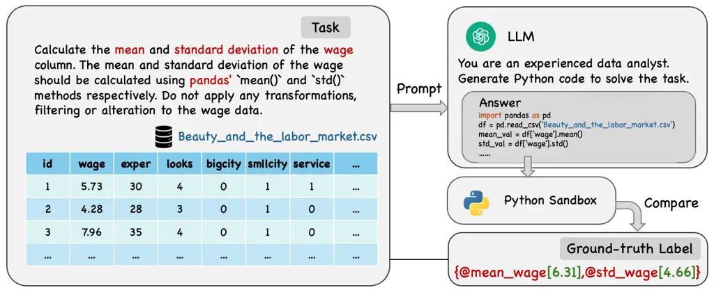

Figure 1: An Example of Analytical Task

Our goal is to identify the prompt that provides the maximum score for a
specific query $`x`$. Formally, we seek a prompt $`t^{*}\in\mathcal{T}`$
that maximizes the evaluation score:

```math
t^{*}=\arg\max_{t\in\mathcal{T}}\;\mathcal{E}\left(LLM_{\text{task}}(x,t),l\right). \tag{1}
```

This formulation reflects a query-level optimization goal, where the
optimal prompting strategy adapts to the specific characteristics of the
query $`x`$. For convenience, a summary of major notation is provided in
Appendix 6.

### 3.2 Prompt Optimization as Causal Inference

We formulate prompt optimization not merely as a search problem, but as
a problem of _causal inference_. Standard supervised learning often
conflates correlation with causation; for instance, “hard” tasks may
inherently lead to lower scores regardless of the prompt, while
simultaneously inducing users to attempt more complex prompts. A
correlational model might erroneously learn that complex prompts _cause_
lower scores. To resolve this, we view each text prompt as a _treatment_
and the model’s performance as the _outcome_, aiming to isolate the
causal effect of the prompt from task-specific confounders.

Let $`X\in\mathcal{X}`$ denote the query features, and $`Y(t)\in[0,1]`$
the evaluation score. Following the potential outcomes framework (Imbens
and Rubin, 2015), the _potential outcome_ under prompt
$`t\in\mathcal{T}`$ is defined as:

```math
\mu(x,t):=\mathbb{E}[Y(t)\mid X=x], \tag{2}
```

where $`Y(t)`$ is the score obtained from evaluating the response of
query $`x`$ under prompt $`t`$.

To measure the true effectiveness of a prompt, we define the CATE of a
candidate prompt $`t`$ relative to a baseline prompt $`t_{0}`$:

```math
\tau(x,t):=\mu(x,t)-\mu(x,t_{0})=\mathbb{E}[Y(t)-Y(t_{0})\mid X=x]. \tag{3}
```

This quantity $`\tau(x,t)`$ represents the _counterfactual gain_: how
much better the model performs with prompt $`t`$ compared to the
baseline $`t_{0}`$, strictly due to the prompt itself. The objective of
query-level optimization is to select the prompt that maximizes this
causal effect:

```math
t^{*}(x)=\arg\max_{t\in\mathcal{T}}\tau(x,t), \tag{4}
```

which connects to the empirical prompt-search objective in (1) by
replacing the realized evaluation score for a single execution with its
counterfactual, feature-conditional expectation and by explicitly
accounting for confounding query characteristics. Note that estimating
either $`\mu(x,t)`$ or $`\tau(x,t)`$ yields the same optimal prompt,
since for a fixed baseline prompt $`t_{0}`$,
$`\arg\max_{t}\tau(x,t)=\arg\max_{t}\mu(x,t)`$. We adopt the CATE
formulation primarily for interpretability: it directly captures the
_causal improvement_ of a candidate prompt over a control prompt, while
in practice, its estimation complexity and accuracy are essentially
identical to those of estimating $`\mu(x,t)`$ directly.

Figure 2 illustrates the overall architecture of the Causal Prompt
Optimization (CPO) framework, which proceeds in two stages: (1) Causal
Reward Learning and (2) Causal-Guided Optimization.

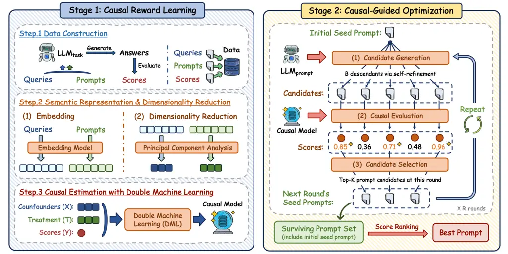

Figure 2: Overview of the Proposed Causal Prompt Optimization (CPO)
Framework

### 3.3 Stage 1: Causal Reward Learning

#### 3.3.1 Step 1: Data Construction

To estimate $`\tau(x,t)`$, we construct a dataset consisting of triplets
$`\{(x_{i},t_{i},y_{i})\}_{i=1}^{N}`$. For a benchmark dataset
$`\mathcal{D}_{\text{task}}`$, we systematically vary prompt templates
while holding the query $`x_{i}`$ constant. These variations differ
along key dimensions, such as constraint inclusion, instructional style,
or few-shot examples, creating a rich treatment space. To anchor causal
estimation, we also define a _control prompt_ $`t_{0}`$ for each
dataset, which is typically a simple instruction without few-shot
examples. This balanced design ensures that for any given query $`x`$,
we observe outcomes under multiple prompt treatments, providing the
necessary variation to disentangle prompt effects from effects of query
characteristics (see Section 4.1.2 for experimental implementation
details).

#### 3.3.2 Step 2: Semantic Representation and “Latent Treatments”

A central challenge in causal modeling over text is that both prompts
and queries are inherently discrete, making it difficult to define
meaningful treatment and control variables. We address this by defining
a continuous “latent treatment” space through a two-stage
transformation.

We first map each query $`x`$ and prompt $`t`$ into dense embeddings
using a sentence-transformer encoder (Nussbaum et al., 2025). These
embeddings capture latent linguistic information (e.g., tone, structure)
but remain too high-dimensional for efficient causal inference. We then
apply PCA to obtain compact semantic representations. PCA orthogonalizes
correlated linguistic features and yields a low-dimensional semantic
space suitable for causal estimation:

```math
\textbf{$\mathbf{x}=\psi_{X}(x)\in\mathbb{R}^{d_{x}}$},\qquad\textbf{$\mathbf{z}=\psi_{T}(t)\in\mathbb{R}^{d_{t}}$}. \tag{5}
```

Here, $`\mathbf{x}`$ and $`\mathbf{z}`$ are vector representations in
the learned semantic space: $`\mathbf{x}`$ summarizes query
characteristics, and $`\mathbf{z}`$ provides a continuous treatment
representation of the prompt. With a slight abuse of notation, we write
$`\hat{\tau}(x,t)`$ to denote $`\hat{\tau}(\mathbf{x},\mathbf{z})`$,
emphasizing that all causal evaluation is conducted in the learned
embedding space.

Given these representations, our object of interest is how prompt
semantics $`\mathbf{z}`$ causally affect task performance $`Y`$,
potentially in a query-adaptive manner characterized by $`\mathbf{x}`$.
A natural starting point is the conditional expectation
$`\mathbb{E}[Y\mid\mathbf{x},\mathbf{z}]`$. However, because both
$`\mathbf{x}`$ and $`\mathbf{z}`$ are high-dimensional vectors, this
relationship is unlikely to admit a simple parametric form. In
particular, performance varies substantially across queries even in the
absence of prompt variation, implying that baseline query difficulty
must be accounted for before isolating the causal effect of prompts.
These considerations motivate a causal estimation strategy that (i)
flexibly models outcome heterogeneity induced by $`\mathbf{x}`$, while
(ii) isolating the causal contribution of $`\mathbf{z}`$ without
imposing restrictive functional form assumptions.

#### 3.3.3 Step 3: Causal Estimation with Double Machine Learning

Our goal in this step is to estimate the causal effect of prompt
semantics $`\mathbf{z}`$ on task performance $`Y`$, allowing this effect
to vary across queries characterized by $`\mathbf{x}`$. Although prompt
assignment is experimentally controlled, estimation remains challenging
because both $`\mathbf{x}`$ and $`\mathbf{z}`$ reside in
high-dimensional semantic spaces. In such settings, standard parametric
estimators impose restrictive functional form assumptions that are
unlikely to hold, while classical semiparametric methods become
infeasible due to the curse of dimensionality. To address these
challenges, we adopt the DML framework (Chernozhukov et al., 2018),
which combines flexible machine learning for nuisance estimation with
orthogonalized estimating equations to deliver valid causal inference in
high-dimensional environments (Shi et al., 2025).

1.  (1)
    Modeling Query Characteristics and Treatment Assignment We begin by
    modeling systematic variation in both outcomes and treatments as a
    function of query semantics. Even in the absence of prompt
    variation, queries differ substantially, implying that observed
    performance reflects both query characteristics and prompt effects.
    Failing to account for this heterogeneity can distort causal
    estimates, particularly when the mapping from semantic embeddings to
    outcomes is nonlinear.

    To operationalize this objective within the DML framework, we impose
    a partially linear structure on the conditional mean, assuming that
    prompt effects enter linearly through their embedding representation
    while allowing unrestricted heterogeneity with respect to query
    semantics (Chernozhukov et al., 2018). This assumption preserves
    flexibility in how query characteristics affect performance, while
    enabling orthogonalized estimation of prompt effects in
    high-dimensional treatment spaces.

    Under this structure, DML introduces nuisance functions that
    summarize how outcomes and treatments vary with $`\mathbf{x}`$:

    ```math
    m(\mathbf{x})=\mathbb{E}[Y\mid\mathbf{x}],\qquad e(\mathbf{x})=\mathbb{E}[\mathbf{z}\mid\mathbf{x}]. \tag{6}
    ```

    Here, $`m(\mathbf{x})`$ represents the baseline performance level
    implied by a query’s characteristics, while $`e(\mathbf{x})`$
    captures systematic dependence between query characteristics and the
    continuous treatment representation. Because both relationships may
    be highly nonlinear in high-dimensional embedding spaces, we
    estimate $`m(\cdot)`$ and $`e(\cdot)`$ using flexible machine
    learning methods (Gradient Boosting), rather than imposing
    parametric restrictions.

    To prevent overfitting in this first stage from biasing causal
    estimates, we implement cross-fitting as prescribed by Chernozhukov
    et al. (2018). Specifically, we partition the data into $`K`$ folds.
    For each fold $`k`$, we estimate the nuisance functions using the
    other $`k-1`$ folds and generate out-of-sample predictions for fold
    $`k`$, ensuring that subsequent residuals are constructed using
    cross-fitted predictions.

2.  (2)
    Residualization via Orthogonalization While flexible machine
    learning improves approximation accuracy, it introduces
    regularization bias that can contaminate causal estimates if left
    unaddressed. A central insight of DML is that this bias can be
    neutralized by constructing an estimating equation that is Neyman
    orthogonal to the nuisance functions. Orthogonality ensures that
    small estimation errors in $`m(\cdot)`$ and $`e(\cdot)`$ affect the
    treatment effect estimator only at second order.

    Operationally, orthogonality is achieved by residualizing both the
    outcome and the treatment using cross-fitted nuisance estimates:

    ```math
    \tilde{Y}=Y-m(\mathbf{x}),\qquad\tilde{\mathbf{z}}=\mathbf{z}-e(\mathbf{x}). \tag{7}
    ```

    This step orthogonalizes the prompt signal against the query signal.
    For instance, if a query is inherently difficult, $`m(\mathbf{x})`$
    will predict a low score; the residual $`\tilde{Y}`$ thus isolates
    the _excess performance_ attributable specifically to the prompt
    variation, independent of the query’s baseline difficulty.

3.  (3)
    CATE Estimation After orthogonalization, we estimate heterogeneous
    treatment effects by exploiting the partially linear structure
    implied by DML. Specifically, the orthogonalized outcome satisfies

    ```math
    \tilde{Y}=\theta(\mathbf{x})^{\intercal}\tilde{\mathbf{z}}+\varepsilon, \tag{8}
    ```

    where $`\theta(\mathbf{x})`$ denotes the conditional average
    treatment effect as a function of query characteristics. This
    specification preserves linearity in the treatment while allowing
    treatment effects to vary flexibly across the semantic query space.

    We estimate $`\theta(\mathbf{x})`$ using a Generalized Random Forest
    (Athey et al., 2019), which is well suited for learning
    heterogeneous coefficients in high-dimensional settings. Because the
    estimating equation is Neyman orthogonal to the nuisance functions,
    the resulting estimator remains locally insensitive to
    regularization bias in the first-stage nuisance estimates.

The estimated conditional average treatment effect is therefore given by

```math
\hat{\tau}(x,t)=\hat{\theta}(\mathbf{x})^{\intercal}(\mathbf{z}-\mathbf{z_{0}}), \tag{9}
```

which yields a robust, de-biased reward signal that guides the
optimization in Stage 2.

### 3.4 Stage 2: Causal-Guided Optimization

In the second stage, we leverage the estimated causal effect
$`\hat{\tau}(x,t)`$ as an offline reward function for prompt
optimization. This design offloads the heavy prompt-evaluation workload,
which otherwise requiring repeated calls to the task-execution LLM
(i.e., $`LLM_{\text{task}}`$), to an offline causal reward model as a
one-time fixed investment, leaving only lightweight marginal costs
during prompt search. As a result, we directly address the primary
economic bottleneck of standard APO methods, which scale linearly with
the number of prompt evaluations.

Using this offline reward, we conduct prompt search via an iterative
tree-search procedure (Figure 3):

1.  (1)
    Candidate Generation: Starting from a set of seed prompts (baseline
    prompt $`t_{0}`$ in the first round), a generator model
    $`LLM_{\text{prompt}}`$, which is typically more lightweight than
    the task-execution model, produces $`B`$ candidate variants, where
    $`B`$ denotes the number of generated variants per prompt. To
    promote meaningful exploration, we embed an explicit
    _self-refinement instruction_ (e.g., “develop superior prompts based
    on the seed prompt”) within the generation prompt. This encourages
    the model to propose semantically improved prompts rather than
    superficial paraphrases, enabling exploration of higher-quality
    regions of the prompt space. Figure 4 illustrates the template used
    in the mathematical-reasoning task (see Section 4.1.1 for further
    details of this task), which consists of (1) a system prompt
    defining the generation goal and style where a self-refinement
    instruction is included, (2) instruction and example blocks that
    guide reasoning, and (3) a user prompt specifying the number and
    format of new candidate prompts.
2.  (2)
    Causal Evaluation: Instead of querying the expensive
    $`LLM_{\text{task}}`$ for every candidate, we project the new
    prompts into the PCA space and evaluate them using the learned
    causal model to obtain $`\hat{\tau}(x,t)`$. This step provides a
    fast estimate of each prompt’s counterfactual performance gain
    relative to the baseline, without incurring online inference costs.
3.  (3)
    Selection and Global Ranking: We retain the top-$`K`$ candidates
    with the highest predicted causal gain to seed the next search
    iteration. This iterative selection-and-expansion process is
    repeated for $`R`$ rounds, after which we aggregate all surviving
    prompts into a global set and re-rank them according to
    $`\hat{\tau}(x,t)`$, selecting the final optimal prompt $`t^{*}`$.

This approach effectively decouples exploration from execution. By
evaluating thousands of candidates via the lightweight causal reward
model, CPO affords deep exploration of the semantic space at a fraction
of the cost of online methods (e.g., LLM-as-a-Judge). Moreover, because
the reward is explicitly causal rather than correlational, the resulting
prompt selection is more robust to query heterogeneity and distribution
shifts, yielding prompts that generalize beyond the specific evaluation
sample.

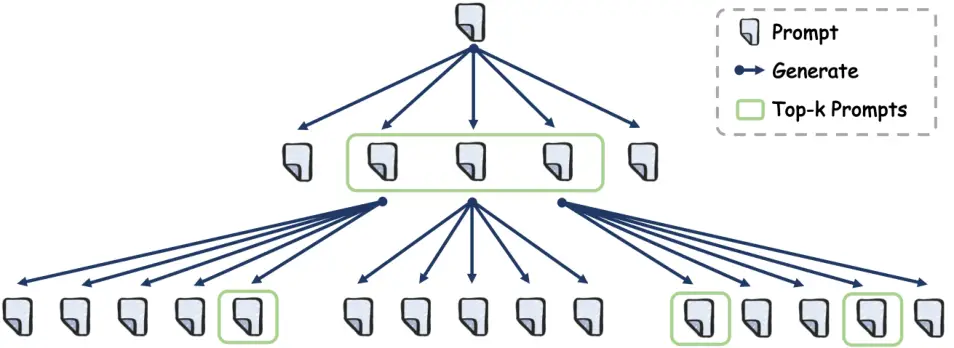

Figure 3: An Illustration of the Tree Search Process in Prompt
Optimization ($`B{=}5`$, $`K{=}3`$, $`R{=}2`$)


Figure 4: Prompt Template for Generating New Candidate Prompts in the
MATH Task

## 4 Experiments

### 4.1 Data Preparation

#### 4.1.1 Benchmark Datasets

To comprehensively evaluate the proposed CPO framework, we conduct
experiments on three diverse tasks, including mathematical reasoning,
natural language to visualization generation, and data analytics. For
each task, we select a corresponding typical benchmark dataset:
MATH (Hendrycks et al., 2021) for mathematical reasoning, VisEval (Chen
et al., 2024) for natural language to visualization generation, and
DABench (Hu et al., 2024) for data analytics. See the detailed
descriptions and the evaluation metrics (e.g., accuracy and pass rate)
of the benchmarks in the Appendix B.

#### 4.1.2 Offline Data Construction

As outlined conceptually in Section 3.3.1, we construct offline datasets
of $`\langle`$query, prompt, score$`\rangle`$ triplets to enable causal
estimation in Stage 1 of CPO. The data-collection pipeline follows a
unified procedure across all three benchmarks while allowing
task-specific adaptations. Table 1 summarizes the dataset statistics.

| Task    | \#Queries | \#Prompts | \#Instructions | \#Examples | \#Triplets |
| ------- | --------- | --------- | -------------- | ---------- | ---------- |
| MATH    | 185       | 201       | 116            | 29         | 37,185     |
| VisEval | 102       | 201       | 30             | 64         | 20,502     |
| DABench | 164       | 160       | 10             | 3          | 26,240     |

Table 1: Statistics of the Constructed Offline Data for the Three
Benchmark Datasets

For the MATH and VisEval datasets, each prompt consists of two elements:
an _instruction_ and a set of _few-shot examples_. We begin with the
baseline prompt $`t_{0}`$ and expand the prompt pool in a binary-tree
manner. Specifically, we use $`LLM_{\text{prompt}}`$ to generate two new
variants from the initial prompt ($`t_{0}`$); then, for each newly
generated prompt, we again generate two variants, and repeat this
process recursively. During this process, the model is required to
preserve the original intent while varying linguistic style, structural
framing, and explanatory tone, thereby producing diverse yet
semantically aligned instructions. Few-shot examples are query–answer
pairs randomly sampled from the benchmark, combined to form multiple
demonstration sets. Pairing distinct instructions with these examples
yields a large collection of complete prompts. We also designed a
baseline prompt $`t_{0}`$ for each task to anchor the CATE estimation,
which is a simple instruction that does not include any few-shot
examples. For example, for the MATH dataset, the baseline prompt is
“Solve the following math problem." The details of the baseline prompts
are shown in Appendix C.1. For each $`\langle`$query, prompt$`\rangle`$
pair, we use $`LLM_{\text{task}}`$ (i.e., Qwen2.5-14B) to generate an
answer, which is subsequently evaluated to obtain the performance
metric. This process yields a comprehensive offline dataset of
$`\langle`$query, prompt, score$`\rangle`$ triplets for each task.

For the DABench dataset, we follow a similar procedure but introduce two
additional types of prompt variation to accommodate its data-analysis
nature. First, each query in DABench includes explicit _constraints_
that influence the solution approach or output format. We therefore
treat the inclusion of these constraints as one dimension of prompt
variation. Second, because tasks require referencing external data
tables, we create a standardized JSON description for each dataset
containing metadata such as column names, data types, extrema, and
representative values. The inclusion or exclusion of this JSON context
constitutes another design dimension. In addition, we design three
few-shot problem-solving demonstrations, each with an associated
dataset, correct code implementation, and expected output. Prompts are
generated under two configurations: (1) a _one-shot_ setting, which
randomly incorporates a single demonstration, and (2) a _three-shot_
setting, which embeds all three demonstrations. This procedure ensures
diversity in prompt complexity and informativeness. A baseline prompt is
similarly designed for this task, as reported in Appendix C.1.

### 4.2 Validation Strategy

To establish the reliability and practical value of the proposed CPO
framework, we develop a validation strategy that evaluates both stages
of CPO: (1) the causal reward model’s ability to estimate unbiased and
generalizable treatment effects, and (2) the effectiveness of using
these causal rewards to guide prompt optimization in practice.

#### 4.2.1 Stage 1: Validating Causal Reward Learning

The first stage evaluates whether the causal estimator
$`\hat{\tau}(x,t)`$ can recover true treatment effects more accurately
than non-causal predictors. It answers our first research question: _If
our model predicts that prompt A will outperform prompt B, does this
prediction actually hold when tested on unseen queries and prompts?_
Specifically, we focus on evaluating whether the estimated causal
effects maintain generalizability across previously unseen queries and
prompts. To this end, each offline dataset, drawn from the three
aforementioned benchmarks, is partitioned into distinct training and
validation sets. Both the causal and non-causal reward models are
trained using the training split, and their performance is subsequently
evaluated on the validation set. This evaluation design is essential
because, in our causal formulation, prompts correspond to the treatments
and questions serve as potential confounders. Robust performance on
unseen prompts and queries demonstrates that the causal model
successfully isolates the true causal contribution of prompts to model
performance, ensuring reliable generalization beyond the observed data.
A significant improvement over the non-causal ML baseline confirms that
causal reward learning provides more reliable and generalizable effect
estimates.

To provide a fair comparison, we introduce a non-causal machine learning
(ML) baseline that employs the same underlying machine learning
architecture as our DML estimator but is trained without causal
adjustment. The baseline directly predicts task outcomes from
concatenated prompt and query embeddings, focusing purely on predictive
accuracy. In contrast, the DML-based causal estimator explicitly
separates treatments from confounders and estimates their conditional
effects, yielding unbiased measures of prompt influence. Therefore,
comparing these two models isolates the unique contribution of causal
reasoning to the reliability and generalizability of the learned reward
signal.

We evaluate the quality of causal effect estimation using Kendall’s
tau-b, a rank-based statistic that measures the ordinal consistency
between the estimated causal effects and the ground-truth causal
outcomes in held-out data (Agresti, 2010). This metric is particularly
appropriate because subsequent prompt optimization depends on ranking
candidate prompts by their estimated effects, making rank consistency
more relevant than absolute accuracy. We adopt Kendall’s tau-b rather
than the traditional Kendall’s tau because it properly accounts for tied
rankings (Agresti, 2010)—a frequent occurrence in our setting, where the
true effects of multiple prompt–query pairs may be identical (e.g.,
performance scores of 1 or 0). By correcting for such ties, Kendall’s
tau-b provides a robust and unbiased measure of ranking quality,
ensuring fair comparison even when many samples share the same
ground-truth outcomes. See the calculation details of Kendall’s tau-b in
the Appendix D.

#### 4.2.2 Stage 2: Validating Causal-Guided Optimization

The second stage examines whether using $`\hat{\tau}(x,t)`$ as a reward
function leads to practical performance gains in prompt optimization.
Specifically, it answers our second research question: _Do the prompts
identified by causal-guided optimization actually yield superior task
performance compared to existing methods?_ Positive results would
demonstrate that the causal reward learned in Stage 1 provides
actionable guidance that consistently translates into real-world gains.
We evaluate CPO against both human-designed and automated baselines on
held-out test sets from the same three benchmarks, ensuring no overlap
with the offline data used for causal training. This separation
guarantees that evaluation reflects genuine generalization rather than
memorization.

We compare CPO against three categories of baseline methods. The first
category, ordinary human prompts (baseline/control prompt in our
setting), represents standard manually crafted instructions that serve
as a baseline for typical prompt engineering practice. The second
category, conventional prompting approaches, includes Chain-of-Thought
(CoT) (Wei et al., 2022) and Reflexion (Shinn et al., 2023), both of
which enhance reasoning by introducing explicit intermediate steps or
iterative self-reflection mechanisms. The third category comprises
automated prompt optimization methods, such as APE (Zhou et al., 2022),
OPRO (Yang et al., 2023), PromptAgent (Wang et al., 2024),
PromptBreeder (Fernando et al., 2024), TextGrad (Yuksekgonul et al.,
2025), and DSPy (Khattab et al., 2023). These methods seek to identify a
single optimized prompt that generalizes across an entire dataset.
Compared with these automated prompt optimization techniques, CPO
conditions on both query and prompt representations to generate
query-specific optimized prompts. This design enables fine-grained
adaptation to query heterogeneity and supports superior generalization
across diverse input distributions. The implementation details of these
baselines, including optimization hyperparameters and final optimized
prompts, are provided in Appendix C.

### 4.3 Experimental Implementation

#### 4.3.1 LLM Model Configuration

This part specifies the model configuration and experimental environment
used across all benchmarks. We employ Qwen2.5-14B as both the
task-execution model ($`LLM_{\text{task}}`$) and the prompt-generation
model ($`LLM_{\text{prompt}}`$). In all experiments, the model
temperature is fixed at 0.8, unless otherwise specified in baseline
configurations. For the embedding model, we employ the
nomic-embed-text-v1.5 model (Nussbaum et al., 2025), a high-performance
open embedding model known for its strong semantic alignment across
diverse text domains. It produces 768-dimensional embeddings that encode
the semantic and structural properties of natural language queries and
prompts into continuous vector representations. To enhance efficiency
and interpretability in causal estimation, we apply Principal Component
Analysis (PCA) to the embeddings, thereby reducing dimensionality and
extracting the most salient prompt patterns. Because the semantic
complexity of queries and prompts varies across tasks, we set
task-specific PCA dimensions. For dimensionality reduction, we retain 40
and 15 PCA components for queries and prompts in MATH, 20 and 10 in
VisEval, and 40 and 30 in DABench, respectively.

#### 4.3.2 Task-Specific Execution Environment

Because the three benchmark tasks involve different types of model
interaction, ranging from direct text generation to code execution and
data visualization, we adopt task-specific frameworks for integrating
$`LLM_{\text{task}}`$ into the evaluation pipeline.

\(1\) For the MATH dataset, the task involves direct query answering and
reasoning. We therefore use $`LLM_{\text{task}}`$ through the standard
OpenAI-compatible API provided in the openai Python library, which
returns plain-text responses for each query–prompt pair.

\(2\) For the VisEval dataset, which requires
natural-language-to-visualization code generation, we follow the
original benchmark setup and adopt the CoML framework (Zhang et al.,
2024). $`LLM_{\text{task}}`$ serves as the LLM within the CoML agent,
which structures prompts using the “Variables–Executed Code–Request”
format: variables describe the dataset, executed code specifies
preprocessing steps, and the request expresses the user’s visualization
query.

\(3\) For the DABench dataset, which centers on data-analysis tasks
requiring code execution and structured output, we employ the smolagents
framework (Roucher et al., 2025) developed by HuggingFace.
$`LLM_{\text{task}}`$ acts as the agent’s reasoning module, capable of
accessing tabular data in CSV format to autonomously perform code
generation, file reading, execution, result extraction, and answer
evaluation, enabling reproducible and end-to-end testing across tasks.

#### 4.3.3 Configuration of DML Model in Stage 1

In Stage 1, we implement causal reward learning using the
CausalForestDML estimator, which decomposes estimation into two nuisance
models: the outcome model $`m(\mathbf{x})`$ and the treatment model
$`e(\mathbf{x})`$. The outcome model $`m(\mathbf{x})`$ is a
GradientBoostingClassifier configured with 100 estimators, a maximum
tree depth of 3, and a minimum leaf size of 20.³³ 3 For the DABench
dataset, the number of estimators is reduced to 50 to control memory
usage and prevent kernel crashes. The treatment model $`e(\mathbf{x})`$
is implemented as a MultiOutputRegressor wrapping a
GradientBoostingRegressor with identical hyperparameters. Unless
otherwise specified, we use a 0.9/0.1 split for training and held-out
evaluation when fitting the DML estimator.

#### 4.3.4 Configuration of Prompt Optimization in Stage 2

In Stage 2, prompt optimization proceeds through the iterative
causal-guided search described in Section 3.4. Using the same notation
as before ($`R`$ for optimization rounds, $`K`$ for the number of
top-performing prompts retained per round, and $`B`$ for the number of
new candidates generated from each prompt), we set $`R=3`$, $`K=3`$, and
$`B=5`$, resulting in $`35`$ newly produced prompt variations overall.
These hyperparameters strike a balance between exploration and
refinement, enabling efficient traversal of the discrete prompt space
without excessive computational cost.

### 4.4 Performance of Causal Reward Learning

Following the validation design described in Section 4.2.1, we assess
model performance on unseen queries or prompts. For both the causal
estimator in CPO and the non-causal ML baseline introduced in
Section 4.2.1, we report Kendall’s tau-b scores for all three tasks, as
shown in Table 2.

Across all three benchmarks, the causal reward model in CPO consistently
achieves higher Kendall’s tau-b scores than the non-causal ML baseline,
indicating that causal reward learning provides a more reliable and
generalizable estimation of prompt effects. Specifically, the causal
estimator of CPO improves Kendall’s tau-b from 0.0441 to 0.0608 (+38%)
on MATH, from 0.0980 to 0.1283 (+31%) on VisEval, and from 0.1347 to
0.1509 (+12%) on DABench. These results provide quantitative evidence
that the proposed causal reward model captures the true effects of
prompt variation more reliably than a purely predictive approach,
reinforcing the value of causal inference as the foundation for prompt
optimization.

| Task    | Method                  | Kendall’s Tau-b |
| ------- | ----------------------- | --------------- |
| MATH    | Non-causal ML baseline  | 0.0441          |
|         | Causal estimator of CPO | 0.0608          |
| VisEval | Non-causal ML baseline  | 0.0980          |
|         | Causal estimator of CPO | 0.1283          |
| DABench | Non-causal ML baseline  | 0.1347          |
|         | Causal estimator of CPO | 0.1509          |

Table 2: Performance Comparison of Causal and Non-Causal Estimators on
Unseen Query/Prompt

### 4.5 Performance of Causal-Guided Optimization

In Stage 2, we design dedicated test datasets for each task to
rigorously evaluate the effectiveness of CPO in guiding prompt
optimization on previously unseen queries. All test queries are sampled
to ensure no overlap with the offline dataset used for causal reward
learning, providing a robust basis for assessing generalization. Because
each benchmark categorizes queries by difficulty, we construct
stratified test sets by sampling across multiple difficulty levels, with
an emphasis on higher-difficulty categories to better reflect
challenging real-world scenarios. The detailed composition of each test
set is summarized in Table 3.

| Task    | Difficulty Levels              | Selection Criteria                                                            | Size |
| ------- | ------------------------------ | ----------------------------------------------------------------------------- | ---- |
| MATH    | Levels 3, Level 4, Level 5     | Randomly sample 100 queries from each level                                   | 300  |
| VisEval | Easy, Medium, Hard, Extra Hard | Sample 100 $`\langle`$NL, VIS$`\rangle`$ pairs per level with each VIS unique | 400  |
| DABench | Easy, Medium, Hard             | Randomly sample 30 queries from each level                                    | 90   |

Table 3: Construction Details of Test Sets for Each Task in Stage 2

Tables 4-6 report the prompt optimization performance on the MATH,
VisEval and DABench test sets respectively, detailing accuracy across
each difficulty level as well as the overall performance. As shown in
Table 4, CPO exhibits two notable advantages on the MATH benchmark.
First, it maintains strong and consistent performance across all three
difficulty levels, achieving the highest overall accuracy of 90.00%. In
contrast, while several automated methods (e.g., APE and PromptBreeder)
perform well on individual levels, their results fluctuate across tasks,
reflecting less stable generalization. This consistency highlights CPO’s
robustness and adaptability in mathematical reasoning tasks. Second, CPO
attains the top accuracy (82%) on Level 5, the most challenging subset,
outperforming all baselines except APE, with which it is tied. This
result underscores CPO’s effectiveness in handling complex reasoning
problems that demand more advanced prompt engineering.

|                        |               |                                  |         |         |         |
| ---------------------- | ------------- | -------------------------------- | ------- | ------- | ------- |
| Type                   | Method        | Accuracy (%) by Difficulty Level |         |         | Overall |
|                        |               | Level 3                          | Level 4 | Level 5 |         |
| Human Prompts          | Human         | 95                               | 91      | 79      | 88.33   |
| Conventional Prompting | CoT (1-shot)  | 93                               | 92      | 74      | 86.33   |
|                        | Reflexion     | 90                               | 92      | 77      | 86.33   |
| Automated Prompting    | APE           | 94                               | 92      | 82      | 89.33   |
|                        | OPRO          | 94                               | 92      | 79      | 88.33   |
|                        | PromptAgent   | 95                               | 93      | 77      | 88.33   |
|                        | PromptBreeder | 92                               | 94      | 80      | 88.67   |
|                        | TextGrad      | 92                               | 87      | 79      | 86.00   |
|                        | DSPy          | 78                               | 75      | 62      | 71.67   |
| Ours                   | CPO           | 96                               | 92      | 82      | 90.00   |

\TableNoteStyle\HD

110Note: For each column, the best performance is highlighted in bold
and the second best one is highlighted in underline.

Table 4: Prompt Optimization Results on MATH

In Table 5, we can see that CPO achieves the highest overall accuracy of
54.75% on the VisEval test set, outperforming all other baselines with a
clear margin. This result underscores the robustness of our framework,
as CPO consistently delivers top-tier performance across all difficulty
levels, whereas other methods exhibit substantial variation. For
instance, PromptAgent attains the best accuracy (77%) on the Easy subset
but performs poorly on the remaining three levels. Similarly, while
PromptBreeder ranks second on the Extra Hard subset, its performance on
the Medium and Hard subsets lags considerably. In contrast, CPO
maintains balanced and stable accuracy across all difficulty levels, a
property critical for real-world deployment where query complexity can
vary widely.

|                        |               |                                  |        |      |            |         |
| ---------------------- | ------------- | -------------------------------- | ------ | ---- | ---------- | ------- |
| Type                   | Method        | Accuracy (%) by Difficulty Level |        |      |            | Overall |
|                        |               | Easy                             | Medium | Hard | Extra Hard |         |
| Human Prompts          | Human         | 74                               | 59     | 42   | 26         | 50.25   |
| Conventional Prompting | CoT (1-shot)  | 73                               | 58     | 44   | 27         | 50.50   |
|                        | Reflexion     | 73                               | 54     | 43   | 29         | 49.75   |
| Automated Prompting    | APE           | 75                               | 59     | 43   | 36         | 53.25   |
|                        | OPRO          | 74                               | 57     | 48   | 34         | 53.25   |
|                        | PromptAgent   | 77                               | 50     | 39   | 26         | 48.00   |
|                        | PromptBreeder | 76                               | 51     | 42   | 35         | 51.00   |
|                        | TextGrad      | 74                               | 59     | 42   | 26         | 51.25   |
|                        | DSPy          | 58                               | 43     | 39   | 13         | 38.25   |
| Ours                   | CPO (ours)    | 76                               | 60     | 49   | 34         | 54.75   |

\TableNoteStyle\HD

110Note: For each column, the best performance is highlighted in bold
and the second best one is highlighted in underline.

Table 5: Prompt Optimization Results on VisEval

On DABench, as shown in Table 6, CPO achieves the highest overall
accuracy of 65.33%, outperforming all baseline methods, including the
strongest automated competitor, PromptBreeder (62.33%). Beyond overall
performance, CPO demonstrates remarkable consistency across difficulty
levels, achieving 77% on the Easy subset and 69% on the Medium subset.
This stability contrasts sharply with methods such as APE and
PromptBreeder, whose performance fluctuates more substantially across
tasks. Moreover, CPO achieves a clear advantage on the Hard subset,
attaining 50% accuracy, substantially higher than any other method. This
result highlights CPO’s effectiveness in handling complex reasoning
tasks that challenge both conventional and automated prompting
approaches. Collectively, these findings underscore CPO’s robustness,
stability, and strong generalization in automated prompt optimization
for data analysis tasks.

|                        |               |                                  |        |      |         |
| ---------------------- | ------------- | -------------------------------- | ------ | ---- | ------- |
| Type                   | Method        | Accuracy (%) by Difficulty Level |        |      | Overall |
|                        |               | Easy                             | Medium | Hard |         |
| Human Prompts          | Human         | 77                               | 57     | 28   | 54.00   |
| Conventional Prompting | CoT (1-shot)  | 57                               | 56     | 30   | 47.67   |
|                        | Reflexion     | 73                               | 50     | 28   | 50.33   |
| Automated Prompting    | APE           | 77                               | 65     | 39   | 60.33   |
|                        | OPRO          | 58                               | 56     | 37   | 50.33   |
|                        | PromptAgent   | 77                               | 65     | 42   | 61.33   |
|                        | PromptBreeder | 80                               | 72     | 35   | 62.33   |
|                        | TextGrad      | 73                               | 60     | 25   | 52.67   |
|                        | DSPy          | 70                               | 59     | 37   | 55.33   |
| Ours                   | CPO           | 77                               | 69     | 50   | 65.33   |

\TableNoteStyle\HD

110Note: For each column, the best performance is highlighted in bold
and the second best one is highlighted in underline.

Table 6: Prompt Optimization Results on DABench

## 5 Why and Where Does CPO Work?

### 5.1 The Impact of Causal Modeling

To rigorously examine whether the performance gains of CPO stem from
genuine causal identification, we conduct a component-level ablation
study comparing our full CPO framework against two variants and the
human baseline across benchmarks. Figure 5 illustrates the performance
comparison of four settings: (1) CPO, our framework employing DML-based
causal reward learning to estimate the $`\hat{\tau}(x,t)`$ (the CATE) of
prompt candidates; (2) ML prediction variant, which replaces the causal
reward model with machine learning prediction model while keeping all
other components identical; (3) Random selection variant, which further
removes the reward-based prompt selection mechanism and randomly selects
prompts from the pool of LLM-generated candidates. Notably, since we let
the LLM refine the previous prompts during the prompt generation
process, this variant can represent the performance based purely on the
“self-refinement" capability of $`LLM_{\text{prompt}}`$; (4) Human
(initial), which is the unoptimized control prompt.

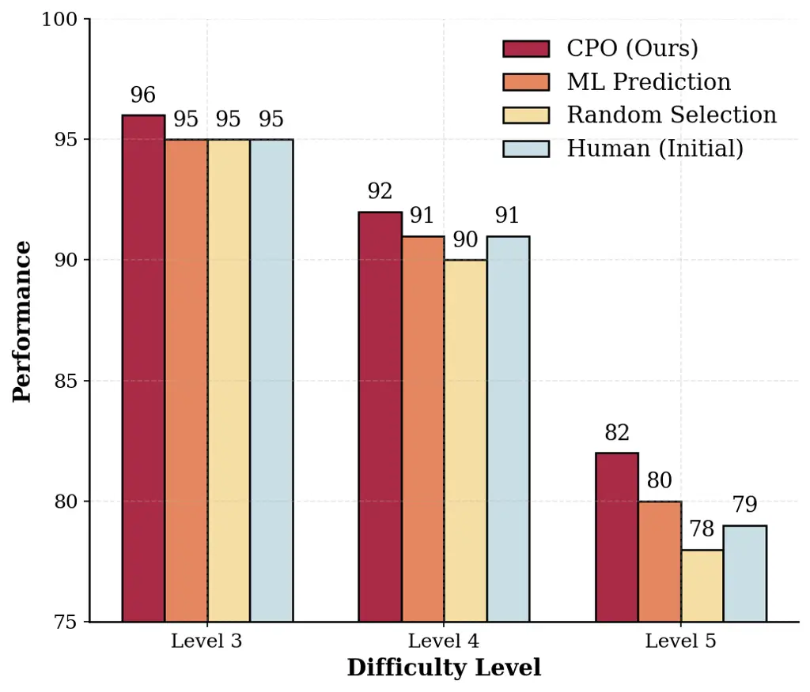

(a) MATH

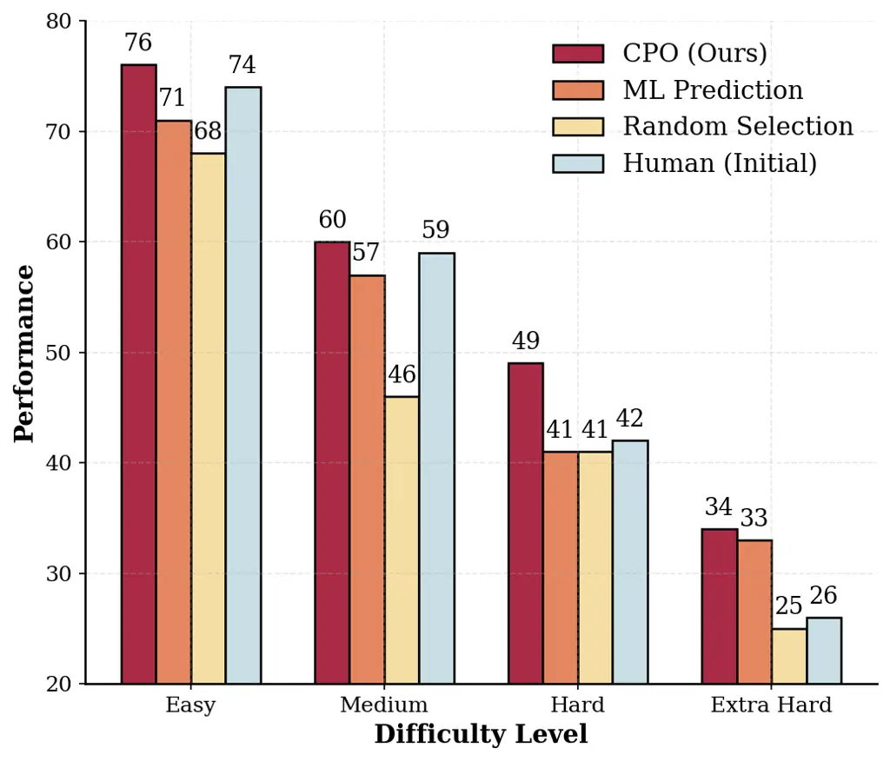

(b) VisEval

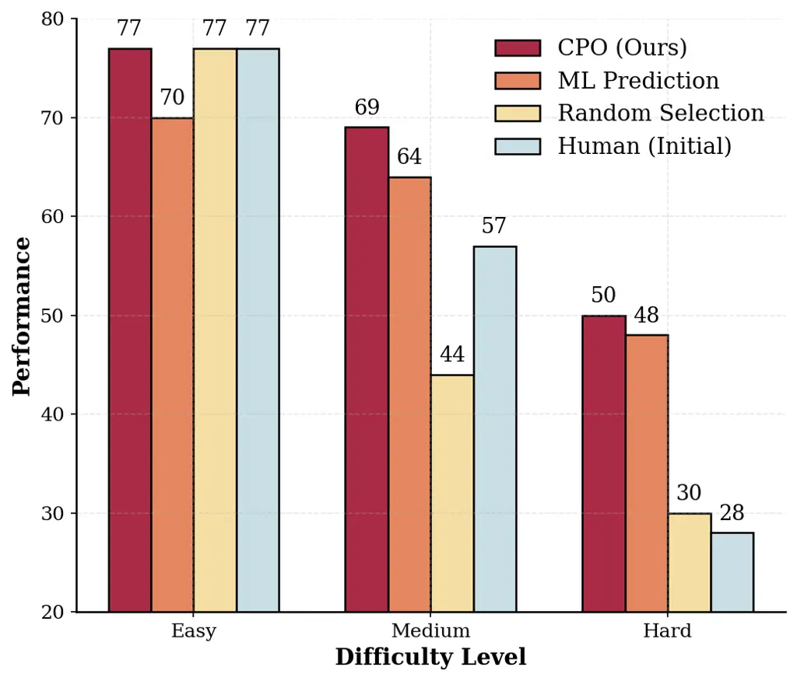

(c) DABench

Figure 5: Ablation Study for the Causal Reward Model in CPO.

The ablation results reveal several important insights about the
contribution of causal modeling. First, CPO demonstrates superior
performance compared to the other variants, as well as the human
baseline across all difficulty levels. The comparison between CPO and ML
prediction is the most theoretically significant. ML prediction
estimates the expected model performance for each query-prompt
combination, which may be confounded by the query-specific
characteristics, such as varying levels of difficulty. In contrast, CPO
aims to isolate the causal effect attributable solely to prompt
modifications from confounding factors. Since both methods share the
same architecture and search strategy, the performance gap of the two
approaches (e.g., CPO achieving 82% vs. ML’s 80% on MATH Level 5) is
attributable strictly to the prompt selection preference guided by the
reward model. This suggests that the causal framework’s ability to
isolate the true effect of prompt variations from confounding factors is
crucial for effective prompt selection. Second, CPO exhibits more stable
performance across queries from different difficulty levels compared to
other methods. Such stability further confirms the superiority of causal
reward learning for handling unseen queries and prompts at test time.
Third, the results show that the Random selection baseline not only
fails to consistently improve upon the initial human prompt, but in many
cases actually underperforms it (for example, achieving only 44% versus
57% on DABench Hard). This phenomenon underscores an important
limitation of relying solely on the self-refinement capabilities of
LLMs: new prompts generated in this way are not guaranteed to be better,
and may even introduce significant variance and instability into
performance. These findings highlight the necessity of employing a
robust causal filter to effectively identify genuinely beneficial prompt
modifications from the vast and noisy pool of LLM-generated prompt
candidates.

### 5.2 Scalability and Robustness to Training Data Size

The benefits of causal modeling become more pronounced as the size of
the offline dataset increases. As data accumulates, a causal learner can
increasingly disentangle true prompt effects from confounding factors,
whereas a correlational learner may instead overfit to spurious
associations.

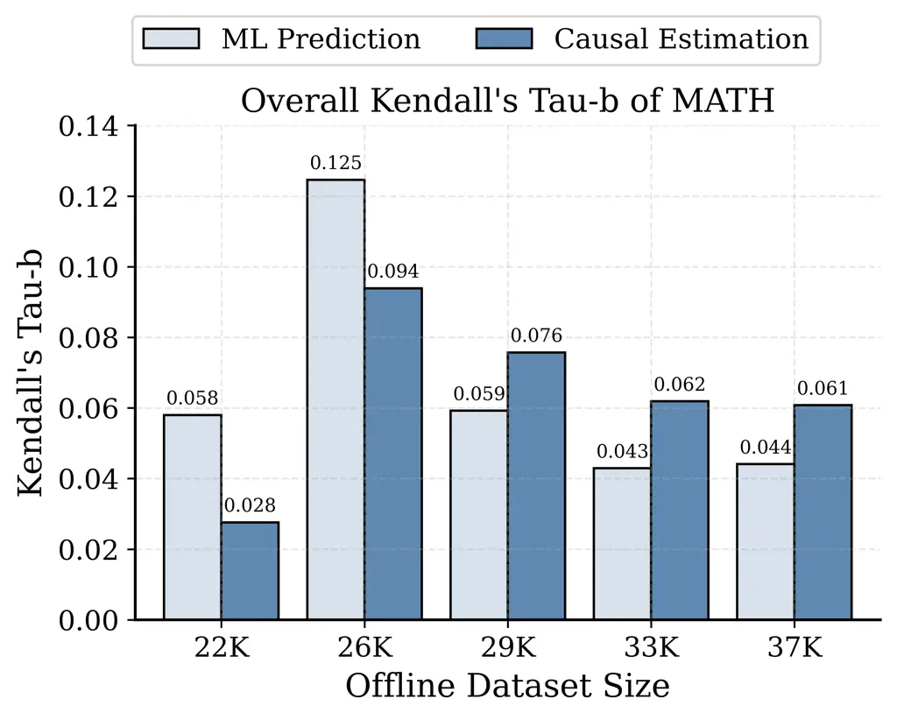

(a) Stage 1: Causal Reward Learning

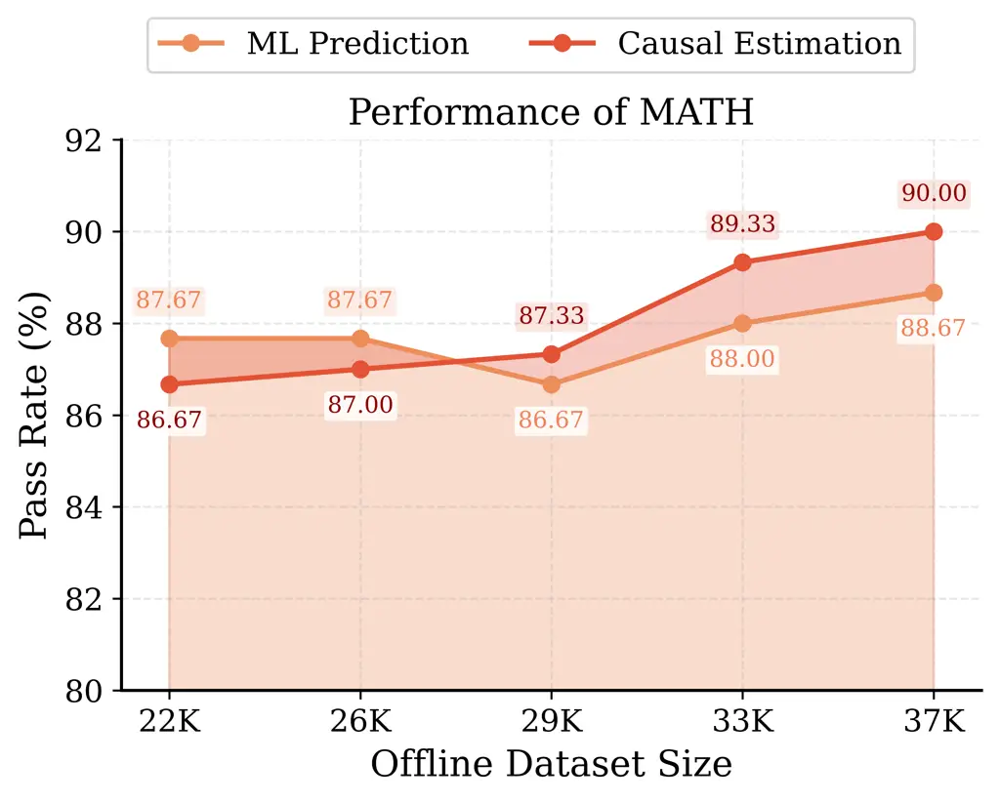

(b) Stage 2: Causal-Guided Optimization

Figure 6: Performance of CPO as Data Accumulates (Dataset: MATH)

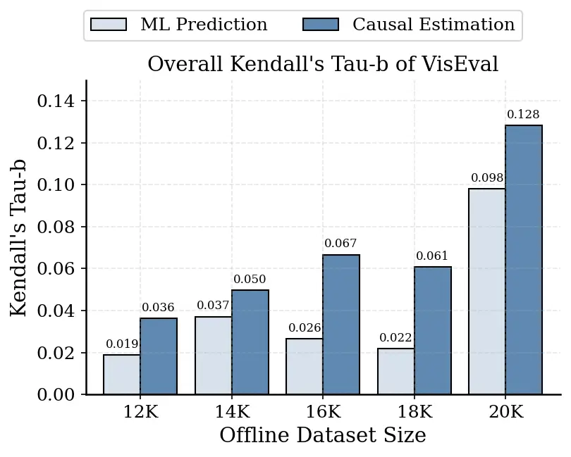

(a) Stage 1: Causal Reward Learning

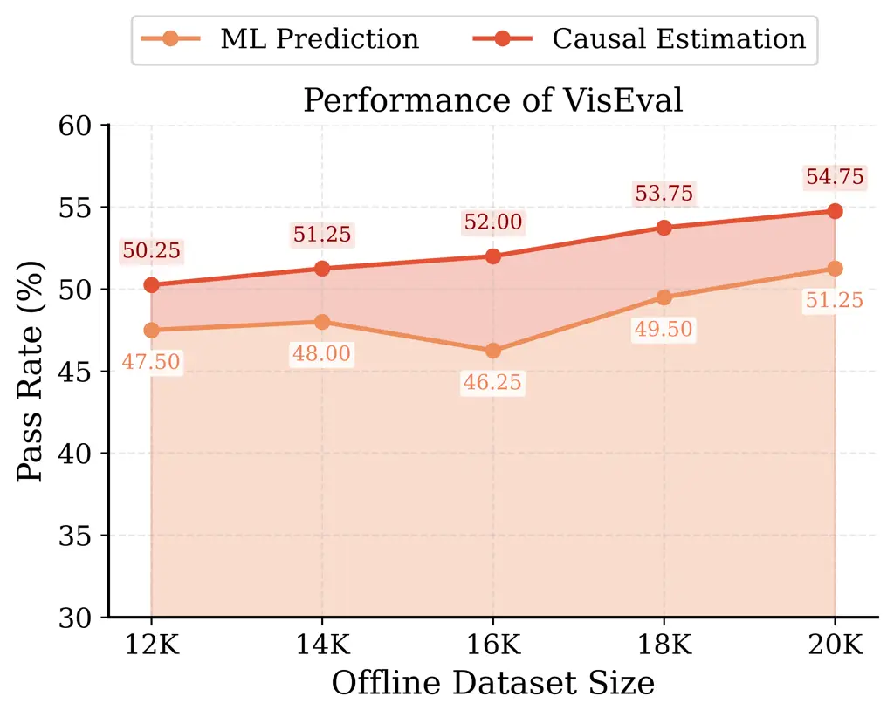

(b) Stage 2: Causal-Guided Optimization

Figure 7: Performance of CPO as Data Accumulates (Dataset: VisEval)

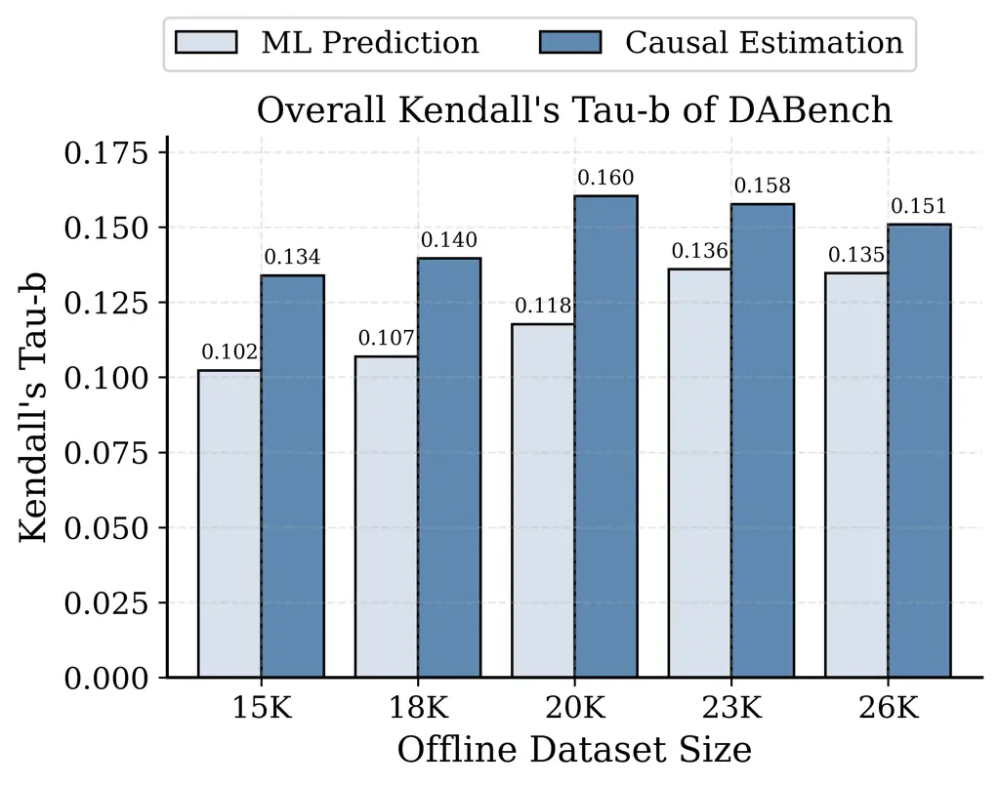

(a) Stage 1: Causal Reward Learning

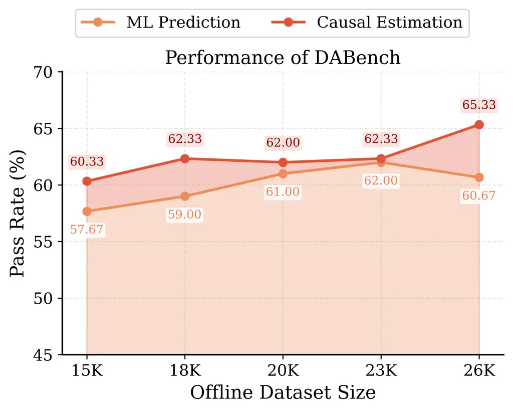

(b) Stage 2: Causal-Guided Optimization

Figure 8: Performance of CPO as Data Accumulates (Dataset: DABench)

Figures 6 to 8 confirm this hypothesis across all three benchmarks. In
Stage 1 (Causal Reward Learning), as the offline dataset size increases,
the causal reward model of CPO demonstrates a more favorable _data
scaling behavior_ compared to the non-causal ML model, with performance
advantage becoming more pronounced as more data accumulates. This
pattern is most evident on MATH, where CPO initially underperforms the
ML baseline at smaller dataset sizes (22K and 26K), but overtakes and
stabilizes ahead of the baseline once sufficient data is available (from
29K onward, CPO consistently achieves Kendall’s $`\tau_{b}`$ around
0.061–0.076, while the baseline drops to 0.043–0.059). This crossover
pattern reveals a critical insight: causal estimators require a certain
volume of observational data to effectively disentangle confounding
effects, but once this threshold is reached, they deliver more reliable
and stable effect estimates than purely predictive models.

Notably, in Stage 2 (Causal-Guided Optimization), a clear contrast
emerges across all three benchmarks: CPO performance shows a consistent
upward tendency with increasing data volume, while the ML prediction
baseline either fluctuates irregularly or undergoes a notable decline.
Moreover, the improvements in task performance achieved by CPO directly
reflect the gains in causal effect estimation quality observed in Stage
1, whereas for the ML baseline, the trends of Stage 1 and Stage 2
sometimes contradict each other. This further highlights the reliability
of CPO when generalizing to new queries and prompts, benefiting from the
ability of the causal reward model to disentangle true prompt effects
from confounding factors.

Taken together, these findings suggest that for enterprise applications
where interaction logs accumulate continuously, CPO offers a superior
“return on data", that is, CPO extracts greater value from each
additional observation, converting accumulated historical logs into
progressively more accurate causal estimates and, ultimately, into more
effective optimization policies.

### 5.3 Validating the “Latent Treatment" Assumption

Our causal framework relies on the assumption that the continuous PCA
components of prompt embeddings
($`\mathbf{z}\subset\mathbb{R}^{d_{t}}`$) act as valid “latent
treatments." One potential concern is whether mathematical operations in
this reduced space correspond to meaningful semantic interventions. To
validate this, we analyze the alignment between the extracted PCA
components and human-interpretable prompt design patterns.

We defined 7 distinct prompt patterns (e.g., _Constraint Strictness_,
_Chain-of-Thought Guidance_, _Tone_) based on recent taxonomies (White
et al., 2023; Geroimenko, 2025) (see Table 10 in Appendix). We then
scored the VisEval offline prompts as an example against these patterns
using GPT-4o and computed the Pearson correlation between the pattern
scores and the PCA coordinates.

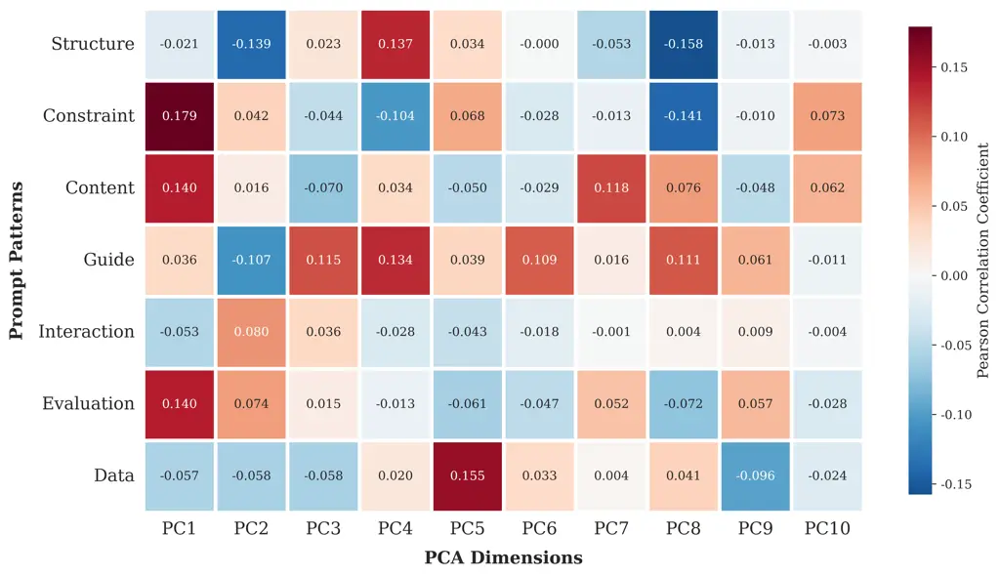

Figure 9: Correlation Coefficients between PCA Components and Prompt
Patterns (Dataset: VisEval)

Figure 9 demonstrates that the leading PCA components serve as
_composite latent treatments_. For instance, PC1 correlates strongly
with _Constraint_ ($`\rho=0.179`$) and _Content_ ($`\rho=0.140`$), while
PC4 captures _Structure_ ($`\rho=0.137`$). While no single dimension
maps one-to-one to a linguistic feature, the matrix confirms that
variance in the PCA space corresponds to variance in design choices.
This validates our methodological choice: by intervening on these
orthogonal components, CPO systematically explores the semantic design
space rather than navigating random noise.

### 5.4 Sensitivity to the Number of PCA Components

To examine how the performance of the proposed CPO framework is affected
by the choice of PCA dimensionality, we conduct a sensitivity analysis
reported in Table 7. We vary the number of retained PCA dimensions for
query and prompt embeddings, assessing the robustness of CPO to
different levels of representation compression.

|                |        |                                  |        |      |            |         |
| -------------- | ------ | -------------------------------- | ------ | ---- | ---------- | ------- |
| PCA Dimensions |        | Accuracy (%) by Difficulty Level |        |      |            | Overall |
| Query          | Prompt | Easy                             | Medium | Hard | Extra Hard |         |
| 10             | 5      | 76                               | 51     | 37   | 23         | 46.75   |
| 15             | 10     | 74                               | 60     | 42   | 33         | 52.25   |
| 20             | 10     | 76                               | 60     | 49   | 34         | 54.75   |
| 25             | 15     | 75                               | 58     | 47   | 33         | 53.50   |
| 40             | 20     | 76                               | 59     | 46   | 32         | 53.25   |
| 80             | 40     | 72                               | 49     | 41   | 26         | 47.25   |

\TableNoteStyle\HD

110Note: For each column, the best performance is highlighted in bold
and the second best one is highlighted in underline.

Table 7: Sensitivity Analysis to the Number of PCA Components (Dataset:
VisEval)

The results reveal an inverted U-shaped relationship. Performance
degrades at high dimensions (e.g., $`d_{x}=80`$), likely due to the
_positivity violation_ in causal inference: as dimensionality grows, the
probability of observing treated and control units in the same region of
the covariate space diminishes, making propensity estimation
unstable (Chernozhukov et al., 2018). This confirms that PCA is not
merely a computational convenience but a necessary regularization step
to ensure valid causal identification in the semantic space.

### 5.5 Economic Analysis: Breaking the Static-Dynamic Trade-off

An operational comparison must distinguish between two distinct
deployment strategies: static approaches (one prompt for all queries)
and dynamic approaches (unique prompts for each query). Existing
baselines (e.g., APE, OPRO) typically employ a _static approach_, which
usually obtain an optimized prompt on the training data and then freeze
it for incoming queries. While this approach avoids high marginal costs,
it incurs a significant performance opportunity cost: the static prompt
fails to adapt to the “long tail" of heterogeneous queries that deviate
from the average training distribution. CPO belongs to the dynamic
approach category, which adapts the prompt to every specific user query
in real-time. Ideally, an enterprise would prefer a _dynamic approach_
($`t^{*}(x)`$) that adapts the prompt to every specific user query in
real-time. However, static approaches are fundamentally incapable of
achieving query adaptation due to their inherent optimization mechanism.

CPO makes the dynamic approach both operationally feasible and highly
cost-efficient. Table 8 shows the cost structure of CPO. By offloading
the heavy evaluation burden to the offline causal model (Fixed Cost),
CPO incurs only a lightweight marginal cost for generating prompt
candidates during real-time adaptation to each query. For example, under
the default parameters in this study, starting from a single initial
seed prompt, only 7 calls to the $`LLM_{\text{prompt}}`$ can generate 35
prompt candidates. This structural shift not only makes dynamic
adaptation feasible in practice, but also ensures that per-query
customization is achieved at a manageable and economic cost, enabling
organizations to fully capitalize on the benefits of real-time
personalized prompt optimization without incurring prohibitive overhead.

| Dataset | Fixed Investment (Stage 1)                           | Marginal Cost (Stage 2)                     |
| ------- | ---------------------------------------------------- | ------------------------------------------- |
|         | ($`LLM_{\text{task}}`$ calls - One-time Sunk Cost)   | ($`LLM_{\text{prompt}}`$ calls - Per Query) |
| MATH    | 37,185                                               | 7 (by default)                              |
| VisEval | 20,502                                               | 7 (by default)                              |
| DABench | 26,240                                               | 7 (by default)                              |

- •
  Note: The table summarizes the CPO framework’s two-stage cost
  structure. Fixed investment reflects the one-time, offline evaluation
  cost using the $`LLM_{\text{task}}`$, usually amortized as a sunk cost
  in organizations with historical data. The marginal cost is the
  per-query online cost for $`LLM_{\text{prompt}}`$, which is
  lightweight. This separation enables practical, economic per-query
  dynamic prompt optimization at scale.

Table 8: CPO Cost Structure: Fixed Investment vs. Marginal Execution

By comparing the baseline methods using static approaches versus CPO
from a long-term perspective in real-world enterprise applications, CPO
demonstrates significant advantages in both cost efficiency and the
stability of returns. Taking the DABench dataset as an example, the
baseline methods using static approaches require approximately 5,000 to
10,000 LLM calls for a single optimization, which stems from the need to
evaluate the performance of prompt candidates on the training dataset.
For only a single optimization, static approaches appear to be less
expensive than the fixed investment cost for DABench shown in Table 8.
However, in practical applications, the enterprises will continuously
accumulate data through ongoing operations and periodically perform
prompt optimization on the ever-growing dataset in pursuit of greater
performance and returns. In this situation, the cost of static
approaches on each optimization escalates significantly as data volume
grows, because the prompt candidates need to be evaluated on this
ever-larger dataset. In contrast, CPO offers a substantial advantage in
such continuous, long-term optimization: when retraining the causal
model on larger datasets, it relies solely on DML algorithm computations
and incurs no additional LLM invocation costs, ensuring consistently low
operational expenses beyond the initial sunk cost. Therefore, from a
long-term perspective, the total cost of static approaches will far
exceed that of CPO. Moreover, CPO is better positioned to reap greater
benefits from accumulating data: as the dataset grows, the causal model
becomes more accurate, which in turn enhances the performance of
subsequent query-adaptive prompt optimization and enables steady
improvement in business returns. In contrast, static-policy methods, due
to their trial-and-error nature, still cannot guarantee that prompts
optimized on historical data will generalize well to new queries. This
combination of escalating costs and unstable returns makes static-policy
methods undesirable for enterprises seeking reliable and scalable
optimization.

Furthermore, CPO also demonstrates superior cost efficiency compared to
existing dynamic-policy approaches. It is worth noting that recent
dynamic-policy approaches achieve query adaptation by fine-tuning a
pretrained large language model into a “prompt model” that maps inputs
directly to prompts. While effective in query-level prompt adaptation,
these approaches are highly demanding in technical and resource
requirements (including technical staff, large-scale training data, GPU
clusters, and so on), constraining their practicality for many
organizations, particularly small-scale and non-technical enterprises.
By contrast, CPO achieves dynamic adaptation with a markedly lower
adoption barrier and superior cost efficiency: it leverages
off-the-shelf LLMs together with an offline causal model, avoids model
fine-tuning, and confines online expenditure to lightweight prompt
generation.

## 6 Concluding Remarks

Prompt design has emerged as the primary interface through which
organizations control LLM behavior, yet it remains an ad-hoc practice:
labor-intensive, brittle, and prohibitively costly to scale. Existing
automated approaches offer limited relief: static methods optimize for
average performance while sacrificing adaptation to query heterogeneity,
and dynamic methods rely on correlational reward signals that confound
prompt effectiveness with query characteristics. This paper introduces
Causal Prompt Optimization, a framework that reconceptualizes prompt
design as a problem of causal inference, enabling systematic
identification of prompts that generalize reliably across heterogeneous
queries.

Our research advances the literature on AI system design in three ways.
First, we expose a foundational limitation in correlation-based
optimization: standard reward models systematically misattribute
performance gains to prompts when outcomes actually reflect intrinsic
query difficulty. By formalizing this confounding bias, we explain why
correlation-driven optimization deteriorates under distribution shift.
Second, we operationalize causal inference over semantic spaces through
a novel integration of principal component analysis and Double Machine
Learning. This extends causal machine learning, traditionally applied to
structured managerial interventions, to the domain of natural language
processing, demonstrating that continuous semantic representations can
serve as valid treatments for causal estimation of prompt effects.
Third, we resolve a key economic constraint that has limited practical
prompt optimization. By converting evaluation from expensive online LLM
calls to an offline causal model, CPO enables query-adaptive prompt
selection at marginal costs that make dynamic optimization operationally
feasible at scale.

Empirically, CPO achieves top overall accuracy across all three
benchmarks, mathematical reasoning, visualization, and data analytics,
while exhibiting two operational advantages critical for enterprise
deployments. First, it maintains substantially higher stability on
difficult queries where correlational methods deteriorate: on MATH Level
5, CPO achieves 82% accuracy compared to 77–80% for the strongest
baselines; on DABench Hard, CPO attains 50% versus 25–42% for
competitors. This robustness directly addresses the long-tail challenge
in enterprise settings, , where rare or complex queries often carry
disproportionate economic value. Second, CPO demonstrates favorable
data-scaling properties: as offline datasets grow, the causal reward
model exhibits consistent improvements in ranking accuracy and
optimization performance, while predictive baselines fluctuate or
decline, confirming that causal estimation extracts enduring value from
accumulated interaction logs.

These results carry direct managerial implications. Existing APO
baselines typically adopt a static deployment policy, optimizing a
single prompt on training data and freezing it for all future queries.
Under this design, query adaptation is not merely costly but
structurally infeasible. CPO breaks this constraint through a two-stage
architecture that treats optimization as a capital investment rather
than a recurring operational expense. Stage 1 leverages accumulated
interaction logs, data organizations already possess, to train an
offline causal reward model, eliminating the need for continuous online
evaluation. Stage 2 enables query-adaptive prompting at marginal costs
comparable to static approaches, requiring only lightweight
prompt-generation calls rather than thousands of task-execution queries.
This design makes per-query customization economically viable, unlocking
value from heterogeneous query distributions that static policies
systematically overlook. Moreover, as enterprises accumulate data, the
causal model improves without incurring additional LLM costs, converting
historical logs into progressively stronger optimized prompts.

Several limitations suggest promising directions for future research.
First, while CPO is designed for heterogeneous queries, operational
environments can be nonstationary; extending causal reward learning to
settings with continuous distribution drift and periodic retraining
policies is an important next step. Second, our semantic treatment
representation relies on embedding and dimensionality reduction choices;
future work can explore alternative representations and causal
estimators that improve robustness under weaker overlap or more complex
prompt spaces. Third, many enterprise applications are increasingly
multimodal (e.g., vision-language agents) and interactive (tool-using
agents); adapting causal prompt optimization to these settings would
extend the framework to a broader class of AI-enabled workflows and
decision processes.

\ECSwitch\ECHead

Appendix – “Optimizing Prompts for Large Language Models: A Causal
Approach” Table 9 summarizes the major notation used in the paper.

| Notation                              | Description                                                                                                                                                 |
| ------------------------------------- | ----------------------------------------------------------------------------------------------------------------------------------------------------------- |
| Setting                               |                                                                                                                                                             |
| $`\mathcal{X},\mathcal{T}`$           | Space of query texts and candidate prompt texts                                                                                                             |
| $`LLM_{\text{task}}`$                 | Query-execution language model that generates a response given a query and a prompt                                                                         |
| $`LLM_{\text{prompt}}`$               | Prompt-generation language model that generates candidate prompts                                                                                           |
| $`\mathcal{E}(\cdot,\cdot)`$          | Evaluation function mapping model output and reference label to a scalar score (e.g., accuracy)                                                             |
| $`x_{i},t_{i}`$                       | The $`i`$-th query and the prompt applied to it                                                                                                             |
| $`l_{i}`$                             | Ground-truth reference answer for query $`x_{i}`$                                                                                                           |
| $`y_{i}`$                             | Score obtained by applying $`t_{i}`$ to $`x_{i}`$: $`y_{i}=\mathcal{E}(LLM_{\text{task}}(x_{i},t_{i}),l_{i})`$                                              |
| $`\mathcal{D}_{\text{task}}`$         | Benchmark task dataset $`\{(x_{i},l_{i})\}_{i=1}^{N}`$                                                                                                      |
| $`N`$                                 | Number of queries in the benchmark task dataset                                                                                                             |
| $`t_{i}^{*}`$                         | Optimal prompt for query $`x_{i}`$, defined in Eq. (1)                                                                                                      |
| Causal Modeling                       |                                                                                                                                                             |
| $`Y(t)`$                              | Potential outcome (evaluation score) if the query $`x`$ were executed under prompt $`t`$                                                                    |
| $`t_{0}`$                             | Baseline (control) prompt                                                                                                                                   |
| $`\mu(x,t)`$                          | Conditional expected potential outcome: $`\mathbb{E}[Y(t)\mid X=x]`$                                                                                        |
| $`\tau(x,t)`$                         | CATE relative to $`t_{0}`$: $`\mu(x,t)-\mu(x,t_{0})`$                                                                                                       |
| Semantic Representation               |                                                                                                                                                             |
| $`\psi_{X}(\cdot)`$                   | Semantic representation function for queries (embedding + PCA)                                                                                              |
| $`\psi_{T}(\cdot)`$                   | Semantic representation function for prompts (embedding + PCA)                                                                                              |
| $`\mathbf{x}=\psi_{X}(x)`$            | Vector representation of query $`x`$ in the learned semantic space                                                                                          |
| $`\mathbf{z}=\psi_{T}(t)`$            | Vector representation of prompt $`t`$ (continuous “latent treatment”)                                                                                       |
| $`d_{x},d_{t}`$                       | Dimensions of the query and prompt semantic spaces                                                                                                          |
| Estimation and Evaluation             |                                                                                                                                                             |
| $`m(\mathbf{x})`$                     | Outcome nuisance function: $`m(\mathbf{x})=\mathbb{E}[Y\mid\mathbf{x}]`$                                                                                    |
| $`e(\mathbf{x})`$                     | Treatment nuisance function: $`e(\mathbf{x})=\mathbb{E}[\mathbf{z}\mid\mathbf{x}]`$                                                                         |
| $`\hat{\mu}(x,t)`$                    | Estimated potential outcome of query $`x`$ under prompt $`t`$                                                                                               |
| $`\hat{\tau}(x,t)`$                   | Estimated CATE for query $`x`$ under prompt $`t`$                                                                                                           |
| $`\theta(\mathbf{x})`$                | Heterogeneous effect function (local coefficient) in the partially linear model: $`\tilde{Y}=\theta(\mathbf{x})^{\intercal}\tilde{\mathbf{z}}+\varepsilon`$ |
| $`\tilde{Y}`$, $`\tilde{\mathbf{z}}`$ | Residualized outcome and treatment: $`\tilde{Y}=Y-m(\mathbf{x})`$, $`\tilde{\mathbf{z}}=\mathbf{z}-e(\mathbf{x})`$                                          |
| Prompt Optimization                   |                                                                                                                                                             |
| $`B`$                                 | Number of prompt candidates generated for each parent prompt                                                                                                |
| $`K`$                                 | Number of top-ranked prompt candidates retained in each optimization round                                                                                  |
| $`R`$                                 | Number of optimization rounds                                                                                                                               |

Table 9: Summary of Notation

## Appendix A Supplementary Tables

This section reports supplementary tables that provide additional
details for the experimental results discussed in the main text.

| Pattern     | Sub-Pattern                   | Description                                                                                                                                                 |
| ----------- | ----------------------------- | ----------------------------------------------------------------------------------------------------------------------------------------------------------- |
| Structure   | Problem Decomposition         | It guides the model to break down complex tasks into manageable steps or sub-tasks, with varying complexity (e.g., simple steps, hierarchical, procedural). |
|             | Preconditions and Constraints | It states known conditions and limitations before posing a query to focus the model’s attention on vital information.                                       |
| Constraint  | Format Strictness             | It enforces a specific format for the response, ranging from no requirements to strict formats like JSON.                                                   |
|             | Output Type and Length        | It limits response type and length to avoid unnecessary verbosity or irrelevance (e.g., numeric-only).                                                      |
|             | Forbidden and Preferred Words | It specifies words that should be avoided or preferred.                                                                                                     |
| Content     | Example Quantity              | It provides a few-shot learning scenario with specific input-output pairs (e.g., zero-shot, few-shot).                                                      |
|             | Background Information        | It provides additional information directly relevant to the query to help the model better understand the context.                                          |
|             | Negative Examples             | It includes incorrect examples to define task boundaries.                                                                                                   |
| Guide       | Chain-of-Thought              | It encourages the model to explicitly demonstrate its reasoning process through chain of thoughts.                                                          |
|             | Multi-path Exploration        | It prompts the model to consider multiple potential solutions before deciding on the best one.                                                              |
|             | Uncertainty Expression        | It instructs the model to express assumptions or areas of uncertainty to enhance the reliability of answers.                                                |
| Interaction | Dialogue Role                 | It assigns a specific role to the model (e.g., expert) to to make its outputs more targeted.                                                                |
|             | Interaction Intent            | It informs the model of the ultimate goal of this conversation to make its behavior more collaborative.                                                     |
|             | Tone and Style                | It requires a particular language style or tone (e.g., formal, informal, lighthearted and humorous).                                                        |
|             | Rhetorical Devices            | It guides the use of rhetorical figures of speech.                                                                                                          |
|             | Audience Adaptation           | It adjusts language complexity and depth based on the audience (e.g., children, experts).                                                                   |
| Evaluation  | Self-evaluation               | It prompts the model to review its response using predefined standards and modify its response.                                                             |
|             | Multi-round Interaction       | It encourages iterative exchanges to refine the answer.                                                                                                     |
| Data        | Source Reliability            | It indicates the trust level of different information sources.                                                                                              |
|             | Information Abstraction       | It requires the model to process large volumes of information and generate outputs at varying levels of granularity.                                        |

Table 10: Prompt Patterns

## Appendix B Details of Benchmark Datasets

This section provides detailed descriptions of the three benchmarks used
in our experiments:

- •
  MATH: MATH is a challenging mathematical benchmark usually used for
  LLM evaluation, it contains 12500 competition-level mathematics
  problems covering 7 subareas including arithmetic, algebra, geometry,
  and more (Hendrycks et al., 2021). Each problem contains a question
  and a solution including the intermediate reasoning steps. The
  evaluation metric is accuracy, i.e., the percentage of problems solved
  correctly.
- •
  VisEval: VisEval is a high-quality and large-scale benchmark designed
  for natural language to visualization generation (NL2VIS) (Chen et
  al., 2024). It contains 1,150 unique VIS and 2,524 $`\langle`$NL,
  VIS$`\rangle`$ pairs from 146 databases. The goal of VisEval is to
  evaluate the ability of LLMs to generate accurate Python visualization
  code based on natural language instructions given single or multiple
  data files. The benchmark provides an automated evaluation framework
  to evaluate the generated visualization from three dimensions:
  validity, legality and readability. Validity refers to the ability of
  the code to render a visualization, legality means the compliance of
  the visualization with the query requirements, and readability
  measures the effectiveness of the visualization in clearly presenting
  information. For the evaluation metrics, we adapt the pass rate in the
  benchmark to fit our setting. In the original benchmark, the pass rate
  is defined as the ratio of results that is both valid and legal to the
  total number of queries for each visualization. In our experiments,
  since the question (i.e., NL) matters in the process of causal
  estimation, we want to calculate the correctness of each question,
  rather than aggregating the performance by each VIS. Therefore, in our
  paper, if a visualization generated under the a query passes both
  validity and legality check, we consider it as correct, thus we define
  the accuracy as the percentage of results that pass both validity and
  legality check.
- •
  DABench: InfiAgent-DABench is a development benchmark designed to
  evaluate LLM agents on realistic, executable data analysis tasks (Hu
  et al., 2024). We use the publicly released validation subset of the
  dataset, which includes 257 closed-form data analysis questions, each
  mapped to a specific real CSV file (totaling 68 files). Distributed in
  JSON Lines format, each entry specifies a natural language question,
  the underlying analysis concepts, constraints for execution, and an
  expected output format. It covers a broad range of queries, from
  simple descriptive statistics and feature engineering to correlation
  analysis, regression modeling, and machine learning. Queries are
  carefully designed to reflect common workflows in applied data science
  while also embedding constraints such as library usage, rounding
  precision, or encoding requirements. By structuring each query with
  explicit answer templates, the dataset ensures outputs can be scored
  automatically through exact matching, enabling consistent and
  reproducible evaluation. Following the original paper, we report
  accuracy, defined as the percentage of questions for which the
  generated answer exactly matches the ground-truth label.

## Appendix C Baseline Configuration

This section describes the configuration of the baseline methods used in
our experiments. In general, we follow the default configuration of the
baseline methods. For some methods, we modify several implementation
details to achieve better performance on our benchmarks.

### C.1 Baseline Prompts

Based on our understanding of the benchmark datasets, we manually
designed the baseline prompt (i.e., control prompt) $`t_{0}`$ for each
task. See Figures 10-12 for the baseline prompts for MATH, VisEval, and
DABench, respectively.


Figure 10: Baseline Prompt for MATH


Figure 11: Baseline Prompt for VisEval


Figure 12: Baseline Prompt for DABench

### C.2 Conventional Prompting Approaches

Conventional prompting approaches include chain-of-thought (CoT) (Wei et
al., 2022) and Reflexion (Shinn et al., 2023). For CoT, we use
chain-of-thought (CoT) with one-shot example across three benchmark
datasets. See Figures 13-15 for the CoT prompts for MATH, VisEval, and
DABench, respectively.


Figure 13: CoT Prompt for MATH


Figure 14: CoT Prompt for VisEval


Figure 15: CoT Prompt for DABench

For Reflexion, we echo the key principle of Reflexion and design a
prompt that guides the large language model to reflect on and revise its
own outputs through iterative self-reflection. Additionally, we do not
set a fixed number of iterations, allowing the model to early terminate
the reflection process if it thinks the current solution is
satisfactory. Figures 16-18 show the Reflexion prompts for MATH,
VisEval, and DABench, respectively.


Figure 16: Reflexion Prompt for MATH


Figure 17: Reflexion Prompt for VisEval


Figure 18: Reflexion Prompt for DABench

### C.3 Automated Prompt Optimization Methods

#### C.3.1 Implementation Details

This section details the training data construction for automated prompt
optimization methods, along with the hyperparameters for their
implementation.

Training data: For all baselines requiring training data (i.e.,
input-output pairs), we utilize the same data from CPO’s offline
dataset. For MATH, the original benchmark dataset has standard answers
for all the 185 questions, so we use the questions in CPO’s offline
dataset and their respective standard answers as the training data. For
VisEval, it is special that the original benchmark dataset does not
provide the standard answers, so we use the responses generated during
the offline data collection process. It is important to note that this
offline dataset contains both correct and incorrect responses; however,
the baseline methods specifically require correct input-output pairs.
Therefore, we extract only the correct input-output pairs, resulting in
98 questions. The amount of data in the training set significantly
exceeds the requirements for each baseline method, making it more than
sufficient. For the DABench, the original public data contains 257
questions. We select 3 questions for the construction of the few-shot
examples in the prompt, and then draw 30 questions each from three
different difficulty levels to form a test set of 90 questions. The
remaining 164 questions constitute the offline training data, which also
serves as the training set for all baselines.

Hyperparameters: In general, we follow the default settings of each
baseline method. Unless otherwise specified, the hyperparameters
described in Table 11 are shared across all three benchmarks.

[TABLE]

Table 11: Hyperparameters of APO baseline methods

#### C.3.2 Optimized Prompts

In this section, we provide the final optimized prompts produced by each
baseline method in the automated prompt optimization category for every
task, where such optimized prompts are available. Note that, for DSPy,
the final optimized prompt is not directly exposed as a textual
output (Khattab et al., 2023). Instead, DSPy compiles an internal
program in which the optimized prompt is represented as a set of
bootstrapped _demonstrations_ stored within the compiled modules. These
demonstrations collectively form the effective few-shot or
chain-of-thought prompt used during inference. Hence, while DSPy does
generate optimized prompts internally, they are embedded within the
compiled pipeline rather than presented as standalone text prompts.

For MATH dataset, the optimized prompts are shown in Figures 19-23.


Figure 19: APE Prompt for MATH


Figure 20: OPRO Prompt for MATH


Figure 21: PromptAgent Prompt for MATH


Figure 22: PromptBreeder Prompt for MATH


Figure 23: TextGrad Prompt for MATH

For VisEval dataset, the optimized prompts are shown in Figures 24-28.


Figure 24: APE Prompt for VisEval


Figure 25: OPRO Prompt for VisEval


Figure 26: PromptAgent Prompt for VisEval


Figure 27: PromptBreeder Prompt for VisEval


Figure 28: TextGrad Prompt for VisEval

For DABench dataset, the optimized prompts are shown in Figures 29-33.


Figure 29: APE Prompt for DABench


Figure 30: OPRO Prompt for DABench


Figure 31: PromptAgent Prompt for DABench


Figure 32: PromptBreeder Prompt for DABench


Figure 33: TextGrad Prompt for DABench

## Appendix D Additional Details of Calculation of Kendall’s tau-b

Formally, let
$`\bm{\hat{\tau}}=[\hat{\tau}_{1},\hat{\tau}_{2},\ldots,\hat{\tau}_{n}]`$
denote the estimated causal effects for $`n`$ samples, and
$`\bm{\tau}=[\tau_{1},\tau_{2},\ldots,\tau_{n}]`$ the corresponding
ground-truth effects. To compute Kendall’s tau-b, we consider all
possible unordered pairs of samples, indexed by $`(i,j)`$ with $`i<j`$.
For each pair, if the ordering of the model estimates matches the
ordering of the ground truth, that is,
$`(\hat{\tau}_{i}-\hat{\tau}_{j})(\tau_{i}-\tau_{j})>0`$, the pair is
considered _concordant_. If the orderings disagree, meaning
$`(\hat{\tau}_{i}-\hat{\tau}_{j})(\tau_{i}-\tau_{j})<0`$, the pair is
classified as _discordant_. If either $`\hat{\tau}_{i}=\hat{\tau}_{j}`$
or $`\tau_{i}=\tau_{j}`$, the pair is considered as _tied_. Let
$`N_{c}`$ be the number of concordant pairs, $`N_{d}`$ the number of
discordant pairs, $`T_{\hat{\tau}}`$ the number of pairs tied only on
the predictions (i.e., $`\hat{\tau}_{i}=\hat{\tau}_{j}`$, but
$`\tau_{i}\neq\tau_{j}`$), and $`T_{\tau}`$ the number of pairs tied
only on the ground truth (i.e., $`\tau_{i}=\tau_{j}`$, but
$`\hat{\tau}_{i}\neq\hat{\tau}_{j}`$). Kendall’s tau-b is then defined
as:

```math
\tau_{b}=\frac{N_{c}-N_{d}}{\sqrt{(N_{c}+N_{d}+T_{\hat{\tau}})\,(N_{c}+N_{d}+T_{\tau})}} \tag{10}
```

where the denominator corrects for the presence of tied pairs to ensure
a fair ranking comparison even when ties are frequent. The value of
$`\tau_{b}`$ ranges from $`-1`$ (perfectly discordant) to $`+1`$
(perfectly concordant), with higher values indicating stronger agreement
between the estimated and true causal rankings.

In implementation, for each query in the validation set, we compute
Kendall’s tau-b between the sequence of predicted prompt effects
$`\bm{\hat{\tau}}`$ and the corresponding true performance outcomes
$`\bm{\tau}`$ across all prompts. The final score is obtained by
averaging the tau-b values across all queries, providing a stable and
interpretable aggregate measure of ranking quality.

## Appendix E Additional Details of Causal-Guided Optimization on DABench

This section outlines additional experimental details of Stage 2:
Causal-Guided Optimization in our CPO optimization framework on DABench.

### E.1 Initial Prompt Selection

In the first step, we constructed the initial set of prompts used for
optimization, which were directly drawn from the previously curated
prompt pool and served as the starting point for optimization. An
initial prompt may contain the following components (not all were
required):

- •
  _Instruction_: the role and general procedure the model should follow;
- •
  _Question_: core query, corresponds to $`x`$;
- •
  _File path_: pointers to data files referenced by the query;
- •
  _Format requirements_: output structure or markup the model must
  follow;
- •
  _Treatment information_: optional “dimensions” such as constraints,
  dataset descriptions, or illustrative few-shot examples.

In our causal view, the optional components (constraints, dataset
descriptions, few-shot examples) constituted distinct treatment
dimensions embedded in prompt $`t`$. Thus, not every prompt contains all
treatment dimensions, and the absence or presence of such components
constitutes meaningful variation in $`t`$.

### E.2 Optimization Process

The optimization stage was designed to iteratively refine the prompts
obtained in Section E.1. This stage consisted of several key phases: (i)
placeholder substitution, (ii) variant prompts generation, (iii)
reconstruction of complete prompts, (iv) embedding transformation, (v)
causal effects estimation and (vi) ranking for selection.

Placeholder substitution. To isolate the role of instructions in shaping
model behavior, each prompt was converted into a normalized template in
which all query-dependent elements—including the question text, file
path, output-format specification, constraints, and JSON metadata—were
replaced with symbolic placeholders. Only the general instructional
component remained in natural language. This step ensured that the
optimization process focused exclusively on refining the prompt $`t`$
while keeping the query-specific information intact.

Variant prompts generation. The placeholder-included prompts were then
given as examples to the $`LLM_{prompt}`$ to produce new prompt variants
for the same query $`x`$, where the instructions differed but the
placeholders for the question, file path and format requirements
remained unchanged. Auxiliary components such as constraints or dataset
descriptions could be optionally retained or omitted, allowing
controlled variation across treatment dimensions.

It is important to note that when an initial prompt contained few-shot
examples, these examples were not replaced with placeholders. Therefore,
the model occasionally rewrote or reformatted such components during
variant generation, introducing additional heterogeneity in the
resulting prompt pool. This reflects realistic variability in the prompt
$`t`$, which is desirable for causal effect estimation.

Reconstruction of complete prompts. Once the new instruction variants
were produced, the placeholders were substituted back with the actual
content corresponding to each specific query. This reconstruction step
yielded complete candidate prompts that combine the original
problem-specific information with alternative instruction formulations.

Embedding transformation. Once the reconstructed prompts were obtained,
each candidate prompt $`t`$ was mapped into an embedding space using the
sentence encoder and then projected by query-specific and
prompt-specific PCA operators $`\psi_{X}`$ and $`\psi_{T}`$.

Causal effects estimation. To define the control group, we adopted the
same control condition as in the offline training phase without any
detailed instructions.

Ranking for selection. For each query, the new candidate prompts were
available at this stage, and they will be ranked by descending order by
estimated treatment effects. The top three prompts for each query were
selected as the seed set for the next round.

### E.3 Evaluation Stage

To rigorously assess the effectiveness of the optimized prompts obtained
from Section E.2, we constructed a fully automated evaluation pipeline.
The pipeline was implemented within the smolagents framework  (Roucher
et al., 2025), which integrated the programming-oriented $`LLM_{task}`$
with automated code execution and verification capabilities.

The evaluation workflow proceeds as follows. Upon receiving a fully
reconstructed prompt $`t`$, the model (i) generated executable code
according to the instructions contained in $`t`$, (ii) executed that
code to load and process the relevant dataset, (iii) produced an
analysis output and (iv) formatted the output according to the
requirements specified in the prompt. Given the formatted output, the
agent would compare the generated output against the ground-truth label
$`l`$. The scoring function
$`\mathcal{E}\left(LLM_{\text{task}}(x,t),l\right)`$ then determines
correctness, producing the observed outcome $`y`$ for each prompt. By
combining automated execution with standardized scoring, this evaluation
protocol provided consistent and reproducible measures of prompt
performance.

## References

- Agresti (2010) A. Agresti Analysis of ordinal categorical data. John
  Wiley & Sons. Cited by: §4.2.1.
- Athey et al. (2019) S. Athey, J. Tibshirani, and S. Wager Generalized
  random forests. The Annals of Statistics 47 (2), pp. 1148–1178. Cited
  by: §2.3, item (3).
- Brown et al. (2020) T. Brown, B. Mann, N. Ryder, M. Subbiah, J. D.
  Kaplan, P. Dhariwal, A. Neelakantan, P. Shyam, G. Sastry, A. Askell,
  et al. Language models are few-shot learners. Advances in Neural
  Information Processing Systems 33, pp. 1877–1901. Cited by: §1, §2.1.
- Brynjolfsson et al. (2025) E. Brynjolfsson, D. Li, and L. Raymond
  Generative AI at work. The Quarterly Journal of Economics 140 (2),
  pp. 889–942. Cited by: §1.
- Chen et al. (2024) N. Chen, Y. Zhang, J. Xu, K. Ren, and Y. Yang
  Viseval: a benchmark for data visualization in the era of large
  language models. IEEE Transactions on Visualization and Computer
  Graphics. Cited by: 2nd item, §4.1.1.
- Chen and Chan (2024) Z. Chen and J. Chan Large language model in
  creative work: the role of collaboration modality and user expertise.
  Management Science 70 (12). Cited by: §1.
- Cheng et al. (2024) J. Cheng, X. Liu, K. Zheng, P. Ke, H. Wang, Y.
  Dong, J. Tang, and M. Huang Black-box prompt optimization: aligning
  large language models without model training. In Proceedings of the
  62nd Annual Meeting of the Association for Computational Linguistics
  (Volume 1: Long Papers), pp. 3201–3219. Cited by: §1, §2.2.
- Chernozhukov et al. (2018) V. Chernozhukov, D. Chetverikov, M.
  Demirer, E. Duflo, C. Hansen, W. Newey, and J. Robins Double/debiased
  machine learning for treatment and structural parameters. The
  Econometrics Journal, pp. C1–C68. Cited by: §1, §2.3, item (1), item
  (1), §3.3.3, §5.4.
- Cui et al. (2024) W. Cui, J. Zhang, Z. Li, H. Sun, D. Lopez, K.
  Das, B. A. Malin, and S. Kumar PhaseEvo: towards unified long-context
  prompt optimization for large language models. In First Workshop on
  Long-Context Foundation Models@ ICML 2024, Cited by: §2.2.1.
- Deng et al. (2022) M. Deng, J. Wang, C. Hsieh, Y. Wang, H. Guo, T.
  Shu, M. Song, E. Xing, and Z. Hu RLPrompt: optimizing discrete text
  prompts with reinforcement learning. In Proceedings of the 2022
  Conference on Empirical Methods in Natural Language Processing,
  pp. 3369–3391. Cited by: §2.2.2.
- Ellickson et al. (2024) P. B. Ellickson, W. Kar, J. C. Reeder III,
  and G. Zeng Using contextual embeddings to predict the effectiveness
  of novel heterogeneous treatments. Available at SSRN 4845956. Cited
  by: §1, §2.3.
- Ellickson et al. (2023) P. B. Ellickson, W. Kar, and J. C. Reeder III
  Estimating marketing component effects: double machine learning from
  targeted digital promotions. Marketing Science 42 (4), pp. 704–728.
  Cited by: §2.3.
- Eloundou et al. (2024) T. Eloundou, S. Manning, P. Mishkin, and D.
  Rock GPTs are GPTs: labor market impact potential of LLMs. Science 384
  (6702), pp. 1306–1308. Cited by: §1.
- Fernando et al. (2024) C. Fernando, D. Banarse, H. Michalewski, S.
  Osindero, and T. Rocktäschel Promptbreeder: self-referential
  self-improvement via prompt evolution. In Proceedings of the 41st
  International Conference on Machine Learning, pp. 13481–13544. Cited
  by: §1, §2.2.1, §4.2.2.
- Geroimenko (2025) V. Geroimenko Key principles of good prompt design.
  In The Essential Guide to Prompt Engineering: Key Principles,
  Techniques, Challenges, and Security Risks, pp. 17–36. Cited by: §5.3.
- Hendrycks et al. (2021) D. Hendrycks, C. Burns, S. Kadavath, A.
  Arora, S. Basart, E. Tang, D. Song, and J. Steinhardt Measuring
  mathematical problem solving with the math dataset. In Thirty-fifth
  Conference on Neural Information Processing Systems Datasets and
  Benchmarks Track (Round 2), Cited by: 1st item, §4.1.1.
- Hu et al. (2024) X. Hu, Z. Zhao, S. Wei, Z. Chai, Q. Ma, G. Wang, X.
  Wang, J. Su, J. Xu, M. Zhu, et al. InfiAgent-dabench: evaluating
  agents on data analysis tasks. In Proceedings of the 41st
  International Conference on Machine Learning, pp. 19544–19572. Cited
  by: 3rd item, §3.1, §4.1.1.
- Hünermund et al. (2022) P. Hünermund, J. Kaminski, and C. Schmitt
  Causal machine learning and business decision making. Available at
  SSRN 3867326. Cited by: §2.3.
- Imbens and Rubin (2015) G. W. Imbens and D. B. Rubin Causal inference
  in statistics, social, and biomedical sciences. Cambridge university
  press. Cited by: §1, §3.2.
- Khattab et al. (2023) O. Khattab, A. Singhvi, P. Maheshwari, Z.
  Zhang, K. Santhanam, S. Vardhamanan, S. Haq, A. Sharma, T. T.
  Joshi, H. Moazam, et al. DSPy: compiling declarative language model
  calls into self-improving pipelines. arXiv preprint arXiv:2310.03714.
  Cited by: §C.3.2, §4.2.2.
- Kojima et al. (2022) T. Kojima, S. S. Gu, M. Reid, Y. Matsuo, and Y.
  Iwasawa Large language models are zero-shot reasoners. Advances in
  neural information processing systems 35, pp. 22199–22213. Cited by:
  §2.1.
- Kong et al. (2024) A. Kong, S. Zhao, H. Chen, Q. Li, Y. Qin, R.
  Sun, X. Zhou, E. Wang, and X. Dong Better zero-shot reasoning with
  role-play prompting. In Proceedings of the 2024 Conference of the
  North American Chapter of the Association for Computational
  Linguistics: Human Language Technologies (Volume 1: Long Papers),
  pp. 4099–4113. Cited by: §2.1.
- Kong et al. (2025) Y. Kong, H. Mao, Q. Zhao, B. Zhang, J. Ruan, L.
  Shen, Y. Chang, X. Wang, R. Zhao, and D. Tao Query-dependent prompt
  optimization via multi-loop offline reinforcement learning. In ICLR
  2025 Workshop on Navigating and Addressing Data Problems for
  Foundation Models, Cited by: §1, §2.2.2.
- Leng and Dimmery (2024) Y. Leng and D. Dimmery Calibration of
  heterogeneous treatment effects in randomized experiments. Information
  Systems Research 35 (4), pp. 1721–1742. Cited by: §2.3.
- Lewis et al. (2020) P. Lewis, E. Perez, A. Piktus, F. Petroni, V.
  Karpukhin, N. Goyal, H. Küttler, M. Lewis, W. Yih, T. Rocktäschel, et
  al. Retrieval-augmented generation for knowledge-intensive nlp tasks.
  Advances in neural information processing systems 33, pp. 9459–9474.
  Cited by: §2.1.
- Li and Liang (2021) X. L. Li and P. Liang Prefix-tuning: optimizing
  continuous prompts for generation. In Proceedings of the 59th Annual
  Meeting of the Association for Computational Linguistics and the 11th
  International Joint Conference on Natural Language Processing (Volume
  1: Long Papers), pp. 4582–4597. Cited by: §1, §2.1.
- Liu et al. (2023) P. Liu, W. Yuan, J. Fu, Z. Jiang, H. Hayashi, and G.
  Neubig Pre-train, prompt, and predict: a systematic survey of
  prompting methods in natural language processing. ACM computing
  surveys 55 (9), pp. 1–35. Cited by: §1, §2.2.
- More et al. (2023) S. More, P. Kotwal, S. Chappidi, D. Mandalapu,
  and C. Khawand Double machine learning at scale to predict causal
  impact of customer actions. In Joint European Conference on Machine
  Learning and Knowledge Discovery in Databases, pp. 513–528. Cited by:
  §2.3.
- Nica et al. (2025) A. Nica, I. Zakazov, N. M. Baldwin, S. Geng, and R.
  West TRPrompt: bootstrapping query-aware prompt optimization from
  textual rewards. arXiv preprint arXiv:2507.18618. Cited by: §2.2.2.
- Nussbaum et al. (2025) Z. Nussbaum, J. X. Morris, A. Mulyar, and B.
  Duderstadt Nomic embed: training a reproducible long context text
  embedder. Transactions on Machine Learning Research. Cited by: §3.3.2,
  §4.3.1.
- Pryzant et al. (2023) R. Pryzant, D. Iter, J. Li, Y. Lee, C. Zhu,
  and M. Zeng Automatic prompt optimization with “gradient descent” and
  beam search. In Proceedings of the 2023 Conference on Empirical
  Methods in Natural Language Processing, pp. 7957–7968. Cited by: §1,
  §2.2.1, §2.2.
- Radford et al. (2019) A. Radford, J. Wu, R. Child, D. Luan, D.
  Amodei, I. Sutskever, et al. Language models are unsupervised
  multitask learners. OpenAI blog 1 (8), pp. 9. Cited by: §1.
- Rai (2024) A. Rai Pathways for design research on artificial
  intelligence. Information Systems Research 35 (2). Cited by: §2.
- Ramnath et al. (2025) K. Ramnath, K. Zhou, S. Guan, S. S. Mishra, X.
  Qi, Z. Shen, S. Wang, S. Woo, S. Jeoung, Y. Wang, et al. A systematic
  survey of automatic prompt optimization techniques. arXiv preprint
  arXiv:2502.16923. Cited by: §2.2.
- Reynolds and McDonell (2021) L. Reynolds and K. McDonell Prompt
  programming for large language models: beyond the few-shot paradigm.
  In Extended Abstracts of the 2021 CHI Conference on Human Factors in
  Computing Systems, pp. 1–7. Cited by: §1, §2.1.
- Roucher et al. (2025) A. Roucher, A. V. del Moral, T. Wolf, L. von
  Werra, and E. Kaunismäki ‘Smolagents’: a smol library to build great
  agentic systems.. Note:
  [https://github.com/huggingface/smolagents](https://github.com/huggingface/smolagents)
  Cited by: §E.3, §4.3.2.
- Sahoo et al. (2024) P. Sahoo, A. K. Singh, S. Saha, V. Jain, S.
  Mondal, and A. Chadha A systematic survey of prompt engineering in
  large language models: techniques and applications. arXiv preprint
  arXiv:2402.07927. Cited by: §2.1.
- Shi et al. (2025) B. Shi, X. Mao, M. Yang, and B. Li What, why, and
  how: an empiricist’s guide to double/debiased machine learning.
  Information Systems Research. Cited by: §1, §3.3.3.
- Shi et al. (2021) C. Shi, V. Veitch, and D. M. Blei Invariant
  representation learning for treatment effect estimation. In
  Uncertainty in artificial intelligence, pp. 1546–1555. Cited by: §2.3.
- Shinn et al. (2023) N. Shinn, F. Cassano, A. Gopinath, K. Narasimhan,
  and S. Yao Reflexion: language agents with verbal reinforcement
  learning. Advances in Neural Information Processing Systems 36,
  pp. 8634–8652. Cited by: §C.2, §1, §4.2.2.
- Sun et al. (2024) H. Sun, A. Hüyük, and M. van der Schaar
  Query-dependent prompt evaluation and optimization with offline
  inverse RL. In The Twelfth International Conference on Learning
  Representations, External Links:
  [Link](https://openreview.net/forum?id=N6o0ZtPzTg) Cited by: §2.2.1,
  §2.2.2.
- Susarla et al. (2025) A. Susarla et al. Inventing with machines:
  generative AI and the evolving landscape of is research. Information
  Systems Research 36 (4). Cited by: §2.
- Wager and Athey (2018) S. Wager and S. Athey Estimation and inference
  of heterogeneous treatment effects using random forests. Journal of
  the American Statistical Association 113 (523), pp. 1228–1242. Cited
  by: §1, §2.3.
- Wang et al. (2024) X. Wang, C. Li, Z. Wang, F. Bai, H. Luo, J.
  Zhang, N. Jojic, E. Xing, and Z. Hu PromptAgent: strategic planning
  with language models enables expert-level prompt optimization. In The
  Twelfth International Conference on Learning Representations, Cited
  by: §2.2.1, §4.2.2.
- Wang et al. (2023) X. Wang, J. Wei, D. Schuurmans, Q. Le, E. Chi, S.
  Narang, A. Chowdhery, and D. Zhou Self-consistency improves chain of
  thought reasoning in language models. In The Eleventh International
  Conference on Learning Representations, Cited by: §2.1.
- Wei et al. (2022) J. Wei, X. Wang, D. Schuurmans, M. Bosma, F. Xia, E.
  Chi, Q. V. Le, D. Zhou, et al. Chain-of-thought prompting elicits
  reasoning in large language models. Advances in Neural Information
  Processing Systems 35, pp. 24824–24837. Cited by: §C.2, §2.1, §4.2.2.
- White et al. (2023) J. White, Q. Fu, S. Hays, M. Sandborn, C. Olea, H.
  Gilbert, A. Elnashar, J. Spencer-Smith, and D. C. Schmidt A prompt
  pattern catalog to enhance prompt engineering with chatgpt. In
  Proceedings of the 30th Conference on Pattern Languages of Programs,
  pp. 1–31. Cited by: §5.3.
- Wu et al. (2024) Z. Wu, X. Lin, Z. Dai, W. Hu, Y. Shu, S. Ng, P.
  Jaillet, and B. K. H. Low Prompt optimization with ease? efficient
  ordering-aware automated selection of exemplars. Advances in Neural
  Information Processing Systems 37, pp. 122706–122740. Cited by:
  §2.2.1.
- Xu et al. (2025) S. Xu, Z. Jiang, Z. Qi, and D. Zhang A causal
  approach to representation learning for unstructured data. Available
  at SSRN. Cited by: §2.3.
- Yang et al. (2023) C. Yang, X. Wang, Y. Lu, H. Liu, Q. V. Le, D. Zhou,
  and X. Chen Large language models as optimizers. In The Twelfth
  International Conference on Learning Representations, Cited by:
  §2.2.1, §4.2.2.
- Yao et al. (2023) S. Yao, D. Yu, J. Zhao, I. Shafran, T. Griffiths, Y.
  Cao, and K. Narasimhan Tree of thoughts: deliberate problem solving
  with large language models. Advances in neural information processing
  systems 36, pp. 11809–11822. Cited by: §2.1.
- Yoo et al. (2024) Y. Yoo et al. The next frontiers of digital
  innovation research. Information Systems Research 35 (4). Cited by:
  §2.
- Yuksekgonul et al. (2025) M. Yuksekgonul, F. Bianchi, J. Boen, S.
  Liu, P. Lu, Z. Huang, C. Guestrin, and J. Zou Optimizing generative AI
  by backpropagating language model feedback. Nature 639 (8055),
  pp. 609–616. Cited by: §1, §4.2.2.
- Zhang et al. (2024) L. Zhang, Y. Zhang, K. Ren, D. Li, and Y. Yang
  MLCopilot: unleashing the power of large language models in solving
  machine learning tasks. In Proceedings of the 18th Conference of the
  European Chapter of the Association for Computational Linguistics
  (Volume 1: Long Papers), pp. 2931–2959. Cited by: §4.3.2.
- Zhao et al. (2024) H. Zhao, Z. Liu, Z. Wu, Y. Li, T. Yang, P. Shu, S.
  Xu, H. Dai, L. Zhao, G. Mai, et al. Revolutionizing finance with LLMs:
  an overview of applications and insights. CoRR. Cited by: §1.
- Zhou and Lee (2024) E. Zhou and D. Lee Generative artificial
  intelligence, human creativity, and art. PNAS nexus 3 (3),
  pp. pgae052. Cited by: §1.
- Zhou et al. (2022) Y. Zhou, A. I. Muresanu, Z. Han, K. Paster, S.
  Pitis, H. Chan, and J. Ba Large language models are human-level prompt
  engineers. In The Eleventh International Conference on Learning
  Representations, Cited by: §1, §1, §2.1, §2.1, §2.2.1, §4.2.2.
