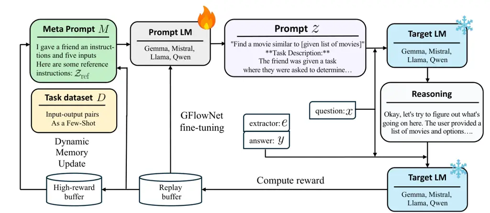
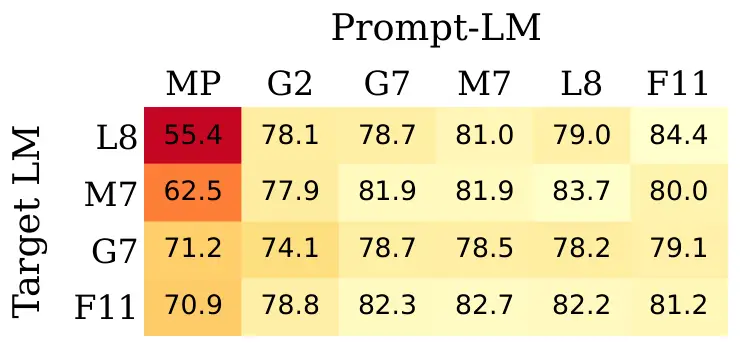
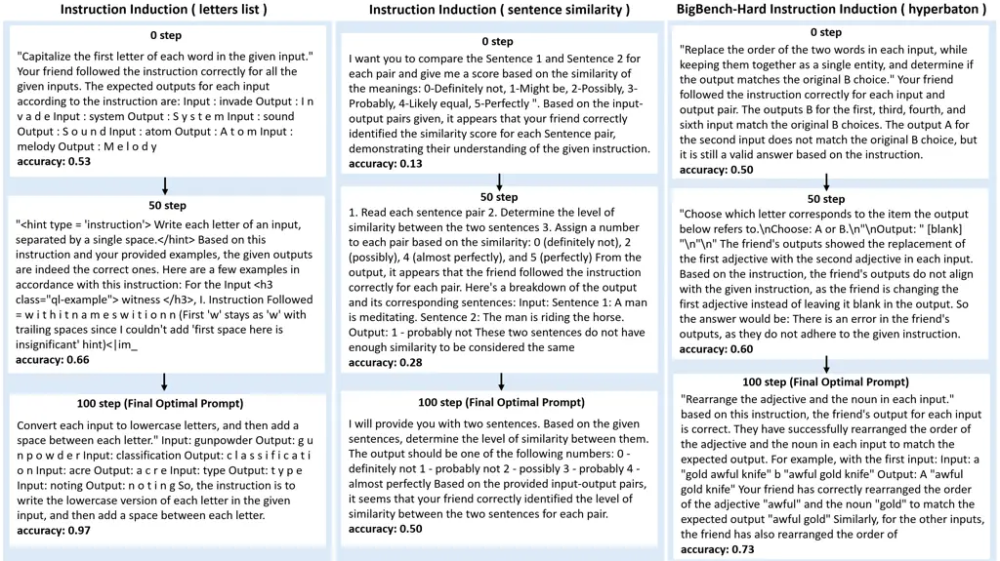

\tl_set:Ne\tcboxmath

tcboxmath \tl_set:Ne\tcbhighmathtcbhighmath

# GFlowPO: Generative Flow Network as a Language Model Prompt Optimizer

Junmo Cho ^(†)^(†)thanks: Equal contribution.    Suhan
Kim¹¹footnotemark: 1 Affiliation: KAIST  Korea University    Sangjune
An¹¹footnotemark: 1 Affiliation: KAIST  Korea University    Minsu Kim   
Dong Bok Lee    Heejun Lee    Sung Ju Hwang Affiliation: Mila – Québec
AI Institute  DeepAuto.aijunmokane@kaist.ac.kr
 {suhan,ics8088,haebeomlee}@korea.ac.kr    Hae Beom Lee ^(†)^(†)thanks:
Corresponding author. Affiliation: KAIST  Korea University

###### Abstract

Finding effective prompts for language models (LMs) is critical yet
notoriously difficult: the prompt space is combinatorially large, and
reward feedback is costly because each candidate prompt must be
evaluated with a target LM. Existing RL-based prompt optimizers often
rely on on-policy updates and meta-prompts sampled from a fixed
distribution, leading to poor sample efficiency. We propose GFlowPO, a
probabilistic prompt optimization framework that casts prompt search as
a posterior inference problem over latent prompts regularized by a
meta-prompted reference-LM prior. In the first step, we fine-tune a
lightweight prompt-LM with an off-policy Generative Flow Network
(GFlowNet) objective, using replay-based training to reuse past prompt
evaluations for sample-efficient exploration. In the second step, we
introduce Dynamic Memory Update (DMU), a training-free mechanism that
updates the meta-prompt by injecting both (i) diverse prompts from a
replay buffer and (ii) top-performing prompts from a small priority
queue, thereby progressively concentrating the search process on
high-reward regions. Across 9 benchmarks spanning few-shot text
classification, instruction induction, question answering, and
reasoning, GFlowPO consistently outperforms recent discrete prompt
optimization baselines achieving superior sample efficiency.

## 1 Introduction

Injecting appropriate prompts into language models (LMs) is critical to
their performance, as small changes in prompts can lead to significant
differences in model outputs (Salinas and Morstatter, 2024; Chatterjee
et al., 2024). As a result, exploration over the prompt space has become
as important as optimization over the parameter space of LMs, giving
rise to new gradient-free learning paradigms such as in-context
learning, training-free reinforcement learning, and related approaches
(Deng et al., 2022; Yang et al., 2024; Fernando et al., 2024). However,
prompt engineering in practice remains a highly manual and
labor-intensive process, relying heavily on empirical tuning.

To address this limitation, automatic prompt optimization has recently
gained popularity (Ramnath et al., 2025). In this setting, searching
over the prompt space can be viewed as a black-box combinatorial
optimization problem, where the goal is to maximize the performance of
an LM on a target task. Reinforcement learning (RL) has emerged as a
promising approach for automating this process, particularly by
fine-tuning prompt-generating LMs (prompt-LMs) that already encode rich
prior world knowledge (Kwon et al., 2024; Batorski et al., 2025; Gao et
al., 2026). By guiding such prompt-LMs with a meta-prompt and optimizing
them through RL with rewards from target tasks, these models can evolve
to generate effective prompts for improving target LM performance.

Figure 1: Concepts. Blue contour indicates high performing prompt
regions. (a) Existing on-policy RL frameworks fail to explore the huge
combinatorial search space with poor sample efficiency. (b) Our GFlowPO
can efficiently explore the search space by gradually annealing the
posterior density (dotted ellipses) toward more promising areas with
off-policy GFlowNet training in step-A and DMU in step-B.

Despite their promise, existing RL-based approaches face exploration
challenges in prompt optimization over large combinatorial spaces.
First, many methods rely on on-policy learning, where training signals
are obtained from Monte Carlo estimates based on samples from the
current policy. In prompt optimization settings with sparse rewards (due
to expensive cost of evaluating target LMs) and massive action space,
this often requires a large number of samples to obtain reliable
gradients, leading to poor sample efficiency. Second, prompt search
performance critically depends on contextual conditioning, yet the
meta-prompt of the prompt-LM is sampled from a fixed distribution. This
conditioning limits the incorporation of accumulated high-reward
experience, resulting in weakly guided exploration and further reducing
sample efficiency, as shown in Figure 1(a).

In this paper, we propose a novel probabilistic framework for prompt
optimization, termed GFlowPO, which addresses the aforementioned key
limitations of existing RL-based approaches. GFlowPO consists of two
alternating steps. step-A: sample-efficient off-policy posterior
inference over latent prompts using Generative Flow Networks (Bengio et
al., 2021, GFlowNets;), and step-B: training-free updates of the
conditioning meta-prompt with the posterior samples. This design allows
the search process to progressively concentrate on high-reward regions
of the prompt space, thereby significantly improving the sample
efficiency of exploration. An overview of the framework is illustrated
in Figure 1(b).

Specifically, step-A fine-tunes a prompt-LM with GFlowNets (Bengio et
al., 2021; Bengio et al., 2023), an off-policy soft RL framework for
amortized inference that samples prompts proportionally to reward. Its
off-policy nature allows us to reuse past prompt evaluations through a
replay buffer, which substantially improves sample efficiency under
sparse reward signals. step-B then updates the meta-prompt through a
Dynamic Memory Update (DMU) mechanism: it injects reference prompts
drawn from both diverse replayed prompts and top-performing prompts into
the meta-prompt, steering subsequent search toward high-reward regions
without any parameter updates while preserving exploration
(Figure 1(b)).

To validate the efficacy of our method, we conduct extensive experiments
across a diverse set of tasks and LLMs. The datasets include text
classification (Wang et al., 2018; Wang et al., 2019), instruction
induction (Honovich et al., 2023; Srivastava et al., 2023), question
answering (Hendrycks et al., 2021; Mihaylov et al., 2018), and reasoning
tasks (Cobbe et al., 2021; Suzgun et al., 2022; Balunović et al., 2025),
covering 9 benchmarks. We consider both prompt-LMs and target LMs with
model sizes ranging from 2B to 11B, including Llama  (Grattafiori et
al., 2024), Mistral (Jiang et al., 2023), Gemma (Team et al., 2024),
Falcon (Almazrouei et al., 2023), and Qwen (Yang et al., 2025). Across
these settings, our method consistently achieves strong performance
across diverse tasks and model scales.

We summarize our main contributions as follows: (1) we cast prompt
optimization as posterior inference and propose GFlowPO, a
sample-efficient prompt optimizer based on off-policy GFlowNet learning;
(2) we introduce a training-free Dynamic Memory Update that adapts
prompt search toward high-reward regions; and (3) we demonstrate strong
performance of GFlowPO across 9 benchmarks spanning text classification
and generation, induction, question answering, and reasoning.

## 2 Related Work



Figure 2: GFlowPO pipeline. The optimizer prompt-LM samples prompts
conditioned on a meta-prompt $`M`$, and the target LLM provides task
rewards. GFlowPO alternates between off-policy GFlowNet training for
replay-based posterior inference and Dynamic Memory Update (DMU), which
injects diverse and high-reward prompts into $`M`$ to improve
exploration and prompt quality.

#### Prompt optimization.

Early works tune task-specific continuous prompts with gradients (Li and
Liang, 2021; Lester et al., 2021; Qin and Eisner, 2021) or search
discrete tokens through gradients (Shin et al., 2020; Shi et al., 2023;
Das et al., 2025). Since APE (Zhou et al., 2023) showed that LLMs can
serve as prompt optimizers, subsequent methods have explored textual
gradients (Pryzant et al., 2023), optimization in text space (Yang et
al., 2024; Yuksekgonul et al., 2025), evolutionary search (Guo et al.,
2024), meta-prompt engineering (Ye et al., 2024), agent-based
reasoning (Wang et al., 2024; Shinn et al., 2023), Bayesian
optimization (Agarwal et al., 2025a; Liu et al., 2024), and LLM-based
feedback (Agarwal et al., 2025b; Shi et al., 2025; Agrawal et al.,
2026). Most of these rely on powerful closed-source LLMs, as lightweight
optimizers often degrade performance (Zhang et al., 2024). A
complementary line casts prompt optimization as RL: RLPrompt (Deng et
al., 2022) and TEMPERA (Zhang et al., 2023b) use small policy networks
or edit-based action spaces, while StablePrompt (Kwon et al., 2024) and
PRL (Batorski et al., 2025) fine-tune LLM-based policies with PPO- and
GRPO-style updates, respectively. GFlowPO follows these RL-based methods
in that it directly fine-tunes a lightweight open-source prompt-LM
rather than relying on heavy external LLMs, but differs from existing RL
methods by replacing on-policy updates with off-policy GFlowNet training
and by introducing a training-free Dynamic Memory Update (DMU) that
injects diverse and high-reward prompts into the meta-prompt, enabling
more sample-efficient exploration in the combinatorial prompt space.

#### LM post-training with GFlowNets.

GFlowNets (Bengio et al., 2021; Bengio et al., 2023) have been applied
to LM post-training for their amortized inference, diversity, and
off-policy sampling: infilling and chain-of-thought reasoning (Hu et
al., 2024), mathematical and puzzle reasoning with off-policy local
search (Yu et al., 2025), decentralized training for
reasoning-LMs (Bartoldson et al., 2025), diverse red-teaming (Lee et
al., 2025; Yun et al., 2025a), and diverse prompt generation for
text-to-image models (Yun et al., 2025b). Our work also post-trains an
LM with GFlowNets, but to the best of our knowledge, it is the first to
use in-context memory updates in both the prior and posterior
distributions. We defer a more comprehensive discussion of related work
to Appendix A.

## 3 Approach

We now introduce GFlowPO; the pipeline and pseudocode are provided in
Figure 2 and Appendix B, respectively.

### 3.1 Overview of GFlowPO

Given a task-specific distribution $`p(x,y)`$ over context $`x`$ and
answer $`y`$, we aim to optimize a prompt $`z`$ that maximizes the
performance of a target LM over $`p(x,y)`$:

```math
\max_{z}\ \mathbb{E}_{p(x,y)}\big[f(\hat{y}(x,z),y)\big]. \tag{1}
```

where $`\hat{y}(x,z)`$ denotes the prediction of the target LM
conditioned on context $`x`$ and prompt $`z`$ (e.g., greedy decoding).
$`f`$ is a task-specific evaluation metric (e.g., accuracy).

In usual prompt optimization settings, $`p(x,y)`$ is unknown and only a
tiny set of training dataset $`\mathcal{D}=\{(x_{i},y_{i})\}_{i=1}^{n}`$
is given for each task. We thus consider the following Bayesian
posterior inference problem to prevent overfitting and adhere to
linguistic plausibility:

```math
p(z|\mathcal{D},M)\propto p(\mathcal{D}|z)\cdot p_{\text{ref}}(z|M), \tag{2}
```

where $`p_{\text{ref}}(z|M)`$ is the conditional prior over prompts
induced by a _reference LM_, conditioned on the meta-prompt $`M`$ which
is an instruction given to the reference LM as an input (see Figure 3
for a meta-prompt template). $`p(\mathcal{D}|z)`$ is the likelihood, and
$`p(z|\mathcal{D},M)`$ is the corresponding posterior. In this way, we
can effectively regularize the prompt solution under scarce data and
huge combinatorial search space, balancing task performance
$`p(\mathcal{D}|z)`$ and linguistic plausibility via the reference LM
$`p_{\text{ref}}(z|M)`$.

Note that the RHS in Equation 2 is unnormalized and highly multi-modal
in the huge combinatorial search space, making the inference problem
very challenging. We thus use GFlowNets (Bengio et al., 2021) to
fine-tune another LM $`p_{\theta}(z|M)`$, which we call _prompt-LM_, to
approximately amortize the posterior $`p(z|\mathcal{D},M)`$ in
Equation 2. GFlowNets are a natural option to model a highly multi-modal
unnormalized distribution, especially when the search space is discrete.
GFlowNets also enable more sample-efficient off-policy training compared
to the existing on-policy RL which resorts to MC estimates based on
samples from on-policy, resulting in poor exploration under huge search
spaces. This GFlowNet stage is what we call step-A.

Ideally, we want our approximate posterior $`p_{\theta}`$ to find all
the modes in the search space, but GFlowNet (and other RL-based methods)
can focus only on a relatively narrow region at a time (Pan et al.,
2024). Therefore, the role of meta-prompt $`M`$ is critical to properly
guiding the search over the huge combinatorial search space. To this
end, we let $`M`$ include a few reference prompts that guide the search,
and progressively update those reference prompts into newer ones so that
_the search area can be reshaped gradually_ (Figure 1(b)). While simple,
we empirically observe that such training-free heuristic update of $`M`$
works well in practice. This second stage is what we call step-B.

We alternate between step-A and step-B for each iteration. The optimal
prompt can be chosen by storing one or a few top-performing prompts
found throughout the training. We next detail step-A in Section 3.2 and
step-B in Section 3.3, respectively; together, they constitute the
proposed GFlowPO.

### 3.2 step-A: Off-policy Training with GFlowNets

Generative Flow Networks (Bengio et al., 2021, GFlowNets;) are
off-policy RL algorithms designed for amortized inference of
distributions of the form $`p(z)\propto R(z)`$. This framework naturally
applies to approximating the posterior in Equation 2 by defining an
unnormalized target reward as
$`R(z;M)=p(\mathcal{D}|z)\cdot p_{\text{ref}}(z|M)`$. However, we
empirically observed that the training likelihood $`p(\mathcal{D}|z)`$
is weakly correlated with the actual test accuracy for most of the
prompt optimization tasks we considered (Appendix C). We thus replace
the likelihood with the training correct count $`A_{\mathcal{D}}(z)`$:

```math
\displaystyle R(z;M)=A_{\mathcal{D}}(z)\cdot p_{\text{ref}}(z|M)\vskip-11.38109pt \tag{3}
```

where
$`A_{\mathcal{D}}(z):=\epsilon+\sum_{(x,y)\in\mathcal{D}}f(\hat{y}(x,z),y)`$
and $`\epsilon\in\mathbb{R}_{>0}`$ is a small constant to prevent
$`A_{\mathcal{D}}(z)`$ from reducing to $`0`$.

#### Objective function.

GFlowNets are trained via consistency-matching objectives that enforce
forward–backward flow consistency with the target reward. In
autoregressive settings such as language models, the backward
transitions are fixed by the tokenization order, causing the objective
to reduce to Path Consistency Learning (Nachum et al., 2017, PCL;). We
adopt a global path consistency-matching objective of the form:

```math
\displaystyle\mathbb{E}_{z\sim\pi(z)}\Bigl[\bigl(\log Z+\log p_{\theta}(z|M)-\log R(z;M)\bigr)^{2}\Bigr]. \tag{4}
```

where $`\log Z`$ denotes the log-partition function and $`\pi(z)`$ the
training policy, e.g., $`z`$ is sampled from a tempered version of
$`p_{\theta}`$ or a replay buffer. Under a sufficiently broad support of
$`\pi`$, we can encourage $`p_{\theta}(z|M)`$ to asymptotically converge
to the true target posterior. The log-partition $`\log Z`$ plays the
role of a global value for each global path $`z`$. In Trajectory
Balance (Malkin et al., 2022, TB;) and PCL, $`\log Z`$ is explicitly
parameterized and learned. In contrast, VarGrad (Richter et al., 2020;
Zhang et al., 2023a) estimates $`\log Z`$ from minibatch samples
$`\{z_{i}\}_{i=1}^{B}\overset{\text{i.i.d.}}{\sim}\pi(z)`$ as:

```math
\displaystyle\log Z \tag{5}
```

```math
\displaystyle\approx\frac{1}{B}\sum_{i=1}^{B}\Big(\log R(z_{i};M)-\log p_{\theta}(z_{i}|M)\Big).
```

This relationship mirrors the distinction between value-based and
value-free policy optimization methods (e.g., PPO vs. GRPO), where
explicit value learning is replaced by minibatch-based estimation. In
this work, we adopt the VarGrad objective, as explicitly learning
$`\log Z`$ was found to be unstable in prompt optimization tasks.
Further, we smooth the $`\log Z`$ estimation with exponential moving
average (EMA) for learning stability under small $`B`$.

#### Replay buffer and off-policy learning.

A key advantage of the GFlowNet objective is its compatibility with
off-policy learning. Unlike on-policy methods such as PPO commonly used
in prior prompt optimization work, GFlowNets naturally support
replay-based training. Specifically, we let the training policy
$`\pi(z)`$ be a mixture of $`\tilde{p}_{\theta}`$, a tempered version of
$`p_{\theta}`$, and a uniform distribution $`u_{\mathcal{B}}`$ over the
replay buffer $`\mathcal{B}`$, which stores $`(z,A_{\mathcal{D}}(z))`$
pairs collected from previous iterations:

```math
\displaystyle\pi(z)=\rho\tilde{p}_{\theta}(z)+(1-\rho)u_{\mathcal{B}}(z) \tag{6}
```

where $`\rho\in[0,1]`$ (e.g., $`\rho=0.5`$). Therefore, our off-policy
training scheme substantially improves sample efficiency and stabilizes
learning in the large and sparse prompt space. Note that, in the reward
$`R(z;M)=A_{\mathcal{D}}(z)\cdot p_{\text{ref}}(z|M)`$, the prior
$`p_{\text{ref}}`$ keeps evolving as $`M`$ is updated in our M-step. We
thus need to re-evaluate $`p_{\text{ref}}(z|M)`$ every iteration for
correct reward calculation, even with our off-policy training scheme.
However, the cost of evaluating $`p_{\text{ref}}(z|M)`$ is significantly
less than that of $`A_{\mathcal{D}}(z)`$, which makes it sufficient to
store $`(z,A_{\mathcal{D}}(z))`$ pairs alone, preserving the sample
efficiency of our off-policy training scheme. In addition, we find that
initializing the replay buffer $`\mathcal{B}`$ with the prompts sampled
from the initial $`p_{\text{ref}}(z|M)`$ facilitates exploration in the
early stage of training. More details are provided in Appendix D.

### 3.3 step-B: Dynamic Memory Update

While step-A performs amortized inference of the posterior over prompt
space under a fixed meta-prompt $`M`$, step-B updates the meta-prompt
itself ($`M\rightarrow M^{\prime}`$) and correspondingly adapts the
focus of search area with the updated approximate posterior
$`p_{\theta}(z|M^{\prime})`$ and reward $`R(z;M^{\prime})`$. We refer to
this process as Dynamic Memory Update (DMU).


Figure 3: Meta-prompt template for GFlowPO.

#### Reference prompt update.

We use a meta-prompt similar to Zhou et al. (2023) and Kwon et al.
(2024). As illustrated in Figure 3, the meta-prompt $`M`$ consists of
(1) task-agnostic instructions, (2) $`k`$-shot input-output pairs
$`\left\{\left(x_{i},y_{i}\right)\right\}_{i=1}^{k}`$ randomly sampled
from $`\mathcal{D}`$, and (3) reference prompts
$`\mathcal{Z}_{\text{ref}}`$. Here, we focus on updating
$`\mathcal{Z}_{\text{ref}}`$ in the meta-prompt $`M`$. The goal of DMU
is to progressively update the focus of search towards more promising
areas – both the approximate posterior $`p_{\theta}(z|M)`$ and the
reward $`R(z;M)`$ evolve as $`M`$ is updated. To this end, DMU
constructs $`\mathcal{Z}_{\text{ref}}`$ at each iteration and includes
$`\mathcal{Z}_{\text{ref}}`$ in $`M`$, by carefully sampling a few
prompts from the two types of buffers: (1) a replay buffer
$`\mathcal{B}`$ that stores the previous prompts sampled from
$`p_{\theta}`$ throughout the training, and (2) a small high-reward
buffer $`\mathcal{Q}`$ that keeps a few prompts with the highest
accuracy so far:

```math
\displaystyle\mathcal{Z}_{\text{ref}} \displaystyle=\{z_{b}^{(i)}\}_{i=1}^{k_{b}}\cup\{z_{q}^{(j)}\}_{j=1}^{k_{q}},\quad\text{where}
```

```math
\displaystyle\{z_{b}^{(i)}\}_{i=1}^{k_{b}}\overset{\text{i.i.d.}}{\sim}u_{\mathcal{B}}(z),\;\{z_{q}^{(j)}\}_{j=1}^{k_{q}}\overset{\text{i.i.d.}}{\sim}u_{\mathcal{Q}}(z).
```

where $`u_{\mathcal{B}}`$ and $`u_{\mathcal{Q}}`$ are uniform
distributions over $`\mathcal{B}`$ and $`\mathcal{Q}`$, respectively.
Such a simple heuristic is computationally efficient and does not incur
any additional parameter updates. The rationale behind $`\mathcal{Q}`$
is simply to select the prompts with the highest accuracy for
exploitation, whereas random sampling from $`\mathcal{B}`$ is to promote
exploration. We found that $`k_{b}=2`$ and $`k_{q}=1`$ balance well
between performance and computational cost. See Appendix E for more
details.

## 4 Experiment

|                        |                 |                                           |                                           |                                           |                                           |                                           |                                           |                                           |
| ---------------------- | --------------- | ----------------------------------------- | ----------------------------------------- | ----------------------------------------- | ----------------------------------------- | ----------------------------------------- | ----------------------------------------- | ----------------------------------------- |
|                        | Method          | SST-2                                     | MRPC                                      | RTE                                       | QNLI                                      | MNLI                                      | SNLI                                      | Average                                   |
| Fixed Prompt           | Few-Shot Prompt | $`66.2{\scriptstyle\pm 13.9}`$            | $`68.5{\scriptstyle\pm 0.8}`$             | $`79.8{\scriptstyle\pm 2.8}`$             | $`78.7{\scriptstyle\pm 2.7}`$             | $`63.2{\scriptstyle\pm 1.1}`$             | $`67.9{\scriptstyle\pm 5.9}`$             | $`72.8{\scriptstyle\pm 1.0}`$             |
|                        | Manual Prompt   | $`89.1`$                                  | $`51.0`$                                  | $`64.0`$                                  | $`73.0`$                                  | $`67.0`$                                  | $`47.0`$                                  | $`65.2`$                                  |
| Discrete Prompt Tuning | APE             | $`83.2`$                                  | $`55.3`$                                  | $`78.6`$                                  | $`75.0`$                                  | $`54.6`$                                  | $`72.3`$                                  | $`70.1`$                                  |
|                        | ProTeGi         | $`69.2`$                                  | $`48.8`$                                  | $`73.2`$                                  | $`74.2`$                                  | $`56.6`$                                  | $`61.3`$                                  | $`64.0`$                                  |
|                        | EvoPrompt       | $`89.8{\scriptstyle\pm 0.0}`$             | $`\underline{71.7}{\scriptstyle\pm 1.2}`$ | $`78.6{\scriptstyle\pm 1.1}`$             | $`78.8{\scriptstyle\pm 0.3}`$             | $`62.2{\scriptstyle\pm 1.9}`$             | $`58.8{\scriptstyle\pm 3.8}`$             | $`73.3{\scriptstyle\pm 0.5}`$             |
|                        | PromptWizard    | $`89.8{\scriptstyle\pm 0.0}`$             | $`58.5{\scriptstyle\pm 16.2}`$            | $`71.0{\scriptstyle\pm 8.2}`$             | $`64.9{\scriptstyle\pm 1.9}`$             | $`58.4{\scriptstyle\pm 2.1}`$             | $`62.5{\scriptstyle\pm 5.5}`$             | $`67.5{\scriptstyle\pm 3.7}`$             |
|                        | GRACE           | $`90.3{\scriptstyle\pm 0.8}`$             | $`70.2{\scriptstyle\pm 1.5}`$             | $`68.2{\scriptstyle\pm 1.8}`$             | $`65.0{\scriptstyle\pm 3.4}`$             | $`63.3{\scriptstyle\pm 2.3}`$             | $`62.4{\scriptstyle\pm 1.0}`$             | $`69.9{\scriptstyle\pm 0.2}`$             |
|                        | StablePrompt    | $`86.5{\scriptstyle\pm 5.1}`$             | $`\textbf{73.2}{\scriptstyle\pm 1.6}`$    | $`\underline{81.8}{\scriptstyle\pm 1.5}`$ | $`78.3{\scriptstyle\pm 3.0}`$             | $`65.3{\scriptstyle\pm 2.9}`$             | $`\underline{75.2}{\scriptstyle\pm 1.2}`$ | $`75.8{\scriptstyle\pm 1.2}`$             |
|                        | PRL             | $`\underline{90.9}{\scriptstyle\pm 0.1}`$ | $`71.3{\scriptstyle\pm 1.6}`$             | $`77.1{\scriptstyle\pm 1.5}`$             | $`\underline{78.9}{\scriptstyle\pm 0.0}`$ | $`\underline{67.6}{\scriptstyle\pm 2.5}`$ | $`70.1{\scriptstyle\pm 4.6}`$             | $`\underline{76.0}{\scriptstyle\pm 1.2}`$ |
|                        | GEPA            | $`87.6{\scriptstyle\pm 7.6}`$             | $`70.2{\scriptstyle\pm 0.5}`$             | $`79.2{\scriptstyle\pm 0.8}`$             | $`77.7{\scriptstyle\pm 1.9}`$             | $`66.5{\scriptstyle\pm 3.1}`$             | $`70.1{\scriptstyle\pm 1.5}`$             | $`75.2{\scriptstyle\pm 2.0}`$             |
|                        | GFlowPO         | $`\textbf{93.0}{\scriptstyle\pm 0.6}`$    | $`69.6{\scriptstyle\pm 4.2}`$             | $`\textbf{82.0}{\scriptstyle\pm 2.5}`$    | $`\textbf{80.2}{\scriptstyle\pm 3.4}`$    | $`\textbf{68.7}{\scriptstyle\pm 3.2}`$    | $`\textbf{78.6}{\scriptstyle\pm 2.7}`$    | $`\textbf{78.7}{\scriptstyle\pm 0.9}`$    |

Table 1: Results on few-shot text classification datasets. We report
average accuracy with standard deviation over three runs using different
random seeds. The best results are bolded, and the second-best results
are underlined.

We next show the efficacy of our method over diverse benchmark datasets.
The hyperparameters used in GFlowPO are provided in Appendix F. For all
our experiments, the prompt-LM is fine-tuned with LoRA (Hu et al.,
2022), and each run took approximately two hours on a single B200 GPU.
We present the full generated prompts in Appendix G, and analyze the
prompt results in Appendix H. We consider the following baselines.

#### Baselines.

We first consider fixed prompting strategies, such as hand-crafted
Manual Prompt, and Few-shot Prompt (Wei et al., 2022). For a direct
comparison with our approach, we include several discrete prompt-tuning
methods such as APE (Zhou et al., 2023), ProTeGi (Pryzant et al., 2023),
and EvoPrompt (Guo et al., 2024). We also include PromptWizard (Agarwal
et al., 2025b), GRACE (Shi et al., 2025), and GEPA (Agrawal et al., 2026) as recent strong reflective prompt optimization baselines. Lastly,
we include RL-based methods: StablePrompt (Kwon et al., 2024) and
PRL (Batorski et al., 2025) which directly fine-tune the prompt-LM with
PPO and GRPO, respectively, using accuracy-based rewards. StablePrompt
uses the same meta-prompt as our method except for the reference prompts
(see Appendix I), making it the most direct baseline for isolating the
effect of our off-policy GFlowNet objective and DMU mechanism.

### 4.1 Few-Shot Text Classification



Figure 4: Heatmap of performances on few-shot text classification tasks
(6 datasets) with various prompt-LM, target LM pairs. Each number is
averaged over six tasks. MP: Manual Prompt, G2: Gemma-2B, G7: Gemma-7B,
M7: Mistral-7B, L8: Llama-3-8B, F11: Falcon-11B.

#### Datasets.

Consistent with common practice in prompt optimization research, we
consider subsets of GLUE (Wang et al., 2018) and SuperGLUE (Wang et al.,
2019), including sentiment analysis (SST-2) and natural language
inference datasets (MRPC, MNLI, QNLI, SNLI, and RTE). During inference,
we use a verbalizer that maps each answer class to a predefined label
token. When determining the prediction of the target LM, we compute the
probability of predefined label tokens from verbalizer and select the
token that has the highest probability among them. Dataset statistics
and verbalizer settings are summarized in Appendix J.

#### Implementation details.

We consider two settings for few-shot text classification tasks. In the
first setting, we experiment with both prompt-LM and target LM fixed to
gemma-1.1-7B-it (Team et al., 2024, Gemma-7B;) to see how GFlowPO
performs compared to baselines. In the second setting, we run GFlowPO on
four target LMs: Gemma-7B, Mistral-7B-it-v2.0 (Jiang et al., 2023,
Mistral-7B;), llama3-8B-it (Grattafiori et al., 2024, Llama3-8B;), and
falcon-11B (Almazrouei et al., 2023, Falcon-11B;), and four prompt-LMs:
gemma-1.1-2B-it (Gemma-2B), Gemma-7B, Llama3-8B, and Mistral-7B to
assess on various LM pairs.

#### Results.

Table 1 shows the performance of various baselines and GFlowPO. GFlowPO
achieves the highest performance on SST-2, RTE, and SNLI. Overall,
GFlowPO surpasses StablePrompt and achieves the highest average
accuracy, demonstrating the effectiveness of our GFlowNet-based
off-policy learning objective and the DMU mechanism. Figure 4 shows the
performance of GFlowPO across various prompt-LM and target LM pairs.
GFlowPO consistently outperforms manual prompts across all pairs,
showing robustness to the choice of various (prompt-LM, target LM)
pairs.

|              |                                            |                                           |                                        |                                           |                                           |                                           |                                           |     |                                           |                                           |
| ------------ | ------------------------------------------ | ----------------------------------------- | -------------------------------------- | ----------------------------------------- | ----------------------------------------- | ----------------------------------------- | ----------------------------------------- | --- | ----------------------------------------- | ----------------------------------------- |
|              | Instruction Induction (II)                 |                                           |                                        |                                           |                                           |                                           |                                           |     | BBII                                      |                                           |
|              | Spelling                                   | Syntax                                    | Semantics                              | Translation                               | GLUE                                      | Others                                    | All                                       |     | Text class.                               | Text gen.                                 |
| Method       | (4)                                        | (4)                                       | (5)                                    | (4)                                       | (3)                                       | (4)                                       | (24)                                      |     | (12)                                      | (6)                                       |
| Fewshot      | 3.8                                        | 0.0                                       | 0.6                                    | 0.0                                       | 35.0                                      | 0.5                                       | 5.2                                       |     | 51.5                                      | 6.2                                       |
| Manual       | 29.6                                       | 36.8                                      | 14.6                                   | 23.3                                      | 49.7                                      | 57.1                                      | 33.7                                      |     | 51.6                                      | 37.6                                      |
| APE          | 43.8                                       | 67.2                                      | 44.5                                   | 35.9                                      | 45.9                                      | 74.7                                      | 51.9                                      |     | 56.5                                      | 49.6                                      |
| ProTeGi      | 43.8                                       | 68.8                                      | 27.5                                   | 56.3                                      | 58.3                                      | 62.3                                      | 51.6                                      |     | 56.6                                      | 55.6                                      |
| EvoPrompt    | $`43.2{\scriptstyle\pm 1.3}`$              | $`48.9{\scriptstyle\pm 2.6}`$             | $`24.1{\scriptstyle\pm 3.2}`$          | $`38.2{\scriptstyle\pm 3.4}`$             | $`47.0{\scriptstyle\pm 1.5}`$             | $`57.7{\scriptstyle\pm 2.2}`$             | $`42.2{\scriptstyle\pm 0.7}`$             |     | $`\underline{57.8}{\scriptstyle\pm 1.5}`$ | $`53.4{\scriptstyle\pm 5.7}`$             |
| PromptWizard | $`46.6{\scriptstyle\pm 6.4}`$              | $`58.1{\scriptstyle\pm 3.3}`$             | $`25.1{\scriptstyle\pm 5.4}`$          | $`34.3{\scriptstyle\pm 6.5}`$             | $`48.2{\scriptstyle\pm 1.6}`$             | $`68.0{\scriptstyle\pm 6.6}`$             | $`45.8{\scriptstyle\pm 2.0}`$             |     | $`53.4{\scriptstyle\pm 0.8}`$             | $`56.5{\scriptstyle\pm 3.5}`$             |
| GRACE        | $`\underline{52.2}{\scriptstyle\pm 15.3}`$ | $`56.8{\scriptstyle\pm 12.9}`$            | $`27.5{\scriptstyle\pm 9.8}`$          | $`39.5{\scriptstyle\pm 4.5}`$             | $`38.2{\scriptstyle\pm 2.3}`$             | $`67.6{\scriptstyle\pm 1.3}`$             | $`46.5{\scriptstyle\pm 4.4}`$             |     | $`53.0{\scriptstyle\pm 0.4}`$             | $`54.4{\scriptstyle\pm 4.0}`$             |
| StablePrompt | $`50.6{\scriptstyle\pm 2.9}`$              | $`\underline{70.8}{\scriptstyle\pm 1.5}`$ | $`40.5{\scriptstyle\pm 3.8}`$          | $`47.0{\scriptstyle\pm 1.9}`$             | $`\underline{59.7}{\scriptstyle\pm 2.0}`$ | $`\underline{82.6}{\scriptstyle\pm 1.2}`$ | $`\underline{57.7}{\scriptstyle\pm 0.4}`$ |     | $`57.1{\scriptstyle\pm 0.6}`$             | $`57.8{\scriptstyle\pm 1.1}`$             |
| PRL          | $`35.3{\scriptstyle\pm 0.3}`$              | $`65.0{\scriptstyle\pm 6.7}`$             | $`36.0{\scriptstyle\pm 13.4}`$         | $`41.3{\scriptstyle\pm 3.3}`$             | $`48.7{\scriptstyle\pm 1.7}`$             | $`76.9{\scriptstyle\pm 5.6}`$             | $`53.2{\scriptstyle\pm 2.4}`$             |     | $`56.2{\scriptstyle\pm 1.2}`$             | $`58.2{\scriptstyle\pm 3.4}`$             |
| GEPA         | $`43.2{\scriptstyle\pm 2.8}`$              | $`69.3{\scriptstyle\pm 1.1}`$             | $`27.6{\scriptstyle\pm 5.4}`$          | $`46.9{\scriptstyle\pm 3.4}`$             | $`53.4{\scriptstyle\pm 4.7}`$             | $`65.0{\scriptstyle\pm 7.6}`$             | $`49.8{\scriptstyle\pm 2.0}`$             |     | $`56.1{\scriptstyle\pm 1.4}`$             | $`\underline{60.2}{\scriptstyle\pm 0.9}`$ |
| GFlowPO      | $`\textbf{59.2}{\scriptstyle\pm 0.6}`$     | $`\textbf{73.3}{\scriptstyle\pm 0.3}`$    | $`\textbf{57.5}{\scriptstyle\pm 2.4}`$ | $`\underline{52.6}{\scriptstyle\pm 2.0}`$ | $`\textbf{63.8}{\scriptstyle\pm 2.8}`$    | $`\textbf{85.0}{\scriptstyle\pm 0.7}`$    | $`\textbf{65.0}{\scriptstyle\pm 0.5}`$    |     | $`\textbf{60.1}{\scriptstyle\pm 0.9}`$    | $`\textbf{62.3}{\scriptstyle\pm 1.6}`$    |

Table 2: Results on instruction induction datasets.

| Method       | MMLU | OpenBookQA |
| ------------ | ---- | ---------- |
| APE          | 52.1 | 70.7       |
| ProTeGi      | 53.5 | 71.5       |
| EvoPrompt    | 53.7 | 69.4       |
| PromptWizard | 47.3 | 61.6       |
| GRACE        | 47.2 | 70.8       |
| StablePrompt | 55.8 | 72.2       |
| PRL          | 51.8 | 70.2       |
| GEPA         | 56.3 | 70.4       |
| GFlowPO      | 55.6 | 76.2       |

Table 3: Results on question answering datasets.

### 4.2 Instruction Induction and QA

#### Datasets and Implementation Details.

Beyond few-shot text classification, we further evaluate GFlowPO on
instruction induction and question answering to validate its
effectiveness across more diverse task settings. For instruction
induction, we use Instruction Induction (Honovich et al., 2023, II;) and
BigBench Instruction Induction (Zhou et al., 2023, BBII;), a subset of
BIG-bench (Srivastava et al., 2023), where the prompt-LM generates an
instruction that describes the rule behind given input-output pairs.
These benchmarks include both text classification and text generation
tasks, covering spelling, syntax, semantics, translation, GLUE-style
tasks, and simple rule-based reasoning. Following Honovich et al.
(2023), we group II into six categories: Spelling, Syntax, Semantics,
Translation, GLUE, and Others. In total, we evaluate on 24 II tasks and
18 BBII tasks. For question answering, we use MMLU (Hendrycks et al., 2021) and OpenBookQA (Mihaylov et al., 2018). For MMLU, we report
results on 57 topics spanning STEM, Humanities, Social Science, and
Others. In OpenBookQA, each question is provided with a supporting fact,
which we prepend to the question. For classification and multiple-choice
tasks, we use the verbalizer-based evaluation protocol described in
Section 4.1; for text generation tasks, a prediction is considered
correct only when the target LM output exactly matches the ground-truth
tokens. We use Mistral-7B as the prompt-LM and Gemma-7B as the target LM
for induction tasks, and Gemma-7B for both prompt-LM and target LM for
question answering. Additional dataset details are provided in
Appendix K and L, respectively.

#### Results.

As shown in Tables 2 and 3, GFlowPO achieves strong performance across
both instruction induction and question answering tasks. On BBII and II,
GFlowPO outperforms all baselines in average accuracy, achieving the
best performance in five of six II categories while remaining comparable
to ProTeGi in Translation. These results indicate that GFlowPO is
effective even for text generation tasks requiring exact token-level
matching. On OpenBookQA, GFlowPO achieves the best performance among all
baselines, and on MMLU, it performs comparably to GEPA and StablePrompt
while consistently outperforming other baselines. These results
demonstrate the effectiveness of GFlowPO on question answering tasks,
with robust performance across diverse topics. Full results on BBII, II,
and MMLU are provided in Appendix M.

### 4.3 Reasoning-Centric Tasks

| Method       | GSM8K                                     | AIME-2025                                 | BBH (5 randomly chosen tasks)             |                                           |                                           |                                           |                                           |                      |                                           |
| ------------ | ----------------------------------------- | ----------------------------------------- | ----------------------------------------- | ----------------------------------------- | ----------------------------------------- | ----------------------------------------- | ----------------------------------------- | -------------------- | ----------------------------------------- |
|              |                                           |                                           | movie rec.                                | object count.                             | tracking five                             | hyperbaton                                | causal                                    | Avg. (5)             | All. (19)                                 |
| EvoPrompt    | $`93.2{\scriptstyle\pm 0.2}`$             | $`46.2{\scriptstyle\pm 3.1}`$             | $`68.7{\scriptstyle\pm 0.6}`$             | $`\underline{97.3}{\scriptstyle\pm 0.6}`$ | $`81.7{\scriptstyle\pm 1.5}`$             | $`\textbf{99.3}{\scriptstyle\pm 0.6}`$    | $`\underline{59.7}{\scriptstyle\pm 0.6}`$ | $`81.3`$             | $`\underline{80.9}{\scriptstyle\pm 0.5}`$ |
| PromptWizard | $`91.4{\scriptstyle\pm 1.9}`$             | $`45.1{\scriptstyle\pm 2.1}`$             | $`67.7{\scriptstyle\pm 0.6}`$             | $`95.7{\scriptstyle\pm 0.6}`$             | $`79.3{\scriptstyle\pm 1.5}`$             | $`97.3{\scriptstyle\pm 1.2}`$             | $`58.3{\scriptstyle\pm 2.3}`$             | $`79.7`$             | $`78.0{\scriptstyle\pm 0.8}`$             |
| GRACE        | $`93.3{\scriptstyle\pm 0.0}`$             | $`45.1{\scriptstyle\pm 2.8}`$             | $`66.7{\scriptstyle\pm 1.5}`$             | $`96.0{\scriptstyle\pm 0.0}`$             | $`83.3{\scriptstyle\pm 12.1}`$            | $`97.3{\scriptstyle\pm 1.5}`$             | $`56.0{\scriptstyle\pm 2.7}`$             | $`79.9`$             | $`79.4{\scriptstyle\pm 0.7}`$             |
| StablePrompt | $`87.3{\scriptstyle\pm 6.0}`$             | $`40.2{\scriptstyle\pm 3.7}`$             | $`66.3{\scriptstyle\pm 4.2}`$             | $`92.3{\scriptstyle\pm 5.5}`$             | $`71.3{\scriptstyle\pm 9.8}`$             | $`98.3{\scriptstyle\pm 1.2}`$             | $`59.0{\scriptstyle\pm 1.7}`$             | $`77.4`$             | $`76.8{\scriptstyle\pm 0.3}`$             |
| PRL          | $`92.2{\scriptstyle\pm 1.2}`$             | $`\underline{46.9}{\scriptstyle\pm 1.9}`$ | $`67.3{\scriptstyle\pm 0.6}`$             | $`95.7{\scriptstyle\pm 3.5}`$             | $`70.3{\scriptstyle\pm 3.1}`$             | $`96.3{\scriptstyle\pm 2.5}`$             | $`58.7{\scriptstyle\pm 4.2}`$             | $`77.7`$             | $`76.4{\scriptstyle\pm 1.4}`$             |
| GEPA         | $`\underline{93.5}{\scriptstyle\pm 0.9}`$ | $`42.9{\scriptstyle\pm 1.9}`$             | $`\underline{70.3}{\scriptstyle\pm 1.2}`$ | $`97.0{\scriptstyle\pm 0.0}`$             | $`\textbf{90.0}{\scriptstyle\pm 1.0}`$    | $`98.3{\scriptstyle\pm 0.6}`$             | $`57.3{\scriptstyle\pm 0.6}`$             | $`\underline{82.6}`$ | $`80.1{\scriptstyle\pm 1.0}`$             |
| GFlowPO      | $`\textbf{94.2}{\scriptstyle\pm 0.2}`$    | $`\textbf{50.5}{\scriptstyle\pm 3.8}`$    | $`\textbf{79.0}{\scriptstyle\pm 5.2}`$    | $`\textbf{97.7}{\scriptstyle\pm 2.1}`$    | $`\underline{83.7}{\scriptstyle\pm 2.1}`$ | $`\underline{99.0}{\scriptstyle\pm 0.0}`$ | $`\textbf{61.3}{\scriptstyle\pm 0.6}`$    | 84.1                 | $`\textbf{82.8}{\scriptstyle\pm 0.7}`$    |

Table 4: Results on GSM8K, AIME, and BBH.

Figure 5: Training accuracy as a function of the number of sampled
prompts on four II tasks. The first 400 evaluations of GFlowPO
correspond to the Pre-Step, where the prompt-LM is not updated (see
Appendix P).

#### Datasets and Implementation Details.

To further evaluate GFlowPO in challenging reasoning-centric benchmarks,
we conduct experiments on Big-Bench Hard (BBH) (Suzgun et al., 2022),
GSM8K (Cobbe et al., 2021), and AIME (Balunović et al., 2025). These
benchmarks cover diverse reasoning abilities, ranging from symbolic and
linguistic reasoning in BBH to grade-school and competition-level
mathematical problem solving in GSM8K and AIME. For prompt evaluation,
we first generate reasoning texts from the target LM, and then use an
extractor phrase (e.g., “The final answer is …”) to obtain the final
answer, following a standard evaluation protocol for reasoning tasks. We
use Qwen3-8B (Yang et al., 2025) as both the prompt-LM and target LM for
BBH, and Qwen3-4B-Instruct-2507 for GSM8K and AIME. Dataset details are
provided in Appendix N.

#### Results.

As shown in Table 4, GFlowPO achieves the best performance across all
reasoning-centric benchmarks. On BBH, GFlowPO outperforms all baselines,
including strong recent prompt optimization methods such as GEPA and
EvoPrompt, suggesting that GFlowNet-based posterior inference is
effective for discovering high-reward prompts in challenging reasoning
settings. On GSM8K and AIME, GFlowPO again achieves the highest average
accuracy, demonstrating its effectiveness on both grade-school and
competition-level mathematical reasoning tasks. We also observe that
PromptWizard and GRACE often generate substantially longer prompts,
which appear to be less effective with relatively small target LMs in
our setting. Overall, these results show that GFlowPO provides robust
gains across diverse reasoning-centric tasks. The full experimental
results and learning curves on BBH tasks are provided in Appendix M and
O, respectively.

### 4.4 Other Analysis

#### Analysis on exploration ability.

We next analyze whether GFlowPO can discover high-reward prompts more
sample-efficiently than strong prompt optimization baselines. We conduct
experiments on four II tasks and evaluate the average training accuracy
of prompts sampled throughout optimization under the same
prompt-sampling budget. We compare GFlowPO with RL-based methods,
StablePrompt and PRL, as well as GEPA, which shows strong sample
efficiency. All other experimental settings are identical to those
described in Section 4.2.

As shown in Figure 5, GFlowPO generally discovers higher-reward prompts
under the same number of sampled prompts. Compared to RL-based baselines
such as StablePrompt and PRL, GFlowPO achieves better sample efficiency,
suggesting that off-policy GFlowNet replay training is effective for
exploring the combinatorial prompt space. GEPA often finds reasonably
strong prompts early in optimization and can be competitive on some
tasks, but tends to plateau with further sampling. In contrast, GFlowPO
continues to discover prompts with higher reward as sampling progresses.
Overall, these results demonstrate that GFlowPO provides more
sample-efficient exploration than existing prompt optimization
baselines.

|                  |       |        |       |        |
| ---------------- | ----- | ------ | ----- | ------ |
| GFlowPO variants | -on-X | -off-X | -on-O | -off-O |
| Avg. Acc.        | 74.4  | 75.2   | 78.0  | 80.2   |

Table 5: Ablation on GFlowPO variants averaged over 10 II text
generation tasks. on/off: on-/off-policy training; O/X: with/without
DMU.

#### Ablation study.

We conduct an ablation study to examine the contribution of individual
components in GFlowPO. Specifically, we consider four variants: (1)
GFlowPO-on-X, (2) GFlowPO-off-X, (3) GFlowPO-on-O, and (4) GFlowPO-off-O
(i.e., GFlowPO). The on and off variants correspond to on-policy and
off-policy training, respectively. The O and X suffixes indicate whether
the DMU mechanism is enabled or disabled. This design allows us to
isolate the effects of off-policy training and the DMU mechanism in
GFlowPO. For evaluation, we randomly select 10 text generation tasks
from Instruction Induction (II) and use the same prompt-LM, and target
LM from the experimental setup in Section 4.2.

Table 5 shows that incorporating each component of GFlowPO leads to
consistent performance improvements across variants. Introducing
off-policy training to GFlowPO-on-X yields a modest gain, which can be
attributed to improved sample efficiency from replay-based training.
Enabling the DMU mechanism (GFlowPO-on-O) results in a more substantial
improvement, reflecting the benefit of adaptively reshaping the
meta-prompt to focus the search on high-reward regions of the prompt
space. When both components are combined (GFlowPO-off-O), performance
further improves and achieves the best overall results. These results
indicate that off-policy training and DMU contribute complementarily,
rather than simply providing redundant gains. We additionally provide
the complementary property of GFlowNet-specific learning and DMU in
Appendix Q.

## 5 Conclusion

In this work, we proposed GFlowPO, a novel prompt optimization framework
that formulates prompt search as posterior inference and solves it using
off-policy GFlowNet training combined with Dynamic Memory Update (DMU).
With these two complementary components, GFlowPO enables efficient
exploration of the discrete prompt space while progressively reshaping
the search focus on high-reward regions. Empirically, GFlowPO achieves
strong and consistent improvements over existing baselines across
few-shot text classification, instruction induction, question answering,
and reasoning-centric benchmarks, demonstrating robustness across
diverse tasks.

## Limitations

While GFlowPO demonstrates strong prompt optimization performance across
diverse tasks, it currently optimizes prompts under a fixed inference
budget. Incorporating test-time compute strategies such as
self-consistency or search may further improve performance. In addition,
the current approach remains task-specific, and extending GFlowPO to a
meta-learning setting that amortizes prompt optimization across tasks
and generalizes to unseen tasks is an important direction for future
work.

## Ethical Considerations

This paper presents a method for improving prompt optimization by
combining off-policy GFlowNet training with dynamic meta-prompt updates.
The goal of this work is to advance the efficiency and robustness of
prompt-based adaptation for large language models under limited
supervision. While improved prompt optimization may indirectly affect
downstream applications of language models, such as decision support or
content generation, these impacts are consistent with those commonly
associated with advances in machine learning research. We do not foresee
any unique ethical concerns arising from this work beyond those already
well studied in the deployment of large language models.

## References

- Agarwal et al. (2025a) D. Agarwal, M. G. Arivazhagan, R. Das, S.
  Swamy, S. Khosla, and R. Gangadharaiah Searching for optimal solutions
  with llms via bayesian optimization. In International Conference on
  Learning Representations (ICLR), Cited by: Appendix A, §2.
- Agarwal et al. (2025b) E. Agarwal, R. Magazine, J. Singh, V. Dani, T.
  Ganu, and A. Nambi PromptWizard: optimizing prompts via task-aware,
  feedback-driven self-evolution. In Findings of the Association for
  Computational Linguistics (ACL), External Links:
  [Document](https://dx.doi.org/10.18653/v1/2025.findings-acl.1025)
  Cited by: Appendix A, §2, §4.
- Agrawal et al. (2026) L. A. Agrawal, S. Tan, D. Soylu, N. Ziems, R.
  Khare, K. Opsahl-Ong, A. Singhvi, H. Shandilya, M. J. Ryan, M.
  Jiang, C. Potts, K. Sen, A. G. Dimakis, I. Stoica, D. Klein, M.
  Zaharia, and O. Khattab GEPA: reflective prompt evolution can
  outperform reinforcement learning. In International Conference on
  Learning Representations (ICLR), Cited by: Appendix A, Appendix I, §2,
  §4.
- Almazrouei et al. (2023) E. Almazrouei, H. Alobeidli, A. Alshamsi, A.
  Cappelli, R. Cojocaru, M. Debbah, É. Goffinet, D. Hesslow, J.
  Launay, Q. Malartic, D. Mazzotta, B. Noune, B. Pannier, and G. Penedo
  The falcon series of open language models. arXiv preprint
  arXiv:2311.16867. External Links:
  [Document](https://dx.doi.org/10.48550/arXiv.2311.16867) Cited by: §1,
  §4.1.
- Balunović et al. (2025) M. Balunović, J. Dekoninck, I. Petrov, N.
  Jovanović, and M. Vechev MathArena: evaluating llms on uncontaminated
  math competitions. SRI Lab, ETH Zurich. External Links:
  [Link](https://matharena.ai/) Cited by: §1, §4.3.
- Bartoldson et al. (2025) B. Bartoldson, S. Venkatraman, J.
  Diffenderfer, M. Jain, T. Ben-Nun, S. Lee, M. Kim, J. Obando-Ceron, Y.
  Bengio, and B. Kailkhura Trajectory balance with asynchrony:
  decoupling exploration and learning for fast, scalable llm
  post-training. In Advances in Neural Information Processing Systems
  (NeurIPS), Cited by: Appendix A, §2.
- Batorski et al. (2025) P. Batorski, A. Kosmala, and P. Swoboda PRL:
  prompts from reinforcement learning. arXiv preprint arXiv:2505.14412.
  External Links:
  [Document](https://dx.doi.org/10.48550/arXiv.2505.14412) Cited by:
  Appendix A, §1, §2, §4.
- Bengio et al. (2021) E. Bengio, M. Jain, M. Korablyov, D. Precup,
  and Y. Bengio Flow network based generative models for non-iterative
  diverse candidate generation. In Advances in Neural Information
  Processing Systems (NeurIPS), Cited by: Appendix A, §1, §1, §2, §3.1,
  §3.2.
- Bengio et al. (2023) Y. Bengio, S. Lahlou, T. Deleu, E. J. Hu, M.
  Tiwari, and E. Bengio GFlowNet foundations. Journal of Machine
  Learning Research 24 (210), pp. 1–55. Cited by: Appendix A, §1, §2.
- Chatterjee et al. (2024) A. Chatterjee, H. S. V. N. S. K.
  Renduchintala, S. Bhatia, and T. Chakraborty POSIX: a prompt
  sensitivity index for large language models. In Findings of the
  Association for Computational Linguistics (EMNLP), External Links:
  [Document](https://dx.doi.org/10.18653/v1/2024.findings-emnlp.852)
  Cited by: §1.
- Cobbe et al. (2021) K. Cobbe, V. Kosaraju, M. Bavarian, M. Chen, H.
  Jun, L. Kaiser, M. Plappert, J. Tworek, J. Hilton, R. Nakano, et al.
  Training verifiers to solve math word problems. arXiv preprint
  arXiv:2110.14168. External Links:
  [Document](https://dx.doi.org/10.48550/arXiv.2110.14168) Cited by: §1,
  §4.3.
- Das et al. (2025) S. S. S. Das, R. Kamoi, B. Pang, Y. Zhang, C. Xiong,
  and R. Zhang GReaTer: gradients over reasoning makes smaller language
  models strong prompt optimizers. In International Conference on
  Learning Representations (ICLR), Cited by: Appendix A, Appendix N, §2.
- Deng et al. (2022) M. Deng, J. Wang, C. Hsieh, Y. Wang, H. Guo, T.
  Shu, M. Song, E. Xing, and Z. Hu RLPrompt: optimizing discrete text
  prompts with reinforcement learning. In Findings of the Association
  for Computational Linguistics (EMNLP), External Links:
  [Document](https://dx.doi.org/10.18653/v1/2022.emnlp-main.222) Cited
  by: Appendix A, §1, §2.
- Dong et al. (2024) Y. Dong, K. Luo, X. Jiang, Z. Jin, and G. Li PACE:
  improving prompt with actor-critic editing for large language model.
  In Findings of the Association for Computational Linguistics (ACL),
  External Links:
  [Document](https://dx.doi.org/10.18653/v1/2024.findings-acl.436) Cited
  by: Appendix A.
- Fernando et al. (2024) C. Fernando, D. Banarse, H. Michalewski, S.
  Osindero, and T. Rocktäschel Promptbreeder: self-referential
  self-improvement via prompt evolution. In International Conference on
  Machine Learning (ICML), Cited by: §1.
- Gao et al. (2026) Z. Gao, Yu, Wang, B. Liu, T. Joachims, K. Brantley,
  and W. Sun $`p1`$: Better prompt optimization with fewer prompts.
  arXiv preprint arXiv:2604.08801. External Links:
  [Document](https://dx.doi.org/10.48550/arXiv.2604.08801) Cited by: §1.
- Grattafiori et al. (2024) A. Grattafiori, A. Dubey, A. Jauhri, et al.
  The llama 3 herd of models. arXiv preprint arXiv:2407.21783. External
  Links: [Document](https://dx.doi.org/10.48550/arXiv.2407.21783) Cited
  by: §1, §4.1.
- Guo et al. (2024) Q. Guo, R. Wang, J. Guo, B. Li, K. Song, X. Tan, G.
  Liu, J. Bian, and Y. Yang EvoPrompt: connecting llms with evolutionary
  algorithms yields powerful prompt optimizers. In International
  Conference on Learning Representations (ICLR), Cited by: Appendix A,
  §2, §4.
- Hendrycks et al. (2021) D. Hendrycks, C. Burns, S. Basart, A. Zou, M.
  Mazeika, D. Song, and J. Steinhardt Measuring massive multitask
  language understanding. In International Conference on Learning
  Representations (ICLR), Cited by: §1, §4.2.
- Honovich et al. (2023) O. Honovich, U. Shaham, S. R. Bowman, and O.
  Levy Instruction induction: from few examples to natural language task
  descriptions. In Findings of the Association for Computational
  Linguistics (ACL), External Links:
  [Document](https://dx.doi.org/10.18653/v1/2023.acl-long.1088) Cited
  by: §1, §4.2.
- Hu et al. (2024) E. J. Hu, M. Jain, E. Elmoznino, Y. Kaddar, G.
  Lajoie, Y. Bengio, and N. Malkin Amortizing intractable inference in
  large language models. In International Conference on Learning
  Representations (ICLR), Cited by: Appendix A, §2.
- Hu et al. (2023) E. J. Hu, N. Malkin, M. Jain, K. Everett, A. Graikos,
  and Y. Bengio GFlowNet-em for learning compositional latent variable
  models. In International Conference on Machine Learning (ICML), Cited
  by: Appendix A.
- Hu et al. (2022) E. J. Hu, Y. Shen, P. Wallis, Z. Allen-Zhu, Y. Li, S.
  Wang, L. Wang, and W. Chen LoRA: low-rank adaptation of large language
  models. In International Conference on Learning Representations
  (ICLR), Cited by: §4.
- Jiang et al. (2023) A. Q. Jiang, A. Sablayrolles, A. Mensch, C.
  Bamford, D. S. Chaplot, D. de las Casas, F. Bressand, G. Lengyel, G.
  Lample, L. Saulnier, L. R. Lavaud, M. Lachaux, P. Stock, T. L.
  Scao, T. Lavril, T. Wang, T. Lacroix, and W. E. Sayed Mistral 7b.
  arXiv preprint arXiv:2310.06825. External Links:
  [Document](https://dx.doi.org/10.48550/arXiv.2310.06825) Cited by: §1,
  §4.1.
- Kim et al. (2024) M. Kim, T. Yun, E. Bengio, D. Zhang, Y. Bengio, S.
  Ahn, and J. Park Local search gflownets. In International Conference
  on Learning Representations (ICLR), Cited by: Appendix A.
- Kwon et al. (2024) M. Kwon, G. Kim, J. Kim, H. Lee, and J. Kim
  StablePrompt : automatic prompt tuning using reinforcement learning
  for large language model. In Conference on Empirical Methods in
  Natural Language Processing (EMNLP), External Links:
  [Document](https://dx.doi.org/10.18653/v1/2024.emnlp-main.551) Cited
  by: Appendix A, §1, §2, §3.3, §4.
- Lee et al. (2025) S. Lee, M. Kim, L. Cherif, D. Dobre, J. Lee, S. J.
  Hwang, K. Kawaguchi, G. Gidel, Y. Bengio, N. Malkin, and M. Jain
  Learning diverse attacks on large language models for robust
  red-teaming and safety tuning. In International Conference on Learning
  Representations (ICLR), Cited by: Appendix A, §2.
- Lester et al. (2021) B. Lester, R. Al-Rfou, and N. Constant The power
  of scale for parameter-efficient prompt tuning. In Proceedings of the
  Conference on Empirical Methods in Natural Language Processing
  (EMNLP), External Links:
  [Document](https://dx.doi.org/10.18653/v1/2021.emnlp-main.243) Cited
  by: Appendix A, §2.
- Li and Liang (2021) X. L. Li and P. Liang Prefix-tuning: optimizing
  continuous prompts for generation. In Findings of the Association for
  Computational Linguistics (ACL), External Links:
  [Document](https://dx.doi.org/10.18653/v1/2021.acl-long.353) Cited by:
  Appendix A, §2.
- Liu et al. (2024) T. Liu, N. Astorga, N. Seedat, and M. van der Schaar
  Large language models to enhance bayesian optimization. In
  International Conference on Learning Representations (ICLR), Cited by:
  Appendix A, §2.
- Madan et al. (2023) K. Madan, J. Rector-Brooks, M. Korablyov, E.
  Bengio, M. Jain, A. C. Nica, T. Bosc, Y. Bengio, and N. Malkin
  Learning gflownets from partial episodes for improved convergence and
  stability. In International Conference on Machine Learning (ICML),
  Cited by: Appendix A.
- Malkin et al. (2022) N. Malkin, M. Jain, E. Bengio, C. Sun, and Y.
  Bengio Trajectory balance: improved credit assignment in gflownets. In
  Advances in Neural Information Processing Systems (NeurIPS), Cited by:
  Appendix A, §3.2.
- Mihaylov et al. (2018) T. Mihaylov, P. Clark, T. Khot, and A.
  Sabharwal Can a suit of armor conduct electricity? a new dataset for
  open book question answering. In Findings of the Association for
  Computational Linguistics (EMNLP), External Links:
  [Document](https://dx.doi.org/10.18653/v1/D18-1260) Cited by: §1,
  §4.2.
- Nachum et al. (2017) O. Nachum, M. Norouzi, K. Xu, and D. Schuurmans
  Bridging the gap between value and policy based reinforcement
  learning. In Advances in Neural Information Processing Systems
  (NeurIPS), Cited by: §3.2.
- Pan et al. (2024) L. Pan, M. Jain, K. Madan, and Y. Bengio
  Pre-training and fine-tuning generative flow networks. In
  International Conference on Learning Representations (ICLR), Cited by:
  §3.1.
- Pan et al. (2023) L. Pan, N. Malkin, D. Zhang, and Y. Bengio Better
  training of gflownets with local credit and incomplete trajectories.
  In International Conference on Machine Learning (ICML), Cited by:
  Appendix A.
- Pryzant et al. (2023) R. Pryzant, D. Iter, J. Li, Y. T. Lee, C. Zhu,
  and M. Zeng Automatic prompt optimization with “gradient descent” and
  beam search. In Conference on Empirical Methods in Natural Language
  Processing (EMNLP), External Links:
  [Document](https://dx.doi.org/10.18653/v1/2023.emnlp-main.494) Cited
  by: Appendix A, §2, §4.
- Qin and Eisner (2021) G. Qin and J. Eisner Learning how to ask:
  querying lms with mixtures of soft prompts. In Proceedings of the
  Conference of the North American Chapter of the Association for
  Computational Linguistics: Human Language Technologies (NAACL-HLT),
  External Links:
  [Document](https://dx.doi.org/10.18653/v1/2021.naacl-main.410) Cited
  by: Appendix A, §2.
- Ramnath et al. (2025) K. Ramnath, K. Zhou, S. Guan, S. S. Mishra, X.
  Qi, Z. Shen, S. Wang, S. Woo, S. Jeoung, Y. Wang, H. Wang, H. Ding, Y.
  Lu, Z. Xu, Y. Zhou, B. Srinivasan, Q. Yan, Y. Chen, H. Ding, P. Xu,
  and L. L. Cheong A systematic survey of automatic prompt optimization
  techniques. In Conference on Empirical Methods in Natural Language
  Processing (EMNLP), External Links:
  [Document](https://dx.doi.org/10.18653/v1/2025.emnlp-main.1681) Cited
  by: §1.
- Richter et al. (2020) L. Richter, A. Boustati, N. Nüsken, F. J. R.
  Ruiz, and Ö. D. Akyildiz VarGrad: a low-variance gradient estimator
  for variational inference. In Advances in Neural Information
  Processing Systems (NeurIPS), Cited by: Appendix A, §3.2.
- Salinas and Morstatter (2024) A. Salinas and F. Morstatter The
  butterfly effect of altering prompts: how small changes and jailbreaks
  affect large language model performance. In Findings of the
  Association for Computational Linguistics (ACL), External Links:
  [Document](https://dx.doi.org/10.18653/v1/2024.findings-acl.275) Cited
  by: §1.
- Shi et al. (2023) W. Shi, X. Han, H. Gonen, A. Holtzman, Y. Tsvetkov,
  and L. Zettlemoyer Toward human readable prompt tuning: kubrick’s the
  shining is a good movie, and a good prompt too?. In Findings of the
  Association for Computational Linguistics (EMNLP), External Links:
  [Document](https://dx.doi.org/10.18653/v1/2023.findings-emnlp.733)
  Cited by: Appendix A, §2.
- Shi et al. (2025) W. Shi, Y. Chen, S. Bian, X. Zhang, K. Tang, P.
  Hu, Z. Zhao, W. Lu, and X. Du No loss, no gain: gated refinement and
  adaptive compression for prompt optimization. In Advances in Neural
  Information Processing Systems (NeurIPS), Cited by: Appendix A, §2,
  §4.
- Shin et al. (2020) T. Shin, Y. Razeghi, R. L. L. IV, E. Wallace,
  and S. Singh AutoPrompt: eliciting knowledge from language models with
  automatically generated prompts. In Findings of the Association for
  Computational Linguistics (EMNLP), External Links:
  [Document](https://dx.doi.org/10.18653/v1/2020.emnlp-main.346) Cited
  by: Appendix A, §2.
- Shinn et al. (2023) N. Shinn, F. Cassano, E. Berman, A. Gopinath, K.
  Narasimhan, and S. Yao Reflexion: language agents with verbal
  reinforcement learning. In Advances in Neural Information Processing
  Systems (NeurIPS), Cited by: Appendix A, §2.
- Srivastava et al. (2023) A. Srivastava, A. Rastogi, A. Rao, et al.
  Beyond the imitation game: quantifying and extrapolating the
  capabilities of language models. Transactions on Machine Learning
  Research. Cited by: §1, §4.2.
- Suzgun et al. (2022) M. Suzgun, N. Scales, N. Schärli, S. Gehrmann, Y.
  Tay, H. W. Chung, A. Chowdhery, Q. V. Le, E. H. Chi, D. Zhou, and J.
  Wei Challenging big-bench tasks and whether chain-of-thought can solve
  them. arXiv preprint arXiv:2210.09261. External Links:
  [Document](https://dx.doi.org/10.48550/arXiv.2210.09261) Cited by: §1,
  §4.3.
- Team et al. (2024) G. Team, T. Mesnard, C. Hardin, and et al. Gemma:
  open models based on gemini research and technology. arXiv preprint
  arXiv:2403.08295. External Links:
  [Document](https://dx.doi.org/10.48550/arXiv.2403.08295) Cited by: §1,
  §4.1.
- Wang et al. (2019) A. Wang, Y. Pruksachatkun, N. Nangia, A. Singh, J.
  Michael, F. Hill, O. Levy, and S. R. Bowman SuperGLUE: a stickier
  benchmark for general-purpose language understanding systems. In
  Advances in Neural Information Processing Systems (NeurIPS), Cited by:
  §1, §4.1.
- Wang et al. (2018) A. Wang, A. Singh, J. Michael, F. Hill, O. Levy,
  and S. Bowman GLUE: a multi-task benchmark and analysis platform for
  natural language understanding. In Proceedings of the 2018 EMNLP
  Workshop BlackboxNLP: Analyzing and Interpreting Neural Networks for
  NLP, External Links:
  [Document](https://dx.doi.org/10.18653/v1/W18-5446) Cited by: §1,
  §4.1.
- Wang et al. (2024) X. Wang, C. Li, Z. Wang, F. Bai, H. Luo, J.
  Zhang, N. Jojic, E. P. Xing, and Z. Hu PromptAgent: strategic planning
  with language models enables expert-level prompt optimization. In
  International Conference on Learning Representations (ICLR), Cited by:
  Appendix A, §2.
- Wei et al. (2022) J. Wei, X. Wang, D. Schuurmans, M. Bosma, B.
  Ichter, F. Xia, E. H. Chi, Q. V. Le, and D. Zhou Chain-of-thought
  prompting elicits reasoning in large language models. In Advances in
  Neural Information Processing Systems (NeurIPS), Cited by: §4.
- Yang et al. (2025) A. Yang, A. Li, B. Yang, B. Zhang, B. Hui, B.
  Zheng, B. Yu, C. Gao, C. Huang, C. Lv, et al. Qwen3 technical report.
  arXiv preprint arXiv:2505.09388. External Links:
  [Document](https://dx.doi.org/10.48550/arXiv.2505.09388) Cited by: §1,
  §4.3.
- Yang et al. (2024) C. Yang, X. Wang, Y. Lu, H. Liu, Q. V. Le, D. Zhou,
  and X. Chen Large language models as optimizers. In International
  Conference on Learning Representations (ICLR), Cited by: Appendix A,
  §1, §2.
- Ye et al. (2024) Q. Ye, M. Ahmed, R. Pryzant, and F. Khani Prompt
  engineering a prompt engineer. In Findings of the Association for
  Computational Linguistics (ACL), External Links:
  [Document](https://dx.doi.org/10.18653/v1/2024.findings-acl.21) Cited
  by: Appendix A, §2.
- Yu et al. (2025) F. Yu, L. Jiang, H. Kang, S. Hao, and L. Qin Flow of
  reasoning: training llms for divergent problem solving with minimal
  examples. In International Conference on Machine Learning (ICML),
  Cited by: Appendix A, §2.
- Yuksekgonul et al. (2025) M. Yuksekgonul, F. Bianchi, J. Boen, S.
  Liu, P. Lu, Z. Huang, C. Guestrin, and J. Zou Optimizing generative ai
  by backpropagating language model feedback. Nature 639, pp. 609–616.
  External Links:
  [Document](https://dx.doi.org/10.1038/s41586-025-08661-4) Cited by:
  Appendix A, §2.
- Yun et al. (2025a) T. Yun, P. St-Charles, J. Park, Y. Bengio, and M.
  Kim Active attacks: red-teaming llms via adaptive environments. arXiv
  preprint arXiv:2509.21947. External Links:
  [Document](https://dx.doi.org/10.48550/arXiv.2509.21947) Cited by:
  Appendix A, §2.
- Yun et al. (2025b) T. Yun, D. Zhang, J. Park, and L. Pan Learning to
  sample effective and diverse prompts for text-to-image generation. In
  Proceedings of the Computer Vision and Pattern Recognition Conference
  (CVPR), Cited by: Appendix A, §2.
- Zhang et al. (2023a) D. W. Zhang, C. Rainone, M. Peschl, and R.
  Bondesan Robust scheduling with gflownets. In International Conference
  on Learning Representations (ICLR), Cited by: Appendix A, §3.2.
- Zhang et al. (2022) D. Zhang, N. Malkin, Z. Liu, A. Volokhova, A.
  Courville, and Y. Bengio Generative flow networks for discrete
  probabilistic modeling. In International Conference on Machine
  Learning (ICML), Cited by: Appendix A.
- Zhang et al. (2023b) T. Zhang, X. Wang, D. Zhou, D. Schuurmans,
  and J. E. Gonzalez TEMPERA: test-time prompt adjustment via
  reinforcement learning. In International Conference on Learning
  Representations (ICLR), Cited by: Appendix A, §2.
- Zhang et al. (2024) T. Zhang, J. Yuan, and S. Avestimehr Revisiting
  opro: the limitations of small-scale llms as optimizers. In Findings
  of the Association for Computational Linguistics (ACL), External
  Links:
  [Document](https://dx.doi.org/10.18653/v1/2024.findings-acl.100) Cited
  by: Appendix A, §2.
- Zhou et al. (2023) Y. Zhou, A. I. Muresanu, Z. Han, K. Paster, S.
  Pitis, H. Chan, and J. Ba Large language models are human-level prompt
  engineers. In International Conference on Learning Representations
  (ICLR), Cited by: Appendix A, §2, §3.3, §4, §4.2.

## Appendix A Extended Related Work

#### Prompt optimization.

Prompt optimization (or prompt tuning) has been explored in previous
works as task-specific continuous vectors tuned by gradient-based
methods to improve task performance (Li and Liang, 2021; Lester et al.,
2021; Qin and Eisner, 2021). Discrete prompts, on the other hand,
involve searching for discrete vocabulary tokens through gradients (Shin
et al., 2020; Shi et al., 2023; Das et al., 2025). A complementary line
of work formulates prompt optimization as an RL problem. Early methods
such as RLPrompt (Deng et al., 2022) and TEMPERA (Zhang et al., 2023b)
optimize discrete prompts or prompt-editing policies using task rewards,
but rely on small policy networks or edit-based action spaces. More
recent methods scale this direction to LLM-based policies: StablePrompt
trains a prompt-LM with PPO-style updates for prompt tuning (Kwon et
al., 2024), and PRL (Batorski et al., 2025) explores GRPO-style
optimization for automatic generation of both prompt and few-shot
examples. Compared to these methods, GFlowPO uses off-policy GFlowNet
and a training-free Dynamic Memory Update (DMU) that injects diverse and
high-reward prompts into the meta-prompt, enabling more sample-efficient
exploration in combinatorial prompt space.

#### LLMs as prompt optimizers.

Early work such as APE (Zhou et al., 2023) demonstrated that LLMs can be
directly used as prompt optimizers by inferring instructions from
input–output pairs, while subsequent methods explored textual gradients
(Pryzant et al., 2023), optimization in text space (Yang et al., 2024;
Yuksekgonul et al., 2025), evolutionary search (Guo et al., 2024),
meta-prompt engineering (Ye et al., 2024), agent-based reasoning (Wang
et al., 2024; Shinn et al., 2023), Bayesian optimization (Agarwal et
al., 2025a; Liu et al., 2024), RL (Dong et al., 2024), and LLM-based
feedback (Agarwal et al., 2025b; Shi et al., 2025; Agrawal et al.,
2026). Most existing methods rely on powerful, closed-source LLMs, since
prompt optimization with lightweight models often leads to degraded
performance (Zhang et al., 2024). In contrast, our method directly
fine-tunes a lightweight, open-source prompt-LM as the prompt optimizer
without relying on heavy external LLMs.

#### Generative Flow Networks.

Generative Flow Networks (Bengio et al., 2021; Bengio et al., 2023,
GFlowNets;) are a family of reinforcement learning methods for
performing amortized inference, sampling proportionally to an
unnormalized density or reward. GFlowNets model trajectories from an
initial state to a terminal state in a step-by-step manner, where the
terminal state represents a compositional objective such as a graph or a
string. Such sequential decision-making policies and value functions
(i.e., flows) are parameterized by deep networks and learned via
constraint-based objectives. Based on the level of constraint coverage,
representative objectives include detailed balance (Bengio et al., 2023,
DB;) and flow matching (Bengio et al., 2021), which enforce local
one-step transition constraints; sub-trajectory balance (Madan et al.,
2023, SubTB;), which matches multi-step transition constraints; and
trajectory balance (Malkin et al., 2022, TB;), which enforces global
constraints over full trajectories. Zhang et al. (2023a) proposed
variants of TB in the form of log-partition gradients (Richter et al.,
2020, VarGrad;), which estimate the partition flow from minibatch data
rather than learning it directly.

#### Language model post-training with GFlowNets.

The amortized inference capability of GFlowNets has been applied to
language model post-training, as it is beneficial for promoting
diversity and enabling efficient off-policy sampling. Hu et al. (2024)
applies GFlowNets with expectation–maximization (Hu et al., 2023,
GFlowEM;) to infilling tasks and chain-of-thought reasoning. Yu et al.
(2025) applied GFlowNets to mathematical and puzzle reasoning using an
off-policy local search method (Zhang et al., 2022; Kim et al., 2024),
while Bartoldson et al. (2025) applied decentralized GFlowNets for
faster reasoning-LM training. Lee et al. (2025) applied GFlowNets to LM
red-teaming with a focus on diversity, which Yun et al. (2025a) further
extends to an active learning-based red-teaming framework. Yun et al.
(2025b) applied GFlowNets with local credit assignment (Pan et al., 2023) for diverse prompt generation into text-to-image model. Our work
is also an LM post-training application of GFlowNets, but to the best of
our knowledge, it is the first approach to use in-context memory updates
in both the prior and posterior distributions.

## Appendix B GFlowPO Full Algorithm

We provide the full learning algorithm of GFlowPO in Algorithm 1.

1:  Input: Prompt-LM $`p_{\theta}`$, small training dataset
$`\mathcal{D}`$, learning rate $`\alpha`$, pre-step size $`n`$, batch
size $`m`$, training steps $`T`$, meta-prompt $`M`$, set of reference
prompts $`\mathcal{Z}_{\text{ref}}`$, high-reward buffer
$`\mathcal{Q}`$, replay buffer $`\mathcal{B}`$, update frequency $`K`$,
number of reference prompts sampled from the replay buffer $`k_{b}`$,
number of reference prompts sampled from the high-reward buffer
$`k_{q}`$.

2:  $`p_{\text{ref}}\leftarrow\text{deepcopy}(p_{\theta})`$,
$`\mathcal{Q}\leftarrow\emptyset`$, $`\mathcal{B}\leftarrow\emptyset`$,
$`\mathcal{Z}_{\text{ref}}\leftarrow\emptyset`$, $`\ell\leftarrow 0`$

3:  for $`i=1,\ldots,n`$ do {Pre-Step: Replay buffer initialization}

4:   $`\tau\leftarrow\text{Uniform}(0.5,2.0)`$

5:   Sample $`z`$ from $`p_{\theta}(z|M)`$ with temperature $`\tau`$

6:   $`\mathcal{B}.\text{Add}\left(z,A_{\mathcal{D}}(z)\right)`$

7:  end for

8:  for $`t=1,\ldots,T`$ do

9:   for $`i=1,\ldots,m`$ do {GFlowNet fine-tuning}

10:    Sample $`s`$ from $`\{0,1\}`$

11:    $`\tau\leftarrow\text{Uniform}(0.5,2.0)`$

12:    if $`s=0`$ then

13:     Sample $`z`$ from $`p_{\theta}(z|M)`$ with temperature $`\tau`$

14:     $`\mathcal{B}.\text{Add}\left(z,A_{\mathcal{D}}(z)\right)`$

15:     $`\mathcal{Q}.\text{Add}\left(z,A_{\mathcal{D}}(z)\right)`$

16:    else

17:     $`\left(z,A_{\mathcal{D}}(z)\right)\sim\mathcal{B}`$

18:    end if

19:    Compute reward
$`R(z;M)=A_{\mathcal{D}}(z)\cdot p_{\text{ref}}(z\mid M)`$ in Equation 3

20:    Compute the loss $`\ell\leftarrow\ell+\mathcal{L}(\theta;M)/m`$
using Equation 4

21:   end for

22:   Update $`\theta\leftarrow\theta-\alpha\nabla_{\theta}\ell`$ and
reset $`\ell\leftarrow 0`$

23:   if $`t\bmod K=0`$ then {Dynamic Memory Update (DMU)}

24:    Sample $`\{z_{b}^{(i)}\}_{i=1}^{k_{b}}`$ from $`\mathcal{B}`$

25:    Sample $`\{z_{q}^{(j)}\}_{j=1}^{k_{q}}`$ from $`\mathcal{Q}`$

26:    Update
$`\mathcal{Z}_{\text{ref}}\leftarrow\{z_{b}^{(i)}\}_{i=1}^{k_{b}}\cup\{z_{q}^{(j)}\}_{j=1}^{k_{q}}`$

27:    Update $`M`$ with $`\mathcal{Z}_{\text{ref}}`$ as in Section 3.3

28:   end if

29:  end for

30:  Return: Prompt-LM $`p_{\theta}`$

Algorithm 1 GFlowPO Full Algorithm

## Appendix C Correlation between Likelihood and Accuracy

In this work, we define an unnormalized target reward as
$`R(z;M)=p(\mathcal{D}\mid z)\cdot p_{\text{ref}}(z\mid M)`$. Here, the
training log-likelihood $`\log p(\mathcal{D}\mid z)`$ can be computed by
summing the log-probabilities of the ground-truth output tokens $`y`$
from target LM given prompt $`z`$ and context $`x`$ over all $`(x,y)`$
pairs in $`\mathcal{D}_{\text{task}}`$. However, we empirically observe
that the training likelihood $`p(\mathcal{D}\mid z)`$ is weakly
correlated with test accuracy for most prompt optimization tasks we
consider. To verify this, we sample 1,000 prompts using the meta-prompt
from StablePrompt (see Figure 7(a)) across six few-shot text
classification tasks, and compute the training log-likelihood
$`\log p(\mathcal{D}\mid z)`$, training accuracy $`A_{\mathcal{D}}(z)`$
(used as the learning objective in this work), and test accuracy for
each prompt. We then measure the correlation between training accuracy
and test accuracy, as well as between training log-likelihood and test
accuracy. As shown in Figure 6, the correlation between training
log-likelihood and test accuracy is consistently lower than that between
training accuracy and test accuracy across all six tasks. Therefore, we
directly use training accuracy as the optimization objective in this
work.

Figure 6: Correlation plots on train accuracy vs test accuracy (left),
and train log-likelihood vs test accuracy (right) on six text
classification tasks (SST2, RTE, MRPC, MNLI, QNLI, and SNLI).

## Appendix D Effect of Collecting Prompts in Replay Buffer before GFlowNet Training

One strength of GFlowPO is its off-policy learning strategy, which
allows sampled prompts from the prompt-LM to be stored in a replay
buffer and reused for training. This off-policy setting also enables
collecting diverse prompts with the prompt-LM and storing them in the
replay buffer before the actual GFlowNet training starts. As a result,
the replay buffer may already contain high-reward prompts at
initialization, which can facilitate exploration in the early stage of
training. We refer to this procedure as Pre-Step. Details of Pre-Step
and the overall training algorithm are provided in Algorithm 1.

To examine whether Pre-Step improves performance, we compare GFlowPO
with GFlowPO w/o Pre-Step. For a fair comparison, GFlowPO w/o Pre-Step
is trained for the same total number of sampled prompts as GFlowPO. All
remaining experimental settings are kept the same as in Section 4.2. As
shown in Table 6, GFlowPO achieves higher average accuracy than GFlowPO
w/o Pre-Step, indicating that Pre-Step is beneficial.

| Task                | GFlowPO w/o pre-step | GFlowPO -$`\mathcal{B}`$ | GFlowPO -$`\mathcal{Q}`$ | GFlowPO |
| ------------------- | -------------------- | ------------------------ | ------------------------ | ------- |
| Cause and effect    | 80.0                 | 76.0                     | 52.0                     | 88.0    |
| Negation            | 83.0                 | 89.0                     | 86.0                     | 87.0    |
| Letters list        | 94.0                 | 94.0                     | 96.0                     | 96.0    |
| Larger animal       | 56.0                 | 91.0                     | 90.0                     | 93.0    |
| Sentence similarity | 39.0                 | 36.0                     | 36.0                     | 39.0    |
| Num to verbal       | 95.0                 | 94.0                     | 100.0                    | 98.0    |
| Word in context     | 62.0                 | 63.0                     | 60.0                     | 64.0    |
| Sentiment           | 90.0                 | 89.0                     | 88.0                     | 91.0    |
| Informal to formal  | 45.7                 | 52.7                     | 38.8                     | 49.2    |
| Singular to plural  | 98.0                 | 99.0                     | 98.0                     | 97.0    |
| Average (10 tasks)  | 74.3                 | 78.4                     | 74.5                     | 80.2    |

Table 6: Comparison of GFlowPO variants. GFlowPO w/o Pre-Step removes
the Pre-Step procedure. GFlowPO-$`\mathcal{B}`$ samples reference
prompts only from the replay buffer $`\mathcal{B}`$, while
GFlowPO-$`\mathcal{Q}`$ samples reference prompts only from the
high-reward buffer $`\mathcal{Q}`$. GFlowPO achieves the best
performance across all variants.

## Appendix E Effect of Sampling Reference Prompts on both Replay Buffer and High-Reward Buffer

In GFlowPO, reference prompts $`\mathcal{Z}_{\text{ref}}`$ in the
meta-prompt $`M`$ are sampled from both the replay buffer
$`\mathcal{B}`$ and the high-reward buffer $`\mathcal{Q}`$ to balance
exploration and exploitation. In this section, we study the effect of
sampling reference prompts exclusively from either $`\mathcal{B}`$ or
$`\mathcal{Q}`$. An example of a meta-prompt that samples reference
prompts only from the high-reward buffer $`\mathcal{Q}`$ is shown in
Figure 7(b).

Specifically, we compare GFlowPO with two variants:
GFlowPO-$`\mathcal{B}`$, which samples reference prompts only from the
replay buffer $`\mathcal{B}`$, and GFlowPO-$`\mathcal{Q}`$, which
samples reference prompts only from the high-reward buffer
$`\mathcal{Q}`$. We use the same experimental settings as in
Section 4.2. As reported in Table 6, GFlowPO outperforms both variants,
suggesting that balancing exploration and exploitation is important for
performance. Sensitivity to k is further analyzed in Appendix U.

## Appendix F GFlowPO Hyperparameter Setting

Hyperparameter used in GFlowPO are presented in Table 7.

| Hyperparameter          | Value         |
| ----------------------- | ------------- |
| Learning rate           | $`10^{-4}`$   |
| Train buffer size       | 1000          |
| High-reward buffer size | 5             |
| Total train steps       | 200           |
| Pre-steps               | 100           |
| Max prompt length       | 150           |
| Num example             | 5             |
| LoRA $`r`$              | 16            |
| LoRA $`\alpha`$         | 32            |
| LoRA dropout            | 0.05          |
| EMA decay               | 0.99          |
| Sampling temperature    | $`[0.5,2.0]`$ |
| Online/offline ratio    | 0.5           |
| M-step frequency        | 1             |

Table 7: Hyperparameters of GFlowPO.

## Appendix G Generated Prompts

In this section, we provide the prompts generated by GFlowPO: few-shot
text classification in G.1, BigBench-Hard Instruction Induction in
G.2–G.3, Instruction Induction in G.4, BBH in G.5, and AIME in G.6. For
each task, we report the prompt selected from the best-performing
prompts.

### G.1 Few-Shot Text Classification


### G.2 BigBench Instruction Induction (BBII) - Text Classification

We randomly choose five tasks from the text classification tasks of BBII
dataset.


### G.3 BigBench Instruction Induction (BBII) - Text Generation

We randomly choose five tasks from the text generation tasks of BBII
dataset.


### G.4 Instruction Induction (II)

We randomly choose five tasks from the II dataset.


### G.5 Big-Bench Hard (BBH)

We randomly choose five tasks from the BBH dataset.


### G.6 AIME


## Appendix H Prompt Result Analysis

Table 8 presents the full prompts of Manual Prompt, GEPA, and GFlowPO
for one II task and one BBII task from Section 4.2: Sentence Similarity
and Hyperbaton. The Manual Prompts are concise fixed task descriptions,
whereas GEPA and GFlowPO generate their prompts through optimization
over task-specific training examples.

As shown in Table 8, GFlowPO generates prompts that better capture the
underlying task than either the Manual Prompt or GEPA. While the Manual
Prompts provide only brief task descriptions, GFlowPO extracts more
task-specific information from the training examples. For Sentence
Similarity, GFlowPO correctly formulates the problem as graded
similarity scoring and specifies the output scale, whereas GEPA drifts
to an unrelated transformation objective. For Hyperbaton, GFlowPO frames
the task as reordering words and provides a concrete worked example,
whereas GEPA mainly adds a generic multiple-choice output template.
These examples illustrate that GFlowPO discovers task-specific rules
rather than merely rephrasing instructions or producing generic
prompting templates, which is consistent with its performance
improvements over both baselines.

[TABLE]

Table 8: Prompts of Manual Prompt, GEPA, and GFlowPO on Sentence
Similarity (II) and Hyperbaton (BBII). Test accuracy is reported in
parentheses. Long GEPA prompts are truncated (…).

## Appendix I Meta prompt Example

We present the meta-prompt examples in Figure 7, where the template is
used for experiment results in Section 4.1 and Section 4.2. For
reasoning-centric tasks in Section 4.3, we use the modified meta-prompt
from GEPA Agrawal et al. (2026).

Figure 7: Meta prompt for prompt generation. (a) Meta-prompt used in
StablePrompt, consisting of an instruction and few-shot examples. (b)
Meta prompt with a reference prompt sampled only from high reward buffer
$`\mathcal{Q}`$. (c) Meta prompt used in our proposed GFlowPO. Reference
prompts are sampled from both high reward buffer $`\mathcal{Q}`$ and
replay buffer $`\mathcal{B}`$, which balances exploitation and
exploration during training.

## Appendix J Dataset Details and Verbalizer Settings on Few-Shot Text Classification Tasks

The dataset details and verbalizer settings on few-shot text
classification tasks are presented in Table 9.

| Dataset | Task type | \# classes | \# training | \# test | Verbalizer               |
| ------- | --------- | ---------- | ----------- | ------- | ------------------------ |
| SST2    | Sentiment | 2          | 32          | 872     | \[“yes”, “no”\]          |
| MRPC    | NLI       | 2          | 32          | 408     | \[“yes”, “no”\]          |
| RTE     | NLI       | 2          | 32          | 277     | \[“yes”, “no”\]          |
| QNLI    | NLI       | 2          | 32          | 5,460   | \[“yes”, “no”\]          |
| MNLI    | NLI       | 3          | 48          | 9,820   | \[“yes”, “maybe”, “no”\] |
| SNLI    | NLI       | 3          | 48          | 9,842   | \[“yes”, “maybe”, “no”\] |

Table 9: Details of the dataset statistics and verbalizer on few-shot
text classification tasks.

## Appendix K Dataset Details on BigBench-Hard Instruction Induction (BBII) and Instruction Induction (II)

The dataset details on BigBench-Hard Instruction Induction (BBII) and
Instruction Induction (II) are presented in Table 10 and Table 11,
respectively.

| Task name                  | Task type       | Metric      | \# training | \# test |
| -------------------------- | --------------- | ----------- | ----------- | ------- |
| Causal judgment            | Multiple choice | Accuracy    | 30          | 160     |
| Disambiguation qa          | Multiple choice | Accuracy    | 30          | 228     |
| Epistemic reasoning        | Multiple choice | Accuracy    | 30          | 1,970   |
| Hyperbaton                 | Multiple choice | Accuracy    | 30          | 49,970  |
| Implicatures               | Multiple choice | Accuracy    | 30          | 462     |
| Logical fallacy detection  | Multiple choice | Accuracy    | 30          | 2,770   |
| Movie recommendation       | Multiple choice | Accuracy    | 30          | 470     |
| Navigate                   | Multiple choice | Accuracy    | 30          | 970     |
| Presuppositions as nli     | Multiple choice | Accuracy    | 30          | 705     |
| Ruin names                 | Multiple choice | Accuracy    | 30          | 418     |
| Snarks                     | Multiple choice | Accuracy    | 30          | 151     |
| Sports understanding       | Multiple choice | Accuracy    | 30          | 970     |
| Dyck languages             | Generation      | Exact match | 30          | 970     |
| Gender inclusive sentences | Generation      | Exact match | 30          | 170     |
| Object counting            | Generation      | Exact match | 30          | 970     |
| Operators                  | Generation      | Exact match | 30          | 181     |
| Tense                      | Generation      | Exact match | 30          | 256     |
| Word sorting               | Generation      | Exact match | 30          | 1,870   |

Table 10: Details of BigBench-Hard instruction induction datasets.

| Task name               | Metric      | \# training | \# test |
| ----------------------- | ----------- | ----------- | ------- |
| Antonyms                | Exact match | 32          | 100     |
| Word in context         | Exact match | 32          | 100     |
| Rhymes                  | Exact match | 32          | 100     |
| Num to verbal           | Exact match | 32          | 100     |
| Cause and effect        | Exact match | 26          | 25      |
| Larger animal           | Exact match | 32          | 100     |
| Second word letter      | Exact match | 32          | 100     |
| Taxonomy animal         | Exact set   | 32          | 100     |
| Negation                | Exact match | 32          | 100     |
| Common concept          | F1 score    | 17          | 16      |
| Diff                    | Exact match | 32          | 100     |
| Translation en-es       | Exact match | 32          | 100     |
| Orthography starts with | Exact set   | 32          | 100     |
| Sentiment               | Exact match | 32          | 100     |
| Informal to formal      | F1 score    | 15          | 15      |
| Sum                     | Exact match | 32          | 100     |
| Singular to plural      | Exact match | 32          | 100     |
| Active to passive       | Exact match | 32          | 100     |
| Translation en-de       | Exact match | 32          | 100     |
| Sentence similarity     | Exact match | 32          | 100     |
| Translation en-fr       | Exact match | 32          | 100     |
| Letters list            | Exact match | 32          | 100     |
| First word letter       | Exact match | 32          | 100     |
| Synonyms                | Contains    | 32          | 100     |

Table 11: Details of instruction induction datasets.

## Appendix L Dataset Details on MMLU

The dataset details on MMLU are presented in Table 12.

| Type           | Subject                             | \# training | \# test |
| -------------- | ----------------------------------- | ----------- | ------- |
| STEM           | Abstract algebra                    | 11          | 100     |
|                | Anatomy                             | 14          | 135     |
|                | Astronomy                           | 16          | 152     |
|                | College biology                     | 16          | 144     |
|                | College chemistry                   | 8           | 100     |
|                | College computer science            | 11          | 100     |
|                | College mathematics                 | 11          | 100     |
|                | College physics                     | 11          | 102     |
|                | Computer security                   | 11          | 100     |
|                | Conceptual physics                  | 26          | 235     |
|                | Electrical engineering              | 16          | 145     |
|                | Elementary mathematics              | 41          | 378     |
|                | High school biology                 | 32          | 310     |
|                | High school chemistry               | 22          | 203     |
|                | High school computer science        | 9           | 100     |
|                | High school mathematics             | 29          | 270     |
|                | High school physics                 | 17          | 151     |
|                | High school statistics              | 23          | 216     |
|                | Machine learning                    | 11          | 112     |
| Social science | Econometrics                        | 12          | 114     |
|                | High school geography               | 22          | 198     |
|                | High school government and politics | 21          | 193     |
|                | High school macroeconomics          | 43          | 390     |
|                | High school microeconomics          | 26          | 238     |
|                | High school psychology              | 60          | 545     |
|                | Human sexuality                     | 12          | 131     |
|                | Professional psychology             | 69          | 612     |
|                | Public relations                    | 12          | 110     |
|                | Security studies                    | 27          | 245     |
|                | Sociology                           | 22          | 201     |
|                | US foreign policy                   | 11          | 100     |
| Humanities     | Formal logic                        | 14          | 126     |
|                | High school European history        | 18          | 165     |
|                | High school US history              | 22          | 204     |
|                | High school world history           | 26          | 237     |
|                | International law                   | 13          | 121     |
|                | Jurisprudence                       | 11          | 108     |
|                | Logical fallacies                   | 18          | 163     |
|                | Moral disputes                      | 38          | 346     |
|                | Moral scenarios                     | 100         | 895     |
|                | Philosophy                          | 34          | 311     |
|                | Prehistory                          | 35          | 324     |
|                | Professional law                    | 170         | 1534    |
|                | World religions                     | 19          | 171     |
| Others         | Business ethics                     | 11          | 100     |
|                | Clinical knowledge                  | 29          | 265     |
|                | College medicine                    | 22          | 173     |
|                | Global facts                        | 10          | 100     |
|                | Human aging                         | 23          | 223     |
|                | Management                          | 11          | 103     |
|                | Marketing                           | 25          | 234     |
|                | Medical genetics                    | 11          | 100     |
|                | Miscellaneous                       | 86          | 783     |
|                | Nutrition                           | 33          | 306     |
|                | Professional accounting             | 31          | 282     |
|                | Professional medicine               | 31          | 272     |
|                | Virology                            | 18          | 166     |

Table 12: MMLU dataset statistics: training and test sizes by category.

## Appendix M Full Experimental results

In this section, we provide full experimental results in Tables 13
to 17.

| Task name                  | Type            | Fewshot | Manual | APE  | ProTeGi | EvoPrompt                                 | PromptWizard                              | GRACE                          | PRL                                       | GEPA                                      | StablePrompt                              | GFlowPO                                   |
| -------------------------- | --------------- | ------- | ------ | ---- | ------- | ----------------------------------------- | ----------------------------------------- | ------------------------------ | ----------------------------------------- | ----------------------------------------- | ----------------------------------------- | ----------------------------------------- |
| Causal judgment            | Multiple choice | 58.8    | 52.5   | 58.1 | 56.7    | $`50.6{\scriptstyle\pm 0.0}`$             | $`47.5{\scriptstyle\pm 0.6}`$             | $`55.4{\scriptstyle\pm 1.4}`$  | $`\textbf{59.8}{\scriptstyle\pm 1.0}`$    | $`58.1{\scriptstyle\pm 1.7}`$             | $`57.1{\scriptstyle\pm 1.8}`$             | $`\underline{58.8}{\scriptstyle\pm 1.1}`$ |
| Disambiguation qa          | Multiple choice | 64.3    | 52.2   | 64.0 | 61.4    | $`61.0{\scriptstyle\pm 5.3}`$             | $`52.9{\scriptstyle\pm 5.8}`$             | $`51.3{\scriptstyle\pm 5.8}`$  | $`57.3{\scriptstyle\pm 6.4}`$             | $`\textbf{66.2}{\scriptstyle\pm 5.8}`$    | $`64.6{\scriptstyle\pm 2.3}`$             | $`\underline{64.8}{\scriptstyle\pm 1.1}`$ |
| Epistemic reasoning        | Multiple choice | 43.7    | 57.2   | 58.4 | 63.8    | $`54.0{\scriptstyle\pm 15.0}`$            | $`50.3{\scriptstyle\pm 7.5}`$             | $`50.9{\scriptstyle\pm 14.1}`$ | $`50.9{\scriptstyle\pm 14.5}`$            | $`44.0{\scriptstyle\pm 1.3}`$             | $`\underline{61.0}{\scriptstyle\pm 1.4}`$ | $`59.0{\scriptstyle\pm 5.2}`$             |
| Hyperbaton                 | Multiple choice | 47.9    | 56.5   | 75.6 | 76.1    | $`\textbf{79.2}{\scriptstyle\pm 1.4}`$    | $`75.7{\scriptstyle\pm 3.5}`$             | $`65.8{\scriptstyle\pm 6.6}`$  | $`70.2{\scriptstyle\pm 7.2}`$             | $`64.5{\scriptstyle\pm 7.2}`$             | $`67.6{\scriptstyle\pm 7.1}`$             | $`74.8{\scriptstyle\pm 3.7}`$             |
| Implicatures               | Multiple choice | 83.3    | 83.1   | 81.0 | 73.6    | $`82.3{\scriptstyle\pm 1.0}`$             | $`74.9{\scriptstyle\pm 8.4}`$             | $`79.9{\scriptstyle\pm 0.0}`$  | $`79.0{\scriptstyle\pm 3.6}`$             | $`82.8{\scriptstyle\pm 0.3}`$             | $`82.3{\scriptstyle\pm 0.6}`$             | $`\textbf{84.5}{\scriptstyle\pm 1.0}`$    |
| Logical fallacy detection  | Multiple choice | 58.2    | 63.5   | 56.5 | 58.2    | $`\textbf{63.6}{\scriptstyle\pm 6.3}`$    | $`53.2{\scriptstyle\pm 0.3}`$             | $`56.8{\scriptstyle\pm 0.5}`$  | $`60.3{\scriptstyle\pm 4.5}`$             | $`\underline{60.9}{\scriptstyle\pm 0.1}`$ | $`52.9{\scriptstyle\pm 0.1}`$             | $`53.2{\scriptstyle\pm 0.2}`$             |
| Movie recommendation       | Multiple choice | 49.4    | 37.7   | 55.3 | 67.2    | $`62.6{\scriptstyle\pm 4.6}`$             | $`58.9{\scriptstyle\pm 7.5}`$             | $`58.4{\scriptstyle\pm 9.2}`$  | $`61.1{\scriptstyle\pm 2.0}`$             | $`\underline{66.1}{\scriptstyle\pm 7.5}`$ | $`63.7{\scriptstyle\pm 1.6}`$             | $`\textbf{73.6}{\scriptstyle\pm 3.8}`$    |
| Navigate                   | Multiple choice | 69.2    | 49.8   | 52.3 | 54.0    | $`\underline{52.6}{\scriptstyle\pm 2.5}`$ | $`50.6{\scriptstyle\pm 0.5}`$             | $`49.3{\scriptstyle\pm 0.6}`$  | $`50.2{\scriptstyle\pm 0.4}`$             | $`51.7{\scriptstyle\pm 2.0}`$             | $`\textbf{51.6}{\scriptstyle\pm 1.1}`$    | $`52.5{\scriptstyle\pm 0.3}`$             |
| Presuppositions as nli     | Multiple choice | 42.6    | 40.8   | 41.6 | 41.4    | $`40.9{\scriptstyle\pm 0.1}`$             | $`41.0{\scriptstyle\pm 0.9}`$             | $`41.6{\scriptstyle\pm 0.6}`$  | $`43.4{\scriptstyle\pm 1.7}`$             | $`43.2{\scriptstyle\pm 0.8}`$             | $`\underline{43.6}{\scriptstyle\pm 3.0}`$ | $`\textbf{46.0}{\scriptstyle\pm 2.3}`$    |
| Ruin names                 | Multiple choice | 12.4    | 30.1   | 32.5 | 28.0    | $`\underline{36.4}{\scriptstyle\pm 7.6}`$ | $`26.5{\scriptstyle\pm 3.2}`$             | $`25.9{\scriptstyle\pm 1.8}`$  | $`34.7{\scriptstyle\pm 6.6}`$             | $`24.9{\scriptstyle\pm 0.4}`$             | $`\textbf{27.7}{\scriptstyle\pm 0.1}`$    | $`27.8{\scriptstyle\pm 1.8}`$             |
| Snarks                     | Multiple choice | 35.8    | 42.4   | 51.0 | 51.0    | $`48.6{\scriptstyle\pm 1.4}`$             | $`49.0{\scriptstyle\pm 1.8}`$             | $`46.1{\scriptstyle\pm 2.0}`$  | $`48.1{\scriptstyle\pm 2.7}`$             | $`50.3{\scriptstyle\pm 1.1}`$             | $`\underline{52.8}{\scriptstyle\pm 2.0}`$ | $`\textbf{60.0}{\scriptstyle\pm 5.3}`$    |
| Sportsunderstanding        | Multiple choice | 52.4    | 59.4   | 56.5 | 56.0    | $`\underline{62.2}{\scriptstyle\pm 3.4}`$ | $`60.0{\scriptstyle\pm 5.5}`$             | $`54.2{\scriptstyle\pm 3.8}`$  | $`59.2{\scriptstyle\pm 2.6}`$             | $`60.1{\scriptstyle\pm 2.7}`$             | $`60.7{\scriptstyle\pm 2.1}`$             | $`\textbf{65.9}{\scriptstyle\pm 2.0}`$    |
| Dyck languages             | Generation      | 0.0     | 0.0    | 0.0  | 0.0     | $`0.0{\scriptstyle\pm 0.0}`$              | $`0.0{\scriptstyle\pm 0.0}`$              | $`0.0{\scriptstyle\pm 0.0}`$   | $`0.0{\scriptstyle\pm 0.0}`$              | $`0.0{\scriptstyle\pm 0.0}`$              | $`0.0{\scriptstyle\pm 0.0}`$              | $`0.0{\scriptstyle\pm 0.0}`$              |
| Gender inclusive sentences | Generation      | 9.3     | 86.0   | 67.1 | 93.8    | $`86.0{\scriptstyle\pm 1.4}`$             | $`86.1{\scriptstyle\pm 0.9}`$             | $`85.7{\scriptstyle\pm 6.3}`$  | $`\underline{90.3}{\scriptstyle\pm 0.3}`$ | $`83.4{\scriptstyle\pm 5.8}`$             | $`86.4{\scriptstyle\pm 3.2}`$             | $`\textbf{90.4}{\scriptstyle\pm 0.7}`$    |
| Object counting            | Generation      | 7.1     | 0.0    | 14.3 | 33.3    | $`37.3{\scriptstyle\pm 1.9}`$             | $`\underline{37.7}{\scriptstyle\pm 2.1}`$ | $`31.4{\scriptstyle\pm 3.9}`$  | $`37.5{\scriptstyle\pm 1.2}`$             | $`33.2{\scriptstyle\pm 0.6}`$             | $`30.9{\scriptstyle\pm 1.8}`$             | $`\textbf{38.2}{\scriptstyle\pm 2.8}`$    |
| Operators                  | Generation      | 5.5     | 49.5   | 57.1 | 50.0    | $`55.0{\scriptstyle\pm 0.0}`$             | $`55.0{\scriptstyle\pm 0.7}`$             | $`50.3{\scriptstyle\pm 3.2}`$  | $`\textbf{56.1}{\scriptstyle\pm 0.1}`$    | $`\underline{55.9}{\scriptstyle\pm 1.2}`$ | $`49.5{\scriptstyle\pm 2.6}`$             | $`53.5{\scriptstyle\pm 4.0}`$             |
| Tense                      | Generation      | 15.3    | 93.9   | 96.8 | 100.0   | $`95.6{\scriptstyle\pm 0.1}`$             | $`95.4{\scriptstyle\pm 0.5}`$             | $`93.2{\scriptstyle\pm 5.4}`$  | $`\textbf{96.7}{\scriptstyle\pm 0.9}`$    | $`95.8{\scriptstyle\pm 1.3}`$             | $`95.1{\scriptstyle\pm 0.4}`$             | $`\underline{96.3}{\scriptstyle\pm 0.7}`$ |
| Word sorting               | Generation      | 0.0     | 20.1   | 96.4 | 75.0    | $`46.3{\scriptstyle\pm 34.9}`$            | $`64.9{\scriptstyle\pm 19.8}`$            | $`66.0{\scriptstyle\pm 35.5}`$ | $`68.3{\scriptstyle\pm 21.1}`$            | $`\underline{92.7}{\scriptstyle\pm 2.1}`$ | $`85.0{\scriptstyle\pm 2.7}`$             | $`\textbf{95.6}{\scriptstyle\pm 3.6}`$    |

Table 13: Full experimental results on the Big-Bench Instruction
Induction (BBII) datasets.

| Task name               | Metric      | Fewshot | Manual | APE   | ProTeGi | EvoPrompt                                 | PromptWizard                              | GRACE                                      | PRL                                        | GEPA                                      | StablePrompt                               | GFlowPO                                   |
| ----------------------- | ----------- | ------- | ------ | ----- | ------- | ----------------------------------------- | ----------------------------------------- | ------------------------------------------ | ------------------------------------------ | ----------------------------------------- | ------------------------------------------ | ----------------------------------------- |
| Antonyms                | Exact match | 0.0     | 43.0   | 62.5  | 25.0    | $`47.3{\scriptstyle\pm 15.0}`$            | $`56.0{\scriptstyle\pm 19.0}`$            | $`64.3{\scriptstyle\pm 4.9}`$              | $`37.7{\scriptstyle\pm 32.9}`$             | $`45.7{\scriptstyle\pm 18.2}`$            | $`\underline{67.7}{\scriptstyle\pm 3.2}`$  | $`\textbf{74.3}{\scriptstyle\pm 2.3}`$    |
| Word in context         | Exact match | 55.0    | 46.0   | 37.5  | 50.0    | $`56.3{\scriptstyle\pm 3.5}`$             | $`60.0{\scriptstyle\pm 3.6}`$             | $`44.3{\scriptstyle\pm 11.7}`$             | $`\textbf{61.0}{\scriptstyle\pm 4.6}`$     | $`58.3{\scriptstyle\pm 1.5}`$             | $`\underline{60.3}{\scriptstyle\pm 5.0}`$  | $`\textbf{61.0}{\scriptstyle\pm 4.4}`$    |
| Rhymes                  | Exact match | 0.0     | 3.0    | 6.3   | 25.0    | $`6.7{\scriptstyle\pm 3.2}`$              | $`6.7{\scriptstyle\pm 6.0}`$              | $`9.3{\scriptstyle\pm 3.1}`$               | $`\textbf{12.0}{\scriptstyle\pm 3.5}`$     | $`4.7{\scriptstyle\pm 1.5}`$              | $`3.7{\scriptstyle\pm 3.8}`$               | $`\underline{8.7}{\scriptstyle\pm 2.1}`$  |
| Num to verbal           | Exact match | 0.0     | 61.0   | 93.8  | 100.0   | $`73.7{\scriptstyle\pm 6.4}`$             | $`83.7{\scriptstyle\pm 4.0}`$             | $`82.7{\scriptstyle\pm 18.6}`$             | $`81.3{\scriptstyle\pm 12.7}`$             | $`82.3{\scriptstyle\pm 14.2}`$            | $`\underline{89.0}{\scriptstyle\pm 4.4}`$  | $`\textbf{97.7}{\scriptstyle\pm 1.5}`$    |
| Cause and effect        | Exact match | 0.0     | 24.0   | 60.0  | 0.0     | $`24.0{\scriptstyle\pm 0.0}`$             | $`48.0{\scriptstyle\pm 10.6}`$            | $`25.3{\scriptstyle\pm 22.0}`$             | $`49.3{\scriptstyle\pm 30.0}`$             | $`52.0{\scriptstyle\pm 17.4}`$            | $`54.7{\scriptstyle\pm 10.1}`$             | $`\textbf{81.3}{\scriptstyle\pm 11.5}`$   |
| Larger animal           | Exact match | 0.0     | 3.0    | 56.3  | 25.0    | $`6.0{\scriptstyle\pm 0.0}`$              | $`47.3{\scriptstyle\pm 29.0}`$            | $`51.7{\scriptstyle\pm 5.8}`$              | $`72.7{\scriptstyle\pm 25.8}`$             | $`48.0{\scriptstyle\pm 10.2}`$            | $`\underline{86.7}{\scriptstyle\pm 8.5}`$  | $`\textbf{92.7}{\scriptstyle\pm 0.6}`$    |
| Second word letter      | Exact match | 12.0    | 8.0    | 6.3   | 25.0    | $`17.7{\scriptstyle\pm 4.0}`$             | $`18.7{\scriptstyle\pm 10.1}`$            | $`\underline{21.0}{\scriptstyle\pm 15.1}`$ | $`8.0{\scriptstyle\pm 0.0}`$               | $`7.0{\scriptstyle\pm 5.6}`$              | $`9.7{\scriptstyle\pm 4.2}`$               | $`\textbf{27.3}{\scriptstyle\pm 3.5}`$    |
| Taxonomy animal         | Exact set   | 0.0     | 0.0    | 37.5  | 37.5    | $`25.3{\scriptstyle\pm 25.6}`$            | $`4.0{\scriptstyle\pm 4.6}`$              | $`26.7{\scriptstyle\pm 44.5}`$             | $`\underline{63.7}{\scriptstyle\pm 38.9}`$ | $`22.7{\scriptstyle\pm 3.5}`$             | $`53.7{\scriptstyle\pm 19.6}`$             | $`\textbf{93.7}{\scriptstyle\pm 8.4}`$    |
| Negation                | Exact match | 0.0     | 16.0   | 68.8  | 50.0    | $`6.7{\scriptstyle\pm 5.0}`$              | $`35.3{\scriptstyle\pm 8.7}`$             | $`59.7{\scriptstyle\pm 7.1}`$              | $`70.3{\scriptstyle\pm 6.7}`$              | $`74.7{\scriptstyle\pm 3.2}`$             | $`\underline{83.7}{\scriptstyle\pm 2.3}`$  | $`\textbf{87.0}{\scriptstyle\pm 0.0}`$    |
| Common concept          | F1          | 3.0     | 4.0    | 50.0  | 50.0    | $`\underline{12.8}{\scriptstyle\pm 0.0}`$ | $`5.0{\scriptstyle\pm 2.1}`$              | $`2.6{\scriptstyle\pm 3.2}`$               | $`6.7{\scriptstyle\pm 0.5}`$               | $`12.1{\scriptstyle\pm 3.9}`$             | $`3.3{\scriptstyle\pm 1.2}`$               | $`\textbf{13.7}{\scriptstyle\pm 3.2}`$    |
| Diff                    | Exact match | 2.0     | 99.0   | 100.0 | 100.0   | $`\textbf{100.0}{\scriptstyle\pm 0.0}`$   | $`\underline{97.3}{\scriptstyle\pm 1.5}`$ | $`\textbf{100.0}{\scriptstyle\pm 0.0}`$    | $`\textbf{100.0}{\scriptstyle\pm 0.0}`$    | $`82.0{\scriptstyle\pm 23.1}`$            | $`\textbf{100.0}{\scriptstyle\pm 0.0}`$    | $`\textbf{100.0}{\scriptstyle\pm 0.0}`$   |
| Translation en-es       | Exact match | 0.0     | 15.0   | 25.0  | 25.0    | $`33.0{\scriptstyle\pm 4.6}`$             | $`27.3{\scriptstyle\pm 15.3}`$            | $`36.3{\scriptstyle\pm 14.2}`$             | $`35.3{\scriptstyle\pm 1.2}`$              | $`40.0{\scriptstyle\pm 4.6}`$             | $`\textbf{43.0}{\scriptstyle\pm 0.0}`$     | $`\underline{40.3}{\scriptstyle\pm 3.8}`$ |
| Orthography starts with | Exact set   | 0.0     | 37.5   | 12.5  | 0.0     | $`\textbf{60.7}{\scriptstyle\pm 2.5}`$    | $`\underline{58.3}{\scriptstyle\pm 4.0}`$ | $`41.3{\scriptstyle\pm 13.9}`$             | $`35.3{\scriptstyle\pm 1.2}`$              | $`8.0{\scriptstyle\pm 1.0}`$              | $`13.3{\scriptstyle\pm 3.2}`$              | $`15.0{\scriptstyle\pm 1.0}`$             |
| Sentiment               | Exact match | 50.0    | 83.0   | 68.8  | 100.0   | $`84.7{\scriptstyle\pm 1.2}`$             | $`84.7{\scriptstyle\pm 1.2}`$             | $`70.3{\scriptstyle\pm 6.1}`$              | $`85.0{\scriptstyle\pm 1.0}`$              | $`84.3{\scriptstyle\pm 2.3}`$             | $`\underline{86.0}{\scriptstyle\pm 3.0}`$  | $`\textbf{91.7}{\scriptstyle\pm 2.1}`$    |
| Informal to formal      | F1          | 0.0     | 27.4   | 42.5  | 24.2    | $`24.8{\scriptstyle\pm 9.1}`$             | $`28.3{\scriptstyle\pm 3.9}`$             | $`18.6{\scriptstyle\pm 2.9}`$              | $`34.8{\scriptstyle\pm 3.4}`$              | $`30.0{\scriptstyle\pm 9.7}`$             | $`\underline{43.5}{\scriptstyle\pm 4.0}`$  | $`\textbf{47.3}{\scriptstyle\pm 2.1}`$    |
| Sum                     | Exact match | 0.0     | 99.0   | 100.0 | 100.0   | $`\textbf{100.0}{\scriptstyle\pm 0.0}`$   | $`\underline{99.0}{\scriptstyle\pm 1.0}`$ | $`\textbf{100.0}{\scriptstyle\pm 0.0}`$    | $`\textbf{100.0}{\scriptstyle\pm 0.0}`$    | $`\textbf{100.0}{\scriptstyle\pm 0.0}`$   | $`\textbf{100.0}{\scriptstyle\pm 0.0}`$    | $`\textbf{100.0}{\scriptstyle\pm 0.0}`$   |
| Singular to plural      | Exact match | 0.0     | 75.0   | 93.8  | 100.0   | $`93.0{\scriptstyle\pm 0.0}`$             | $`95.0{\scriptstyle\pm 0.0}`$             | $`95.0{\scriptstyle\pm 3.5}`$              | $`79.3{\scriptstyle\pm 27.2}`$             | $`\textbf{99.3}{\scriptstyle\pm 1.2}`$    | $`96.0{\scriptstyle\pm 1.0}`$              | $`\underline{98.3}{\scriptstyle\pm 1.5}`$ |
| Active to passive       | Exact match | 0.0     | 53.0   | 100.0 | 100.0   | $`89.3{\scriptstyle\pm 9.5}`$             | $`95.3{\scriptstyle\pm 2.5}`$             | $`63.3{\scriptstyle\pm 45.9}`$             | $`98.3{\scriptstyle\pm 2.1}`$              | $`98.3{\scriptstyle\pm 2.1}`$             | $`\textbf{100.0}{\scriptstyle\pm 0.0}`$    | $`\underline{99.0}{\scriptstyle\pm 0.0}`$ |
| Translation en-de       | Exact match | 0.0     | 10.0   | 18.8  | 50.0    | $`23.7{\scriptstyle\pm 3.5}`$             | $`15.0{\scriptstyle\pm 7.0}`$             | $`17.7{\scriptstyle\pm 2.5}`$              | $`25.0{\scriptstyle\pm 2.0}`$              | $`\underline{30.3}{\scriptstyle\pm 3.5}`$ | $`29.7{\scriptstyle\pm 5.0}`$              | $`\textbf{32.0}{\scriptstyle\pm 2.7}`$    |
| Sentence similarity     | Exact match | 0.0     | 20.0   | 31.5  | 25.0    | $`0.0{\scriptstyle\pm 0.0}`$              | $`0.0{\scriptstyle\pm 0.0}`$              | $`0.0{\scriptstyle\pm 0.0}`$               | $`0.0{\scriptstyle\pm 0.0}`$               | $`17.7{\scriptstyle\pm 14.5}`$            | $`\underline{32.7}{\scriptstyle\pm 4.2}`$  | $`\textbf{38.7}{\scriptstyle\pm 2.5}`$    |
| Translation en-fr       | Exact match | 0.0     | 7.0    | 6.0   | 50.0    | $`22.3{\scriptstyle\pm 4.2}`$             | $`11.3{\scriptstyle\pm 5.8}`$             | $`21.3{\scriptstyle\pm 6.5}`$              | $`23.7{\scriptstyle\pm 4.2}`$              | $`\underline{35.0}{\scriptstyle\pm 6.2}`$ | $`26.3{\scriptstyle\pm 5.0}`$              | $`\textbf{40.3}{\scriptstyle\pm 1.5}`$    |
| Letters list            | Exact match | 0.0     | 0.0    | 68.8  | 50.0    | $`1.7{\scriptstyle\pm 1.5}`$              | $`12.7{\scriptstyle\pm 21.9}`$            | $`49.3{\scriptstyle\pm 47.2}`$             | $`0.0{\scriptstyle\pm 0.0}`$               | $`77.0{\scriptstyle\pm 17.8}`$            | $`\underline{82.3}{\scriptstyle\pm 10.7}`$ | $`\textbf{95.3}{\scriptstyle\pm 2.1}`$    |
| First word letter       | Exact match | 3.0     | 73.0   | 87.8  | 100.0   | $`92.7{\scriptstyle\pm 6.4}`$             | $`96.7{\scriptstyle\pm 2.9}`$             | $`97.0{\scriptstyle\pm 2.0}`$              | $`\underline{98.0}{\scriptstyle\pm 0.0}`$  | $`80.7{\scriptstyle\pm 15.0}`$            | $`97.0{\scriptstyle\pm 1.0}`$              | $`\textbf{99.0}{\scriptstyle\pm 1.0}`$    |
| Synonyms                | Contains    | 0.0     | 2.0    | 12.5  | 25.0    | $`11.0{\scriptstyle\pm 4.6}`$             | $`12.7{\scriptstyle\pm 3.1}`$             | $`18.3{\scriptstyle\pm 3.1}`$              | $`22.7{\scriptstyle\pm 3.5}`$              | $`5.7{\scriptstyle\pm 5.0}`$              | $`\underline{23.0}{\scriptstyle\pm 10.5}`$ | $`\textbf{24.7}{\scriptstyle\pm 5.1}`$    |
| Average accuracy        |             | 5.2     | 33.7   | 51.9  | 51.6    | $`42.2{\scriptstyle\pm 0.7}`$             | $`45.8{\scriptstyle\pm 2.0}`$             | $`46.5{\scriptstyle\pm 4.4}`$              | $`53.2{\scriptstyle\pm 2.4}`$              | $`49.8{\scriptstyle\pm 2.0}`$             | $`\underline{57.7}{\scriptstyle\pm 0.4}`$  | $`\textbf{65.0}{\scriptstyle\pm 0.5}`$    |

Table 14: Full experimental results on the Instruction Induction (II).

|             |                         |             |         |        |       |         |                                         |                                           |                                            |                                            |                                         |               |         |
| ----------- | ----------------------- | ----------- | ------- | ------ | ----- | ------- | --------------------------------------- | ----------------------------------------- | ------------------------------------------ | ------------------------------------------ | --------------------------------------- | ------------- | ------- |
| Task group  | Task name               | Metric      | Fewshot | Manual | APE   | ProTeGi | Evo Prompt                              | Prompt Wizard                             | GRACE                                      | PRL                                        | GEPA                                    | Stable Prompt | GFlowPO |
| Spelling    | First word letter       | Exact match | 3.0     | 73.0   | 87.8  | 100.0   | $`92.7{\scriptstyle\pm 6.4}`$           | $`96.7{\scriptstyle\pm 2.9}`$             | $`97.0{\scriptstyle\pm 2.0}`$              | $`\underline{98.0}{\scriptstyle\pm 0.0}`$  | $`80.7{\scriptstyle\pm 15.0}`$          | 97.0          | 99.0    |
|             | Second word letter      | Exact match | 12.0    | 8.0    | 6.3   | 25.0    | $`17.7{\scriptstyle\pm 4.0}`$           | $`18.7{\scriptstyle\pm 10.1}`$            | $`\underline{21.0}{\scriptstyle\pm 15.1}`$ | $`8.0{\scriptstyle\pm 0.0}`$               | $`7.0{\scriptstyle\pm 5.6}`$            | 9.7           | 27.3    |
|             | Letters list            | Exact match | 0.0     | 0.0    | 68.8  | 50.0    | $`1.7{\scriptstyle\pm 1.5}`$            | $`12.7{\scriptstyle\pm 21.9}`$            | $`49.3{\scriptstyle\pm 47.2}`$             | $`0.0{\scriptstyle\pm 0.0}`$               | $`77.0{\scriptstyle\pm 17.8}`$          | 82.3          | 95.3    |
|             | Orthography starts with | Exact set   | 0.0     | 37.5   | 12.5  | 0.0     | $`\textbf{60.7}{\scriptstyle\pm 2.5}`$  | $`\underline{58.3}{\scriptstyle\pm 4.0}`$ | $`41.3{\scriptstyle\pm 13.9}`$             | $`35.3{\scriptstyle\pm 1.2}`$              | $`8.0{\scriptstyle\pm 1.0}`$            | 13.3          | 15.0    |
|             | Average                 |             | 3.8     | 29.6   | 43.8  | 43.8    | 42.2                                    | 46.6                                      | 52.2                                       | 35.3                                       | 43.2                                    | 50.6          | 59.2    |
| Syntax      | Singular to plural      | Exact match | 0.0     | 75.0   | 93.8  | 100.0   | $`93.0{\scriptstyle\pm 0.0}`$           | $`95.0{\scriptstyle\pm 0.0}`$             | $`95.0{\scriptstyle\pm 3.5}`$              | $`79.3{\scriptstyle\pm 27.2}`$             | $`\textbf{99.3}{\scriptstyle\pm 1.2}`$  | 96.0          | 98.3    |
|             | Active to passive       | Exact match | 0.0     | 53.0   | 100.0 | 100.0   | $`89.3{\scriptstyle\pm 9.5}`$           | $`95.3{\scriptstyle\pm 2.5}`$             | $`63.3{\scriptstyle\pm 45.9}`$             | $`98.3{\scriptstyle\pm 2.1}`$              | $`98.3{\scriptstyle\pm 2.1}`$           | 100.0         | 99.0    |
|             | Negation                | Exact match | 0.0     | 16.0   | 68.8  | 50.0    | $`6.7{\scriptstyle\pm 5.0}`$            | $`35.3{\scriptstyle\pm 8.7}`$             | $`59.7{\scriptstyle\pm 7.1}`$              | $`70.3{\scriptstyle\pm 6.7}`$              | $`74.7{\scriptstyle\pm 3.2}`$           | 83.7          | 87.0    |
|             | Rhymes                  | Exact match | 0.0     | 3.0    | 6.3   | 25.0    | $`6.7{\scriptstyle\pm 3.2}`$            | $`6.7{\scriptstyle\pm 6.0}`$              | $`9.3{\scriptstyle\pm 3.1}`$               | $`\underline{12.0}{\scriptstyle\pm 3.5}`$  | $`4.7{\scriptstyle\pm 1.5}`$            | 3.7           | 8.7     |
|             | Average                 |             | 0.0     | 36.8   | 67.2  | 68.8    | 48.9                                    | 58.1                                      | 56.8                                       | 65.0                                       | 69.3                                    | 70.8          | 73.3    |
| Semantics   | Antonyms                | Exact match | 0.0     | 43.0   | 62.5  | 25.0    | $`47.3{\scriptstyle\pm 15.0}`$          | $`56.0{\scriptstyle\pm 19.0}`$            | $`64.3{\scriptstyle\pm 4.9}`$              | $`37.7{\scriptstyle\pm 32.9}`$             | $`45.7{\scriptstyle\pm 18.2}`$          | 67.7          | 74.3    |
|             | Synonyms                | Contains    | 0.0     | 2.0    | 12.5  | 25.0    | $`11.0{\scriptstyle\pm 4.6}`$           | $`12.7{\scriptstyle\pm 3.1}`$             | $`18.3{\scriptstyle\pm 3.1}`$              | $`22.7{\scriptstyle\pm 3.5}`$              | $`5.7{\scriptstyle\pm 5.0}`$            | 23.0          | 24.7    |
|             | Taxonomy animal         | Exact set   | 0.0     | 0.0    | 37.5  | 37.5    | $`25.3{\scriptstyle\pm 25.6}`$          | $`4.0{\scriptstyle\pm 4.6}`$              | $`26.7{\scriptstyle\pm 44.5}`$             | $`\underline{63.7}{\scriptstyle\pm 38.9}`$ | $`22.7{\scriptstyle\pm 3.5}`$           | 53.7          | 93.7    |
|             | Cause and effect        | Exact match | 0.0     | 24.0   | 60.0  | 0.0     | $`24.0{\scriptstyle\pm 0.0}`$           | $`48.0{\scriptstyle\pm 10.6}`$            | $`25.3{\scriptstyle\pm 22.0}`$             | $`49.3{\scriptstyle\pm 30.0}`$             | $`52.0{\scriptstyle\pm 17.4}`$          | 54.7          | 81.3    |
|             | Common concept          | F1          | 3.0     | 4.0    | 50.0  | 50.0    | $`12.8{\scriptstyle\pm 0.0}`$           | $`5.0{\scriptstyle\pm 2.1}`$              | $`2.6{\scriptstyle\pm 3.2}`$               | $`6.7{\scriptstyle\pm 0.5}`$               | $`12.1{\scriptstyle\pm 3.9}`$           | 3.3           | 13.7    |
|             | Average                 |             | 0.6     | 14.6   | 44.5  | 27.5    | 24.1                                    | 25.1                                      | 27.5                                       | 36.0                                       | 27.6                                    | 40.5          | 57.5    |
| Translation | Num to verbal           | Exact match | 0.0     | 61.0   | 93.8  | 100.0   | $`73.7{\scriptstyle\pm 6.4}`$           | $`83.7{\scriptstyle\pm 4.0}`$             | $`82.7{\scriptstyle\pm 18.6}`$             | $`81.3{\scriptstyle\pm 12.7}`$             | $`82.3{\scriptstyle\pm 14.2}`$          | 89.0          | 97.7    |
|             | Translation en-es       | Exact match | 0.0     | 15.0   | 25.0  | 25.0    | $`33.0{\scriptstyle\pm 4.6}`$           | $`27.3{\scriptstyle\pm 15.3}`$            | $`36.3{\scriptstyle\pm 14.2}`$             | $`35.3{\scriptstyle\pm 1.2}`$              | $`40.0{\scriptstyle\pm 4.6}`$           | 43.0          | 40.3    |
|             | Translation en-de       | Exact match | 0.0     | 10.0   | 18.8  | 50.0    | $`23.7{\scriptstyle\pm 3.5}`$           | $`15.0{\scriptstyle\pm 7.0}`$             | $`17.7{\scriptstyle\pm 2.5}`$              | $`25.0{\scriptstyle\pm 2.0}`$              | $`30.3{\scriptstyle\pm 3.5}`$           | 29.7          | 32.0    |
|             | Translation en-fr       | Exact match | 0.0     | 7.0    | 6.0   | 50.0    | $`22.3{\scriptstyle\pm 4.2}`$           | $`11.3{\scriptstyle\pm 5.8}`$             | $`21.3{\scriptstyle\pm 6.5}`$              | $`23.7{\scriptstyle\pm 4.2}`$              | $`35.0{\scriptstyle\pm 6.2}`$           | 26.3          | 40.3    |
|             | Average                 |             | 0.0     | 23.3   | 35.9  | 56.3    | 38.2                                    | 34.3                                      | 39.5                                       | 41.3                                       | 46.9                                    | 47.0          | 52.6    |
| GLUE        | Sentence similarity     | Exact match | 0.0     | 20.0   | 31.5  | 25.0    | $`0.0{\scriptstyle\pm 0.0}`$            | $`0.0{\scriptstyle\pm 0.0}`$              | $`0.0{\scriptstyle\pm 0.0}`$               | $`0.0{\scriptstyle\pm 0.0}`$               | $`17.7{\scriptstyle\pm 14.5}`$          | 32.7          | 38.7    |
|             | Word in context         | Exact match | 55.0    | 46.0   | 37.5  | 50.0    | $`56.3{\scriptstyle\pm 3.5}`$           | $`60.0{\scriptstyle\pm 3.6}`$             | $`44.3{\scriptstyle\pm 11.7}`$             | $`\textbf{61.0}{\scriptstyle\pm 4.6}`$     | $`58.3{\scriptstyle\pm 1.5}`$           | 60.3          | 61.0    |
|             | Sentiment               | Exact match | 50.0    | 83.0   | 68.8  | 100.0   | $`84.7{\scriptstyle\pm 1.2}`$           | $`84.7{\scriptstyle\pm 1.2}`$             | $`70.3{\scriptstyle\pm 6.1}`$              | $`85.0{\scriptstyle\pm 1.0}`$              | $`84.3{\scriptstyle\pm 2.3}`$           | 86.0          | 91.7    |
|             | Average                 |             | 35.0    | 49.7   | 45.9  | 58.3    | 47.0                                    | 48.2                                      | 38.2                                       | 48.7                                       | 53.4                                    | 59.7          | 63.8    |
| Others      | Larger animal           | Exact match | 0.0     | 3.0    | 56.3  | 25.0    | $`6.0{\scriptstyle\pm 0.0}`$            | $`47.3{\scriptstyle\pm 29.0}`$            | $`51.7{\scriptstyle\pm 5.8}`$              | $`72.7{\scriptstyle\pm 25.8}`$             | $`48.0{\scriptstyle\pm 10.2}`$          | 86.7          | 92.7    |
|             | Informal to formal      | F1          | 0.0     | 27.4   | 42.5  | 24.2    | $`24.8{\scriptstyle\pm 9.1}`$           | $`28.3{\scriptstyle\pm 3.9}`$             | $`18.6{\scriptstyle\pm 2.9}`$              | $`34.8{\scriptstyle\pm 3.4}`$              | $`30.0{\scriptstyle\pm 9.7}`$           | 43.5          | 47.3    |
|             | Sum                     | Exact match | 0.0     | 99.0   | 100.0 | 100.0   | $`\textbf{100.0}{\scriptstyle\pm 0.0}`$ | $`\underline{99.0}{\scriptstyle\pm 1.0}`$ | $`\textbf{100.0}{\scriptstyle\pm 0.0}`$    | $`\textbf{100.0}{\scriptstyle\pm 0.0}`$    | $`\textbf{100.0}{\scriptstyle\pm 0.0}`$ | 100.0         | 100.0   |
|             | Diff                    | Exact match | 2.0     | 99.0   | 100.0 | 100.0   | $`\textbf{100.0}{\scriptstyle\pm 0.0}`$ | $`\underline{97.3}{\scriptstyle\pm 1.5}`$ | $`\textbf{100.0}{\scriptstyle\pm 0.0}`$    | $`\textbf{100.0}{\scriptstyle\pm 0.0}`$    | $`82.0{\scriptstyle\pm 23.1}`$          | 100.0         | 100.0   |
|             | Average                 |             | 0.5     | 57.1   | 74.7  | 62.3    | 57.7                                    | 68.0                                      | 67.6                                       | 76.9                                       | 65.0                                    | 82.6          | 85.0    |

Table 15: Category-wise results on the Instruction Induction (II) tasks.

| Type           | Subject                             | Metric   | Fewshot +Manual | CoT  | APE  | ProTeGi | Evo Prompt | Prompt Wizard | GRACE | PRL  | GEPA | Stable Prompt | GFlowPO |
| -------------- | ----------------------------------- | -------- | --------------- | ---- | ---- | ------- | ---------- | ------------- | ----- | ---- | ---- | ------------- | ------- |
| STEM           | Abstract algebra                    | Accuracy | 30.0            | 33.0 | 31.0 | 35.0    | 31.0       | 30.0          | 32.0  | 29.0 | 38.0 | 33.0          | 31.0    |
|                | Anatomy                             | Accuracy | 50.4            | 51.9 | 49.6 | 53.0    | 54.1       | 55.6          | 48.2  | 56.3 | 54.8 | 53.3          | 52.6    |
|                | Astronomy                           | Accuracy | 57.9            | 64.5 | 54.0 | 56.6    | 61.2       | 57.9          | 52.6  | 58.6 | 57.2 | 63.2          | 57.9    |
|                | College biology                     | Accuracy | 66.7            | 67.4 | 57.0 | 65.8    | 55.0       | 46.0          | 45.0  | 60.4 | 68.1 | 65.3          | 56.9    |
|                | College chemistry                   | Accuracy | 38.0            | 34.0 | 39.0 | 40.0    | 60.4       | 46.4          | 45.3  | 32.0 | 35.0 | 39.0          | 36.0    |
|                | College computer science            | Accuracy | 41.0            | 48.0 | 32.8 | 37.0    | 60.4       | 56.3          | 59.0  | 41.0 | 45.0 | 40.0          | 39.0    |
|                | College mathematics                 | Accuracy | 32.0            | 34.0 | 33.0 | 33.0    | 43.0       | 33.0          | 37.0  | 31.0 | 35.0 | 35.0          | 37.0    |
|                | College physics                     | Accuracy | 39.2            | 34.3 | 32.3 | 35.3    | 40.0       | 42.0          | 35.0  | 25.5 | 32.4 | 40.2          | 40.2    |
|                | Computer security                   | Accuracy | 70.0            | 67.0 | 62.2 | 67.0    | 28.0       | 28.0          | 32.0  | 57.0 | 74.0 | 64.0          | 61.0    |
|                | Conceptual physics                  | Accuracy | 51.1            | 55.3 | 51.1 | 49.8    | 55.5       | 39.3          | 49.1  | 48.1 | 50.2 | 52.3          | 48.1    |
|                | Electrical engineering              | Accuracy | 51.7            | 55.2 | 46.2 | 40.0    | 39.2       | 33.3          | 25.5  | 42.8 | 58.6 | 58.6          | 53.8    |
|                | Elementary mathematics              | Accuracy | 38.9            | 60.1 | 38.1 | 37.3    | 66.0       | 63.0          | 60.0  | 39.7 | 39.4 | 41.0          | 38.4    |
|                | High school biology                 | Accuracy | 70.7            | 64.5 | 65.8 | 69.8    | 47.7       | 35.3          | 47.7  | 64.5 | 72.3 | 71.9          | 70.3    |
|                | High school chemistry               | Accuracy | 52.7            | 52.7 | 52.2 | 45.8    | 29.0       | 28.1          | 29.0  | 50.7 | 49.8 | 50.3          | 47.8    |
|                | High school computer science        | Accuracy | 61.0            | 58.0 | 54.0 | 51.0    | 53.1       | 37.9          | 46.2  | 61.0 | 63.0 | 56.0          | 61.0    |
|                | High school mathematics             | Accuracy | 36.3            | 33.7 | 38.5 | 33.0    | 40.0       | 34.4          | 37.6  | 38.5 | 35.6 | 35.2          | 37.0    |
|                | High school physics                 | Accuracy | 26.5            | 31.1 | 32.5 | 33.8    | 45.2       | 31.8          | 31.0  | 30.5 | 50.2 | 31.8          | 31.1    |
|                | High school statistics              | Accuracy | 45.4            | 43.5 | 46.8 | 50.5    | 36.0       | 22.0          | 33.0  | 41.7 | 43.5 | 39.8          | 45.4    |
|                | Machine learning                    | Accuracy | 35.7            | 46.4 | 39.3 | 35.7    | 60.7       | 59.7          | 70.3  | 33.9 | 34.8 | 38.4          | 40.2    |
| Social science | Econometrics                        | Accuracy | 32.5            | 34.2 | 32.5 | 31.6    | 48.3       | 18.2          | 31.0  | 30.7 | 33.3 | 37.7          | 36.0    |
|                | High school geography               | Accuracy | 66.7            | 61.1 | 56.6 | 59.7    | 60.0       | 58.0          | 62.0  | 57.6 | 69.2 | 68.7          | 69.2    |
|                | High school government and politics | Accuracy | 74.1            | 76.2 | 67.9 | 70.9    | 63.6       | 52.1          | 57.0  | 67.4 | 76.2 | 80.3          | 78.2    |
|                | High school macroeconomics          | Accuracy | 54.1            | 55.1 | 50.0 | 56.2    | 60.6       | 56.6          | 58.1  | 39.2 | 56.9 | 54.1          | 52.8    |
|                | High school microeconomics          | Accuracy | 55.5            | 55.5 | 53.4 | 56.2    | 68.9       | 51.8          | 42.5  | 55.0 | 30.5 | 58.4          | 59.3    |
|                | High school psychology              | Accuracy | 76.3            | 73.6 | 71.2 | 72.7    | 52.3       | 52.3          | 43.3  | 75.1 | 72.7 | 74.5          | 75.1    |
|                | Human sexuality                     | Accuracy | 62.6            | 52.8 | 61.1 | 58.8    | 34.4       | 21.5          | 27.4  | 62.6 | 71.1 | 69.5          | 68.7    |
|                | Professional psychology             | Accuracy | 51.8            | 53.4 | 49.5 | 48.1    | 54.6       | 48.3          | 44.5  | 50.5 | 53.8 | 52.3          | 54.6    |
|                | Public relations                    | Accuracy | 60.0            | 54.6 | 63.6 | 59.1    | 32.5       | 27.2          | 27.8  | 60.0 | 60.0 | 68.2          | 66.4    |
|                | Security studies                    | Accuracy | 50.2            | 48.6 | 52.2 | 47.4    | 73.2       | 73.8          | 67.9  | 55.5 | 57.1 | 58.8          | 53.5    |
|                | Sociology                           | Accuracy | 66.2            | 67.2 | 65.2 | 70.7    | 46.8       | 41.7          | 39.4  | 68.7 | 78.1 | 70.7          | 75.6    |
|                | US foreign policy                   | Accuracy | 75.0            | 69.0 | 76.0 | 73.0    | 59.8       | 52.0          | 63.2  | 70.0 | 78.0 | 73.0          | 72.0    |
| Humanities     | Formal logic                        | Accuracy | 37.3            | 38.1 | 36.5 | 33.3    | 67.5       | 68.4          | 62.5  | 46.0 | 42.9 | 32.5          | 36.5    |
|                | High school European history        | Accuracy | 63.6            | 57.6 | 62.4 | 65.5    | 59.2       | 53.8          | 50.2  | 63.6 | 64.2 | 67.9          | 65.5    |
|                | High school US history              | Accuracy | 62.8            | 56.9 | 65.2 | 55.4    | 64.9       | 45.8          | 59.5  | 61.3 | 64.2 | 70.1          | 68.1    |
|                | High school world history           | Accuracy | 68.4            | 67.5 | 71.2 | 64.1    | 66.9       | 52.9          | 57.0  | 64.6 | 71.3 | 73.4          | 73.8    |
|                | International law                   | Accuracy | 62.0            | 65.3 | 64.5 | 66.1    | 54.6       | 35.2          | 63.9  | 65.3 | 71.1 | 69.4          | 71.1    |
|                | Jurisprudence                       | Accuracy | 57.4            | 63.9 | 62.0 | 62.0    | 66.3       | 59.5          | 39.9  | 56.5 | 65.7 | 66.7          | 71.3    |
|                | Logical fallacies                   | Accuracy | 63.2            | 65.0 | 68.1 | 66.9    | 36.6       | 34.8          | 37.5  | 62.6 | 69.3 | 66.3          | 65.0    |
|                | Moral disputes                      | Accuracy | 49.7            | 51.2 | 59.0 | 55.5    | 57.3       | 54.4          | 53.4  | 43.9 | 61.3 | 59.8          | 58.7    |
|                | Moral scenarios                     | Accuracy | 24.4            | 27.9 | 27.3 | 29.3    | 77.4       | 69.2          | 70.1  | 26.0 | 31.3 | 29.1          | 28.3    |
|                | Philosophy                          | Accuracy | 56.9            | 54.7 | 54.7 | 57.2    | 58.0       | 58.0          | 56.0  | 55.3 | 60.8 | 54.7          | 56.3    |
|                | Prehistory                          | Accuracy | 60.5            | 52.2 | 58.6 | 56.2    | 71.8       | 70.8          | 65.9  | 57.7 | 57.7 | 55.3          | 57.1    |
|                | Professional law                    | Accuracy | 40.6            | 38.5 | 32.0 | 42.0    | 54.1       | 56.4          | 43.1  | 40.9 | 39.4 | 39.8          | 41.2    |
|                | World religions                     | Accuracy | 73.7            | 69.6 | 71.9 | 74.3    | 25.6       | 26.6          | 24.7  | 73.7 | 76.0 | 73.7          | 73.7    |
| Others         | Business ethics                     | Accuracy | 47.0            | 63.0 | 55.0 | 51.0    | 60.5       | 57.8          | 55.2  | 53.0 | 57.0 | 58.0          | 56.0    |
|                | Clinical knowledge                  | Accuracy | 54.3            | 56.6 | 51.2 | 51.7    | 54.0       | 42.8          | 51.5  | 47.6 | 61.1 | 62.3          | 62.6    |
|                | College medicine                    | Accuracy | 54.3            | 53.2 | 46.9 | 49.7    | 59.6       | 57.4          | 47.8  | 47.4 | 57.8 | 57.8          | 53.2    |
|                | Global facts                        | Accuracy | 32.0            | 39.0 | 32.0 | 35.0    | 41.1       | 24.1          | 33.7  | 37.0 | 37.0 | 37.0          | 34.0    |
|                | Human aging                         | Accuracy | 56.5            | 55.6 | 58.7 | 58.3    | 40.7       | 40.0          | 34.0  | 60.5 | 61.0 | 54.7          | 58.7    |
|                | Management                          | Accuracy | 61.2            | 64.1 | 63.1 | 60.2    | 49.6       | 46.3          | 27.2  | 63.1 | 70.9 | 70.9          | 69.9    |
|                | Marketing                           | Accuracy | 75.6            | 80.3 | 76.9 | 77.4    | 51.6       | 48.0          | 45.3  | 76.1 | 79.9 | 82.9          | 81.2    |
|                | Medical genetics                    | Accuracy | 54.0            | 55.0 | 55.0 | 57.0    | 60.9       | 53.6          | 48.2  | 46.0 | 57.0 | 59.0          | 59.0    |
|                | Miscellaneous                       | Accuracy | 73.3            | 74.2 | 72.4 | 72.8    | 56.3       | 52.7          | 53.1  | 68.7 | 75.1 | 70.8          | 72.2    |
|                | Nutrition                           | Accuracy | 59.2            | 53.6 | 56.9 | 62.1    | 67.7       | 67.2          | 59.7  | 61.8 | 62.8 | 64.4          | 66.3    |
|                | Professional accounting             | Accuracy | 40.1            | 41.5 | 46.5 | 42.9    | 75.0       | 72.0          | 72.0  | 39.0 | 44.3 | 40.8          | 39.4    |
|                | Professional medicine               | Accuracy | 55.2            | 45.2 | 0.5  | 50.7    | 48.2       | 43.4          | 28.9  | 50.0 | 50.4 | 44.1          | 52.2    |
|                | Virology                            | Accuracy | 46.4            | 47.2 | 48.8 | 50.0    | 76.0       | 71.4          | 72.5  | 48.2 | 48.2 | 49.4          | 51.2    |

Table 16: Full experimental results on the MMLU.

Task Evo Prompt Prompt Wizard GRACE PRL GEPA Stable Prompt GFlowPO
Average accuracy 80.9 78.0 79.4 76.4 80.1 76.7 82.8 Tracking shuffled
objects five objects $`81.7{\scriptstyle\pm 1.5}`$
$`79.3{\scriptstyle\pm 1.5}`$ $`83.3{\scriptstyle\pm 12.1}`$
$`70.3{\scriptstyle\pm 3.1}`$ $`\textbf{90.0}{\scriptstyle\pm 1.0}`$
$`71.3{\scriptstyle\pm 9.8}`$ $`\underline{83.7}{\scriptstyle\pm 2.1}`$
Object counting $`\underline{97.3}{\scriptstyle\pm 0.6}`$
$`95.7{\scriptstyle\pm 0.6}`$ $`96.0{\scriptstyle\pm 0.0}`$
$`95.7{\scriptstyle\pm 3.5}`$ $`97.0{\scriptstyle\pm 0.0}`$
$`92.3{\scriptstyle\pm 5.5}`$ $`\textbf{97.7}{\scriptstyle\pm 2.1}`$
Date understanding $`82.3{\scriptstyle\pm 1.5}`$
$`\underline{83.7}{\scriptstyle\pm 2.5}`$
$`\underline{83.7}{\scriptstyle\pm 3.8}`$ $`80.7{\scriptstyle\pm 1.5}`$
$`\textbf{89.7}{\scriptstyle\pm 0.6}`$ $`80.7{\scriptstyle\pm 4.0}`$
$`82.0{\scriptstyle\pm 0.0}`$ Disambiguation qa
$`67.7{\scriptstyle\pm 3.1}`$ $`69.7{\scriptstyle\pm 5.5}`$
$`64.3{\scriptstyle\pm 9.6}`$ $`\textbf{74.0}{\scriptstyle\pm 3.6}`$
$`69.3{\scriptstyle\pm 2.9}`$ $`66.0{\scriptstyle\pm 7.6}`$
$`\underline{72.7}{\scriptstyle\pm 0.6}`$ Formal fallacies
$`\textbf{87.3}{\scriptstyle\pm 2.5}`$ $`76.0{\scriptstyle\pm 5.6}`$
$`\underline{82.0}{\scriptstyle\pm 2.7}`$ $`75.7{\scriptstyle\pm 2.9}`$
$`81.3{\scriptstyle\pm 0.6}`$ $`74.0{\scriptstyle\pm 3.6}`$
$`79.0{\scriptstyle\pm 2.7}`$ Geometric shapes
$`\textbf{56.0}{\scriptstyle\pm 2.7}`$ $`45.7{\scriptstyle\pm 2.3}`$
$`47.0{\scriptstyle\pm 1.7}`$ $`39.0{\scriptstyle\pm 1.0}`$
$`42.0{\scriptstyle\pm 5.2}`$ $`42.3{\scriptstyle\pm 5.5}`$
$`\underline{54.0}{\scriptstyle\pm 2.7}`$ Salient translation error
detection $`\textbf{70.0}{\scriptstyle\pm 0.0}`$
$`63.3{\scriptstyle\pm 3.8}`$ $`\underline{68.3}{\scriptstyle\pm 1.2}`$
$`66.7{\scriptstyle\pm 1.2}`$ $`67.3{\scriptstyle\pm 4.7}`$
$`66.3{\scriptstyle\pm 3.2}`$ $`66.7{\scriptstyle\pm 1.2}`$ Penguins in
a table $`94.8{\scriptstyle\pm 4.5}`$ $`96.2{\scriptstyle\pm 2.6}`$
$`93.1{\scriptstyle\pm 3.9}`$ $`88.9{\scriptstyle\pm 2.2}`$
$`\underline{97.6}{\scriptstyle\pm 2.4}`$ $`93.4{\scriptstyle\pm 3.4}`$
$`\textbf{98.3}{\scriptstyle\pm 1.6}`$ Causal judgement
$`\underline{59.7}{\scriptstyle\pm 0.6}`$ $`58.3{\scriptstyle\pm 2.3}`$
$`56.0{\scriptstyle\pm 2.7}`$ $`58.7{\scriptstyle\pm 4.2}`$
$`57.3{\scriptstyle\pm 0.6}`$ $`59.0{\scriptstyle\pm 1.7}`$
$`\textbf{61.3}{\scriptstyle\pm 0.6}`$ Logical deduction five objects
$`\underline{72.3}{\scriptstyle\pm 0.6}`$ $`69.3{\scriptstyle\pm 3.5}`$
$`70.3{\scriptstyle\pm 3.8}`$ $`67.7{\scriptstyle\pm 1.5}`$
$`65.3{\scriptstyle\pm 0.6}`$ $`70.7{\scriptstyle\pm 0.6}`$
$`\textbf{76.7}{\scriptstyle\pm 2.1}`$ Movie recommendation
$`68.7{\scriptstyle\pm 0.6}`$ $`67.7{\scriptstyle\pm 0.6}`$
$`66.7{\scriptstyle\pm 1.5}`$ $`67.3{\scriptstyle\pm 0.6}`$
$`\underline{70.3}{\scriptstyle\pm 1.2}`$ $`66.3{\scriptstyle\pm 4.2}`$
$`\textbf{79.0}{\scriptstyle\pm 5.2}`$ Navigate
$`\textbf{93.0}{\scriptstyle\pm 1.0}`$ $`90.0{\scriptstyle\pm 1.7}`$
$`89.7{\scriptstyle\pm 1.5}`$ $`84.3{\scriptstyle\pm 4.2}`$
$`89.7{\scriptstyle\pm 0.6}`$ $`87.7{\scriptstyle\pm 4.0}`$
$`\underline{91.0}{\scriptstyle\pm 1.0}`$ Sports understanding
$`73.3{\scriptstyle\pm 0.6}`$ $`78.0{\scriptstyle\pm 3.5}`$
$`\textbf{88.3}{\scriptstyle\pm 2.5}`$ $`72.0{\scriptstyle\pm 5.3}`$
$`83.7{\scriptstyle\pm 0.6}`$ $`77.7{\scriptstyle\pm 5.7}`$
$`\underline{88.0}{\scriptstyle\pm 1.0}`$ Reasoning about colored
objects $`93.3{\scriptstyle\pm 1.2}`$ $`93.0{\scriptstyle\pm 1.0}`$
$`93.3{\scriptstyle\pm 2.1}`$ $`88.7{\scriptstyle\pm 2.1}`$
$`\underline{94.0}{\scriptstyle\pm 1.7}`$
$`\underline{94.0}{\scriptstyle\pm 3.0}`$
$`\textbf{95.3}{\scriptstyle\pm 2.1}`$ Hyperbaton
$`\textbf{99.3}{\scriptstyle\pm 0.6}`$ $`97.3{\scriptstyle\pm 1.2}`$
$`97.3{\scriptstyle\pm 1.5}`$ $`96.3{\scriptstyle\pm 2.5}`$
$`98.3{\scriptstyle\pm 0.6}`$ $`98.3{\scriptstyle\pm 1.2}`$
$`\underline{99.0}{\scriptstyle\pm 0.0}`$ Ruin names
$`\underline{71.7}{\scriptstyle\pm 2.5}`$ $`63.3{\scriptstyle\pm 4.0}`$
$`71.0{\scriptstyle\pm 5.0}`$ $`68.0{\scriptstyle\pm 6.1}`$
$`64.0{\scriptstyle\pm 1.0}`$ $`56.7{\scriptstyle\pm 7.6}`$
$`\textbf{73.0}{\scriptstyle\pm 1.7}`$ Snarks
$`82.3{\scriptstyle\pm 2.1}`$ $`78.5{\scriptstyle\pm 0.7}`$
$`78.3{\scriptstyle\pm 1.5}`$ $`78.0{\scriptstyle\pm 3.6}`$
$`\underline{83.0}{\scriptstyle\pm 3.0}`$ $`79.0{\scriptstyle\pm 5.3}`$
$`\textbf{85.3}{\scriptstyle\pm 2.5}`$ Temporal sequences
$`88.3{\scriptstyle\pm 3.2}`$ $`82.3{\scriptstyle\pm 0.6}`$
$`\underline{88.7}{\scriptstyle\pm 4.0}`$ $`86.7{\scriptstyle\pm 5.9}`$
$`88.3{\scriptstyle\pm 1.2}`$ $`87.7{\scriptstyle\pm 5.9}`$
$`\textbf{94.7}{\scriptstyle\pm 3.5}`$ Boolean expressions
$`\textbf{97.0}{\scriptstyle\pm 1.0}`$ $`94.7{\scriptstyle\pm 3.1}`$
$`92.0{\scriptstyle\pm 0.0}`$ $`92.7{\scriptstyle\pm 4.9}`$
$`94.0{\scriptstyle\pm 6.6}`$ $`94.3{\scriptstyle\pm 4.7}`$
$`\underline{96.0}{\scriptstyle\pm 1.7}`$ Table 17: Full experimental
results on Big-Bench Hard (BBH).

## Appendix N Dataset Details on Reasoning-Centric Tasks

BBH. The benchmark originally consists of 27 tasks. Starting from the
full 27-task set, we first followed prior works using the five-object
versions of logical deduction and tracking shuffled objects as
representative variants, reducing the evaluation set into 23 tasks. In
addition, we adopted the evaluation procedure from Das et al. (2025),
where the LM first generates reasoning and then an extractor phrase
(e.g., "The final answer is …") is used to obtain the final answer.
Under this setup, we found that for a certain subset of BBH tasks,
Qwen3-8B frequently produced final answers inconsistent with reasoning
or difficult-to-parse final answers, making automatic evaluation less
reliable. For these reasons, we further restricted the evaluation to a
19-task subset. We evaluated on 19 tasks using 50 training samples and
100 test samples per task.

GSM8K. We used 100 training samples and evaluated on the full test set
of 1319 samples.

AIME. We used AIME 2022-2024 problems as training and validation data
for prompt optimization. The learning process was executed among
randomly split 45 train data and 45 validation data. The learned prompt
was evaluated on AIME-2025 (30 problems), evaluating 5 runs per problem
(150 generations total).

## Appendix O Learning Curves on BBH Tasks

In this section, we report the learning curves of GFlowPO, RL-based
prompt optimization methods including StablePrompt and PRL, as well as
GEPA on 6 BBH tasks. As shown in Figure 8, under the same
prompt-sampling budget, GFlowPO consistently achieves higher sample
efficiency and average test accuracy than other baselines, except
Geometric Shapes and Formal Fallacies. While GEPA attains higher
performance than GFlowPO on Geometric Shapes, its performance remains
high only in the early stage and becomes less stable as optimization
proceeds. On Formal Fallacies, PRL shows slightly better performance
than GFlowPO; however, its prompt performance does not substantially
improve from the initial stage, suggesting limited exploration. In
contrast, even when GFlowPO starts with relatively lower-performing
prompts, it continues to improve throughout optimization. This indicates
that off-policy learning enables GFlowPO to sustain exploration and
discover prompts in high-reward regions over time.

Figure 8: Learning curves of GFlowPO, StablePrompt, PRL, and GEPA. Given
the same prompt sampling budgets, GFlowPO consistently shows higher
sample efficiency in average test accuracy.

## Appendix P Early-stage performance and comparison with GEPA.

The learning curves in Figure 5 should be interpreted in light of the
Pre-Step protocol. The first 400 prompt evaluations of GFlowPO
correspond to the Pre-Step, during which prompts are sampled only to
initialize the replay buffer $`\mathcal{B}`$ and the prompt-LM is not
updated. Consequently, no learning-driven improvement is expected in
this interval, and methods that start optimizing from the first
evaluation, such as GEPA, may appear competitive in the early stage of
the curve. However, this early advantage does not persist: on Letters
List, for instance, GEPA reaches a final test accuracy of 77.0, whereas
GFlowPO achieves 95.3. Moreover, as shown in Table 6, removing the
Pre-Step lowers the average accuracy from 80.2 to 74.3, indicating that
replay initialization is important for stable off-policy optimization.
GFlowPO thus trades a small amount of early-stage sample efficiency for
substantially better final performance. This trade-off also suggests a
hybrid strategy in which GEPA is used to initialize the replay buffer
and GFlowPO performs the subsequent optimization, potentially improving
early-stage sample efficiency further; we leave this direction to future
work.

## Appendix Q Contribution of GFlowNet Learning

The ablation in Section 4.4 shows that DMU accounts for a substantial
portion of the overall improvement. To isolate the contribution of
GFlowNet-specific learning, we compare GFlowPO with two simpler
alternatives, each evaluated with and without DMU.

- •
  Frozen Prompt-LM. The parameters of the prompt-LM are not updated.
  Without DMU, this variant serves as a generation-only control; with
  DMU, it becomes a retrieval-only baseline.
- •
  Reward-weighted off-policy MLE. The off-policy GFlowNet objective is
  replaced with a reward-weighted maximum-likelihood objective over the
  same replay data, assigning larger weights to higher-reward prompts.

All other settings are identical to those in Section 4.2. The results
are summarized in Table 18. This extended ablation separates three
possible sources of improvement: dynamic retrieval, generic
reward-weighted replay learning, and GFlowNet-specific learning.

| Method                         | w/o DMU | w/ DMU |
| ------------------------------ | ------- | ------ |
| Frozen Prompt-LM               | 69.9    | 74.4   |
| Reward-weighted off-policy MLE | 73.3    | 74.4   |
| On-policy GFlowNet             | 74.4    | 78.0   |
| Off-policy GFlowNet            | 75.2    | 80.2   |

Table 18: Average accuracy of different prompt-LM training strategies
with and without DMU.

#### Dynamic retrieval is useful but insufficient on its own.

Enabling DMU for the frozen prompt-LM improves accuracy from 69.9 to
74.4 (+4.5 points). However, this retrieval-only variant remains 5.8
points below the full GFlowPO (80.2), showing that retrieval alone
cannot account for the full gain.

#### Generic reward-weighted replay learning does not recover the performance of GFlowPO.

Reward-weighted off-policy MLE achieves 73.3 without DMU and 74.4 with
DMU. Under otherwise matched conditions, off-policy GFlowNet training
outperforms it by 1.9 points without DMU (75.2 vs. 73.3) and by 5.8
points with DMU (80.2 vs. 74.4). Off-policy GFlowNet training also
consistently outperforms its on-policy counterpart (75.2 vs. 74.4
without DMU and 80.2 vs. 78.0 with DMU), highlighting the benefit of
reusing past prompt evaluations.

#### DMU and GFlowNet learning are complementary.

DMU improves off-policy GFlowNet training by 5.0 points (75.2
$`\rightarrow`$ 80.2), compared with only 1.1 points for reward-weighted
MLE (73.3 $`\rightarrow`$ 74.4). Notably, the advantage of GFlowNet
learning becomes larger when DMU is enabled.

Overall, these results indicate that DMU is an effective retrieval
mechanism but does not substitute for GFlowNet-specific learning; the
best performance is achieved by combining off-policy GFlowNet training
with DMU.

## Appendix R Effect of using large LM as target LM

To investigate whether prompt optimization remains useful for very large
LLMs, we conduct additional experiments with GPT-4.1 as the target LM on
six BBH tasks: Disambiguation QA, Salient Translation Error Detection,
Causal Judgement, Geometric Shapes, Movie Recommendation, and Sports
Understanding. These tasks were selected solely based on the headroom of
GPT-4.1 zero-shot performance, i.e., tasks where GPT-4.1 does not
achieve near-perfect zero-shot accuracy, before running any prompt
optimizer. We compare Zero-shot, Few-shot, Manual Prompt, StablePrompt,
GEPA, and GFlowPO under the same experimental setting as in Section 4.3.

As shown in Table 19, GFlowPO achieves the highest average accuracy
(77.5), outperforming Manual Prompt (71.2), Few-shot (71.5),
StablePrompt (72.3), and GEPA (76.8). Table 20 compares the manual
prompts with the prompts discovered by GFlowPO on three tasks. These
results indicate that even for a very large proprietary model such as
GPT-4.1, carefully handcrafted prompts remain suboptimal, while GFlowPO
can discover more effective task-specific prompts.

| Method         | Zero shot | Few shot | Manual | Stable Prompt                 | GEPA                                      | GFlowPO                                |
| -------------- | --------- | -------- | ------ | ----------------------------- | ----------------------------------------- | -------------------------------------- |
| Avg. (6 tasks) | 71.2      | 71.5     | 71.2   | $`72.3{\scriptstyle\pm 0.7}`$ | $`\underline{76.8}{\scriptstyle\pm 1.8}`$ | $`\textbf{77.5}{\scriptstyle\pm 1.4}`$ |

Table 19: Average accuracy on six BBH tasks with GPT-4.1 as the target
LM.

[TABLE]

Table 20: Comparison of manual prompts and prompts discovered by GFlowPO
with GPT-4.1 as the target LM. Test accuracy is reported in parentheses.

## Appendix S Examples of Manual Prompts

Table 21 presents the full Manual and GFlowPO-optimized prompts for one
II task and one BBII task from Section 4.2: Sentence Similarity and
Hyperbaton. The Manual Prompts are concise fixed task descriptions,
whereas GFlowPO generates its prompts through optimization over
task-specific training examples.

As shown in Table 21, the optimized prompts do more than simply
paraphrase the Manual Prompts. Instead, GFlowPO infers task-specific
rules that remain implicit in the original instructions, producing more
explicit and executable prompts that include reasoning procedures,
decision criteria, or transformation rules. These qualitative
differences are consistent with the substantial performance improvements
over the manually designed prompts.

[TABLE]

Table 21: Comparison of Manual Prompts and prompts discovered by GFlowPO
on Sentence Similarity (II) and Hyperbaton (BBII). Test accuracy is
reported in parentheses.

## Appendix T Prompt Evaluation

Generated prompts are evaluated using the template “\[prompt\] Input:
\[input\] Output:”. We randomly sampled the training and test dataset,
for each benchmark which are detailed in Appendix J, K, L, and N. We
follow the same evaluation protocol in StablePrompt (Kwon et al., 2024).

## Appendix U Sensitivity to DMU Hyperparameters

The main hyperparameter of DMU is the number of reference prompts
$`k=k_{b}+k_{q}`$, where $`k_{b}`$ and $`k_{q}`$ denote the number of
prompts sampled from the replay buffer $`\mathcal{B}`$ and the
high-reward buffer $`\mathcal{Q}`$, respectively. As shown in Table 6,
with $`k=3`$ fixed, sampling reference prompts exclusively from either
the replay buffer ($`k_{b}=3,k_{q}=0`$; 78.4) or the high-reward buffer
($`k_{b}=0,k_{q}=3`$; 74.5) degrades performance compared to using both
sources (80.2). This indicates that combining both sources is important,
as it balances exploration (replay buffer) and exploitation (high-reward
buffer).

Given the importance of this balance, we further evaluate the
sensitivity of GFlowPO to the total number of reference prompts $`k`$
while maintaining a similar replay/high-reward composition. All other
settings are identical to those in Section 4.2. As shown in Table 22,
performance remains relatively stable for $`k\geq 3`$, with the
configuration used in the main experiments ($`k=3`$) achieving the best
performance. Performance degrades only when $`k`$ is too small
($`k=2`$), suggesting that GFlowPO is not particularly sensitive to the
choice of $`k`$ within a reasonable range.

| $`k`$             | 2      | 3      | 4      | 5      |
| ----------------- | ------ | ------ | ------ | ------ |
| $`(k_{b},k_{q})`$ | (1, 1) | (2, 1) | (2, 2) | (3, 2) |
| Avg. accuracy     | 77.6   | 80.2   | 78.9   | 79.2   |

Table 22: Sensitivity of GFlowPO to the number of reference prompts
$`k=k_{b}+k_{q}`$ in DMU. We report average accuracy over the same 10 II
tasks as in Table 6.

## Appendix V Prompt Evolution during GFlowPO Training

In this section, we show how prompt evolves during GFlowPO training. We
select two tasks from II, and one task from BBII. As in Figure 9, the
initial prompts tend to include ambiguous or irrelevant context, while
the prompts are refined to extract the core task rules and converge to a
more explicit form as step increases. This suggests that GFlowPO
progressively explores and refines instructions that are practically
effective for task performance throughout training.



Figure 9: Prompt evolution during GFlowPO training. The prompts become
increasingly precise and specific as training steps change. Initially
(at step 0), prompts tend to include ambiguous or irrelevant context,
but by step 50 they are refined to focus on the core task rules, and by
step 100 they converge to a more explicit form with finer-grained
criteria.

## Appendix W Information About Substantive AI Assistance

We used AI assistants during manuscript preparation to (i) detect errors
in the references, (ii) verify bibliographic information of cited works
(e.g., author lists, venues, and DOIs), (iii) check the manuscript
against the ACL formatting guidelines, and (iv) suggest sentence-level
edits for clarity and grammar. They were not used to generate research
ideas, methods, experiments, analyses, or paper content.
