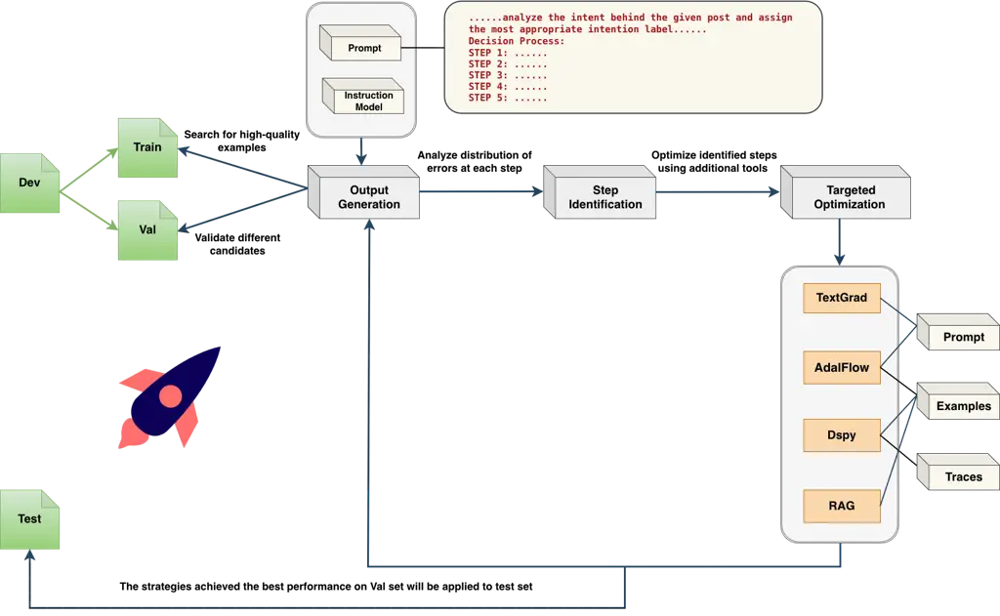
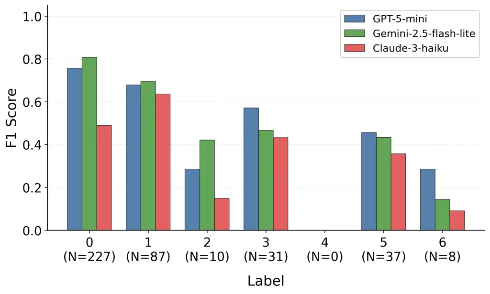
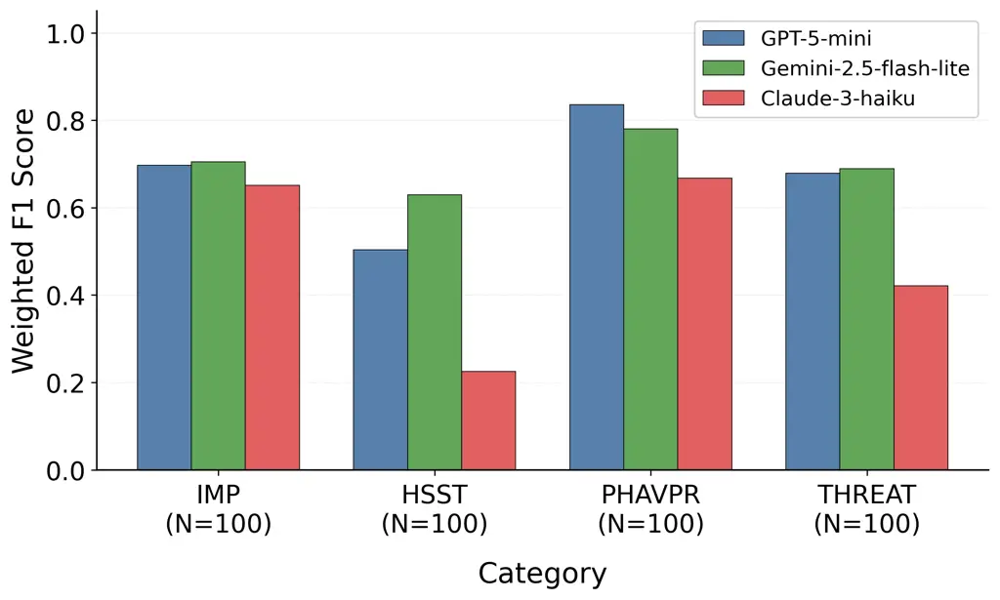
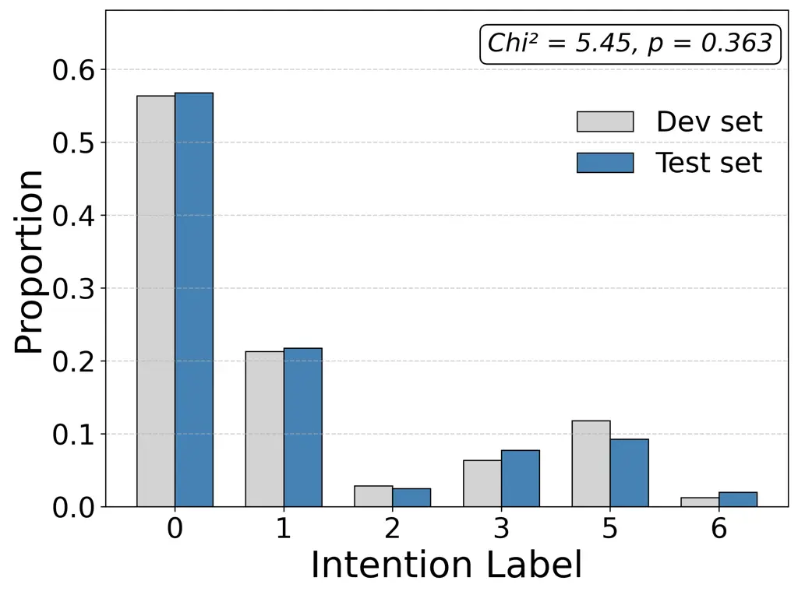
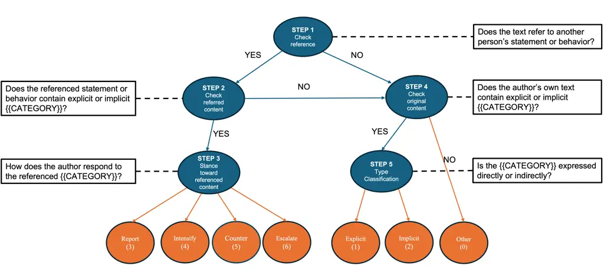

# LinGO: A Linguistic Graph Optimization Framework with LLMs for Interpreting Intents of Online Uncivil Discourse

Yuan Zhang^(1,∗), Thales Bertaglia²

¹University of Zurich, Zurich, Switzerland

²Utrecht University, Utrecht, Netherlands

$`\ast`$ y.zhang@ikmz.uzh.ch

###### Abstract

Detecting uncivil language is crucial for maintaining safe, inclusive,
and democratic online spaces. Yet existing classifiers often
misinterpret posts containing uncivil cues but expressing civil intents,
leading to inflated estimates of harmful incivility online. We introduce
LinGO, a linguistic graph optimization framework for large language
models (LLMs) that leverages linguistic structures and optimization
techniques to classify multi-class intents of incivility that use
various direct and indirect expressions. LinGO decomposes language into
multi-step linguistic components, identifies targeted steps that cause
the most errors, and iteratively optimizes prompt and/or example
components for targeted steps. We evaluate it using a dataset collected
during the 2022 Brazilian presidential election, encompassing four forms
of political incivility: Impoliteness (IMP), Hate Speech and
Stereotyping (HSST), Physical Harm and Violent Political Rhetoric
(PHAVPR), and Threats to Democratic Institutions and Values (THREAT).
Each instance is annotated with six types of civil/uncivil intent. We
benchmark LinGO using three cost-efficient LLMs: GPT-5-mini, Gemini 2.5
Flash–Lite, and Claude 3 Haiku, and four optimization techniques:
TextGrad, AdalFlow, DSPy, and Retrieval-Augmented Generation (RAG). The
results show that, across all models, LinGO consistently improves
accuracy and weighted F1 compared with zero-shot, chain-of-thought,
direct optimization, and fine-tuning baselines. RAG is the strongest
optimization technique and, when paired with Gemini model, achieves the
best overall performance. These findings demonstrate that incorporating
multi-step linguistic components into LLM instructions and optimize
targeted components can help the models explain complex semantic
meanings, which can be extended to other complex semantic explanation
tasks in the future.

Keywords: Linguistic Graph $`|`$ Automated LLM Optimization $`|`$
Incivility Detection $`|`$ Natural Language Processing $`|`$ Explainable
AI.

## 1 Introduction

Online incivility is a multidimensional concept incorporating behaviors
that are impolite, aggressive, harmful, and even detrimental to
democratic values, thereby undermining online safety and democratic
processes \[27, 37, 5\]. Both computer scientists and social scientists
have sought to identify uncivil discourse online using Artificial
Intelligence (AI) techniques \[36, 32, 14, 28, 9, 10, 3, 26, 1, 13\].
Although these machine learning and deep learning methods enable
large-scale classification, post hoc analyses show frequent errors and
interpretive difficulty, even for human coders, when dealing with many
indirect expressions. One common case is implicit attacks that rely on
sarcasm, insinuation, presupposition, or metaphor, or that require
inferring incivility from additional context \[24\]. This type of
incivility is not perceived equally by everyone and is often considered
milder than explicit attacks \[6\]. For instance, "Brilliant leadership,
if the goal was to embarrass the nation" expresses dissatisfaction and
criticism of the leadership but does not really contain harmful intent
¹¹ 1 The example is generated by AI.. A second case involves referencing
others’ uncivil speech while adding the author’s own opinions, such as
"They told us to go back where we came from. This is unacceptable." ²² 2
The example is generated by AI. The author’s stance toward the quoted
content is condemning and it implies an intent of counterspeech. When
the author’s stance is endorsing or neutral/reporting, the conveyed
intent may shift, for example, toward amplification or just
attention-seeking. Treating all discourse that contains uncivil elements
as having the same harmful intent, as earlier AI models largely did,
risks overestimating the prevalence of incivility and harm online \[11,
31, 38\].

LLMs, drawing on knowledge from large-scale training data, can capture
more nuanced semantic meaning than earlier AI models, but they remain
struggle to recognize complex linguistic structures in zero-shot
settings \[4\]. With recent advances of LLM optimization techniques, we
can leverage LLMs more effectively by automatically programming the
prompts and/or few-shot examples, similar to how traditional neural
networks are trained \[20, 41, 40\]. Additionally, many linguistic
structures follow systematic patterns and convey consistent intent.
Incorporating multiple linguistic structural components into LLM
instructions could help LLMs identify and optimize specific
comprehension difficulties and improve their overall interpretive
ability. Therefore, this work introduces a linguistic graph optimization
framework that integrates linguistic structures with existing LLM
optimization techniques and improves performance in recognizing various
intents of uncivil language uses.

In summary, this work addresses a multi-label classification task that
distinguishes direct and indirect expressions of incivility, which are
closely tied to speakers’ intents. This distinction is important because
not all intents are equally harmful; given this classification, future
studies could examine the harmfulness of each category in greater
detail. Fig. 1 presents six expression ways in which hate speech
indicators are present but intents vary. Cases $`[1]`$ and $`[2]`$ are
hateful opinion from the author toward a protected group: $`[1]`$ is
explicit and overtly uncivil, whereas $`[2]`$ is implicit and subtler,
often lacking obvious surface cues and harmful intent. By contrast,
Cases $`[3]`$–$`[6]`$ reference a third party’s hateful statement; we
further consider the author’s stance: In $`[5]`$, the author criticizes
or rejects the hateful content, yielding counter-speech of incivility.
With no stance (pure reference), agreement, and response with additional
hate speech from the author, the intent shifts to reporting $`[3]`$,
intensifying $`[4]`$, and escalating $`[6]`$ others’ hate speech. Under
these circumstances, only case $`[1]`$ constitutes direct harmful
intent, whereas the other cases involve indirect expressions that are
not intended to cause harm but may still be harmful depending on the
specific context.


Figure 1: Illustration of six intent categories of hate speech. \[1\] is
a direct expression of hate speech. \[2\]–\[6\] are indirect expressions
of hate speech.

Those complex expressions are highly structured and require multi-step
comprehension for LLMs, similar to how human beings cognitively process
them. Therefore, we hypothesize that a multi-step procedure guided by
linguistic structure could also help LLMs capture the intended meaning
more effectively \[31\]. For example, reference of incivility can be
modeled as a nested construction: \[author’s stance \[reference to
others’ statements/behaviors\]\]. First, we detect incivility within the
\[reference to others’ statements/behaviors\]. If incivility is present,
treat the instance as _indirect_ and then assess the author’s stance in
\[author’s stance\]. If no incivility is found in the reference, treat
the instance as _direct_ and evaluate incivility in \[author’s stance\]
alone. When no reference appears, set \[reference to others’
statements/behaviors\] = None and detect incivility solely within
\[author’s stance\]. Although similar idea has before been put forward
as functionalities checklist \[31\] or as an analytical scheme \[38\],
it has not yet been systematically programmed with AI models, hence
large-scale structural linguistic understanding remains underexplored.
To fill this gap, we incorporate linguistic components into LLM-based
inference in this work. Specifically, we use a linguistic graph in which
the output of each step determines the next step, until the path reaches
the final decision label (see more details in Method).

This multi-step linguistic graph is further combined with current
automated optimization techniques for improving stability. As is well
known, LLM outputs are highly sensitive to the prompt and to any
included examples (in few-shot settings); even small changes can
significantly affect performance. This disadvantage is amplified in
multi-step tasks due to error propagation: a mistake made in an early
step can carry forward, causing downstream steps to fail or make further
errors, often magnifying the original mistake \[8\]. The simplest
strategy overcoming the instability is manual trial-and-error, where
practitioners iteratively refine prompts after observing
misinterpretations \[33\]. However, this strategy requires substantial
human effort and relies excessively on subjective decisions. Scholars
have therefore proposed systematic methods that treat prompt/example
optimization as a programming task \[22\]. Existing techniques include
textural gradient descent (e.g., TextGrad, AdalFlow), similarity-based
retrieval (e.g., retrieval-augmented generation, RAG), metric-driven
bootstrapping (e.g., DSPy), etc. Combining the linguistic graph with
optimization techiniques, our approach enables to identify the most
problematic steps during sentence comprehension, and optimization
techniques can develop the best strategies for those steps. In this way,
error propagation can be alleviated.

The whole procedure is summerized as Linguistic Graph Optimization.
First, we construct a graph of linguistic nodes grounded in linguistic
structure. Second, the LLM traverses this graph step by step, where each
next step depends on the output of the previous one. Finally, the model
optimizes prompts and/or examples for the steps with the most frequent
errors.

The results of our experiments show that, for all models, stronger
baselines that incorporate some automated optimization techniques
outperform basic baselines such as zero-shot prompting and
Chain-of-Thought (CoT) prompting, even without applying linguistic
graph. Among these techniques, RAG achieves the highest weighted F1
scores (OpenAI: 0.640; Gemini: 0.664; Claude: 0.551), suggesting that
optimizing demonstration examples through high-quality selection may be
more effective than text-based optimization. Moreover, except for the
Claude model, incorporating the linguistic-graph multi-step procedure
with both OpenAI and Gemini models yields further improvements across
all optimization techniques. Overall, the best performance is achieved
by RAG with the Gemini model, reaching 0.690 accuracy and a 0.699
weighted F1 score. We also compare our approach’s best performance with
that of open-source fine-tuning, and it still achieves the best results.
Our findings indicate that decomposing complex semantic understanding
into multiple steps and identifying key steps for optimization helps
improve the interpretability of LLMs.

## 2 Related Work

Automatic Identification of Uncivil Discourses. Incivility refers to
behaviors that violate norms of politeness or democratic values \[27,
37\]. Natural Language Processing (NLP), leveraging machine learning and
deep learning techniques, enables scalable automatic detection of such
online discourse \[34\].

Early works mostly relied on classical statistical machine learning.
These approaches typically compute term frequency–inverse document
frequency (TF–IDF) features or use bag-of-words (BoW) representations,
which are then fitted with models such as Naive Bayes, Logistic
Regression, Random Forests, and Support Vector Machines (SVMs) \[36, 32,
14, 28, 9\]. While these methods effectively detect straightforward
cases with clear lexical indicators, they perform poorly when incivility
is subtle or context-dependent \[36\]

With the advent of neural network and pre-trained embeddings,
performance on complex forms of incivility has substantially improved
\[26\]. Unlike frequency-based or purely probabilistic word
representations, embeddings capture relational and semantic properties
in dense vector spaces \[25\]. Concurrent advances in neural
architectures, such as Recurrent Neural Networks (RNNs), Long Short-Term
Memory (LSTM) networks, and Transformers, have enabled richer modeling
of context \[12, 18, 39\]. Numerous studies using transformer-based
models, particularly BERT and its derivatives, report strong performance
for incivility detection, including Davidson et al. \[10\], Ali et al.
\[3\], Mozafari et al. \[26\], Abusaqer et al. \[1\], and Gao \[13\],
among others.

Indirect Incivility and Linguistic Structure. Despite substantial
progress of artificial intelligence technologies, automatic incivility
detection remains far from solved. One major challenge is indirect
incivility: texts that contain uncivil elements but express them
implicitly (i.e., through sarcasm or metaphor, by obscuring context), or
by referencing others’ uncivil statements with additional commentary or
opinions\[11, 31, 15\]. For example, Zhang et al. \[42\] used
multilingual sentence transformers to identify multidimensional forms of
political incivility and, upon manual inspection, found many indirect
cases identified by classifiers, particularly those involving physical
harm and threats to democratic values. Implicit incivility is difficult
even for human coders to judge, and it often leads to low-quality
annotations \[2\]. People sometimes also cite others’ uncivil statements
or behaviors to report it, criticize it, or escalate the discussion, and
their intents differ from directly expressing incivility. To interpret
their intents and avoid exaggeration of harmfulness, models must capture
not only superficial uncivil features but also their linguistic
structures \[31\].

Using linguistically informed tests to probe indirect cases of
incivility is not a novel idea. For instance, Röttger et al. present a
diagnostic suite of 29 linguistically motivated cases to stress-test
classifiers \[31\]. Van Aken et al. conduct an in-depth linguistic error
analysis of misclassified toxic comments \[38\]. Although these studies
illuminate the important role of linguistic structure in identifying
indirect expressions, to our knowledge this has not yet been
incorporated into the programming of AI models. Incorporating linguistic
rules into the LLM instructions is likely to improve LLMs’ understanding
of indirect and complex semantics.

LLMs with Automatic Optimization. Trained on large corpora and optimized
under an autoregressive objective, generative LLMs can produce
high-quality outputs across a wide range of tasks. In a common setup,
the natural language prompt and few-shot examples are tokenized, and the
model generates an output by sequentially predicting the next tokens
\[23\]. However, response quality depends heavily on the prompts and
examples provided. A popular direction is to use automatic optimization
techniques to help humans find effective prompts and/or examples with
minimal effort \[35\]. Current widely used techniques include: (i)
gradient-based methods that treat prompts or examples as trainable
parameters and optimize them via gradient descent \[35, 30\]. For
instance, TextGrad introduces a gradient-based optimization scheme for
LLM systems in which prompt text (and potentially intermediate reasoning
and outputs) is updated using textual gradients generated by a stronger
model, analogous to backpropagation in neural network training \[41\].
Similarly, AdalFlow also uses LLM-generated feedback as a gradient-like
signal, but within a broader engineering framework where multiple
components, including prompt text, selected examples, and other modules,
can be optimized \[40\]. (ii) retrieval of representative demonstrations
from additional sources. Including representative few-shot examples
typically improves LLM performance \[7\], akin to providing supervised
signals that the model can generalize to unseen inputs. To retrieve
relevant examples, one can borrow techniques from RAG, which selects the
most relevant information by similarity matching \[21\]. In broader
applications, RAG can retrieve not only static examples but also
up-to-date knowledge from online and offline corpora. (iii)
metric-driven prompt construction via bootstrapping. Rather than
hand-crafting prompts or manually adding demonstrations, frameworks such
as DSPy define task signatures and construct prompts with demonstrations
during compilation by bootstrapping examples that optimize user-defined
metrics \[20\]. DSPy can also be extended to multi-step tasks by
composing multiple declarative modules and optimizing them toward a
shared objective or module-specific objectives \[20\]. Although tools
like TextGrad, AdalFlow, and RAG are not intrinsically designed for
multi-step tasks, they can also be applied to individual steps or
subsets of steps. These programming techniques can be combined with our
linguistic graph to improve multi-step reasoning and reduce error
propagation.

## 3 Method

The goal of our approach is to classify six direct and indirect
expression patterns and intents of incivility: (1) explicit attack
(direct); (2) implicit attack (indirect); (3) reporting incivility
(indirect); (4) intensifying incivility(indirect); (5) countering
incivility (indirect); and (6) escalating incivility (indirect). (0) is
a backup label that collects cases that do not belong to any of the
categories above. We first define a linguistic graph that incorporates
Q-A nodes related to the nested components \[author’s stance \[reference
to others’ statements/behaviors\]\], as well as judgments about whether
each component contains uncivil elements and whether those elements are
expressed explicitly or implicitly. The model’s response at each node
determines which next node to visit, until a final label is produced.
Furthermore, the framework identifies which specific nodes lead to the
most frequent errors by LLMs, enabling targeted step optimization. A
detailed description is provided below, and a formal mathematical
definition of the procedures are provided in Appendix B.

### 3.1 Linguistic Graph Construction

The linguistic graph consists of five steps and is described in the
following and in Algorithm 1. An illustrative visualization of the
linguistic graph is provided in Fig. 6 in the Appendix B.

1.  _Step 1:_
    Determine whether the post refers to another person’s statement or
    behavior. If _YES_, go to Step 2; if _NO_, go to Step 4.
2.  _Step 2:_
    Analyze whether the referenced statement or behavior contains
    explicit or implicit incivility. If _YES_, go to Step 3; if _NO_, go
    to Step 4.
3.  _Step 3:_
    Examine whether the author reports, intensifies, counters, or
    escalates the referenced incivility. Assign labels _Report (3)_,
    _Intensify (4)_, _Counter (5)_, and _Escalate (6)_.
4.  _Step 4:_
    Determine whether the author’s own statement or behavior contains
    explicit or implicit incivility. If _YES_, go to Step 5; if _NO_,
    assign label _Other (0)_.
5.  _Step 5:_
    Classify the author’s incivility as explicit or implicit. _Explicit_
    incivility refers to expressions with salient uncivil features,
    while _implicit_ incivility covers cases without salient features
    that nonetheless convey uncivil meaning (e.g., critical, sarcastic,
    or metaphorical). Assign labels _Explicit (1)_ and _Implicit (2)_.

1: Post $`x`$

2: $`y\in\{`$Other (0), Explicit (1), Implicit (2), Report (3),
Intensify (4), Counter (5), Escalate (6)$`\}`$

3: function ClassifyIntent($`x`$)

4:    $`r\leftarrow\textsc{DetectReference}(x)`$ $`\triangleright`$ Step
1

5:    if $`r`$ then

6:     $`c\leftarrow\textsc{ExtractReferencedContent}(x)`$

7:     $`h\leftarrow\textsc{ContainsIncivility}(c)`$ $`\triangleright`$
Step 2

8:     if $`h`$ then

9:       $`s\leftarrow\textsc{DetermineStance}(x,c)`$ $`\triangleright`$
Step 3

10:       if $`s=\text{report}`$ then

11:        return Report (3)       

12:       if $`s=\text{intensify}`$ then

13:        return Intensify (4)       

14:       if $`s=\text{counter}`$ then

15:        return Counter (5)       

16:       return Escalate (6)        

17:    $`o\leftarrow\textsc{ExtractAuthorText}(x)`$

18:    $`h_{o}\leftarrow\textsc{ContainsIncivility}(o)`$
$`\triangleright`$ Step 4

19:    if not $`h_{o}`$ then

20:     return Other (0)

21:    else

22:     $`t\leftarrow\textsc{TypeExplicitVsImplicit}(o)`$
$`\triangleright`$ Step 5

23:     if $`t=\text{explicit}`$ then

24:       return Explicit (1)

25:     else

26:       return Implicit (2)        

Algorithm 1 Linguistic Graph

### 3.2 Human Annotation of Training Data

Human coders are required to annotate the texts following the steps
described in the linguistic graph above. The annotation includes an
answer for each sub-step as well as a final classification label. All
answers and labels are concatenated into a reasoning chain in the form:
STEP 1: Answer -\> STEP 2: Answer -\> ... -\> LABEL: 0-6. Finally, an
intercoder reliability test is conducted to assess the consistency of
the annotated sub-step answers and labels. Because the task involves
multiple classes and the class distribution is highly imbalanced, we
recommend using Gwet’s AC2 as the reliability metric. Compared with
traditional measures such as Krippendorff’s alpha, Gwet’s AC2 is less
affected by class imbalance becuase of using a more stable model for
estimating chance agreement \[17, 16\].

With the annotated data, we can then split the dataset into developing
(which is further split into training and validation sets) and test sets
following traditional supervised learning practice.

### 3.3 Targeted Step Optimization

The automatic prompt-optimization procedure comprises three steps.
First, we provide an initial prompt that includes: (i) definitions of
specific forms of incivility (can be single category or multi-category);
(ii) the overall task description; (iii) questions and instructions at
each step defined in the linguistic graph; and (iv) the required output
format. We require the model to return both a label and a reasoning
chain similar to human being’s annotation, e.g.,

1 REASONING: \[STEP 1: YES/NO -\> STEP 2/4: YES/NO -\>

2 STEP 3/5: Other/Explicit/Implicit/Report/Intensify/Counter/Escalate\]

3 -\> LABEL: 0--6

Second, we use generative LLMs to generate responses for data in
validation set. The model responses are compared against human-labeled
sub-steps, and we examine the distribution of mismatches across all
steps. Steps whose proportion of mismatches exceeds certain thresholds
are selected for optimization. Optimization is conducted utilizing the
existing advanced LLM programming tools: TextGrad, AdalFlow, DSPy, and
RAG, and examples from training set. The specific techniques and
optimized elements are shown in Tab. 1.

|          |                             |                                               |
| -------- | --------------------------- | --------------------------------------------- |
| Tool     | Technique                   | Optimized elements                            |
| TextGrad | Textual gradient descent    | Targeted prompt text                          |
| AdalFlow | Textual gradient descent    | Targeted prompt text; targeted demonstrations |
| DSPy     | Metric-driven bootstrapping | Targeted demonstrations; targeted traces      |
| RAG      | Similarity-based retrieval  | Targeted demonstrations                       |

Table 1: Tools used for step-wise optimization and the corresponding
optimized elements.

The optimization procedure can be run iteratively over multiple rounds,
and the prompt and/or examples that achieve the best validation
performance will then be evaluated on the test set. The algorithmic
description is provided in Algorithm 2. The whole pipeline is visualized
in Fig. 2.

1: $`\mathcal{T}=(\mathcal{N},\mathcal{E})`$ (linguistic graph with
steps/nodes $`\mathcal{N}`$),
$`\mathcal{D}=\mathcal{D}_{\text{train}}\cup\mathcal{D}_{\text{val}}\cup\mathcal{D}_{\text{test}}`$
with sub-step labels $`a_{n}^{\ast}(x)`$ and final label
$`y^{\ast}(x)`$, initial prompt $`\mathcal{P}^{(0)}`$ (definitions, task
description, step instructions, output format), threshold $`\tau`$,
few-shot size $`k`$, max rounds $`R`$, LLM $`g(\cdot)`$, validation
metric $`m_{\text{val}}(\cdot)`$, optimizer set
$`\Omega=\{\textsc{TextGrad},\textsc{AdalFlow},\textsc{DSPy},\textsc{RAG}\}`$

2: Optimized prompt and examples
$`(\mathcal{P}^{\star},\mathcal{F}^{\star})`$ for final test evaluation

3:
$`\mathcal{P}\leftarrow\mathcal{P}^{(0)}`$; $`\mathcal{F}\leftarrow\varnothing`$; $`s^{\star}\leftarrow-\infty`$; $`(\mathcal{P}^{\star},\mathcal{F}^{\star})\leftarrow(\mathcal{P},\mathcal{F})`$

4: for $`t\leftarrow 0`$ to $`R-1`$ do

5:    (Run) For each $`(x_{i},\cdot)\in\mathcal{D}_{\text{val}}`$, query
$`g`$ with $`(\mathcal{P},\mathcal{F},x_{i})`$ and parse

6:    predicted reasoning path $`\pi(x_{i})`$, node answers
$`\hat{a}_{n}(x_{i})`$, and predicted label $`\hat{y}(x_{i})`$.

7:    (Diagnose) For each node $`n\in\mathcal{N}`$, define the visited
set

8:
   $`\mathcal{I}_{n}\leftarrow\{\,i:\;n\text{ is visited in }\pi(x_{i})\,\}`$,
and compute step-wise mismatch rate

9:
   $`\hat{p}_{n}\leftarrow\dfrac{1}{|\mathcal{I}_{n}|}\sum_{i\in\mathcal{I}_{n}}\mathbf{1}\!\left\{\,\hat{a}_{n}(x_{i})\neq a_{n}^{\ast}(x_{i})\,\right\}`$.

10:    (Select)
$`\mathcal{S}\leftarrow\{\,n\in\mathcal{N}:\;\hat{p}_{n}>\tau\,\}`$
$`\triangleright`$ steps to optimize

11:    if $`\mathcal{S}=\varnothing`$ then break    

12:    for all $`n\in\mathcal{S}`$ do

13:     (Collect errors)
$`\mathcal{E}_{n}\leftarrow\{\,(x_{i},a_{n}^{\ast}(x_{i}),\hat{a}_{n}(x_{i})):\;i\in\mathcal{I}_{n}\wedge\hat{a}_{n}(x_{i})\neq a_{n}^{\ast}(x_{i})\,\}`$

14:     (Sample)
$`\mathcal{F}_{n}\leftarrow\textsc{Sample}(\mathcal{E}_{n},D_{\text{train}})`$

15:     (Choose tool)
$`\omega_{n}\leftarrow\textsc{SelectOptimizer}(\Omega,n,\mathcal{F}_{n})`$

16:     (Optimize)
$`(\Delta\mathcal{I}_{n},\Delta\mathcal{F}_{n})\leftarrow\omega_{n}(\mathcal{P},\mathcal{F}_{n},\mathcal{T})`$

17:     (Update)
$`\mathcal{P}\leftarrow\textsc{EmbedNodeUpdate}(\mathcal{P},n,\Delta\mathcal{I}_{n})`$

18:
   $`\mathcal{F}\leftarrow\textsc{ExamplesUpdate}(\mathcal{F},\Delta\mathcal{F}_{n})`$

   

19:    (Validate)
$`s\leftarrow m_{\text{val}}(\mathcal{P},\mathcal{F},\mathcal{D}_{\text{val}})`$

20:    if $`s>s^{\star}`$ then

21:
    $`s^{\star}\leftarrow s`$; $`(\mathcal{P}^{\star},\mathcal{F}^{\star})\leftarrow(\mathcal{P},\mathcal{F})`$

   

22: (Test once) Evaluate $`(\mathcal{P}^{\star},\mathcal{F}^{\star})`$
on $`\mathcal{D}_{\text{test}}`$ to report final results.

23: return $`(\mathcal{P}^{\star},\mathcal{F}^{\star})`$

Algorithm 2 Targeted Optimization



Figure 2: Demonstration of pipeline of Linguistic Graph Optimization
(LinGO).

### 3.4 Baseline Approaches as Comparison

We compare the classification performance of our approach against four
baselines: zero-shot prompting, CoT prompting, direct optimization, and
LoRA fine-tuning. In the zero-shot setting, the prompt contains only the
task description, and the model outputs a label directly without a
reasoning chain. In the CoT setting, the prompt includes the same task
description but explicitly instructs the model to reason step by step
before producing an answer.

As more advanced baselines, direct optimization updates the prompt
and/or examples using different optimization techniques but does not
involve the linguistic graph reasoning steps. We also include LoRA
fine-tuning as an additional baseline, since it directly updates model
parameters and can improve performance while requiring far fewer
trainable parameters than full fine-tuning \[19\].

## 4 Experiments

### 4.1 Experimental Setup

#### Data Preparation.

We use a Portuguese dataset of Twitter/X posts published by political
influencers during the 2022 Brazilian presidential election, provided by
\[42\] ³³ 3 Data license available at
[https://doi.org/10.7910/DVN/M552GM](https://doi.org/10.7910/DVN/M552GM)..
The dataset contains only publicly available posts and was collected in
compliance with Twitter/X’s Terms of Service. Our reuse of the dataset
aligns with the original access conditions and intended research
purpose. In the paper of using this dataset, posts have been annotated
with binary labels (civil vs. uncivil) across four forms of incivility
in political contexts: Impoliteness, Physical Harm and Violent Rhetoric,
Hate Speech and Stereotyping, and Threats to Democratic Institutions and
Values. From each dimension, we randomly sample 500 posts classified as
“uncivil” by their sentence-transformer models. Two researchers with
expertise in the Brazilian context and proficiency in Portuguese then
annotate the intents of these posts according to the linguistic graph,
providing both the final labels and sub-step answers as ground-truth
references.

Inter-coder agreement is 67.35%, and inter-coder reliability, measured
by Gwet’s AC2, is 0.514. We consider this level acceptable given the
multi-class complexity of the task.

#### Model Selection.

We select three instruction-tuned LLMs as instruction models to generate
the initial responses for comparison across commercial providers. Since
our goal is to compare improvements across methods rather than the
intrinsic capabilities of the underlying models, we use relatively
low-cost models to reduce experimental costs. Specifically, we use: (i)
GPT-5-mini (OpenAI), (ii) Gemini 2.5 Flash-Lite (Google), and (iii)
Claude 3 Haiku (Anthropic). For optimization frameworks that require a
teacher or optimizer model, we use GPT-5-mini in all experiments. For
the open-source models used for fine-tuning, we select Mistral-7B,
DeepSeek-V2-Lite-Chat, and Qwen3-4B-Instruct-2507 due to their strong
instruction-following capabilities and manageable parameter sizes.

#### Training Pipeline.

First of all, we split the 2,000 annotated posts into a fixed
development set (80%) and a fixed test set (20%). The development set is
further split into training and validation sets using the same ratio but
varying seeds. The distributions of intent labels for development set
and test set are shown in Tab. 2. It also statistically shows that the
distribution of the six intents labels are similar in the development
set and test set (see Appendix A).

|        |                |     |     |     |     |     |          |     |     |     |     |     |
| ------ | -------------- | --- | --- | --- | --- | --- | -------- | --- | --- | --- | --- | --- |
|        | Devlopment Set |     |     |     |     |     | Test Set |     |     |     |     |     |
| Form   | 0              | 1   | 2   | 3   | 5   | 6   | 0        | 1   | 2   | 3   | 5   | 6   |
| IMP    | 89             | 268 | 24  | 5   | 9   | 5   | 22       | 67  | 6   | 2   | 2   | 1   |
| HSST   | 290            | 51  | 7   | 12  | 36  | 4   | 68       | 15  | 1   | 3   | 10  | 3   |
| PHAVPR | 292            | 8   | 8   | 53  | 31  | 8   | 70       | 2   | 2   | 17  | 5   | 4   |
| THREAT | 231            | 14  | 7   | 32  | 113 | 3   | 67       | 3   | 1   | 9   | 20  | 0   |

Table 2: Distribution of intent labels across four categories of
political incivility in the devlopment and test sets. Labels: 0=No
defined labels, 1=Explicit, 2=Implicit, 3=Report, 4 = Intensify (no
case); 5=Counter, 6=Escalate.

At each round of optimization, we first use instruction model to produce
response for validation set and identity the targeted steps that make
the most mistakes. The main hyperparameters of this process are
summarized in Tab. 3.

|                                            |                                                   |
| ------------------------------------------ | ------------------------------------------------- |
| Hyperparameter                             | Value                                             |
| Instruction models                         | GPT-5-mini, Gemini 2.5 Flash-Lite, Claude 3 Haiku |
| Teacher/Refinement model                   | GPT-5-mini                                        |
| Threshold for step optimization ($`\tau`$) | 0.1                                               |
| Ratio of validation set ($`p`$)            | 0.2                                               |
| Optimization rounds ($`T`$)                | 5                                                 |

Table 3: Hyperparameters used in the training pipeline.

We then run the optimization program only on the steps identified as
problematic. The optimized strategies are selected based on validation
performance and then evaluated on the held-out test set. After each
round, we compute accuracy and weighted F1-score. We place greater
emphasis on weighted F1 due to class imbalance. Improvements are
reflected in higher accuracy and weighted F1-scores.

Prompting experiments were implemented through API calls to the official
model endpoints using the litellm library. Fine-tuning was conducted on
a single NVIDIA A100 SXM4 GPU (80 GB VRAM) with an AMD EPYC 7513 32-core
CPU and 128 GB RAM, running CUDA 12.8.

### 4.2 Main Results

#### Overall comparison of LinGo with baselines.

Tab. 4 reports the evaluation scores for zero-shot and CoT prompting
across three models: GPT-5-mini, Gemini 2.5 Flash-Lite, and Claude 3
Haiku. Among them, GPT-5-mini achieves the highest performance on both
accuracy and weighted F1, with scores of 0.583 and 0.578, respectively.

|                       |           |                       |                  |
| --------------------- | --------- | --------------------- | ---------------- |
| Model                 | Method    | Accuracy $`\uparrow`$ | wF1 $`\uparrow`$ |
| GPT–5–mini            | Zero–Shot | 0.518                 | 0.513            |
|                       | CoT       | 0.583                 | 0.578            |
| Gemini 2.5–Flash–Lite | Zero–Shot | 0.335                 | 0.364            |
|                       | CoT       | 0.380                 | 0.413            |
| Claude 3 Haiku        | Zero–Shot | 0.190                 | 0.130            |
|                       | CoT       | 0.305                 | 0.283            |

Table 4: Comparison across base prompting (Zero–Shot) and
Chain–of–Thought (CoT). Higher is better for Accuracy and weighted F1
(wF1).

We then evaluate more advanced baselines using existing LLM optimization
techniques, starting from the prompt without incorporating the
linguistic-graph steps. Tab. 5 reports these results under the
optimization setting for TextGrad, AdalFlow, DSPy, and RAG. Only with
RAG (no linguistic graph added) do all models consistently improve: both
accuracy and weighted F1 increase relative to the zero-shot and CoT
baselines. In contrast, other optimization techniques sometimes perform
worse than the zero-shot or CoT baselines. This may occur because some
optimization methods introduce overfitting or incorporate misleading
examples. Therefore, not all optimization techniques reliably improve
classification performance. Among these tools, RAG achieves the
strongest performance with Gemini 2.5 Flash-Lite (accuracy = 0.640; wF1
= 0.664). TextGrad yields the weakest performance and the smallest
improvements. This suggests that optimizing demonstrations, for example,
retrieving high-quality representative examples, is more effective than
optimizing the text.

Finally, using the same models and the same LLM optimization techniques,
we incorporate the linguistic graph to identify and refine only the
targeted steps. As shown in the LinGO section of Tab. 5, Except for
Claude 3 Haiku, LinGO improves almost all the accuracy and weighted F1
scores of LLMs compared to the direct optimization setting using any of
the optimization techniques. Our approach is less effective on the
Claude 3 Haiku model, likely due to its weaker semantic understanding
and a higher risk of error propagation. However, it still works with
TextGrad, and evaluation metrics are now all higher than the
corresponding zero-shot and CoT baseline results. The best performance
is again achieved by RAG, reaching an accuracy of 0.690 and a weighted
F1 of 0.699. This corresponds to improvements of +10.7 pp (accuracy) and
+12.1 pp (weighted F1) over the best zero-shot/CoT result, and +5.0 pp
(accuracy) and +3.5 pp (weighted F1) over the best direct optimization
result. It should be noted that techniques of metric-driven
bootstrapping and similarity-based retrieval tend to be more consistent
than textual gradient descent, as the latter depends on long-text
generation and is therefore more variable.

|                       |                     |          |                   |                  |
| --------------------- | ------------------- | -------- | ----------------- | ---------------- |
| Model                 | Method              | Tool     | Acc. $`\uparrow`$ | wF1 $`\uparrow`$ |
| GPT-5-mini            | Direct Optimization | TextGrad | 0.328             | 0.393            |
|                       |                     | AdalFlow | 0.568             | 0.411            |
|                       |                     | DSPy     | 0.540             | 0.525            |
|                       |                     | RAG      | 0.638             | 0.640            |
|                       | LinGO               | TextGrad | 0.590             | 0.614            |
|                       |                     | AdalFlow | 0.620             | 0.637            |
|                       |                     | DSPy     | 0.508             | 0.554            |
|                       |                     | RAG      | 0.655             | 0.677            |
| Gemini 2.5 Flash–Lite | Direct Optimization | TextGrad | 0.413             | 0.392            |
|                       |                     | AdalFlow | 0.493             | 0.427            |
|                       |                     | DSPy     | 0.630             | 0.606            |
|                       |                     | RAG      | 0.640             | 0.664            |
|                       | LinGO               | TextGrad | 0.518             | 0.550            |
|                       |                     | AdalFlow | 0.530             | 0.551            |
|                       |                     | DSPy     | 0.648             | 0.665            |
|                       |                     | RAG      | 0.690             | 0.699            |
| Claude 3 Haiku        | Direct Optimization | TextGrad | 0.203             | 0.257            |
|                       |                     | AdalFlow | 0.488             | 0.385            |
|                       |                     | DSPy     | 0.515             | 0.540            |
|                       |                     | RAG      | 0.495             | 0.551            |
|                       | LinGO               | TextGrad | 0.350             | 0.348            |
|                       |                     | AdalFlow | 0.365             | 0.380            |
|                       |                     | DSPy     | 0.410             | 0.458            |
|                       |                     | RAG      | 0.479             | 0.489            |

Table 5: Performance comparison of prompt-optimization tools under two
settings: (i) single-step Optimization and (ii) step-wise LinGO. For
each (Model, Method) block, the best tool by weighted F1 (wF1) is
highlighted in bold. Acc. denotes accuracy.

The experimental results show that our approach, namely prompting LLMs
based on linguistic structures and iteratively optimizing the targeted
steps, improves their ability to capture complex semantics and achieves
the best performance in terms of accuracy and weighted F1 compared to
zero-shot/CoT prompting and direct optimization.

Besides, we also evaluate our method against fine-tuned open-source
models (see Tab. 6). Experiments with three models - Mistral-7B,
DeepSeek-V2-Lite-Chat, and Qwen3-4B-Instruct-2507 show that the best
results reach 0.590 accuracy and 0.535 weighted F1, both lower than our
method’s best performance with GPT-5-mini and Gemini 2.5 Flash-Lite.
Performance may improve with larger open-source models, but this would
require substantially greater computational resources and infrastructure
costs.

|                        |             |                       |                  |
| ---------------------- | ----------- | --------------------- | ---------------- |
| Model                  | Method      | Accuracy $`\uparrow`$ | wF1 $`\uparrow`$ |
| Mistral–7B             | FT          | 0.215                 | 0.250            |
| DeepSeek–V2–Lite–Chat  | FT          | 0.302                 | 0.340            |
| Qwen3–4B–Instruct–2507 | FT          | 0.590                 | 0.535            |
| Gemini 2.5 Flash–Lite  | LinGO (RAG) | 0.690                 | 0.699            |

Table 6: Comparison between fine-tuned open-source models with human
annotations and closed-source models optimized with LinGO. LinGO results
are the best round by weighted F1 score, with model Gemini 2.5
Flash–Lite and RAG.

#### Performance on different intent labels across models.

We further analyze performance (based on F1 score) across intent labels
for the three models under our approach with RAG, and observe several
common patterns. As shown in Fig. 3, the label distribution in our test
set is notably imbalanced; for example, there are no instances of the
“intensifying” category (label 4). Among the remaining labels, direct
incivility achieves higher F1 scores than indirect incivility, which is
not surprising due to the difficulty of interpretating indirect
incivility. Among indirect expressions, implicit incivility is
particularly difficult to detect, which has also been mentioned by prior
work \[36, 29, 31\].

Across models, Claude 3 Haiku performs worse on all labels than
GPT-5-mini and Gemini 2.5 Flash–Lite. Gemini 2.5 Flash–Lite is slightly
better than GPT-5-mini at identifying irrelevant cases (label 0), direct
incivility (label 1), and implicit incivility (label 2), whereas
GPT-5-mini performs better on referred indirect incivility, including
label 3 (Reporting), label 5 (Criticizing) and label 6 (Escalating).
These differences suggest that practitioners may benefit from
benchmarking multiple models and selecting those that perform best on
the labels most relevant to their research goals.



Figure 3: Comparison of LinGO and baseline prompting methods across
intent labels (0-6) and models (GPT-5-mini, Claude 3 Haiku,
Gemini 2.5 Flash–Lite).

#### Performance on different categories of incivility across models.

We further examine the weighted F1 scores of the three models under the
RAG setting across the four categories of incivility (Fig. 4). A
consistent pattern emerges across models: _Hate Speech and Stereotyping_
yields the lowest weighted F1, whereas _Physical Harm and Violent
Political Rhetoric_ achieves the highest.

Across all categories, Claude 3 Haiku performs worst relative to
GPT-5-mini and Gemini 2.5 Flash–Lite. GPT-5-mini and Gemini 2.5
Flash–Lite achieve broadly similar performance overall, but Gemini 2.5
Flash–Lite performs slightly better on _Hate Speech and Stereotyping_
than GPT-5-mini, and GPT-5-mini is better in recognizing _Physical Harm
and Violent Political Rhetoric_. This may reflect differences in their
training data coverage or model sensitivity to hate speech–related
patterns. Therefore, when selecting a model, practitioners should
consider which incivility categories they aim to detect and choose the
model that previously performs better on similar category tasks.



Figure 4: Comparison of LinGO and baseline prompting methods across
forms of incivility (IMP, HSST, PHAVPR, THREAT) and models (GPT-5-mini,
Claude 3 Haiku, Gemini 2.5 Flash–Lite).

## 5 Conclusion

Previous approaches to the automatic detection of incivility often
struggle to distinguish between the direct expression of incivility and
indirect mentions of it. Although both contain uncivil features, they
may convey different intents depending on how they are expressed. Our
work identifies six distinct expressions and intents by introducing a
linguistic graph optimization framework. The results show that our
method outperforms zero-shot learning, CoT prompting, the
state-of-the-art LLM optimization techniques, as well as some fine-tuned
open-source models. A deeper analysis of performance by label and
incivility category suggests that different models excel at different
aspects of the task. For instance, GPT-5-mini performs better at
detecting referred indirect labels, whereas Gemini-2.5-Flash-Lite
performs superbly at recognizing hate speech and stereotyping.

Our approach provides a practical method for LLMs to explain
fine-grained direct and indirect forms of incivility, and makes the
sub-steps of explanation explicit and optimizable. It can be used by
other researchers either as a straightforward classifier for multi-label
incivility intent classification or as a post hoc analysis tool for
uncivil cases identified by other machine learning or deep learning
classifiers. Identifying various linguistic structures and its
underlying intents can inform more accurate examination of harmfulness
and interventions to mitigate toxic online environments.

## 6 Limitations

Our approach has three main limitations. First, it depends on human
annotation not only for intent labels but also for intermediate sub-step
labels at each linguistic node, which increases labeling effort.
However, our experiments show that using only 2,000 labeled instances
(500 for single category) has been enough to improve LLM classification
performance. Second, because the method iteratively refines prompts and
evaluates them on full datasets, it can be computationally demanding.
Our experiments use low-cost models, keeping the cost at \$5–\$10 per
experiment, and the highest weighted F1 score is already close to 70%,
which is quite acceptable. Third, we evaluate the approach on a single
domain (Brazilian politics), language (Portuguese), and four categories
of uncivil discourse. Generalizability cannot be fully confirmed, and we
encourage future work to test the method across additional cultural
contexts, languages, and incivility types.

## 7 Ethical considerations

Automatic detection of uncivil intents may be misused for surveillance
or censorship and could compromise individual privacy. We recommend
combining automated detection results with human judgment when
implementing moderation measures.

This study uses only publicly available Twitter/X posts. To protect user
privacy, all user identifiers were removed to prevent re-identification.
Because the research focuses on online incivility, the dataset includes
some offensive language; such content was analyzed exclusively for
scholarly purposes. No personally identifiable or harmful text is
reproduced in this paper, and all data handling procedures complied with
ethical research standards and were approved by the University of Zurich
Ethics Committee.

We affirm that AI-assisted tools were used solely to correct grammatical
errors and enhance the clarity and readability of the manuscript. All
ideas, analyses, and interpretations are entirely those of the authors.

## 8 Code and Data Availability

The code and data sets for this work is available at
[https://github.com/yuanzhang1227/Replication_Code_LinGO](https://github.com/yuanzhang1227/Replication_Code_LinGO).

## Appendix

## Appendix A Label distribution in the development and test sets



Figure 5: Distribution of intent labels in the development and test
sets. The chi-square test shows that the differences between their
distributions are not statistically significant.

## Appendix B Formalization of LinGO Process

### B.1 Linguistic Graph Construction

An illustrative graph of LinGO is given in Fig. 6.



Figure 6: Linguistic Graph Based on Discourse Representation.

Formally, we define these different steps as a directed acyclic graph

```math
\mathcal{T}=(\mathcal{N},\mathcal{E}),
```

where $`\mathcal{N}`$ is the set of linguistic nodes (reasoning steps
for LLMs) and $`\mathcal{E}\subseteq\mathcal{N}\times\mathcal{N}`$ is
the set of directed edges that encode the flow of reasoning. Each node
$`n\in\mathcal{N}`$ is associated with a decision function

```math
d_{n}:\mathcal{X}\to\mathcal{A}_{n},
```

where $`\mathcal{X}`$ is the input space and $`\mathcal{A}_{n}`$ is the
set of possible answers at step $`n`$ (e.g., {YES, NO}, or stance
categories).

The transition rule is then defined as

```math
\delta:\mathcal{N}\times\mathcal{A}_{n}\to\mathcal{N},
```

which maps a node $`n`$ and an answer $`a\in\mathcal{A}_{n}`$ to the
next node in the graph.

Reasoning on input $`x\in\mathcal{X}`$ proceeds as a path

```math
\pi(x)=(n_{1},a_{1}),(n_{2},a_{2}),\dots,(n_{m},a_{m}),
```

where $`n_{1}`$ is the initial node of the graph, $`a_{i}=d_{n_{i}}(x)`$
(d is the process of LLM generation), and
$`n_{i+1}=\delta(n_{i},a_{i})`$.

Finally, the leaf node $`n_{m}`$ corresponds to a classification
function

```math
f_{n_{m}}:\mathcal{X}\to\mathcal{Y},
```

which outputs a label $`y\in\mathcal{Y}`$ from the pre-defined label
set. In our study, they are different intents of uncivil expression:
explicit, implicit, report, intensify, counter, and escalate.

### B.2 Prompt Optimization via Step-wise Refinement

We first construct an initial prompt $`\mathcal{P}^{(0)}`$ following the
nodes in the linguistic graph $`\mathcal{T}=(\mathcal{N},\mathcal{E})`$,
where each node $`n\in\mathcal{N}`$ corresponds to a sub-decision and
edges encode the branching logic. The prompt contains (i) category
definitions; (ii) main task description, (iii) sub-tasks description,
and (iv) output format. Given an input $`x\in\mathcal{X}`$, executing
$`\mathcal{P}^{(t)}`$ induces (i) a _reasoning path_ $`\pi^{(t)}(x)`$,
i.e., the sequence of visited nodes and decisions, and (ii) a terminal
_label_ $`\hat{y}^{(t)}(x)\in\mathcal{Y}`$. See examples of the prompt:


#### Data partitioning.

Given a labeled dataset
$`\mathcal{D}\subseteq\mathcal{X}\times\mathcal{Y}`$ with gold terminal
labels $`y^{\ast}(x)`$ and gold node answers
$`\{a_{n}^{\ast}(x)\}_{n\in\mathcal{N}}`$, we partition the development
data as

```math
\mathcal{D}_{\mathrm{dev}}\;=\;\mathcal{D}_{\mathrm{train}}\;\cup\;\mathcal{D}_{\mathrm{val}},
```

and reserve a held-out test set $`\mathcal{D}_{\mathrm{test}}`$ for a
single final evaluation.

#### Diagnosis on validation set.

At optimization round $`t`$, we run the current configuration
(prompt/program, and retrieved demonstrations if used) on each
$`x\in\mathcal{D}_{\mathrm{val}}`$ to obtain the predicted label
$`\hat{y}^{(t)}(x)`$ and node-level answers
$`\{\hat{a}_{n}^{(t)}(x)\}_{n\in\mathcal{N}}`$ along the realized path
$`\pi^{(t)}(x)`$. We define the set of validation instances that visit
node $`n`$ as

```math
\mathcal{I}_{n}^{(t)}\;=\;\{\,x\in\mathcal{D}_{\mathrm{val}}:\;n\in\pi^{(t)}(x)\,\}.
```

#### Step-wise mismatch estimation on validation data.

For each visited node $`n`$, we compute the mismatch indicator

```math
M_{n}^{(t)}(x)\;=\;\mathbf{1}\!\left\{\,\hat{a}_{n}^{(t)}(x)\neq a_{n}^{\ast}(x)\,\right\},
```

and the empirical mismatch rate

```math
\hat{p}_{n}^{(t)}\;=\;\frac{1}{|\mathcal{I}_{n}^{(t)}|}\sum_{x\in\mathcal{I}_{n}^{(t)}}M_{n}^{(t)}(x),
```

restricting the sum to instances where
$`\hat{y}^{(t)}(x)\neq y^{\ast}(x)`$.

#### Target selection.

We select nodes whose mismatch rates exceed a threshold $`\tau`$:

```math
\mathcal{S}^{(t)}\;=\;\{\,n\in\mathcal{N}:\;\hat{p}_{n}^{(t)}>\tau\,\}.
```

If $`\mathcal{S}^{(t)}=\varnothing`$, the procedure terminates early.

#### Targeted updates using training data.

For each selected node $`n\in\mathcal{S}^{(t)}`$, we construct a
node-specific training signal from $`\mathcal{D}_{\mathrm{train}}`$,
optionally prioritized according to error patterns observed on
$`\mathcal{D}_{\mathrm{val}}`$, and apply an optimizer

```math
\omega_{n}\in\Omega=\{\textsc{DSPy},\textsc{TextGrad},\textsc{AdalFlow},\textsc{RAG}\}
```

to update only the components associated with node $`n`$ (e.g., step
instruction text, step-specific programs/demos, or retrieval policy).
All non-selected nodes remain fixed.

#### Validation-based model selection.

After each round, we evaluate the updated configuration on
$`\mathcal{D}_{\mathrm{val}}`$ using a metric $`m_{\mathrm{val}}`$
(e.g., weighted F1) and retain the best checkpoint:

```math
(\mathcal{P}^{\star},\mathcal{F}^{\star})\;=\;\arg\max_{t}\;m_{\mathrm{val}}\!\big(\mathcal{P}^{(t)},\mathcal{F}^{(t)},\mathcal{D}_{\mathrm{val}}\big).
```

#### Final evaluation.

We report final performance by evaluating
$`(\mathcal{P}^{\star},\mathcal{F}^{\star})`$ on
$`\mathcal{D}_{\mathrm{test}}`$.

## References

- \[1\] Abusaqer, M., Saquer, J., Shatnawi, H.: Efficient hate speech
  detection: Evaluating 38 models from traditional methods to
  transformers. In: Proceedings of the 2025 ACM Southeast Conference.
  pp. 203–214 (2025)
- \[2\] Albladi, A., Islam, M., Das, A., Bigonah, M., Zhang, Z.,
  Jamshidi, F., Rahgouy, M., Raychawdhary, N., Marghitu, D., Seals, C.:
  Hate speech detection using large language models: A comprehensive
  review. IEEE Access (2025)
- \[3\] Ali, R., Farooq, U., Arshad, U., Shahzad, W., Beg, M.O.: Hate
  speech detection on twitter using transfer learning. Computer Speech &
  Language 74, 101365 (2022)
- \[4\] Andersson, M., McIntyre, D.: Can chatgpt recognize impoliteness?
  an exploratory study of the pragmatic awareness of a large language
  model. Journal of Pragmatics 239, 16–36 (2025)
- \[5\] Bentivegna, S., Rega, R.: Searching for the dimensions of
  today’s political incivility. Social Media+ Society 8(3),
  20563051221114430 (2022)
- \[6\] Bormann, M.: Perceptions and evaluations of incivility in public
  online discussions—insights from focus groups with different online
  actors. Frontiers in Political Science 4, 812145 (2022)
- \[7\] Brown, T., Mann, B., Ryder, N., Subbiah, M., Kaplan, J.D.,
  Dhariwal, P., Neelakantan, A., Shyam, P., Sastry, G., Askell, A.,
  et al.: Language models are few-shot learners. Advances in neural
  information processing systems 33, 1877–1901 (2020)
- \[8\] Caselli, T., Vossen, P., van Erp, M., Fokkens, A., Ilievski, F.,
  Izquierdo, R., Le, M., Morante, R., Postma, M.: When it’s all piling
  up: investigating error propagation in an nlp pipeline. In: WNACP@
  NLDB (2015)
- \[9\] Chakrabarty, N.: A machine learning approach to comment toxicity
  classification. In: Computational Intelligence in Pattern Recognition:
  Proceedings of CIPR 2019. pp. 183–193. Springer (2019)
- \[10\] Davidson, S., Sun, Q., Wojcieszak, M.: Developing a new
  classifier for automated identification of incivility in social media.
  In: Proceedings of the fourth workshop on online abuse and harms. pp.
  95–101 (2020)
- \[11\] Davidson, T., Warmsley, D., Macy, M., Weber, I.: Automated hate
  speech detection and the problem of offensive language. In:
  Proceedings of the international AAAI conference on web and social
  media. vol. 11, pp. 512–515 (2017)
- \[12\] Elman, J.L.: Finding structure in time. Cognitive science
  14(2), 179–211 (1990)
- \[13\] Gao, Y., Qin, W., Murali, A., Eckart, C., Zhou, X., Beel, J.D.,
  Wang, Y.C., Yang, D.: A crisis of civility? modeling incivility and
  its effects in political discourse online. In: Proceedings of the
  International AAAI Conference on Web and Social Media. vol. 18, pp.
  408–421 (2024)
- \[14\] Gaydhani, A., Doma, V., Kendre, S., Bhagwat, L.: Detecting hate
  speech and offensive language on twitter using machine learning: An
  n-gram and tfidf based approach. arXiv preprint
  arXiv:1809.08651 (2018)
- \[15\] Gligoric, K., Cheng, M., Zheng, L., Durmus, E., Jurafsky, D.:
  Nlp systems that can’t tell use from mention censor counterspeech, but
  teaching the distinction helps. arXiv preprint arXiv:2404.01651 (2024)
- \[16\] Gwet, K.: Handbook of inter-rater reliability. Gaithersburg,
  MD: STATAXIS Publishing Company pp. 223–246 (2001)
- \[17\] Gwet, K.L.: Computing inter-rater reliability and its variance
  in the presence of high agreement. British Journal of Mathematical and
  Statistical Psychology 61(1), 29–48 (2008)
- \[18\] Hochreiter, S., Schmidhuber, J.: Long short-term memory. Neural
  computation 9(8), 1735–1780 (1997)
- \[19\] Hu, E.J., Shen, Y., Wallis, P., Allen-Zhu, Z., Li, Y., Wang,
  S., Wang, L., Chen, W., et al.: Lora: Low-rank adaptation of large
  language models. ICLR 1(2),  3 (2022)
- \[20\] Khattab, O., Singhvi, A., Maheshwari, P., Zhang, Z., Santhanam,
  K., Vardhamanan, S., Haq, S., Sharma, A., Joshi, T.T., Moazam, H.,
  et al.: Dspy: Compiling declarative language model calls into
  self-improving pipelines. arXiv preprint arXiv:2310.03714 (2023)
- \[21\] Lewis, P., Perez, E., Piktus, A., Petroni, F., Karpukhin, V.,
  Goyal, N., Küttler, H., Lewis, M., Yih, W.t., Rocktäschel, T., et al.:
  Retrieval-augmented generation for knowledge-intensive nlp tasks.
  Advances in neural information processing systems 33, 9459–9474 (2020)
- \[22\] Li, W., Wang, X., Li, W., Jin, B.: A survey of automatic prompt
  engineering: An optimization perspective. arXiv preprint
  arXiv:2502.11560 (2025)
- \[23\] Liu, P., Yuan, W., Fu, J., Jiang, Z., Hayashi, H., Neubig, G.:
  Pre-train, prompt, and predict: A systematic survey of prompting
  methods in natural language processing. ACM computing surveys 55(9),
  1–35 (2023)
- \[24\] Madhyastha, P., Founta, A., Specia, L.: A study towards
  contextual understanding of toxicity in online conversations. Natural
  Language Engineering 29(6), 1538–1560 (2023)
- \[25\] Mikolov, T., Chen, K., Corrado, G., Dean, J.: Efficient
  estimation of word representations in vector space. arXiv preprint
  arXiv:1301.3781 (2013)
- \[26\] Mozafari, M., Farahbakhsh, R., Crespi, N.: A bert-based
  transfer learning approach for hate speech detection in online social
  media. In: International conference on complex networks and their
  applications. pp. 928–940. Springer (2019)
- \[27\] Muddiman, A.: Personal and public levels of political
  incivility. International Journal of Communication 11,  21 (2017)
- \[28\] Nugroho, K., Noersasongko, E., Fanani, A.Z., Basuki, R.S.,
  et al.: Improving random forest method to detect hatespeech and
  offensive word. In: 2019 International Conference on Information and
  Communications Technology (ICOIACT). pp. 514–518. IEEE (2019)
- \[29\] Park, J.K., Ellezhuthil, R.D., Wisniewski, P., Singh, V.:
  Collaborative human-ai risk annotation: co-annotating online
  incivility with chaira. arXiv preprint arXiv:2409.14223 (2024)
- \[30\] Pryzant, R., Iter, D., Li, J., Lee, Y.T., Zhu, C., Zeng, M.:
  Automatic prompt optimization with" gradient descent" and beam search.
  arXiv preprint arXiv:2305.03495 (2023)
- \[31\] Röttger, P., Vidgen, B., Nguyen, D., Talat, Z., Margetts, H.,
  Pierrehumbert, J.: Hatecheck: Functional tests for hate speech
  detection models (2021)
- \[32\] Sadeque, F., Rains, S., Shmargad, Y., Kenski, K., Coe, K.,
  Bethard, S.: Incivility detection in online comments. In: Proceedings
  of the eighth joint conference on lexical and computational semantics
  (\* SEM 2019). pp. 283–291 (2019)
- \[33\] Sahoo, P., Singh, A.K., Saha, S., Jain, V., Mondal, S., Chadha,
  A.: A systematic survey of prompt engineering in large language
  models: Techniques and applications. arXiv preprint
  arXiv:2402.07927 (2024)
- \[34\] Seble, H., Muluken, S., Edemealem, D., Kafte, T., Terefe, F.,
  Mekashaw, G., Abiyot, B., Senait, T.: Hate speech detection using
  machine learning: a survey. Academy Journal of Science and Engineering
  17(1), 88–109 (2023)
- \[35\] Shin, T., Razeghi, Y., Logan IV, R.L., Wallace, E., Singh, S.:
  Autoprompt: Eliciting knowledge from language models with
  automatically generated prompts. arXiv preprint
  arXiv:2010.15980 (2020)
- \[36\] Stoll, A., Ziegele, M., Quiring, O.: Detecting impoliteness and
  incivility in online discussions: Classification approaches for german
  user comments. Computational Communication Research 2(1),
  109–134 (2020)
- \[37\] Stryker, R., Conway, B.A., Danielson, J.T.: What is political
  incivility? Communication Monographs 83(4), 535–556 (2016)
- \[38\] Van Aken, B., Risch, J., Krestel, R., Löser, A.: Challenges for
  toxic comment classification: An in-depth error analysis. arXiv
  preprint arXiv:1809.07572 (2018),
  [https://arxiv.org/abs/1809.07572](https://arxiv.org/abs/1809.07572)
- \[39\] Vaswani, A., Shazeer, N., Parmar, N., Uszkoreit, J., Jones, L.,
  Gomez, A.N., Kaiser, Ł., Polosukhin, I.: Attention is all you need.
  Advances in neural information processing systems 30 (2017)
- \[40\] Yin, L., Wang, Z.: Llm-autodiff: Auto-differentiate any llm
  workflow. arXiv preprint arXiv:2501.16673 (2025)
- \[41\] Yuksekgonul, M., Bianchi, F., Boen, J., Liu, S., Huang, Z.,
  Guestrin, C., Zou, J.: Textgrad: Automatic" differentiation" via text.
  arXiv preprint arXiv:2406.07496 (2024)
- \[42\] Zhang, Y., Amsler, M., Herrero, L.C., Esser, F., Bovet, A.:
  Quantifying the spread of online incivility in brazilian politics. In:
  Proceedings of the International AAAI Conference on Web and Social
  Media. vol. 19, pp. 2241–2259 (2025)
