# Generative Ontology: When Structured Knowledge Learns to Create

Benny Cheung Affiliation: Dynamind Research
Email: [btscheung@dynamindresearch.com](mailto:)

###### Abstract

Traditional ontologies excel at describing domain structure but cannot
generate novel artifacts. Large language models generate fluently but
produce outputs that lack structural validity, hallucinating mechanisms
without components, goals without end conditions. We introduce
_Generative Ontology_, a framework that synthesizes these complementary
strengths: ontology provides the grammar; the LLM provides the
creativity.

Generative Ontology encodes domain knowledge as executable Pydantic
schemas that constrain LLM generation via DSPy signatures. A multi-agent
pipeline assigns specialized roles to different ontology domains: a
Mechanics Architect designs game systems, a Theme Weaver integrates
narrative, a Balance Critic identifies exploits, each carrying a
professional “anxiety” that prevents shallow, agreeable outputs.
Retrieval-augmented generation grounds novel designs in precedents from
existing exemplars, while iterative validation ensures coherence between
mechanisms and components.

We demonstrate the framework through GameGrammar, a system for
generating complete tabletop game designs, and present three empirical
studies. An _ablation study_ (120 designs, 4 conditions) shows that
multi-agent specialization produces the largest creative quality gains
(fun $`d=1.12`$, strategic depth $`d=1.59`$; both $`p<.001`$), while
schema validation eliminates structural errors ($`d=4.78`$). A
_benchmark comparison_ against 20 published board games reveals
structural parity but a bounded creative gap (fun $`d=1.86`$): generated
designs score 7–8 while published games score 8–9, with tension/drama
and social interaction already at parity. A _test-retest reliability_
study (ICC analysis, 50 evaluations) validates the LLM-based evaluator,
with 7 of 9 metrics achieving Good-to-Excellent reliability (ICC
0.836–0.989).

The pattern generalizes beyond games. Any domain with expert vocabulary,
validity constraints, and accumulated exemplars is a candidate for
Generative Ontology. Constraints do not limit creativity but enable it:
just as grammar makes poetry possible, ontology makes structured
generation possible.

## 1  Introduction

Ontologies describe what _is_. They define concepts, relationships, and
constraints that codify expert understanding of a domain. In our earlier
work on tabletop game ontology \[5\], we built a structured vocabulary
that could decompose _Catan_ into mechanisms (resource trading, modular
board, dice-driven production), components (hex tiles, resource cards,
settlements), and player dynamics (competitive, negotiation-heavy,
variable player count). That ontology gave us a precise language for
analysis.

But analysis is not creation.

Understanding the structure of sonnets does not make one a poet. Knowing
the rules of chess does not generate new games. A traditional ontology,
for all its precision, remains passive, a tool for describing what
already exists, not for imagining what could be. We ask: what happens
when we transform that passive vocabulary into an active grammar?

### 1.1  The Problem: Structural Hallucination

Large language models (LLMs) excel at fluent generation. Ask an LLM to
“design a deck-building game set in a haunted mansion” and it will
produce paragraphs of creative output: themes, mechanisms, components,
and victory conditions flowing freely. Yet this fluency hides a deeper
problem: LLMs generate without understanding structure.

Consider the output for such a prompt: “_Players explore Ravenshollow
Manor, collecting ghost cards and building their decks. The game
features a unique ‘fear mechanic’ where players manage their sanity.
Victory goes to whoever escapes with the most treasure_…” This sounds
plausible. But what cards exist in the starting deck? How do players
acquire new cards? What triggers the end of the game? How does the “fear
mechanic” interact with deck composition? The LLM has generated the
_appearance_ of a game design without the _substance_. Handed to a
playtester, it would collapse into confusion. This is the hallucination
problem applied to creative domains: just as LLMs hallucinate facts,
they hallucinate structures, producing outputs that _sound_ valid
without _being_ valid.

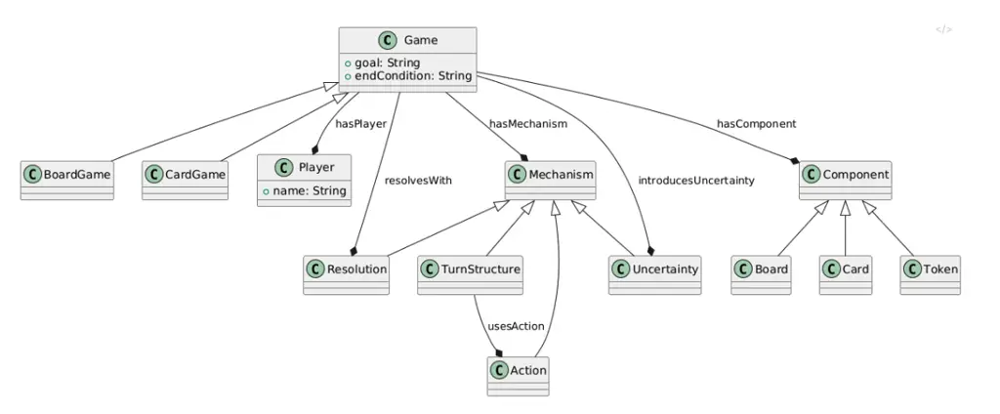

Figure 1: A sample Game Ontology expressed as an OntoUML class diagram.
The Game root entity decomposes into Player, Mechanism, and Component
aggregates, each with typed relationships (_hasPlayer_, _hasMechanism_,
_hasComponent_) that mirror the domain structure a Generative Ontology
must capture and enforce.

### 1.2  Complementary Limitations

Table 1 summarizes the impasse. Traditional ontology has structure
without creativity; the LLM has creativity without structure. Neither
alone solves the problem of generating novel, valid designs.

|          | Strength                       | Weakness                      |
| -------- | ------------------------------ | ----------------------------- |
| Ontology | Precise, structured, validated | Cannot generate novel outputs |
| LLM      | Creative, fluent, abundant     | Unstructured, hallucinated    |

Table 1: Traditional ontology versus pure LLM generation.

The insight of Generative Ontology is that these limitations are
_complementary_. What ontology lacks, LLMs provide. What LLMs lack,
ontology provides. The synthesis, structured generation guided by
ontological schemas, produces outputs that are both creative and valid.

### 1.3  Paper Overview

We introduce _Generative Ontology_ and develop it through the domain of
tabletop game design. Section 2 reviews related work. Section 3 defines
the framework and its philosophical grounding. Sections 4–8 develop the
technical architecture: executable schemas, DSPy operationalization,
multi-agent pipelines, retrieval augmentation, and validation contracts.
Section 9 presents three empirical studies evaluating the framework.
Section 10 illustrates the pipeline with a complete case study.
Section 11 argues the pattern generalizes beyond games. Section 13
concludes with future directions.

## 2  Related Work

### 2.1  Ontologies and LLMs

Ontology development has a well-established methodology \[15\], but
recent research at the intersection of ontologies and LLMs proceeds
primarily in the _opposite_ direction from our approach. DRAGON-AI uses
retrieval-augmented LLM generation to construct biomedical ontologies
from text corpora \[18\], and OLLM demonstrates end-to-end ontology
learning with language models. These systems use LLMs _to generate
ontologies_; we use ontologies _to guide generation_.

Mehenni and Zouaq \[13\] demonstrate ontology-constrained generation for
clinical summaries, the closest methodological precedent to our work,
though their goal is hallucination reduction in summarization rather
than structured creativity. Cooper \[7\] provides foundational work on
constrained decoding that underpins our structured output approach.

### 2.2  LLMs in Game Design

Gallotta *et al.* \[9\] survey LLM applications in games broadly, while
Becker *et al.* \[4\] present Boardwalk, a framework for generating
board game _code_ from existing rules, generating implementations rather
than designs. Maleki and Zhao \[12\] survey procedural content
generation methods, noting emerging LLM integration but without
ontological constraints.

### 2.3  LLM-as-Judge Evaluation

Recent work has established LLMs as evaluators of creative
output \[20\]. Concerns about evaluator reliability motivate our
test-retest analysis: Shankar *et al.* \[16\] argue that “who validates
the validators” is a critical question for LLM-based evaluation
pipelines. We address this by reporting intraclass correlation
coefficients (ICC) for all evaluation metrics \[11, 17\], demonstrating
that our evaluator is a reliable instrument rather than assuming so.

### 2.4  Gap

Our contribution fills a specific gap: using ontology as a generative
grammar for structured creative output, operationalized through
executable schemas, multi-agent pipelines, and retrieval augmentation,
with rigorous empirical evaluation including ablation, benchmarking, and
evaluator validation.

## 3  Generative Ontology: The Synthesis

If traditional ontology is a map, Generative Ontology is a map that
knows how to build new cities.

> Generative Ontology is the practice of encoding domain knowledge as
> executable schemas that constrain and guide AI generation,
> transforming static knowledge representation into a creative engine.

When we built our tabletop game ontology \[5\], we created a structured
vocabulary: game types, mechanisms, components, player interactions.
This vocabulary enabled _analysis_ of games such as _Catan_ and _Dune:
Imperium_ with precision. The insight of Generative Ontology is that the
same structure enabling understanding can enable creation. The
categories that constrain analysis become the scaffolding for
generation.

### 3.1  The Grammar of Games

A poet does not experience grammar as a limitation. Grammar is not what
prevents poetry; it is what makes poetry _possible_. Without the
structure of syntax, semantics, and form, there would be no sonnets, no
haiku, no free verse pushing against convention. The rules are not the
enemy of creativity; they are its condition of possibility.

The same principle applies to game design. When we ask an unconstrained
LLM to “design a board game about space exploration,” we receive verbose
descriptions that sound plausible but collapse under scrutiny. The AI
might describe a “resource management mechanic” without specifying what
resources exist, how they flow, or what makes acquiring them
interesting. Generative Ontology provides the grammar. When we encode
the game ontology as a schema, we give the LLM the structural vocabulary
to be creative _coherently_. The schema declares: every game must have a
goal, an end condition, mechanisms that create player choices,
components that instantiate those mechanisms. Within those constraints,
infinitely many games are possible. Without them, no valid game emerges.

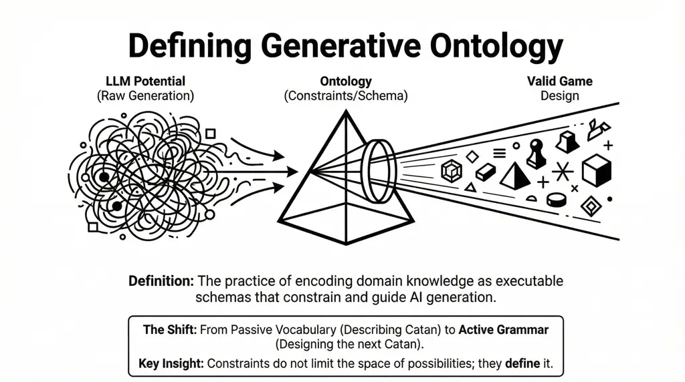

Figure 2: LLM potential plus ontology constraints yields valid design.
Generative Ontology transforms a passive vocabulary for description into
an active grammar for creation.

Table 2 illustrates the difference concretely.

| Without Ontology                             | With Generative Ontology                                                  |
| -------------------------------------------- | ------------------------------------------------------------------------- |
| “Players collect resources and build things” | Goal: first to 10 VP via settlements                                      |
| “There’s some kind of trading”               | Mechanism: resource trading with 4:1 bank or negotiated rates             |
| “The game ends eventually”                   | End Condition: when any player reaches 10 VP or development deck exhausts |
| Fluent but vague                             | Structured and playable                                                   |

Table 2: Generation without versus with Generative Ontology.

### 3.2  Philosophical Grounding

For readers familiar with our earlier exploration of process philosophy
for AI agent design \[6\], Generative Ontology has a natural grounding
in Alfred North Whitehead’s metaphysics \[19\]. Whitehead distinguished
between _eternal objects_ (pure forms, patterns, and structures that
exist as potentials) and _actual occasions_ (the concrete events where
eternal objects find expression). Our game ontology is a collection of
eternal objects: the abstract patterns of worker placement, deck
building, area control. These patterns have no reality until they are
instantiated in actual games. Generative Ontology is the process of
moving from eternal objects to actual occasions: the ontology provides
the forms; generation produces the instances. Creativity, in Whitehead’s
view, is precisely this novel synthesis of eternal objects into actual
occasions that have never existed before \[3\].

## 4  From Ontology to Executable Schema

Philosophy illuminates the path; engineering builds the road. The key
insight is surprisingly direct: ontology classes map naturally to schema
definitions, and schema definitions become the structured outputs that
constrain LLM generation.

### 4.1  The Transformation

Our tabletop game ontology \[5, 8\] defined four core concepts: _Game_
(the container with goal and end condition), _Mechanism_ (turn
structure, actions, resolution, uncertainty), _Component_ (board, cards,
tokens), and _Player_ (roles and interactions). Each of these ontology
classes becomes a Pydantic BaseModel, a typed, validated structure that
LLMs must conform to when generating output.

Listing 1 shows the abbreviated GameOntology schema. The MechanismType
enumeration reflects ontological categories developed over decades of
game design taxonomy \[8\]. By encoding these as an enum, we ensure the
LLM can only reference mechanisms within our shared vocabulary. Every
field in GameOntology corresponds to an ontology concept. The goal and
end_condition are required strings with minimum lengths, preventing
vague outputs. The nested ComponentSet and PlayerDynamics models enforce
structure at every level.

1 from enum import Enum

2 from typing import List, Literal, Optional

3 from pydantic import BaseModel, Field

4

5 class MechanismType(str, Enum):

6 WORKER_PLACEMENT = "worker_placement"

7 ACTION_POINTS = "action_points"

8 DECK_BUILDING = "deck_building"

9 RESOURCE_MGMT = "resource_management"

10 AREA_CONTROL = "area_control"

11 ENGINE_BUILDING = "engine_building"

12 SET_COLLECTION = "set_collection"

13 HIDDEN_INFO = "hidden_information"

14

15 class GameOntology(BaseModel):

16 title: str = Field(description="Name of the game")

17 theme: str = Field(description="Setting and narrative")

18 game_type: Literal\["cooperative","competitive",

19 "semi-cooperative"\]

20 goal: str = Field(min_length=20,

21 description="Victory condition")

22 end_condition: str = Field(min_length=10,

23 description="What triggers game end")

24 primary_mechanisms: List\[MechanismType\] = Field(

25 min_length=2, max_length=4)

26 turn_structure: str

27 uncertainty_source: str

28 components: ComponentSet \# nested model

29 players: PlayerDynamics \# nested model

30 setup: str

31 core_loop: str

32 strategic_depth: str

Listing 1: Abbreviated game ontology Pydantic schema. Each field
corresponds to an ontology concept; enums constrain the LLM to
recognized mechanisms.

### 4.2  Ontology-to-Schema Correspondence

Table 3 formalizes the mapping. The correspondence is not accidental:
every ontology class finds expression in the schema, and every
ontological relationship (_Game has Mechanisms_, _Game uses Components_)
becomes a nested field or list. The schema is the ontology made
executable.

| Concept    | Schema Type       | Purpose        |
| ---------- | ----------------- | -------------- |
| Game Types | Literal\[...\]    | Valid modes    |
| Mechanisms | List\[Mechanism\] | Mechanics      |
| Components | ComponentSet      | Physical parts |
| Goal / End | str (required)    | Playability    |
| Players    | PlayerDynamics    | Interactions   |

Table 3: Ontology-to-schema correspondence.

### 4.3  Why Pydantic?

The choice of Pydantic \[2\] is deliberate. Declaring GameOntology as a
BaseModel provides four critical capabilities: (1) *type validation*,
where the LLM’s output is automatically validated against the schema;
(2) *self-documentation*, where each Field description becomes part of
the prompt context; (3) *nested structure*, where hierarchical
ontologies map naturally to nested models; and (4) *enum constraints*,
where the LLM operates within the ontological vocabulary and cannot
invent mechanisms outside the taxonomy.

## 5  Operationalizing with DSPy

We have the ontology encoded as Pydantic schemas. Now we need an engine
to drive generation. DSPy (Declarative Self-improving Python) \[10\]
treats LLM interactions as composable, typed operations rather than
monolithic prompt templates. This philosophy aligns with Generative
Ontology: DSPy signatures _are_ ontological contracts.

### 5.1  Signatures as Ontological Contracts

A DSPy signature declares inputs, outputs, and a docstring that
establishes the LLM’s persona. Listing 2 shows the core generation
signature. The docstring becomes the system prompt; the input fields
capture what the user provides; the output field declares that the
result must conform to our GameOntology schema.

1 import dspy

2 from game_ontology import GameOntology

3

4 class GenerativeOntologySignature(dspy.Signature):

5 """You are an expert tabletop game designer

6 with deep knowledge of mechanisms, player

7 dynamics, and component design. Design a

8 complete, playable game based on the theme.

9 Every field must be specific, not vague."""

10

11 theme = dspy.InputField(

12 desc="Thematic concept for the game")

13 design_constraints = dspy.InputField(

14 desc="Player count, complexity, time",

15 default="")

16 game_design: GameOntology = dspy.OutputField(

17 desc="Complete game design per schema")

Listing 2: DSPy generation signature. The typed output field binds
generation to the ontological schema.

### 5.2  Execution Flow

When we execute this signature, DSPy performs the following sequence:
(1) constructs a prompt incorporating the docstring, field descriptions,
and the full Pydantic schema structure; (2) sends the prompt to the
configured LLM; (3) parses the response into the GameOntology model;
(4) validates that all required fields are present and correctly typed;
and (5) returns the validated result or raises an error for retry.

DSPy’s ChainOfThought module extends this by instructing the model to
reason through the design before committing to structured output.
Encapsulating logic in a DSPy Module enables composition of multiple
generation steps, post-generation validation, and retry logic. The
module adds a layer of semantic validation beyond what Pydantic
provides: the schema ensures structural correctness (all fields present,
correct types), while the module ensures _coherence_: that mechanisms
match components and that game type aligns with player dynamics.

## 6  Multi-Agent Ontology Pipeline

A single LLM call, even with our ontology schema, carries the entire
burden of game design: it must simultaneously consider mechanisms,
theme, components, balance, and player experience. Human design teams do
not work this way. Generative Ontology enables the same division of
labor by decomposing the ontology into domains and assigning specialized
agents to each.

### 6.1  Agent Roster and Professional Anxieties

Table 4 lists the five agents. The “Anxiety” column is crucial: each
agent is not merely assigned a domain but is given a _concern_, a
professional worry that shapes its generation and critique. This
anxiety-driven design prevents the “yes-man” tendency of LLMs to produce
plausible but shallow output.

| Agent               | Domain                     | Anxiety                                         |
| ------------------- | -------------------------- | ----------------------------------------------- |
| Mechanics Architect | Mechanisms, turn structure | “Is there meaningful player agency?”            |
| Theme Weaver        | Narrative, setting         | “Does the theme feel alive in every mechanism?” |
| Component Designer  | Cards, tokens, board       | “Can players manipulate this smoothly?”         |
| Balance Critic      | Cross-domain analysis      | “What breaks when optimized?”                   |
| Fun Factor Judge    | Player experience          | “Would I want to play this again?”              |

Table 4: Agent roster with ontology domains and professional anxieties.

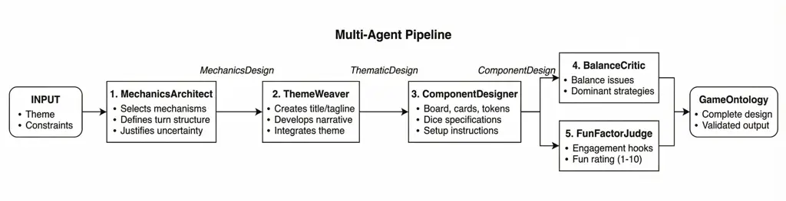

Figure 3: Multi-agent pipeline architecture. Generative agents build
sequentially (Mechanics $`\to`$ Theme $`\to`$ Components); critic agents
evaluate in parallel; refinement addresses identified issues before
final assessment.

### 6.2  Pipeline Architecture

The pipeline, illustrated in Figure 3, proceeds in four phases:

1.  1.  Sequential Generation. The Mechanics Architect produces core systems
        given the theme and constraints. The Theme Weaver receives these
        mechanics and integrates narrative. The Component Designer receives
        both and specifies physical elements.
2.  2.  Critical Evaluation. The Balance Critic examines the assembled
        design for exploits, dominant strategies, and interaction gaps.
3.  3.  Refinement. If moderate or severe issues are found, a refinement
        agent addresses specific recommendations while preserving the
        design’s strengths.
4.  4.  Experience Assessment. The Fun Factor Judge evaluates engagement
        hooks, tension moments, satisfaction sources, and replayability.

## 7  Retrieval-Augmented Generation

Our Generative Ontology can create novel game designs, but creativity
without context risks reinventing solutions that already exist. The most
interesting creative work happens in conversation with what has come
before.

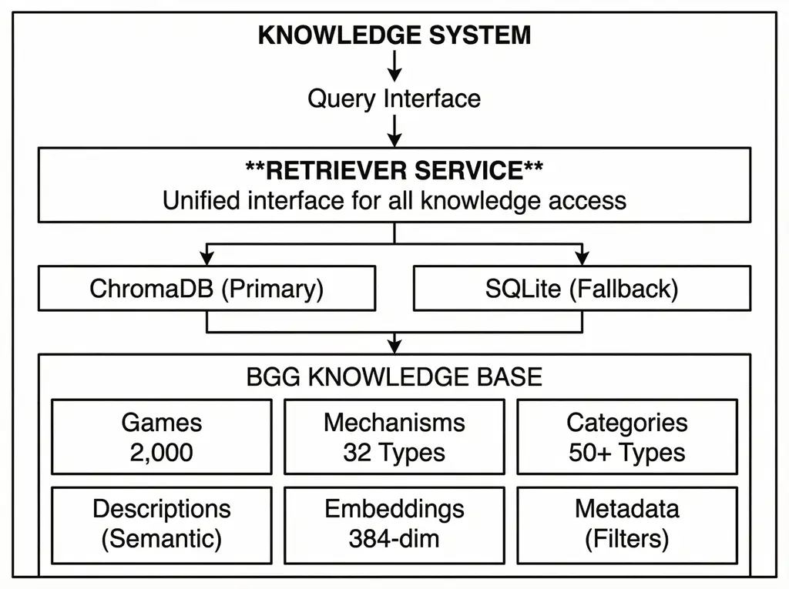

Figure 4: Knowledge System architecture. A unified Retriever Service
dispatches queries to ChromaDB (semantic vector search) or SQLite
(structured fallback), drawing on a BGG corpus of 1,767 games with
384-dimensional embeddings, mechanism types, and filterable metadata.

### 7.1  Two-Phase Retrieval

BoardGameGeek \[1\] contains data on over 100,000 tabletop games. We
structure this corpus according to our ontology and employ a two-phase
retrieval strategy: (1) *ontology filtering*, which narrows candidates
to games sharing target mechanisms from the MechanismType taxonomy; then
(2) *semantic ranking*, which ranks the filtered set by embedding
similarity to the thematic query. This ensures retrieved games are both
_mechanically relevant_ and _thematically resonant_.

### 7.2  Grounded Creativity

RAG transforms Generative Ontology from invention to _informed
invention_. The system knows what mechanisms have been successfully
combined, how similar themes have been approached, and what design
patterns work for given player counts and complexity levels. The
ontology provides the grammar; the retrieved examples provide the
vocabulary. Together, they enable generation that speaks the language of
game design fluently.

## 8  Ontology as Validation Contract

Generation is not enough. The ontology serves not only as a generation
schema but as a validation contract: a set of constraints that generated
designs must satisfy to count as coherent.

### 8.1  Ontological Constraint Checking

We encode mechanism–component dependencies as validation functions.
Listing 3 shows the core checker: a dictionary maps each mechanism to
the component field it requires (deck building $`\to`$ cards, area
control $`\to`$ board, worker placement $`\to`$ tokens). When a
mechanism is present but its required component is absent, the validator
flags the incoherence.

1 def \_check_mechanism_requirements(

2 self, design: GameOntology

3 ) -\> List\[str\]:

4 issues = \[\]

5 requirements = {

6 MechanismType.DECK_BUILDING:

7 ("card_types",

8 "Deck building needs cards"),

9 MechanismType.AREA_CONTROL:

10 ("board_description",

11 "Area control needs board"),

12 MechanismType.WORKER_PLACEMENT:

13 ("tokens",

14 "Workers need tokens"),

15 }

16 for mech in design.primary_mechanisms:

17 if mech in requirements:

18 field, msg = requirements\[mech\]

19 val = getattr(

20 design.components, field, None)

21 if not val:

22 issues.append(msg)

23 return issues

Listing 3: Ontology validator excerpt checking mechanism–component
coherence.

### 8.2  Iterative Refinement

DSPy’s Assert mechanism enables inline validation: when
dspy.Assert(is_valid, error_message) fails, DSPy automatically retries
generation with the error message included as feedback. This
architecture treats the ontology as a _contract_ between the generation
system and downstream consumers. Downstream systems (whether human
designers, balancing tools, or game engines) can rely on structural
guarantees: a deck-building game will have cards; a cooperative game
will not have direct conflict; the end condition will be specified.

## 9  Empirical Evaluation

The preceding sections describe the Generative Ontology framework. We
now evaluate it through three complementary studies: an ablation study
isolating the contribution of each architectural component, a benchmark
comparison against published board games, and a test-retest reliability
analysis validating our evaluation instrument.

### 9.1  Experimental Setup

Generation Model. All designs were generated using Claude Sonnet 4
(model ID claude-sonnet-4-20250514, temperature 0.7) via DSPy.

Evaluation Pipeline. Each generated design is evaluated through two
complementary lenses: (1) *structural metrics*, computed
deterministically by checking the ontology for completeness (are all
required fields present?), alignment (do mechanisms match components?),
and consistency (are there contradictions?); and (2) *creative metrics*,
scored by an LLM evaluator (“Design Coach”) on seven dimensions:
strategic depth, tension/drama, player agency, replayability, social
interaction, elegance, and thematic cohesion, each on a 1–10 scale. The
Design Coach also provides an overall fun rating (1–10) and engagement
variance (standard deviation across dimension scores). The evaluator
uses the same model at temperature 0 for near-deterministic scoring.

Theme Prompts. Ten standardized theme prompts span a range of complexity
levels and game types (see Appendix A). Each prompt specifies a theme,
player count, complexity level, and target play time.

Experimental Conditions. Four conditions isolate the contribution of
each pipeline component (Table 5).

| Condition     | Configuration                                                     |
| ------------- | ----------------------------------------------------------------- |
| C1 (Baseline) | Raw LLM generation, no schema or ontology                         |
| C2 (Schema)   | Pydantic schema validation only                                   |
| C3 (Ontology) | Schema + ontology constraints, single agent                       |
| C4 (Pipeline) | Full pipeline: schema + ontology + RAG + multi-agent + validation |

Table 5: Experimental conditions for the ablation study.

### 9.2  Study 1: Ablation

Design.
$`4\text{ conditions}\times 10\text{ prompts}\times 3\text{ replications}=120`$
designs, all evaluated through the full pipeline.

Structural Validity. Table 6 reports structural metrics. Schema
validation (C1$`\to`$C2) produces the largest single improvement: mean
consistency errors drop from 5.03 to 0.10 ($`d=4.78`$, $`p<.001`$).
Adding ontology constraints (C3, C4) eliminates errors entirely. C3
achieves perfect consistency but lower completeness (83%) because
single-agent generation misses some detail fields, resolved by
multi-agent specialization in C4.

| Condition     | Errors | Compl. |
| ------------- | ------ | ------ |
| C1 (Baseline) | 5.03   | 100%   |
| C2 (Schema)   | 0.10   | 100%   |
| C3 (Ontology) | 0.00   | 83%    |
| C4 (Pipeline) | 0.00   | 100%   |

Table 6: Structural metrics by condition.

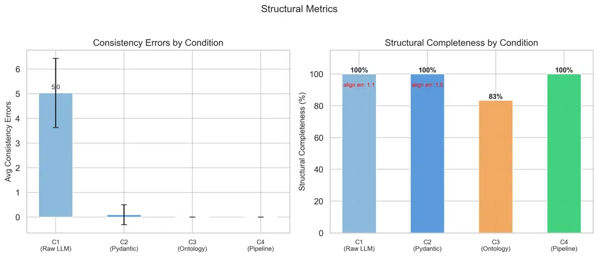

Figure 5: Structural metrics by condition. Left: mean consistency errors
drop from 5.03 (C1) to zero (C3, C4). Right: completeness is 100% for
all conditions except C3 (83%), where single-agent generation misses
detail fields.

Creative Quality. Figure 6 shows the distribution of creative dimension
scores. The key finding is that constraints alone (C2, C3) do not
improve creative quality; multi-agent specialization (C4) does. The
largest effects from C3$`\to`$C4 are on strategic depth ($`d=1.59`$,
$`p<.001`$), elegance ($`d=1.14`$, $`p<.001`$), and fun ($`d=1.12`$,
$`p<.001`$). Tension shows a moderate effect ($`d=0.79`$, $`p<.05`$).
Replayability and social interaction show no reliable differences across
any conditions.

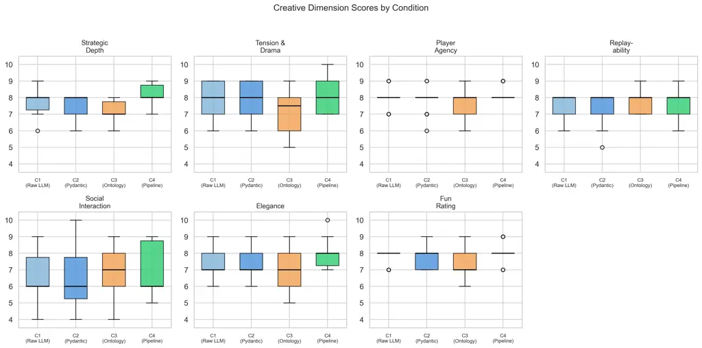

Figure 6: Creative dimension score distributions by condition. C4
(Pipeline) shows the highest and tightest distributions on most
dimensions. Replayability and social interaction do not discriminate
between conditions.

Cost–Quality Frontier. The multi-agent pipeline incurs significant
computational cost. C4 uses $`{\sim}27`$k tokens per design versus
$`{\sim}3.1`$k for C1, an 8.5$`\times`$ increase. Figure 7 shows both
absolute cost and the efficiency ratio (tokens per fun point). C4
achieves the highest quality but at 3,369 tokens per fun point versus
398 for C1, establishing a clear Pareto frontier.

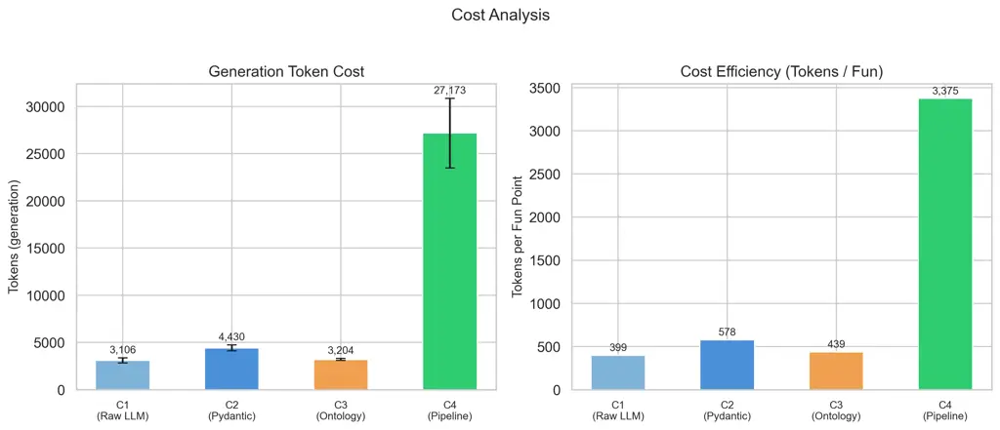

Figure 7: Cost analysis. Left: generation tokens per design. Right:
tokens per fun point. C4 costs $`{\sim}8.5\times`$ more but achieves the
highest fun rating.

Summary. Structural validity is solved by schema validation. Creative
quality arises from the interaction between constraint enforcement and
architectural specialization: constraints alone suppress richness;
specialization restores and enhances it.

### 9.3  Study 2: Benchmark Comparison

Design. We compare 30 C4-generated designs from Study 1 against 20
published board games evaluated through the same pipeline. The reference
set spans three complexity tiers: light (Azul, Splendor, Love Letter,
Kingdomino, Codenames), medium (Wingspan, Everdell, 7 Wonders,
Concordia, Spirit Island), and heavy (Brass: Birmingham, Gaia Project,
Twilight Imperium 4E, Through the Ages, Gloomhaven), plus five
pre-existing ontologies (Catan, Root, Dune Imperium, Terraforming Mars,
Ticket to Ride). See Appendix B for the full list. Each real game was
reverse-engineered into a complete GameGrammar ontology and evaluated
through the identical Design Coach pipeline.

Structural Parity. Both groups achieve 100% completeness. Generated
designs have fewer consistency errors (1.27 vs. 2.80, $`d=0.76`$,
$`p<.01`$). The higher error count for real games reflects richer
component vocabularies (specialized tokens, standees, custom boards)
that extend beyond the checker’s standard categories.

Creative Gap. Table 7 reports creative dimension scores. Published games
score significantly higher on 5 of 7 dimensions, with the largest
effects on elegance ($`d=1.72`$) and fun ($`d=1.86`$). Crucially,
tension/drama ($`d=0.35`$, ns) and social interaction ($`d=0.19`$, ns)
show no significant differences, suggesting the pipeline already handles
these dimensions comparably.

| Dimension          | Real | Gen. | $`d`$ | Sig.   |
| ------------------ | ---- | ---- | ----- | ------ |
| Strategic Depth    | 8.85 | 8.13 | 0.94  | \*\*   |
| Tension & Drama    | 8.50 | 8.20 | 0.35  | ns     |
| Player Agency      | 9.00 | 8.23 | 1.21  | \*\*\* |
| Replayability      | 9.05 | 7.63 | 1.59  | \*\*\* |
| Social Interaction | 7.20 | 6.93 | 0.19  | ns     |
| Elegance           | 9.25 | 7.97 | 1.72  | \*\*\* |
| Fun Rating         | 8.90 | 8.07 | 1.86  | \*\*\* |

$`d`$ = Cohen’s $`d`$; ns = not significant; \*\* $`p<.01`$; \*\*\*
$`p<.001`$.

Table 7: Creative dimensions: real vs. generated designs.

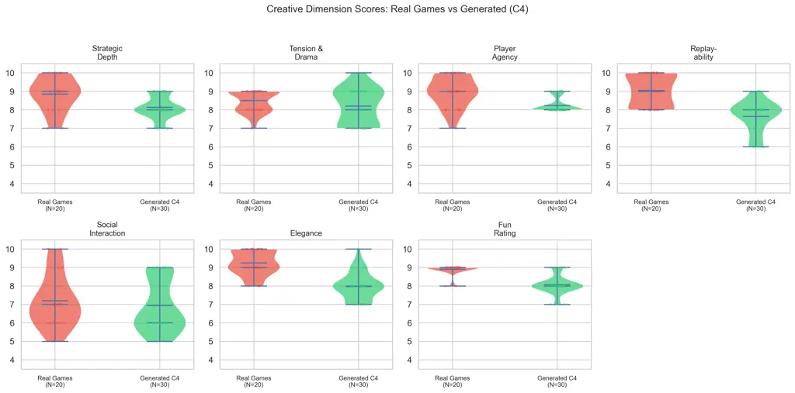

Figure 8: Violin plots showing score distributions for all creative
dimensions. Real games (red) cluster in the 8–9 range while generated
designs (green) spread across 7–9. Tension/drama and social interaction
show the most overlap.

Mechanism Similarity. Generated designs use a similar number of
mechanisms (6.7 vs. 6.1, $`d=-0.60`$) but fewer component types (7.8
vs. 11.6, $`d=1.12`$, $`p<.01`$). The pipeline generates designs within
a mid-complexity band but does not yet produce the extremes: neither
ultra-light party games nor epic-scale strategy games (Figure 9).

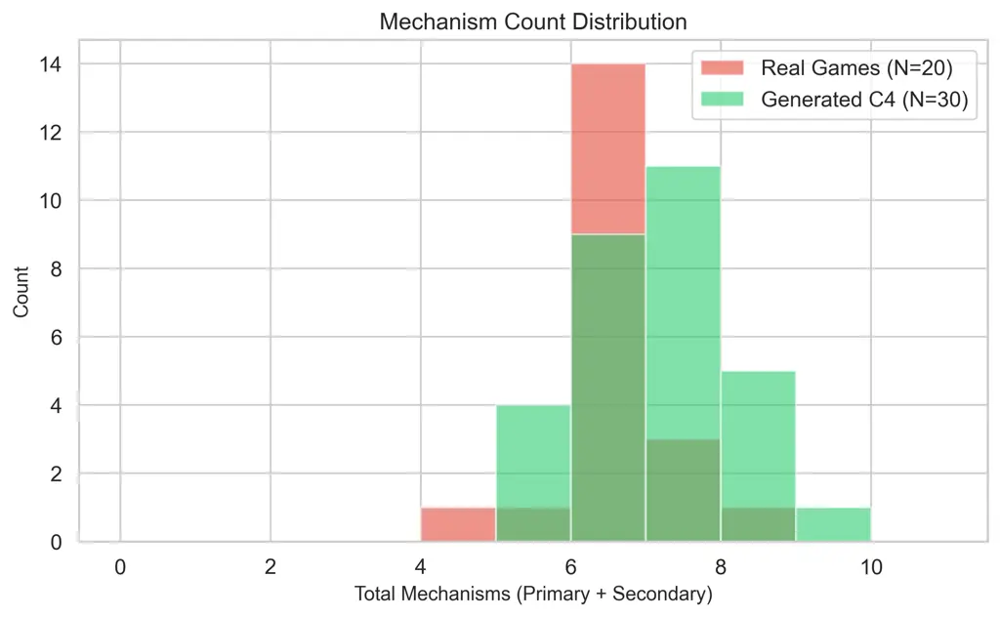

Figure 9: Mechanism count distributions. Both groups center around 6–7
mechanisms; generated designs show slightly more spread.

Summary. Generated designs achieve structural parity with published
games but exhibit a bounded creative gap of approximately one point on a
10-point scale. This gap likely reflects properties that emerge from
iterative playtesting (elegance and replayability) rather than design
specification alone.

### 9.4  Study 3: Evaluator Reliability

An empirical evaluation is only as credible as its evaluation
instrument. We assess the Design Coach’s test-retest reliability using
intraclass correlation coefficients (ICC).

Design. Ten designs spanning the quality range (fun ratings 6–9, all
four conditions) were each evaluated five times through the Design
Coach, yielding 50 evaluations. We compute ICC(2,1), two-way random
effects with single rater and absolute agreement \[17\], for each of the
nine LLM-scored metrics.

Results. Table 8 reports ICC values. Seven of nine metrics achieve
Good-to-Excellent reliability (ICC $`\geq 0.75`$). Four metrics rate
Excellent ($`\geq 0.90`$): tension & drama (0.989), social interaction
(0.983), thematic cohesion (0.975), and elegance (0.934). Three rate
Good: fun rating (0.873), strategic depth (0.846), and player agency
(0.836). Two metrics, replayability (0.578) and engagement variance
(0.598), show moderate reliability.

| Metric             | ICC  | 95% CI         | Level     |
| ------------------ | ---- | -------------- | --------- |
| Tension & Drama    | .989 | \[.970, 1.00\] | Excellent |
| Social Interaction | .983 | \[.960, .990\] | Excellent |
| Thematic Cohesion  | .975 | \[.940, .990\] | Excellent |
| Elegance           | .934 | \[.850, .980\] | Excellent |
| Fun Rating         | .873 | \[.730, .960\] | Good      |
| Strategic Depth    | .846 | \[.680, .950\] | Good      |
| Player Agency      | .836 | \[.660, .950\] | Good      |
| Engagement Var.    | .598 | \[.330, .850\] | Moderate  |
| Replayability      | .578 | \[.300, .840\] | Moderate  |

Table 8: Test-retest reliability: ICC(2,1) per metric.

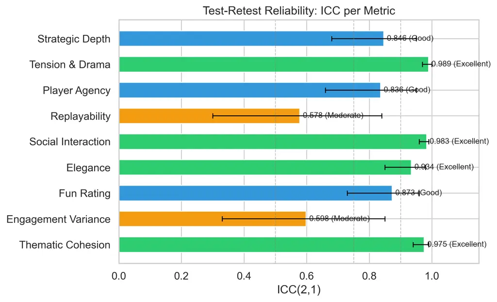

Figure 10: ICC values per metric with 95% confidence intervals. Green =
Excellent ($`\geq.90`$), blue = Good (.75–.90), orange = Moderate
(.50–.75).

Cross-Study Validation. The ICC results retroactively validate prior
findings. Fun rating (ICC = 0.873) confirms that the fun-based
comparisons in Studies 1 and 2 rest on stable measurements. The high ICC
for tension & drama (0.989) and social interaction (0.983) confirms that
the non-significant differences in Study 2 reflect genuine equivalence,
not measurement noise. Conversely, replayability’s moderate ICC (0.578)
suggests that its non-significance in Study 1 may partly reflect
evaluator inconsistency, a property arguably better assessed through
playtesting than design specification analysis.

Summary. The Design Coach is a reliable evaluation instrument. Score
differences between designs reflect genuine quality differences, not
evaluator drift.

## 10  Case Study: Mycelium: The Deep

To illustrate the pipeline concretely, we trace a single generation from
theme to playable design. The input is a theme chosen to be unusual
enough that retrieval finds no direct precedents:

> Theme: “Bioluminescent fungi competing for dominance in a deep cave
> ecosystem”  
> Constraints: 2–4 players, medium complexity, cooperative, 60–90
> minutes

The Mechanics Architect selects three core mechanisms: resource
management (spore allocation), area control (cave network expansion),
and engine building (specialized fungal structures). The Theme Weaver
titles the game _Mycelium: The Deep_ and maps each mechanism to its
fictional counterpart: spore placement as reproductive strategy, area
control as securing nutrient pathways, engine building as developing
specialized structures. The Component Designer specifies 30 modular hex
cave tiles, three card types, and tokens including fungal growth cubes,
spore tokens, and flood markers. The Balance Critic identifies a
runaway-leader problem and arbitrary flood timing; the refinement agent
adds a Network Synergy rule and predictable flood escalation. The Fun
Factor Judge rates the refined design 7/10. Table 9 summarizes the
output.

| Field      | Value                                                                               |
| ---------- | ----------------------------------------------------------------------------------- |
| Title      | Mycelium: The Deep                                                                  |
| Type       | Cooperative                                                                         |
| Goal       | Grow fungal network from cave depths to surface before flood reaches highest colony |
| End        | Victory: growth cube reaches surface tile. Defeat: flood reaches highest cube row   |
| Mechanisms | Resource management, area control, engine building                                  |
| Turn loop  | Place spores $`\to`$ Reveal $`\to`$ Grow $`\to`$ Event $`\to`$ Flood rises          |
| Players    | 2–4, role-differentiated                                                            |
| Components | 30 hex tiles, 3 card types, 60 growth cubes, 12 spore tokens, 20 flood markers      |

Table 9: Abbreviated output: _Mycelium: The Deep_.

Without the ontology schema, an LLM generating “a cooperative game about
bioluminescent fungi” would likely produce vague victory conditions,
inconsistent mechanism–component mappings, and disconnected theme.
Generative Ontology enforced complete goal specification, coherent
mechanism–component alignment, and thematic integration. The output is
not merely plausible; it is _playable_.

## 11  Generalizability

We developed Generative Ontology through tabletop games because games
have rich ontological structure and connect to our previous work. But
the pattern extends to any domain with coherent structure, where experts
share vocabulary, where valid outputs satisfy definable constraints, and
where knowledge accumulates in exemplars.

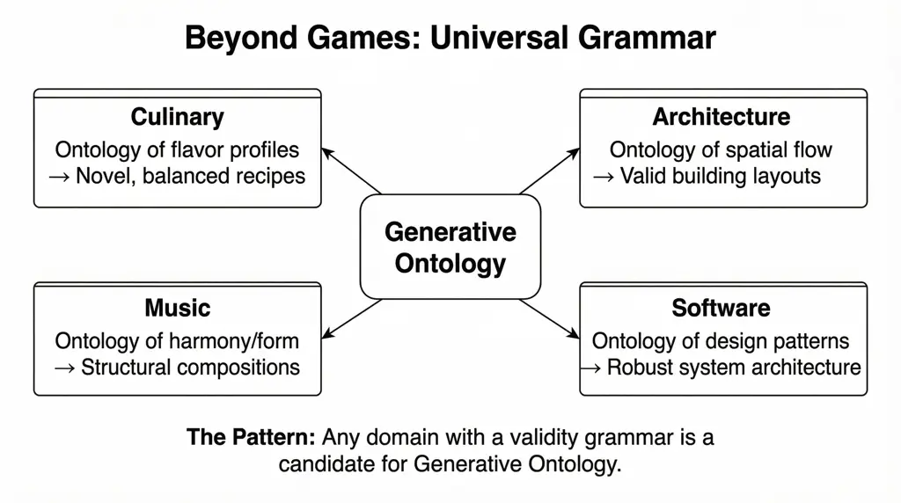

Figure 11: Beyond games: any domain with a “validity grammar” is a
candidate for Generative Ontology.

Table 10 illustrates eight domains where Generative Ontology applies.
The pattern is most valuable when four conditions hold: (1) *the domain
has structure*: experts can articulate what makes outputs valid;
(2) *exemplars exist*: a corpus of successful examples enables RAG;
(3) *validity is checkable*: constraints can be encoded as validation
functions; and (4) *generation is valuable*: the effort of building the
ontology is justified by repeated generation needs.

| Domain               | Ontology Elements                | Generation Output     | Validation Criteria              |
| -------------------- | -------------------------------- | --------------------- | -------------------------------- |
| Tabletop Games       | Mechanisms, components, dynamics | Novel game designs    | Playability, balance, coherence  |
| Music Composition    | Scales, progressions, forms      | Original compositions | Harmonic validity, structure     |
| Architecture         | Spaces, materials, flows, codes  | Building designs      | Structural integrity, compliance |
| Culinary Arts        | Ingredients, techniques, flavors | Novel recipes         | Flavor balance, feasibility      |
| Narrative            | Characters, arcs, themes         | Stories and plots     | Narrative coherence, pacing      |
| Software Design      | Patterns, components, interfaces | System architectures  | Consistency, coupling, coverage  |
| Legal Documents      | Clauses, parties, obligations    | Contracts             | Legal validity, completeness     |
| Scientific Protocols | Methods, materials, controls     | Experimental designs  | Reproducibility, validity        |

Table 10: Cross-domain applicability of Generative Ontology.

## 12  Discussion

### 12.1  The Constraint Paradox in Data Form

Our ablation results provide empirical evidence for what we term the
_constraint paradox_: adding constraints (C2, C3) eliminates structural
errors without improving creative quality, yet the combination of
constraints with architectural specialization (C4) produces the largest
creative gains. Constraints alone suppress richness; constraints plus
specialization enable it. This suggests a _Constraint–Architecture
Interaction Model_: creative quality is a function of constraint
expressiveness _multiplied by_ architectural specialization, not simply
additive.

### 12.2  The Gap as Feature

The one-point creative gap between generated and published designs
(Study 2) is, paradoxically, encouraging. Published games represent
decades of iterative playtesting, community feedback, and designer
refinement, processes that no single generation pass can replicate. That
the pipeline produces designs in the 7–8 range (“good, playable,
interesting”) rather than the 8–9 range (“polished, elegant,
replayable”) suggests the gap reflects not a fundamental limitation of
the approach but the absence of iterative refinement. The dimensions
where parity is already achieved (tension/drama and social interaction)
may be those most amenable to specification-time design, while the gap
dimensions (elegance and replayability) may require iterative
playtesting to optimize.

### 12.3  The Whiteheadian Connection

Generative Ontology offers a concrete instantiation of Whitehead’s
metaphysics \[19, 6\]. The ontology provides eternal objects, abstract
patterns existing as potentials. Generation produces actual occasions,
concrete instantiations where form meets matter. Creativity is the
movement from potentiality to actuality. Our empirical results show this
movement is not random: the constraints shape the space of possible
actualizations, and architectural specialization navigates that space
effectively.

### 12.4  Limitations

Several limitations qualify our findings. LLM-as-evaluator: While our
ICC analysis demonstrates evaluator reliability, it does not establish
validity: LLM scores may be consistently biased. Human calibration
(comparing LLM scores to expert judgment) remains future work. No
playtesting: Our evaluation assesses design specifications, not
gameplay. Properties like elegance and replayability may manifest
differently in play than in specification. Reference set: The 20
benchmark games, while spanning three complexity tiers, represent a
convenience sample of well-known titles. A larger, more diverse
reference set would strengthen generalizability. Single model: All
generation and evaluation used Claude Sonnet 4. Cross-model evaluation
would assess robustness. Temperature sensitivity: Evaluator ICC was
measured at temperature 0; reliability at higher temperatures is
untested.

## 13  Conclusion and Future Work

We began with a question: what happens when ontology learns to create?
The answer is Generative Ontology, a synthesis combining the structural
precision of knowledge representation with the creative power of large
language models \[14\].

Four insights emerged from this work:

The Grammar Paradox. Constraints enable creativity. Our ablation study
confirms this empirically: schema validation eliminates structural
errors ($`d=4.78`$) while multi-agent specialization produces the
largest creative gains (fun $`d=1.12`$, depth $`d=1.59`$).

Neither Alone Suffices. Traditional ontology without generation is
static. LLM generation without ontology is unconstrained. The benchmark
comparison shows that the synthesis produces designs that are
structurally equivalent to published games, with a bounded creative gap
that likely reflects the absence of iterative playtesting rather than
fundamental architectural limitations.

Reliable Measurement Matters. Our test-retest analysis (ICC 0.578–0.989,
median 0.873) demonstrates that LLM-based evaluation can be reliable
when properly constrained. The cross-study validation differentiates
“non-significant due to noise” from “non-significant due to genuine
equivalence,” a methodological contribution applicable beyond game
design.

The Pattern Generalizes. Although we developed Generative Ontology
through games, the pattern applies wherever structured domains exist.
Music, architecture, cooking, narrative, software design: each has its
grammar, its ontology, its space of valid outputs.

Future directions include _human calibration_ (validating LLM scores
against expert judgment), _iterative design loops_ (multiple
generation–evaluation–refinement cycles to close the creative gap),
_cross-model evaluation_ (assessing robustness across LLMs), and _DSPy
optimization_ (using the ontology validation function as a reward signal
for automatic prompt tuning).

The grammar does not write the poem. But without grammar, there is no
poem to write. Generative Ontology gives AI the grammar it needs to
create meaningfully within any structured domain. The GameGrammar system
is available at
[https://github.com/bennycheung/GameGrammarCLI](https://github.com/bennycheung/GameGrammarCLI).

## References

- \[1\] BoardGameGeek.
  [https://boardgamegeek.com/](https://boardgamegeek.com/), 2024.
- \[2\] DSPy: Programming with foundation models.
  [https://dspy.ai/](https://dspy.ai/), 2024.
- \[3\] Timothy Barker. Artificial creativity: A process philosophy of
  technology perspective. _Journal of Continental Philosophy_, 2024. URL
  [https://eprints.gla.ac.uk/327708/1/327708.pdf](https://eprints.gla.ac.uk/327708/1/327708.pdf).
- \[4\] Álvaro Guglielmin Becker, Gabriel Bauer de Oliveira,
  Lana Bertoldo Rossato, and Anderson Rocha Tavares. Boardwalk: Towards
  a framework for creating board games with LLMs. _arXiv preprint
  arXiv:2508.16447_, 2025. URL
  [https://arxiv.org/abs/2508.16447](https://arxiv.org/abs/2508.16447).
- \[5\] Benny Cheung. Unlocking the secrets of tabletop games ontology.
  [https://bennycheung.github.io/unlocking-secrets-of-tabletop-games-ontology](https://bennycheung.github.io/unlocking-secrets-of-tabletop-games-ontology), 2025.
- \[6\] Benny Cheung. Process philosophy for AI agent design.
  [https://bennycheung.github.io/process-philosophy-for-ai-agent-design](https://bennycheung.github.io/process-philosophy-for-ai-agent-design), 2026.
- \[7\] Aidan Cooper. A guide to structured generation using constrained
  decoding.
  [https://www.aidancooper.co.uk/constrained-decoding/](https://www.aidancooper.co.uk/constrained-decoding/), 2024.
- \[8\] Geoffrey Engelstein and Isaac Shalev. _Building Blocks of
  Tabletop Game Design: An Encyclopedia of Mechanisms_. CRC Press, 2020.
- \[9\] Roberto Gallotta et al. Large language models and games: A
  survey and roadmap. _arXiv preprint arXiv:2402.18659_, 2024. URL
  [https://arxiv.org/abs/2402.18659](https://arxiv.org/abs/2402.18659).
- \[10\] Omar Khattab et al. DSPy: Compiling declarative language model
  calls into self-improving pipelines. In _International Conference on
  Learning Representations (ICLR)_, 2024. URL
  [https://openreview.net/pdf?id=sY5N0zY5Od](https://openreview.net/pdf?id=sY5N0zY5Od).
- \[11\] Terry K. Koo and Mae Y. Li. A guideline of selecting and
  reporting intraclass correlation coefficients for reliability
  research. _Journal of Chiropractic Medicine_, 15(2):155–163, 2016.
  doi: 10.1016/j.jcm.2016.02.012.
- \[12\] Mahdi Farrokhi Maleki and Richard Zhao. Procedural content
  generation in games: A survey with insights on emerging LLM
  integration. _arXiv preprint arXiv:2410.15644_, 2024. URL
  [https://arxiv.org/abs/2410.15644](https://arxiv.org/abs/2410.15644).
- \[13\] Gaya Mehenni and Amal Zouaq. Ontology-constrained generation of
  domain-specific clinical summaries. _arXiv preprint
  arXiv:2411.15666_, 2024. URL
  [https://arxiv.org/abs/2411.15666](https://arxiv.org/abs/2411.15666).
- \[14\] Lingrui Mei et al. A survey of context engineering for large
  language models. _arXiv preprint arXiv:2507.13334_, 2025. URL
  [https://arxiv.org/abs/2507.13334](https://arxiv.org/abs/2507.13334).
- \[15\] Natalya F. Noy and Deborah L. McGuinness. Ontology development
  101: A guide to creating your first ontology. Technical report,
  Stanford University, 2001. URL
  [https://protege.stanford.edu/publications/ontology_development/ontology101.pdf](https://protege.stanford.edu/publications/ontology_development/ontology101.pdf).
- \[16\] Shreya Shankar et al. Who validates the validators? aligning
  LLM-assisted evaluation of LLM outputs with human preferences. _arXiv
  preprint arXiv:2404.12272_, 2024. URL
  [https://arxiv.org/abs/2404.12272](https://arxiv.org/abs/2404.12272).
- \[17\] Patrick E. Shrout and Joseph L. Fleiss. Intraclass
  correlations: Uses in assessing rater reliability. _Psychological
  Bulletin_, 86(2):420–428, 1979. doi: 10.1037/0033-2909.86.2.420.
- \[18\] Sabrina Toro et al. DRAGON-AI: Dynamic retrieval augmented
  generation of ontologies using AI. _Journal of Biomedical
  Semantics_, 2024. URL
  [https://jbiomedsem.biomedcentral.com/articles/10.1186/s13326-024-00320-3](https://jbiomedsem.biomedcentral.com/articles/10.1186/s13326-024-00320-3).
- \[19\] Alfred North Whitehead. _Process and Reality_. Free
  Press, 1929. Corrected edition, 1978.
- \[20\] Lianmin Zheng et al. Judging LLM-as-a-judge with MT-Bench and
  chatbot arena. _Advances in Neural Information Processing Systems_,
  36, 2024. URL
  [https://arxiv.org/abs/2306.05685](https://arxiv.org/abs/2306.05685).

## Appendix A Theme Prompts

Table 11 lists the ten standardized theme prompts used in the ablation
study. Each prompt was run under all four experimental conditions with
three replications, yielding 120 total designs.

| \#  | Constraints                             | Theme                                                         |
| --- | --------------------------------------- | ------------------------------------------------------------- |
| 1   | 2–4p, competitive, medium, 45–60min     | Bioluminescent fungi competing in a cave ecosystem            |
| 2   | 2–4p, competitive, med-heavy, 60–90min  | Victorian-era detective solving mysteries through deduction   |
| 3   | 3–5p, competitive, med-heavy, 60–90min  | Space traders negotiating routes between planets              |
| 4   | 2–4p, competitive, light, 30–45min      | Medieval knights jousting in a tournament                     |
| 5   | 2–4p, cooperative, medium, 45–60min     | Deep sea divers recovering treasure from a sunken ship        |
| 6   | 2–4p, competitive, medium, 45–60min     | Rival chefs competing in a cooking competition                |
| 7   | 2–5p, competitive, med-heavy, 90–120min | Ancient civilizations building wonders of the world           |
| 8   | 2–4p, cooperative, medium, 30–45min     | Escape room where the walls are closing in                    |
| 9   | 2–4p, competitive, medium, 45–60min     | Fairy tale creatures vying for control of an enchanted forest |
| 10  | 2–4p, cooperative, heavy, 90–120min     | Time travelers preventing paradoxes across historical eras    |

Table 11: Standardized theme prompts for the ablation study.

## Appendix B Reference Games

Table 12 lists the 20 published board games used as the reference set in
Study 2. Games were selected to span three complexity tiers (light,
medium, heavy) and represent widely recognized titles with established
design reputations. Each game was reverse-engineered into a complete
GameGrammar ontology (25 required fields plus 3 balance parameters) and
evaluated through the identical Design Coach pipeline used for generated
designs.

| \#  | Game                 | Designer(s)                       | Tier   |
| --- | -------------------- | --------------------------------- | ------ |
| 1   | Azul                 | Michael Kiesling                  | Light  |
| 2   | Codenames            | Vlaada Chvátil                    | Light  |
| 3   | Kingdomino           | Bruno Cathala                     | Light  |
| 4   | Love Letter          | Seiji Kanai                       | Light  |
| 5   | Splendor             | Marc André                        | Light  |
| 6   | 7 Wonders            | Antoine Bauza                     | Medium |
| 7   | Catan                | Klaus Teuber                      | Medium |
| 8   | Concordia            | Mac Gerdts                        | Medium |
| 9   | Dune: Imperium       | Paul Dennen                       | Medium |
| 10  | Everdell             | James A. Wilson                   | Medium |
| 11  | Root                 | Cole Wehrle                       | Medium |
| 12  | Spirit Island        | R. Eric Reuss                     | Medium |
| 13  | Terraforming Mars    | Jacob Fryxelius                   | Medium |
| 14  | Ticket to Ride       | Alan R. Moon                      | Medium |
| 15  | Wingspan             | Elizabeth Hargrave                | Medium |
| 16  | Brass: Birmingham    | Gavan Brown & Matt Tolman         | Heavy  |
| 17  | Gaia Project         | Jens Drögemüller & Helge Ostertag | Heavy  |
| 18  | Gloomhaven           | Isaac Childres                    | Heavy  |
| 19  | Through the Ages     | Vlácil Chvátil                    | Heavy  |
| 20  | Twilight Imperium 4E | Dane Beltrami & Corey Konieczka   | Heavy  |

Table 12: Reference games for the benchmark study (Study 2).
