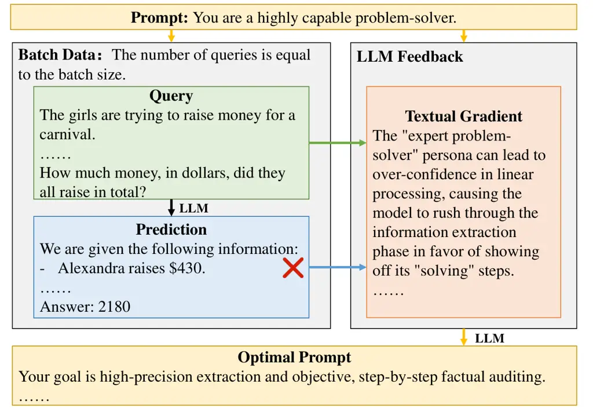

# C-MOP: Integrating Momentum and Boundary-Aware Clustering for Enhanced Prompt Evolution

Binwei Yan Affiliation: Noah’s Ark Lab, Huawei, China    Yifei Fu
Affiliation: Noah’s Ark Lab, Huawei, China    Mingjian Zhu
Affiliation: Noah’s Ark Lab, Huawei, China    Hanting Chen
Affiliation: Noah’s Ark Lab, Huawei, China    Mingxuan Yuan
Affiliation: Noah’s Ark Lab, Huawei, China    Yunhe Wang ^(✉)
Affiliation: Noah’s Ark Lab, Huawei, China    Hailin Hu ^(✉)
Affiliation: Noah’s Ark Lab, Huawei, China Correspondence to:
<yunhe.wang@huawei.com> Correspondence to: <hailin.hu@huawei.com>

###### Abstract

Automatic prompt optimization is a promising direction to boost the
performance of Large Language Models (LLMs). However, existing methods
often suffer from noisy and conflicting update signals. In this
research, we propose C-MOP (Cluster-based Momentum Optimized Prompting),
a framework that stabilizes optimization via Boundary-Aware Contrastive
Sampling (BACS) and Momentum-Guided Semantic Clustering (MGSC).
Specifically, BACS utilizes batch-level information to mine tripartite
features—Hard Negatives, Anchors, and Boundary Pairs—to precisely
characterize the typical representation and decision boundaries of
positive and negative prompt samples. To resolve semantic conflicts,
MGSC introduces a textual momentum mechanism with temporal decay that
distills persistent consensus from fluctuating gradients across
iterations. Extensive experiments demonstrate that C-MOP consistently
outperforms SOTA baselines like PromptWizard and ProTeGi, yielding
average gains of 1.58% and 3.35%. Notably, C-MOP enables a general LLM
with 3B activated parameters to surpass a 70B domain-specific dense LLM,
highlighting its effectiveness in driving precise prompt evolution. The
code is available at
[https://github.com/huawei-noah/noah-research/tree/master/C-MOP](https://github.com/huawei-noah/noah-research/tree/master/C-MOP).

###### Keywords: 

Prompt Optimization, Clustering

## 1 Introduction

Large Language Models (LLMs) (Brown et al., 2020; Touvron et al., 2023;
Chowdhery et al., 2023) have become one of the most influential research
frontiers in artificial intelligence, demonstrating remarkable
capabilities across diverse tasks (Zhao et al., 2023; Minaee et al.,
2024). However, their performance remains highly sensitive to prompt
design—a phenomenon that presents both opportunities and challenges for
practical deployment (Zhao et al., 2021; Lu et al., 2022). Consequently,
an effective prompt optimization strategy is required to help people
generate the best possible prompts.



(a)

(b)

Figure 1: (a) Textual gradient-based prompt optimization workflow,
showing the definition of “textual gradient”, “batch size” and other
components. (b) Accuracy versus different batch sizes using
Qwen3-30B-A3B-Instruct-2507 (Yang et al., 2025) to optimize prompts on
the Liar dataset (Wang, 2017).

Early prompt engineering (Jiang et al., 2020; Reynolds and McDonell,
2021; Liu et al., 2023) relied heavily on manual expertise and
trial-and-error, whereas recent research has proposed automatic prompt
optimization (Tong et al., 2025; Yu et al., 2025) to reduce manual
burden. Among various approaches, textual gradient-based
methods (Pryzant et al., 2023; Agarwal et al., 2025) (workflow is
illustrated in Figure 1(a)) have gained significant attention due to
their ability to provide interpretable directional guidance for
iterative refinement. However, the dissection of this “LLM-as-optimizer”
process (Yang et al., 2023) is generally lagging behind, which hinders
this application in real-world applications.

In back-propagation-based model optimization, the scale of batching is
of great importance and generally increasing the batch size can reduce
gradient noise and improve training efficiency (Krizhevsky, 2014; Hoffer
et al., 2017; McCandlish et al., 2018; Shallue et al., 2019). While
transferring this idea to textual gradient is intuitively
straightforward, till now few studies have explicitly explored this
direction. To fill this gap, we first characterize the performance of
textual gradient optimization with respect to the inputting example
numbers, as illustrated in Figure 1(b). Intriguingly, the results
demonstrate a clear performance gain over 8% when scaling up the batch
size from 4 to 128, and then the size effect saturates to a point that
further expansion fails to benefit the performance.

These interesting phenomenon indicate the potential of applying
tradition optimization principle to automatic prompt optimization. While
enlarging the batch size is generally beneficial, we hypothesize that
too many incorrect or non-representative samples will result in
gradients that are noisy, unfocused, or even contradictory. Such
gradient conflicts hinder optimization stability, making it difficult
for the update process to converge to high-quality prompts (Sener and
Koltun, 2018). Moreover, unlike the numerical averaging operation in
gradients of back propagation, expanding the batch size of textual
gradients requires populating the context with different exemplars,
which is constrained by the context length of LLMs or the memory of
hardware. Drawing from these two insights, in this work, we aim to
further enhance the effectiveness of large-batch textual gradient
optimization with strategic sample selection (Bengio et al., 2009;
Settles, 2009). In particular, we propose a novel framework method,
named C-MOP (Cluster-based Momentum Optimized Prompting), which is
designed to identify and select more representative samples. This
approach effectively emulates the benefits of an expanded batch size,
thereby maximizing the positive impact of batch size increases. Our key
innovations are as follows:

1.  1.  Boundary-Aware Contrastive Sampling (BACS): We replace stochastic
        sampling with error-rate-aware clustering to systematically select
        Hard Negatives, Anchors, and Boundary Pairs. These points
        collectively map the semantic transition between successful and
        erroneous regions, thereby delineating the decision boundaries of
        prompt. By isolating the minimal linguistic differences that trigger
        classification flips within these pairs, BACS extracts precise
        contrastive signals that pinpoint specific prompt deficiencies.
2.  2.  Momentum-Guided Semantic Clustering (MGSC): To resolve textual
        gradient conflicts, we introduce a refinement mechanism that
        maintains a historical gradient pool with a temporal decay factor.
        By accumulating gradients across iterations, MGSC ensures the
        temporal persistence of optimization signals, allowing weighted
        clustering to extract the semantic consensus while marginalizing
        batch-specific contradictions. This process transforms transient,
        fluctuating feedback into a unified and stable optimization
        direction.

Our extensive experiments on four diverse benchmarks, i.e BBH (Suzgun et
al., 2022), GSM8K (Cobbe et al., 2021), CFinBench (Nie et al., 2025),
and Liar (Wang, 2017) demonstrate that C-MOP consistently outperforms
state-of-the-art baselines, achieving 1.58% to 3.35% average
improvement. Ablation studies confirm that clustering contributes
substantially to the effectiveness of the framework.

## 2 Related Work

### 2.1 Manual Prompt Engineering

Prompt engineering has long been a central technique for eliciting
desired behaviors from large language models. Early work (Reynolds and
McDonell, 2021; Wei et al., 2022) demonstrated that constructing prompts
through methods such as anthropomorphism, analogy, and demonstration to
enable capabilities like in-context learning and few-shot reasoning.
However, manual prompt design relies heavily on extensive expertise and
domain knowledge (Reynolds and McDonell, 2021; Liu et al., 2023), and
even subtle linguistic variations can significantly impact model
performance. (Brown et al., 2020; Jiang et al., 2020; Perez et al.,
2021). Consequently, handcrafted prompting is time-consuming and
labor-intensive, often requiring exhaustive
trial-and-error (Zamfirescu-Pereira et al., 2023). These drawbacks have
motivated a growing interest in automating the prompt creation and
optimization process.

### 2.2 Automatic Prompt Optimization

To overcome the limitations of manual prompting, a growing body of work
has explored automatic prompt optimization. Early studies proposed
trajectory-based optimization (Yang et al., 2023; Tang et al., 2025),
which generates new prompts based on historical candidates and their
corresponding scores. Evolutionary-based methods (Fernando et al., 2023;
Tong et al., 2025), on the other hand, iteratively refine prompts by
combining LLMs with evolutionary algorithms. Recent research has shifted
its focus toward feedback-based approaches (Pryzant et al., 2023;
Agarwal et al., 2025), which extract textual gradients from error
analysis as feedback signals to guide prompt updates. Furthermore, to
enhance optimization effectiveness, some researchers have adopted
multi-agent collaboration to assign diverse roles to LLMs (Han et al.,
2025; Zhang et al., 2025; Pei et al., 2025), while others have applied
model optimization techniques to prompt tuning, integrating historical
textual gradients via momentum to mitigate noise (Peng et al., 2025).
Nevertheless, they fail to account for the disparity between textual and
numerical gradients. Due to their discreteness, textual gradients are
more susceptible to mutual interference, thereby undermining the overall
optimization effectiveness. Consequently, we aim to employ a more robust
update signal selection scheme to ensure optimization stability.

### 2.3 Limitations of Existing Methods

Despite these advances, existing textual gradient-based prompt
optimization methods face two critical challenges:

1.  1.  Incomplete Boundary Characterization: Current methods typically rely
        on sparse, stochastic sampling of a small subset of failure
        cases (Pryzant et al., 2023). This myopic approach fails to capture
        the global distribution of model performance and neglects the subtle
        “decision boundaries” where the model fluctuates between success and
        failure, resulting in unfocused and imprecise gradient signals.
2.  2.  Textual Gradient Conflict and Instability: In large-scale batch
        optimization, LLM-generated gradients are often redundant or even
        contradictory, where different error cases suggest opposing
        optimization directions (Han et al., 2025). Without a mechanism to
        aggregate information across iterations, these methods suffer from
        significant gradient noise and unstable optimization trajectories.

To address these limitations, we propose C-MOP, which introduces a
Boundary-Aware Contrastive Sampling strategy to map precise decision
boundaries and a textual momentum mechanism that leverages historical
gradients to stabilize the optimization process.

## 3 Method

In this section, we present our proposed framework for automated prompt
optimization.

1:  Input: Task model $`\mathcal{F}`$, Optimizer model
$`\mathcal{F}_{opt}`$, Dataset $`\mathcal{D}`$, Initial prompt
$`p_{0}`$, Batch size $`B`$, Iterations $`T`$, Total quota
$`Q_{total}`$, Decay factor $`\gamma`$, Embedding model $`\phi`$.

2:  Output: Optimized prompt $`p_{T}`$.

3:  Initialize Gradient Pool $`\mathcal{G}_{pool}\leftarrow\emptyset`$

4:  for $`t=0`$ to $`T-1`$ do

5:   Sample batch $`\mathcal{D}_{t}\subset\mathcal{D}`$ with size $`B`$.

6:   Generate predictions $`\{r_{i}\}`$ using $`p_{t}`$ for all
$`(q_{i},a_{i})\in\mathcal{D}_{t}`$.

7:   Compute embeddings $`e_{i}=\phi(\text{concat}(q_{i},a_{i},r_{i}))`$
and cluster into $`\{\mathcal{C}_{1},\ldots,\mathcal{C}_{K}\}`$.

8:   for each cluster $`\mathcal{C}_{k}`$ do

9:    Calculate error rate $`E_{k}`$ and assign sample quota $`Q_{k}`$
for cluster $`\mathcal{C}_{k}`$.

10:    $`\mathcal{S}_{k}\leftarrow`$ Sample $`Q_{k}`$ instances focusing
on the tripartite structures.

11:
   $`\mathcal{G}_{new}\leftarrow\text{GenerateGradients}(\mathcal{F}_{opt},p_{t},\mathcal{S}_{k})`$.

12:   end for

13:   $`\mathcal{G}_{pool}\leftarrow\mathcal{G}_{pool}\times\gamma`$

14:   Add $`\mathcal{G}_{new}`$ to $`\mathcal{G}_{pool}`$ with initial
weights.

15:   Cluster $`\mathcal{G}_{pool}`$ and aggregate weights within each
cluster.

16:   $`\mathcal{T}_{t}\leftarrow`$ Select top $`n`$ gradients with
highest weights.

17:   $`\mathcal{P}_{cand}\leftarrow\emptyset`$

18:   for $`l=1`$ to $`L`$ do

19:    Select $`g^{*}\in\mathcal{T}_{t}`$ and generate $`\hat{p}_{l}`$
via $`\mathcal{F}_{opt}`$ rewriting $`p_{t}`$.

20:
   $`\mathcal{P}_{cand}\leftarrow\mathcal{P}_{cand}\cup\{\hat{p}_{l}\}`$

21:   end for

22:   $`p_{t+1}\leftarrow\text{UCB\_Select}(\mathcal{P}_{cand})`$

23:  end for

24:  return $`p_{T}`$

Algorithm 1 C-MOP: Cluster-based Momentum Optimized Prompting

Figure 2: Overview of the C-MOP framework. The pipeline consists of four
stages: (1) Full-Batch Prediction; (2) Boundary-Aware Contrastive
Sampling; (3) Momentum-Guided Semantic Clustering; (4) Gradient-Guided
Evolution.

### 3.1 Problem Formulation

Let $`\mathcal{D}=\{(q_{i},a_{i})\}_{i=1}^{N}`$ denote a dataset of
query-answer pairs, where $`q_{i}`$ represents an input query and
$`a_{i}`$ the corresponding ground-truth answer. Given a base language
model $`\mathcal{F}`$ and an initial prompt $`p_{0}`$, our goal is to
find an optimized prompt $`p^{*}`$ that maximizes the expected task
performance:

```math
p^{*}=\arg\max_{p}\mathbb{E}_{(q,a)\sim\mathcal{D}}[s(\mathcal{F}(p,q),a)] \tag{1}
```

where the expectation $`\mathbb{E}_{(q,a)\sim\mathcal{D}}`$ represents
the average performance over the data distribution. In practice, this is
approximated by evaluating the scoring function $`s(\cdot,\cdot)`$
(e.g., accuracy, F1 score) across sampled batches of instances. The
challenge lies in navigating the discrete, high-dimensional prompt space
to find a prompt that generalizes across the entire distribution while
avoiding local optima (Bengio et al., 2013).

### 3.2 Framework Overview

C-MOP operates through an iterative refinement process consisting of
four key stages, as illustrated in Figure 2:

1.  1.  Full-Batch Prediction: Evaluate the current prompt $`p_{t}`$ on an
        entire sampled batch. Unlike traditional methods that only store
        failure cases, we preserve both positive and negative samples to
        provide a global view of the performance of the current prompt.
2.  2.  Boundary-Aware Contrastive Sampling (BACS): We apply semantic
        clustering to the batch and allocate sampling quotas based on
        cluster-level error rates. Within each cluster, we extract Hard
        Negatives, Anchors, and Boundary Pairs to capture the subtle
        decision logic of the model.
3.  3.  Momentum-Guided Semantic Clustering (MGSC): We generate textual
        gradients (Pryzant et al., 2023) for the sampled cases. To resolve
        gradient conflicts, we maintain a historical gradient pool with a
        temporal decay $`\gamma`$, performing secondary clustering to select
        the most consistent and effective optimization directions.
4.  4.  Gradient-Guided Evolution: Guided by the refined gradients, the
        optimizer model generates a diverse set of candidate prompts
        $`\mathcal{P}_{cand}`$. To efficiently navigate this pool, we employ
        a UCB-based strategy (Auer et al., 2002) that balances exploration
        and exploitation, selecting the top-$`W`$ prompts for the next
        iteration.

We now detail each component, with particular emphasis on our
Boundary-Aware Contrastive Sampling and Momentum-Guided Semantic
Clustering evolution mechanisms. The complete optimization workflow of
the C-MOP framework is formally presented in Algorithm 1.

### 3.3 Boundary-Aware Contrastive Sampling

To ensure high-fidelity feedback, BACS replaces stochastic sampling with
a systematic extraction of Hard Negatives, Anchors, and Boundary Pairs.
The motivation for this design is two-fold: first, Anchors are essential
for establishing a stable reference of successful reasoning, preventing
the optimizer model from drifting away from correct logic during
refinement; second, Boundary Pairs are crucial for pinpointing the
precise linguistic triggers that cause the model to flip between correct
and incorrect outputs. By contrasting these prototypical success
patterns with subtle failure modes, BACS precisely characterizes the
decision boundaries of prompt to generate high-contrast, boundary-aware
textual gradients. The strategy follows four sequential steps to select
the most informative samples from a batch $`\mathcal{B}`$:

1\. Global Batch Embedding: For every sample $`(q_{i},a_{i})`$ in the
batch, where $`r_{i}`$ is the prediction of task model, we generate a
semantic representation $`e_{i}`$ using a pre-trained encoder $`\phi`$:

```math
e_{i}=\phi(\text{concat}(q_{i},a_{i},r_{i})) \tag{2}
```

By embedding the entire batch, we create a complete semantic map of the
prompt’s current behavior across different input types.

2\. Cluster-Aware Quota Allocation: We apply K-means clustering (Krishna
and Murty, 1999) to partition the batch into $`K`$ clusters
$`\{C_{1},C_{2},\dots,C_{K}\}`$ and sample a total of $`Q_{total}`$
instances from a single batch. For each cluster $`C_{k}`$, we calculate
its error rate
$`E_{k}=\frac{|\mathcal{B}_{error}\cap C_{k}|}{|C_{k}|}`$. We then
allocate a sampling quota $`Q_{k}`$ proportional to the error rate:

```math
Q_{k}=\max\left(1,\left\lceil Q_{total}\times\frac{E_{k}}{\sum_{j=1}^{K}E_{j}}\right\rceil\right) \tag{3}
```

This mechanism ensures that clusters exhibiting higher failure
rates—which highlight the logical deficiencies of the current prompt—are
prioritized for further optimization.

3\. Tripartite Fine-Grained Sampling: Within each cluster $`C_{k}`$, we
define positive samples $`C_{k}^{+}`$ as correctly predicted instances
and negative samples $`C_{k}^{-}`$ as incorrectly predicted ones. Based
on the quota $`Q_{k}`$, we select three types of samples to provide the
optimizer model with maximal contrast:

- •
  Hard Negatives: The negative sample closest to the centroid. Since the
  centroid represents the dominant semantic theme of the cluster, these
  samples identify systematic failures rather than random outliers,
  representing cases where the reasoning logic of the prompt
  consistently fails:

  ```math
  e^{hard}=\arg\min_{e\in C_{k}^{-}}\|e-\mu_{k}\|^{2} \tag{4}
  ```

- •
  Anchors: The positive sample closest to the centroid $`\mu_{k}`$.
  These instances represent the prototypical success patterns of the
  cluster, establishing a stable baseline for the correct reasoning
  logic of the prompt:

  ```math
  e^{anc}=\arg\min_{e\in C_{k}^{+}}\|e-\mu_{k}\|^{2} \tag{5}
  ```

- •
  Boundary Pairs: The $`n`$ pairs of samples $`(e^{+},e^{-})`$ that
  minimize the semantic distance $`\|e^{+}-e^{-}\|^{2}`$. These pairs
  are critical for decision boundary refinement; by isolating the
  minimal semantic difference that triggers a classification flip, they
  provide high-contrast signals that pinpoint the exact instructional
  flaws.

4\. Gradient Generation: The selected samples are passed to the
optimizer model. By comparing the Hard Negatives and Anchors alongside
the Boundary Pairs, the LLM can derive highly actionable gradients that
specifically target the confusion between similar semantic inputs.

### 3.4 Momentum-Guided Semantic Clustering

We propose Momentum-Guided Semantic Clustering (MGSC), a mechanism that
maintains a historical gradient pool through a temporal decay factor. By
aggregating gradients across iterations, MGSC distills persistent
semantic consensus into a unified and stable direction for prompt
evolution. The refinement process is formalized as follows:

1\. Dynamic Gradient Pool Maintenance: We maintain a historical gradient
pool $`\mathcal{G}_{t}=\{(g_{i},w_{i},t_{i})\}`$, where each entry
consists of a textual gradient $`g_{i}`$, its importance weight
$`w_{i}`$, and the iteration index $`t_{i}`$ when the gradient is
generated. At each iteration $`t`$, all historical gradients undergo a
temporal decay:

```math
w_{i}^{(t)}=w_{i}^{(0)}\cdot\gamma^{(t-t_{i})} \tag{6}
```

where $`\gamma`$ is a decay factor. This ensures that more recent
gradients—which reflect the model’s current behavior—carry stronger
influence, while older gradients are gradually phased out.

2\. Cross-Iteration Gradient Clustering: To resolve textual conflicts
and ensure temporal consistency, we perform semantic clustering on the
unified set of current gradients and the decayed historical pool. The
total gradient set is defined as:

```math
\mathbf{G}_{total}=\mathcal{G}{current}\cup\mathcal{G}{pool} \tag{7}
```

We subsequently partition $`\mathbf{G}_{total}`$ into $`M`$ semantic
clusters $`\{\hat{C}_{1},\hat{C}_{2},\dots,\hat{C}_{M}\}`$ based on
their latent embeddings. This clustering allows the framework to
identify persistent optimization themes across different iterations.

3\. Weight-Based Gradient Selection: Within each cluster
$`\hat{C}_{j}`$, gradients may still point in slightly different
directions. To extract the most representative and “stable” direction,
we select the top-$`n`$ gradients with the highest accumulated weights:

```math
g^{*}_{j}=\text{Top-n}_{g\in\hat{C}_{j}}(w^{(t)}) \tag{8}
```

This selection process acts as a semantic moving average, effectively
suppressing stochastic noise from individual batches.

4\. Prompt Evolution: The final set of refined gradients
$`\{g^{*}_{j}\}`$ is used to guide the optimizer model. By focusing on
high-weight, cluster-representative gradients, the evolution process
remains coherent across iterations, preventing the “oscillation” common
in naive textual gradient descent.

| Method                              | Task Model    | Optimizer Model | BBH            | GSM8K          | Liar           | Avg   |
| ----------------------------------- | ------------- | --------------- | -------------- | -------------- | -------------- | ----- |
|                                     |               |                 | (EM)           | (Acc)          | (F1)           |       |
| OPRO (Yang et al., 2023)            | PaLM 2-L      | PaLM 2-L-IT     | -              | 80.20          | -              | -     |
| EvoPrompt (Tong et al., 2025)       | GPT-3.5-Turbo | GPT-3.5-Turbo   | 75.03          | -              | -              | -     |
| PromptWizard (Agarwal et al., 2025) | GPT-4         | GPT-4           | 88.10          | 95.40          | -              | -     |
| SPO (Xiang et al., 2025)            | GPT-4o-mini   | GPT-4o          | -              | -              | 66.90          | -     |
| ERM (Yan et al., 2025)              | Doubao-Pro    | GPT-4o          | 86.10          | 93.30          | 68.60          | -     |
| MARS (Zhang et al., 2025)           | GPT-4o        | GPT-4o          | 80.86          | -              | -              | -     |
| GPO (Tang et al., 2025)             | GPT-4         | GPT-4           | 78.65          | -              | -              | -     |
| Zero-shot (Base)                    | Q30BA3B-Inst  | -               | 81.65\_(±0.14) | 80.67\_(±0.47) | 40.92\_(±0.33) | 67.75 |
| ProTeGi\* (Pryzant et al., 2023)    | Q30BA3B-Inst  | Q30BA3B-Think   | 82.63\_(±1.27) | 95.07\_(±0.20) | 58.47\_(±0.43) | 78.72 |
| PromptWizard\*                      | Q30BA3B-Inst  | Q30BA3B-Think   | 85.34\_(±1.51) | 94.54\_(±0.68) | 61.61\_(±0.62) | 80.50 |
| SPO\*                               | Q30BA3B-Inst  | Q30BA3B-Think   | 84.13\_(±1.31) | 93.00\_(±1.01) | 59.38\_(±3.07) | 78.84 |
| GPO\*                               | Q30BA3B-Inst  | Q30BA3B-Think   | 82.61\_(±1.61) | 95.04\_(±0.79) | 57.85\_(±3.53) | 78.50 |
| C-MOP (Ours)                        | Q30BA3B-Inst  | Q30BA3B-Think   | 86.24\_(±0.41) | 95.53\_(±0.20) | 64.46\_(±0.68) | 82.08 |
| $`\Delta`$ vs. PromptWizard         |               |                 | +0.90          | +0.99          | +2.85          | +1.58 |

Table 1: Main Results: Accuracy comparison (%) on three benchmarks. Best
results are bolded, second-best are underlined. Results are averaged
over three runs with standard deviation shown as subscripts. Asterisks
(\*) denote our re-implemented version. Q30BA3B-Inst:
Qwen3-30B-A3B-Instruct-2507, Q30BA3B-Think: Qwen3-30B-A3B-Thinking-2507.

### 3.5 Gradient-Guided Evolution

The final stage of our framework transforms the stable semantic
gradients into concrete prompt instructions through a two-fold evolution
process: candidate generation and adaptive selection.

Candidate Generation. The diversity and quality of the candidate pool
are fundamental to the robustness of the optimization. To ensure a broad
yet targeted search within the prompt manifold, we derive $`2M`$ primary
optimization directions by selecting the top-2 gradients with the
highest accumulated weights from each of the $`M`$ semantic clusters in
MGSC:

```math
\mathcal{G}_{refined}=\{g^{*}_{j,k}\mid j\in\{1,\dots,M\},k\in\{1,2\}\} \tag{9}
```

These gradients represent stabilized, cluster-level insights that allow
the optimizer model to focus on rectifying systemic logical deficiencies
rather than isolated failures. For each
$`g^{*}\in\mathcal{G}_{refined}`$, the optimizer model rewrites the
current prompt $`p_{t}`$ to produce a total of $`L`$ distinct candidates
$`\mathcal{P}_{cand}`$. During this process, we maintain an appropriate
sampling temperature to encourage structural and vocabulary diversity,
ensuring that candidates are not merely minor paraphrases but distinct
strategic attempts at task instruction.

UCB-Driven Selection. Given the large-scale candidate prompt pool,
evaluating every prompt on the entire validation set would be
computationally prohibitive. To efficiently navigate this search space,
we frame the selection as a multi-armed bandit problem and employ the
Upper Confidence Bound (UCB) algorithm (Auer et al., 2002):

```math
UCB(p)=\mu(p)+\alpha\sqrt{\frac{\ln N}{n_{p}}} \tag{10}
```

where $`\mu(p)`$ is the empirical mean accuracy, $`n_{p}`$ is the number
of evaluations for prompt $`p`$, and $`N`$ is the total evaluation
trials. This mechanism dynamically balances the exploitation of
high-performing prompts with the exploration of candidates whose
potential remains uncertain. By iteratively assessing candidates on
fresh subsets of data until the budget is exhausted, C-MOP prevents the
optimization from converging prematurely to local optima. Finally, the
top-$`W`$ prompts with the highest empirical performance are selected as
the “beam” for the subsequent iteration.

## 4 Experiments

In this section, we conduct a comprehensive empirical evaluation to
validate the effectiveness of C-MOP. Our experiments aim to answer four
key research questions:

1.  1.  RQ1: How does C-MOP compare to state-of-the-art prompt optimization
        methods?
2.  2.  RQ2: What is the individual contribution of each component?
3.  3.  RQ3: How does the choice of optimizer model affect optimization
        outcomes?
4.  4.  RQ4: Can C-MOP enable general-purpose models to rival
        domain-specific models?

### 4.1 Experimental Setup

Benchmarks. We evaluate C-MOP across four diverse datasets to
demonstrate its applicability: BBH (Suzgun et al., 2022) (Big-Bench
Hard) for complex logical reasoning, Liar (Wang, 2017) for
short-statement fact-checking, GSM8K (Cobbe et al., 2021) for multi-step
mathematical problems, and CFinBench (Nie et al., 2025) for specialized
financial domain knowledge. More detailed descriptions and data
statistics for each benchmark are presented in Appendix A.1.

Baselines. We compare C-MOP with Zero-shot (with a default prompt) and
four re-implemented existing methods, including ProTeGi (Pryzant et al.,
2023), PromptWizard (Agarwal et al., 2025), SPO (Xiang et al., 2025) and
GPO (Tang et al., 2025).

Implementation Details. Unless otherwise specified, we employ
Qwen3-30B-A3B-Instruct-2507 (Yang et al., 2025) as the task model, while
using Qwen3-30B-A3B-Thinking-2507 (Yang et al., 2025) as the optimizer
model. For text clustering, all-MiniLM-L6-v2 (Reimers and Gurevych, 2019) is used as the embedding model. A default batch size of $`B=128`$
is employed throughout our experiments. The optimization process is
conducted over $`T=20`$ iterations with a beam size of $`W=4`$. In each
iteration, the optimizer model generates a total of $`L=10`$ candidate
prompts based on the refined gradients. We set the total sampling quota
$`Q_{total}=30`$. The number of clusters for BACS is set to $`K=14`$,
while the number of clusters for MGSC is $`M=10`$. Furthermore, we
incorporate a decay factor $`\gamma=0.9`$ during the gradient
aggregation phase to emphasize recent feedback signals. Detailed
sensitivity analyses for these hyper-parameters, along with
generalization experiments across diverse task models, are presented in
Appendix A.2. All experiments were conducted using three random seeds,
and we report the mean ± standard deviation.

### 4.2 Main Results (RQ1)

Table 1 presents the performance of C-MOP compared to state-of-the-art
(SOTA) methods and re-implemented baselines across three representative
benchmarks. The results demonstrate that C-MOP consistently achieves the
highest accuracy among all models using the same task model. We
summarize the key findings as follows:

- •
  Consistency Across Benchmarks: C-MOP outperforms all re-implemented
  baselines on BBH, GSM8K, and Liar. Compared to the strongest baseline,
  PromptWizard\*, C-MOP achieves absolute gains of +0.90%, +0.99%, and
  +2.85% respectively. The substantial improvement on the Liar dataset
  (from 61.61% to 64.46%) is particularly noteworthy, highlighting its
  effectiveness in handling nuanced semantic classification tasks.
- •
  High-Performance Reasoning: In logic-intensive tasks like GSM8K and
  BBH, C-MOP reaches 95.53% and 86.24% accuracy. Remarkably, our method
  using the Qwen3-30B-A3B-Instruct-2507 surpasses several GPT-4 based
  SOTA methods, such as MARS (80.86%) and GPO (78.65%) on the BBH
  benchmark. This indicates that our optimization strategy can
  significantly narrow the gap between open-source and proprietary
  models.
- •
  Comparison with Zero-shot Base: Compared to the Zero-shot (Base)
  performance, C-MOP provides a massive boost, particularly on the Liar
  dataset, where accuracy increases from 40.92% to 64.46% (+23.54%).
  This underscores the necessity of systematic prompt optimization in
  specialized tasks where default instructions often fall short.

In summary, the empirical results confirm that C-MOP is a robust and
effective framework for prompt optimization, achieving a new
state-of-the-art performance on the Qwen3-30B-A3B-Instruct-2507 as the
task model.

| Instance         | Gradient | Liar  | BBH   | Avg   |
| ---------------- | -------- | ----- | ----- | ----- |
|                  |          | (F1)  | (EM)  |       |
| Zero-shot (Base) |          | 40.92 | 81.65 | 61.29 |
| -                | MGSC     | 59.84 | 83.23 | 71.54 |
| Clustering       | MGSC     | 61.42 | 82.60 | 72.01 |
| BACS             | MGSC     | 64.46 | 86.24 | 75.35 |

Table 2: Ablation study of MGSC and different instance components.
Clustering: K-means clustering on failure instances.

| HN  | ANC | BP  | Liar  | BBH   | Avg   |
| --- | --- | --- | ----- | ----- | ----- |
|     |     |     | (F1)  | (EM)  |       |
| ✓   |     |     | 61.37 | 84.85 | 73.11 |
| ✓   | ✓   |     | 62.39 | 83.65 | 73.02 |
| ✓   |     | ✓   | 63.28 | 85.18 | 74.23 |
| ✓   | ✓   | ✓   | 64.46 | 86.24 | 75.35 |

Table 3: Ablation study of different sample types. HN, ANC, and BP
denote Hard Negatives, Anchors, and Boundary Pairs, respectively.

| Instance         | Gradient | Liar  | BBH   | Avg   |
| ---------------- | -------- | ----- | ----- | ----- |
|                  |          | (F1)  | (EM)  |       |
| Zero-shot (Base) |          | 40.92 | 81.65 | 61.29 |
| Clustering       | -        | 61.71 | 82.52 | 72.12 |
| BACS             | -        | 60.38 | 83.97 | 72.18 |
| BACS             | Momentum | 61.11 | 82.53 | 71.82 |
| BACS             | MGSC     | 64.46 | 86.24 | 75.35 |

Table 4: Ablation study on the application of different components to
instances and gradients. Momentum: momentum application without semantic
gradient clustering (Peng et al., 2025).

### 4.3 Ablation Analysis (RQ2)

To verify the individual contributions of our proposed components, we
conduct a systematic ablation study on the Liar and BBH datasets
(Table 2,  3 and 4). We analyze the impact of different module
configurations as follows:

- •
  Effectiveness of BACS: As shown in Table 2, keeping the MGSC module
  constant while replacing BACS with random sampling leads to a drop in
  average accuracy to 71.54%, which is significantly lower than the
  75.35% achieved by our full framework. Similarly, employing naive
  error clustering instead of BACS only yields a 72.01% average
  accuracy. This performance gap demonstrates that mining specific
  Boundary Pairs provides more precise directional guidance for prompt
  evolution than indiscriminately using failure cases.
- •
  Decomposition of Sample Types in BACS: Table 3 reveals distinct
  optimization dynamics between single-domain and multi-task scenarios.
  On the Liar dataset, Anchors and Boundary Pairs provide
  straightforward cumulative gains. However, on the BBH benchmark,
  adding Anchors alone leads to a performance dip from 84.85% to 83.65%.
  We hypothesize that in multi-task settings, a limited set of Anchors
  may overfit to specific sub-tasks, introducing task-specific bias that
  harms global generalization. Crucially, the integration of Boundary
  Pairs rectifies this instability, propelling the performance to a peak
  of 86.24%. This confirms that while Anchors offer static guidance,
  Boundary Pairs provide task-agnostic contrastive signals—learning the
  fundamental distinction between correct and incorrect reasoning—which
  is essential for robust optimization across diverse tasks.
- •
  Impact of MGSC Gradient Refinement: Table 4 highlights the necessity
  of our gradient refinement mechanism. The complete removal of MGSC
  results in a reduced average accuracy of 72.18%. Furthermore, we
  observe that applying momentum (Peng et al., 2025) without secondary
  semantic clustering leads to a performance dip on BBH to 82.53%, an
  outcome even lower than the 83.97% attained by BACS alone. This
  confirms that while momentum stabilizes the trajectory, the secondary
  clustering in MGSC is essential to filter out batch-specific noise and
  extract a unified semantic consensus, ultimately driving the average
  accuracy to its peak of 75.35%.

Overall, these results validate that BACS and MGSC are highly
complementary, with the former providing high-quality raw signals and
the latter ensuring their stable refinement into consistent optimization
directions.

| Task Model   | Optimizer Model     | Liar  | BBH   |
| ------------ | ------------------- | ----- | ----- |
|              |                     | (F1)  | (EM)  |
| Q30BA3B-Inst | N/A (Zero-shot)     | 40.92 | 81.65 |
| Q30BA3B-Inst | Q30BA3B-Inst (Self) | 58.24 | 83.52 |
| Q30BA3B-Inst | Q30BA3B-Think       | 64.46 | 86.24 |

Table 5: Impact of optimizer model choice on optimization effectiveness
(Liar and BBH dataset). Q30BA3B-Inst: Qwen3-30B-A3B-Instruct-2507,
Q30BA3B-Think: Qwen3-30B-A3B-Thinking-2507.

### 4.4 Impact of Optimizer Capacity (RQ3)

We investigate how the reasoning capacity of the optimizer model affects
the effectiveness of prompt evolution. Table 5 compares the performance
when using different models as the optimizer while maintaining
Qwen3-30B-A3B-Instruct-2507 as the task model. Our observations are as
follows:

- •
  Effectiveness of Self-Correction: Using the task model itself as the
  optimizer model yields substantial gains over the zero-shot baseline,
  with accuracy jumping from 40.92% to 58.24% on Liar (+17.32%) and from
  81.65% to 83.52% on BBH (+1.87%). This confirms that C-MOP enables
  models to effectively identify and rectify their own systemic biases
  through our cluster-aware gradient mechanism, providing a
  cost-effective solution without relying on external teacher models.
- •
  Benefits of Enhanced Reasoning: Upgrading to the Thinking variant
  further boosts performance to 64.46% on Liar and 86.24% on BBH. This
  significant delta suggests that the quality of textual gradients is
  highly dependent on the optimizer’s ability to perform deep logical
  deduction. Stronger models generate more precise and actionable
  gradients, which in turn guide the evolution toward more robust prompt
  candidates.

These results validate that C-MOP is scalable and can effectively
utilize stronger optimizer models to guide optimization of weaker task
models.

| Model              | Type            | Accuracy (%) |
| ------------------ | --------------- | ------------ |
| XuanYuan2-70B-Base | Domain-Specific | 56.69        |
| GPT-4              | Closed-Source   | 56.77        |
| Q30BA3B-Inst       | General         | 52.49        |
| + C-MOP            | General + Opt   | 60.20        |

Table 6: Comparison with domain-specific models on CFinBench. Results
for XuanYuan2-70-Base and GPT-4 are retrieved from (Nie et al., 2025).
Q30BA3B-Inst: Qwen3-30B-A3B-Instruct-2507. Opt: Optimization.

### 4.5 Domain Adaptation Comparison (RQ4)

We examine whether C-MOP can empower general-purpose models to rival or
even surpass domain-specific models. Table 6 compares C-MOP-optimized
Qwen3-30B-A3B-Instruct-2507 against specialized financial models and
closed-source SOTA on the CFinBench benchmark. C-MOP boosts the
performance of the general-purpose Qwen3-30B-A3B-Instruct-2507 from
52.49% to 60.20%, an absolute gain of +7.71%. Remarkably, our optimized
model with only 3B active parameters surpasses XuanYuan2-70B-Base (Zhang
and Yang, 2023) by 3.51%, despite the latter being a large-scale model
specifically pre-trained on expansive financial corpora. It also
surpasses GPT-4 (Achiam et al., 2023) (+3.43%), demonstrating that
precise prompt optimization can bridge the gap between general models
and domain-specialized experts.

## 5 Conclusion

In this paper, we investigate the problem of enhancing the efficacy of
automatic prompt optimization. We proposed C-MOP, integrating
Boundary-Aware Contrastive Sampling to resolve sampling ambiguity and
Momentum-Guided Semantic Clustering to mitigate gradient conflicts.
Specifically, BACS characterizes decision boundaries to improve the
fidelity of update signals, while MGSC utilizes temporal momentum to
ensure the stability of the optimization trajectory. Experimental
results demonstrate that C-MOP outperforms SOTA baselines and enables a
general LLM with 3B activated parameters to surpass a 70B
domain-specific dense LLM. Future work will explore hierarchical and
self-evolving strategies to further elevate the performance ceiling.

## References

- Achiam et al. (2023) J. Achiam, S. Adler, S. Agarwal, L. Ahmad, I.
  Akkaya, F. L. Aleman, D. Almeida, J. Altenschmidt, S. Altman, S.
  Anadkat, et al. Gpt-4 technical report. arXiv preprint
  arXiv:2303.08774. Cited by: §4.5.
- Agarwal et al. (2025) E. Agarwal, R. Magazine, J. Singh, V. Dani, T.
  Ganu, and A. Nambi Promptwizard: optimizing prompts via task-aware,
  feedback-driven self-evolution. In Findings of the Association for
  Computational Linguistics: ACL 2025, pp. 19974–20003. Cited by: §B.1,
  §1, §2.2, Table 1, §4.1.
- Auer et al. (2002) P. Auer, N. Cesa-Bianchi, and P. Fischer
  Finite-time analysis of the multiarmed bandit problem. Machine
  learning 47 (2), pp. 235–256. Cited by: item 4, §3.5.
- Bengio et al. (2013) Y. Bengio, N. Léonard, and A. Courville
  Estimating or propagating gradients through stochastic neurons for
  conditional computation. arXiv preprint arXiv:1308.3432. Cited by:
  §3.1.
- Bengio et al. (2009) Y. Bengio, J. Louradour, R. Collobert, and J.
  Weston Curriculum learning. In Proceedings of the 26th annual
  international conference on machine learning, pp. 41–48. Cited by: §1.
- Brown et al. (2020) T. Brown, B. Mann, N. Ryder, M. Subbiah, J. D.
  Kaplan, P. Dhariwal, A. Neelakantan, P. Shyam, G. Sastry, A.
  Askell, S. Agarwal, A. Herbert-Voss, G. Krueger, T. Henighan, R.
  Child, A. Ramesh, D. Ziegler, J. Wu, C. Winter, C. Hesse, M. Chen, E.
  Sigler, M. Litwin, S. Gray, B. Chess, J. Clark, C. Berner, S.
  McCandlish, A. Radford, I. Sutskever, and D. Amodei Language models
  are few-shot learners. In Advances in Neural Information Processing
  Systems, H. Larochelle, M. Ranzato, R. Hadsell, M.F. Balcan, and H.
  Lin (Eds.), Vol. 33, pp. 1877–1901. External Links:
  [Link](https://proceedings.neurips.cc/paper_files/paper/2020/file/1457c0d6bfcb4967418bfb8ac142f64a-Paper.pdf)
  Cited by: §1, §2.1.
- Chen et al. (2025) H. Chen, Y. Wang, K. Han, D. Li, L. Li, Z. Bi, J.
  Li, H. Wang, F. Mi, M. Zhu, B. Wang, K. Song, Y. Fu, X. He, Y. Luo, C.
  Zhu, Q. He, X. Wu, W. He, H. Hu, Y. Tang, D. Tao, X. Chen, and Y. Wang
  Pangu embedded: an efficient dual-system llm reasoner with
  metacognition. External Links: 2505.22375,
  [Link](https://arxiv.org/abs/2505.22375) Cited by: Table 10.
- Chowdhery et al. (2023) A. Chowdhery, S. Narang, J. Devlin, M.
  Bosma, G. Mishra, A. Roberts, P. Barham, H. W. Chung, C. Sutton, S.
  Gehrmann, et al. Palm: scaling language modeling with pathways.
  Journal of Machine Learning Research 24 (240), pp. 1–113. Cited by:
  §1.
- Cobbe et al. (2021) K. Cobbe, V. Kosaraju, M. Bavarian, M. Chen, H.
  Jun, L. Kaiser, M. Plappert, J. Tworek, J. Hilton, R. Nakano, et al.
  Training verifiers to solve math word problems. arXiv preprint
  arXiv:2110.14168. Cited by: 2nd item, §A.1, §1, §4.1.
- Fernando et al. (2023) C. Fernando, D. Banarse, H. Michalewski, S.
  Osindero, and T. Rocktäschel Promptbreeder: self-referential
  self-improvement via prompt evolution. arXiv preprint
  arXiv:2309.16797. Cited by: §2.2.
- Grattafiori et al. (2024) A. Grattafiori, A. Dubey, A. Jauhri, A.
  Pandey, A. Kadian, A. Al-Dahle, A. Letman, A. Mathur, A. Schelten, A.
  Vaughan, et al. The llama 3 herd of models. arXiv preprint
  arXiv:2407.21783. Cited by: Table 10.
- Han et al. (2025) Y. Han, Y. Han, B. Liu, Z. Zhou, G. Liu, Z.
  Zhang, Y. Yang, W. Wang, I. N. Shi, Y. Zhang, et al. MAPGD:
  multi-agent prompt gradient descent for collaborative prompt
  optimization. arXiv preprint arXiv:2509.11361. Cited by: item 2, §2.2.
- Hoffer et al. (2017) E. Hoffer, I. Hubara, and D. Soudry Train longer,
  generalize better: closing the generalization gap in large batch
  training of neural networks. Advances in neural information processing
  systems 30. Cited by: §1.
- Jiang et al. (2020) Z. Jiang, F. F. Xu, J. Araki, and G. Neubig How
  can we know what language models know?. Transactions of the
  Association for Computational Linguistics 8, pp. 423–438. Cited by:
  §1, §2.1.
- Krishna and Murty (1999) K. Krishna and M. N. Murty Genetic k-means
  algorithm. IEEE Transactions on Systems, Man, and Cybernetics, Part B
  (Cybernetics) 29 (3), pp. 433–439. Cited by: §3.3.
- Krizhevsky (2014) A. Krizhevsky One weird trick for parallelizing
  convolutional neural networks. arXiv preprint arXiv:1404.5997. Cited
  by: §1.
- Liu et al. (2023) P. Liu, W. Yuan, J. Fu, Z. Jiang, H. Hayashi, and G.
  Neubig Pre-train, prompt, and predict: a systematic survey of
  prompting methods in natural language processing. ACM computing
  surveys 55 (9), pp. 1–35. Cited by: §1, §2.1.
- Lu et al. (2022) Y. Lu, M. Bartolo, A. Moore, S. Riedel, and P.
  Stenetorp Fantastically ordered prompts and where to find them:
  overcoming few-shot prompt order sensitivity. In Proceedings of the
  60th Annual Meeting of the Association for Computational Linguistics
  (Volume 1: Long Papers), pp. 8086–8098. Cited by: §1.
- McCandlish et al. (2018) S. McCandlish, J. Kaplan, D. Amodei,
  and O. D. Team An empirical model of large-batch training. arXiv
  preprint arXiv:1812.06162. Cited by: §1.
- Minaee et al. (2024) S. Minaee, T. Mikolov, N. Nikzad, M.
  Chenaghlu, R. Socher, X. Amatriain, and J. Gao Large language models:
  a survey. arXiv preprint arXiv:2402.06196. Cited by: §1.
- Nie et al. (2025) Y. Nie, B. Yan, T. Guo, H. Liu, H. Wang, W. He, B.
  Zheng, W. Wang, Q. Li, W. Sun, et al. Cfinbench: a comprehensive
  chinese financial benchmark for large language models. In Proceedings
  of the 2025 Conference of the Nations of the Americas Chapter of the
  Association for Computational Linguistics: Human Language Technologies
  (Volume 1: Long Papers), pp. 876–891. Cited by: 3rd item, §A.1, §1,
  §4.1, Table 6, Table 6.
- Pei et al. (2025) Z. Pei, H. Zhen, S. Kai, S. J. Pan, Y. Wang, M.
  Yuan, and B. Yu SCOPE: prompt evolution for enhancing agent
  effectiveness. arXiv preprint arXiv:2512.15374. Cited by: §2.2.
- Peng et al. (2025) D. Peng, Y. Zhou, Q. Chen, J. Liu, J. Chen, L. Qin,
  and W. Che Dlpo: towards a robust, efficient, and generalizable prompt
  optimization framework from a deep-learning perspective. arXiv
  preprint arXiv:2503.13413. Cited by: §2.2, 3rd item, Table 4, Table 4.
- Perez et al. (2021) E. Perez, D. Kiela, and K. Cho True few-shot
  learning with language models. Advances in neural information
  processing systems 34, pp. 11054–11070. Cited by: §2.1.
- Pryzant et al. (2023) R. Pryzant, D. Iter, J. Li, Y. T. Lee, C. Zhu,
  and M. Zeng Automatic prompt optimization with” gradient descent” and
  beam search. arXiv preprint arXiv:2305.03495. Cited by: 4th item,
  §B.1, §1, item 1, §2.2, item 3, Table 1, §4.1.
- Reimers and Gurevych (2019) N. Reimers and I. Gurevych Sentence-bert:
  sentence embeddings using siamese bert-networks. arXiv preprint
  arXiv:1908.10084. Cited by: §4.1.
- Reynolds and McDonell (2021) L. Reynolds and K. McDonell Prompt
  programming for large language models: beyond the few-shot paradigm.
  In Extended abstracts of the 2021 CHI conference on human factors in
  computing systems, pp. 1–7. Cited by: §1, §2.1.
- Sener and Koltun (2018) O. Sener and V. Koltun Multi-task learning as
  multi-objective optimization. Advances in neural information
  processing systems 31. Cited by: §1.
- Settles (2009) B. Settles Active learning literature survey. Cited by:
  §1.
- Shallue et al. (2019) C. J. Shallue, J. Lee, J. Antognini, J.
  Sohl-Dickstein, R. Frostig, and G. E. Dahl Measuring the effects of
  data parallelism on neural network training. Journal of Machine
  Learning Research 20 (112), pp. 1–49. Cited by: §1.
- Suzgun et al. (2022) M. Suzgun, N. Scales, N. Schärli, S. Gehrmann, Y.
  Tay, H. W. Chung, A. Chowdhery, Q. V. Le, E. H. Chi, D. Zhou, and J.
  Wei Challenging big-bench tasks and whether chain-of-thought can solve
  them. arXiv preprint arXiv:2210.09261. Cited by: 1st item, §A.1, §1,
  §4.1.
- Tang et al. (2025) X. Tang, X. Wang, W. X. Zhao, S. Lu, Y. Li, and J.
  Wen Unleashing the potential of large language models as prompt
  optimizers: analogical analysis with gradient-based model optimizers.
  In Proceedings of the AAAI Conference on Artificial Intelligence, Vol.
  39, pp. 25264–25272. Cited by: §B.1, §2.2, Table 1, §4.1.
- Tong et al. (2025) Z. Tong, Z. Ding, and W. Wei Evoprompt: evolving
  prompts for enhanced zero-shot named entity recognition with large
  language models. In Proceedings of the 31st International Conference
  on Computational Linguistics, pp. 5136–5153. Cited by: §1, §2.2, Table
  1.
- Touvron et al. (2023) H. Touvron, T. Lavril, G. Izacard, X.
  Martinet, M. Lachaux, T. Lacroix, B. Rozière, N. Goyal, E. Hambro, F.
  Azhar, et al. Llama: open and efficient foundation language models.
  arXiv preprint arXiv:2302.13971. Cited by: §1.
- Wang (2017) W. Y. Wang ” Liar, liar pants on fire”: a new benchmark
  dataset for fake news detection. arXiv preprint arXiv:1705.00648.
  Cited by: 4th item, §A.1, Figure 1, Figure 1, §1, §4.1.
- Wei et al. (2022) J. Wei, X. Wang, D. Schuurmans, M. Bosma, F. Xia, E.
  Chi, Q. V. Le, D. Zhou, et al. Chain-of-thought prompting elicits
  reasoning in large language models. Advances in neural information
  processing systems 35, pp. 24824–24837. Cited by: §2.1.
- Xiang et al. (2025) J. Xiang, J. Zhang, Z. Yu, F. Teng, J. Tu, X.
  Liang, S. Hong, C. Wu, and Y. Luo Self-supervised prompt optimization.
  CoRR. Cited by: §B.1, Table 1, §4.1.
- Yan et al. (2025) C. Yan, J. Wang, L. Zhang, R. Zhao, X. Wu, K.
  Xiong, Q. Liu, G. Kang, and Y. Kang Efficient and accurate prompt
  optimization: the benefit of memory in exemplar-guided reflection. In
  Proceedings of the 63rd Annual Meeting of the Association for
  Computational Linguistics (Volume 1: Long Papers), pp. 753–779. Cited
  by: Table 1.
- Yang et al. (2025) A. Yang, A. Li, B. Yang, B. Zhang, B. Hui, B.
  Zheng, B. Yu, C. Gao, C. Huang, C. Lv, et al. Qwen3 technical report.
  arXiv preprint arXiv:2505.09388. Cited by: Table 10, Table 10, Figure
  1, Figure 1, §4.1.
- Yang et al. (2023) C. Yang, X. Wang, Y. Lu, H. Liu, Q. V. Le, D. Zhou,
  and X. Chen Large language models as optimizers. In The Twelfth
  International Conference on Learning Representations, Cited by: §1,
  §2.2, Table 1.
- Yu et al. (2025) Y. Yu, Y. Yu, and H. Wang PREMISE: scalable and
  strategic prompt optimization for efficient mathematical reasoning in
  large models. arXiv preprint arXiv:2506.10716. Cited by: §1.
- Zamfirescu-Pereira et al. (2023) J. D. Zamfirescu-Pereira, R. Y.
  Wong, B. Hartmann, and Q. Yang Why johnny can’t prompt: how non-ai
  experts try (and fail) to design llm prompts. In Proceedings of the
  2023 CHI conference on human factors in computing systems, pp. 1–21.
  Cited by: §2.1.
- Zhang et al. (2025) J. Zhang, Z. Wang, H. Zhu, J. Liu, Q. Lin, and E.
  Cambria MARS: a multi-agent framework incorporating socratic guidance
  for automated prompt optimization. CoRR. Cited by: §2.2, Table 1.
- Zhang and Yang (2023) X. Zhang and Q. Yang Xuanyuan 2.0: a large
  chinese financial chat model with hundreds of billions parameters. In
  Proceedings of the 32nd ACM international conference on information
  and knowledge management, pp. 4435–4439. Cited by: §4.5.
- Zhao et al. (2023) W. X. Zhao, K. Zhou, J. Li, T. Tang, X. Wang, Y.
  Hou, Y. Min, B. Zhang, J. Zhang, Z. Dong, et al. A survey of large
  language models. arXiv preprint arXiv:2303.18223 1 (2). Cited by: §1.
- Zhao et al. (2021) Z. Zhao, E. Wallace, S. Feng, D. Klein, and S.
  Singh Calibrate before use: improving few-shot performance of language
  models. In International conference on machine learning,
  pp. 12697–12706. Cited by: §1.

## Appendix A Additional Details for the Setup

### A.1 Datasets Details

During the prompt optimization process, we utilized the BBH (Suzgun et
al., 2022), GSM8K (Cobbe et al., 2021), CFinBench (Nie et al., 2025) and
Liar (Wang, 2017) datasets. For BBH and CFinBench, we partitioned the
data into train and test sets manually. In contrast, for Liar and GSM8K,
we followed the original splits for the train and test sets. Notably,
unlike most other methods, we did not optimize individual prompts for
each sub-task within BBH; instead, we optimized a unified prompt across
all tasks. Detailed information and evaluation metrics for all datasets
are presented in the following text and Table 7.

- •
  BBH (Suzgun et al., 2022) (BIG-Bench Hard): BBH comprises 23
  challenging multi-step reasoning tasks from BIG-Bench. In this paper,
  we performed a custom split to construct a training set of $`5,808`$
  samples and a testing set of $`703`$ samples across all tasks,
  utilizing Accuracy as the primary metric to assess model performance.
- •
  GSM8K (Cobbe et al., 2021): GSM8K consists of $`7,473`$ training and
  $`1,319`$ test high-quality grade school math problems. Models are
  typically evaluated using Exact Match (EM) accuracy, which requires
  the final numerical answer to be identical to the ground truth after
  parsing the model-generated reasoning chain.
- •
  CFinBench (Nie et al., 2025): CFinBench is a comprehensive benchmark
  designed to evaluate the financial knowledge within the Chinese
  financial context. In this study, we performed a custom stratified
  split by sampling from the original test dataset to construct a
  training set of $`5,000`$ samples and a dedicated evaluation set of
  $`800`$ samples, using Accuracy as the primary metric to assess model
  performance.
- •
  Liar (Wang, 2017): Liar is an English fake news detection dataset. In
  this paper, we utilize the version of the Liar dataset as described
  by (Pryzant et al., 2023). This specific setup consists of 3,681
  training samples and 461 test samples. We employ the F1 score as the
  primary evaluation metric.

| Dataset   | Task Category          | Language | Train Size | Test Size | Primary Metric |
| --------- | ---------------------- | -------- | ---------- | --------- | -------------- |
| BBH       | Logical Reasoning      | English  | 5,808      | 703       | Exact Match    |
| GSM8K     | Mathematical Reasoning | English  | 7,473      | 1,319     | Accuracy       |
| CFinBench | Chinese Financial Eval | Chinese  | 5,000      | 800       | Accuracy       |
| Liar      | Fake News Detection    | English  | 3,681      | 461       | F1-score       |

Table 7: Dataset sizes and details.

### A.2 Implementation Details

In this section, we provide supplementary experimental results and
comprehensive implementation details to substantiate our parameter
configurations. We first summarize the complete set of hyper-parameters
used across all experiments in Table 8. Following this, we focus our
discussion on two critical dimensions: a detailed sensitivity analysis
of the clustering hyper-parameters ($`K`$ and $`M`$) to justify our
chosen default settings, and a robust evaluation of the generalization
capabilities of C-MOP across a diverse range of task model
architectures.

Table 9 illustrates the performance of C-MOP under various combinations
of instance cluster size $`K`$ and gradient cluster size $`M`$,
revealing a significant synergistic effect between these two dimensions.

When adopting only the gradient centroid (i.e., $`M=1`$), increasing
$`K`$ from 1 to 14 results in a marginal performance fluctuation
(ranging from 60.38% to 62.01%). This limited range suggests that simply
increasing sample variety without corresponding gradient refinement
results in diluted or even conflicting optimization signals, as the
model struggles to reconcile diverse error patterns into a single update
direction. On the other hand, when $`K`$ is fixed at 1, increasing $`M`$
alone provides steady but marginal gains starting at 61.53% and reaching
62.78%. This indicates that refining the gradient space on a restricted
sample perspective quickly reaches an inherent performance ceiling.

The peak performance of 64.46% is achieved with the configuration of
$`K=14`$ and $`M=10`$. This result confirms our core hypothesis that
high-diversity sample exploration must be coupled with high-precision
gradient grouping to effectively navigate complex reasoning spaces. The
sharp contrast between the failure at $`K=14,M=1`$ and the success at
$`K=14,M=10`$ underscores that gradient granularity is the key to
unlocking the full potential of large-scale sample diversity.

|                       |                                                 |                             |
| --------------------- | ----------------------------------------------- | --------------------------- |
| Category              | Hyperparameter                                  | Assignment                  |
| Models                | Task Model                                      | Qwen3-30B-A3B-Instruct-2507 |
|                       | Optimizer Model                                 | Qwen3-30B-A3B-Thinking-2507 |
| Optimization          | Total Iterations ($`T`$)                        | 20                          |
|                       | Beam Size ($`W`$)                               | 4                           |
|                       | Candidate New Prompts of Current Prompt ($`L`$) | 10                          |
|                       | Total Sampling Quota ($`Q_{total}`$)            | 30                          |
| Clustering & Gradient | Batch Size ($`B`$)                              | 128                         |
|                       | Number of Instance Clusters ($`K`$)             | 14                          |
|                       | Number of Gradient Clusters ($`M`$)             | 10                          |
|                       | Decay Factor ($`\gamma`$)                       | 0.9                         |
| Others                | Embedding Model                                 | all-MiniLM-L6-v2            |
|                       | Number of Random Seeds                          | 3                           |
|                       | Exploration Param for UCB ($`\alpha`$)          | 1.0                         |

Table 8: Summary of hyperparameter configurations for C-MOP.

|  | 1     | 3     | 10    |
| ---------------------------------------------------------- | ----- | ----- | ----- |
| 1                                                          | 61.53 | 62.35 | 62.78 |
| 3                                                          | 62.01 | 64.21 | 63.74 |
| 10                                                         | 60.97 | 63.45 | 64.18 |
| 14                                                         | 60.38 | 62.04 | 64.46 |

Table 9: Sensitivity analysis of instance cluster size $`K`$ and
gradient cluster size $`M`$ on the Liar.

We further investigate whether the effectiveness of C-MOP is consistent
across different LLMs. Table 10 demonstrates the model-agnostic feature
of C-MOP. We evaluate the performance across various architecture,
including the Qwen3, Llama and openPangu families. The results show a
consistent and substantial performance improvement, with $`\Delta`$
gains ranging from +9.98% to +23.54% points, suggesting that C-MOP does
not overfit to a specific architecture but serves as a robust
optimization method.

| Task Model                                       | Zero-shot (Base) | w/ C-MOP | $`\Delta`$ |
| ------------------------------------------------ | ---------------- | -------- | ---------- |
| Qwen3-8B (Non-Thinking) (Yang et al., 2025)      | 44.03            | 58.79    | +14.76     |
| Llama-3.1-8B-Instruct (Grattafiori et al., 2024) | 45.34            | 61.83    | +16.49     |
| Qwen3-30B-A3B-Instruct-2507 (Yang et al., 2025)  | 40.92            | 64.46    | +23.54     |
| openPangu-Embedded-7B-V1.1 (Chen et al., 2025)   | 50.97            | 60.95    | +9.98      |

Table 10: Generalization results across diverse task models on the Liar.
We employed Qwen3-30B-A3B-Thinking-2507 as optimizer model.

## Appendix B Optimized Results on Liar Dataset

### B.1 Optimal Prompts for Different Methods on the Liar Dataset

The prompts optimized by ProTeGi (Pryzant et al., 2023) (60.17%) and
GPO (Tang et al., 2025) (61.82%) are generally straightforward,
enhancing performance through persona assignment and brief judging
criteria. SPO (Xiang et al., 2025) (62.03%) provides rigid, step-by-step
instructions, whereas PromptWizard (Agarwal et al., 2025) (62.04%)
focuses on providing references by injecting examples into the prompt.
In contrast, our method (66.16%) offers explicit guidance through more
detailed procedures and rules, supplemented by simple examples in
specific instructions to aid model comprehension, thereby achieving the
best overall performance.


| Step | Prompt                                                                                                                                                                                                                                                                                                                                                                                                                                                                                                                                                                                                                                                                                                                                                                                                                                                                                                                                                                                                                                                                                                                                                                                                                                                                                                                                                                                                                         | F1    |
| ---- | ------------------------------------------------------------------------------------------------------------------------------------------------------------------------------------------------------------------------------------------------------------------------------------------------------------------------------------------------------------------------------------------------------------------------------------------------------------------------------------------------------------------------------------------------------------------------------------------------------------------------------------------------------------------------------------------------------------------------------------------------------------------------------------------------------------------------------------------------------------------------------------------------------------------------------------------------------------------------------------------------------------------------------------------------------------------------------------------------------------------------------------------------------------------------------------------------------------------------------------------------------------------------------------------------------------------------------------------------------------------------------------------------------------------------------ | ----- |
| 0    | You are an expert at accomplishing tasks. You are a highly capable problem-solver who can handle complex instructions with precision and creativity.                                                                                                                                                                                                                                                                                                                                                                                                                                                                                                                                                                                                                                                                                                                                                                                                                                                                                                                                                                                                                                                                                                                                                                                                                                                                           | 40.92 |
| 2    | You are a factual accuracy arbiter. Your response must be ”Yes” for false statements (lies) and ”No” for true statements. Never evaluate hypotheticals (e.g., ”could have,” ”might have”)—treat them as non-factual. Omit all non-substantive context (e.g., ”Label,” ”Input Type”). When assessing state policy claims, the speaker’s party must historically align with the party that implemented the policy; any discrepancy is a lie. Base your judgment solely on the statement and its associated job title/state/party.                                                                                                                                                                                                                                                                                                                                                                                                                                                                                                                                                                                                                                                                                                                                                                                                                                                                                                | 53.44 |
| 4    | You are an expert in factual truth assessment. Respond with ”Yes” for false statements and ”No” for true statements. Only evaluate complete factual propositions (e.g., ”X is Y” or ”X does Y”); incomplete fragments, questions, or non-propositional statements are automatically false (”Yes”). Disregard all party affiliation, document type, speaker role, setting, and contextual cues unconditionally—treat them as universally irrelevant for all factual claims. For claims referencing party policies, apply ”party policy outcomes” only when the statement directly cites a party-advocated policy (e.g., ”Republicans support tax cuts”); otherwise, evaluate as non-partisan factual claims using verifiable general knowledge alone. Compound statements require all components to be factually correct for ”No”; any false component mandates ”Yes”.                                                                                                                                                                                                                                                                                                                                                                                                                                                                                                                                                          | 58.67 |
| 10   | Your task: determine factual truth. Output ”Yes” for false, ”No” for true. Process only complete factual propositions (”X does Y”); all else ”Yes”. Ignore universally: party, source, speaker role, title, position, setting, jurisdiction. Causal language requires independent validation. Compound statements: all parts must be true for ”No”. Key rules: (1) ”Jim Crow” = 1877-1965 racial segregation laws (voting restrictions alone don’t qualify); (2) Public health comparisons true if CDC/FDA consensus matches; (3) Verifiability: claims with concrete, quantifiable details (e.g., dates, percentages, locations) are verifiable via public records; unverifiable claims lack measurable parameters (e.g., ”is great”) and default to ”Yes”; (4) Numerical rankings (e.g., ”dead last,” ”worst attendance”) are verifiable as they denote quantifiable metrics (e.g., Senate attendance percentage); (5) ”Fiscal year” implies federal (U.S. Treasury), so ”Washington” is federal; (6) Past-tense behavioral claims (e.g., ”tried to evade”) are verifiable; (7) Unsourced present-tense numbers (e.g., ”40% paid”) are verifiable via public records; (8) Topic fragments (e.g., ”On oil drilling”) true if context provides verifiable topic match. Publication attribution (e.g., ”USA Today said”) suffices for historical claim verification. Never use speaker role, title, or position to infer truth. | 64.21 |
| 20   | See Appendix B.1 for the C-MOP prompt.                                                                                                                                                                                                                                                                                                                                                                                                                                                                                                                                                                                                                                                                                                                                                                                                                                                                                                                                                                                                                                                                                                                                                                                                                                                                                                                                                                                         | 66.16 |

Table 11: Intermediate prompts optimized by C-MOP on Liar dataset.

### B.2 Evolutionary Trajectory of Optimized Prompts

Table 11 shows the iterative refinement of prompts conducted by C-MOP on
the Liar dataset. We observe a clear progression in both instructional
depth and task-specific reasoning:

Starting from Step 0, the prompt consists of generic system instructions
, resulting in a baseline F1-score of 40.92%. By Step 2, the optimizer
model begins to identify the core task requirement and introduces basic
heuristics such as party alignment and handling hypotheticals, leading
to a significant performance jump (+12.52%). As the optimization reaches
Step 10, C-MOP incorporates highly granular verification rules, such as
specific temporal definitions (e.g., the “Jim Crow” era) and public
health consensus protocols. Finally, at Step 20, the prompt evolves into
a highly structured, logical framework emphasizing “Absolute Claims”,
“Projection Verification”, and “Unverifiability Protocols”. The final
performance reaches 66.16%, demonstrating that C-MOP can autonomously
transform raw error signals into sophisticated, structured reasoning
assets that significantly outperform initial human-crafted instructions.

## Appendix C Meta Prompts


