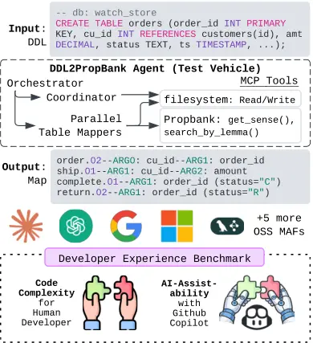

# Declarative by Design, Assistable Only by Convention: Benchmarking Multi-Agent Frameworks for AI-Assistability

DOI: [XXXXXXX.XXXXXXX](https://doi.org/XXXXXXX.XXXXXXX)Conference: ACM
Conference on AI and Agentic Systems; May 26–29, 2026; San Jose,
CAISBN: 978-1-4503-XXXX-X/2018/06CCS: Computing
methodologies Multi-agent systemsCCS: Computing methodologies Lexical
semanticsCCS: Information systems Relational database query languages

Shafiuddin Rehan Ahmed Affiliation: Center for Advanced AI, Accenture,
Mountain View, California, USA email: <shafiuddin.r.ahmed@accenture.com>
and Sourabh Deshpande Affiliation: Center for Advanced AI, Accenture,
Mountain View, California, USA email:
<sourabh.a.deshpande@accenture.com>

2026

###### Abstract.

Multi-agent frameworks (MAFs) promise to simplify LLM-driven software
development, yet no principled metric captures how well AI coding
assistants can generate correct, framework-specific code. We introduce
AI-assistability ($`\mathcal{AI}`$), a composite metric that quantifies
a framework’s amenability to AI-assisted development by combining
structural alignment ($`\bar{\sigma}`$) with functional correctness
(pass@1). To evaluate this metric in a controlled setting, we design
DDL2PropBank, a novel benchmark task that maps relational database
schemas to PropBank semantic rolesets, and implement identical agent
logic across ten frameworks using the Agent-as-a-Tool pattern. Our
results challenge the intuition that declarative framework design
guarantees AI-assistability: Agno, with a single canonical pattern and
convention-aligned API, achieves the highest $`\mathcal{AI}`$ score
(0.55), while DSPy—the most declarative framework by design—scores
lowest (0.07), as its novel abstractions are insufficiently represented
in AI training data. We find that convention alignment, not declarative
design alone, is the primary driver of AI-assistability ($`r=0.576`$
between $`\bar{\sigma}`$ and pass@1). ¹¹ 1 All artifacts—DDL2PropBank,
PropBank MCP server, and all implementations—are available at
[https://github.com/ahmeshaf/ddl2propbank](https://github.com/ahmeshaf/ddl2propbank).
See §H for the full list.

###### Keywords: 

AI-assistability, multi-agent frameworks, developer experience,
PropBank, schema mapping, LLM-as-Judge, Model Context Protocol, code
generation

## 1. Introduction

In an LLM-based multi-agent system, “multiple autonomous agents
collaboratively engage in planning, discussions, and decision-making”
(Guo et al., 2024), coordinated through an orchestration layer that
manages tool use and execution flow. Popular multi-agent frameworks
(MAFs) such as LangChain, LangGraph, AutoGen, CrewAI, and others
(Derouiche et al., 2025) promise to streamline the development of these
systems by providing reusable infrastructure for agent coordination and
tool integration. However, as we demonstrate in §2.4.2, these frameworks
primarily supply orchestration primitives: users are still expected to
write substantial code to define agent roles, compose workflows, handle
control flow, and adapt abstractions to task-specific requirements. As
the market for MAFs grows²² 2 The multi-agent system market is valued at
\$10.6B in 2025, projected to exceed \$375B by 2034 (Market.us, 2025).,
it raises a fundamental question: which frameworks has the least code
complexity of assembling agentic workflows.

Modern AI coding assistants decouple MAFs’ perceived usability from its
code complexity by rapidly generating framework-specific scaffolding
from documentation and examples (Liang et al., 2024). This aligns with
the ethos of vibe coding³³ 3
[https://en.wikipedia.org/wiki/Vibe_coding](https://en.wikipedia.org/wiki/Vibe_coding),
in which implementation is increasingly delegated to AI assistants.
While this accelerates adoption, it can also obscure substantive
differences between frameworks: plausible-looking code may mask brittle
abstractions or implicit control logic, and failures often manifest as
hallucinated correctness or silent errors. Consequently, a framework’s
practical usability depends not only on its human-facing APIs, but also
on the extent to which its abstractions and documentation enable AI
coding assistants to generate correct, executable code—a property we
refer to as a framework’s AI-assistability.

Evaluating these two aspects of developer experience—code complexity and
AI-assistability—is a nontrivial challenge (Winters et al., 2020;
Ziegler et al., 2024). Because LLMs drive code generation, planning, and
control flow, conventional evaluations risk conflating framework quality
with model memorization or benchmark familiarity. We therefore posit
that evaluating developer experience requires a controlled task that is
complex enough to stress-test AI-assisted code generation, yet uniform
enough for fair comparison. Crucially, such a task must be novel with
respect to LLM training data, avoiding settings where agents can
trivially retrieve known solutions or exploit patterns from common
benchmarks, thereby isolating framework-induced differences from
artifacts of prior exposure.

To this end, we introduce DDL2PropBank, an agentic task of mapping
database schemas to PropBank rolesets (Palmer et al., 2005)
corresponding to the events implicitly encoded by the database.
Relational benchmarks like RelBench (Robinson et al., 2024) formulate
tasks as temporal next-event prediction, yet their schemas encode event
semantics only implicitly; prior approaches such as RelGNN (Chen et al., 2025) recover event structure through representation learning over
instance data rather than schema-level analysis. DDL2PropBank addresses
this gap by requiring agents to derive explicit event representations
directly from schema structure, constraints, and inter-table relations.
While this task has potential uses, we treat it primarily as a novel,
controlled, and sufficiently complex benchmarking vehicle to compare
MAFs.

We adopt Agent-as-a-Tool design pattern, as illustrated in Figure 1,
where specialized agents are registered as callable tools by an
orchestrator (Schick et al., 2023; Li et al., 2024b; Li, 2025). The
orchestrator first invokes a Coordinator to track the progress of the
mapping, then dispatches Table Mapper agents parallelly to do semantic
mapping for each table simultaneously. All agents interact with shared
Model Context Protocol (MCP; Anthropic (2024)) servers for filesystem
access and PropBank queries. This architecture is intentionally generic
and representative of real-world agentic usecases, and we expect it to
be supported by any mature MAF.



Figure 1. Top: The Agent-as-a-Tool architecture—an Orchestrator invokes
a Coordinator and parallel Table Mapper agents, all accessing shared MCP
servers (filesystem and PropBank). Middle: We implement identical logic
across 10 MAFs including Claude SDK (Anthropic), Agents SDK (OpenAI),
and 8 other open-source frameworks. Bottom: Dual-dimensional developer
experience benchmarking.

Using human-authored reference implementations that fully specify MCP
servers, prompts, and nested agent definitions, we evaluate both code
complexity and AI-assistability. Code complexity is measured via static
analysis across frameworks, using lines of code and cyclomatic
complexity (McCabe, 1976) as proxies for the cognitive burden of
assembling agentic workflows. To assess AI-assistability, we keep all
functional components fixed and task three AI coding assistants (GitHub
Copilot, Claude Code, and Cursor) with reimplementing the same agent in
each framework using only public APIs and documentation. We then
evaluate whether the generated implementations (i) align structurally
with the idiomatic human reference and (ii) execute end-to-end to
produce functionally valid PropBank mappings (correct tool grounding and
well-formed output, which we term _functional validity_ rather than
semantic optimality) on a test database.

Our results show that framework design choices lead to substantial
variation in developer effort. Static analysis of the reference
implementations reveals three complexity tiers: Pydantic AI and Agno
require the least code and control-flow logic; a middle tier includes
Smolagents, LangChain, OpenAI Agents, Google ADK, and Claude SDK; and
AgentScope and DSPy impose the highest overhead. For AI-assistability,
structural alignment reliably predicts runtime robustness for frameworks
with a single canonical pattern—Agno leads with the highest structural
alignment and 72% pass@1—but underestimates correctness for flexible,
multi-pattern frameworks, where non-idiomatic code can still execute
(e.g. Pydantic AI reaches 61% pass@1 at below-median alignment).
Overall, Agno emerges as the strongest performer
($`\mathcal{AI}=0.55`$), combining low code complexity with high
structural alignment and robust functional correctness, making it
particularly well-suited for idiomatic AI-assisted development.

Together, we make the following contributions:

- •
  A first-of-its-kind benchmark, DDL2PropBank, for evaluating MAFs’
  developer experience.
- •
  A dual-dimensional evaluation methodology assessing code complexity
  (via static analysis) and AI-assistability (via AI-generated code),
  offering actionable insights for framework developers and practical
  guidance for the NLP community.
- •
  A novel event semantic analysis tool which makes use of the PropBank
  MCP server⁴⁴ 4 Also introduced in this work in §B. to facilitate
  semantic annotation of database schemas.

## 2. DDL2PropBank Agent

### 2.1. Task Definition

Given a database schema in Data Definition Language (DDL), DDL2-PropBank
is the semantic mapping of the tables in the schema to PropBank rolesets
(See §A for a background on PropBank). Formally, the task is defined as
follows:

##### Input.

Given a DDL schema $`\mathcal{S}=\{T_{1},T_{2},\ldots,T_{n}\}`$ where
each table $`T_{i}`$ consists of columns
$`\{c_{1},c_{2},\ldots,c_{m}\}`$ with types and constraints (primary
keys, foreign keys).

##### Output.

For each table $`T_{i}`$, a set of mappings
$`\mathcal{M}_{i}=\{(r_{j},A_{j},\kappa_{j})\}`$ where:

- •
  $`r_{j}:`$ PropBank roleset sense_id (e.g., order.02)
- •
  $`A_{j}:\{\texttt{ARG0},\texttt{ARG1},\ldots\}\rightarrow\{c_{1},c_{2},\ldots,c_{m}\}`$
  maps semantic arguments of $`r_{j}`$ to columns
- •
  $`\kappa_{j}\in[0,1]`$ is a confidence score reflecting the semantic
  fit of $`(r_{j},A_{j})`$

##### Example.

A single table can encode multiple event semantics, yielding several
roleset mappings. As illustrated in Figure 1, an Orders table with
columns cu*id (customer), order_id, amt (amo-unt), status, and ts (order
timestamp) maps to four rolesets—order.02, ship.01, complete.01, and
return.02—each capturing a distinct event in the order lifecycle. For
instance, order.02 (“request to be delivered”) grounds ARG0 (orderer)
$`\rightarrow`$ cu_id and ARG1 (thing ordered) $`\rightarrow`$ order_id,
while ship.01 grounds ARG1 $`\rightarrow`$ cu_id and ARG2
$`\rightarrow`$ amt. Both rolesets also map ARGM-TMP (temporal)
$`\rightarrow`$ ts. Arguments without a matching column are left
unmapped, and each mapping receives a confidence score $`\kappa*{j}`$
reflecting its semantic fit.

##### Novelty and Memorization.

To our knowledge DDL2PropBank is novel: no prior work maps relational
schemas to PropBank rolesets, and PropBank access is exposed through a
custom-built MCP server (§B) rather than any pre-existing API. The
combination—Agent-as-a-Tool orchestration, shared MCP servers, and
schema-level semantic annotation—has no precedent in public training
data, mitigating memorization confounds: assistants cannot retrieve a
known reference solution, so generated implementations reflect each
framework’s documentation and abstractions rather than recall of the
task.

### 2.2. Reference Agent-as-a-Tool Architecture

We implement DDL2PropBank using the Agent-as-a-Tool pattern, where
specialized ReAct-style⁵⁵ 5 ReAct, a portmanteau of Reasoning and
Acting, is an approach introduced by Yao et al. (2023) that enables
language models to “generate both reasoning traces and task-specific
actions in an interleaved manner.” agents are registered as callable
tools within a orchestrator. The architecture comprises three agent
types operating at different granularities.⁶⁶ 6 See §C for algorithmic
details of the agent design, including pseudocode and prompts.

#### 2.2.1. Agent Descriptions

##### Orchestrator.

The top-level agent manages the complete workflow for a single database.
It invokes the Coordinator to identify pending work, then dispatches
Table Mapper agents in parallel. This design enables incremental
progress: if execution fails mid-way, previously completed mappings
persist and the Coordinator will skip them on retry.

##### Coordinator.

The Coordinator examines the output folder to determine which tables
have valid mappings and which require processing. By checking filesystem
state, it enables idempotent execution—re-running the pipeline only
processes missing or invalid mappings.

##### Table Mapper.

Each Table Mapper processes a single table independently. It extracts
column information and foreign key context from the DDL, invokes an
LLM-tool to generate candidate action verbs from table context (e.g.,
Orders $`\rightarrow`$ \["order", "purchase"\]), queries PropBank via
MCP for matching rolesets, then grounds semantic arguments to columns.
For each candidate mapping, the agent estimates a confidence score
$`\kappa_{j}\in[0,1]`$ based on semantic fit quality. The complete
mapping set $`\mathcal{M}_{T}=\{(r_{j},A_{j},\kappa_{j})\}`$ is
persisted immediately upon completion.

#### 2.2.2. MCP Integration

The Model Context Protocol (MCP) is an open standard for connecting AI
assistants to external data sources and tools via standardized message
passing. By exposing PropBank and filesystem operations as MCP servers,
we decouple agent logic from tool infrastructure, enabling all 10
frameworks to access identical tool capabilities. This architectural
choice is critical: agents query the same PropBank server, read the same
schemas, and write outputs to the same filesystem, ensuring that
observed differences in mapping quality arise solely from
framework-specific choices.

##### PropBank MCP Server (StreamableHTTP).

Provides programmatic access to PropBank’s curated rolesets, avoiding
reliance on LLM memorization of semantic frame definitions⁷⁷ 7 See §B
for details on the motivation and implementations of the PropBank MCP
server.:

- •
  search_by_lemma(word, max_res): Query PropBank for all rolesets
  matching a verb base form or morphological variant
- •
  search_by_sense_id(sense_id, include_examples): Retrieve full frame
  def for the roleset, including roles and annotated examples

##### Filesystem MCP Server (StdIO).

Manages agent state and output persistence, enabling incremental
progress and fault tolerance:

- •
  list_directory(): Enumerate files in the output folder to check
  mapping progress.
- •
  read_file(): Load previously computed mappings for validation or reuse
- •
  write_file(): Persist new mappings immediately upon completion

##### Get Action Verbs function tool.

An LLM-tool that generates candidate verbs from table context via a
single LLM call. Given a table’s schema. the tool prompts the LLM to
produce lemmas capturing the table’s potential event semantics—e.g.,
Orders may give \["order", "ship", "cancel", "return"\]. These lemmas
seed PropBank queries, enabling exploration of semantic frames (see Fig.
8 in §C.3).

1: DDL schema $`\mathcal{S}`$, output folder $`\mathcal{F}`$

2: PropBank mappings for all tables

3: $`\mathcal{T}_{todo}\leftarrow`$ Coordinator($`\mathcal{S}`$,
$`\mathcal{F}`$) Agent-as-a-tool

4: parallel for $`T\in\mathcal{T}_{todo}`$ do ReAct

5:   TableMapper($`T`$, $`\mathcal{S}`$, $`\mathcal{F}`$)
Agent-as-a-tool

6: end parallel for

7: go to line 3 ReAct

Algorithm 1 Orchestrator

1: DDL schema $`\mathcal{S}`$, output folder $`\mathcal{F}`$

2: Tables requiring mapping ($`\mathcal{T}_{todo}`$)

3: $`\mathcal{T}_{all}\leftarrow`$ parse table names from
$`\mathcal{S}`$ ReAct

4: for $`T\in\mathcal{T}_{all}`$ do ReAct

5:   $`\mathcal{M}_{T}\leftarrow`$
ReadFile($`\mathcal{F}/T.\text{json}`$)tool

6:   if not valid $`\mathcal{M}_{T}`$ then ReAct

7:    $`\mathcal{T}_{todo}\leftarrow\mathcal{T}_{todo}\cup\{T\}`$

8:   end if

9: end for

10: return $`\mathcal{T}_{todo}`$

Algorithm 2 Coordinator

1: Table $`T`$, schema $`\mathcal{S}`$, output folder $`\mathcal{F}`$

2: Mapping $`\mathcal{M}`$ persisted to filesystem

3: $`context\leftarrow`$ analyze $`\mathcal{S}`$ w.r.t $`T`$ ReAct

4: $`lemmas\leftarrow`$ GetActionVerbs($`T`$, $`ctx`$) LLM-tool

5: for $`lemma\in lemmas`$ do ReAct

6:   $`rolesets\leftarrow`$ SearchByLemma($`lemma`$) tool

7:   $`\mathcal{R}\leftarrow`$ identify relevant $`rolesets`$ ReAct

8:   for $`r\in\mathcal{R}`$ do ReAct

9:    $`args\leftarrow`$ SearchBySenseId($`r`$) xxxxx tool

10:    $`\mathcal{M}\leftarrow\mathcal{M}\cup\{(r,`$ map $`args`$ to
$`context`$, estimate $`\kappa)\}`$ xxx ReAct

11:   end for

12: end for

13: $`\mathcal{M}_{T}\leftarrow`$ select the best mappings from
$`\mathcal{M}`$ that are sorted by $`\kappa`$ xxx ReAct

14: WriteFile($`\mathcal{F}/T.\text{json}`$, $`\mathcal{M}_{T}`$) tool

Algorithm 3 TableMapper

Figure 2. DDL2PropBank Agent algorithms for Agent-as-a-Tool pattern
using only the agentic primitives defined in §2.3.

### 2.3. Pseudocode and Agentic Primitives

Figure 2 presents the pseudocode for the three DDL2PropBank agents. The
Orchestrator (Algorithm 1) serves as the top-level coordinator, invoking
Coordinator and TableMapper as callable tools. The Coordinator
(Algorithm 2) analyzes existing mappings to determine which tables
require processing. The TableMapper (Algorithm 3) handles per-table
PropBank mapping, iterating over candidate verbs, searching for matching
rolesets, and persisting results. We identify four _agentic
primitives_—atomic building blocks of the agent algorithms, ordered here
by increasing autonomy:

##### tool

A direct call to an MCP server tool such as ListDirectory, ReadFile,
WriteFile, SearchByLemma, or SearchBySenseId. These are deterministic
operations with no LLM reasoning involved.

##### LLM-tool

A tool encapsulating a _single_ LLM inference. For example,
GetActionVerbs infers action verbs from table context. Callers treat
these as tools, but they internally invoke one LLM call.

##### Agent-as-a-tool

A sub-agent registered as a callable tool. The Orchestrator invokes
Coordinator and TableMapper as tools, enabling hierarchical composition
and parallel execution via concurrent tool calls.

##### ReAct

LLM reasoning steps encoded directly in the system prompt, without
external code logic. The agent iteratively analyzes context, makes
decisions, and synthesizes information—relying solely on the driving
LLM’s reasoning capabilities. Critically, ReAct governs execution
topology, shaping the agentic workflow by determining whether tool calls
are issued in parallel or sequentially.

These primitives define a framework-agnostic vocabulary for agentic
workflows, however, multi-agent frameworks may differ substantially in
how they realize each one—differences that directly impact code
complexity and developer effort (§2.4).

### 2.4. Ground-truth Implementations

We implement the DDL2PropBank agent architecture across 10 multi-agent
frameworks, creating human-authored reference implementations that serve
as ground truth for our AI-assistability evaluation (§3). Each
implementation realizes identical agent logic—the Orchestrator,
Coordinator, and Table Mapper hierarchy described in §2.2—using only
framework-native abstractions. System prompts are standardized across
all frameworks (App C.3), ensuring that observed differences in code
complexity and runtime behavior arise solely from framework design
choices rather than algorithmic variation.

#### 2.4.1. Framework Selection

We include all three major LLM provider frameworks—Claude SDK, OpenAI
Agents, and Google ADK—as first-party agentic solutions from the primary
model providers. For the remaining seven community-maintained frameworks
(Pydantic AI, Agno, DSPy (Khattab et al., 2024), LangChain, Microsoft
Agent Framework, Smolagents (Roucher et al., 2025), AgentScope (Gao et
al., 2025)), we applied eight selection criteria spanning four
dimensions:

- •
  Reproducibility: open-source licensing (C1) and programmatic
  invocation for batch processing (C7).
- •
  Tool integration: support for both MCP servers and direct function
  calling (C2), with concurrent tool invocations for parallel processing
  (C3).
- •
  Operational: multi-provider model support (C5), single API key
  operation (C6), and programmatic access to token usage metrics (C4).
- •
  AI-assistability: comprehensive documentation (C8), with llms.txt
  availability prioritized for AI-assisted code generation.

See Table 4 in §D for per-framework compliance with each criterion.

#### 2.4.2. Static Code Analysis

To quantify the structural complexity of assembling agentic workflows,
we analyze each framework’s database_mapper.py implementation using
standard static analysis metrics (Table 1). Logical lines of code (LLOC)
measures implementation size excluding comments and blank lines; values
in parentheses indicate lines added beyond the 31-line starter template.
Cyclomatic complexity (CCN) captures control flow branching—higher
values indicate more complex decision logic. Framework-specific imports
reflect API surface area and coupling to framework internals.

##### Low-Complexity Winners.

Pydantic AI and Agno emerge as co-leaders in code complexity. Pydantic
AI achieves lower LLOC (52 vs. 54) and CCN (3 vs. 4), while Agno
requires fewer imports (3 vs. 4). Their advantage stems from a shared
set of design choices that systematically reduce boilerplate. In
particular, both frameworks support _unified tool declarations_ that
allow MCP servers and Python functions to coexist without wrapper code,
_decorator-free function registration_ that accepts plain Python
functions, _model-string–based provider inference_ that avoids
provider-specific client classes, and _native MCP abstractions_ that
manage connection lifecycles and expose token usage without custom
instrumentation. Collectively, these patterns minimize scaffolding code
while preserving expressiveness, resulting in more concise and
maintainable agentic solution.

|                           |          |     |       |         |
| ------------------------- | -------- | --- | ----- | ------- |
| Framework                 | LLOC     | CCN | \#Fns | Imports |
| LLM Providers’ Frameworks |          |     |       |         |
| Google ADK                | 68 (+37) | 12  | 4     | 8       |
| OpenAI Agents             | 70 (+39) | 14  | 8     | 5       |
| Claude SDK                | 75 (+44) | 10  | 5     | 7       |
| Independent Frameworks    |          |     |       |         |
| Pydantic AI               | 52 (+21) | 3   | 3     | 4       |
| Agno                      | 54 (+23) | 4   | 3     | 3       |
| Smolagents                | 66 (+35) | 15  | 5     | 6       |
| LangChain                 | 70 (+39) | 11  | 4     | 8       |
| Microsoft                 | 73 (+42) | 16  | 4     | 4       |
| AgentScope                | 82 (+51) | 10  | 5     | 10      |
| DSPy                      | 88 (+57) | 20  | 6     | 9       |
| Starter code              | 31       | -   | 3     | -       |

Table 1. Code complexity metrics for agent implementations. LLOC =
logical lines of code; CCN = cyclomatic complexity; \#Fns = number of
functions; Imports = framework-specific imports. Bold indicates best
(lowest).

##### Mid-Complexity Frameworks.

The six remaining frameworks—all three vendor SDKs (Google ADK, OpenAI
Agents, Claude SDK) and three independent projects (Smolagents,
LangChain, Microsoft)—cluster in the LLOC 66–75 range. The vendor SDKs
share comparable implementation size but differ in control-flow
complexity: Google ADK and Claude SDK exhibit moderate CCN (10–12),
while OpenAI Agents requires more branching (CCN 14) due to explicit
tool-result handling. Among the independent frameworks, Smolagents and
Microsoft exhibit the highest CCN in this tier (15–16), reflecting more
verbose control flow for agent orchestration and tool registration.

##### High-Complexity Frameworks.

DSPy exhibits the highest code complexity—LLOC of 88 and CCN of
20—driven primarily by the absence of native MCP support. As a result,
developers must integrate external MCP libraries, manage server
lifecycles manually and adapt MCP tools into framework-specific
abstractions. AgentScope exhibits lower control-flow complexity but
incurs substantial overhead from extensive framework imports: 10 imports
across seven submodules, compared to 3–4 for lower-complexity
frameworks. Reliance on internal abstractions for formatters, memory
classes, tool response objects, and provider-specific model classes
increases cognitive load and tightly couples implementations to
framework internals.

Across frameworks, we observe a 1.7$`\times`$ variation in LLOC and a
3.3$`\times`$ variation in import count for implementing identical agent
behavior, underscoring that framework design choices—particularly native
MCP integration and unified tool registration—have a substantial impact
on developer effort. For detailed analysis of implementation patterns
across all frameworks see §E.

## 3. Framework’s AI-Assistability Evaluation

AI coding assistants are transforming software development. A controlled
experiment by Ziegler et al. (2024) found that developers using GitHub
Copilot completed tasks 55.8% faster than those without access, with
junior developers showing the largest gains. As tools like GitHub
Copilot, Claude Code, and Cursor become ubiquitous, a framework’s raw
code complexity—the LLOC and CCN metrics from §2.4.2—becomes less
decisive. If an AI assistant can reliably generate framework specific
boilerplate, developers need not manually navigate verbose APIs or
complex control flow. The more pressing question shifts from how much
code must I write? to how well can AI assistants write it for me?

This reframing motivates our second evaluation dimension:
AI-assistability—the extent to which large language models can
autonomously generate correct, framework-specific code from
documentation alone. We hypothesize that frameworks differ substantially
in AI-assistability due to variations in (i) documentation quality
(comprehensive API references vs. scattered tutorials), (ii) API
consistency (predictable patterns vs. special cases), (iii) abstraction
level (declarative vs. imperative control flow), and (iv) error message
clarity (actionable diagnostics vs. opaque traces). To isolate these
framework-intrinsic factors, we formalize the evaluation as follows.

##### Generation Context.

Let $`\mathcal{G}=(a,m,\tau,P_{\tau})`$ be a generation context: AI
coding assistant $`a\in\mathcal{A}`$, model tier $`m\in\mathcal{M}`$,
task $`\tau`$, and its associated project artifacts $`P_{\tau}`$ (task
specification, starter code, agent prompts, entry point). Note that
$`P_{\tau}`$ can vary with the expertise level of the developer: a more
experienced practitioner may provide richer task specifications, more
detailed prompts, or better-structured starter code, all of which
influence generation quality independently of the framework or
assistant. We vary $`a`$, $`m`$, and the framework $`f`$; the only
framework specific input is the documentation $`D_{f}`$. The assistant
generates:

```math
\hat{y}_{f}\sim a(D_{f},P_{\tau};\;m)
```

##### Validation.

Let $`y_{f}^{*}`$ denote the human-authored ground-truth implementation
for framework $`f`$ (§2.4). Each $`\hat{y}_{f}`$ is evaluated by two
complementary functions:

- •
  $`\sigma(\hat{y}_{f},y_{f}^{*})\in[0,24]`$: structural
  alignment—LLM-as-Judge score against $`y_{f}^{*}`$ (rubric in §3.4.1)
- •
  $`\phi(\hat{y}_{f})\in\{0,1\}`$: functional correctness—runtime
  pass/fail on a test database (§3.4.2)

For a fixed configuration $`\mathcal{G}`$, we compute per-run metrics
over $`n`$ independent runs:

```math
\text{pass@1}(f\mid\mathcal{G})=\frac{1}{n}\sum\nolimits_{i=1}^{n}\phi(\hat{y}_{f,i}),\quad\bar{\sigma}(f\mid\mathcal{G})=\frac{1}{n}\sum\nolimits_{i=1}^{n}\sigma(\hat{y}_{f,i},y_{f}^{*})
```

To obtain a single score per framework, we marginalize over assistants
and model tiers by averaging across all configurations:

```math
\displaystyle\text{pass@1}(f) \displaystyle=\frac{1}{|\mathcal{A}||\mathcal{M}|}\sum\nolimits_{a,m}\text{pass@1}(f\mid\mathcal{G}) \tag{1}
```

```math
\displaystyle\bar{\sigma}(f) \displaystyle=\frac{1}{|\mathcal{A}||\mathcal{M}|}\sum\nolimits_{a,m}\bar{\sigma}(f\mid\mathcal{G}) \tag{2}
```

##### AI-Assistability Score.

We define a framework’s AI-assistability as the product of its
normalized structural alignment and functional correctness:

```math
\mathcal{AI}(f)=\text{pass@1}(f)\;\times\;\frac{\bar{\sigma}(f)}{\sigma_{\max}}
```

where $`\sigma_{\max}=24`$ is the maximum rubric score. This
multiplicative formulation requires both dimensions to be high: a
framework with perfect structural alignment but zero pass rate scores
$`\mathcal{AI}=0`$, and vice versa. The score ranges from 0 (complete
failure on either dimension) to 1 (perfect on both).

By varying $`f`$, $`a`$, and $`m`$, differences in $`\mathcal{AI}`$,
pass@1, and $`\bar{\sigma}`$ isolate framework-intrinsic properties from
assistant- and model-specific effects. Although we instantiate $`\tau`$
= DDL2PropBank in this work, the formalization is task-agnostic:
substituting a different agentic task $`\tau^{\prime}`$ with
corresponding artifacts $`P_{\tau^{\prime}}`$ and ground-truth
implementations $`y_{f}^{*\prime}`$ yields a reusable evaluation
protocol for any MAF comparison.

### 3.1. Evaluation Protocol ($`\mathcal{A}`$, $`D_{f}`$)

We evaluate three AI coding assistants,
$`\mathcal{A}=\{\text{GitHub Copilot},`$
$`\text{Claude Code},\text{Cursor}\}`$, each configured with Claude
models via Anthropic’s API. All three operate in agent mode, where they
can read project files, browse documentation URLs, and iteratively edit
code—capabilities beyond single-turn code completion. This agentic
workflow mirrors realistic developer usage: the assistant explores the
codebase, consults framework documentation, and produces a complete
implementation over multiple tool-calling steps. The three assistants
represent distinct integration paradigms: GitHub Copilot is IDE-embedded
(VS Code), Claude Code is CLI-native, and Cursor is an AI-first IDE
fork. By varying the assistant alongside the framework, we disentangle
framework-intrinsic difficulty from assistant-specific strengths (§3.3).

Figure 3 illustrates the evaluation protocol. For each framework $`f`$,
a developer provides a standardized query template that supplies the
framework-specific documentation $`D_{f}`$: the framework name, its
documentation URL, and its GitHub repository URL. This query is the sole
input that varies across frameworks. The assistant then reads the shared
project context $`P`$—task specification (CLAUDE.md⁸⁸ 8 CLAUDE.md is a
convention for providing project-specific instructions to coding
assistants. See
[https://docs.anthropic.com/en/docs/claude-code](https://docs.anthropic.com/en/docs/claude-code).),
agent prompts (prompts.py), and the starter code with TODOs—and
generates the framework-specific implementation $`\hat{y}_{f}`$ in
database_mapper.py.


Figure 3. Evaluation protocol for AI-assistability. The query template
provides framework-specific documentation $`D_{f}`$; the project
directory provides task artifacts $`P_{\tau}`$. Each assistant
$`a\in\mathcal{A}`$ generates $`\hat{y}_{f}`$ by implementing
database_mapper.py ( ), with all other files locked ( ).

The workflow enforces a clear separation: each assistant implements only
the framework integration layer (database_mapper.py), while agent
behavior (system prompts), task specification, and tool infrastructure
remain fixed across all frameworks and assistants. This isolation
ensures that observed differences in pass@1 and $`\bar{\sigma}`$ stem
from framework and assistant characteristics rather than task variation.

### 3.2. Project Structure ($`P_{\tau}`$)

Each framework evaluation uses an identical project scaffold (Figure 4).
The assistant must understand task requirements from CLAUDE.md, reuse
agent prompts from prompts.py, and produce code that integrates with the
fixed main.py entry point.

src\_{framework}/

 

  

CLAUDE.md – task spec, architecture

 

  

prompts.py – agent prompts (641 LOC)

 

  

main.py – entry point

 

  

examples/

 

  

rel-avito.sql – 8-table test schema

 

  

database_mapper.py – 31-line stub w/ TODOs

Figure 4. Project structure for AI-assisted implementation. Files marked
are read-only context; the assistant implements only database_mapper.py
( ).

The database_mapper.py file is the sole implementation target—a 31-line
stub containing function signatures, docstrings, and TODO comments that
the assistant must complete using framework-native abstractions (see
Listing 8 for the full skeleton). The stub specifies three components:
run_coordinator() for progress analysis, run_mapper() for single-table
PropBank mapping, and orchestration logic that coordinates these via LLM
tool-calling. This decomposition directly reflects the three-agent
hierarchy from §2.2, with each stub function corresponding to an agent
the assistant must realize using framework-native APIs.

### 3.3. Experimental Configuration ($`m`$, $`n`$)

We vary the model tier $`m`$ in the generation context $`\mathcal{G}`$
to test two capability levels.⁹⁹ 9 The DDL2PropBank agents themselves
use pre-specified model assignments detailed in §C.1.

##### Model Tiers.

We test two Claude model tiers as the coding assistant backend: Claude
Haiku 4.5 (fast, cost-effective) and Claude Sonnet 4.5 (balanced
capability). All three assistants are configured with the same Claude
model for a given tier, isolating assistant-level differences from model
capability. This comparison reveals whether framework complexity creates
a capability threshold—some frameworks may require more capable models
to implement correctly.

##### Replication Strategy.

To account for stochastic variation in LLM generation, we execute
$`n=3`$ independent runs per configuration, yielding
$`10\text{ frameworks}\times 3\text{ assistants}\times 2\text{ models}\times 3\text{ runs}=180`$
implementations total. Each assistant is allowed to run until reaching
context window compaction—the point at which the assistant’s
conversation history is compressed to fit within its context
limit—ensuring that generation is bounded by the assistant’s effective
memory rather than an artificial step cap. Each run provides the same
inputs—starter code, task specification (CLAUDE.md), and framework
documentation URLs—but generates agent code independently.

### 3.4. Evaluation Metrics ($`\sigma`$, $`\phi`$)

Generated implementations are evaluated along two independent
dimensions: structural alignment $`\sigma`$ via automated LLM-based
assessment and functional correctness $`\phi`$ via human-supervised
runtime testing.

#### 3.4.1. LLM-as-Judge: Structural Alignment ($`\sigma`$)

We employ Claude Opus 4.5 as an automated code reviewer, comparing each
generated implementation against human-authored references (described in
§2.4). This alignment-based evaluation measures whether AI assistants
can autonomously recreate idiomatic code from documentation alone. The
rationale is twofold: idiomatic code is (i) maintainable—adhering to
established patterns makes code easier to debug, extend, and review; and
(ii) trustworthy—our ground-truth solutions are validated through unit
and end-to-end testing, so AI-generated code that follows the same
patterns inherits this robustness. High structural alignment thus serves
as a proxy for robustness.

Our LLM-judge-over-a-structured-rubric approach follows established
evaluation practice, reviewed in §6; it suits our setting because the
property of interest is _structural_—tool-registration patterns, MCP
lifecycle, idiomatic API usage—rather than the token overlap that
reference-based metrics capture. We anchor $`\sigma`$ to a single
canonical reference per framework by design: the metric measures
convergence toward canonical API usage rather than whether the assistant
found _any_ valid pattern, so functionally correct but non-canonical
code is flagged as divergent, e.g. Pydantic AI’s high pass@1 at
below-median $`\bar{\sigma}`$ (§4.3).

|                                      |       |                                             |
| ------------------------------------ | ----- | ------------------------------------------- |
| Component                            | Scale | Evaluation Focus                            |
| Agent Architecture (0–3 each)        |       |                                             |
| Coordinator                          | 0–3   | Inner agent with filesystem-readonly access |
| Mapper                               | 0–3   | Inner agent with full toolset               |
| get_verbs                            | 0–3   | LLM-tool in mapper’s toolset                |
| MCP Integration (0–4 each, weighted) |       |                                             |
| filesystem_mcp                       | 0–4   | StdIO server, allowed_dirs                  |
| propbank_mcp                         | 0–4   | HTTP server, correct endpoint               |
| Framework Integration                |       |                                             |
| matching_imports                     | 0–3   | Imports match ground truth                  |
| api_usage                            | 0–4   | Idiomatic API patterns                      |
| Total                                | 0–24  | Weighted sum                                |

Table 2. LLM-as-Judge rubric for structural code alignment. MCP
integration and API usage use weighted scoring (0–4) as they strongly
predict runtime validity.

The judge evaluates 7 architectural components critical to the
Agent-as-a-Tool pattern as depicted in Table 2. MCP integration and API
usage receive higher weights (0–4) because they most strongly predict
runtime validity: MCP configuration errors cause 73% of runtime
failures, while API misuse accounts for another 18%. To reduce
stochastic variance, each implementation receives 10 independent
evaluations; we report median scores per component, then sum to compute
totals.

#### 3.4.2. Runtime Validity Testing ($`\phi`$)

A human executes each run on the rel-avito database from RelBench
(Robinson et al., 2024)—an 8-table classified advertisements schema that
exercises all DDL2PropBank components (details in Appendix F.2). An
implementation is marked valid if it (i) completes without exceptions,
(ii) correctly invokes the PropBank MCP tools (search_by_lemma,
search_by_sense_id) to ground mappings, and (iii) produces
correctly-structured JSON mappings for all 8 tables; otherwise it is
invalid. We therefore read $`\phi`$ as _functional validity_---correct
tool use, well-formed output, and end-to-end pipeline
completion---rather than semantic optimality of the chosen rolesets,
which would require gold annotations that do not exist for this novel
task. This binary signal provides label for functional correctness,
independent of structural assessment.¹⁰¹⁰ 10 Each run uses a generous
framework-specific timeout scaled to the framework’s ground-truth
runtime rather than a single fixed budget, so a correct-but-slower
framework is not penalized for speed; ground-truth runtimes (Table 8)
were measured without a timeout. Frameworks achieving both high validity
rates and high judge scores demonstrate robust AI-assistability—the
ideal production sweet spot.

## 4. Results

### 4.1. Overall AI-Assistability

GitHub Copilot produces valid DDL2PropBank implementations 66.7% of the
time (40/60 runs; the GitHub Copilot subset of the full 180-run set,
reported here as a single-assistant baseline—per-framework aggregates
over all three assistants appear in Figure 5) across all framework and
model configurations. This two-thirds success rate establishes a
practical baseline for AI-assisted multi-agent development: developers
can expect functional code in the majority of attempts, though manual
intervention remains necessary for roughly one-third of generations.

Structural alignment strongly predicts runtime success (Figure 10,
Appendix G.1). Implementations scoring 18+ achieve 89% pass@1¹¹¹¹ 11
pass@k measures the probability that at least one of k generated code
samples passes all tests (Chen et al., 2021); we report pass@1, the
strictest single-attempt metric. (24/27), while those scoring below 12
achieve only 29% (2/7). The Pearson correlation of $`r=0.576`$ between
judge score and pass@1 confirms that the LLM-as-Judge methodology
captures meaningful code quality dimensions—high-scoring runs are
substantially more likely to execute correctly. We read this as a
moderate relationship: $`\bar{\sigma}`$ captures a significant but
partial dimension of functional correctness, and the remaining
unexplained variance reflects runtime integration issues invisible to
static structural analysis—MCP connection lifecycle, async
compatibility, and session management—the failure modes that dominate
Google ADK’s case (§4.2). This correlation is strongest for frameworks
with canonical implementation patterns: for Agno, Claude SDK, and OpenAI
Agents, high structural alignment reliably implies correct tool
registration and idiomatic API usage.

### 4.2. Framework Landscape

Figure 5 maps each framework along two dimensions: structural alignment
(judge score, out of 24) and functional correctness (pass@1). Agno
occupies the upper-right sweet spot with the highest structural
alignment ($`\sim`$18.3) and pass@1 ($`\sim`$72%), demonstrating that AI
assistants most reliably generate code for frameworks with a single
canonical pattern. Pydantic AI achieves competitive pass@1 ($`\sim`$61%)
despite a lower judge score ($`\sim`$13), suggesting that functional
correctness can emerge even when generated code diverges from idiomatic
patterns. Claude SDK ($`\sim`$17.5, 50%) and OpenAI Agents ($`\sim`$17,
44%) cluster in the high-alignment, moderate-pass region—structurally
sound code that does not always execute successfully.

Below the 50% validity threshold, AgentScope ($`\sim`$15.5, 33%)
achieves above-median structural alignment but struggles with runtime
correctness. LangChain ($`\sim`$13, 28%), Microsoft Agent Framework
($`\sim`$13, 17%), and DSPy ($`\sim`$11, 15%) form a low-assistability
cluster where AI assistants struggle to produce both structurally
aligned and functionally correct implementations.

We exclude Google ADK and Smolagents from the $`\mathcal{AI}(f)`$
ranking—both produce zero valid implementations, so a multiplicative
$`\mathcal{AI}(f)=0`$ regardless of alignment—but treat them as
informative failure cases rather than hiding them. The failures are
systematic and reproducible across every run and configuration: Google
ADK fails despite reasonable structural alignment due to mandatory
session-lifecycle boilerplate, fragmented MCP connection-parameter
types, and event-stream interpretation; Smolagents fails on a sync/async
execution-model mismatch and unreliable streamable-HTTP MCP support. We
give the full technical analysis in Appendix G.4. Notably, Google ADK
strengthens the thesis---convention alignment is necessary but not
sufficient when runtime integration complexity overrides structural
correctness.¹²¹² 12 Full results including these frameworks are reported
in Appendix G.1.

The composite $`\mathcal{AI}(f)`$ score (Figure 5, right) quantifies
this landscape. Agno leads decisively ($`\mathcal{AI}=0.55`$), nearly
$`1.5\times`$ the next-ranked framework. A clear tier structure emerges:
Claude SDK (0.36), Pydantic AI (0.33), and OpenAI Agents (0.31) form a
middle tier with comparable overall assistability despite different
trade-offs—Claude SDK and OpenAI Agents achieve it through high
structural alignment with moderate pass rates, while Pydantic AI
compensates for lower alignment with higher functional correctness.
Below these, AgentScope (0.22) sits alone as a transitional case,
followed by a low-assistability tier where LangChain (0.15), Microsoft
(0.09), and DSPy (0.07) score below 0.2, indicating that AI assistants
produce usable code in fewer than one in five attempts.

|               |                      |                     |        |                     |
| ------------- | -------------------- | ------------------- | ------ | ------------------- |
| Framework     | LLOC $`(y_{f}^{*})`$ | $`\bar{\sigma}(f)`$ | pass@1 | $`\mathcal{AI}(f)`$ |
| Agno          | 54                   | 18.29               | 72%    | 0.55                |
| Claude SDK    | 75                   | 17.44               | 50%    | 0.36                |
| Pydantic AI   | 52                   | 13.18               | 61%    | 0.33                |
| OpenAI Agents | 70                   | 16.92               | 44%    | 0.31                |
| AgentScope    | 82                   | 15.72               | 33%    | 0.22                |
| LangChain     | 70                   | 12.77               | 28%    | 0.15                |
| Microsoft     | 73                   | 12.82               | 17%    | 0.09                |
| DSPy          | 88                   | 11.23               | 15%    | 0.07                |

Figure 5. Framework comparison across judge score and pass@1 dimensions
(left) with aggregate AI-assistability rankings (right). The upper-right
quadrant represents the sweet spot—frameworks where AI assistants
reliably generate both structurally aligned and functionally correct
implementations.

### 4.3. Outlier Analysis

Four frameworks exhibit distinctive patterns revealing the nuanced
relationship between framework design and AI-assistability.

##### Pydantic AI

($`\sim`$61% pass@1, $`\sim`$13 score) achieves the second-highest
functional correctness despite below-median structural alignment.
AI-generated code wraps tools with decorators instead of using the
direct registration API, diverging from ground-truth patterns yet still
producing working implementations.

##### Claude SDK and OpenAI Agents

($`\sim`$50% and $`\sim`$44% pass@1, $`\sim`$17.5 and $`\sim`$17 scores)
exhibit high structural alignment that does not fully translate to
runtime success. Generated code closely follows idiomatic patterns but
fails on subtle integration issues such as tool registration ordering
and MCP session lifecycle management.

##### LangChain

($`\sim`$28% pass@1, $`\sim`$13 score) suffers from pattern
fragmentation—its extensive API surface lets AI assistants find a
pattern without converging on canonical usage. For such multi-pattern
frameworks, judge scores underestimate verification burden: functionally
correct implementations may rely on deprecated APIs, omit observability
hooks, or diverge from team conventions.

##### DSPy

($`\sim`$15% pass@1, lowest score) lacks native MCP support, forcing
improvised integrations via httpx or aiohttp. Despite being the most
declarative framework by design, its novel abstractions (signatures,
modules, optimizers) are insufficiently represented in AI training data,
resulting in the lowest AI-assistability across all frameworks
evaluated.

## 5. Discussion

### 5.1. The Curious Case of Agno

Agno presents a notable paradox: despite having the lowest code
complexity (54 LLOC), it is backed by one of the largest library in our
study (310K LOC across 3,048 files). Conventional wisdom would suggest
such scale increases API surface area and encourages non-idiomatic usage
by AI assistants; instead, Agno achieves the highest structural
alignment and ties for the best pass@1. This effect is reinforced by its
documentation footprint:although substantially larger than LangChain’s
(1,429 vs. 762 pages), Agno’s documentation consistently reinforces a
single canonical pattern across tutorials and references, enabling AI
assistants to converge on the same idiomatic structure. In contrast,
LangChain exposes multiple valid but divergent approaches (graph-based,
chain-based, and legacy), leading to reasonable execution success (75%
pass@1) but lower structural alignment (15) due to fragmented pattern
induction.

This suggests a design principle for AI-assistable frameworks:
documentation volume amplifies whatever pattern structure exists in the
API. A well-designed API with one obvious way to accomplish tasks
benefits from extensive documentation; a flexible API with multiple
valid approaches may see documentation exacerbate pattern fragmentation.
Framework developers optimizing for AI-assisted development should
prioritize API convergence before documentation expansion.

The contrast also clarifies the role of declarative design. Agno’s API
is itself declarative, yet convention-aligned, and benefits from that
combination; the difficulty DSPy exhibits stems instead from declarative
_novelty_—abstractions under-represented in training data, such as its
signatures, modules, and optimizers (§4.3). Agno’s advantage is
similarly one of consistency over maturity: although its repository is
newer than LangChain’s and DSPy’s, its documentation reinforces a single
canonical pattern across tutorials and references.

### 5.2. Controlled Scope and Generalization

Our findings speak to model developers as much as to framework authors:
because AI assistants exploit canonical-pattern alignment, emphasizing a
framework’s single “one obvious way”—through fine-tuning or in-context
exposure—should improve framework-specific code generation more than
exposure to many divergent valid patterns. The evaluation protocol also
generalizes beyond this task: substituting a different agentic task, its
artifacts, and per-framework ground truth yields the same
two-dimensional comparison. The multiplicative form of
$`\mathcal{AI}(f)`$ (§3) requires both dimensions to be high and forces
$`\mathcal{AI}=0`$ whenever pass@1$`=0`$ (e.g. Google ADK), and the
Agno-first/DSPy-last ordering is stable under additive and
weighted-geometric alternatives, so the ranking does not hinge on this
combination rule.

These conclusions hold within a deliberately controlled scope. Fixing
the agent architecture, prompts, MCP servers, and entry point leaves the
framework integration layer as the only variable, which is what makes
$`\bar{\sigma}`$ measurable; since the Agent-as-a-Tool pattern is
expressible in all ten frameworks (verified through the human-authored
ground truth), low scores reflect difficulty generating a framework’s
specific API patterns while the architecture itself remains expressible
everywhere. An unconstrained setup that let the assistant choose the
architecture, tools, and whether to use a multi-agent system at all
would have no shared reference to compare against, collapsing the
evaluation to “does it run?” The controlled task is thus a prerequisite
baseline; unconstrained, agent-chooses-the-structure evaluation is a
natural next step we leave to future work.

### 5.3. LiteLLM: Tooling Effects on AI-Assisted Developer Experience

While our evaluation focuses on framework-intrinsic properties, we
observed that auxiliary tooling can materially shape AI-assisted
developer experience. In particular, LiteLLM emerged as a consistent
accelerator across frameworks that delegate model management to it. Two
features are especially relevant to our findings. First, unified model
switching allows developers—and AI coding assistants—to vary providers
or model tiers via a single string substitution, enabling rapid
development without provider-specific code changes. Second, disk-based
caching improves agent-level debugging by replaying cached outputs for
unchanged agents, avoiding re-execution of the full pipeline. In our
three-tier architecture, this reduced prompt iteration latency from
minutes to seconds.

These observations reinforce a broader insight of this work:
AI-assistability depends not only on framework APIs and documentation,
but on whether the surrounding tooling ecosystem supports fast,
deterministic iteration under AI-mediated development. Frameworks that
integrate with LiteLLM inherit these benefits transparently, lowering
the practical cost of experimentation and error recovery without
increasing implementation complexity.

## 6. Related Work

##### Developer Experience Frameworks.

Greiler et al. (2022) introduce the DX Framework, distilling developer
experience (DX) into three core dimensions: feedback loops (speed and
quality of responses), cognitive load (mental effort required), and flow
state (immersive focus during work). Their study of 21 industry
developers identifies 25+ sociotechnical factors affecting DX, with
culture, work context, and tooling friction as primary determinants. In
conjunction, the SPACE framework (Forsgren et al., 2021) measures
productivity across Satisfaction, Performance, Activity, Communication,
and Efficiency, showing productivity cannot be reduced to a single
metric.

##### AI Coding Assistant Evaluation.

Liang et al. (2024) survey 410 developers on AI programming assistant
usability, finding they value AI assistants for reducing keystrokes and
recalling syntax, not brainstorming. They identify controllability and
requirement satisfaction as primary barriers to adoption—developers
reject suggestions when generated code misses specifications or resists
steering to desired outputs. Ziegler et al. (2024) show that acceptance
rate of AI-generated suggestions predicts perceived productivity better
than persistence or volume metrics, validating self-reported
productivity as a meaningful signal. Chen et al. (2021) introduce
HumanEval, a benchmark of 164 coding problems to evaluate functional
correctness of LLM-generated code, and introduced the pass@k metric now
widely used in code generation evaluation. Benchmarks such as HumanEval
and SWE-bench (Jimenez et al., 2024) measure an _assistant’s_ general
code-generation capability across tasks and repositories; in contrast,
$`\mathcal{AI}(f)`$ measures a _framework’s_ amenability to AI-assisted
generation, holding task and assistant fixed and varying only the
framework. The two are complementary: an assistant strong on SWE-bench
may still produce brittle code for a framework whose canonical pattern
is under-represented in its training data.

##### LLM-as-Judge Evaluation.

Using a strong LLM as an evaluator has become standard practice for
generation quality: LLM judges correlate with human judgments
substantially better than reference-overlap metrics (BLEU, ROUGE,
BERTScore) for natural-language generation (Liu et al., 2023) and
specifically for code (Zhuo, 2024), and checklist-style decomposition of
the rubric further improves evaluator agreement (Lee et al., 2025). We
adopt this paradigm for structural alignment (§3.4.1), where the
property of interest is structural—tool-registration patterns, MCP
lifecycle management, and idiomatic API usage—rather than the
token-level surface overlap that embedding-based metrics capture.

##### MAF Studies.

Wang et al. (2025a) present the first large-scale empirical study of
agent framework developer practices, analyzing 1,575 GitHub projects and
20,620 developer discussions across ten frameworks. Their findings
reveal that 96% of top-starred projects employ multiple frameworks,
suggesting no single framework meets complex real-world needs. Logic
failures (33% of issues), tool integration challenges (25.6%), and
version instability (25%) dominate reported issues. Duan and Wang (2024)
combine LangGraph’s graph-based orchestration with CrewAI’s role-based
collaboration, showing feasibility on email automation and code
generation tasks through qualitative case studies.

Our work differs from these prior studies by providing the first
controlled, task-based benchmark for systematically comparing MAFs’ DX
across dimensions of code complexity, and AI-assistability.

## 7. Conclusion

We introduced DDL2PropBank, a controlled benchmark for evaluating
multi-agent framework developer experience through the novel task of
mapping relational database schemas to PropBank semantic rolesets. By
implementing identical agent logic across 10 frameworks, we isolated
framework-induced differences in both human implementation effort and
AI-assisted code generation. Our evaluation reveals that native MCP
integration and unified tool registration are the primary drivers of low
code complexity (§2.4.2), while API convergence, not documentation
volume, determines AI-assistability (§4,§5). Structural alignment
reliably proxies robustness for single-canonical-pattern frameworks, but
underestimates correctness for flexible, multi-pattern MAFs. Among the
MAFs evaluated, Agno best exemplifies these design principles, achieving
near-lowest complexity and highest AI-assistability
($`\mathcal{AI}=0.55`$).¹³¹³ 13 All artifacts—DDL2PropBank benchmark,
PropBank MCP server, and all framework implementations—are available at
[https://github.com/ahmeshaf/ddl2propbank](https://github.com/ahmeshaf/ddl2propbank).
See §H for the full list.

## Limitations

##### Task Scope.

DDL2PropBank is a single instantiation of a broader class of semantic
annotation tasks. While the Agent-as-a-Tool pattern we employ is
intentionally generic—orchestrator, coordinator, and specialized mappers
accessing shared resources—we have not empirically validated that our
findings generalize to other annotation tasks such as frame
identification or relation extraction. Our claims are accordingly scoped
to the Agent-as-a-Tool pattern with shared MCP servers; whether they
transfer to graph-based, stateful, long-horizon, or less tool-centric
agent systems remains open, and because the task exercises MCP
integration heavily, some observed differences reflect MCP-integration
maturity alongside core framework design. Additionally, PropBank is
English-centric; multilingual database schemas may require adapted
semantic resources.

##### Evaluation Design.

Two design choices bound our conclusions. First, $`\bar{\sigma}`$ is
scored against a single human-authored reference per framework; this is
intentional—it measures convergence toward canonical API usage
(§3.4.1)—but it can penalize “different-but-correct” implementations in
frameworks admitting multiple valid patterns, and a single reference
reflects one author’s familiarity. Second, the LLM-as-Judge, while
grounded in a structured rubric and prior validation of LLM evaluators
(§3.4.1), is not validated here against independent human annotation; we
report it as a structural proxy rather than a ground-truth quality
measure. Multi-reference scoring and human-agreement studies are natural
strengthening steps.

##### Framework Coverage.

Our evaluation covers 10 frameworks selected via the criteria in
Appendix D.1, but this is not exhaustive. The MAF ecosystem evolves
rapidly, with new frameworks emerging and existing ones undergoing
significant API changes between versions. Our findings reflect the
framework landscape as of late-2025 and may require re-evaluation as the
ecosystem matures.

##### Ephemeral Nature of Evaluation Methodology.

Our AI-assistability evaluation relies on DDL2PropBank being novel with
respect to LLM training data—a property that diminishes as the task
becomes widely known. This reflects a broader methodological insight:
benchmarks designed to isolate framework quality from model memorization
have an inherent shelf life. Reproducing these results in the future may
require either continuously novel evaluation tasks or sandboxed
experimental setups that prevent training data contamination.

## Future Work

##### Ground-Truth Mappings and RelBench Tasks.

Scaling DDL2PropBank annotations beyond our current evaluation set
requires efficient ground-truth generation. The CoAnnotating methodology
(Li et al., 2023), which uses uncertainty-guided work allocation between
humans and LLMs, offers a natural fit: by running multiple framework
implementations on the same schema, we can treat inter-framework
agreement as a confidence signal—high-agreement mappings are
automatically accepted while disagreements are routed to human
annotators. This approach could efficiently generate ground-truth for
the full RelBench benchmark (Robinson et al., 2024), which spans 7
databases with 30 prediction tasks, and scale further to REDELEX’s 70+
relational databases (Pelešká and Šír, 2025). Event-enriched schemas may
prove particularly valuable for temporal prediction tasks, where
explicit event semantics (e.g., distinguishing purchase events from view
events) could provide interpretable features beyond raw relational
structure.

##### World Simulation and Synthetic Data Generation.

Generative agent-based modeling enables simulation of human behavior in
grounded environments (Vezhnevets et al., 2023; Wang et al., 2025b),
with applications to post-training data synthesis (Tang et al., 2025)
and schema-guided event simulation (Li et al., 2024a). DDL2PropBank
mappings define an action vocabulary for the database schema: PropBank
rolesets specify what events each table encodes. Grounding agent actions
in these rolesets enables simulation of database operations as semantic
events (e.g., users posting ads, requesting phone numbers). This
supports event-driven synthetic data generation for proprietary
databases where schemas are available but data access is restricted
(Balog et al., 2025). Existing LLM-based tabular generation approaches
(Long et al., 2025; Xu et al., 2024) model statistical distributions
without semantic grounding; DDL2PropBank mappings provide event
semantics for generating coherent temporal sequences that respect the
schema’s causal structure.

##### Benchmark Extension.

Our evaluation methodology—skeleton code plus documentation-driven
generation—is designed for extensibility. As the MAF ecosystem evolves,
new frameworks can be added by providing the same skeleton and measuring
AI-assistability against the established ground truth. Beyond framework
coverage, DDL2PropBank could extend to other semantic resources:
FrameNet’s situational frames may better capture complex business
processes, while VerbNet’s syntactic alternations could inform schema
normalization. Multilingual database schemas present another frontier,
leveraging PropBank’s Spanish and Chinese variants or cross-lingual
frame resources.

## Ethics Statement

##### Use of AI in This Work.

This research employs AI systems at multiple stages: (i) GitHub Copilot
generates framework implementations for AI-assistability evaluation
(§3), (ii) Claude Opus 4.5 serves as an LLM-as-Judge for structural
alignment scoring (§3.4.1), and (iii) the DDL2PropBank agents themselves
use LLMs for semantic mapping. All AI-generated code and evaluations are
disclosed as such; human-authored ground-truth implementations are
clearly distinguished from AI-generated variants. The first author used
Claude Code to assist in writing the paper (especially in the
organization of sections), code development, and experimental analysis,
and ChatGPT Deep Research for literature search and fact-checking. While
AI tools assisted at various stages, all content has been thoroughly
verified by the authors, who take full responsibility for the accuracy
of results, validity of claims, and integrity of the work presented.

##### Risks of AI-Assisted Development.

Our findings raise a concern for the broader software ecosystem: as AI
coding assistants increasingly mediate framework adoption, frameworks
optimized for AI-assistability may dominate regardless of their
intrinsic merit. This parallels recent findings that ChatGPT decreases
idea diversity in brainstorming tasks—while individual outputs may be
higher quality, collective diversity suffers when many users converge on
similar AI-suggested solutions (Meincke et al., 2025). In our context,
this creates a homogenization risk: if all developers converge on the
same “AI-friendly” patterns, the diversity of architectural approaches
may diminish, potentially foreclosing innovative designs that AI
assistants cannot yet generate reliably. Framework developers should
balance AI-assistability with support for diverse implementation styles,
and the research community should monitor whether AI-assisted
development narrows or broadens the space of viable software
architectures.

## Acknowledgments

The puzzle icon in Figure 1 is sourced from
[flaticon.com](https://www.flaticon.com/free-icon/puzzle-pieces_3050442).
We additionally used ChatGPT to generate an AI-rendered variant of the
same icon.

## References

- Ahmed et al. (2024) S. R. Ahmed, G. A. Baker, E. Judge, M. Reagan, K.
  Wright-Bettner, M. Palmer, and J. H. Martin Linear cross-document
  event coreference resolution with X-AMR. In Proceedings of the 2024
  Joint International Conference on Computational Linguistics, Language
  Resources and Evaluation (LREC-COLING), Torino, Italia,
  pp. 10517–10529. External Links:
  [Link](https://aclanthology.org/2024.lrec-main.920) Cited by: Appendix
  B.
- Anthropic (2024) Anthropic Model context protocol (MCP): standardizing
  AI-tool integration. Note:
  [https://github.com/modelcontextprotocol](https://github.com/modelcontextprotocol)Open
  standard for connecting AI systems with data sources and tools.
  Accessed: 2025-11-30 External Links:
  [Link](https://www.anthropic.com/news/model-context-protocol) Cited
  by: Appendix B, §1.
- Baker et al. (1998) C. F. Baker, C. J. Fillmore, and J. B. Lowe The
  Berkeley FrameNet project. In Proceedings of the 36th Annual Meeting
  of the Association for Computational Linguistics and 17th
  International Conference on Computational Linguistics (COLING-ACL),
  pp. 86–90. External Links: [Link](https://aclanthology.org/P98-1013)
  Cited by: §A.2.
- Balog et al. (2025) K. Balog, N. Bernard, S. Zerhoudi, and C. Zhai
  Theory and toolkits for user simulation in the era of generative AI:
  user modeling, synthetic data generation, and system evaluation. In
  Proceedings of the 48th International ACM SIGIR Conference on Research
  and Development in Information Retrieval, Padua, Italy, pp. 4138–4141.
  Note: Tutorial External Links:
  [Link](https://dl.acm.org/doi/10.1145/3726302.3731697),
  [Document](https://dx.doi.org/10.1145/3726302.3731697) Cited by: World
  Simulation and Synthetic Data Generation..
- Banarescu et al. (2013) L. Banarescu, C. Bonial, S. Cai, M.
  Georgescu, K. Griffitt, U. Hermjakob, K. Knight, P. Koehn, M. Palmer,
  and N. Schneider Abstract Meaning Representation for sembanking. In
  Proceedings of the 7th Linguistic Annotation Workshop and
  Interoperability with Discourse, pp. 178–186. External Links:
  [Link](https://aclanthology.org/W13-2322) Cited by: §A.2.
- Chen et al. (2021) M. Chen, J. Tworek, H. Jun, Q. Yuan, H. P. d. O.
  Pinto, J. Kaplan, H. Edwards, Y. Burda, N. Joseph, G. Brockman, et al.
  Evaluating large language models trained on code. arXiv preprint
  arXiv:2107.03374. External Links:
  [Link](https://arxiv.org/abs/2107.03374) Cited by: §6, footnote 11.
- Chen et al. (2025) T. Chen, C. Kanatsoulis, and J. Leskovec RelGNN:
  composite message passing for relational deep learning. In Proceedings
  of the 42nd International Conference on Machine Learning (ICML),
  Proceedings of Machine Learning Research, Vol. 267, pp. 8296–8312.
  External Links:
  [Link](https://proceedings.mlr.press/v267/chen25ad.html) Cited by:
  §A.1, §1.
- Cheng et al. (2024) N. Cheng, Z. Yan, Z. Wang, Z. Li, J. Yu, Z.
  Zheng, K. Tu, J. Xu, and W. Han Potential and limitations of LLMs in
  capturing structured semantics: a case study on SRL. In Advanced
  Intelligent Computing Technology and Applications, D. Huang, X. Zhang,
  and Q. Zhang (Eds.), Singapore, pp. 50–61. Cited by: Appendix B.
- Derouiche et al. (2025) H. Derouiche, Z. Brahmi, and H. Mazeni Agentic
  AI frameworks: architectures, protocols, and design challenges. arXiv
  preprint arXiv:2508.10146. Note: Systematic review of major agentic
  frameworks (CrewAI, LangGraph, AutoGen) examining architectures,
  communication protocols, and memory management External Links:
  [Link](https://arxiv.org/abs/2508.10146),
  [Document](https://dx.doi.org/10.48550/arXiv.2508.10146) Cited by: §1.
- Dowty (1991) D. Dowty Thematic proto-roles and argument selection.
  Language 67 (3), pp. 547–619. External Links:
  [Link](https://muse.jhu.edu/article/452429) Cited by: §A.3.
- Duan and Wang (2024) Z. Duan and J. Wang Exploration of LLM
  multi-agent application implementation based on LangGraph+CrewAI.
  arXiv preprint arXiv:2411.18241. Note: Combines LangGraph’s graph
  architecture with CrewAI’s task allocation for enhanced multi-agent
  system design External Links:
  [Link](https://arxiv.org/abs/2411.18241),
  [Document](https://dx.doi.org/10.48550/arXiv.2411.18241) Cited by: §6.
- Forsgren et al. (2021) N. Forsgren, M. Storey, C. Maddila, T.
  Zimmermann, B. Houck, and J. Butler The SPACE of developer
  productivity: there’s more to it than you think. ACM Queue 19 (1),
  pp. 20–48. External Links:
  [Document](https://dx.doi.org/10.1145/3454122.3454124) Cited by: §6.
- Gao et al. (2024) D. Gao, Z. Li, X. Pan, W. Kuang, Z. Ma, B. Qian, F.
  Wei, W. Zhang, Y. Xie, D. Chen, L. Yao, H. Peng, Z. Zhang, L. Zhu, C.
  Cheng, H. Shi, Y. Li, B. Ding, and J. Zhou AgentScope: a flexible yet
  robust multi-agent platform. External Links: 2402.14034,
  [Link](https://arxiv.org/abs/2402.14034) Cited by: Table 5.
- Gao et al. (2025) D. Gao, Z. Li, Y. Xie, W. Kuang, L. Yao, B. Qian, Z.
  Ma, Y. Cui, H. Luo, S. Li, L. Yi, Y. Yu, S. He, Z. Luo, W. Zhou, Z.
  Zhang, X. He, Z. Chen, W. Liao, F. I. Kushnazarov, Y. Li, B. Ding,
  and J. Zhou AgentScope 1.0: a developer-centric framework for building
  agentic applications. arXiv preprint arXiv:2508.16279. Note:
  Developer-centric framework with flexible tool-based agent
  interactions and runtime sandboxes External Links:
  [Link](https://arxiv.org/abs/2508.16279),
  [Document](https://dx.doi.org/10.48550/arXiv.2508.16279) Cited by:
  Table 5, §2.4.1.
- Gildea and Jurafsky (2002) D. Gildea and D. Jurafsky Automatic
  labeling of semantic roles. Computational Linguistics 28 (3),
  pp. 245–288. External Links: [Link](https://aclanthology.org/J02-3001)
  Cited by: Appendix A.
- Greiler et al. (2022) M. Greiler, M. Storey, and A. Noda An actionable
  framework for understanding and improving developer experience. IEEE
  Transactions on Software Engineering 49 (4), pp. 1411–1425. External
  Links: [Document](https://dx.doi.org/10.1109/TSE.2022.3182081),
  [Link](https://ieeexplore.ieee.org/document/9785882) Cited by: §6.
- Guo et al. (2024) T. Guo, X. Chen, Y. Wang, R. Chang, S. Pei, N. V.
  Chawla, O. Wiest, and X. Zhang Large language model based
  multi-agents: a survey of progress and challenges. In Proceedings of
  the Thirty-Third International Joint Conference on Artificial
  Intelligence (IJCAI), pp. 8048–8057. Note: Comprehensive survey
  covering LLM-based multi-agent systems: domains, agent profiling,
  communication, and capacity acquisition External Links:
  [Link](https://arxiv.org/abs/2402.01680),
  [Document](https://dx.doi.org/10.24963/ijcai.2024/890) Cited by: §1.
- Jimenez et al. (2024) C. E. Jimenez, J. Yang, A. Wettig, S. Yao, K.
  Pei, O. Press, and K. Narasimhan SWE-bench: can language models
  resolve real-world GitHub issues?. In International Conference on
  Learning Representations (ICLR), External Links:
  [Link](https://arxiv.org/abs/2310.06770) Cited by: §6.
- Khattab et al. (2024) O. Khattab, A. Singhvi, P. Maheshwari, Z.
  Zhang, K. Santhanam, S. Vardhamanan, S. Haq, A. Sharma, T. T.
  Joshi, H. Moazam, H. Miller, M. Zaharia, and C. Potts DSPy: compiling
  declarative language model calls into self-improving pipelines. In The
  Twelfth International Conference on Learning Representations (ICLR),
  Note: Documentation available at dspy.ai/llms.txt External Links:
  [Link](https://arxiv.org/abs/2310.03714) Cited by: §2.4.1.
- Lee et al. (2025) Y. Lee, J. Kim, J. Kim, H. Cho, and P. Kang
  CheckEval: a reliable LLM-as-a-judge framework for evaluating text
  generation using checklists. In Proceedings of the 2025 Conference on
  Empirical Methods in Natural Language Processing (EMNLP), Cited by:
  §6.
- Li et al. (2023) M. Li, T. Shi, C. Ziems, M. Kan, N. F. Chen, Z. Liu,
  and D. Yang CoAnnotating: uncertainty-guided work allocation between
  human and large language models for data annotation. In Proceedings of
  the 2023 Conference on Empirical Methods in Natural Language
  Processing (EMNLP), Singapore, pp. 1487–1505. Note: Framework for
  human-LLM collaborative annotation using uncertainty-guided work
  allocation with up to 21% improvement over random baseline External
  Links: [Link](https://aclanthology.org/2023.emnlp-main.92),
  [Document](https://dx.doi.org/10.18653/v1/2023.emnlp-main.92) Cited
  by: Ground-Truth Mappings and RelBench Tasks..
- Li et al. (2024a) S. Li, R. G. Reddy, K. D. Nguyen, Q. Wang, Y.
  Fung, C. Han, J. Han, K. Natarajan, C. R. Voss, and H. Ji
  Schema-Guided Culture-Aware Complex Event Simulation with Multi-Agent
  Role-Play. In Proceedings of the 2024 Conference on Empirical Methods
  in Natural Language Processing: System Demonstrations, Miami, Florida,
  USA, pp. 372–381. External Links:
  [Link](https://aclanthology.org/2024.emnlp-demo.39/),
  [Document](https://dx.doi.org/10.18653/v1/2024.emnlp-demo.39) Cited
  by: World Simulation and Synthetic Data Generation..
- Li et al. (2024b) X. Li, S. Wang, S. Zeng, Y. Wu, and Y. Yang A survey
  on LLM-based multi-agent systems: workflow, infrastructure, and
  challenges. Vicinagearth 1 (1), pp. 9. External Links: ISSN 3005-060X,
  [Link](https://doi.org/10.1007/s44336-024-00009-2),
  [Document](https://dx.doi.org/10.1007/s44336-024-00009-2) Cited by:
  §1.
- Li (2025) X. Li A review of prominent paradigms for LLM-based agents:
  tool use, planning (including RAG), and feedback learning. In
  Proceedings of the 31st International Conference on Computational
  Linguistics, O. Rambow, L. Wanner, M. Apidianaki, H. Al-Khalifa, B. D.
  Eugenio, and S. Schockaert (Eds.), Abu Dhabi, UAE, pp. 9760–9779.
  External Links: [Link](https://aclanthology.org/2025.coling-main.652/)
  Cited by: §1.
- Liang et al. (2024) J. T. Liang, C. Yang, and B. A. Myers A
  large-scale survey on the usability of AI programming assistants:
  successes and challenges. In Proceedings of the IEEE/ACM 46th
  International Conference on Software Engineering (ICSE), Lisbon,
  Portugal, pp. 605–617. External Links:
  [Document](https://dx.doi.org/10.1145/3597503.3608128),
  [Link](https://dl.acm.org/doi/10.1145/3597503.3608128) Cited by: §1,
  §6.
- Liu et al. (2023) Y. Liu, D. Iter, Y. Xu, S. Wang, R. Xu, and C. Zhu
  G-Eval: NLG evaluation using GPT-4 with better human alignment. In
  Proceedings of the 2023 Conference on Empirical Methods in Natural
  Language Processing (EMNLP), pp. 2511–2522. Cited by: §6.
- Long et al. (2025) Y. Long, L. Xu, and A. Brintrup LLM-TabLogic:
  preserving inter-column logical relationships in synthetic tabular
  data via prompt-guided latent diffusion. arXiv preprint
  arXiv:2503.02161. External Links:
  [Link](https://arxiv.org/abs/2503.02161),
  [Document](https://dx.doi.org/10.48550/arXiv.2503.02161) Cited by:
  World Simulation and Synthetic Data Generation..
- Market.us (2025) Market.us Multi-agent system market size, share,
  trends, growth and industry analysis. Note:
  [https://market.us/report/multi-agent-system-market/](https://market.us/report/multi-agent-system-market/)Projects
  48.6% CAGR from \$7.2B (2024) to \$375.4B (2034). Accessed: 2025-12-26
  Cited by: footnote 2.
- McCabe (1976) T. J. McCabe A complexity measure. IEEE Transactions on
  Software Engineering SE-2 (4), pp. 308–320. External Links:
  [Link](https://doi.org/10.1109/TSE.1976.233837) Cited by: §1.
- Meincke et al. (2025) L. Meincke, G. Nave, and C. Terwiesch ChatGPT
  decreases idea diversity in brainstorming. Nature human behaviour,
  pp. 1–3. Cited by: Risks of AI-Assisted Development..
- Palmer et al. (2005) M. Palmer, D. Gildea, and P. Kingsbury The
  Proposition Bank: an annotated corpus of semantic roles. Computational
  Linguistics 31 (1), pp. 71–106. External Links:
  [Link](https://aclanthology.org/J05-1004) Cited by: §A.2, Appendix A,
  §1.
- Palmer (2009) M. Palmer SemLink: linking PropBank, VerbNet and
  FrameNet. In Proceedings of the 5th International Conference on
  Generative Approaches to the Lexicon, Pisa, Italy. Note: Introduces
  SemLink mappings between PropBank, VerbNet, and FrameNet. See also
  Unified Verb Index:
  [https://uvi.colorado.edu/](https://uvi.colorado.edu/) Cited by: §A.2.
- Pelešká and Šír (2025) J. Pelešká and G. Šír REDELEX: a framework for
  relational deep learning exploration. Note: Comprehensive benchmark
  with 70+ relational databases for evaluating RDL models External
  Links: 2506.22199, [Link](https://arxiv.org/abs/2506.22199) Cited by:
  Ground-Truth Mappings and RelBench Tasks..
- Pradhan et al. (2022) S. Pradhan, J. Bonn, S. Myers, K. Conger, T.
  O’Gorman, J. Gung, K. Wright-Bettner, and M. Palmer PropBank comes of
  age—larger, smarter, and more diverse. In Proceedings of the 11th
  Joint Conference on Lexical and Computational Semantics, Seattle,
  Washington, pp. 278–288. External Links:
  [Link](https://aclanthology.org/2022.starsem-1.24),
  [Document](https://dx.doi.org/10.18653/v1/2022.starsem-1.24) Cited by:
  §A.2.
- Robinson et al. (2024) J. Robinson, R. Ranjan, W. Hu, K. Huang, J.
  Han, A. Dobles, M. Fey, J. E. Lenssen, Y. Yuan, Z. Zhang, X. He,
  and J. Leskovec RelBench: a benchmark for deep learning on relational
  databases. In Advances in Neural Information Processing Systems
  (NeurIPS) Datasets and Benchmarks Track, Vol. 37. Note: Foundational
  benchmark for RDL with diverse databases, tasks, and comprehensive
  evaluation External Links:
  [Link](https://proceedings.neurips.cc/paper_files/paper/2024/hash/25cd345233c65fac1fec0ce61d0f7836-Abstract-Datasets_and_Benchmarks_Track.html)
  Cited by: §A.1, §F.2, §1, §3.4.2, Ground-Truth Mappings and RelBench
  Tasks..
- Roucher et al. (2025) A. Roucher, A. V. del Moral, T. Wolf, L. von
  Werra, and E. Kaunismäki ‘Smolagents‘: a smol library to build great
  agentic systems.. Note:
  [https://github.com/huggingface/smolagents](https://github.com/huggingface/smolagents)
  Cited by: §2.4.1.
- Schick et al. (2023) T. Schick, J. Dwivedi-Yu, R. Dessì, R.
  Raileanu, M. Lomeli, L. Zettlemoyer, N. Cancedda, and T. Scialom
  Toolformer: language models can teach themselves to use tools. In
  Advances in Neural Information Processing Systems (NeurIPS), Vol. 36,
  pp. 68539–68551. External Links:
  [Link](https://proceedings.neurips.cc/paper_files/paper/2023/hash/d842425e4bf79ba039352da0f658a906-Abstract-Conference.html)
  Cited by: §1.
- Schuler (2005) K. K. Schuler VerbNet: a broad-coverage, comprehensive
  verb lexicon. Ph.D. Thesis, University of Pennsylvania. External
  Links: [Link](https://repository.upenn.edu/dissertations/AAI3179808/)
  Cited by: §A.2.
- Spaulding et al. (2025) E. Spaulding, S. R. Ahmed, and J. Martin On
  the role of semantic proto-roles in semantic analysis: what do LLMs
  know about agency?. In Findings of the Association for Computational
  Linguistics: ACL 2025, Vienna, Austria, pp. 12027–12048. External
  Links: [Link](https://aclanthology.org/2025.findings-acl.623) Cited
  by: Appendix B.
- Tang et al. (2025) S. Tang, X. Pang, Z. Liu, B. Tang, R. Ye, T.
  Jin, X. Dong, Y. Wang, and S. Chen Synthesizing Post-Training Data for
  LLMs through Multi-Agent Simulation. In Proceedings of the 63rd Annual
  Meeting of the Association for Computational Linguistics (Volume 1:
  Long Papers), Vienna, Austria, pp. 23306–23335. External Links:
  [Link](https://aclanthology.org/2025.acl-long.1136/) Cited by: World
  Simulation and Synthetic Data Generation..
- Vezhnevets et al. (2023) A. S. Vezhnevets, J. P. Agapiou, A.
  Aharon, R. Ziv, J. Matyas, E. A. Duéñez-Guzmán, W. A. Cunningham, S.
  Osindero, D. Karmon, and J. Z. Leibo Generative agent-based modeling
  with actions grounded in physical, social, or digital space using
  Concordia. arXiv preprint arXiv:2312.03664. External Links:
  [Link](https://arxiv.org/abs/2312.03664),
  [Document](https://dx.doi.org/10.48550/ARXIV.2312.03664) Cited by:
  World Simulation and Synthetic Data Generation..
- Wang et al. (2025a) Y. Wang, X. Xu, J. Chen, T. Bi, W. Gu, and Z.
  Zheng An empirical study of agent developer practices in ai agent
  frameworks. External Links: 2512.01939,
  [Link](https://arxiv.org/abs/2512.01939) Cited by: §6.
- Wang et al. (2025b) Y. Wang, Y. Chen, F. Zhong, L. Ma, and Y. Wang
  Simulating Human-like Daily Activities with Desire-driven Autonomy. In
  Proceedings of the Thirteenth International Conference on Learning
  Representations, External Links:
  [Link](https://openreview.net/forum?id=3ms8EQY7f8) Cited by: World
  Simulation and Synthetic Data Generation..
- Winters et al. (2020) T. Winters, T. Manshreck, and H. Wright Software
  engineering at google: lessons learned from programming over time.
  O’Reilly Media. External Links: ISBN 9781492082798 Cited by: §1.
- Xu et al. (2024) S. Xu, C. Lee, M. Sharma, R. B. Yousuf, N.
  Muralidhar, and N. Ramakrishnan Why LLMs are bad at synthetic table
  generation (and what to do about it). arXiv preprint arXiv:2406.14541.
  External Links: [Link](https://arxiv.org/abs/2406.14541),
  [Document](https://dx.doi.org/10.48550/arXiv.2406.14541) Cited by:
  World Simulation and Synthetic Data Generation..
- Yao et al. (2023) S. Yao, J. Zhao, D. Yu, N. Du, I. Shafran, K.
  Narasimhan, and Y. Cao ReAct: synergizing reasoning and acting in
  language models. In International Conference on Learning
  Representations (ICLR), Note: Introduces ReAct paradigm combining
  reasoning traces and task-specific actions for improved LLM
  performance on interactive tasks External Links:
  [Link](https://arxiv.org/abs/2210.03629) Cited by: footnote 5.
- Zhuo (2024) T. Y. Zhuo ICE-Score: instructing large language models to
  evaluate code. In Findings of the Association for Computational
  Linguistics: EACL 2024, pp. 2232–2242. Cited by: §6.
- Ziegler et al. (2024) A. Ziegler, E. Kalliamvakou, X. A. Li, A.
  Rice, D. Rifkin, S. Simister, G. Sittampalam, and E. Aftandilian
  Measuring GitHub Copilot’s impact on productivity. Communications of
  the ACM 67 (3), pp. 54–63. External Links:
  [Document](https://dx.doi.org/10.1145/3633453) Cited by: §1, §3, §6.

## Appendix A Proposition Bank Background

Semantic Role Labeling (SRL)—the task of identifying predicates in text
and labeling their arguments with semantic roles such as agent, patient,
and instrument—provides a structured representation of “who did what to
whom” (Gildea and Jurafsky, 2002). PropBank is a large-scale corpus
annotated with predicate-argument structure that serves as the primary
training and evaluation resource for SRL systems (Palmer et al., 2005).

Relational databases encode the evolving state of a domain through
records and the events that modify them. Tables such as orders,
shipments, and transactions implicitly represent actions with typed
participants: an orders table encodes ordering events where columns like
customer_id and product_id fill semantic roles analogous to PropBank’s
ARG0 (agent) and ARG1 (theme). This conceptual alignment motivates our
use of PropBank as the grounding resource for database schema
annotation.

### A.1. From RelBench to Event Semantics

RelBench (Robinson et al., 2024) comprises seven real-world relational
databases with 30 predictive tasks, all formulated as temporal
next-event prediction over user interactions such as clicks, purchases,
and content engagement. While these tasks are fundamentally
event-driven, relational schemas encode event semantics only indirectly
via foreign keys, temporal attributes, and inter-table structure, with
event sequences—such as search-to-click or
invitation–response–attendance—distributed across multiple tables. Prior
relational modeling approaches, such as RelGNN (Chen et al., 2025),
preserve instance-level structure by operating over populated relational
graphs, but require access to underlying data and recover event
structure implicitly through representation learning. This leaves a
complementary opportunity: deriving explicit event representations
directly from schema information alone, providing an interpretable
semantic foundation for next-event prediction without relying on
instance-level data.

DDL2PropBank bridges this gap by mapping relational database schemas to
PropBank semantic rolesets, yielding an explicit and interpretable
representation of events directly from schema design. PropBank provides
a structured and evolving lexicon of event semantics, in which rolesets
define predicate-specific argument structures (e.g., Agent, Theme,
Location, Temporal) across a large set of predicates. By aligning
database tables with PropBank rolesets, DDL2PropBank transforms
multi-table relational structure into explicit event representations
that can be queried and reasoned over by downstream systems.

### A.2. Why PropBank?

Several lexical-semantic resources could serve as grounding targets,
including FrameNet (Baker et al., 1998), VerbNet (Schuler, 2005), and
PropBank (Palmer et al., 2005). We select PropBank for four reasons: (i)
scale—the Unified Verb Index reports 11,637 lemmas with 9,533 rolesets,
compared to FrameNet’s approximately 800 frames; (ii) active
maintenance—PropBank is maintained via GitHub
([https://github.com/propbank](https://github.com/propbank)) with
continuous updates through version 3.4 (Pradhan et al., 2022); (iii)
cross-resource integration—SemLink (Palmer, 2009) maps PropBank to
VerbNet and FrameNet, while PropBank frames underpin AMR annotation
(Banarescu et al., 2013); and (iv) domain fit—PropBank’s verb-centric
organization and standardized ARG0–ARG4 structure align naturally with
event-encoding tables and their participant columns.

### A.3. Roleset Structure

Each PropBank roleset contains the components shown in Table 3.

|            |                                                          |
| ---------- | -------------------------------------------------------- |
| Field      | Description                                              |
| sense_id   | Unique identifier (e.g., order.02)                       |
| lemma      | Base verb form (e.g., order)                             |
| definition | Human-readable meaning (e.g., “request to be delivered”) |
| aliases    | Morphological variants (e.g., ordering)                  |
| roles      | Argument definitions (ARG0, ARG1, etc.)                  |
| examples   | Annotated sentences with argument spans                  |
| lexlinks   | Cross-references to FrameNet, VerbNet                    |

Table 3. PropBank roleset structure.

##### Core Arguments (ARG0–ARG4).

Numbered arguments are verb-specific but follow proto-role patterns
(Dowty, 1991):

|      |                                       |
| ---- | ------------------------------------- |
| ARG0 | agent, causer, or experiencer         |
| ARG1 | patient, theme, or entity affected    |
| ARG2 | instrument, beneficiary, or attribute |
| ARG3 | starting point, source, or price      |
| ARG4 | ending point or destination           |

##### Modifier Arguments (ARGM-\*).

Unlike core arguments, modifiers maintain consistent semantics across
verbs: ARGM-TMP (temporal), ARGM-LOC (locative), ARGM-MNR (manner), and
ARGM-CAU (cause).

##### Example: order.02.

The roleset “request to be delivered” defines four core arguments:

- •
  ARG0: orderer
- •
  ARG1: thing ordered
- •
  ARG2: benefactive, ordered-for
- •
  ARG3: source

An annotated example: “\[Stevie\]$`{}_{\text{ARG0}}`$ ordered
\[it\]$`{}_{\text{ARG1}}`$ \[for her\]$`{}_{\text{ARG2}}`$ \[from
Mariage Frères\]$`{}_{\text{ARG3}}`$ \[in
Paris\]$`{}_{\text{ARGM-LOC}}`$.”

## Appendix B PropBank MCP Server

Model Context Protocol (MCP)—an open standard for connecting AI
assistants to external data sources and tools via JSON-RPC 2.0 message
passing—provides a unified interface that decouples agent
implementations from tool infrastructure (Anthropic, 2024). MCP servers
expose three primitives: prompts (templated instructions), resources
(readable data), and tools (callable functions); clients invoke these
primitives through standardized request-response patterns over stdio or
HTTP transports.

While LLMs demonstrate impressive language understanding, recent work
reveals limitations in structured semantic analysis. Cheng et al. (2024)
show that LLMs struggle with semantic role labeling consistency,
particularly for non-core arguments and predicate disambiguation. Ahmed
et al. (2024) find that downstream performance of symbolic event
coreference is bounded by LLM accuracy on semantic role labeling,
highlighting SRL as a critical bottleneck. Spaulding et al. (2025)
demonstrate that even high-performing models like GPT-4o exhibit
degraded accuracy on proto-role property prediction, underperforming
human annotators on complex event reasoning.

These findings motivate our PropBank MCP server: rather than relying on
LLMs to internalize the full breadth of predicate-argument semantics, we
provide programmatic access to PropBank’s curated rolesets as an
external knowledge source. The MCP architecture enables agents to query
structured frame definitions, argument roles, and annotated examples on
demand—augmenting LLM reasoning with authoritative lexical-semantic
knowledge.

### B.1. Implementation

We build the PropBank MCP server by cloning the official propbankframes
repository,¹⁴¹⁴ 14
[https://github.com/propbank/propbank-frames](https://github.com/propbank/propbank-frames)
which contains XML frame files for all PropBank rolesets. We parse these
XML files to extract sense definitions, argument structures, aliases,
examples, and lexical links to FrameNet and VerbNet. At startup, we
construct inverted indexes mapping lemmas and aliases to their
corresponding sense identifiers, enabling O(1) lookups for both base
verb forms (e.g., ‘‘order’’) and morphological variants (e.g.,
‘‘ordering’’, ‘‘ordered’’). The server is implemented using FastMCP,¹⁵¹⁵
15
[https://github.com/jlowin/fastmcp](https://github.com/jlowin/fastmcp) a
Python framework for building MCP servers, and exposes a StreamableHTTP
endpoint that agents can connect to via the standard MCP client
protocol.

### B.2. Tool Schemas

The server exposes two tools for querying PropBank:

##### search_by_lemma.

Searches PropBank frames by verb base form or morphological variant.

- •
  Parameters: lemma (str), max_results (int, default=10)
- •
  Returns: List of matching frames with sense_id, definition, and roles

##### search_by_sense_id.

Retrieves a specific frame by its unique identifier.

- •
  Parameters: sense_id (str), include_examples (bool, default=True)
- •
  Returns: Complete frame definition including roles, examples, and
  lexlinks

This two-tool design supports the Table Mapper workflow (Algorithm 3):
agents first search by lemma to discover candidate rolesets, then
retrieve full definitions by sense_id to examine argument structures and
select the best semantic match.

## Appendix C Agent Design

### C.1. Model Configuration

The starter code pre-specifies model assignments for the DDL2PropBank
agents to ensure consistency across framework implementations:

- •
  Orchestrator: Claude Sonnet 4.5 (high-level workflow coordination)
- •
  Coordinator: Claude Haiku 4.5 (filesystem state analysis)
- •
  Table Mapper: Claude Haiku 4.5 (per-table PropBank mapping)
- •
  get_action_verbs() tool: Claude Opus 4.5 (semantic verb generation)

This tiered model assignment balances cost and capability: Opus handles
the most semantic task (verb generation), Sonnet manages workflow
orchestration, and Haiku executes the numerous table mapping operations
efficiently. GitHub Copilot must implement the three agent functions
using framework-specific APIs while respecting these pre-assigned model
configurations.

### C.2. Output Schema

Each Table Mapper produces a JSON file conforming to the
TableMappingOutput schema:

1 TableMappingOutput:

2 table_name: string \# e.g., "orders"

3 mappings: list\[RolesetMapping\]

4

5 RolesetMapping:

6 sense_id: string \# e.g., "order.02"

7 lemma: string \# e.g., "order"

8 definition: string \# Human-readable meaning

9 roles: map\[string, string\]

10 ARG0: string \# Agent/orderer

11 ARG1: string \# Patient/thing affected

12 ARG2?: string \# Optional: benefactive

13 ARG3?: string \# Optional: source

14 ARGM-\*?: string \# Optional: modifiers

15 confidence: float \# 0.0-1.0 semantic fit

The Coordinator validates mappings against this schema, classifying
tables as VALID (non-empty mappings array), MISSING (no JSON file),
EMPTY (empty mappings array), or ERROR (malformed JSON).

### C.3. System Prompts

Each ReAct agent prompt follows a three-part structure: (i)
Preamble—role description and task context, (ii) Available Tools—MCP
tools and Agent-as-a-Tool invocations, and (iii) Workflow—step-by-step
execution instructions. The GetActionVerbs LLM-tool differs: as a
single-inference wrapper, it has no tool access and uses an Instructions
section instead.

##### Orchestrator.

Top-level coordinator (Figure 6) with access to Coordinator and Table
Mapper as callable tools.

##### Coordinator and Table Mapper.

Sub-agents (Figure 7) invoked by the Orchestrator. Coordinator accesses
Filesystem MCP; Table Mapper accesses both PropBank and Filesystem MCP.

##### GetActionVerbs.

LLM-tool (Figure 8) that generates candidate action verbs from table
context.


Figure 6. System prompt for the Orchestrator agent. The Orchestrator
coordinates the mapping workflow by invoking Coordinator and TableMapper
as callable tools (Agent-as-a-Tool pattern).


Figure 7. System prompts for the Coordinator and Table Mapper
sub-agents. Both are invoked by the Orchestrator as callable tools.


Figure 8. Prompt for the GetActionVerbs LLM-tool. The tool receives
table context (name, columns, foreign keys) and returns candidate action
verbs for PropBank queries.

## Appendix D Framework Feature Comparison

This appendix provides a detailed feature comparison of the 10
multi-agent frameworks evaluated in this benchmark, along with the
rationale for their selection.

### D.1. Selection Criteria

We include all three major LLM provider frameworks—Claude SDK
(Anthropic), OpenAI Agents SDK, and Google ADK—regardless of selection
criteria, as they represent first-party agentic solutions from the
primary model providers. For the remaining seven community-maintained
frameworks, we applied eight criteria balancing diversity, maturity, and
practical usability:

- C1 (Open-Source): Permissive licenses enabling reproducibility and
  community scrutiny.

- C2 (Dual Tool Integration): Support for both MCP servers and direct
  function calling.

- C3 (Parallel Tools): Concurrent tool invocations for efficient batch
  processing.

- C4 (Observability): Programmatic access to tool counts and token
  metrics.

- C5 (Multi-Provider): Support for Anthropic and OpenAI model families.

- C6 (Single API Key): Operation with one provider’s credentials.

- C7 (Programmatic): CLI or programmatic invocation for batch
  processing.

- C8 (Documentation): Comprehensive docs; llms.txt availability valued.

We also prioritized frameworks with significant GitHub stars as a proxy
for community validation (Table 5).

|                           |          |     |     |          |     |     |     |     |
| ------------------------- | -------- | --- | --- | -------- | --- | --- | --- | --- |
| Framework                 | C1       | C2  | C3  | C4       | C5  | C6  | C7  | C8  |
| LLM Providers’ Frameworks |          |     |     |          |     |     |     |     |
| Claude SDK                | $`\sim`$ | ✓   | ✓   | ✓        | –   | ✓   | ✓   | ✓   |
| OpenAI Agents             | ✓        | ✓   | ✓   | ✓        | ✓   | ✓   | ✓   | ✓   |
| Google ADK                | ✓        | ✓   | ✓   | ✓        | ✓   | ✓   | ✓   | ✓   |
| Independent Frameworks    |          |     |     |          |     |     |     |     |
| Pydantic AI               | ✓        | ✓   | ✓   | ✓        | ✓   | ✓   | ✓   | ✓   |
| Agno                      | ✓        | ✓   | ✓   | ✓        | ✓   | ✓   | ✓   | ✓   |
| LangChain                 | ✓        | ✓   | ✓   | ✓        | ✓   | ✓   | ✓   | ✓   |
| DSPy                      | ✓        | ✓   | ✓   | ✓        | ✓   | ✓   | ✓   | ✓   |
| Microsoft                 | ✓        | ✓   | ✓   | ✓        | ✓   | ✓   | ✓   | –   |
| Smolagents                | ✓        | ✓   | ✓   | $`\sim`$ | ✓   | ✓   | ✓   | –   |
| AgentScope                | ✓        | ✓   | ✓   | $`\sim`$ | ✓   | ✓   | ✓   | –   |

Table 4. Framework compliance with selection criteria. C1: Open-source,
C2: MCP + function calling, C3: Parallel tools, C4: Usage observability,
C5: Multi-provider, C6: Single API key, C7: CLI-based, C8: Documentation
(llms.txt). ✓ = full support, $`\sim`$ = partial/manual, – = not
available.

### D.2. Selected Frameworks

Table 5 provides a comprehensive overview of the 10 frameworks included
in this benchmark, including their GitHub repositories, documentation
URLs, design patterns, and AI-assisted development support (llms.txt
availability).

|                                                 |                   |       |                                                                               |                                                                                                |                                              |          |
| ----------------------------------------------- | ----------------- | ----- | ----------------------------------------------------------------------------- | ---------------------------------------------------------------------------------------------- | -------------------------------------------- | -------- |
| Framework                                       | Version           | Stars | GitHub                                                                        | Documentation                                                                                  | Design Pattern                               | llms.txt |
| LLM Providers’ Frameworks                       |                   |       |                                                                               |                                                                                                |                                              |          |
| Claude SDK                                      | 0.1.13            | 2.5K  | [anthropics/claude-agent-sdk](https://github.com/anthropics/claude-agent-sdk) | [claude.com/docs/agent-sdk](https://claude.com/docs/agent-sdk)                                 | Native MCP; @tool; built-in usage            | ✓        |
| OpenAI Agents                                   | 0.6.2             | 17.8K | [openai/openai-agents-python](https://github.com/openai/openai-agents-python) | [openai.github.io/openai-agents](https://openai.github.io/openai-agents)                       | Native MCP; @function_tool; LiteLLM          | ✓        |
| Google ADK                                      | 1.18.0            | 15.6K | [google/adk-python](https://github.com/google/adk-python)                     | [google.github.io/adk-docs](https://google.github.io/adk-docs)                                 | Native McpToolset; direct func; LiteLLM      | ✓        |
| Independent Frameworks                          |                   |       |                                                                               |                                                                                                |                                              |          |
| Pydantic AI                                     | 1.22.0            | 13.7K | [pydantic/pydantic-ai](https://github.com/pydantic/pydantic-ai)               | [ai.pydantic.dev](https://ai.pydantic.dev)                                                     | Native MCP; heterogeneous toolsets; .usage() | ✓        |
| Agno                                            | 2.3.8             | 35.9K | [agno-agi/agno](https://github.com/agno-agi/agno)                             | [docs.agno.com](https://docs.agno.com)                                                         | Unified MCPTools (stdio+http); LiteLLM       | ✓        |
| DSPy                                            | e0833e3^(†)       | 30.7K | [stanfordnlp/dspy](https://github.com/stanfordnlp/dspy)                       | [dspy.ai](https://dspy.ai)                                                                     | External mcp lib; manual tool conversion     | ✓        |
| LangChain                                       | 1.1.3 / 1.0.4^(‡) | 22.1K | [langchain-ai/langgraph](https://github.com/langchain-ai/langgraph)           | [langchain-ai.github.io/langgraph](https://langchain-ai.github.io/langgraph)                   | MCP adapters; @tool; LiteLLM                 | ✓        |
| Microsoft Agent Framework                       | 1.0.0b^(§)        | 6.3K  | [microsoft/agent-framework](https://github.com/microsoft/agent-framework)     | [learn.microsoft.com/en-us/agent-framework](https://learn.microsoft.com/en-us/agent-framework) | Native MCP; provider-specific client         | –        |
| Smolagents                                      | 1.23.0            | 23.3K | [huggingface/smolagents](https://github.com/huggingface/smolagents)           | [huggingface.co/docs/smolagents](https://huggingface.co/docs/smolagents)                       | External mcp lib; @tool; LiteLLM             | –        |
| AgentScope (Gao et al., 2024; Gao et al., 2025) | 1.0.10            | 6.4K  | [modelscope/agentscope](https://github.com/modelscope/agentscope)             | [doc.agentscope.io](https://doc.agentscope.io)                                                 | Native MCP; provider-specific classes        | –        |

Table 5. Consolidated framework overview: versions, repositories,
documentation, design patterns, and AI-assisted development support.
^(†)DSPy uses git commit e0833e37 (parallel tool calls branch).
^(‡)LangChain uses langchain==1.1.3 and langgraph==1.0.4. ^(§)Microsoft
Agent Framework version 1.0.0b251120.

## Appendix E Detailed Code Complexity Analysis

|                           |       |      |      |         |           |          |          |           |           |         |
| ------------------------- | ----- | ---- | ---- | ------- | --------- | -------- | -------- | --------- | --------- | ------- |
| Framework                 | SLOC  | LLOC | CCN  | Avg CCN | Cov Stmts | Cov Arcs | Sync Fns | Async Fns | Total Fns | Imports |
| LLM Providers’ Frameworks |       |      |      |         |           |          |          |           |           |         |
| OpenAI Agents             | 115   | 70   | 14   | 1.75    | 58        | 60       | 5        | 3         | 8         | 5       |
| Google ADK                | 126   | 68   | 12   | 3.00    | 61        | 65       | 0        | 4         | 4         | 8       |
| Claude SDK                | 139   | 75   | 10   | 2.00    | 63        | 67       | 0        | 5         | 5         | 7       |
| Independent Frameworks    |       |      |      |         |           |          |          |           |           |         |
| Pydantic AI               | 95    | 52   | 3    | 1.00    | 46        | 47       | 0        | 3         | 3         | 4       |
| Agno                      | 92    | 54   | 4    | 1.33    | 49        | 50       | 0        | 3         | 3         | 3       |
| LangChain                 | 115   | 70   | 11   | 2.75    | 61        | 64       | 1        | 3         | 4         | 8       |
| Microsoft                 | 109   | 73   | 16   | 4.00    | 64        | 72       | 0        | 4         | 4         | 4       |
| Smolagents                | 115   | 66   | 15   | 3.00    | 60        | 61       | 4        | 1         | 5         | 6       |
| AgentScope                | 126   | 82   | 10   | 2.00    | 76        | 77       | 2        | 3         | 5         | 10      |
| DSPy                      | 126   | 88   | 20   | 3.33    | 81        | 85       | 1        | 5         | 6         | 9       |
| Mean                      | 118.6 | 71.2 | 12.3 | 2.58    | 63.2      | 66.1     | 1.4      | 3.4       | 4.8       | 6.6     |
| Std Dev                   | 10.9  | 8.8  | 4.3  | 0.84    | 8.8       | 9.5      | 1.7      | 1.1       | 1.3       | 2.0     |
| Starter (noop)            | 42    | 31   | 3    | 1.00    | 28        | 28       | 0        | 3         | 3         | 0       |

Table 6. Complete code complexity metrics for database_mapper.py
implementations, sorted by SLOC within each category after achieving
pylint score of 10/10 for each. SLOC/LLOC = source/logical lines of
code; CCN = cyclomatic complexity; Cov Stmts/Arcs = coverage statements
and arcs (executable paths); Sync/Async Fns = function counts by type;
Imports = framework-specific imports. Bold indicates best (lowest) in
column. The Starter (noop) row shows the skeleton code provided to all
implementations as a baseline.

### E.1. Implementation Pattern Differences

The complexity metrics in Table 6 reflect underlying implementation
patterns that vary systematically across frameworks. This section
presents concrete code excerpts from the ground-truth implementations,
illustrating four key patterns that explain the observed complexity
differences.

#### E.1.1. Tool Registration Patterns

Frameworks differ in whether tools require explicit decorators or can be
registered as plain Python functions with schemas inferred from type
hints.

##### Decorator-Based Registration.

Claude SDK, Smolagents, and LangChain require explicit @tool decorators
with schema specifications:

1 @tool(

2 "get_action_verbs",

3 "Generate action verb candidates for a table",

4 {"table_name": str, "ddl": str, "num_verbs": int},

5 )

6 async def get_action_verbs(args: dict) -\> str:

7 table_name = args\["table_name"\]

8 ddl = args\["ddl"\]

9 num_verbs = args\["num_verbs"\]

10 \# ... implementation

Listing 1: Claude SDK: Decorator with explicit schema (7 lines overhead)

##### Plain Function Registration.

Pydantic AI and Agno accept plain Python functions, inferring schemas
from type hints and docstrings:

1 async def get_action_verbs(table_name: str, ddl: str, num_verbs: int)
-\> str:

2 """Get action verbs for a given table.

3

4 Args:

5 table_name: Name of the table to analyze

6 ddl: DDL schema string

7 num_verbs: Number of verbs to generate

8 """

9 \# ... implementation (schema inferred from signature + docstring)

Listing 2: Pydantic AI: Plain function with inferred schema (0 lines
overhead)

The decorator requirement adds 5–7 lines of boilerplate per tool
function. With the DDL2PropBank architecture requiring 3+ tool
registrations, this overhead accumulates.

#### E.1.2. Return Type Requirements

AgentScope uniquely requires all tool functions to return ToolResponse
objects wrapping content in TextBlock structures:

1 from agentscope.tool import ToolResponse

2 from agentscope.message import TextBlock

3

4 def get_action_verbs_tool(table_name: str, ddl: str, num_verbs: int)
-\> ToolResponse:

5 """Wrapper returning ToolResponse instead of plain string."""

6 verbs = get_action_verbs(table_name, ddl, num_verbs)

7 return ToolResponse(content=\[TextBlock(type="text", text=verbs)\])

Listing 3: AgentScope: Required ToolResponse wrapper

This pattern requires: (i) additional imports from framework internals,
(ii) explicit ToolResponse wrapping for every tool return, and (iii)
nested TextBlock construction with type specifications. No other
evaluated framework imposes this overhead.

#### E.1.3. Token Usage Extraction

Observability APIs vary from direct attribute access to complex
dictionary traversal.

##### Clean Pattern.

Agno and Pydantic AI expose token counts via direct attribute access:

1 response = await agent.arun(task_prompt)

2 in_tokens, out_tokens = response.metrics.input_tokens,
response.metrics.output_tokens

Listing 4: Agno: Direct metrics attribute (2 lines)

1 response = await agent.run(task_prompt)

2 usage = response.usage()

3 print(f"Input: {usage.input_tokens}, Output: {usage.output_tokens}")

Listing 5: Pydantic AI: Method-based access (2 lines)

##### Complex Pattern.

DSPy requires iterating over language model history with defensive
checks:

1 input_tokens, output_tokens = 0, 0

2 if hasattr(lm, "history") and lm.history:

3 for entry in lm.history:

4 usage = entry.get("usage", {})

5 if usage:

6 input_tokens += usage.get("prompt_tokens", 0) or 0

7 output_tokens += usage.get("completion_tokens", 0) or 0

8 return input_tokens, output_tokens

Listing 6: DSPy: Manual history parsing (8 lines)

The 4$`\times`$ difference in token extraction code (2 vs. 8 lines)
reflects API design choices that compound across the three agent types
in DDL2PropBank.

#### E.1.4. Async Compatibility

Smolagents executes tools synchronously within an async event loop,
requiring the nest_asyncio workaround:

1 import nest_asyncio

2

3 \# Required: enable nested event loops for smolagents compatibility

4 nest_asyncio.apply()

5

6 @tool

7 def get_action_verbs_tool(table_name: str, ddl: str, num_verbs: int)
-\> str:

8 """Must use sync completion despite async context."""

9 response = completion( \# sync version, not acompletion

10 model=VERBS_MODEL,

11 messages=\[{"role": "user", "content": prompt}\],

12 )

13 return response.choices\[0\].message.content.strip()

Listing 7: Smolagents: Required event loop patching

This pattern forces synchronous tool implementations even when async
would be natural, introduces potential runtime issues with event loop
patching, and limits composability with async-native codebases.

#### E.1.5. Pattern Summary

Table 7 summarizes the implementation pattern differences across
frameworks.

|                     |                   |                        |                                   |
| ------------------- | ----------------- | ---------------------- | --------------------------------- |
| Pattern             | Best Case         | Worst Case             | Differentiator                    |
| Tool Registration   | Pydantic AI, Agno | Claude SDK, Smolagents | Decorator vs. plain function      |
| Return Wrapping     | Most frameworks   | AgentScope             | Direct return vs. ToolResponse    |
| Token Extraction    | Agno, Pydantic AI | DSPy, Microsoft        | Attribute access vs. dict parsing |
| Async Compatibility | Most frameworks   | Smolagents             | Native async vs. loop patching    |

Table 7. Summary of implementation pattern differences across
frameworks.

## Appendix F Experimental Setup Details

### F.1. CLAUDE.md Project Instructions

CLAUDE.md is a project-level instruction file for Claude Code encoding
codebase conventions and task-specific requirements. Unlike framework
documentation (via llms.txt), it specifies project-specific constraints
constant across all implementations. Each AI assistant receives the
standardized file (Figure 9) containing: (i) uv package manager
commands, (ii) Agent-as-a-Tool architecture, (iii) agent hierarchy with
tool assignments, and (iv) MCP endpoints. The critical instruction
requires LLM orchestration over Python loops—ensuring our evaluation
measures framework orchestration capabilities.


Figure 9. Condensed CLAUDE.md provided to AI assistants, encoding dev
commands, architectural constraints, and the LLM orchestration
requirement.

### F.2. Test Database

We use the rel-avito database from RelBench (Robinson et al., 2024) as
the evaluation schema. This classified advertisements dataset contains 8
tables with realistic foreign key relationships:

- •
  Core entities: Users, Categories, Locations
- •
  Listing lifecycle: Ads, AdInfo, ItemInfo
- •
  User interactions: SearchInfo, PhoneRequests

This schema exercises all DDL2PropBank components: the Coordinator must
enumerate 8 pending mappings, Table Mapper agents must handle varying
table complexities (2–9 columns), and the Orchestrator must coordinate
parallel mapping operations. The schema’s mix of entity tables (Users,
Categories) and event tables (PhoneRequests, SearchInfo) provides
diverse semantic grounding challenges.

### F.3. Deployment Complexity

Deploying DDL2PropBank to evaluate a framework is intentionally
lightweight, lowering the barrier to extending the benchmark. Setup
requires three steps: (i) launch the PropBank MCP server (pip install
then uvicorn); (ii) launch the filesystem MCP server (via npx); and
(iii) run main.sh with the target framework and database arguments.
End-to-end setup completes in under ten minutes on a typical developer
machine. Adding a new framework requires only completing the shared
database_mapper.py skeleton (Listing 8) against the same fixed
infrastructure—no changes to prompts, MCP servers, or the entry point—so
the marginal cost of evaluating an additional framework is small.

### F.4. Code Skeleton

Listing 8 shows the shared skeleton structure for database_mapper.py
that AI assistants must complete. The skeleton provides function
signatures, docstrings, and commented instructions indicating the
expected implementation steps for each agent function.

1 async def run_orchestrator(ddl_file, db_name, output_folder,
max_rolesets_per_table):

2 """Run the full PropBank mapping workflow."""

3

4 async def run_coordinator() -\> str:

5 """Run coordinator to get tables needing mapping."""

6 \# 1. Create coordinator agent with filesystem MCP toolset

7 \# 2. Run the agent to get the coordinator report

8 \# 3. Print token usage (input_tokens and output_tokens)

9 coordinator_task_prompt = build_coordinator_prompt(...)

10 ...

11

12 async def run_mapper(table_name: str, ddl: str) -\> str:

13 """Map a single table to PropBank rolesets."""

14 \# 1. Create mapper agent with filesystem MCP, propbank MCP, verbs
function

15 \# 2. Run the agent to save mapping to
output_folder/{db_name}/{table_name}.json

16 \# 3. Print token usage (input_tokens and output_tokens)

17 mapper_prompt = build_mapper_prompt(...)

18 ...

19

20 \# Orchestration logic:

21 \# 1. Create orchestrator agent with filesystem MCP toolset

22 \# 2. Register coordinator and mapper functions as tools
(Agent-as-a-Tool)

23 \# 3. Run orchestrator: coordinator finds tables, mapper processes
each

24 \# 4. Print token usage and prepare final report

25 orchestrator_task_prompt = build_orchestrator_prompt(...)

26 ...

Listing 8: Shared skeleton for database_mapper.py across all frameworks

## Appendix G Fine-grained Analysis of AI-Assistability

### G.1. Score Distribution and Validity Correlation

Figure 10 shows the joint distribution of LLM-as-Judge scores and pass@1
outcomes across all framework configurations. The stacked bars partition
implementations into passing (green) and failing (red) categories within
each score bin. Higher structural alignment scores strongly predict
runtime success: implementations scoring 18+ achieve 89% pass@1 (24/27),
the 15–17 bin achieves 73% (11/15), and scores below 12 yield only 29%
(2/7). The 6–9 bin contains zero passing implementations (0/4),
confirming that low structural alignment reliably indicates functional
failure.

Figure 10. Distribution of implementations by judge score and pass@1
status. Higher scores strongly predict runtime success: the 18+ bin
achieves 89% pass@1 (24/27) while the 6–9 bin achieves 0% (0/4). The
Pearson correlation ($`r=0.565`$ on the GitHub Copilot subset;
$`r=0.576`$ across all three assistants, §4.1) validates structural
alignment as a meaningful proxy for functional correctness.

### G.2. Cost-Effectiveness Analysis

Table 8 reports inference costs for ground-truth implementations
processing the rel-avito database. We measure total API cost, rolesets
discovered, and cost per roleset—a proxy for semantic work efficiency.

|               |          |     |     |        |       |
| ------------- | -------- | --- | --- | ------ | ----- |
| Framework     | Time (s) | RS  | HC  | Cost   | \$/RS |
| Claude SDK    | 508.8    | 119 | 82  | \$1.24 | 0.010 |
| LangGraph     | 122.3    | 120 | 75  | \$1.32 | 0.011 |
| Agno          | 155.4    | 113 | 86  | \$1.50 | 0.013 |
| Google ADK    | 125.6    | 117 | 76  | \$1.57 | 0.013 |
| DSPy          | 168.2    | 116 | 78  | \$1.62 | 0.014 |
| Smolagents    | 138.1    | 119 | 63  | \$2.07 | 0.017 |
| OpenAI Agents | 167.1    | 124 | 84  | \$2.37 | 0.019 |
| Pydantic AI   | 203.7    | 124 | 90  | \$6.33 | 0.051 |
| Microsoft     | 798.0    | 108 | 80  | \$6.19 | 0.057 |

Table 8. Cost-effectiveness of ground-truth implementations on
rel-avito. RS: total rolesets found. HC: high-confidence rolesets. Cost:
total API cost (USD). \$/RS: cost per roleset discovered. Frameworks
below the rule are 3–5$`\times`$ more expensive per roleset.

### G.3. Library Size and Documentation Coverage

Table 9 compares library complexity (source lines of code) with
documentation coverage (doc page count) for three frameworks with
available data. Despite having the largest codebase, Agno provides the
most extensive AI-friendly documentation—nearly twice that of LangChain.
This extensive yet consistent documentation may contribute to Agno’s
superior structural alignment: AI assistants encounter the same
canonical patterns across 1,429 pages, reinforcing idiomatic usage
rather than fragmenting attention across competing approaches.

|             |           |         |           |        |
| ----------- | --------- | ------- | --------- | ------ |
| Framework   | Lib Files | Lib LOC | Doc Pages | Pass@1 |
| Agno        | 3,048     | 309,799 | 1,429     | 83%    |
| LangChain\* | 2,511     | 282,098 | 762       | 75%    |
| Pydantic AI | 403       | 130,089 | 127       | 67%    |

Table 9. Framework library size and documentation coverage. Code LOC
measured via cloc on Python files. \*LangChain combines langchain (203K)
and langgraph (79K) repositories; doc pages combine docs.langchain.com
(622) and langgraph docs (140). Pass@1 here is the GitHub Copilot
subset; all-assistant aggregates are in Figure 5.

### G.4. Failure Analysis: Google ADK and Smolagents

Google ADK and Smolagents are excluded from the $`\mathcal{AI}(f)`$
ranking (§4.2) because they produce zero valid implementations across
all configurations—a systematic, reproducible failure that recurs
identically across runs. We retain them in the structural-alignment and
complexity analyses and document the failure modes here, as they are
informative data points rather than artifacts to hide. Neither failure
is explained by structural alignment alone, motivating the tempered
reading of the $`\bar{\sigma}`$–pass@1 correlation (§4.1).

##### Google ADK

fails despite reasonable structural alignment, driven by
runtime-integration complexity that assistants cannot reliably assemble:
(i) mandatory session-lifecycle boilerplate (InMemorySessionService plus
a Runner) with no counterpart in convention-aligned frameworks; (ii)
fragmentation across multiple MCP connection-parameter types, where the
correct one must be selected; and (iii) event-stream interpretation,
where results are extracted via conditional logic over a streamed event
sequence rather than a direct return value. Each requirement is
individually manageable, but their combination consistently yields
non-executing implementations—strengthening the thesis that convention
alignment is necessary but not sufficient when runtime integration
complexity dominates.

##### Smolagents

fails on an execution-model mismatch: its synchronous ToolCallingAgent
conflicts with the asynchronous evaluation harness (requiring a
nest_asyncio workaround assistants rarely apply), tool definitions are
coupled to ToolCollection context managers, and its streamable-HTTP MCP
support did not work reliably in our setup, pushing assistants toward
manual   requests.post() workarounds. These barriers originate in the
frameworks themselves under the Agent-as-a-Tool + MCP workload.

## Appendix H Artifact Summary

Table 10 summarizes the artifacts released with this work. All code will
be released under the CC BY-NC-ND license. The PropBank MCP server data
is derived from PropBank’s existing annotations and is distributed under
the CC BY-SA 4.0 license. The rel-avito database from RelBench is used
under the MIT license.

|                           |                       |                                                                                                                                |
| ------------------------- | --------------------- | ------------------------------------------------------------------------------------------------------------------------------ |
| Artifact                  | Location              | Description                                                                                                                    |
| Core Benchmark            |                       |                                                                                                                                |
| Task Definition           | This paper            | DDL2PropBank specification and evaluation rubric                                                                               |
| Test Databases            | data/\*.sql           | 7 RelBench schemas in DDL format                                                                                               |
| Example Outputs           | output/rel-avito/\*/  | Schema-to-roleset mappings by each framework for rel-avito database schema DDL for a maximum of 15 roleset mappings per table. |
| MCP Server                |                       |                                                                                                                                |
| PropBank MCP              | mcp/propbank-mcp/     | search_by_lemma, search_by_sense_id tools for programmatic PropBank access                                                     |
| Framework Implementations |                       |                                                                                                                                |
| Ground-Truth Code         | gt/\*/                | 10 human-authored framework implementations                                                                                    |
| AI-Generated Code         | src/\*/               | 60 Copilot implementations (10 frameworks $`\times`$ 6 configs)                                                                |
| Starter Template          | starter/              | Shared infrastructure and MCP setup                                                                                            |
| System Prompts            | starter/prompts.py    | Orchestrator, Coordinator, and Table Mapper prompts                                                                            |
| Evaluation Tools          |                       |                                                                                                                                |
| LLM-as-Judge              | eval/llm_judge.py     | Structural alignment prompts and scoring scripts                                                                               |
| Functional Analysis       | eval/func_analysis.py | Three-dimensional analysis of pass@1, judge scores, and complexity                                                             |
| Static Analyzer           | eval/cc.py            | LLOC, CCN extraction scripts                                                                                                   |

Table 10. Summary of released artifacts. The complete benchmark is
available at
[https://github.com/ahmeshaf/ddl2propbank](https://github.com/ahmeshaf/ddl2propbank).
