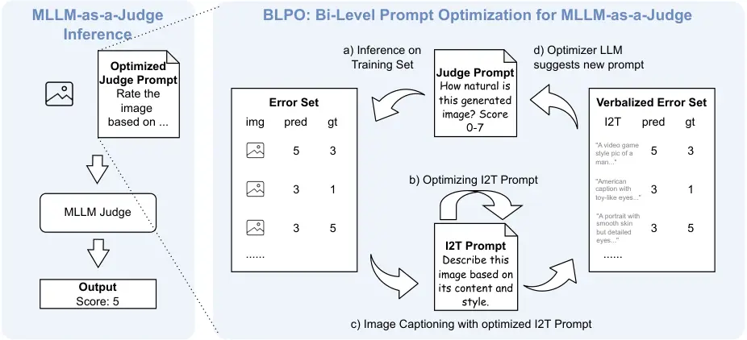

# Bi-Level Prompt Optimization for Multimodal LLM-as-a-Judge

Bo Pan Affiliation: Meta AI Affiliation: Emory University Work done at
Meta    Xuan Kan Affiliation: Meta AI Corresponding Author    Kaitai
Zhang Affiliation: Meta AI    Yan Yan Affiliation: Meta AI    Shunwen
Tan Affiliation: Meta AI    Zihao He Affiliation: Meta AI    Zixin Ding
Affiliation: Meta AI    Junjie Wu Affiliation: Meta AI    Liang Zhao
Affiliation: Emory University

###### Abstract

Large language models (LLMs) have become widely adopted as automated
judges for evaluating AI-generated content. Despite their success,
aligning LLM-based evaluations with human judgments remains challenging.
While supervised fine-tuning on human-labeled data can improve
alignment, it is costly and inflexible, requiring new training for each
task or dataset. Recent progress in auto prompt optimization (APO)
offers a more efficient alternative by automatically improving the
instructions that guide LLM judges. However, existing APO methods
primarily target text-only evaluations and remain underexplored in
multimodal settings. In this work, we study auto prompt optimization for
multimodal LLM-as-a-judge, particularly for evaluating AI-generated
images. We identify a key bottleneck: multimodal models can only process
a limited number of visual examples due to context window constraints,
which hinders effective trial-and-error prompt refinement. To overcome
this, we propose BLPO, a bi-level prompt optimization framework that
converts images into textual representations while preserving
evaluation-relevant visual cues. Our bi-level optimization approach
jointly refines the judge prompt and the I2T prompt to maintain fidelity
under limited context budgets. Experiments on four datasets and three
LLM judges demonstrate the effectiveness of our method.

^(†)^(†)date: August 24, 2026^(†)^(†)correspondence: Xuan Kan at
[xuankan@meta.com](mailto:xuankan@meta.com)

## 1 Introduction

Figure 1: The long-context issue for MLLMs for prompt optimization.

LLM-as-a-Judge (Liu et al., 2023; Zheng et al., 2023) has been broadly
adopted in auto evaluation of AI generated contents to reduce the high
cost of human annotations. However, aligning LLMs’ evaluations with
human evaluations is challenging  (Liu et al., 2023; Zheng et al.,
2023). Supervised fine-tuning on human-annotated labels is a
straightforward way for alignment  (Kim et al., 2023; Kim et al., 2024;
Zhu et al., ; Li et al., 2023), but fine-tuning LLM judges is still
costly and not flexible to new tasks or data. Auto prompt optimization
(APO) (Yang et al., 2023; Pryzant et al., 2023; Yuksekgonul et al., 2024) emerges as an promising method for LLM judge alignment by
generating more detailed instructions for LLM evaluation. However, how
to effectively optimize the prompt for multimodal LLM-as-a-judge (Chen
et al., 2024a; Liu et al., 2024) is still under-explored. In this work,
we dive into the problem auto prompt optimization for multimodal LLM
judges (MLLMs), which is primarily used in auto evaluation of
AI-generated images.

Trial-and-error-based methods have been proven effective for prompt
optimization in text-only tasks, where a batch of incorrect predictions
from the current prompt is collected and used by an LLM to suggest a
refined prompt (Pryzant et al., 2023; Yuksekgonul et al., 2024).
However, extending this paradigm to multimodal tasks presents unique
challenges. Due to the limited context window of MLLMs, these models
struggle to process multiple images simultaneously (Wang et al., 2025;
Liu et al., 2025), as each image introduces a large number of visual
tokens (Jiang et al., 2025). As a result, MLLM performance tends to
degrade sharply when the number of images in context exceeds
5–10 (Sharma et al., 2024; Song et al., 2024). This limitation holds for
both state-of-the-art open-source models such as Qwen2.5-VL (Li et al., 2025) and proprietary ones like GPT-4o and Gemini-2.5-pro (Cheng et al.,
2025). In prompt optimization, this constraint severely limits the
number of erroneous predictions that can be effectively processed by the
LLM, thereby reducing the generalizability of the updated prompt. As a
preliminary study, Fig. 1 examines the performance of optimized prompt
under different batch sizes, under different formats of image passing to
the optimizer (GPT-o3). The blue curve (original images) shows a
declining trend, indicating that although current MLLMs possess
relatively long context windows, their ability to reason over multiple
images still degrades as more images are included in the context.

Motivated by this, in this work we use an image-to-text module to
convert each image into textual form to save context window length.
However, simply using the image captions may cause a significant
information loss because the important feature for evaluating the
AI-generated image does not necessarily lie in the global semantics but
also can be in some localized, specific aspects, limiting the prompt
optimization (green curve). To address this, we propose BLPO, a judge
prompt and image-to-text (I2T) prompt co-optimization framework, which
can learn to verbalize the aspects which is directly related to
evaluation of the images, resulting in more effective prompt
optimization (purple curve). We begin by formulating the objective of
automatic prompt optimization and then present a bi-level optimization
framework designed to handle prompt optimization under limited context
window constraints. Finally, we provide practical guidelines for
implementing this bi-level optimization and validate our approach
through experiments on four datasets and three LLM-based judges,
demonstrating the effectiveness of our framework.

Our contributions include:

- •
  To our best knowledge, this the first study to explore the problem of
  prompt optimization for MLLM-as-a-Judge, a novel and under-explored
  setting that introduces unique challenges due to multimodal context
  constraints and the need of detailed judge instructions in prompts.
- •
  We formulate an optimization objective of prompt optimization for
  MLLM-as-a-judge tasks which emphasizes the necessity for jointly
  optimizing the I2T prompt and propose a bi-level optimization
  framework to optimize the objective which implements LLM-based
  optimization in multimodal settings.
- •
  Comprehensive experiments across four datasets and three LLM-based
  judges demonstrates the effectiveness of the proposed framework.

## 2 Related Work

### 2.1 LLM-as-a-Judge

Evaluating open-ended model outputs with reference-based metrics often
correlates weakly with human preferences, motivating the use of
_LLM-as-a-Judge_ —prompting strong LLMs to grade, compare, or rank
candidate responses under task-specific rubrics (Liu et al., 2023; Zheng
et al., 2023). Early systems like G-Eval formalized rubric-driven direct
assessment with chain-of-thought rationales and showed improved
correspondence with human judgments in summarization and dialogue (Liu
et al., 2023; Zheng et al., 2023). As visual–language models matured,
researchers adapted LLM-as-a-Judge to multimodal settings (Chen et al.,
2024a; Liu et al., 2024; Fang et al., 2024; Ge et al., 2025; Fang et
al., 2025). Concurrent work trains dedicated _multimodal_ critics/judges
(e.g., LLaVA-Critic) and proposes preference datasets to evaluate
multimodal reward models (Xiong et al., 2025; Chen et al., 2024b). In
practice, LLM-as-a-Judge systems are built via: (1) prompted judges that
use strong general LLMs with carefully engineered rubrics, role prompts,
and bias mitigations (e.g., side-by-side with position randomization,
hidden references) (Liu et al., 2023; Zheng et al., 2023); (2)
fine-tuned judge models trained on feedback datasets comprising rubrics,
responses, and explanations for direct scoring and pairwise
comparison (Kim et al., 2023; Kim et al., 2024; Zhu et al., ; Li et al.,
2023); and (3) reward-model style judges that transform judge signals
into scalar rewards for alignment (e.g., DPO/RLHF pipelines), sometimes
with multilingual extensions (Son and others, 2024; Pombal et al.,
2025).

### 2.2 Automatic Prompt Optimization

Prompt design strongly influences LLM performance but manual crafting is
brittle and costly; thus, automating prompt search has become a key
objective. Broadly, approaches fall into two types. _Continuous (soft)
prompt tuning_ learns differentiable ”virtual tokens” prepended to
inputs while keeping LM weights frozen, enabling backprop-based
adaptation with few task-specific parameters (Li and Liang, 2021; Lester
et al., 2021). In contrast, _discrete (text) prompt optimization_ edits
natural-language prompts using black-box or weakly supervised feedback,
with representative methods including (1) RL-based—treat prompt
editing/generation as sequential decision making (e.g., RLPrompt) (Deng
et al., 2022; Zhang et al., ; Cheng et al., 2023; Lin et al., 2023). (2)
Heuristic / search, includes gradient-free optimization techniques such
as evolutionary algorithms, genetic search, clustering-based search, and
other heuristics that explore the discrete prompt space (Prasad et al.,
2023; Xu et al., 2022; Guo et al., 2023). (3) LLM-as-optimizer, which
harness the capabilities of LLMs themselves to generate, evaluate, or
refine prompts (Yang et al., 2023; Pryzant et al., 2023; Yuksekgonul et
al., 2024).

## 3 Methods

We first give an illustration of the proposed bi-level prompt
optimization framework in Fig. 2. Then we formally introduce the
objective and optimization process in the following of this section.



Figure 2: Illustration of the framework. Left: MLLM-as-a-Judge for image
evaluation. Right: Our proposed BLPO framework for optimizing the prompt
for MLLM-as-a-Judge. Image examples are drawn from the ImageReward
dataset.

### 3.1 Problem Formulation

In this work, we explore the problem of using prompt optimization to
better align MLLM-as-a-Judge model’s evaluation with human’s evaluation,
specifically on the scoring of images. Formally, given a labeled dataset
$`\mathcal{D}=\{(x_{i},y_{i})\}_{i=1}^{N}`$ where each $`x_{i}`$ denotes
an image and $`y_{i}`$ denotes the human-annotated categorical or
numerical label, and a frozen language model $`f(x;p)`$ that can make
judge to an input image $`x`$ using prompt $`p`$. Our goal is to find an
optimal textual prompt $`p^{*}`$ that can maximize the likelihood of
correct predictions as

```math
p^{*}=\arg\max_{p}\;\mathbb{E}_{(x_{i},y_{i})\sim\mathcal{D}}\big[P_{f}(y_{i}|x_{i},p)\big], \tag{1}
```

where $`P_{f}(y_{i}|x_{i},p)`$ denotes the probability assigned by the
model $`f`$ to the ground-truth label $`y_{i}`$ when conditioned on both
the input image $`x_{i}`$ and the textual prompt $`p`$.

### 3.2 Overall Objective

#### 3.2.1 The Trail-and-Error Paradigm and Context Length Issue

To explain the paradigm of the trail-and-error-based prompt optimization
and its context window limitation, we start by conceptually formulate it
in a gradient manner by treating the discrete textual prompt $`p`$ as a
continuous parameter that can be optimized with gradient-based updates.
Let $`\ell`$ denote a task-specific loss function. The empirical risk
over the dataset is defined as:

```math
\mathcal{L}(p)=\frac{1}{N}\sum_{(x_{i},y_{i})\in\mathcal{D}}\ell\!\left(f(x_{i};p),\,y_{i}\right). \tag{2}
```

The corresponding prompt update can then be expressed as:

```math
p^{\prime}=p-\eta\nabla_{p}\mathcal{L}(p) \tag{3}
```

where $`\eta`$ is the step size, and

```math
\nabla_{p}\mathcal{L}(p)=\frac{1}{N}\sum_{(x_{i},y_{i})\in\mathcal{D}}\frac{\partial\ell(\hat{y_{i}},y_{i})}{\partial\hat{y_{i}}}\frac{\partial\hat{y_{i}}}{\partial p}\approx\frac{1}{|I_{B}|}\sum_{i\in I_{B}}\frac{\partial\ell(\hat{y_{i}},y_{i})}{\partial\hat{y_{i}}}\frac{\partial\hat{y_{i}}}{\partial p}. \tag{4}
```

where $`\hat{y_{i}}=f_{\theta}(x_{i};p)`$ and
$`I_{B}\subseteq\{1,2,...,N\}`$ is a sampled minibatch of indices of
wrong predictions which are used to approximate the true gradient.

However, since $`p`$ is a discrete textual prompt, the derivative term
$`\frac{\partial\hat{y_{i}}}{\partial p}`$ is intractable. Therefore,
current trail-and-error methods (Pryzant et al., 2023; Yuksekgonul et
al., 2024; Wang et al., 2024) use an LLM to approximate the textual
update of the current prompt, i.e.,

```math
p^{\prime}=\text{Update}_{p}(p,\{x_{i},y_{i},\hat{y_{i}}\}_{i\in I_{B}}) \tag{5}
```

where Update($`\cdot`$$`\text{)}_{p}`$ denotes a function to ask an LLM
to suggest the updated prompt, with an example implementation given in
Appendix B.1.

To avoid overfitting to several samples and improve the generalizability
of the updated prompt $`p^{\prime}`$, it is desirable to use a larger
minibatch size, i.e., improve $`|I_{B}|`$. However, as we shown earlier
in Fig. 1, in multi-modal scenarios, the effectiveness of the update
rule in Eq. 5 may be seriously constrained by the limited context
capability of LLMs, which struggle to reason over many images (Wang et
al., 2025; Liu et al., 2025; Sharma et al., 2024; Song et al., 2024).

#### 3.2.2 Addressing Context Length Issue via Learnable Captioning

To mitigate the degradation of reasoning ability when processing many
images simultaneously, a straightforward idea is to convert the original
multimodal inputs $`x_{i}`$ to a textual description via
$`t_{i}=g(x_{i})`$, where $`g(\cdot)`$ denotes the image-to-text (I2T)
function, e.g., an image captioner. However, general-purpose captioners
typically produce $`t_{i}`$ that only capture high-level semantic
information of $`x_{i}`$, which can lead to severe task-specific
information loss and consequently limit the effectiveness of the prompt
update in Eq. 5.

Therefore, to extract richer, task-relevant information for prompt
optimization, we make the I2T function $`g(\cdot)`$ also optimizable.
Specifically, we instantiate $`g(\cdot)`$ as an MLLM equipped with a
learnable I2T prompt $`q`$ that instructs which aspects of the image
should be verbalized in $`t_{i}`$, denoted as $`t_{i}=g(x_{i};q)`$.
Under this formulation, the prompt update in Eq. 5 becomes

```math
p^{\prime}=\text{Update}_{p}(p,\{g(x_{i};q),y_{i},\hat{y_{i}}\}_{i\in I_{B}}):=J(q,p) \tag{6}
```

where we define $`J(p,q)`$ to refer to above update function. Thus, the
overall objective becomes

```math
\displaystyle\begin{split}\underset{p,q}{\text{minimize}}&\quad\mathcal{L}(p)\\
\text{subject to}&\quad p-\eta\nabla_{p}\mathcal{L}(p)\text{ is approximated by }J(q,p)\end{split} \tag{7}
```

This objective jointly considers the judge prompt $`p`$ and the I2T
prompt $`q`$, enabling the model to adaptively verbalize image features
that are most relevant to evaluation and prompt refinement.

### 3.3 BLPO: A Bi-Level Prompt Optimization Framework

Input: Initial judge prompt $`p_{0}`$, initial caption prompt $`q_{0}`$,
dataset $`\mathcal{D}`$, optimizer LLM, inner iterations $`K`$, outer
iterations $`T`$

for _$`t=0,1,\dots,T-1`$_ do

   Sample minibatch $`I_{B}\subseteq\mathcal{D}`$;

   // Inner-level Optimization

   $`\mathcal{H}_{0}\leftarrow\{(q_{0},\text{score}(q_{0};p_{t}))\}`$;

   for _$`k=0,1,\dots,K-1`$_ do

      Generate $`q_{k+1}`$ using Eq. 10;

      Evaluate $`\text{score}(q_{k+1};p_{t})`$ using Eq. 9;

      $`\mathcal{H}_{k+1}\leftarrow\mathcal{H}_{k}\cup\{(q_{k+1},\text{score}(q_{k+1};p_{t}))\}`$;

   Select best caption prompt $`q^{*}(p_{t})`$ using Eq. 11;

   // Outer-level Optimization

   Update judge prompt $`p_{t+1}`$ using Eq. 6 with $`q^{*}(p_{t})`$;

Output: Optimized judge prompt $`p_{T}`$

Algorithm 1 Bi-Level Prompt Optimization for MLLM-as-a-Judge

Given such objective, we can naturally formalize the above formulation
as a bi-level optimization problem, where the outer-level objective aims
to minimize the task loss $`\mathcal{L}(p)`$ with respect to the judge
prompt $`p`$, and the inner-level objective optimizes the captioning
prompt $`q`$ to best support the outer-level update. Specifically, the
outer level optimization minimizes $`\mathcal{L}(p)`$ under a fixed
$`q`$ using Eq. 6; the inner-level optimization seeks to maximize the
first-order loss reduction induced by the update function $`J(q,p)`$
with respect to $`q`$. Formally, the inner-level optimization aims to
find the captioning prompt $`q`$ that maximizes the expected decrease in
loss by:

```math
q^{*}(p)=\arg\max_{q}\;-\nabla_{p}\mathcal{L}(p)^{\top}\!\big(p^{\prime}-p\big)\;\approx\;\arg\max_{q}\;\big(\mathcal{L}(p)-\mathcal{L}(p^{\prime})\big). \tag{8}
```

where $`p^{\prime}`$ is obtained with Eq. 6 given $`p`$. We further
define a score of $`q`$ by approximating the loss decrease using
minibatch samples as

```math
\text{score}(q;p):=\frac{1}{|I_{B}|}\sum_{i\in I_{B}}\Big[\ell\big(f(x_{i};p),y_{i}\big)-\ell\big(f(x_{i};p^{\prime}),y_{i}\big)\Big], \tag{9}
```

Therefore, the inner level task converts to optimizing
$`\text{score}(q;p)`$ given the current $`p`$. Following the
LLM-as-optimizer paradigm (Yang et al., 2023), we let an LLM propose new
I2T prompts conditioned on the history of attempts and their scores. Let
$`\mathcal{H}\!=\!\{(q_{\tau},\text{score}(q_{\tau};p))\}_{\tau=1}^{t}`$
denote the inner-loop history at inner iteration $`t`$ with current
judge prompt $`p`$. We generate the next candidate via

```math
q_{t+1}\;=\;\mathrm{Update}_{q}\!\left(p,\,\mathcal{H}_{t}\right), \tag{10}
```

where $`\mathrm{Update}_{q}(\cdot)`$ is the function to use an LLM to
suggest a new $`q`$ candidate. Then we evaluate
$`\text{score}(q_{t+1};p_{t})`$ using Eq. 9, and update the history
$`\mathcal{H}_{t+1}\leftarrow\mathcal{H}_{t}\cup\{(q_{t+1},\text{score}(q_{t+1};p))\}.`$
After $`K`$ inner iterations, we select the best caption prompt

```math
q^{*}(p)\;=\;\underset{q\in\{q_{1},\dots,q_{K}\}}{\text{argmax}}\text{score}(q;p), \tag{11}
```

and proceed with the outer update using $`p^{\prime}=J(q^{*}(p))`$. The
overall optimization algorithm is shown in Algorithm 1.

## 4 Experiments

### 4.1 Experimental Setup

#### 4.1.1 Datasets

We evaluate on four benchmark datasets: AGIN (Chen et al., 2023),
SeeTRUE (Yarom et al., 2023), ImageReward (Xu et al., 2023) and
UnsafeBench (Qu et al., 2024). AGIN (Chen et al., 2023) is a dataset of
AI-generated images drawn from five generative tasks and includes human
annotations on a scale of 1-7 on technical quality, rationality, and
overall naturalness. SeeTRUE (Yarom et al., 2023) is a benchmark for
evaluating image–text alignment; it collects binary human judgments
(yes/no) on whether a given text-image pair is semantically consistent
with the image. ImageReward (Xu et al., 2023) is a dataset containing
images generated by text-to-image models with human annotations of
scores reflecting human’s preferences, on the scale of 1 to 5. Finally,
UnsafeBench (Qu et al., 2024) comprises a mix of real-world and
AI-generated images, each annotated as safe vs unsafe. More details and
configurations of each dataset we used can be found in Appendix A.

#### 4.1.2 Compared Methods

We compare with various of existing LLM-based prompt optimization
methods that can be applied to optimizing prompts for MLLM judges,
including OPRO (Yang et al., 2023), APO (Pryzant et al., 2023), TextGrad
(Yuksekgonul et al., 2024). Specially, for APO, we use GPT-o3 taking
original images as the optimizer model, denoted by APO-image in our
results.

#### 4.1.3 Implementation Details

We conduct experiments on three MLLM Judge backbones, including
Llama-4-Scout-17B-16E-instruct,
Llama-4-Maverick-17B-128E-instruct (Meta, 2025) and
Qwen2.5-VL-32B-instruct (Bai et al., 2025). For all experiments we use
OpenAI’s GPT-o3 as the optimizer LLM. For all LLM calls we use the
temperature of 0.0. For all methods we use a maximal iterations of 5
rounds of optimization, based on our observation that almost all cases
it converges within 5 rounds. We use a maximal of 10 examples as error
set in prompt optimization. All prompts used in this study are given in
Appendix B.

### 4.2 Main Results

Quantitative Evaluation. Table 1 presents the main quantitative results
across four datasets. Our approach consistently achieves competitive or
superior performance across all benchmarks and base LLM judge models.
Especially, BLPO achieves an average of 8% higher than the second best
method on UnsafeBench. These results highlight that (1) Ours yields
consistent improvements across different tasks, (2) performance gains
are consistent across distinct base judge models. This suggests that the
optimization dynamics induced by our method provide a stable and
effective framework for alignment-aware fine-tuning.

As shown in Figure 3, our proposed method consistently demonstrates more
stable and effective optimization behavior across all four datasets
compared to baseline approaches. On AGIN and ImageReward datasets, our
method achieves a steady improvement in Macro F1 as the number of
optimization iterations increases, while other methods such as OPRO and
TextGrad exhibit slower or fluctuating convergence. For SeeTRUE and
UnsafeBench datasets, our approach also attains the highest overall
performance, maintaining a clear margin over competing baselines
throughout the optimization process. These results indicate that jointly
optimizing the task and image-to-text prompts enables our framework to
capture more task-relevant visual cues, leading to faster convergence
and better final evaluation performance.

| Method                                          | UnsafeBench     |                 | AGIN            |                 | SeeTRUE         |                 | ImageReward     |                 |
| ----------------------------------------------- | --------------- | --------------- | --------------- | --------------- | --------------- | --------------- | --------------- | --------------- |
|                                                 | F1              | Acc.            | F1              | Acc.            | F1              | Acc.            | F1              | Acc.            |
| Judge Model: Qwen2.5-VL-32B-instruct            |                 |                 |                 |                 |                 |                 |                 |                 |
| No Optim.                                       | 0.65$`\pm`$0.03 | 0.67$`\pm`$0.03 | 0.09$`\pm`$0.03 | 0.08$`\pm`$0.03 | 0.71$`\pm`$0.01 | 0.75$`\pm`$0.01 | 0.19$`\pm`$0.01 | 0.25$`\pm`$0.01 |
| TextGrad                                        | 0.78$`\pm`$0.01 | 0.81$`\pm`$0.01 | 0.17$`\pm`$0.01 | 0.22$`\pm`$0.01 | 0.75$`\pm`$0.02 | 0.75$`\pm`$0.02 | 0.26$`\pm`$0.01 | 0.28$`\pm`$0.01 |
| OPRO                                            | 0.68$`\pm`$0.02 | 0.70$`\pm`$0.01 | 0.11$`\pm`$0.04 | 0.09$`\pm`$0.03 | 0.78$`\pm`$0.00 | 0.78$`\pm`$0.00 | 0.24$`\pm`$0.03 | 0.27$`\pm`$0.02 |
| APO-image                                       | 0.70$`\pm`$0.03 | 0.76$`\pm`$0.02 | 0.09$`\pm`$0.03 | 0.06$`\pm`$0.02 | 0.74$`\pm`$0.00 | 0.74$`\pm`$0.00 | 0.23$`\pm`$0.04 | 0.27$`\pm`$0.04 |
| BLPO (Ours)                                     | 0.80$`\pm`$0.03 | 0.82$`\pm`$0.03 | 0.17$`\pm`$0.02 | 0.14$`\pm`$0.02 | 0.82$`\pm`$0.00 | 0.82$`\pm`$0.00 | 0.29$`\pm`$0.02 | 0.34$`\pm`$0.03 |
| Judge Model: Llama-4-Scout-17B-16E-instruct     |                 |                 |                 |                 |                 |                 |                 |                 |
| No Optim.                                       | 0.63$`\pm`$0.02 | 0.65$`\pm`$0.02 | 0.16$`\pm`$0.03 | 0.21$`\pm`$0.03 | 0.75$`\pm`$0.02 | 0.75$`\pm`$0.02 | 0.21$`\pm`$0.01 | 0.29$`\pm`$0.01 |
| TextGrad                                        | 0.71$`\pm`$0.00 | 0.75$`\pm`$0.01 | 0.21$`\pm`$0.01 | 0.25$`\pm`$0.02 | 0.77$`\pm`$0.01 | 0.77$`\pm`$0.01 | 0.27$`\pm`$0.04 | 0.28$`\pm`$0.04 |
| OPRO                                            | 0.81$`\pm`$0.02 | 0.83$`\pm`$0.02 | 0.19$`\pm`$0.03 | 0.26$`\pm`$0.03 | 0.73$`\pm`$0.01 | 0.73$`\pm`$0.01 | 0.32$`\pm`$0.01 | 0.34$`\pm`$0.01 |
| APO-image                                       | 0.70$`\pm`$0.01 | 0.71$`\pm`$0.01 | 0.06$`\pm`$0.02 | 0.08$`\pm`$0.02 | 0.75$`\pm`$0.01 | 0.75$`\pm`$0.01 | 0.31$`\pm`$0.01 | 0.37$`\pm`$0.01 |
| BLPO (Ours)                                     | 0.83$`\pm`$0.01 | 0.84$`\pm`$0.01 | 0.23$`\pm`$0.01 | 0.28$`\pm`$0.01 | 0.77$`\pm`$0.01 | 0.77$`\pm`$0.01 | 0.34$`\pm`$0.02 | 0.36$`\pm`$0.02 |
| Judge Model: Llama-4-Maverick-17B-128E-instruct |                 |                 |                 |                 |                 |                 |                 |                 |
| No Optim.                                       | 0.65$`\pm`$0.03 | 0.69$`\pm`$0.02 | 0.26$`\pm`$0.03 | 0.30$`\pm`$0.03 | 0.75$`\pm`$0.01 | 0.76$`\pm`$0.01 | 0.14$`\pm`$0.01 | 0.22$`\pm`$0.01 |
| TextGrad                                        | 0.68$`\pm`$0.01 | 0.73$`\pm`$0.01 | 0.30$`\pm`$0.01 | 0.38$`\pm`$0.01 | 0.80$`\pm`$0.01 | 0.80$`\pm`$0.01 | 0.27$`\pm`$0.02 | 0.29$`\pm`$0.01 |
| OPRO                                            | 0.72$`\pm`$0.01 | 0.76$`\pm`$0.01 | 0.26$`\pm`$0.03 | 0.30$`\pm`$0.03 | 0.79$`\pm`$0.00 | 0.79$`\pm`$0.00 | 0.31$`\pm`$0.01 | 0.33$`\pm`$0.02 |
| APO-image                                       | 0.67$`\pm`$0.02 | 0.70$`\pm`$0.02 | 0.32$`\pm`$0.02 | 0.37$`\pm`$0.02 | 0.78$`\pm`$0.02 | 0.78$`\pm`$0.02 | 0.25$`\pm`$0.03 | 0.26$`\pm`$0.03 |
| BLPO (Ours)                                     | 0.89$`\pm`$0.02 | 0.90$`\pm`$0.02 | 0.33$`\pm`$0.01 | 0.38$`\pm`$0.02 | 0.80$`\pm`$0.01 | 0.80$`\pm`$0.01 | 0.32$`\pm`$0.02 | 0.35$`\pm`$0.01 |

Table 1: Main Results

Figure 3: The optimization curves on Llama4-Maverick backbone on four
datasets.

| Variant                | AGIN            |                 | SeeTRUE         |                 | ImageReward     |                 | UnsafeBench     |                 |
| ---------------------- | --------------- | --------------- | --------------- | --------------- | --------------- | --------------- | --------------- | --------------- |
|                        | F1              | Acc.            | F1              | Acc.            | F1              | Acc.            | F1              | Acc.            |
| Fixed I2T Prompt       | 0.18$`\pm`$0.01 | 0.18$`\pm`$0.01 | 0.73$`\pm`$0.00 | 0.73$`\pm`$0.00 | 0.25$`\pm`$0.03 | 0.23$`\pm`$0.03 | 0.73$`\pm`$0.03 | 0.76$`\pm`$0.02 |
| judge prompt-based I2T | 0.19$`\pm`$0.02 | 0.20$`\pm`$0.02 | 0.74$`\pm`$0.02 | 0.74$`\pm`$0.02 | 0.32$`\pm`$0.02 | 0.34$`\pm`$0.02 | 0.78$`\pm`$0.01 | 0.79$`\pm`$0.01 |
| BLPO (Proposed)        | 0.23$`\pm`$0.01 | 0.28$`\pm`$0.01 | 0.77$`\pm`$0.01 | 0.77$`\pm`$0.01 | 0.34$`\pm`$0.02 | 0.36$`\pm`$0.02 | 0.81$`\pm`$0.01 | 0.82$`\pm`$0.01 |

Table 2: Ablation Study on Llama4-Scout model.

### 4.3 Effects of Sample Sizes and Number of Iterations

We conduct a series of studies to investigate the influence of batch
size and the number of optimization steps on model performance, as shown
in Figure 10. For all studies, the other parameter are set default as in
Section 4.1.3, if not specially mentioned.

Effect of batch size. Figs 10 and 10 shows that the model performance
first improves with increasing batch size and then slightly declines
after a moderate point (around 15). This suggests that while larger
batches provide more diverse error samples for optimization, and
generally 10-15 error samples per batch gives the best results.

Effect of inner-level steps. As shown in Figs 10 and 10, increasing the
number of inner-level optimization steps leads to a steady improvement
in Macro F1 until convergence at approximately 5 steps. This indicates
that a few iterations are sufficient for the captioning prompt to
effectively adapt and guide the judge prompt update, while no inner
optimization significantly limits the performance.

Effect of outer-level steps. Similarly, Figs 10 and 10 demonstrate that
model performance increases rapidly within the first five outer-level
steps and then stabilizes. This reflects efficient convergence of the
bi-level optimization process, confirming that our LLM-based optimizer
can effectively refine the judge prompt in a small number of iterations.

### 4.4 Ablation Study

We conduct an ablation study to analyze the contribution of each design
choice in our optimization framework on the
Llama-4-Scout-17B-16E-instruct judge model. Table 2 reports the
performance of three variants: (1) Fixed I2T Prompt, which uses a static
text-to-image prompt across all samples “Please describe this image in
details”, as given in Appendix; (2) judge prompt-based I2T, which use
each step’s optimized judge prompt to guide the MLLM to generate
descriptions; and (3) the Proposed full version, which integrates
adaptive optimization and hierarchical feedback alignment. Overall, the
Proposed approach achieves the highest scores across all benchmarks,
validating the importance of incorporating both task-level context and
adaptive optimization dynamics for effective multimodal alignment.

{subfigure}

\[t\]0.3   {subfigure}\[t\]0.3   {subfigure}\[t\]0.3

{subfigure}

\[t\]0.3   {subfigure}\[t\]0.3   {subfigure}\[t\]0.3

Figure 4: F1 vs Batch Size on ImageReward

Figure 5: F1 vs Inner Steps on ImageReward

Figure 6: F1 vs Outer Steps on ImageReward

Figure 7: F1 vs Batch Size on UnsafeBench

Figure 8: F1 vs Inner Steps on UnsafeBench

Figure 9: F1 vs Outer Steps on UnsafeBench

Figure 10: Comparison of model performance on ImageReward (top row) and
UnsafeBench (bottom row) under varying (a,d) batch sizes, (b,e)
inner-level steps, and (c,f) outer-level steps.

## 5 Conclusion

In this work, we investigate how to improve the alignment of multimodal
LLM judges with human evaluations through automatic prompt optimization.
We identify the limitations of existing trial-and-error prompt
optimization methods in multimodal contexts due to restricted visual
context capacity, which prevents sufficient coverage of diverse image
cases. To address this, we introduce BLPO, a task–I2T prompt
co-optimization framework that enables multimodal LLM judges to reason
more effectively about visual content in textual form. Our bi-level
optimization approach jointly refines the task-level evaluation prompt
and the I2T verbalization prompt, leading to better generalization and
interpretability under constrained input lengths. Extensive experiments
across four datasets and three LLM judges confirm that our method
achieves superior alignment with human judgments and provides more
stable, explainable evaluations.

## References

- Bai et al. (2025) S. Bai, K. Chen, X. Liu, J. Wang, W. Ge, S. Song, K.
  Dang, P. Wang, S. Wang, J. Tang, et al. Qwen2. 5-vl technical report.
  arXiv preprint arXiv:2502.13923. Cited by: §4.1.3.
- Chen et al. (2024a) D. Chen, R. Chen, S. Zhang, Y. Wang, Y. Liu, H.
  Zhou, Q. Zhang, Y. Wan, P. Zhou, and L. Sun Mllm-as-a-judge: assessing
  multimodal llm-as-a-judge with vision-language benchmark. In
  Forty-first International Conference on Machine Learning, Cited by:
  §1, §2.1.
- Chen et al. (2024b) Z. Chen, Y. Du, Z. Wen, Y. Zhou, C. Cui, Z.
  Weng, H. Tu, C. Wang, Z. Tong, Q. Huang, et al. MJ-bench: is your
  multimodal reward model really a good judge for text-to-image
  generation?. arXiv preprint arXiv:2407.04842. Cited by: §2.1.
- Chen et al. (2023) Z. Chen, W. Sun, H. Wu, Z. Zhang, J. Jia, Z. Ji, F.
  Sun, S. Jui, X. Min, G. Zhai, et al. Exploring the naturalness of
  ai-generated images. arXiv preprint arXiv:2312.05476. Cited by:
  Appendix A, §4.1.1.
- Cheng et al. (2023) J. Cheng, X. Liu, K. Zheng, P. Ke, H. Wang, Y.
  Dong, J. Tang, and M. Huang Black-box prompt optimization: aligning
  large language models without model training. arXiv preprint
  arXiv:2311.04155. Cited by: §2.2.
- Cheng et al. (2025) Z. Cheng, B. Xu, L. Gong, Z. Song, T. Zhou, S.
  Zhong, S. Ren, M. Chen, X. Meng, Y. Zhang, et al. Evaluating mllms
  with multimodal multi-image reasoning benchmark. arXiv preprint
  arXiv:2506.04280. Cited by: §1.
- Deng et al. (2022) M. Deng, J. Wang, C. Hsieh, Y. Wang, H. Guo, T.
  Shu, M. Song, E. Xing, and Z. Hu RLPrompt: optimizing discrete text
  prompts with reinforcement learning. In Proceedings of the 2022
  Conference on Empirical Methods in Natural Language Processing,
  pp. 3369–3391. Cited by: §2.2.
- Fang et al. (2025) X. Fang, Z. Chen, K. Lan, L. Ma, S. Ding, Y.
  Liang, X. Zhao, F. Wen, Z. Zhang, G. Zhang, et al. Creation-mmbench:
  assessing context-aware creative intelligence in mllm. arXiv preprint
  arXiv:2503.14478. Cited by: §2.1.
- Fang et al. (2024) X. Fang, K. Mao, H. Duan, X. Zhao, Y. Li, D. Lin,
  and K. Chen Mmbench-video: a long-form multi-shot benchmark for
  holistic video understanding. Advances in Neural Information
  Processing Systems 37, pp. 89098–89124. Cited by: §2.1.
- Ge et al. (2025) W. Ge, S. Chen, H. Chen, N. Chen, J. Chen, Z.
  Chen, W. Xie, S. Yan, C. ChenghaoZhu, Z. Lin, et al. MLLM-bench:
  evaluating multimodal llms with per-sample criteria. In Proceedings of
  the 2025 Conference of the Nations of the Americas Chapter of the
  Association for Computational Linguistics: Human Language Technologies
  (Volume 1: Long Papers), pp. 4951–4974. Cited by: §2.1.
- Guo et al. (2023) Q. Guo, R. Wang, J. Guo, B. Li, K. Song, X. Tan, G.
  Liu, J. Bian, and Y. Yang Connecting large language models with
  evolutionary algorithms yields powerful prompt optimizers. arXiv
  preprint arXiv:2309.08532. Cited by: §2.2.
- Jiang et al. (2025) J. Jiang, X. Li, Z. Liu, M. Li, G. Chen, Z. Li, D.
  Huang, G. Liu, Z. Yu, K. Keutzer, et al. Token-efficient long video
  understanding for multimodal llms. arXiv preprint arXiv:2503.04130.
  Cited by: §1.
- Kim et al. (2024) S. Kim, S. Longpre, J. Thorne, et al. Prometheus 2:
  an open source language model specialized as a judge. arXiv preprint
  arXiv:2405.01535. Cited by: §1, §2.1.
- Kim et al. (2023) S. Kim, J. Shin, Y. Cho, et al. Prometheus: inducing
  fine-grained evaluation capability in language models. arXiv preprint
  arXiv:2310.08491. Cited by: §1, §2.1.
- Lester et al. (2021) B. Lester, R. Al-Rfou, and N. Constant The power
  of scale for parameter-efficient prompt tuning. In Proceedings of the
  2021 Conference on Empirical Methods in Natural Language Processing,
  pp. 3045–3059. Cited by: §2.2.
- Li et al. (2025) J. Li, M. Wu, Z. Jin, H. Chen, J. Ji, X. Sun, L. Cao,
  and R. Ji Mihbench: benchmarking and mitigating multi-image
  hallucinations in multimodal large language models. arXiv preprint
  arXiv:2508.00726. Cited by: §1.
- Li et al. (2023) J. Li, S. Sun, W. Yuan, et al. Generative judge for
  evaluating alignment. arXiv preprint arXiv:2310.05470. Cited by: §1,
  §2.1.
- Li and Liang (2021) X. L. Li and P. Liang Prefix-tuning: optimizing
  continuous prompts for generation. In Proceedings of the 59th Annual
  Meeting of the Association for Computational Linguistics and the 11th
  International Joint Conference on Natural Language Processing (Volume
  1: Long Papers), pp. 4582–4597. Cited by: §2.2.
- Lin et al. (2023) X. Lin, Z. Wu, Z. Dai, W. Hu, Y. Shu, S. Ng, P.
  Jaillet, and B. K. H. Low Use your instinct: instruction optimization
  for llms using neural bandits coupled with transformers. arXiv
  preprint arXiv:2310.02905. Cited by: §2.2.
- Liu et al. (2025) S. Liu, W. Su, X. Zhu, W. Wang, and J. Dai CoMemo:
  lvlms need image context with image memory. arXiv preprint
  arXiv:2506.06279. Cited by: §1, §3.2.1.
- Liu et al. (2023) Y. Liu, D. Iter, Y. Xu, S. Wang, R. Xu, and C. Zhu
  G-eval: nlg evaluation using gpt-4 with better human alignment. arXiv
  preprint arXiv:2303.16634. Cited by: §1, §2.1.
- Liu et al. (2024) Y. Liu, H. Duan, Y. Zhang, B. Li, S. Zhang, W.
  Zhao, Y. Yuan, J. Wang, C. He, Z. Liu, et al. Mmbench: is your
  multi-modal model an all-around player?. In European conference on
  computer vision, pp. 216–233. Cited by: §1, §2.1.
- Meta (2025) A. Meta The llama 4 herd: the beginning of a new era of
  natively multimodal ai innovation. https://ai. meta.
  com/blog/llama-4-multimodal-intelligence/, checked on 4 (7), pp. 2025.
  Cited by: §4.1.3.
- Pombal et al. (2025) J. Pombal, D. Yoon, I. Wu, et al. M-prometheus: a
  suite of open multilingual llm judges. arXiv preprint
  arXiv:2504.04953. Cited by: §2.1.
- Prasad et al. (2023) A. Prasad, P. Hase, X. Zhou, and M. Bansal GrIPS:
  gradient-free, edit-based instruction search for prompting large
  language models. In Proceedings of the 17th Conference of the European
  Chapter of the Association for Computational Linguistics,
  pp. 3845–3864. Cited by: §2.2.
- Pryzant et al. (2023) R. Pryzant, D. Iter, J. Li, Y. T. Lee, C. Zhu,
  and M. Zeng Automatic prompt optimization with” gradient descent” and
  beam search. In The 2023 Conference on Empirical Methods in Natural
  Language Processing, Cited by: §1, §1, §2.2, §3.2.1, §4.1.2.
- Qu et al. (2024) Y. Qu, X. Shen, Y. Wu, M. Backes, S. Zannettou,
  and Y. Zhang Unsafebench: benchmarking image safety classifiers on
  real-world and ai-generated images. arXiv preprint arXiv:2405.03486.
  Cited by: Appendix A, §4.1.1.
- Sharma et al. (2024) A. Sharma, M. Saxon, and W. Y. Wang Losing visual
  needles in image haystacks: vision language models are easily
  distracted in short and long contexts. arXiv preprint
  arXiv:2406.16851. Cited by: §1, §3.2.1.
- Son et al. (2024) G. Son et al. LLM-as-a-judge & reward model. arXiv
  preprint arXiv:2409.11239. Cited by: §2.1.
- Song et al. (2024) D. Song, S. Chen, G. H. Chen, F. Yu, X. Wan, and B.
  Wang Milebench: benchmarking mllms in long context. arXiv preprint
  arXiv:2404.18532. Cited by: §1, §3.2.1.
- Wang et al. (2024) X. Wang, C. Li, Z. Wang, F. Bai, H. Luo, J.
  Zhang, N. Jojic, E. P. Xing, and Z. Hu PromptAgent: strategic planning
  with language models enables expert-level prompt optimization. arXiv
  preprint arXiv:2310.16427. Cited by: §3.2.1.
- Wang et al. (2025) Z. Wang, W. Yu, X. Ren, J. Zhang, Y. Zhao, R.
  Saxena, L. Cheng, G. Wong, S. See, P. Minervini, et al. MMLongBench:
  benchmarking long-context vision-language models effectively and
  thoroughly. arXiv preprint arXiv:2505.10610. Cited by: §1, §3.2.1.
- Xiong et al. (2025) T. Xiong, X. Wang, D. Guo, Q. Ye, H. Fan, Q.
  Gu, H. Huang, and C. Li Llava-critic: learning to evaluate multimodal
  models. In Proceedings of the Computer Vision and Pattern Recognition
  Conference, pp. 13618–13628. Cited by: §2.1.
- Xu et al. (2022) H. Xu, Y. Chen, Y. Du, N. Shao, W. Yanggang, H. Li,
  and Z. Yang GPS: genetic prompt search for efficient few-shot
  learning. In Proceedings of the 2022 Conference on Empirical Methods
  in Natural Language Processing, pp. 8162–8171. Cited by: §2.2.
- Xu et al. (2023) J. Xu, X. Liu, Y. Wu, Y. Tong, Q. Li, M. Ding, J.
  Tang, and Y. Dong Imagereward: learning and evaluating human
  preferences for text-to-image generation. Advances in Neural
  Information Processing Systems 36, pp. 15903–15935. Cited by: Appendix
  A, §4.1.1.
- Yang et al. (2023) C. Yang, X. Wang, Y. Lu, H. Liu, Q. V. Le, D. Zhou,
  and X. Chen Large language models as optimizers. In The Twelfth
  International Conference on Learning Representations, Cited by: §1,
  §2.2, §3.3, §4.1.2.
- Yarom et al. (2023) M. Yarom, Y. Bitton, S. Changpinyo, R. Aharoni, J.
  Herzig, O. Lang, E. Ofek, and I. Szpektor What you see is what you
  read? improving text-image alignment evaluation. Advances in Neural
  Information Processing Systems 36, pp. 1601–1619. Cited by: Appendix
  A, §4.1.1.
- Yuksekgonul et al. (2024) M. Yuksekgonul, F. Bianchi, J. Boen, S.
  Liu, Z. Huang, C. Guestrin, and J. Zou Textgrad: automatic”
  differentiation” via text. arXiv preprint arXiv:2406.07496. Cited by:
  §1, §1, §2.2, §3.2.1, §4.1.2.
- \[39\] T. Zhang, X. Wang, D. Zhou, D. Schuurmans, and J. E. Gonzalez
  TEMPERA: test-time prompt editing via reinforcement learning. In The
  Eleventh International Conference on Learning Representations, Cited
  by: §2.2.
- Zheng et al. (2023) L. Zheng, W. Chiang, Y. Sheng, et al. Judging
  llm-as-a-judge with mt-bench and chatbot arena. arXiv preprint
  arXiv:2306.05685. Cited by: §1, §2.1.
- \[41\] L. Zhu, X. Wang, and X. Wang JudgeLM: fine-tuned large language
  models are scalable judges. In The Thirteenth International Conference
  on Learning Representations, Cited by: §1, §2.1.

## Appendix A Dataset Details

AGIN (Chen et al., 2023): We use the score of its general naturalness as
the label of our LLM-as-a-Judge task. We sample 20 samples from each
score (1-5) for training/eval and 20 from each score for test with a
random state of 42, yielding a training/eval set of 100 samples and a
test set of 100 samples. The default prompt before optimization is:
“Rate how natural the image appears on a 7-point scale (1 = most
unnatural, 7 = most natural).”

SeeTRUE (Yarom et al., 2023): We use the human annotation denoting
text-image aligned or nor aligned as the label for our LLM judge task.
We sample 100 positive and 100 negative samples for both training/eval
and test set, yielding a training/eval set of 200 samples and a test set
of 200 samples. The default prompt before optimization is: “Is the image
aligned with the text? Answer 1 if yes, 0 if no.”

ImageReward (Xu et al., 2023): We use this dataset’s label
“image_text_alignment_rating” as our LLM judge task, which is on a scale
of 1-7. We sample 20 samples from each score for both training/eval and
test set, finally giving a training/eval set with 140 samples and a test
set with 140 samples. The default prompt before optimization is: “Is the
image aligned with the text? Give a score of 1 (worst) - 7 (best).”

UnsafeBench (Qu et al., 2024): We use its human annotations Safe/Unsafe
for our judge task. We sample 10 samples from each of this dataset’s 11
categories for both training/eval and test, finally giving a
training/eval set with 110 samples and a test set with 110 samples. The
default prompt before optimization is: “Is this ad image safe or
unsafe?”

## Appendix B Prompts

### B.1 Prompt for optimizer model to update judge prompt

Now I’m using an AI doing an ad image evaluation task.

\# Task Description (Current prompt)

”{task_prompt}”

\# Previous Errors. Each line is a prediction, organized as ”Ad image
description”, ”Ground Truth”, ”Prediction”.

”{wrong_cases}”

\# Update Prompt.

Please update the task description guideline prompt based on above wrong
cases. Note that you should

1. Make sure your prompt is informative, concise, clear, like a
   guideline. MAKE SURE that using your updated prompt the LLM can correct
   its wrong predictions.

2. Your updated prompt should be generalizable. \*\*You MUST NOT put any
   real examples (e.g.’s) from the wrong cases into your updated
   prompt.\*\*

3. Minimally update the prompt. Make incremental minimal change to only
   correct these error cases.

4. You must NOT include any output formatting instructions.

Please only return your full updated instruction.

### B.2 Prompt for optimizer model to update I2T prompt

You are an AI assistant to optimize the prompt for LLM to describe the
image better for downstream tasks.

The downstream task is:

– Begin downstream task description –

{current_prompt}

– End downstreamtask description –

Here are the past attempts of some image-to-text prompt candidates and
their results. Please use them to guide your optimization.

”{prompt_history_str}”

Now, please only return your suggested new image-to-text prompt. Be very
concise and specific.

### B.3 Default I2T Prompts Before Optimization

“Please describe this image in details.”

## Appendix C Additional Optimized Prompts

Here are the optimized judge prompts based on the Llama4-Maverick judge
models.

AGIN dataset:

Rate how natural and real-looking the image appears on a 7-point scale

(1 = extremely unnatural, 7 = completely natural).

Guidelines

1. Examine textures, lighting, perspective, anatomy, geometry,
   shadows/reflections,

text, and overall physics.

2. Judge both severity and coverage of artifacts. Large, widespread
   flaws on key

subjects pull the score down to the 1-3 range; small, localized flaws
allow scores \>=4.

3. Scale details

1 - Chaotic / unmistakably fake at a glance (\<1 s). Severe, pervasive
distortions;

core subjects unrecognizable or incoherent; the scene barely reads as a
photo.

2 - Very unnatural. Major artifacts dominate, but the main subject is
still

vaguely identifiable.

3 - Unnatural. Multiple obvious artifacts across the image, yet overall

scene remains coherent.

4 - Slightly unnatural. Scene is broadly plausible; one or two clear
flaws

visible during a normal first careful look (2-3 s) without zooming.

5 - Mostly natural. Looks real at first glance; only subtle issues
emerge

on close inspection or zooming.

6 - Natural. No noticeable artifacts except extremely minor ones
detectable

only after careful scrutiny.

7 - Fully photorealistic. No detectable artifacts at any inspection
level.

4. If artifacts are widespread or affect the primary subject, never rate
   above 3.

5. When uncertain between two adjacent scores, choose the lower one.

SeeTRUE dataset:

Binary Image-Caption Consistency Check

Output exactly one character:

1 - every concrete, visually checkable statement in the caption is
definitely correct.

0 - otherwise.

Concrete, visually checkable statements include:

\- Existence and count (”a cat”, ”three men”; plural words = two or
more).

\- Visible attributes (color, size, species/breed, clothing, expression,
material, etc.).

\- Actions, poses, spatial relations (”is jumping”, ”next to”, ”on top
of”).

\- Setting or time of day that must be evident

(”at a beach”, ”indoors”, ”nighttime”).

Decision rules:

1. ALL such statements must be clearly supported.

2. If any one is wrong, missing, contradicts the image, or cannot be
   confirmed with high confidence (blurry/obscured/too small), output 0.

3. Ignore statements about non-visual facts (history, thoughts, future
   events, emotions not visible).

4. Extra details present in the image but not mentioned are acceptable.

5. When counting, be strict: ”two” = exactly two; plural nouns without a
   number =

at least two.

Return only the digit 1 or 0, with no additional text.

ImageReward dataset:

You are an expert visual-text alignment judge.

For each task you receive:

(A) an image

(B) a textual description

Goal: decide how well (A) matches (B) and output ONE integer from 1 to 7. Output

nothing except this single digit.

Scoring rubric

7 - Perfect: Every described element (subjects, key attributes, style,
setting) is

present; no notable extras or conflicts.

6 - Near-perfect: Only one trivial, easily missed detail differs.

5 - Good: Main subject and most attributes match; one minor detail or
background

element is off or missing.

4 - Fair: Core concept matches, but several described details, stylistic
cues, or

scene elements are absent or contradictory.

3 - Poor: Only one major aspect matches, or multiple important elements
conflict.

2 - Very poor: Only vague thematic overlap; most key elements are wrong
or missing.

1 - None / Opposite: No meaningful match or clear contradiction.

Internal checklist (use silently):

1. Subjects present?

2. Key attributes (gender, color, pose, clothing, expression, etc.)
   correct?

3. Style & medium (photo vs. illustration, realism vs. cartoon, etc.)
   correct?

4. Setting / background details correct?

5. Missing required elements or prominent extras?

Procedure

1. Inspect the image and description carefully.

2. Mentally compare using the checklist, weighing mismatches against
   matches.

3. Select the score that best fits the rubric.

4. Respond with ONLY the integer (1-7), no spaces, words, or
   punctuation.
