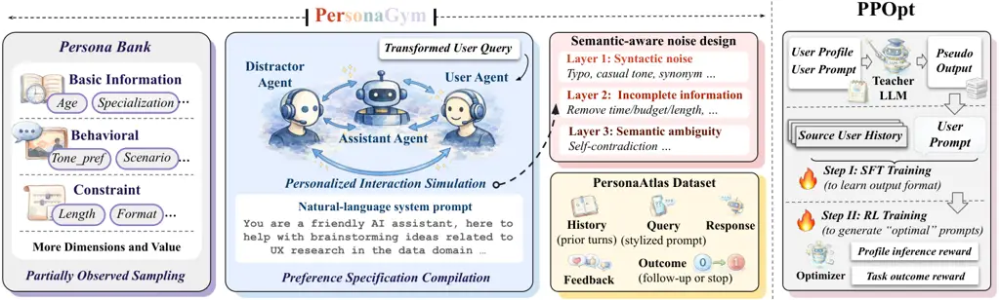
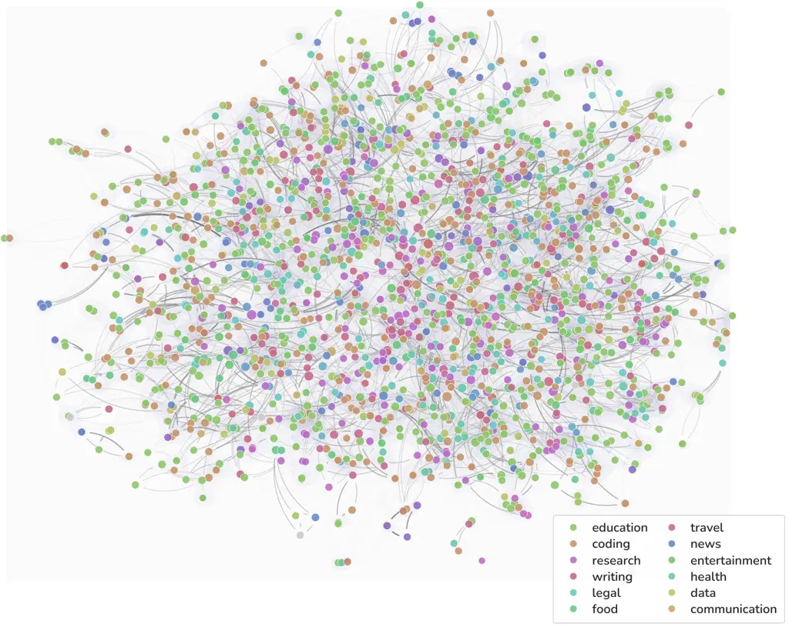
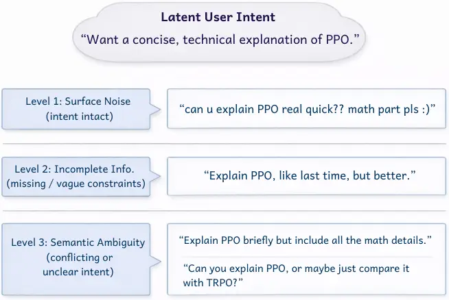
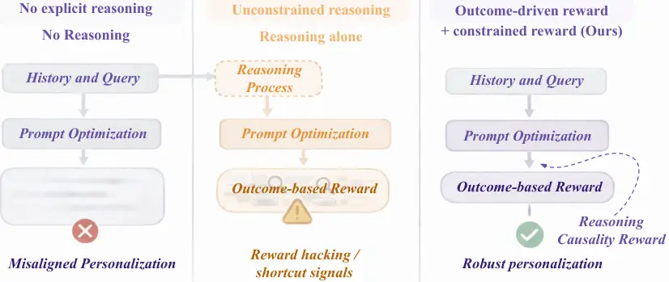
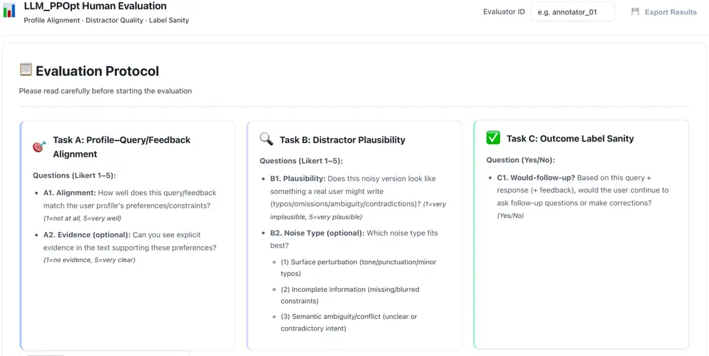

Yuchen Ma ([yuchen.ma@lmu.de](mailto:yuchen.ma@lmu.de))

# Synthetic Interaction Data for Scalable Personalization in Large Language Models

Yuchen Ma^(†) Affiliation: Munich Center for Machine Learning & LMU
Munich    Yue Huang Affiliation: University of Notre Dame    Wenjie Wang
Affiliation: Sichuan University    Xiaonan Luo Affiliation: University
of Notre Dame    Xiangliang Zhang Affiliation: University of Notre Dame
   Stefan Feuerriegel Corresponding author: = Affiliation: Munich Center
for Machine Learning & LMU Munich

###### Abstract

Personalized prompting offers large opportunities for deploying large
language models (LLMs) to diverse users, yet existing prompt
optimization methods primarily focus on task-level optimization, while
largely overlooking user-specific preferences and latent constraints of
individual users. This gap is primarily due to (i) the absence of
high-quality, privacy-sensitive data that capture personalized user–LLM
interactions at scale, and (ii) the lack of robust reward signals for
individual preferences. To overcome existing data limitations, we
introduce a high-fidelity synthetic data generation framework called
PersonaGym. Unlike prior work that treats personalization as static
persona–preference pairs, PersonaGym models a dynamic preference process
via an agentic LLM system to simulate realistic preference behaviors and
semantic-aware noise in order to generate personalized _multi-turn_
interaction trajectories. Using PersonaGym, we release PersonaAtlas, a
large-scale, high-quality, and diverse synthetic dataset of
high-fidelity multi-turn personalized interaction trajectories that
closely mirror real-world preference expression and noise patterns. We
further propose _Personalized Prompt Optimization_ (PPOpt), a scalable
and model-agnostic framework that optimizes user prompts based on
interaction histories without modifying the deployed LLM. PPOpt adopts a
reason-then-optimize paradigm that infers an explicit user profile and
conditions prompt rewriting on the user profile to avoid rewarding
hacking. Our training procedure for PPOpt integrates a cold-start
supervised prior with outcome-driven multi-objective reinforcement
learning. We present extensive experiments to demonstrate consistent
improvements over state-of-the-art baselines in terms of task
performance, personalization quality, and robustness to noisy as well as
to sparse preference signals.

Accepted at KDD 2026 (Datasets & Benchmarks Track)

Dataset:
[https://huggingface.co/datasets/HowieHwong/PPOpt-data](https://huggingface.co/datasets/HowieHwong/PPOpt-data)  
Model:
[https://huggingface.co/HowieHwong/ppopt](https://huggingface.co/HowieHwong/ppopt)  
Docs:
[https://personagym.readthedocs.io/](https://personagym.readthedocs.io/)  
Code:
[https://github.com/yccm/LLM-PPOpt](https://github.com/yccm/LLM-PPOpt)

## 1 Introduction

Large language models (LLMs) are increasingly deployed as
general-purpose assistants for writing, coding, planning, and decision
support \[4, 5, 6, 8, 18, 28, 41, 50, 70, 73\]. Despite impressive
general capabilities, real-world usage is inherently driven by
_personalized_ needs: users may prefer different levels of verbosity and
structure, different reasoning styles, and different degrees of
proactivity, and many of these preferences come as latent constraints
that are seldom stated explicitly (such as, e.g., privacy concerns,
formatting requirements, domain-specific conventions) \[77\]. As a
result, personalized alignment is important for improving users’
experiences during LLM interactions.

However, current efforts to personalize alignment are limited due to a
severe

_data gap_ for two practical reasons: First, high-fidelity data of
personalized multi-turn user interactions with LLMs are absent, because
collecting and releasing such data is challenging due to privacy and
consent reasons \[55\]. Second, real user feedback is inherently noisy
and incomplete: users rarely provide explicit rewards, and their
responses can be ambiguous or inconsistent across turns.

Moreover, existing approaches for personalized alignment have also

_method limitations_ in that these approach typically rely on _static_
preferences, _limited_ feedback, or _LLM-side_ adaptation \[6, 8, 18,
26, 50, 70, 73, 69\]. However, these approaches are often
computationally expensive or inapplicable to proprietary, closed-source
LLMs. Deployed LLMs are often proprietary or frozen, limiting access to
parameters and gradients. These challenges limit the scalability of
personalized alignment through model-side training. A natural way to
personalize _without_ modifying the underlying model is _prompt
adaption_. Black-box prompt optimization methods can steer a fixed LLM
by rewriting user instructions, providing a model-agnostic and
potentially transferable mechanism for behavior control \[9, 13, 20, 57,
79\], which provides a promising way to solve this problem.

To address the above bottlenecks (i.e.,

_data gap_ and

_method limitation_) behind personalized alignment, we first introduce a
 high-fidelity
synthetic data generation framework called PersonaGym, and we further
also present a
 model-agnostic
framework for _Personalized Prompt Optimization_ (PPOpt).


Data generation framework (PersonaGym): In practice, user preferences
are often expressed implicitly through interaction history: users
interact with the LLM over multiple turns which allow users to encode
preferences by correcting the LLM, rephrasing requests, and accepting or
rejecting suggestions in order to gradually steer the LLM toward a
preferred format for the output. A key novelty in PersonaGym is that we
introduce a scalable synthetic data generation pipeline that models each
user as a _dynamic latent preference process_ rather than a static
persona. Our PersonaGym follows an agentic framework involving three
LLMs (User, Assistant, and Distractor) to simulate realistic preference
behaviors and semantic-aware noise. Concretely, we generate diverse
multi-turn interaction trajectories where (1) user intent can be
partially specified, (2) user updates their behavior in response to the
LLMs’s outputs, and (3) noise is explicitly injected to mimic real
conversational patterns. This synthetic construction differs from static
persona-preference pairs by treating conversational dialogues as an
interactive, dynamic process. Based on this, we release PersonaAtlas, a
large-scale, high-fidelity synthetic dataset of high-fidelity multi-turn
personalized interaction trajectories, generated by PersonaGym to
closely mirror real-world preference expression and noise patterns.


_Personalized Prompt Optimization_ (PPOpt): We propose _Personalized
Prompt Optimization_ (PPOpt), a model-agnostic framework for _scalable
personalized prompt optimization_ that decouples personalization from
LLM training. PPOpt learns a _personalized prompt optimizer_ that
rewrites user prompts based on interaction history, without updating the
parameters of the deployed LLM. This black-box formulation is compatible
with proprietary models and easy to deploy. PPOpt follows a
_reason-then-optimize_ paradigm: it first infers a latent user profile
from historical interactions, then rewrites the current prompt
conditioned on the inferred profile. The optimizer is trained with
_task-level outcome rewards_ derived from downstream LLM performance,
yielding an outcome-driven objective that mitigates shortcut learning
and improves generalization. We further adopt a multi-objective RL
formulation to balance _personalization fidelity_ and task performance.
We evaluate PPOpt on both synthetic benchmarks and real-world user data.
Across settings, it consistently improves task outcomes, personalization
quality, outperforming state-of-the-art baselines.

Overall, our main contributions are the following:

1.  1.  High-fidelity synthetic data generation framework for personalized
        interaction: We introduce PersonaGym, a high-fidelity synthetic data
        generation framework. Based on this, we release PersonaAtlas, a
        large-scale, diverse synthetic dataset of high-fidelity multi-turn
        personalized interactions.
2.  2.  Prompt optimization method for personalization: By leveraging
        PersonaAtlas, we propose a scalable and model-agnostic framework
        PPOpt that optimizes user prompts from interaction histories without
        modifying the deployed LLM.
3.  3.  Empirical validation: We conduct extensive evaluations using the
        synthetic data generated by PersonaGym to demonstrate the
        effectiveness of PPOpt. In particular, our PPOpt shows improved
        personalization and generalization to unseen users.

## 2 Related Work

### 2.1 Synthetic Data Generation with LLMs

LLMs have demonstrated strong capability in generating high-quality
synthetic data at scale \[34\]. Compared to earlier approaches based on
conventional language models \[47\], modern LLMs are highly expressive
and controllable. Prior work has shown the effectiveness of
LLM-generated data across various settings, including multilingual
question answering \[42\], conversational systems \[72\], instruction
tuning \[63, 68, 76\], factuality improvement \[59\], synthetic data for
scientific domains \[23, 32\], and dataset diversification \[14, 10,
43\]. Recent frameworks such as DataGen \[24\] and Janus \[29\] further
highlight the scalability and versatility of LLM-based approaches for
synthetic data generation. Given the strong generative capacity of LLMs,
applying synthetic data generation to personalized conversations and
interaction-level settings is particularly promising \[31, 7, 61\].

In contrast to prior works that treat personalization as static
_persona-preference_ pairs, we model personalization as an _dynamic_
conversational process: preferences emerge only after observing the
LLM’s response, thus our modeling approach closely reflects real-world
user interactions and feedback (we later calls this also
“outcome-driven”). We further incorporate realistic human preference
behaviors such as ambiguous intents and cross-turn inconsistency into
our data generation process, thereby enabling training under noisy
conditions that mirror real conversations.

|                      |                |             |                   |             |                 |                |           |             |                  |
| -------------------- | -------------- | ----------- | ----------------- | ----------- | --------------- | -------------- | --------- | ----------- | ---------------- |
| Dimension            | PPOpt (_ours_) | LaMP \[46\] | PERSONA AI \[56\] | CAPM \[40\] | Summ+Ret \[44\] | Matryo. \[30\] | PAD \[8\] | ICPL \[64\] | NextQuill \[73\] |
| Intervention level   | Prompt         | Memory      | Memory            | Parameter   | Memory          | Prompt         | Decoding  | Prompt      | Parameter        |
| Data scalability     | High           | High        | High              | Medium      | High            | Medium         | Medium    | Low         | Medium           |
| User noise modeling  | ✓              | ✗           | ✗                 | ✗           | ✗               | ✗              | ✗         | ✗           | ✗                |
| Interaction dynamics | ✓              | ✗           | ✓                 | ✗           | ✗               | ✓              | ✗         | ✗           | ✗                |
| Closed-source Compa. | ✓              | ✓           | ✓                 | ✗           | ✓               | ✓              | ✗         | ✗           | ✗                |

Table 1: Comparison of personalization methods. Shown are the following
key dimensions: _Intervention level_ indicates the stage at which
personalization is applied (e.g., prompt-, memory-, decoding-, or
parameter-level). _Data scalability_ reflects whether the
personalization data can be scaled, for example via synthetic data
generation with a mature and reusable workflow. _User noise modeling_
measures whether the method explicitly accounts for realistic human
noise, such as ambiguous intent, typos, or inconsistent behaviors.
_Interaction dynamics_ denotes whether personalization is modeled over
multi-turn interactions rather than single-turn inputs. _Closed-source
compatibility_ indicates whether the method can be applied to
closed-source or proprietary models without accessing model parameters.

### 2.2 Prompt Optimization of LLMs

A growing line of work studies _black-box_ prompt optimization, which
rewrites user instructions without access to model parameters or
gradients and which is thus applicable to proprietary or frozen LLMs.
Early studies focus on single-prompt rewriting: BPO \[9\] automatically
refines human-written prompts to elicit better behaviors from a fixed
LLM, while DistillPrompt \[79\] distills task-specific knowledge from
data into compact, high-performing prompts. Other methods search over
prompts more explicitly; e.g., EvoPrompt \[20\] uses evolutionary
algorithms to evolve prompts, and SEE \[13\] treats the target LLM as a
black-box evaluator and optimizes prompts using only task-level
feedback. Complementary to these, AdaReasoner \[57\] targets
model-agnostic improvements in reasoning via prompt optimization, and
Promptolution \[65\] provides a modular framework that standardizes and
unifies diverse prompt-optimization pipelines.

Beyond rewriting a single instruction, recent work proposed methods to
search over higher-level prompting _patterns_ and multi-step prompt
content for LLM agents. Examples are AutoPDL \[49\], AFlow \[67\], and
DyFlow \[58\]. Finally, self-supervised prompt optimization reduces the
reliance on labeled data by leveraging an LLM’s own outputs as
supervision (e.g., by comparing candidate prompts through
self-consistency or preference signals \[62, 17\]).

Overall, prompt optimization offers a powerful route to steering LLM
behavior without training or parameter access. Prompt optimization is
inherently model-agnostic and often transferable across different LLMs.
However, despite these properties, prompt optimization has been
relatively under-explored in the context of _personalization_, where
model-agnostic adaptation and transferability are particularly
beneficial.

### 2.3 Personalized Alignment of LLMs

A large body of work aligns LLMs with general human preferences via
reinforcement learning and preference optimization, including
reinforcement learning from human feedback (RLHF) \[39\], reinforcement
learning from AI feedback (RLAIF) \[4, 28\], and direct preference
optimization (DPO) \[41\]. While these approaches are effective at
modeling population-level preferences, they struggle to capture
individual-level user heterogeneity, thus motivating _personalized
alignment_ \[19, 71\].

Existing methods for personalized alignment can be broadly grouped by
where adaptation occurs. One line of research targets _inference-time_
personalization without per-user fine-tuning. PAD \[8\] injects
user-specific rewards into token-level decoding, CoPe \[6\] contrasts
user-specific preferences against a base model, and Persona-judge \[70\]
uses the model’s own preference judgments to filter candidate tokens. A
second line improves _preference modeling_ and data efficiency.
NextQuill \[73\] adopts a causal framework to isolate the effects of
user history, HyPerAlign \[18\] infers interpretable preference
hypotheses from a small number of examples, and PUGC \[50\] leverages
implicit preferences from unlabeled user-generated content. A third line
studies _long-term_ (system-level) personalization. AI PERSONA \[56\]
enables lifelong personalization through continual user profile updates,
while PROPER \[69\] bridges group-level and individual-level preferences
via data-efficient adaptation. In parallel, several other architectural,
parameter-efficient approaches adapt models via lightweight modules,
including Profile-to-PEFT \[52\], HYDRA \[78\], and modular PEFT
composition \[51\]. Finally, CUPID \[26\] introduces a multi-turn
benchmark for evaluating context-dependent personalization in
interactive settings. PERSONAMEM-V2 \[25\] targets personalization where
preferences are mostly _implicitly_ revealed across long interaction
histories. For this, PERSONAMEM-V2 introduces a dataset and studies how
models can infer user personas from extended context; it further
proposes an agentic memory framework that distills long histories into a
compact, human-readable memory representation to improve personalization
efficiency.

However, existing personalized alignment methods typically rely on
_static_ preferences, _limited_ feedback, or _model-/memory-side_
adaptation (e.g., parameter updates, specialized memory modules, or very
long-context inference). In contrast, our approach treats
personalization as a scalable bridge between users and models: we
translate latent user intents into model-effective prompts using
synthetic interaction data and outcome-driven reinforcement learning,
thus achieving personalization without modifying the deployed model. We
show the detailed comparison in Table 1.

Research gap: As discussed above, there is—to the best of our
knowledge—no approach for prompt personalization that learns prompt
rewrites from _multi-turn_ interactions trajectories while explicitly
modeling _latent_ user preferences. To fill this gap, we propose a
scalable, outcome-driven, and model-agnostic framework that jointly
infers user preferences from interaction history and learns to generate
personalized prompt rewrites optimized for downstream outcomes.

## 3 PersonaGym: High-Fidelity Personalized Synthetic Interaction Data Generator

We propose PersonaGym, a high-fidelity synthetic data generation
pipeline that models users as dynamic preference processes (see Figure
1, left). It generates diverse multi-turn interaction trajectories while
capturing realistic user behaviors.

### 3.1 Overview of data generation

Our synthetic data generator employs an agentic architecture, which
involves three LLMs: (1) a User model that generates user-like queries
and feedback, (2) an Assistant model that produces responses to mimic
human preferences, and (3) a Distractor model that injects realistic
noise into both initial queries and follow-up feedback. The noise helps
generate more human-like text (e.g., it includes spelling errors),
which, in turn, improves robustness in downstream learning. For this,
our data generation pipeline operates in two stages: (1)
persona-to-policy compilation, where a persona is sampled from a curated
_Persona Bank_, optionally masked to model partial observability, and
compiled into a system-level preference specification; and (2)
trajectory synthesis, where stylized initial queries are generated,
multi-turn query–response–feedback interactions are simulated (using the
User and Response agent), and trajectories are optionally perturbed
(using the Distractor agent).




Figure 1: Overview of our high-fidelity synthetic data generation
framework PersonaGym (left) and the unified prompt optimization
framework PPOpt (right).

### 3.2 Persona Bank and Preference Specification Compilation

#### Persona Bank.

We construct a _Persona Bank_ $`\mathcal{P}`$ that captures
heterogeneous user characteristics, preferences, and latent constraints.
Each persona $`p\in\mathcal{P}`$ is represented as a set of
feature–value pairs $`p=\{(f_{i},v_{i})\}_{i=1}^{d}`$, where $`f_{i}`$
denotes a feature dimension and $`v_{i}`$ its associated categorical
value, as described in the following.

The feature dimensions span three schema-level categories in our persona
specification: (i) basic user profile attributes, (ii) interaction and
behavioral traits, and (iii) output/response constraints (the details of
these categories are shown in Appendix G). Moreover, we explicitly tag
each dimension with an is$`\_`$constraint indicator to distinguish hard
constraints, which must be strictly satisfied during generation (e.g.,
core profile attributes and response-level requirements), from soft
constraints, which are treated as optional or partially observed signals
(e.g., preferences for tone). This design enables controllable persona
instantiation under partial observability to mimic realistic diversity
in user intent and interaction dynamics while maintaining a compact
categorical representation suitable for large-scale synthetic trajectory
generation.

#### Feature sampling (under partial observability).

In practice, user features are rarely fully observable. To mirror that
such user features are only partially observable from the past history
in real-world settings, we make information about the user “sparse” by
employing stochastic sampling. Specifically, we model this by sampling
an observed _subset_ of features

```math
o\sim\mathrm{Sample}(p;\pi_{\mathrm{mask}}),\quad o\subseteq p, \tag{1}
```

where $`\pi_{\mathrm{mask}}`$ is a masking policy (e.g., random masking
per feature). This yields a partially observed persona $`o`$.

Given the observed persona $`o`$, we compile a system-level preference
specification $`s`$ that can condition the user simulation:

```math
s=\mathrm{Compile}(o;\Psi), \tag{2}
```

where $`\Psi`$ is an LLM-based _Preference Spec Compiler_ that
translates structured attributes into a natural-language system prompt
(details are in Appendix C and in our code).

### 3.3 Personalized Interaction Simulation

We synthesize multi-turn interaction trajectories via an interaction
generation pipeline. It employs three specialized stages to simulate
realistic user-assistant dialogues:

#### (i) User query transformation

We initialize the process using a seed query $`q`$ sampled from a
mixture of public task datasets $`\mathcal{D}`$ (e.g., QA, rewriting,
coding, planning; see Table 2), denoted as $`q\sim\mathcal{D}`$. To
induce user-specific phrasing, we optionally transform $`q`$ into a
persona-stylized query $`\tilde{q}`$:

```math
\tilde{q}=\begin{cases}\mathrm{Stylize}(q,s;M_{\mathrm{user}}),&\text{with probability }\rho,\\
q,&\text{with probability }1-\rho,\end{cases} \tag{3}
```

where $`M_{\mathrm{user}}`$ refers to the User agent l and $`\rho`$
controls how often queries are explicitly persona-stylized (here we set
$`\rho=0.5`$). We show an illustrative example of this process in
Appendix G.


#### (ii) Multi-turn interaction generation.

We then simulate a conversation of up to $`T`$ rounds. At each round
$`t`$: the Assistant agent $`M_{\mathrm{asst}}`$ produces an answer
$`a_{t}`$ given the current user message and history $`h_{t}`$; the User
agent emits feedback $`f_{t}`$ conditioned on a persona specification
$`s`$, the response of the Assistant agent, and the query:

```math
\displaystyle a_{t} \displaystyle=M_{\mathrm{asst}}(\tilde{q}_{t},h_{t-1}), \tag{4}
```

```math
\displaystyle f_{t} \displaystyle=M_{\mathrm{user}}(s,\tilde{q}_{t},a_{t},h_{t-1}). \tag{5}
```

In our simulation, if the User agent is not satisfied with the response,
the agent produces a follow-up request $`\tilde{q}_{t+1}`$; otherwise,
the trajectory terminates. This process yields a trajectory
$`\mathcal{T}_{u}=\left\{\left(q_{1},a_{1},f_{1}\right),\ldots,\left(q_{T},a_{T}\right)\right\}`$
for each user $`u`$.

#### (iii) Outcome-derived labels (positive/negative).

We derive supervision signals for reinforcement learning (RL) from
_behavioral outcomes_ (i.e., from the interaction trajectory) rather
than from the prompt itself. To this end, if a user issues a follow-up
request (or corrective feedback) after receiving $`a_{t}`$, we treat the
preceding prompt instance as a _negative_ outcome; if the interaction
terminates without follow-up, we treat it as _positive_. Let
$`\mathbb{I}[\cdot]`$ denote an indicator, we define a binary label for
turn $`t`$:

```math
y_{t}=1-\mathbb{I}[\text{follow-up at }t], \tag{6}
```

where $`y_{t}=1`$ indicates satisfaction. We store both (i) the
_historical prompt trajectory_ and (ii) turn-level positive/negative
instances for downstream RL training.

### 3.4 Data Augmentation via Distractor

Real-world user prompts and feedback are often noisy, underspecified, or
internally inconsistent (e.g., typos, missing constraints, vague
references, or preference changes). Relying solely on clean, fully
specified synthetic interactions can therefore lead to unrealistic
assumptions about user behavior. To better capture the long tail of
realistic inputs observed in practice, we simulate such variability
explicitly. We thus introduce a semantic-aware Distractor agent
$`M_{\mathrm{dist}}`$ that injects controlled noise into both the
initial user query and the follow-up feedback.

The Distractor agent acts as a perturbation engine that injects (a)
_initial user query perturbation_ and (b) _follow-up feedback
perturbation_. Formally, given a clean persona-stylized query
$`\tilde{q}`$ and feedback $`f_{t}`$, we generate corrupted versions
via:

```math
\displaystyle\tilde{q}^{\prime} \displaystyle=\mathrm{Noisify}(\tilde{q};M_{\mathrm{dist}},\alpha_{q}), \tag{7}
```

```math
\displaystyle f_{t}^{\prime} \displaystyle=\mathrm{Noisify}(f_{t};M_{\mathrm{dist}},\alpha_{f}), \tag{8}
```

where $`\alpha_{q},\alpha_{f}`$ control overall noise strength. We then
replace $`\tilde{q}`$ and/or $`f_{t}`$ with $`\tilde{q}^{\prime}`$
and/or $`f_{t}^{\prime}`$ during the interaction simulation process,
yielding a corrupted trajectory $`\tilde{\mathcal{T}}_{u}`$ that the
optimizer must learn to interpret.

#### Three-layer semantic-aware noise design.

The Distractor is configured as a _three-layer_ corruption process (see
the example in Figure 4). Intuitively, the layers represent increasing
semantic disruption:

- •
  Layer 1: Syntactic noise (intent intact). Preserve semantic content
  but perturb surface form (casual tone, punctuation changes, mild
  typos, synonym rewrite).
- •
  Layer 2: Incomplete information (intent clear, information
  missing/vague). Preserve the core intent but drop or blur key
  cues/constraints (remove time/budget/length, replace with vague
  values, add context-dependence such as “like last time”).
- •
  Layer 3: Semantic ambiguity (intent uncertain or conflicting).
  Introduce ambiguity or contradictions (multi-intent concatenation,
  underspecified improvement requests, self-contradiction, mid-request
  mind changing).

The above layered design allows us to control how much the observed text
deviates from the latent intent, matching realistic failure modes seen
in deployed systems.

### 3.5 Synthetic Data and PersonaAtlas Dataset

We serialize each synthesized interaction into turn-level training
instances following the trajectory construction in §3.3–§3.4. For each
persona $`p\in\mathcal{P}`$, we record partially observed features $`o`$
and compiled preference specifications $`s`$, unroll a (possibly
corrupted) interaction trajectory, and extract one training instance per
turn. A turn-level instance consists of the observed persona features,
preference specification, interaction history, current (possibly
distracted) user input and feedback, the assistant response, and a
binary outcome label indicating whether the interaction terminates or
continues.

By running PersonaGym, we collect approximately 2,000 personas and over
10,000 conversations, which form the PersonaAtlas dataset. Example
conversations are in the Appendix (see Figure 8–Figure 11. ). The
dataset is publicly released on HuggingFace¹¹ 1
[https://huggingface.co/datasets/HowieHwong/PPOpt-data](https://huggingface.co/datasets/HowieHwong/PPOpt-data).

| Dataset                     | Domain                          | \#Queries |
| --------------------------- | ------------------------------- | --------- |
| ultrachat_200k \[15\]       |   Multi-turn chat / instruction | $`3,250`$ |
| OpenR1-Math-220k \[35\]     |   Math reasoning                | $`2,638`$ |
| CodeFeedback \[75\]         |   Code instruction & feedback   | $`2,028`$ |
| Mol-Instructions \[16\]     |   Chemistry / molecules         | $`1,766`$ |
| MMLU \[21\]                 |   General knowledge (MCQ)       | $`1,638`$ |
| ai2_arc \[11\]              |   Science QA (MCQ)              | $`1,300`$ |
| Alpaca-cleaned \[53\]       |   Instruction following         | $`844`$   |
| TruthfulQA \[33\]           |   Truthfulness / factual QA     | $`759`$   |
| databricks-dolly-15k \[12\] |   Instruction / assistant data  | $`684`$   |
| MBPP \[3\]                  |   Programming problems          | $`619`$   |
| MT-Bench \[74\]             |   Evaluation prompts            | $`80`$    |

Table 2: Datasets used for query collection, with domains and query
counts.

## 4 _Personalized Prompt Optimization_ (PPOpt)

Based on the large-scale synthetic dataset PersonaAtlas powered by
PersonaGym, we present _Personalized Prompt Optimization_ (PPOpt), a
unified framework that learns a _personalized prompt optimizer_ from
user-specific interaction history. Given a user $`u`$ characterized by a
synthetic persona $`p_{u}`$, historical trajectories
$`\mathcal{H}_{u}`$, and a new session’s initial query
$`\tilde{q}^{\mathrm{init}}_{u}`$, PPOpt outputs an optimized prompt
$`\hat{q}^{\mathrm{init}}_{u}`$ so that a _fixed_ base LLM produces
responses that better satisfy the user’s personalization preferences.

#### Problem setup.

For each user $`u`$, we assume access to multiple historical sessions
(each potentially multi-turn):

```math
\mathcal{H}_{u}=\Big\{\mathcal{T}_{u}^{(j)}\Big\}_{j=1}^{J_{u}},\qquad\mathcal{T}_{u}^{(j)}=\Big\{(\tilde{q}^{(j)}_{t},a^{(j)}_{t},f^{(j)}_{t})\Big\}_{t=1}^{T_{j}}, \tag{9}
```

where $`\tilde{q}^{(j)}_{t}`$ denotes the user message, $`a^{(j)}_{t}`$
the assistant response from the base assistant model
$`M_{\mathrm{asst}}`$, and $`f^{(j)}_{t}`$ the user feedback.

In addition, we observe the initial query
$`\tilde{q}^{\mathrm{init}}_{u}`$ of a new session. The prompt optimizer
receives the _same input format during training and evaluation_, i.e.,
the initial query $`\tilde{q}^{\mathrm{init}}_{u}`$ with the historical
trajectories $`\mathcal{H}_{u}`$:

```math
s_{u}\;=\;\big(\tilde{q}^{\mathrm{init}}_{u},\;\mathcal{H}_{u}\big). \tag{10}
```

### 4.1 Reason-Then-Optimize Paradigm

Directly mapping an interaction history to a rewritten prompt often
encourages shortcut learning. To avoid this, we therefore design a
reason-then-optimize paradigm: the optimizer first infers a
natural-language user profile description,and then generates an improved
prompt conditioned on it.

Formally, the optimizer is a conditional policy $`\pi_{\theta}`$
producing:

```math
(\hat{z}_{u},\;\hat{q}^{\mathrm{init}}_{u})\sim\pi_{\theta}(\cdot\mid s_{u}), \tag{11}
```

where $`\hat{z}_{u}`$ includes inferred user
preferences/constraints/style based on $`\mathcal{H}_{u}`$. We implement
this with an autoregressive factorization:

```math
\pi_{\theta}(\hat{z}_{u},\hat{q}^{\mathrm{init}}_{u}\mid s_{u})=\pi_{\theta}(\hat{z}_{u}\mid s_{u})\cdot\pi_{\theta}(\hat{q}^{\mathrm{init}}_{u}\mid s_{u},\hat{z}_{u}), \tag{12}
```

realized by a single sequence model with explicit delimiters:

```math
\texttt{<REASONING>}\penalty\ \hat{z}_{u}\penalty\ \texttt{</REASONING>}\penalty\ \texttt{<PROMPT>}\penalty\ \hat{q}^{\mathrm{init}}_{u}\penalty\ \texttt{</PROMPT>}.
```

### 4.2 Cold-Start Supervised Fine-Tuning (SFT)

We use supervised fine-tuning (SFT) _only_ as a cold-start to (i)
enforce the reasoning-then-optimization output format and (ii) teach the
optimizer to _condition_ on
$`(\tilde{q}^{\mathrm{init}}_{u},\mathcal{H}_{u})`$ to produce a
plausible profile description followed by a rewritten prompt.
Importantly, we do _not_ assume access to ground-truth “optimal”
prompts; correctness and optimality are instead learned in the
subsequent outcome-driven RL stage.

#### Pseudo targets via strong teacher synthesis.

Let $`\mathcal{D}_{\mathrm{train}}`$ denote the synthetic dataset. Each
training sample contains a state
$`s_{u}=(\tilde{q}^{\mathrm{init}}_{u},\mathcal{H}_{u})`$ and the
synthetic persona $`p_{u}`$ (or its observed subset), where $`p_{u}`$ is
available _only_ during training. We use a powerful teacher model, i.e.,
a LLM (we use GPT-5.2 for the implementation), to synthesize
_format-consistent_ targets:

```math
z^{\star}_{u}\sim\mathcal{T}_{\mathrm{prof}}(\cdot\mid p_{u},\mathcal{H}_{u}),\qquad q^{\star}_{u}\sim\mathcal{T}_{\mathrm{prompt}}(\cdot\mid\tilde{q}^{\mathrm{init}}_{u},\mathcal{H}_{u},z^{\star}_{u}), \tag{13}
```

where $`\mathcal{T}_{\mathrm{prof}}`$ produces a natural-language
profile summary and $`\mathcal{T}_{\mathrm{prompt}}`$ produces a
rewritten initial prompt. These pseudo labels serve as _scaffolding_ to
bootstrap generation structure; they are not treated as ground-truth
optimal solutions. We show the synthesized case data in Appendix D. To
reduce the noise within pseudo targets, we introduce a filtering
mechanism, which is detailed in Appendix C.

### 4.3 Outcome-Driven Multi-Objective RL

After SFT, we optimize $`\pi_{\theta}`$ with RL using downstream
outcomes. Given $`(\hat{z}_{u},\hat{q}^{\mathrm{init}}_{u})`$, we obtain
the response from the Assistant agent under the improved prompt:

```math
\hat{a}^{\mathrm{init}}_{u}=M_{\mathrm{asst}}(\hat{q}^{\mathrm{init}}_{u};\mathcal{H}_{u}), \tag{14}
```

and a baseline response under the original prompt:

```math
a^{\mathrm{base}}_{u}=M_{\mathrm{asst}}(\tilde{q}^{\mathrm{init}}_{u};\mathcal{H}_{u}). \tag{15}
```

(For a single-turn evaluation,
$`M_{\mathrm{asst}}(\cdot;\mathcal{H}_{u})`$ indicates that the
historical context may be provided as additional conditioning text, but
the optimized prompt is _only_ the new session’s first query.)

#### Multi-objective reward.

We combine two rewards: (1) profile inference quality and (2) task
outcome improvement:

```math
R_{u}(\theta)=\lambda_{\mathrm{prof}}\,r_{\mathrm{prof}}(u)+\lambda_{\mathrm{task}}\,r_{\mathrm{task}}(u),\qquad\lambda_{\mathrm{prof}},\lambda_{\mathrm{task}}\geq 0. \tag{16}
```

#### (1) Profile inference reward.

In synthetic training, the ground-truth persona $`p_{u}`$ is available.
We score the inferred profile $`\hat{z}_{u}`$ with an LLM-as-judge
$`\mathcal{J}_{\mathrm{prof}}`$:

```math
r_{\mathrm{prof}}(u)=\mathrm{Norm}\Big(\mathcal{J}_{\mathrm{prof}}(\hat{z}_{u},\;p_{u})\Big)\in[0,1], \tag{17}
```

where $`\mathcal{J}_{\mathrm{prof}}(\cdot)`$ outputs a scalar rating
(e.g., 1–10) for how well $`\hat{z}_{u}`$ matches the persona (including
style and latent constraints), and $`\mathrm{Norm}(\cdot)`$ linearly
rescales to $`[0,1]`$.

#### (2) Task outcome reward (pairwise, preference-aware).

We evaluate whether the improved prompt yields a better assistant
response than the original prompt. We use an LLM-as-judge
$`\mathcal{J}_{\mathrm{task}}`$ that is provided with: the original
query $`\tilde{q}^{\mathrm{init}}_{u}`$, the ground-truth persona
$`p_{u}`$ (for preference grounding), and the two candidate responses
$`(a^{\mathrm{base}}_{u},\hat{a}^{\mathrm{init}}_{u})`$. The judge
outputs a binary value reflecting whether the response using the
improved prompt gives higher task correctness/clarity and preference
satisfaction

```math
r_{\mathrm{task}}(u)=\mathrm{Norm}\Big(\mathcal{J}_{\mathrm{task}}(\tilde{q}^{\mathrm{init}}_{u},p_{u},a^{\mathrm{base}}_{u},\hat{a}^{\mathrm{init}}_{u})\Big)\in\{0,1\}. \tag{18}
```

As a result, this yields the trained optimizer for personalizing LLMs.
The optimizer $`\pi_{\theta}`$ is itself implemented as a language
model, whose parameters are learned via SFT and outcome-driven RL Given
a user’s interaction history and an initial query, this optimizer
generates a rewritten prompt. When training the optimizer, we
instantiate it using different base LLMs.

## 5 Implementation details

Due to the space limits, the implementation details are in Appendix C.
We also release the code and toolkit docs for reference²² 2 Toolkit docs
at
[https://personagym.readthedocs.io/](https://personagym.readthedocs.io/)
and code is available at
[https://github.com/yccm/LLM-PPOpt](https://github.com/yccm/LLM-PPOpt).

## 6 Analysis of PersonaAtlas Dataset

#### Token analysis.

Table 3 reports the average tokens per conversation sample used during
the construction of PersonaAtlas. The results show that generating one
conversation sample requires 17,662.8 output tokens in total,
corresponding to \$0.2473/token for GPT-5.2 and \$0.1413/token for
GPT-4.1.³³ 3 Price estimates are based on information from OpenAI on
February 1, 2026. The interaction generation accounts for the vast
majority of tokens (13,880; 78.6%). These suggest that PersonaGym is
scalable for constructing large synthetic interaction datasets, as most
cost is spent on producing diverse multi-turn interactions rather than
repeatedly re-deriving persona specifications. This efficiency aligns
with our goal of scalable personalization data generation.

|                        |             |           |                    |                    |
| ---------------------- | ----------- | --------- | ------------------ | ------------------ |
| Module                 | Tokens      | Perc. (%) | \$/token (GPT-5.2) | \$/token (GPT-4.1) |
| Interaction generation | 13880.0     | 78.6      | 0.1943             | 0.1110             |
| Query generation       | $`1,824.6`$ | $`10.3`$  | $`0.025,5`$        | $`0.014,6`$        |
| Distractor             | $`1,020.0`$ | $`5.8`$   | $`0.014,3`$        | $`0.008,2`$        |
| Persona formulation    | $`938.2`$   | $`5.3`$   | $`0.013,1`$        | $`0.007,5`$        |
| Total                  | 17662.8     | 100.0     | 0.2473             | 0.1413             |

Table 3: Token consumption breakdown by different parts in PersonaGym.



Figure 2: Conversation embedding of PersonaAtlas by different domains.

#### Embeddings.

Figure 2 visualizes conversation-level embeddings colored by domain. The
data points are broadly interleaved rather than forming distinct
clusters, thus indicating substantial semantic overlap across domains.
This suggests that domain identity is not the dominant factor in the
representation structure, which is intended by design.

#### Diversity.

Table 4 compares data sample diversity across UltraChat \[15\], ShareGPT
\[48\] (shareGPT52K), and ours. Self-BLEU measures intra-dataset
similarity by computing BLEU of each sample against other samples; lower
values indicate higher diversity. INGF reports the proportion of
infrequent $`n`$-grams; higher values suggest more variable wording. The
type–token ratio \[TTR\] (i.e., unique tokens divided by total tokens),
captures lexical richness; higher is better.

Our dataset achieves the lowest Self-BLEU, indicating substantially
reduced intra-set repetition and higher sample-level variability. Our
dataset also has the highest INGF and TTR, suggesting more frequent use
of rarer lexical patterns and greater lexical richness overall. These
results indicate that our data generation procedure produces a broader
set of realistic realizations with less template-like overlap, which is
desirable for training and evaluating models in realistic, human-like
conversational phrasing.

|                       |                            |                     |                    |
| --------------------- | -------------------------- | ------------------- | ------------------ |
| Dataset               | Self-BLEU ($`\downarrow`$) | INGF ($`\uparrow`$) | TTR ($`\uparrow`$) |
| UltraChat             | $`0.148`$                  | $`0.530`$           | $`0.074`$          |
| ShareGPT              | $`0.107`$                  | $`0.569`$           | $`0.128`$          |
| PersonaAtlas (_ours_) | 0.056                      | 0.572               | 0.143              |

Table 4: Diversity comparison across datasets. Reported in Self-BLEU
($`\downarrow`$), INGF ($`\uparrow`$) and TTR ($`\uparrow`$).

#### Human evaluation.

|        |                            |                         |
| ------ | -------------------------- | ----------------------- |
| Task   | Metric                     | Score                   |
| Task A | Align@5 ($`\uparrow`$)     | 4.538 $`\;(\pm 0.736)`$ |
|        | High-Align% ($`\uparrow`$) | 91.03%                  |
| Task B | Plaus@5 ($`\uparrow`$)     | 4.940 $`\;(\pm 0.238)`$ |
|        | High-Plaus% ($`\uparrow`$) | 100%                    |
| Task C | AgreeRate% ($`\uparrow`$)  | 89.33                   |

Table 5: Human evaluation results. Reported in Align@5 ($`\uparrow`$),
Plaus@5 ($`\uparrow`$) and AgreeRate% ($`\uparrow`$).

|                       |                     |                  |                  |                  |                  |                  |                  |                  |                  |                  |                  |                  |                  |                  |                  |
| --------------------- | ------------------- | ---------------- | ---------------- | ---------------- | ---------------- | ---------------- | ---------------- | ---------------- | ---------------- | ---------------- | ---------------- | ---------------- | ---------------- | ---------------- | ---------------- |
|                       | Llama-3-8b-instruct |                  |                  |                  |                  | Qwen3-8b         |                  |                  |                  |                  | GPT-oss-20b      |                  |                  |                  |                  |
|                       | ai2_arc             | IFEval           | MBPP             | oasst1           | ultrachat        | ai2_arc          | IFEval           | MBPP             | oasst1           | ultrachat        | ai2_arc          | IFEval           | MBPP             | oasst1           | ultrachat        |
| Personalization Score |                     |                  |                  |                  |                  |                  |                  |                  |                  |                  |                  |                  |                  |                  |                  |
| Vanilla               | $`4.62_{0.001}`$    | $`5.48_{0.013}`$ | $`5.96_{0.003}`$ | $`5.30_{0.020}`$ | $`5.56_{0.003}`$ | $`4.62_{0.001}`$ | $`5.48_{0.013}`$ | $`5.96_{0.003}`$ | $`5.30_{0.020}`$ | $`5.56_{0.003}`$ | $`4.62_{0.001}`$ | $`5.48_{0.013}`$ | $`5.96_{0.003}`$ | $`5.30_{0.020}`$ | $`5.56_{0.003}`$ |
| PPOpt.                | $`7.38_{0.135}`$    | $`6.58_{0.007}`$ | $`7.90_{0.001}`$ | $`7.26_{0.001}`$ | $`7.00_{0.080}`$ | $`6.60_{0.157}`$ | $`6.56_{0.013}`$ | $`7.74_{0.097}`$ | $`7.00_{0.157}`$ | $`7.00_{0.205}`$ | $`7.34_{0.180}`$ | $`6.52_{0.051}`$ | $`7.78_{0.007}`$ | $`6.88_{0.080}`$ | $`7.26_{0.065}`$ |
| $`\Delta`$            | $`2.76_{0.157}`$    | $`1.10_{0.001}`$ | $`1.94_{0.007}`$ | $`1.96_{0.013}`$ | $`1.44_{0.051}`$ | $`1.98_{0.180}`$ | $`1.08_{0.000}`$ | $`1.78_{0.135}`$ | $`1.70_{0.289}`$ | $`1.44_{0.259}`$ | $`2.72_{0.205}`$ | $`1.04_{0.115}`$ | $`1.82_{0.020}`$ | $`1.58_{0.180}`$ | $`1.70_{0.097}`$ |
| Task Completion Score |                     |                  |                  |                  |                  |                  |                  |                  |                  |                  |                  |                  |                  |                  |                  |
| Vanilla               | $`9.56_{0.003}`$    | $`8.28_{0.013}`$ | $`9.08_{0.013}`$ | $`7.94_{0.001}`$ | $`7.88_{0.051}`$ | $`9.56_{0.003}`$ | $`8.28_{0.013}`$ | $`9.08_{0.013}`$ | $`7.94_{0.001}`$ | $`7.88_{0.051}`$ | $`9.56_{0.003}`$ | $`8.28_{0.013}`$ | $`9.08_{0.013}`$ | $`7.94_{0.001}`$ | $`7.88_{0.051}`$ |
| PPOpt                 | $`9.50_{0.097}`$    | $`8.20_{0.259}`$ | $`8.70_{0.180}`$ | $`7.76_{0.051}`$ | $`7.70_{0.007}`$ | $`9.30_{0.065}`$ | $`7.50_{0.097}`$ | $`8.84_{0.013}`$ | $`7.94_{0.097}`$ | $`7.82_{0.065}`$ | $`9.48_{0.003}`$ | $`8.24_{0.320}`$ | $`8.86_{0.007}`$ | $`7.80_{0.013}`$ | $`7.96_{0.051}`$ |
| \|$`\Delta`$\|        | $`0.06_{0.065}`$    | $`0.08_{0.387}`$ | $`0.38_{0.097}`$ | $`0.18_{0.039}`$ | $`0.18_{0.097}`$ | $`0.26_{0.097}`$ | $`0.78_{0.039}`$ | $`0.24_{0.000}`$ | $`0.00_{0.115}`$ | $`0.06_{0.001}`$ | $`0.08_{0.013}`$ | $`0.04_{0.461}`$ | $`0.22_{0.039}`$ | $`0.14_{0.020}`$ | $`0.08_{0.205}`$ |

Table 6: Personalization score and task completion score by model and
synthetic evaluation set. Reported: $`\mathrm{mean}_{\mathrm{var}}`$.

We now evaluate our dataset through human judgments across tasks (for
all metrics: higher is better). The tasks involve profile–query/feedback
alignment (Task A), distractor plausibility (Task B), outcome label fit
(Task C); see Appendix I. Align@5 and Plaus@5 report the mean of 5-point
Likert ratings for (A) alignment with the task requirements, and (B)
plausibility. Further, High-Align% and High-Plaus% denote the fraction
of instances receiving a high rating ($`\geq 4`$), respectively.
AgreeRate% is the percentage of instances for which annotators agreed
that the output satisfies Task C. Table 5 shows strong alignment and
plausibility overall. These results indicate that the generated
responses are consistently perceived as personalized (aligned with user
needs) and natural (plausible and coherent). Further details are in the
Appendix I.

| Method                                       | Personalization |       |                               | Task Completion |       |                              |
| -------------------------------------------- | --------------- | ----- | ----------------------------- | --------------- | ----- | ---------------------------- | ------ | --- |
|                                              | Vanilla         | PPOpt | $`\Delta`$                    | Vanilla         | PPOpt | $`                           | \Delta | `$  |
| History-augmented prompting                  | 5.41            | 6.94  | $`1.53_{\,28.28\%}`$          | 8.48            | 7.89  | $`0.59_{\,6.96\%}`$          |
| Persona-based query rewriting \[44, 18, 73\] | 5.41            | 6.22  | $`0.81_{\,14.97\%}`$          | 8.48            | 7.42  | $`1.06_{\,12.50\%}`$         |
| Preference-based few-shot ICL \[40, 64\]     | 5.41            | 6.86  | $`1.45_{\,26.80\%}`$          | 8.48            | 7.94  | $`0.54_{\,6.37\%}`$          |
| Controller-guided prompting \[30, 56\]       | 5.41            | 6.67  | $`1.26_{\,23.29\%}`$          | 8.48            | 7.94  | $`0.54_{\,6.37\%}`$          |
| PPOpt (ours)                                 | 5.41            | 7.20  | $`\mathbf{1.79_{\,33.09\%}}`$ | 8.48            | 8.26  | $`\mathbf{0.22_{\,2.59\%}}`$ |

Table 7: Comparison of personalization and task completion performance
across different baselines.

| Optimizer | Deployed Model | Personalization |       |                         | Task Completion |       |                |
| --------- | -------------- | --------------- | ----- | ----------------------- | --------------- | ----- | -------------- | ------ | --- |
|           |                | Vanilla         | PPOpt | $`\boldsymbol{\Delta}`$ | Vanilla         | PPOpt | $`\boldsymbol{ | \Delta | }`$ |
| Llama 3   | GPT-4o-mini    | 7.05            | 8.26  | 1.21                    | 8.26            | 8.11  | 0.15           |
|           | GPT-5.2        | 7.66            | 8.66  | 1.00                    | 8.53            | 8.24  | 0.29           |
|           | llama-3.3-70b. | 6.78            | 8.08  | 1.30                    | 8.11            | 7.96  | 0.15           |
|           | Qwen3-32B      | 7.50            | 8.56  | 1.06                    | 7.98            | 8.05  | 0.07           |
|           | Claude-Sonnet  | 7.75            | 8.61  | 0.86                    | 8.36            | 8.34  | 0.02           |
| Qwen3     | GPT-4o-mini    | 6.93            | 8.11  | 1.18                    | 8.21            | 8.27  | 0.06           |
|           | GPT-5.2        | 7.82            | 8.53  | 0.71                    | 8.43            | 8.06  | 0.37           |
|           | llama-3.3-70b. | 6.98            | 7.89  | 0.91                    | 8.06            | 7.76  | 0.30           |
|           | Qwen3-32B      | 7.45            | 8.34  | 0.89                    | 7.75            | 7.99  | 0.24           |
|           | Claude-Sonnet  | 7.70            | 8.42  | 0.72                    | 8.57            | 8.47  | 0.10           |
| GPT-oss   | GPT-4o-mini    | 6.93            | 7.42  | 0.49                    | 8.28            | 8.13  | 0.15           |
|           | GPT-5.2        | 7.71            | 8.14  | 0.43                    | 8.39            | 8.10  | 0.29           |
|           | llama-3.3-70b. | 6.68            | 7.38  | 0.70                    | 7.97            | 7.97  | 0.00           |
|           | Qwen3-32B      | 7.52            | 7.98  | 0.46                    | 7.91            | 7.93  | 0.02           |
|           | Claude-Sonnet  | 7.74            | 8.14  | 0.40                    | 8.52            | 8.50  | 0.02           |

Table 8: Personalization and task completion performance with different
optimizer and deployed model combinations. llama-3.3-70b. denotes
Llama-3.3-70B-Instruct, and Claude-Sonnet denotes Claude-Sonnet-4.5.

|                 |                     |          |             |
| --------------- | ------------------- | -------- | ----------- | ---- | ---- |
| Method          | Llama-3-8b-instruct | Qwen3-8b | GPT-oss-20b |
| Personalization |                     |          |             |
| Vanilla         | 5.49                | 5.49     | 5.49        |
| PPOpt           | 7.20                | 7.10     | 7.35        |
| $`\Delta`$      | 1.71                | 1.61     | 1.86        |
| Task Completion |                     |          |             |
| Vanilla         | 8.09                | 8.09     | 8.09        |
| PPOpt           | 8.05                | 8.08     | 7.99        |
| $`              | \Delta              | `$       | 0.04        | 0.01 | 0.10 |

Table 9: Personalization and task completion scores on the real-world
test set.

### 6.1 Experimental Setup

#### Models & Baselines.

We use a broad set of open- and closed-source, instruction-tuned LLMs
for evaluation. Detailed model lists are provided in the Appendix F. We
compare our method with the vanilla prompt and the following
representative personalization approaches: (1) history-augmented
prompting (Simple Concat), persona-based query rewriting \[44, 18, 73\],
(3) preference-based few-shot in-context learning \[40, 64\], and (4)
controller-guided Prompting \[30, 56\]. More details are provided in in
Appendix C).

#### Datasets

We evaluate our method in two ways: (1) synthetic personalized
interaction datasets and (2) a real-world test set. The synthetic
benchmarks consist of multi-turn trajectories constructed from multiple
public datasets (i.e., ai2*arc, IFEval, oasst1, ultrachat), with
additional held-out datasets used only for evaluation. The real-world
test set contains high-fidelity personalized interactions processed into
$`(\mathcal{H}*{u},\tilde{q}^{\mathrm{init}}\_{u})`$ pairs.
Implementation and dataset details are in Appendix E.

#### Evaluation Metrics

We evaluate model performance using two metrics by LLM-as-a-Judge
\[74\]: a _personalization score_ and a _task completion score_. (1)
Personalization score: To measure personalization quality, we provide
the user profile together with the model output to an LLM-based judge,
which assigns a score indicating how well the response aligns with the
specified user preferences. (2) Task completion score: To measure task
performance, we provide ground-truth answers to an LLM-based judge,
which scores the model output based on task correctness and
completeness. We report the mean and variance over 3 runs.

Figure 3: Ablation study of PPOpt. We report personalization scores
under different training settings: SFT only, RL w/o the profile
inference reward, and our full setting.

### 6.2 Experiment Results

#### Overall Performance.

We report the overall personalization quality and task completion in
Table 6 (synthetic evaluation) and Table 9 (real-world evaluation). The
results are based on the deployed model of Llama-3.3-70b-instruct
(selected because it is an open-source model). The results show that
PPOpt with all three optimizers achieves substantial improvements in
personalization. At the same time, we find that the differences in task
completion are very small across methods, indicating that the impact of
PPOpt on task completion is acceptable.

#### Baseline comparison.

Table 7 compares PPOpt against several representative prompting and
rewriting baselines in terms of personalization quality and task
completion. All baselines improve personalization over the vanilla
prompts (e.g., $`+0.81`$ to $`+1.53`$), but these gains typically come
with a non-trivial drop in task completion ($`|\Delta|=0.54`$–$`1.06`$),
indicating a trade-off where stronger personalization steering can
lightly hurt task completion quality. In contrast, PPOpt achieves the
largest gain personalization ($`\Delta=1.79`$, $`33.09\%`$) while
preserving task completion most effectively ($`|\Delta|=0.22`$,
$`2.59\%`$), thereby substantially reducing the performance degradation
observed in prior methods. This suggests PPOpt better captures
user-specific constraints without over-constraining the underlying
model, thus yielding improved personalization with minimal impact on
task success.

#### Robustness across LLM Backbones.

From Table 8, we observe that PPOpt consistently improves
personalization across all optimizer–model combinations. Notably,
optimization can elevate the personalization performance of weaker
deployed models to a level comparable with that of stronger models,
despite clear differences in their original personalization
capabilities. Meanwhile, the impact on task completion remains minimal,
with only small changes observed.

#### Ablation Study.

Figure 3 shows that SFT alone already provides a strong boost in
personalization across all optimizers, establishing an effective
cold-start prior. However, RL without the profile inference reward leads
to inconsistent gains, and even degrades performance for some models
(e.g., Qwen3), probably indicating unstable optimization without
explicit guidance. In contrast, the full setting consistently achieves
the best and most stable performance, demonstrating that the profile
inference reward plays a crucial role in stabilizing RL and further
improving personalization.

### Acknowledgments

This work has been supported by the German Federal Ministry of Education
and Research (Grant: 01IS24082).

## References

- \[1\] AI@Meta (2024) Llama 3 model card. External Links:
  [Link](https://github.com/meta-llama/llama3/blob/main/MODEL_CARD.md)
  Cited by: Appendix F.
- \[2\] Anthropic (2025) Claude sonnet 4.5. Note: Accessed: 2026-02-06
  External Links: [Link](https://www.anthropic.com/claude/sonnet) Cited
  by: Appendix F.
- \[3\] J. Austin, A. Odena, M. Nye, M. Bosma, H. Michalewski, D.
  Dohan, E. Jiang, C. Cai, M. Terry, Q. Le, et al. (2021) Program
  synthesis with large language models. arXiv preprint arXiv:2108.07732.
  Cited by: Appendix E, Table 2.
- \[4\] Y. Bai, S. Kadavath, S. Kundu, A. Askell, J. Kernion, A.
  Jones, A. Chen, A. Goldie, A. Mirhoseini, C. McKinnon, et al. (2022)
  Constitutional ai: harmlessness from ai feedback. arXiv preprint
  arXiv:2212.08073. Cited by: §1, §2.3.
- \[5\] T. Brown, B. Mann, N. Ryder, M. Subbiah, J. D. Kaplan, P.
  Dhariwal, A. Neelakantan, P. Shyam, G. Sastry, A. Askell, et
  al. (2020) Language models are few-shot learners. Advances in Neural
  Information Processing Systems 33, pp. 1877–1901. Cited by: §1.
- \[6\] H. Bu, C. Jung, M. Kang, and J. Kim (2025) Personalized llm
  decoding via contrasting personal preference. arXiv preprint
  arXiv:2506.12109. Cited by: §1, §1, §2.3.
- \[7\] X. Chan, X. Wang, D. Yu, H. Mi, and D. Yu (2024) Scaling
  synthetic data creation with 1,000,000,000 personas. arXiv preprint
  arXiv:2406.20094. Cited by: §2.1.
- \[8\] R. Chen, X. Zhang, M. Luo, W. Chai, and Z. Liu (2024) PAD:
  personalized alignment of llms at decoding-time. In International
  Conference on Learning Representations, Cited by: §1, §1, §2.3, Table
  1.
- \[9\] J. Cheng, X. Liu, K. Zheng, P. Ke, H. Wang, Y. Dong, J. Tang,
  and M. Huang (2024) Black-box prompt optimization: aligning large
  language models without model training. In Proceedings of the 62nd
  Annual Meeting of the Association for Computational Linguistics
  (Volume 1: Long Papers), pp. 3201–3219. Cited by: §1, §2.2.
- \[10\] J. J. Y. Chung, E. Kamar, and S. Amershi (2023) Increasing
  diversity while maintaining accuracy: text data generation with large
  language models and human interventions. arXiv preprint
  arXiv:2306.04140. Cited by: §2.1.
- \[11\] P. Clark, I. Cowhey, O. Etzioni, T. Khot, A. Sabharwal, C.
  Schoenick, and O. Tafjord (2018) Think you have solved question
  answering? try arc, the ai2 reasoning challenge. arXiv:1803.05457v1.
  Cited by: Appendix E, Table 2.
- \[12\] M. Conover, M. Hayes, A. Mathur, J. Xie, J. Wan, S. Shah, A.
  Ghodsi, P. Wendell, M. Zaharia, and R. Xin (2023) Free dolly:
  introducing the world’s first truly open instruction-tuned llm. Cited
  by: Table 2.
- \[13\] W. Cui, J. Zhang, Z. Li, H. Sun, D. Lopez, K. Das, B. Malin,
  and K. Sricharan (2024) SEE: strategic exploration and exploitation
  for cohesive in-context prompt optimization. External Links:
  [Link](https://api.semanticscholar.org/CorpusID:267750577) Cited by:
  §1, §2.2.
- \[14\] H. Dai, Z. Liu, W. Liao, X. Huang, Y. Cao, Z. Wu, L. Zhao, S.
  Xu, F. Zeng, W. Liu, et al. (2025) Auggpt: leveraging chatgpt for text
  data augmentation. IEEE Transactions on Big Data. Cited by: §2.1.
- \[15\] N. Ding, Y. Chen, B. Xu, Y. Qin, S. Hu, Z. Liu, M. Sun, and B.
  Zhou (2023) Enhancing chat language models by scaling high-quality
  instructional conversations. In Proceedings of the 2023 Conference on
  Empirical Methods in Natural Language Processing, pp. 3029–3051. Cited
  by: Appendix E, Table 2, §6.
- \[16\] Y. Fang, X. Liang, N. Zhang, K. Liu, R. Huang, Z. Chen, X. Fan,
  and H. Chen (2024) Mol-instructions: A large-scale biomolecular
  instruction dataset for large language models. In ICLR, External
  Links: [Link](https://openreview.net/pdf?id=Tlsdsb6l9n) Cited by:
  Table 2.
- \[17\] S. Gao, C. Wang, C. Gao, X. Jiao, C. Y. Chong, S. Gao,
  and M. R. Lyu (2025) The prompt alchemist: automated llm-tailored
  prompt optimization for test case generation. arXiv preprint
  arXiv:2501.01329. Cited by: §2.2.
- \[18\] C. Garbacea and C. Tan (2025) HyPerAlign: interpretable
  personalized llm alignment via hypothesis generation. arXiv preprint
  arXiv:2505.00038. Cited by: 2nd item, §1, §1, §2.3, §6.1, Table 7.
- \[19\] J. Guan, J. Wu, J. Li, C. Cheng, and W. Wu (2025) A survey on
  personalized alignment - the missing piece for large language models
  in real-world applications. arXiv preprint arXiv:2503.17003. Cited by:
  §2.3.
- \[20\] Q. Guo, R. Wang, J. Guo, B. Li, K. Song, X. Tan, G. Liu, J.
  Bian, Y. Yang, T. University, and M. Research (2023) EvoPrompt:
  connecting llms with evolutionary algorithms yields powerful prompt
  optimizers. Cited by: §1, §2.2.
- \[21\] D. Hendrycks, C. Burns, S. Basart, A. Zou, M. Mazeika, D. Song,
  and J. Steinhardt (2021) Measuring massive multitask language
  understanding. Proceedings of the International Conference on Learning
  Representations (ICLR). Cited by: Table 2.
- \[22\] E. J. Hu, Y. Shen, P. Wallis, Z. Allen-Zhu, Y. Li, S. Wang, L.
  Wang, W. Chen, et al. (2022) Lora: low-rank adaptation of large
  language models.. ICLR 1 (2), pp. 3. Cited by: Appendix C.
- \[23\] Y. Huang, Z. Jiang, X. Luo, K. Guo, H. Zhuang, Y. Zhou, Z.
  Yuan, X. Sun, J. Schleinitz, Y. Wang, et al. (2025) ChemOrch:
  empowering llms with chemical intelligence via synthetic instructions.
  arXiv preprint arXiv:2509.16543. Cited by: §2.1.
- \[24\] Y. Huang, S. Wu, C. Gao, D. Chen, Q. Zhang, Y. Wan, T. Zhou, C.
  Xiao, J. Gao, L. Sun, and X. Zhang (2025) DataGen: unified synthetic
  dataset generation via large language models. In The Thirteenth
  International Conference on Learning Representations, External Links:
  [Link](https://openreview.net/forum?id=F5R0lG74Tu) Cited by: §2.1.
- \[25\] B. Jiang, Y. Yuan, M. Shen, Z. Hao, Z. Xu, Z. Chen, Z.
  Liu, A. R. Vijjini, J. He, H. Yu, R. Poovendran, G. Wornell, L.
  Ungar, D. Roth, S. Chen, and C. J. Taylor (2025) PersonaMem-v2:
  towards personalized intelligence via learning implicit user personas
  and agentic memory. External Links: 2512.06688 Cited by: §2.3.
- \[26\] T. S. Kim, Y. Lee, Y. Park, J. Kim, Y. Kim, and J. Kim (2025)
  CUPID: evaluating personalized and contextualized alignment of llms
  from interactions. arXiv preprint arXiv:2508.01674. Cited by: §1,
  §2.3.
- \[27\] A. Köpf, Y. Kilcher, D. Von Rütte, S. Anagnostidis, Z. R.
  Tam, K. Stevens, A. Barhoum, D. Nguyen, O. Stanley, R. Nagyfi, et
  al. (2023) Openassistant conversations-democratizing large language
  model alignment. Advances in neural information processing systems 36,
  pp. 47669–47681. Cited by: Appendix E.
- \[28\] H. Lee, S. Phatale, H. Mansoor, T. Mesnard, J. Ferret, K.
  Lu, C. Bishop, E. Hall, V. Carbune, A. Rastogi, et al. (2023) Rlaif
  vs. rlhf: scaling reinforcement learning from human feedback with ai
  feedback. Cited by: §1, §2.3.
- \[29\] S. Lee, S. H. Park, S. Kim, and M. Seo (2024) Aligning to
  thousands of preferences via system message generalization. Advances
  in Neural Information Processing Systems 37, pp. 73783–73829. Cited
  by: §2.1.
- \[30\] C. Li, Y. Zhuang, R. Qiang, H. Sun, H. Dai, C. Zhang, and B.
  Dai (2024) Matryoshka pilot: learning to drive black-box llms with
  llms. Cited by: 4th item, Table 1, §6.1, Table 7.
- \[31\] J. Li, J. Guan, S. Wu, W. Wu, and R. Yan (2025) From 1,000,000
  users to every user: scaling up personalized preference for user-level
  alignment. arXiv preprint arXiv:2503.15463. Cited by: §2.1.
- \[32\] J. Lin, L. Dai, R. Han, Y. Sui, R. Wang, X. Sun, Q. Wu, M.
  Feng, H. Liu, and H. Xiong (2025) ScIRGen: synthesize realistic and
  large-scale rag dataset for scientific research. In Proceedings of the
  31st ACM SIGKDD Conference on Knowledge Discovery and Data Mining V.2,
  KDD ’25, New York, NY, USA, pp. 5619–5630. External Links: ISBN
  9798400714542, [Link](https://doi.org/10.1145/3711896.3737432) Cited
  by: §2.1.
- \[33\] S. Lin, J. Hilton, and O. Evans (2022) Truthfulqa: measuring
  how models mimic human falsehoods. In Proceedings of the 60th annual
  meeting of the association for computational linguistics (volume 1:
  long papers), pp. 3214–3252. Cited by: Table 2.
- \[34\] R. Liu, J. Wei, F. Liu, C. Si, Y. Zhang, J. Rao, S. Zheng, D.
  Peng, D. Yang, D. Zhou, et al. (2024) Best practices and lessons
  learned on synthetic data. arXiv preprint arXiv:2404.07503. Cited by:
  §2.1.
- \[35\] A. Lozhkov, H. Kydlíček, L. B. Allal, G. Penedo, E.
  Beeching, Q. Gallouédec, N. Habib, L. Tunstall, and L. von
  Werra (2025) OpenR1-math-220k. Hugging Face. Note:
  [https://huggingface.co/datasets/open-r1/OpenR1-Math-220k](https://huggingface.co/datasets/open-r1/OpenR1-Math-220k)
  Cited by: Table 2.
- \[36\] OpenAI (2024) Hello gpt-4o. Note: Accessed: 2026-02-06 External
  Links: [Link](https://openai.com/index/hello-gpt-4o/) Cited by:
  Appendix F.
- \[37\] OpenAI (2025) Gpt-oss-120b & gpt-oss-20b model card. External
  Links: 2508.10925, [Link](https://arxiv.org/arXiv:2508.10925) Cited
  by: Appendix F.
- \[38\] OpenAI (2025) Introducing gpt-5.2. Note: Accessed: 2026-02-06
  External Links: [Link](https://openai.com/index/introducing-gpt-5-2/)
  Cited by: Appendix F.
- \[39\] L. Ouyang, J. Wu, X. Jiang, D. Almeida, C. Wainwright, P.
  Mishkin, C. Zhang, S. Agarwal, K. Slama, A. Ray, et al. (2022)
  Training language models to follow instructions with human feedback.
  In Advances in Neural Information Processing Systems, Cited by: §2.3.
- \[40\] S. Pitis, Z. Xiao, N. L. Roux, and A. Sordoni (2024) Improving
  context-aware preference modeling for language models. arXiv preprint
  arXiv:2407.14916. Cited by: 3rd item, Table 1, §6.1, Table 7.
- \[41\] R. Rafailov, A. Sharma, E. Mitchell, C. D. Manning, S. Ermon,
  and C. Finn (2023) Direct preference optimization: your language model
  is secretly a reward model. Cited by: §1, §2.3.
- \[42\] A. Riabi, T. Scialom, R. Keraron, B. Sagot, D. Seddah, and J.
  Staiano (2021) Synthetic data augmentation for zero-shot cross-lingual
  question answering. In Proceedings of the 2021 Conference on Empirical
  Methods in Natural Language Processing, Online and Punta Cana,
  Dominican Republic, pp. 7016–7030. External Links:
  [Link](https://aclanthology.org/2021.emnlp-main.562) Cited by: §2.1.
- \[43\] H. Riaz, S. Bhabesh, V. Arannil, M. Ballesteros, and G.
  Horwood (2025) MetaSynth: meta-prompting-driven agentic scaffolds for
  diverse synthetic data generation. arXiv preprint arXiv:2504.12563.
  Cited by: §2.1.
- \[44\] C. Richardson, Y. Zhang, K. Gillespie, S. Kar, A. Singh, Z.
  Raeesy, O. Z. Khan, and A. Sethy (2023) Integrating summarization and
  retrieval for enhanced personalization via large language models.
  arXiv preprint arXiv:2310.20081. Cited by: 2nd item, Table 1, §6.1,
  Table 7.
- \[45\] C. M. Rivers and B. L. Lewis (2014) Ethical research standards
  in a world of big data. F1000Research 3, pp. 38. Cited by: Ethics
  Statement.
- \[46\] A. Salemi, S. Mysore, M. Bendersky, and H. Zamani (2024) LaMP:
  when large language models meet personalization. In Proceedings of the
  62nd Annual Meeting of the Association for Computational Linguistics
  (Volume 1: Long Papers), Bangkok, Thailand, pp. 7370–7392. External
  Links: [Link](https://aclanthology.org/2024.acl-long.399/) Cited by:
  Table 1.
- \[47\] T. Schick and H. Schütze (2021) Generating datasets with
  pretrained language models. In Proceedings of the 2021 Conference on
  Empirical Methods in Natural Language Processing, Online and Punta
  Cana, Dominican Republic, pp. 6943–6951. External Links:
  [Link](https://aclanthology.org/2021.emnlp-main.555/) Cited by: §2.1.
- \[48\] ShareGPT (2023) ShareGPT. External Links:
  [Link](https://sharegpt.com/) Cited by: §6.
- \[49\] C. Spiess, M. Vaziri, L. Mandel, and M. Hirzel (2025) AutoPDL:
  automatic prompt optimization for llm agents. arXiv preprint
  arXiv:2504.04365. Cited by: §2.2.
- \[50\] Z. Tan, Z. Li, T. Liu, H. Wang, H. Yun, M. Zeng, P. Chen, Z.
  Zhang, Y. Gao, R. Wang, P. Nigam, B. Yin, and M. Jiang (2025) Aligning
  large language models with implicit preferences from user-generated
  content. arXiv preprint arXiv:2506.04463. Cited by: §1, §1, §2.3.
- \[51\] Z. Tan, Z. Liu, and M. Jiang (2024) Personalized pieces:
  efficient personalized large language models through collaborative
  efforts. In Conference on Empirical Methods in Natural Language
  Processing, Cited by: §2.3.
- \[52\] Z. Tan, Z. Zhang, H. Wen, Z. Li, R. Zhang, P. Chen, F. Mo, Z.
  Liu, Q. Zeng, Q. Yin, and M. Jiang (2025) Instant personalized large
  language model adaptation via hypernetwork. arXiv preprint
  arXiv:2510.16282. Cited by: §2.3.
- \[53\] R. Taori, I. Gulrajani, T. Zhang, Y. Dubois, X. Li, C.
  Guestrin, P. Liang, and T. B. Hashimoto (2023) Stanford alpaca: an
  instruction-following llama model. GitHub. Note:
  [https://github.com/tatsu-lab/stanford_alpaca](https://github.com/tatsu-lab/stanford_alpaca)
  Cited by: Table 2.
- \[54\] Q. Team (2025) Qwen3 technical report. External Links:
  2505.09388, [Link](https://arxiv.org/arXiv:2505.09388) Cited by:
  Appendix F.
- \[55\] S. Tran, H. Lu, I. Slaughter, B. Herman, A. Dangol, Y. Fu, L.
  Chen, B. Gebreyohannes, B. Howe, A. Hiniker, et al. (2025)
  Understanding privacy norms around llm-based chatbots: a contextual
  integrity perspective. In Proceedings of the AAAI/ACM Conference on
  AI, Ethics, and Society, Vol. 8, pp. 2522–2534. Cited by: §1.
- \[56\] T. Wang, M. Tao, R. Fang, H. Wang, S. Wang, Y. E. Jiang, and W.
  Zhou (2024) AI persona: towards life-long personalization of llms.
  arXiv preprint arXiv:2412.13103. Cited by: 4th item, §2.3, Table 1,
  §6.1, Table 7.
- \[57\] X. Wang, Y. Huang, Y. Wang, X. Luo, K. Guo, Y. Zhou, and X.
  Zhang (2025) AdaReasoner: adaptive reasoning enables more flexible
  thinking. In The Thirty-ninth Annual Conference on Neural Information
  Processing Systems, External Links:
  [Link](https://openreview.net/forum?id=VjjJlJ5qik) Cited by: §1, §2.2.
- \[58\] Y. Wang, Z. Xu, Y. Huang, X. Wang, Z. Song, L. Gao, C. Wang, X.
  Tang, Y. Zhao, A. Cohan, X. Zhang, and X. Chen (2025) DyFlow: dynamic
  workflow framework for agentic reasoning. In The Thirty-ninth Annual
  Conference on Neural Information Processing Systems, External Links:
  [Link](https://openreview.net/forum?id=0pbUfmwNTy) Cited by: §2.2.
- \[59\] J. Wei, D. Huang, Y. Lu, D. Zhou, and Q. V. Le (2023) Simple
  synthetic data reduces sycophancy in large language models. arXiv
  preprint arXiv:2308.03958. Cited by: §2.1.
- \[60\] S. Wu, M. Galley, B. Peng, H. Cheng, G. Li, Y. Dou, W. Cai, J.
  Zou, J. Leskovec, and J. Gao (2025) Collabllm: from passive responders
  to active collaborators. In International Conference on Machine
  Learning, Cited by: §3.1.
- \[61\] S. Wu, M. Fung, C. Qian, J. Kim, D. Hakkani-Tur, and H.
  Ji (2024) Aligning llms with individual preferences via interaction.
  arXiv preprint arXiv:2410.03642. Cited by: §2.1.
- \[62\] J. Xiang, J. Zhang, Z. Yu, F. Teng, J. Tu, X. Liang, S.
  Hong, C. Wu, and Y. Luo (2025) Self-supervised prompt optimization.
  arXiv preprint arXiv:2502.06855. Cited by: §2.2.
- \[63\] Z. Xu, F. Jiang, L. Niu, Y. Deng, R. Poovendran, Y. Choi,
  and B. Y. Lin (2024) Magpie: alignment data synthesis from scratch by
  prompting aligned llms with nothing. arXiv preprint arXiv:2406.08464.
  Cited by: §2.1.
- \[64\] C. Yu, Q. Tan, H. Lu, J. Gao, X. Yang, Y. Wang, Y. Wu, and E.
  Vinitsky (2024) ICPL: few-shot in-context preference learning via
  llms. Cited by: 3rd item, Table 1, §6.1, Table 7.
- \[65\] T. Zehle, T. Heiss, M. Schlager, M. Assenmacher, and M.
  Feurer (2025) Promptolution: a unified, modular framework for prompt
  optimization. arXiv preprint arXiv:2512.02840. Cited by: §2.2.
- \[66\] Z. Zeng, J. Yu, T. Gao, Y. Meng, T. Goyal, and D. Chen (2024)
  Evaluating large language models at evaluating instruction following.
  In International Conference on Learning Representations (ICLR), Cited
  by: Appendix E.
- \[67\] J. Zhang, J. Xiang, Z. Yu, F. Teng, X. Chen, J. Chen, M.
  Zhuge, X. Cheng, S. Hong, J. Wang, B. Zheng, B. Liu, Y. Luo, and C.
  Wu (2024) AFlow: automating agentic workflow generation. arXiv
  preprint arXiv:2410.10762. Cited by: §2.2.
- \[68\] L. Zhang, Q. Cui, B. Zhao, and C. Yang (2025) Oasis: one image
  is all you need for multimodal instruction data synthesis. arXiv
  preprint arXiv:2503.08741. Cited by: §2.1.
- \[69\] L. Zhang, J. Wu, D. Zhou, and Y. He (2025) PROPER: a
  progressive learning framework for personalized large language models
  with group-level adaptation. In Annual Meeting of the Association for
  Computational Linguistics, Cited by: §1, §2.3.
- \[70\] X. Zhang, R. Chen, Y. Feng, and Z. Liu (2025) Persona-judge:
  personalized alignment of large language models via token-level
  self-judgment. In Annual Meeting of the Association for Computational
  Linguistics, Cited by: §1, §1, §2.3.
- \[71\] Z. Zhang, R. A. Rossi, B. Kveton, Y. Shao, D. Yang, H.
  Zamani, F. Dernoncourt, J. Barrow, T. Yu, S. Kim, R. Zhang, J. Gu, T.
  Derr, H. Chen, J. Wu, X. Chen, Z. Wang, S. Mitra, N. Lipka, N. K.
  Ahmed, and Y. Wang (2024) Personalization of large language models: a
  survey. arXiv preprint arXiv:2411.00027. Cited by: §2.3.
- \[72\] W. Zhao, X. Ren, J. Hessel, C. Cardie, Y. Choi, and Y. Deng
  WildChat: 1m chatgpt interaction logs in the wild. In The Twelfth
  International Conference on Learning Representations, Cited by: §2.1.
- \[73\] X. Zhao, J. You, Y. Zhang, W. Wang, H. Cheng, F. Feng, S. Ng,
  and T. Chua (2025) NextQuill: causal preference modeling for enhancing
  llm personalization. arXiv preprint arXiv:2506.02368. Cited by: 2nd
  item, §1, §1, §2.3, Table 1, §6.1, Table 7.
- \[74\] L. Zheng, W. Chiang, Y. Sheng, S. Zhuang, Z. Wu, Y. Zhuang, Z.
  Lin, Z. Li, D. Li, E. Xing, et al. (2023) Judging llm-as-a-judge with
  mt-bench and chatbot arena. Advances in Neural Information Processing
  Systems 36, pp. 46595–46623. Cited by: Table 2, §6.1.
- \[75\] T. Zheng, G. Zhang, T. Shen, X. Liu, B. Y. Lin, J. Fu, W. Chen,
  and X. Yue (2024) Opencodeinterpreter: integrating code generation
  with execution and refinement. arXiv preprint arXiv:2402.14658. Cited
  by: Table 2.
- \[76\] Z. Zhong, L. Zhong, Z. Sun, Q. Jin, Z. Qin, and X. Zhang (2024)
  Synthet2c: generating synthetic data for fine-tuning large language
  models on the text2cypher task. arXiv preprint arXiv:2406.10710. Cited
  by: §2.1.
- \[77\] J. Zhou, T. Lu, S. Mishra, S. Brahma, S. Basu, Y. Luan, D.
  Zhou, and L. Hou (2023) Instruction-following evaluation for large
  language models. arXiv preprint arXiv:2311.07911. Cited by: §1.
- \[78\] Y. Zhuang, H. Sun, Y. Yu, R. Qiang, Q. Wang, C. Zhang, and B.
  Dai (2024) HYDRA: model factorization framework for black-box llm
  personalization. arXiv preprint arXiv:2406.02888. Cited by: §2.3.
- \[79\] V. N. Zhuravlev, A. R. Khairullin, E. A. Dyagin, A. N. Sitkina,
  and N. I. Kulin (2025) Automatic prompt optimization with prompt
  distillation. arXiv preprint arXiv:2508.18992. Cited by: §1, §2.2.

## Generative AI Usage

We used generative AI tools during the research and writing process in a
limited, assistive manner. Specifically, we used such tools (i) to
polish and proofread text (e.g., improving clarity, grammar, and
conciseness), (ii) to help debug and refine code implementations (e.g.,
diagnosing errors and suggesting fixes), and (iii) to refine and polish
figures created by the authors (e.g., improving layout, labeling, and
visual consistency), without generating figures from scratch. All
scientific decisions, experimental design, data generation choices,
result interpretation, and final manuscript content were reviewed and
approved by the authors.

## Ethics Statement

The construction of our dataset follows best-practice for ethical
research \[45\]. The dataset construction and usage were approved as
ethically unproblematic by the corresponding ethics commission (i.e.,
institutional review board) of LMU Munich (approval number:
ETH-SOM-048). Further, we respect the privacy of users and only report
aggregate results throughout our paper. Although we believe the intended
use of this work is largely positive, there exists potential for misuse.

## Appendix A Algorithm

1: Persona bank $`\mathcal{P}`$, task datasets $`\mathcal{D}`$, masking
policy $`\pi_{\mathrm{mask}}`$, stylization prob. $`\rho`$, max turns
$`T`$

2: Preference spec compiler $`\Psi`$, models
$`M_{\mathrm{user}},M_{\mathrm{asst}},M_{\mathrm{dist}}`$, noise
strengths $`\alpha_{q},\alpha_{f}`$

3: Noise application probabilities $`p_{q},p_{f}`$

4: $`\triangleright`$ Persona sampling & partial observability (persona
$`\rightarrow`$ observed features)

5: Sample persona $`p\sim\mathcal{P}`$

6: Sample observed features
$`o\sim\mathrm{Sample}(p;\pi_{\mathrm{mask}})`$ $`\triangleright`$ Eq.
(1)

7: $`\triangleright`$ Preference compilation (observed features
$`\rightarrow`$ system-level spec)

8: Compile preference spec $`s\leftarrow\mathrm{Compile}(o;\Psi)`$
$`\triangleright`$ Eq. (2)

9: $`\triangleright`$ Seed query sampling & optional persona stylization

10: Sample seed query $`q\sim\mathcal{D}`$

11: $`\tilde{q}\leftarrow\mathrm{Stylize}(q,s;M_{\mathrm{user}})`$ with
prob. $`\rho`$; otherwise $`\tilde{q}\leftarrow q`$ $`\triangleright`$
Eq. (3)

12: $`\triangleright`$ Query perturbation (distractor injects realistic
noise)

13: with prob. $`p_{q}`$,
$`\tilde{q}\leftarrow\mathrm{Noisify}(\tilde{q};M_{\mathrm{dist}},\alpha_{q})`$
$`\triangleright`$ Eq. (17)

14: Initialize history $`h_{0}\leftarrow\emptyset`$

15: $`\triangleright`$ Trajectory synthesis (query $`\rightarrow`$
response $`\rightarrow`$ feedback $`\rightarrow`$ follow-up/stop)

16: for $`t=1`$ to $`T`$ do

17:   Set current prompt $`\tilde{q}_{t}\leftarrow\tilde{q}`$

18:   Assistant response
$`a_{t}\leftarrow M_{\mathrm{asst}}(\tilde{q}_{t},h_{t-1})`$
$`\triangleright`$ Eq. (11)

19:   User feedback
$`f_{t}\leftarrow M_{\mathrm{user}}(s,\tilde{q}_{t},a_{t},h_{t-1})`$
$`\triangleright`$ Eq. (12)

20: $`\triangleright`$ Feedback perturbation (optional noisy follow-up
signals)

21:   with prob. $`p_{f}`$,
$`f_{t}\leftarrow\mathrm{Noisify}(f_{t};M_{\mathrm{dist}},\alpha_{f})`$
$`\triangleright`$ Eq. (18)

22:   Determine follow-up
$`(\mathrm{stop},\tilde{q}_{t+1})\leftarrow\mathrm{Decide}(f_{t})`$

23: $`\triangleright`$ Outcome-derived supervision (stop $`\Rightarrow`$
positive)

24:   Outcome label $`y_{t}\leftarrow\mathbb{I}[\mathrm{stop}]`$
$`\triangleright`$ Eq. (6)

25:   Save instance $`(o,s,h_{t-1},\tilde{q}_{t},a_{t},f_{t},y_{t})`$

26:   if $`\mathrm{stop}`$ then

27:    break

28:   end if

29:   Update history
$`h_{t}\leftarrow h_{t-1}\cup\{(\tilde{q}_{t},a_{t},f_{t})\}`$

30:   Update prompt $`\tilde{q}\leftarrow\tilde{q}_{t+1}`$

31: end for

32: return synthesized instances

Algorithm 1 Synthetic Personalized Interaction Generation

## Appendix B Method details



Figure 4: Examples of distractor perturbations at three levels. All
examples share the same latent user intent, while the observed queries
exhibit increasing degrees of syntactic noise, missing
execution-relevant constraints, or semantic ambiguity.



Figure 5: Reasoning and reward design for personalized prompt
optimization. Unconstrained or absent reasoning leads to misalignment or
reward hacking, whereas combining outcome-driven rewards with
constrained reasoning causality yields robust personalization.

## Appendix C Implementation details

#### Filtering low-quality pseudo targets for SFT.

Since $`(z^{\star}_{u},q^{\star}_{u})`$ are synthesized and may be
noisy, we apply lightweight filtering to remove non-effective or
degenerate rewrites before SFT. Concretely, we discard samples where the
rewritten prompt $`q^{\star}_{u}`$ is near-identical to
$`\tilde{q}^{\mathrm{init}}_{u}`$ (e.g., trivial paraphrases or copies),
overly generic (e.g., adding boilerplate without introducing
user-specific constraints), or leads to no measurable improvement under
an automatic preference-aware comparison (e.g.,
$`\mathcal{J}_{\mathrm{task}}`$ fails to prefer the response induced by
$`q^{\star}_{u}`$ over that induced by
$`\tilde{q}^{\mathrm{init}}_{u}`$). This filtering step improves the
signal-to-noise ratio of the behavioral prior learned by SFT and reduces
the tendency to imitate superficial prompt edits.

#### Implementation details of baselines

- •
  History-augmented prompting (Concat). The user’s conversation history
  is directly concatenated with the current query and provided to the
  assistant model for response generation. The assistant’s output is
  subsequently evaluated by a judge model to obtain the final score.
- •
  Persona-based query rewriting \[44, 18, 73\]. A high-level user
  persona is first induced from the conversation history using a helper
  model (llama-3.1-8b-instruct). The inferred persona is then
  concatenated with the current query, and the combined input is passed
  to the assistant model for response generation. The resulting output
  is scored by the judge model.
- •
  Preference-based few-shot in-context learning \[40, 64\]. A helper
  model (GPT-4o-mini) constructs a small set of preference-oriented
  few-shot examples (e.g., chosen vs. rejected responses) from the
  user’s interaction history. The current query, together with the
  generated preference pairs, is prepended as in-context demonstrations
  to guide personalized generation by the assistant model.
- •
  Controller-guided prompting \[30, 56\]. The conversation history and
  current query are provided to an auxiliary controller model
  (GPT-4o-mini), which generates context-enhanced personalized guidance
  by rewriting the query based on the interaction history. The rewritten
  query is then passed to the assistant model for response generation.

Unless otherwise specified, the assistant model is
llama-3.3-70b-instruct, and the judge model is GPT-5.2.

#### Training Details

We adopt a two-stage training paradigm for PPOpt. In the first stage, we
perform Supervised Fine-Tuning (SFT) with Low-Rank Adaptation (LoRA)
\[22\] using rank $`r=32`$. The model is trained to generate structured
outputs that include user preference reasoning and optimized prompts.
During SFT, we apply cross-entropy loss over completion tokens only. A
cosine learning rate schedule is used, with a peak learning rate of
$`2\times 10^{-6}`$, a minimum learning rate of $`5\times 10^{-7}`$, and
$`50`$ warmup steps.

In the second stage, we apply Group Relative Policy Optimization (GRPO)
for reinforcement learning. For each training state, we sample $`K=8`$
completions from the current policy using temperature $`\tau=0.7`$ and
nucleus sampling with $`p=0.9`$. We employ GPT-4o-mini as the judge
model to compute rewards, which evaluate both the accuracy of inferred
user profiles against ground-truth personas and the quality improvement
of optimized queries via pairwise comparison with the original queries.

## Appendix D Case Study


 
 
\<REASONING\>Across the threads, the user consistently signals
.
They repeatedly say

ask for

and want the
,
which supports
.
They are
:
in the school deviled-egg question they prioritize

and in the team-building plan they explicitly say

and request a

showing a
.
They also prefer

(
),
and they push back on

(),
indicating
.
The user’s context often involves

(),
and they want outputs that are

().
Tone is
—seeking

.\</REASONING\>\<PROMPT\>


\</PROMPT\>

## Appendix E Evaluation Dataset

We use two sets of datasets for the experiments: (1) Synthetic
personalized interaction benchmark. We construct a synthetic multi-turn
trajectory benchmark as the test split for evaluation, covering queries
from five datasets. The three datasets in Table 2 are ai2*arc \[11\],
MBPP \[3\], and ultrachat_200k \[15\]. We additionally include IFEval
\[66\] and oasst1 \[27\] as held-out evaluation datasets, to reduce
potential distributional advantages associated with dataset reuse during
training. (2) Real-world test set. In addition to synthetic benchmarks,
we evaluate our method on a high-fidelity dataset that closely simulates
real-world personalized interactions. We preprocess the resulting
interactions into $`(\mathcal{H}*{u},\tilde{q}^{\mathrm{init}}\_{u})`$
pairs following the same protocol used throughout our experiments.

#### Real-world dataset construction.

Instead of directly relying on raw user logs, we construct this dataset
through controlled human-in-the-loop collection to preserve realism
while ensuring diversity and reproducibility.

We recruit a single cohort of human experts via Prolific⁴⁴ 4
[https://www.prolific.com/](https://www.prolific.com/), all of whom are
experienced in interacting with LLMs and collectively cover a broad
range of domains. Participants are compensated at a rate of at least
\$10.89 per hour (above minimum wage), and 99 human experts contribute
to the data editing process. Participants gave informed consent. The
data collection was reviewed by the institutional review board (ethics
commission) at LMU Munich (approval number: ETH-SOM-048).

We first generate interaction trajectories using our automated
generation pipeline. For ease of inspection and editing, each trajectory
is formatted as a structured Markdown document. The documents are then
distributed to participants through Qualtrics⁵⁵ 5
[https://www.qualtrics.com/](https://www.qualtrics.com/) as survey
tasks. Human experts are instructed to edit and refine the user-side
content only, including the initial queries and subsequent user
feedback, according to specified user profiles. After editing,
participants upload the revised Markdown files back to the survey,
enabling complete and consistent data collection. This process improves
realism and behavioral fidelity while preserving the original task
intent and interaction structure.

## Appendix F Evaluation Model

We use a broad set of instruction-tuned LLMs as optimizers, including
Llama-3-8B-instruct \[1\], Qwen3-8B \[54\], and GPT-oss-20B \[37\]. We
evaluate deployment-time performance on GPT-4o-mini \[36\], GPT-5.2
\[38\], Llama-3.3-70B-instruct \[1\], Qwen3-32B \[54\], and
Claude-Sonnet-4.5 \[2\].

## Appendix G Details of PersonaGym

#### Open-ended values via feature expansion.

To avoid an artificially closed-world assumption over persona
attributes, we augment each categorical feature dimension with a special
others option. This serves as an open-vocabulary placeholder. When a
dimension samples others, we dynamically invoke an LLM to synthesize a
novel category value that is not present in the predefined taxonomy. We
then treat it as an instantiated free-form category for that persona and
trajectory. This mechanism yields an _open-vocabulary_ extension of
categorical attributes, enabling _unbounded_ expansion of the persona
space.

#### Three categories of persona feature dimension.

\(i\) Basic user profile attributes, capturing relatively stable user
characteristics (e.g., role, seniority, education level, and domain
expertise). (ii) Interaction and behavioral traits, describing how users
interact with the system and express intent (e.g., risk posture, time
sensitivity, learning style, and communication preferences). (iii)
output/response constraints, specifying requirements on the system’s
responses (e.g., response length, formatting structure, explanation
depth, and citation preference).

#### Illustrative example of user query transformation.

For the same underlying task, a user may sometimes issue a clean
request:

> Seed/clean: ‘‘Summarize this document in bullet points.’’

Sometimes, a user may also use a prompt that is idiosyncratic (e.g.,
using abbreviated style, missing punctuation, etc.), which is reflected
in the stylization:

> Stylized: ‘‘Quick summary in bullet points please keep it short and
> practical, like last time.’’

By sampling stylization with probability $`\rho`$, our synthetic
trajectories naturally contain both modes, yielding more realistic
histories where preferences must be inferred from _occasional_ signals
rather than being always explicit.

Figure 6: Dimensions and values covered by PersonaGym (1).

Figure 7: Dimensions and values covered by PersonaGym (2).

## Appendix H PersonaAtlas Details

In this section, we present sample user–assistant interaction data
generated in batch using a unified generation rule set. Each instance is
generated based on a predefined user persona to ensure consistency in
tone, content strategy, and response style, as shown in Figure 8, 9, 10,
and 11.

Figure 8: PersonaAtlas case by PersonaGym (1).

Figure 9: PersonaAtlas case by PersonaGym (2).

Figure 10: PersonaAtlas case by PersonaGym (3).

Figure 11: PersonaAtlas case by PersonaGym (4).

## Appendix I Details of Human Evaluation

We conduct a human evaluation to assess the quality of PersonaGym
synthetic data with the protocol (Figure 12). For each sampled instance,
annotators are shown the user profile and the corresponding
query/feedback, along with the distractor perturbations type (when
applicable) and the associated response context. Figure 12 summarizes
the exact questions and scales used.

#### Task A: Profile–Query/Feedback Alignment.

Annotators rate how well the query/feedback matches the displayed user
profile’s preferences and constraints (A1, Likert 1–5; 1 = not at all, 5
= very well). They rate how much explicit evidence in the text supports
those preferences (A2, Likert 1–5; 1 = no evidence, 5 = very clear).

#### Task B: Distractor Plausibility.

When a noisy version is provided, annotators rate whether it looks like
something a real user might write (B1, Likert 1–5; 1 = very implausible,
5 = very plausible). They optionally label the distractor perturbations
type (B2): (1) surface perturbation (tone/punctuation/minor typos), (2)
incomplete information (missing/blurred constraints), or (3) semantic
ambiguity/conflict (unclear or contradictory intent).

#### Task C: Outcome Label Fit.

Annotators answer a binary question on whether the user would likely
continue with follow-up questions or corrections given the query and
response context (C1, Yes/No), which is used to validate the outcome
labels used in our synthetic interaction data.



Figure 12: Human evaluation protocol for the quality analysis of
synthetic data via PersonaGym.


Figure 13: Human evaluation interface for the quality analysis of
synthetic data via PersonaGym.
