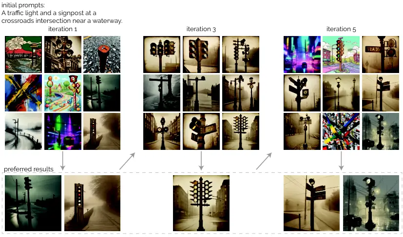
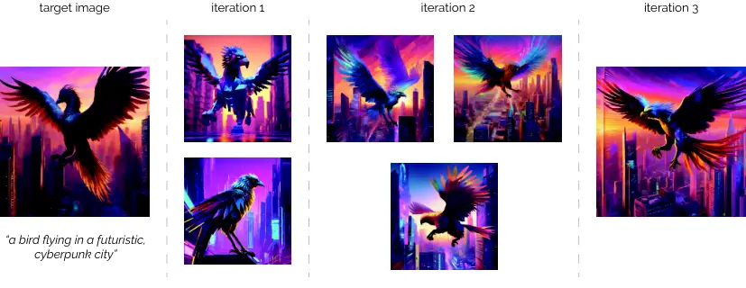

# Preference-Guided Prompt Optimization for Text-to-Image Generation

Conference: Proceedings of the 2026 CHI Conference on Human Factors in
Computing Systems; April 13–17, 2026; Barcelona, SpainProceedings of the
2026 CHI Conference on Human Factors in Computing Systems (CHI ’26),
April 13–17, 2026, Barcelona,
SpainDOI: [10.1145/3772318.3791443](https://doi.org/10.1145/3772318.3791443)ISBN: 979-8-4007-2278-3/2026/04CCS: Human-centered
computing Interactive systems and toolsCCS: Computing
methodologies Machine learning

Zhipeng Li Affiliation: Department of Computer Science, ETH Zürich,
Zürich, Switzerland email: <zhipeng.li@inf.ethz.ch> , Yi-Chi Liao
Affiliation: Department of Computer Science, ETH Zürich, Zürich,
Switzerland email: <yichi.liao@inf.ethz.ch> and Christian Holz
Affiliation: Department of Computer Science, ETH Zürich, Zürich,
Switzerland email: <christian.holz@inf.ethz.ch>

© cc

![ This figure illustrates an iterative process for generating images
based on user feedback. The workflow begins when a user designates a
"preferred" image and several "non-preferred" ones. The system then
enters a "prompt optimization" phase where it retains the preferred
selection , aligns future prompts toward the user's preferences , and
simultaneously expands prompts to create diversity. This results in a
set of "new candidates" for the user to evaluate. The process is
cyclical, as the user's choices from these new images serve as input for
the next iteration, continuously refining the output.
](arxiv-2602-13131v1--6372dfb13777.figures/figure-1.webp)

Figure 1. We introduce APPO, a prompt optimization framework guided by
user preferences. With APPO, the user simply needs to iteratively select
the generation results they prefer among options that are most aligned
with their implicit goals, and APPO will improve the underlying prompts
using three strategies: _retain_, which preserves preferred prompts from
the previous iteration; _align_, which adjusts non-preferred prompts
toward the user’s preference; and _expand_, which explores diverse
directions by generating new prompts. The outputs generated from the
optimized prompts are presented to the user for evaluation in the next
iteration. By combining these strategies, our method balances
exploration and exploitation, enabling efficient, user-guided prompt
optimization with minimal effort. This figure illustrates an iterative
process for generating images based on user feedback. The workflow
begins when a user designates a "preferred" image and several
"non-preferred" ones. The system then enters a "prompt optimization"
phase where it retains the preferred selection , aligns future prompts
toward the user's preferences , and simultaneously expands prompts to
create diversity. This results in a set of "new candidates" for the user
to evaluate. The process is cyclical, as the user's choices from these
new images serve as input for the next iteration, continuously refining
the output.

###### Abstract.

Generative models are increasingly powerful, yet users struggle to guide
them through prompts. The generative process is difficult to control and
unpredictable, and user instructions may be ambiguous or
under-specified. Prior prompt refinement tools heavily rely on human
effort, while prompt optimization methods focus on numerical functions
and are not designed for human-centered generative tasks, where feedback
is better expressed as binary preferences and demands convergence within
few iterations. We present APPO, a preference-guided prompt optimization
algorithm. Instead of iterating prompts, users only provide binary
preferential feedback. APPO adaptively balances its strategies between
exploiting user feedback and exploring new directions, yielding
effective and efficient optimization. We evaluate APPO on image
generation, and the results show APPO enables achieving satisfactory
outcomes in fewer iterations with lower cognitive load than manual
prompt editing. We anticipate APPO will advance human-AI collaboration
in generative tasks by leveraging user preferences to guide complex
content creation.

###### Keywords: 

Prompt optimization, Generative models, Preferential optimization,
Human-AI collaboration

^(†)^(†)cc-license: by-nc-nd

## 1. Introduction

Generative models are becoming increasingly prevalent in everyday life,
supporting end-users in various tasks such as writing (Radford et al.,
2019; Brown et al., 2020), coding (Fried et al., 2022; Jiang et al.,
2024), and image or video generation (Rombach et al., 2022; Dhariwal and
Nichol, 2021; Singer et al., 2022; Ho et al., 2022). In image
generation, where users primarily interact with models through textual
prompts that are expected to include all essential information, such as
detailed composition of objects, explicit vibes, etc. and often lead to
iterative trial-and-error for producing the desired image. However,
crafting effective prompts is challenging (Sahoo et al., 2024;
Subramonyam et al., 2024). This difficulty arises from the combination
of implicit human subjective goals and the black-box nature of
generative models. Users’ generation targets are vague and implicit
throughout the generation process (Qian et al., 2024). They usually do
not have a precise target in mind; instead, they may only have a general
idea of the essential objects and a rough visual style. They then
gradually refine and finalize their goals as they observe intermediate
results. Moreover, even if they have concrete targets in mind, perfectly
translating the ideas to effective textual prompts requires experience
and trial-and-error. Simultaneously, the generation process is opaque to
users, providing them with little understanding of how the outcomes are
exactly generated from the prompts. Therefore, the prompt creation often
relies on iterative trials, which is time-consuming and cognitively
demanding, making prompt refinement intrinsically challenging.

Prior works attempted to address this challenge via three rough
approaches: supporting users to manually refine the prompt,
automatically optimizing prompts without users’ involvement, and
iteratively refining prompts by incorporating user feedback. In HCI
field, previous studies have explored _various interfaces and tools_ to
support manual prompt refinement in image generation (Arawjo et al.,
2024; Brade et al., 2023; Mishra et al., 2023; Feng et al., 2023). For
example, DesignPrompt (Peng et al., 2024) and PromptPaint (Chung and
Adar, 2023) provide different interfaces that allow users to better
combine textual prompts with sketches and color themes to steer the
image generation processes. PrompTHis (Guo et al., 2024) takes a
different approach; it visualizes the outcomes of different prompt
variations, allowing the users to visually analyze the effects. These
works offer interfaces that support users in better editing prompts;
however, the decision-making for creating the prompts ultimately relies
on humans.

_Automatic prompt optimization_ is an established topic in the machine
learning domain. Several works focus on training prompt generation
models, for instance, by optimizing prompt embeddings with
gradient-based methods to maximize a fixed reward (Mañas et al., 2024;
Dong et al., 2023; Wen et al., 2023), exploring prompts that produce
more aesthetic outputs via reinforcement learning (Hao et al., 2023), or
dynamically adjusting word weights and timing during generation (Mo et
al., 2024). This direction relies on large training data, and the
resulting model does not generalize to different tasks well. Other works
focus on refining prompts using Large Language Models (LLMs) to simulate
optimization strategies (Pryzant et al., 2023; Yuksekgonul et al., 2024)
or perform prompt evolution (e.g., edit or mutate existing prompts or
combine them) (Fernando et al., 2023; Guo et al., 2025; Cui et al.,
2024; Sécheresse et al., 2025) to progressively improve performance.
They all operate on numerical evaluation functions to judge the quality
of generation results, without a strict search limit. In reality, this
assumption rarely holds: human users cannot reliably and consistently
score generation outcomes. Rather, humans are better at providing
preferences among options (Koyama et al., 2020; Li et al., 2025;
Christiano et al., 2017). More fundamentally, when a human is involved,
it is critical to converge quickly, leading to a stricter budget limit.

_Iterative prompt refinement that incorporates user feedback_ offers a
third direction. DSPy (Khattab et al., 2023), for example, implements a
self-improvement LLM pipeline in which prompts are iteratively refined
based on users’ natural language feedback. ConstitutionMaker (Petridis
et al., 2024) transforms user rewrites into structured principles that
are appended to the optimizer’s prompt, steering the optimization
process toward the user’s preference. Similarly, Promptimizer (Wang et
al., 2025) collects user-authored prompt refinements and uses them to
guide the selection and ranking of prompts in subsequent iterations.
Although this approach benefits from more explicit and richer
information from users, it also imposes a higher cognitive burden, since
users must carefully articulate their intents with texts. Further, this
is not always feasible, as users may not identify the most effective
prompts for achieving the optimal results.

Previous work, thus, leaves a clear research gap: How can automatic
prompt optimization methods be integrated into human-centered image
generation tasks in a way that reduces user effort and remains
efficient? Such a method would need to operate from minimal user
input—ideally just preference selections rather than manual prompt
editing or numerical scoring—while maximizing the utility of this sparse
feedback to converge quickly. There, our goal is to develop a method
that supports a novel generative workflow driven _solely by preference
feedback_ (e.g., selecting from options), thereby minimizing human
effort and eliminating the need for manual prompt tuning. We further aim
to maximize the utility of the sparse feedback from users to ensure high
sample efficiency.

In this paper, we introduce Adaptive Preferential Prompt
Optimization (_APPO_ ), a prompt optimization method that is driven by
users’ preference feedback. APPO begins with a simple initial prompt
provided by the user, which should capture the essential elements (e.g.,
in image generation, specifying the required objects) of the goal, while
the details (e.g., adjectives to the objects, and visual style) can be
ambiguous or loosely structured, or even missing. APPO will then
iteratively generate a batch of prompts, each leads to a specific
generative outcome, and present them to the users. The users, instead of
carefully fine-tuning the prompts, only need to select the ones that are
aligned with their implicit preferences. Crucially, users are not
required to explain their reasoning, provide evaluation scores, or
manually edit the prompts. After the selections, APPO interprets the
human’s selection and infers the human preferences, further refining the
prompt batch, leading to a set of different outcomes. Through repeated
preference collection, APPO gradually aligns the optimization process
with the implicit goals. The user’s role is limited to simple preference
selection, which minimizes effort while still allowing them to
meaningfully steer the optimization.

Prompt optimization faces a fundamental challenge: searching within the
vast space of natural language instructions. This challenge becomes even
more severe when relying solely on preference selections but not human
edits. To achieve both effectiveness and sample efficiency, APPO must
systematically balance exploration, which keeps diversity in prompt
proposals, and exploitation, which actively leverages user intent.
Overemphasizing exploration would require many interactions before
convergence, while relying only on exploitation risks premature
convergence to local optima. To address this, APPO allocates its limited
per-iteration generation budget (i.e., the number of outputs shown to
users in each iteration) across three complementary strategies:
retainment, alignment, and expansion. Retainment preserves prompts
preferred in the previous iteration, ensuring output can be at least as
good as the previous iterations. Alignment exploits user selections by
refining non-preferred prompts, shifting them closer in structure or
semantics to preferred ones. Expansion explores the neighborhood around
preferred prompts to uncover potentially better solutions. Finally, to
actively regulate exploration and exploitation, we introduce an
_adaptation policy_ that adapts the expansion range. When the alignment
strategy yields semantically similar prompts, indicating convergence
toward a local optimum, the policy expands the mutation range to
encourage broader exploration. Conversely, when alignment already
provides sufficiently diverse prompts, expansion restricts its mutation
range to support a more focused, efficient search. This adaptive
mechanism enables APPO to steer toward users’ preferences while
retaining flexibility to escape local optima.

Accompanying our method, we propose a preference-guided generation
workflow, which is then evaluated through ablation studies and a user
study on image generation tasks. In the ablation study, we analyze the
contribution of each component by comparing variants without expansion,
without alignment, and without adaptive exploration. We also compared
APPO with state-of-the-art automatic prompt optimization approaches. The
results show that APPO effectively optimizes prompts from binary
preference feedback and that its components, together with adaptive
exploration, enable the system to escape local optima and converge on
better solutions. APPO also outperformed other prompt optimization
methods by achieving better results in fewer iterations and producing
better final outcomes. We then evaluate the workflow with real user
prompts in a user study involving two scenarios: a target-matching image
generation task, where participants reproduced a given image using our
workflow versus manually revising prompts, and an open-ended image
generation task, where participants generated images aligned with their
own intent without a reference. Results show that our workflow helps
users reach satisfying generation outcomes with fewer iterations and
less interaction time compared to a state-of-the-art prompt-engineering
tool (Wang et al., 2024b) and existing prompt optimization
methods (Khattab et al., 2023) Participants also reported lower
cognitive load and less manual effort when using APPO, while perceiving
a stronger sense of exploration. Together, these findings demonstrate
that our workflow empowers users to control image generation more
effectively, achieve desired results with fewer iterations, and
experience a more engaging and satisfying creative process.

In summary, we make the following contributions:

- •
  APPO, an automatic prompt optimization approach that leverages users’
  binary preference feedback to refine prompts for image generation
  tasks. It adaptively balances exploiting users’ feedback and exploring
  new directions, enabling users to achieve satisfactory outputs within
  a few iterations without manual prompt editing.
- •
  a preference-driven generation workflow powered by APPO. We
  demonstrate its effectiveness and generalizability through synthetic
  evaluations and user studies on image generation tasks.

## 2. Related Work

### 2.1. Interfaces for Prompt Engineering

Creating effective prompts remains a non-trivial challenge. In HCI
domain, prior work has investigated interfaces and tools that support
users by visualizing generation results with their prompts, providing
refinement suggestions, and enabling multimodal inputs for more precise
control.

Since users have limited understanding of how the prompts affect the
generation results, previous work has proposed visualizing generation
outcomes corresponding to user inputs. PrompTHis (Guo et al., 2024)
visualized prompts alongside their generated images, helping users
understand how specific prompt elements influence outcomes and refine
them accordingly. PromptMagician (Feng et al., 2023) introduced
interactive visualizations, allowing users to evaluate and filter images
based on self-defined criteria and to explore prompt keywords and
guidance scales for images of interest. PromptCharm (Wang et al., 2024b)
assists novice users by mapping parts of the text prompt to regions in
the generated image, facilitating more effective refinement. For text
generation tasks, ChainForge (Arawjo et al., 2024) provided a visual
toolkit for improved prompt engineering, while PromptAid (Mishra et al., 2023) allowed users to compare prompt versions and analyze performance
differences. In 3D generation, Self3DCraft (Xiang et al., 2025)
visualized the contribution of each keyword in the prompt alongside the
generated 3D mesh.

Beyond visualization, prior work also explored providing prompt
suggestions to support refinement. Promptify (Brade et al., 2023) offers
automatic prompt recommendations based on generated image clusters.
Drosos et al. proposed generating multiple prompt options from an
initial user prompt for selection (Drosos et al., 2025).
PromptAid (Mishra et al., 2023) and PromptMagician (Feng et al., 2023)
also provide keyword recommendations alongside visualization.

In addition to text-based prompts, several interfaces support multimodal
input to guide generation. DesignPrompt (Peng et al., 2024) allows users
combining images, colors, and text for more expressive design
exploration. DirectGPT (Masson et al., 2024) supports users specifying
spatial positions and arranging content via drag-and-drop alongside
textual prompts. PromptPaint (Chung and Adar, 2023) enables flexible
steering of image generation through interactions resembling traditional
painting mediums (e.g., oil, watercolor). FusAIn (Peng et al., 2025)
allows designers to create personalized pens loaded with objects or
attributes (e.g., color, texture) to provide additional input during
generation.

While these tools facilitate crafting more effective prompts, they still
rely on users’ judgment and manual edits, which remain cognitively
demanding and limit everyday usability for end-users. Therefore, we aim
to optimize the prompts automatically with only users’ preference
feedback, minimizing users’ effort in generation tasks.

### 2.2. Prompt Optimization for Image Generation

There are several challenges in generating images that match a desired
outcome using textual prompts. First, it is difficult to know in advance
the appropriate and enough level of specification needed to express an
intended visual quality. Further, even when the desired quality is
clear, finding the phrasing that produces the intended effect often
requires extensive exploration, especially for abstract properties such
as visual style. These challenges often interact and are mixed. _Prompt
optimization_ is the broad concept that refers to the iteratively
improving prompts to achieve a desired outcome. Its goal is to identify
the most effective prompt formulation that produces results aligned with
the user’s intent. Unlike optimizing system-level prompts that govern a
model’s general behavior to better address a set of tasks (Pryzant et
al., 2023; Yuksekgonul et al., 2024), the _prompt optimization_ concept
discussed in this paper focuses on instance-level prompts tailored to
generating a specific target output. This goal is aligned with prior
works (Hao et al., 2023; Mañas et al., 2024; Mo et al., 2024; Cui et
al., 2024). Existing approaches can be grouped into two main strategies.
The first relies on refinement of the prompts, in which users
iteratively adjust prompts or provide clarifications (Wang et al., 2025;
Gao et al., 2024). The second is automatic optimization: the system
evaluates prompt candidates and infers how to improve output quality
without requiring direct edits (Hao et al., 2023; Mañas et al., 2024;
Pryzant et al., 2023). Below, we review these two categories in turn.

#### 2.2.1. Refining prompts by human users

Recent work has explored prompt optimization driven by user textual
feedback or rewriting to align the generation results with user
preferences and intents. Gao et al. infer latent user preferences
directly from edits: by comparing the original output with user-modified
outputs, they learn a latent preference representation, which is then
used to condition the model for future generations without requiring
numeric scoring (Gao et al., 2024). ConstitutionMaker (Petridis et al., 2024) converts natural user rewrites into structured principles that are
appended to the prompt context, steering the model to generate outputs
consistent with user-specified style, content, or tone.
Promptimizer (Wang et al., 2025) collects user-driven prompt refinements
and uses them to guide the selection and ranking of prompts in
subsequent iterations, effectively aligning outputs to individual
preferences. DSPy (Khattab et al., 2023) is a popular framework for
enabling self-improvement in LLMs. It can dynamically select an
appropriate reasoning strategy (e.g., chain-of-thought (Wei et al.,
2022), ReAct (Yao et al., 2022)) based on a provided evaluation function
or guideline. As an example use case, DSPy can be used to optimize
prompts for image generation: users provide natural-language feedback,
and DSPy evaluates multiple prompt variations against the feedback to
identify the most effective refinements.

While user textual feedback can provide more information than sparse
preference signals, it imposes a higher cognitive load, requiring users
to carefully articulate how they want the results to be improved. In
many cases, this is infeasible, as users may not know the precise words
to achieve the desired outcome, otherwise they would include them in the
initial prompt. Therefore, we investigate a different approach: prompt
optimization in which the system learn from evaluation outcomes and
evolve the prompts without human editing.

#### 2.2.2. Automatic Prompt optimization with evaluation results

Recent ML research focused on automatic prompt optimization to improve
generation results. Most approaches rely on a reward function to
evaluate outputs, such as semantic consistency between prompts and
generations (Cho et al., 2023; Hu et al., 2023; Huang et al., 2025),
aesthetics for images (Hao et al., 2023; Schuhmann, 2022), or other
task-specific metrics. With such reward signals, optimization methods
can compute gradients and apply learning-based techniques.
Promptist (Hao et al., 2023) fine-tuned a language model with
reinforcement learning to transform user inputs into model-preferred
prompts. PAE (Mo et al., 2024) similarly applied reinforcement learning
to adjust word weights and injection time steps, improving generation
outcomes. DPO-Diff (Wang et al., 2024a) reduced the search space via
LLM-generated synonyms and antonyms, then optimized negative prompts
with gradient descent. Wen et al. (Wen et al., 2023) proposed mapping
prompts into embeddings, applying gradient-based optimization, and
decoding back to the nearest natural language expressions.

Beyond embedding-level methods, recent works leverage LLMs directly for
prompt-level optimization. OPT2I (Mañas et al., 2024) iteratively
improves prompts using historical feedback to enhance text-to-image
consistency. OPRO (Yang et al., 2023) frames optimization as an
iterative prompting process, where LLMs are queried with previous
histories as context. PromptAgent (Wang et al., 2023) treats prompt
optimization as a strategic planning problem, applying Monte Carlo tree
search to systematically explore expert-level prompts. Prior research
has also explored self-improving prompts using automatically generated
checklists (Cook et al., 2024; Viswanathan et al., 2025). These methods
derive a checklist from the original instruction and use it to verify
whether the generated outputs satisfy each requirement. If any checklist
item is unmet, the system iteratively refines the prompt until the
output fulfills all items. The growing capabilities of LLMs have also
enabled them to simulate classical optimization strategies. Automatic
Prompt Optimization (Pryzant et al., 2023) and TextGrad (Yuksekgonul et
al., 2024) introduce natural language “gradients,” drawing analogies to
gradient descent for guiding edits. We also adopt this idea in our
implementation to identify effective prompt elements based on user
preferences. Similarly, evolutionary approaches such as
PromptBreeder (Fernando et al., 2023), EvoPrompt (Guo et al., 2025),
PhaseEvo (Cui et al., 2024), and GAAPO (Sécheresse et al., 2025) use
LLMs to generate, mutate, and refine candidate prompts; we also adopt
LLM-driven evolutionary search in our implementation for exploration.

While these methods have proven effective, they are typically developed
and evaluated using pre-defined numerical reward functions. However,
they struggle in real-world settings involving human users, as humans
cannot reliably or consistently provide numerical ratings for generation
outcomes. Human ratings are inherently noisy and subjective, due to
individual differences in perception and personal preferences.
Consequently, models trained on numerical reward functions are unable to
effectively optimize prompts based on actual user scalar feedback.
Although humans are generally better at expressing preferences among
options rather than providing absolute ratings, binary preferences
convey far less information than scalar ratings. Therefore, these models
may not converge to a good solution within limited iteration budget by
converting these preferences into scalar signals. Several datasets of
human preferences for image generation have been collected and used to
fine-tune generative models (Wu et al., 2023; Liang et al., 2024; Xu et
al., 2023). However, these datasets are typically aggregated across
large populations and therefore capture only general human preferences.
In practice, users’ preferences and generation goals are highly diverse
and inherently individual, limiting the applicability of existing
preference-based prompt optimization methods. In contrast, our method
aims to directly optimize prompts based on online user preferences in a
real-time generation task.

### 2.3. Preference-Guided Optimization

The notion of preference can be formally expressed as a pairwise
comparison: an outcome $`x`$ is preferred over $`y`$ if $`f(x)>f(y)`$,
where $`f(\cdot)`$ represents the latent preference function in a user’s
mind (Chu and Ghahramani, 2005). Compared to providing explicit
numerical ratings, it is easier and more reliable for users to indicate
which of two options they prefer (Chan et al., 2022; Yannakakis and
Martínez, 2015). Such pairwise judgments reduce noise and inconsistency
in human feedback, making them a valuable signal for optimization. Since
preferences ultimately guide users’ decisions and behaviors, they serve
as an important channel for computational models to better understand
users and generate improved outcomes.

A well-established approach to modeling such feedback is to use Gaussian
Processes to estimate the probability that $`f(x)>f(y)`$ from observed
comparisons (Eric et al., 2007). By integrating this probabilistic model
with Bayesian Optimization, humans can iteratively steer the
optimization process through their preferences, an approach known as
Preferential Bayesian optimization (Brochu et al., 2010; Iwai et al.,
2025). Building on this line of work, researchers have developed
interfaces that make preference elicitation more natural and efficient.
For instance, (Koyama et al., 2020) introduced a single slider that
aggregates multiple latent factors, allowing users to adjust image
appearance without explicitly controlling each dimension; the slider
range is refined based on preference feedback. Similarly, (Koyama et
al., 2017) proposed a gallery-based interaction where users select from
candidate options, and the system adaptively presents the next most
promising set. This strategy was further improved in efficiency by
leveraging prior optimization experience (Li et al., 2025). Researchers
have also leveraged Gaussian Processes to guide the generation of
generative adversarial networks, where the generative space is
constrained to specific objects or subjects, and textual prompts are not
involved (Nakashima et al., 2024). In this paper, we adopt the
gallery-based paradigm (Koyama et al., 2017; Li et al., 2025) for
preference collection in image generation tasks, as it offers a
lightweight and intuitive comparison mechanism for users.

However, when dealing with more complex tasks involving high-dimensional
input spaces, traditional probabilistic preference models often struggle
to scale. At the same time, capturing human preference structures
becomes increasingly challenging. To address this, our work uses
preference feedback primarily as a directional signal for optimization,
without attempting to explicitly model the entire preference function.

## 3. Preference-Driven Generation Workflow

Here, we first describe the preference-driven image generation workflow
that enables completing generative tasks. This provides the necessary
context for understanding the subsequent preference-guided prompt
optimization algorithm and how it operates internally to support the
workflow.

### 3.1. Prerequisites

We define an image generation task as the process in which a user
leverages a generative model to produce images for a specific goal. The
user provides an initial prompt, and our APPO edits it iteratively based
on the user’s preferences until a satisfactory results that meet the
specific goal. To succeed, prompts must encode two complementary types
of information. The first is “essential information”: explicit elements
that must appear in the output and are typically clear and easy for
users to specify. In image generation, for example, objects such as
apple or river represent essential information. The second is “implicit
intention”: broader but implicit goals that shape how the essential
information should be realized. These include aspects such as mood (sad,
joyful), visual style (vintage, cold), or object attributes (tall,
thin). Unlike essential information, implicit intentions are harder to
articulate as they may be abstract or ambiguous (e.g., “a vintage
style”), or they may not be a user’s immediate focus when drafting an
initial prompt.

In our framework, we assume that users can reliably specify the
essential information upfront, which anchors the initial prompt. This
assumption is crucial: the essential information constrains the search
space, ensuring that optimization focuses on specific implicit
intentions rather than blindly exploring the unbounded prompt space. For
example, if a user specifies “a cat sitting on a chair” as essential
information, our method ensures that all generated candidates retain
both a cat and a chair. The optimization then operates only on
reasonable implicit aspects, such as mood (playful or lonely), style
(cartoon or photorealistic), or descriptors (wooden chair or metal
chair). Without this constraint, the optimizer might drift toward
implicit intentions that are misaligned with the core goal, such as
“surrounded by ocean” or “grand medieval battlefield.” These descriptors
are semantically rich but typically incompatible with a cat on a chair,
leading the system to generate irrelevant or incoherent results. We
further assume that both essential information and implicit intention
remain consistent throughout a single task; if either changes, the
process constitutes a new task. Under these assumptions, APPO focuses on
searching the prompt space to discover effective textual representations
of the implicit intentions, progressively aligning them with the user’s
underlying goals. These assumptions are aligned with the
state-of-the-art prompt optimization approaches (Guo et al., 2025; Hao
et al., 2023; Ho et al., 2022; Lin et al., 2024; Mahdavi Goloujeh et
al., 2024).

Below, we provide user interactions within our workflow.

Figure 2. Preference-driven generation workflow enabled by APPO, with
image generation as an example. The user begins with an initial prompt
specifying the objects to be included in the generated images (top
left). In the first iteration, the optimizer expands this prompt to
explore diverse possibilities and generate multiple prompt variants
(right). The generative model then produces outputs corresponding to
these variants (down), which are presented to the user in a gallery
(left). The user selects their preferred results (up), which are then
fed into the optimizer who infers their preferences to generate refined
prompts. These refined prompts are used by the generative model to
produce new outputs, which are further evaluated by the user in
subsequent iterations. This figure illustrates an iterative AI image
generation workflow where a "user" provides an initial text prompt and
selects a "preference" from a set of generated images. An "optimizer"
uses this preference to create multiple new "prompt variant n" , which
are then used by a "generative model" to produce new images. These
"generation outcome n" are displayed back to the user via an
"interface", allowing the user to make a new selection and repeat the
refinement cycle.

### 3.2. Workflow

The workflow starts with the _user_ providing an initial prompt, as
illustrated in Figure 2, using image generation as an example. This
prompt serves as a starting point: it should include essential elements
of the task (e.g., specifying core objects in image generation) but may
remain underspecified or vague with respect to style, composition, or
other modifiers. In the first iteration, the _optimizer_ expands the
initial prompt in two ways: it completes missing details to form viable
prompts, and it explores diverse directions in the prompt space. Since
no preference information is available yet, the focus at this stage is
to explore a broad range of possibilities. The expanded prompts are then
passed to the _generative model_, yielding a set of candidate outputs.
The candidate outputs are displayed to the _user_ through an
_interface_, where the user selects one or more results that best
capture their implicit goal. This feedback is then passed to the
_optimizer_, which analyzes differences between preferred and
non-preferred prompts to infer user preferences and underlying intent.
Based on these insights, the _optimizer_ generates refined prompt
candidates that place greater emphasis on directions aligned with the
user’s evolving goals. The _generative model_ transforms these prompts
into a new set of outputs for _user_ to evaluate. Through this iterative
cycle of selection, analysis, and refinement, the prompts progressively
converge toward results that satisfy the user’s intent.

### 3.3. Core elements

Our preference-driven generation workflow contains four interconnected
core elements: the human user, the interface for presenting results, the
prompt optimizer, and the generative model. Together, these components
form a closed feedback loop through which implicit user goals are
progressively externalized and the outputs are increasingly aligned with
those goals.

_User._ The human user initiates the generation task by providing an
initial prompt and subsequently evaluating generated outputs at each
iteration. Rather than editing prompts iteratively, users simply select
the results that best align with their implicit goals. This interaction
is designed to be lightweight: preferences are expressed in a binary
manner (selected vs. not selected), reducing both cognitive and manual
effort while still providing meaningful feedback to guide optimization.

_Interface._ Generated results are presented to the user through an
interface designed to support efficient inspection and preference
expression. In image generation, outputs are typically arranged in a
gallery, as in prior work (Koyama et al., 2020; Li et al., 2025) and
illustrated in Figure 2, allowing users to visually compare multiple
candidates at once. While galleries are effective for visual media such
as images or videos, alternative layouts may be more appropriate in
other domains to allow users to access outputs and provide binary
feedback. For example, text-based tasks may benefit from presenting
fewer candidates at a time for more detailed reading.

_Optimizer._ The optimizer refines prompts using APPO in each iteration.
It takes the user’s preference feedback and the current set of prompt
candidates as input, while also maintaining a history of prompts
explored in previous iterations. Based on this information, it outputs a
new set of optimized prompts for the generative model. We employ an LLM
to perform the operations in the optimizer, ensuring that the optimized
prompts remain human-readable. This preserves transparency and allows
for optional user intervention when desired. In contrast,
embedding-based approaches often sacrifice interpretability, making them
less suitable for workflows in which users actively participate. We
describe the optimizer’s internal mechanisms in section 4.

_Generative Model._ The generative model translates refined prompts into
concrete outputs. Depending on the task, this may involve LLMs for text
generation, diffusion models for image synthesis, motion generation
models for motion creation, or other domain-specific generators. As the
realization layer of the workflow, the generative model produces the
artifacts that are presented to users for evaluation, thereby closing
the feedback loop that drives subsequent iteration.

## 4. Adaptive Preferential Prompt Optimization

In this section, we introduce Adaptive Preferential Prompt Optimization
(APPO), our adaptive prompt optimization method that refines prompts
based on user preferences. We begin by outlining the key challenges of
preference-guided prompt optimization will face, then present the
working principles of our method, and finally provide a detailed
description.

### 4.1. Challenges

As described in the workflow, preference-guided prompt optimization must
rely on users’ feedback while aiming to fulfill their implicit
generation goals efficiently. Meeting these requirements gives rise to
several challenges, which we detail below.

Challenge 1: How to leverage sparse preference signals to guide prompt
optimization? In generation tasks, the prompt search space is enormous,
yet users can only evaluate a small subset of prompts because human
evaluation is both time-consuming and cognitively demanding.
Consequently, user feedback is inherently sparse, covering only a tiny
fraction of possible prompts. Moreover, users often struggle to provide
consistent numerical ratings; instead, binary preference feedback (e.g.,
indicating which option is preferred) has been shown to provide a more
accurate and reliable signal (Koyama et al., 2017; Koyama et al., 2020;
Li et al., 2025). The key challenge is, therefore, how to maximize the
utility of these sparse preference signals to effectively guide the next
iteration of prompt generation.

Challenge 2: How to maintain diversity and escape local optima in prompt
optimization? The opposite problem arises when the optimizer relies too
heavily on exploiting user preferences. Overfitting to a small set of
selections can cause all prompts to converge too quickly toward a narrow
region of the search space. This reduces the diversity of subsequent
generations, forcing users to review iterations of highly similar
outcomes and preventing the discovery of their broader options. In
optimization terms, the process is known as being trapped in a local
optimum. How to maintain diversity and systematically escape premature
convergence is therefore another key challenge.

Challenge 3: How to strike the balance between exploration and
exploitation for efficient prompt optimization? Building on the prior
two challenges, a more fundamental issue is how to balance exploitation
and exploration. Exploitation leverages user preferences to refine
prompts in a stable direction but risks reducing diversity. Exploration,
in contrast, probes new regions of the prompt space, which may uncover
better solutions but also risks producing inferior results and
increasing instability. Striking the right balance between these two
strategies is a known dilemma in general optimization, but it becomes
especially critical in human-involved tasks where evaluations are
costly. Here, sample efficiency is an important constraint: the
optimizer must approach high-quality prompts in as few iterations as
possible while still preserving the ability to escape local optima.

### 4.2. Prompt Generation Strategies

In each iteration of the workflow, the system generates $`n`$ outcomes
based on prompts, presents them to the user, and then receives binary
preference feedback. Here, $`n`$ denotes the per-iteration generation
budget. This budget is divided across complementary strategies, which
are designed to address the challenges outlined above.

Strategy 1: Retain user-preferred prompts (Retainment). A
straightforward way to exploit preference signals observed thus far
(addressing Challenge 1) is to retain the most preferred prompts from
previous iterations. This strategy, commonly used in preferential
optimization methods (Koyama et al., 2017), provides stability by
ensuring that output quality either improves (when users prefer a newly
generated outcome) or remains consistent (when they re-select the same
option). From the user’s perspective, this creates a sense of steady
progress, reinforcing trust in the system and supporting a positive
overall experience.

Strategy 2: Align prompts toward the preferred selections (Alignment):
Instead of simply discarding non-preferred prompts, the optimizer
leverages them by comparing them against preferred ones (Challenge 1).
This comparison reveals which qualities or aspects better align with the
user’s implicit preferences. The resulting differences can be
interpreted as a “text gradient” (e.g., Pryzant et al. (2023)), which is
then applied to adjust non-preferred prompts, moving them closer to the
user’s intent. Implementation details of how this gradient is estimated
and applied are provided later.

This figure details a prompt "optimization" workflow that starts with
user "preference feedback" , where specific prompts are labeled as
"preferred" , such as "rustic sepia-toned crossroads" , and others as
"non-preferred" , like "vibrant cyberpunk crossroads". The system then
"estimate\[s a\] textual gradient" to identify the user's preferred
aesthetic, which includes a "vintage, rustic, and natural aesthetic"
with "sepia and golden light". This analysis drives four simultaneous
actions: the system will "retain preferred prompts" , "crossover
preferred prompts" to create hybrids like a "sepia-toned crossroads at
dusk" with fog , "mutate to expand prompts" , and "align non-preferred
prompts with gradient". This multi-step process results in a list of
"new prompts" that includes the originals , new combinations , and
aligned versions of previously rejected concepts.

Figure 3. The concept of optimization methods behind APPO with a
concrete example. In each iteration, APPO takes the preferred prompts
(green) and non-preferred prompts (red) from the previous iteration as
input. Three strategies are applied: It first _retains_ the preferred
prompts. In parallel, the _expansion_ strategy applies evolutionary
operations to explore new prompts. This begins with _crossover_, mixing
elements of the preferred prompts (words in different green colors),
followed by _mutation_ to generate additional prompts (orange).
Simultaneously, the _alignment_ strategy estimates the textual gradient
from both preferred and non-preferred prompts to identify elements
generally favored by the user (blue). This gradient is then applied to
non-preferred prompts to better align them with user preferences.
Finally, all of the three _retainment_, _expansion_, and _alignment_
prompts form the set of prompts for the next iteration. This figure
details a prompt "optimization" workflow that starts with user
"preference feedback" , where specific prompts are labeled as
"preferred" , such as "rustic sepia-toned crossroads" , and others as
"non-preferred" , like "vibrant cyberpunk crossroads". The system then
"estimate\[s a\] textual gradient" to identify the user's preferred
aesthetic, which includes a "vintage, rustic, and natural aesthetic"
with "sepia and golden light". This analysis drives four simultaneous
actions: the system will "retain preferred prompts" , "crossover
preferred prompts" to create hybrids like a "sepia-toned crossroads at
dusk" with fog , "mutate to expand prompts" , and "align non-preferred
prompts with gradient". This multi-step process results in a list of
"new prompts" that includes the originals , new combinations , and
aligned versions of previously rejected concepts.

Strategy 3: Expand the prompt search space for diversity (Expansion).
Continued exploration of the prompt space is essential to avoid local
optima and to encourage discovery of novel solutions (Challenge 2). A
common approach is to vary prompts using evolutionary principles,
including operations such as adding, deleting, mutating, or recombining
words (e.g., Guo et al. (2025)). The degree of change directly
determines the search range: Unconstrained mutations produce a broad but
largely random exploration, and guided edits on specific words focus the
search on a narrow region and lean toward exploitation behavior. This
trade-off (Challenge 3) is essentially to balance exploration and
exploitation.

To address this, we introduce a policy for controlling exploration
intensity. At the high level, the policy ensures the overall
optimization moves from exploration to exploitation across iterations;
that is, the diversity within the prompts in each iteration should
gradually decrease. Beyond that, the policy also ensures enough
exploration within each iteration, avoiding the mutation also highly
focused on the selected prompts from the previous rounds. Specifically,
APPO computes the semantic similarity between retained prompts and newly
aligned prompts to assess whether the aligned prompts explore diverse
regions. If they are highly similar, the policy encourages random,
less-constrained exploration; otherwise, it restricts exploration to the
local vicinity of promising regions. Overall, this policy adapts the
expansion strategy, making the prompt generation controlled and
efficiently balancing diversity with convergence.

### 4.3. Implementation of APPO

1: $`P_{0}`$: initial prompt, $`T`$: maximum iterations, $`G(\cdot)`$:
generative model, $`n`$: per-iteration generation budget

2: Initialize iteration counter: $`t\leftarrow 1`$

3: Initialize prompt set: $`P\leftarrow P_{0}`$

4: Initialize history:
$`H_{p}\leftarrow\emptyset,\;H_{n}\leftarrow\emptyset`$

5: Initialize exploration parameters:
$`v\leftarrow 0,\;v_{\min}\leftarrow 0,\;v_{\max}\leftarrow 0`$

6: while $`t\leq T`$ do

7:   if $`t=1`$ then

8:    $`P^{\prime}\leftarrow\mathrm{Randomize}(P)`$ $`\triangleright`$
Initial exploration for diversity

9:   else

10:    Retainment: $`R\leftarrow P_{p}`$ $`\triangleright`$ Keep
user-preferred prompts

11:    Alignment:
$`A\leftarrow\mathrm{Align}\!\left(P_{p},P_{n},H_{p},H_{n},\left\lfloor\tfrac{n-|R|}{2}\right\rfloor\right)`$
$`\triangleright`$ Balance retained and non-preferred prompts

12:    Update intensity:
$`(v,v_{\min},v_{\max})\leftarrow\mathrm{UpdateIntensity}(R,A,v_{\min},v_{\max})`$
$`\triangleright`$ Adjust exploration strength

13:    Expansion: $`E\leftarrow\mathrm{Expand}(P_{p},\;n-|R|-|A|,\;v)`$
$`\triangleright`$ Generate variations around retained prompts

14:    Candidate set: $`P^{\prime}\leftarrow R\cup A\cup E`$

15:    Consistency Check:
$`P^{\prime\prime}\leftarrow\mathrm{Reflect}(P_{0},P^{\prime})`$
$`\triangleright`$ Ensure key information from $`P_{0}`$ is preserved

16:   end if

17:   Generate outcomes: $`C\leftarrow G(P^{\prime\prime})`$

18:   Collect feedback:
$`(P_{p},P_{n})\leftarrow\mathrm{UserFeedback}(C)`$ $`\triangleright`$
$`P_{p}`$: preferred, $`P_{n}`$: non-preferred prompts

19:   Update history:
$`H_{p}\leftarrow H_{p}\cup P_{p},\;H_{n}\leftarrow H_{n}\cup P_{n}`$

20:   if user is satisfied with any $`P_{p}`$ then

21:    return final optimized prompt $`P_{p}`$

22:   end if

23:   $`P\leftarrow P^{\prime}`$

24:   $`t\leftarrow t+1`$

25: end while

26: return final optimized prompt $`P_{p}`$ and the satisfied generation
outcomes

Algorithm 1 Preference-Guided Prompt Optimization

With the working principles identified above, we implemented our
preference-guided prompt optimization method as summarized
in Algorithm 1.

#### 4.3.1. Overview

Our method starts with an initial prompt $`P_{0}`$ and refines it
continuously based on user feedback until the user is satisfied or a
predefined maximum number of iterations is reached. Importantly, the
initial prompt should contain the essential information that must be
correctly presented, such as objects to include. This assumption and our
intended optimization goal are introduced in subsection 3.1. In the
first iteration, before any preference feedback is given, the
optimization performs random exploration to generate a diverse set of
candidate prompts from the initial input. From the second iteration
onward, new prompts are generated through three strategies: retainment,
alignment, and expansion (see subsection 4.2). Specifically, the
generation budget $`n`$ first reserves slots for the items selected in
the previous iteration, and then divides the remaining budget equally
between alignment and expansion. A _consistency check_ step follows to
ensure that essential information from the initial prompt is preserved.
The generated candidates are then passed to the generative model, and
the resulting outputs are presented to the user, who selects preferred
($`P_{p}`$) and non-preferred ($`P_{n}`$) options. This feedback informs
the next iteration of prompt generation. In the following sections, we
provide a detailed description of each step of APPO.

#### 4.3.2. Random Exploration

In the first iteration, no historical information about the user’s
preferences is available. The optimizer only has access to the initial
prompt, so it can only rely on random exploration to generate diverse
candidate prompts. We leverage an LLM to rewrite the initial prompt into
complete and well-formed variants. Each variant explores different
directions (e.g., in image generation, diverse styles, visual details,
or wording) while preserving the core objects and descriptors of the
original prompt. This approach ensures that the generated candidates are
both coherent and highly diverse, providing a rich starting point for
subsequent iterations.

#### 4.3.3. Retainment

In each iteration, APPO always applied one strategy, which directly
carries over the prompts marked as preferred by the user in the previous
round. These retained prompts are included unchanged in the new
candidate pool, ensuring that best options remain available for the next
iteration.

#### 4.3.4. Alignment

The second strategy involves aligning non-preferred prompts toward the
preferred ones. We achieve this using a textual gradient
approach (Pryzant et al., 2023), inspired by gradient descent in
continuous optimization. In numerical optimization, gradients provide a
direction for improving performance. In prompt optimization, however,
true gradients are unavailable, since the only way to assess the quality
of prompts is feeding it to the target model, generating the outcome,
followed by user evaluation. Prior research (Pryzant et al., 2023;
Yuksekgonul et al., 2024) has demonstrated that LLMs can approximate a
“textual gradient” by comparing different prompts. The model analyzes
differences between these prompts to infer which components contribute
positively to desired outcomes and which should be modified or removed.
This information acts as a directional signal: it guides the
transformation of non-preferred prompts toward patterns found in the
preferred prompts, effectively “nudging” them in the direction of
user-aligned language without requiring explicit human rewriting.

Given the sparsity of human feedback, our method incorporates the
history of prompts from previous iterations when estimating the textual
gradient. By summarizing the history of preferred and non-preferred
prompts, the LLM can better identify recurring effective elements than
only relying on the current selections. Using this information, the
non-preferred prompts are gradually adjusted toward the preferred
prompts while keeping their other characteristics, allowing the
optimizer to exploit user-indicated elements efficiently without
requiring extensive evaluation.

The procedure is formalized in Algorithm 2. First, our method summarizes
($`\mathrm{LLM}_{s}`$) the history of preferred ($`H_{p}`$) and
non-preferred prompts ($`H_{n}`$) to capture the effective elements that
consistently lead to desirable outcomes ($`S`$). Next, it computes a
textual gradient ($`g`$) between the preferred ($`P_{p}`$) and
non-preferred prompts ($`P_{n}`$), highlighting the elements to retain
and the elements to modify. Finally, our method uses this gradient,
together with the summarized history, to iteratively generate (using
$`\mathrm{LLM}_{\delta}`$) a set of new prompts that are closely aligned
with the user’s preferences, ensuring both high quality and diversity in
the candidate set for the next iteration.

1: $`P_{p}`$: preferred prompts from the last iteration; $`P_{n}`$:
non-preferred prompts from the last iteration $`H_{p}`$: history of
preferred prompts; $`H_{n}`$: history of non-preferred prompts; $`m`$:
number of gradient-based candidates return $`P^{\prime}`$: aligned
candidate prompts for the next iteration

2: $`P^{\prime}\leftarrow\emptyset`$

3: $`S\leftarrow\mathrm{LLM}_{s}(H_{p},H_{n})`$ $`\triangleright`$
Summarize historical prompts to extract salient patterns

4: $`g\leftarrow\mathrm{LLM}_{\nabla}(P_{p},P_{n})`$ $`\triangleright`$
Estimate textual gradient from preferred vs. non-preferred prompts

5: for $`i\leftarrow 1`$ to $`m`$ do

6:   $`p^{\prime}_{i}\leftarrow\mathrm{LLM}_{\delta}(S,g)`$
$`\triangleright`$ Generate a new candidate aligned with preferred
features

7:   $`P^{\prime}\leftarrow P^{\prime}\cup\{p^{\prime}_{i}\}`$

8: end for

9: return $`P^{\prime}`$

Algorithm 2 $`\mathrm{Align}(\cdot)`$, corresponding to line 10 in
Algorithm 1

#### 4.3.5. Expansion

The third operation further explores candidate prompts based on the
preferred prompts. Because prompts are discrete natural language, we
leverage LLMs to perform an evolutionary algorithm (EA) to evolve the
textual prompts. Prior work has demonstrated that this approach is
effective for evolving prompts (Fernando et al., 2023; Guo et al.,
2025).

Such LLM-based EA works as follows. First, a subset of the current
candidate prompts is selected to serve as _parents_. These parents form
the foundation for generating new prompts. Next, a _crossover_ operation
combines elements from multiple parents, such as tokens, phrases, or
structural patterns, to produce new child prompts that inherit
characteristics from more than one high-quality candidate. Following
this, a _mutation_ step introduces additional variations, such as
replacing or reordering words, inserting modifiers, or adjusting
sentence structure. This step ensures diversity in the candidate pool
and helps the algorithm escape local optima. Finally, a _selection_ step
evaluates all generated children according to a fitness function. Only
high-quality candidates are retained for the next iteration. By
repeatedly applying this cycle of selection, crossover, and mutation,
the algorithm progressively expands the search around promising regions,
improving the chances of discovering prompts that better align with the
user’s intent.

When adopting EAs in our method, human users provide the preferred
prompts, which serve as parent prompts. It then generates new candidates
through a crossover process that combines features from multiple
parents. Each resulting child prompt is then mutated by the LLM to
introduce additional variation, controlled by the mutation number and
intensity. Finally, we select a subset of children using a fitness
function. The fitness function evaluates each mutated child prompt based
on two complementary objectives: similarity to the parent prompts and
diversity among the children. Similarity ensures that the generated
prompts remain aligned with the user’s preferred directions, while
diversity encourages exploration of the local search space. We compute a
Pareto front over these two objectives (similarity and diversity) to
identify prompts that optimally trade off alignment and variation. From
this Pareto front, a fixed number of children are selected for the next
iteration, guaranteeing that the resulting candidate set is both
high-quality and diverse, efficiently guiding the optimization process.
This iterative process allows the system to efficiently explore the
local neighborhood around preferred prompts while maintaining alignment
with user preferences. The procedure is formalized in Algorithm 3.

1: $`P_{p}`$: preferred prompts from the last iteration; $`k`$: number
of children to select; $`v`$: mutation intensity return $`S`$: selected
candidate prompts for the next iteration

2: $`C\leftarrow\mathrm{LLM}_{c}(P_{p})`$ $`\triangleright`$ Crossover:
generate children from parent prompts

3: $`M\leftarrow\emptyset`$

4: for $`i\leftarrow 1`$ to $`|C|`$ do

5:   $`m_{i}\leftarrow\mathrm{LLM}_{m}(C_{i},v)`$ $`\triangleright`$
Mutate each child with adaptive intensity $`v`$

6:   $`M\leftarrow M\cup\{m_{i}\}`$

7: end for

8: $`F\leftarrow\emptyset`$ $`\triangleright`$ Evaluate fitness of
mutated prompts

9: for $`i\leftarrow 1`$ to $`|M|`$ do

10:   $`s_{i}\leftarrow\mathrm{Sim}(m_{i},P_{p})`$ $`\triangleright`$
Similarity to parent prompts

11:   $`d_{i}\leftarrow\mathrm{Div}(m_{i},M\setminus\{m_{i}\})`$
$`\triangleright`$ Diversity relative to other children

12:   $`F_{i}\leftarrow(s_{i},d_{i})`$

13:   $`F\leftarrow F\cup\{F_{i}\}`$

14: end for

15: $`S\leftarrow\mathrm{SelectPareto}(M,F,k)`$ $`\triangleright`$
Select $`k`$ Pareto-optimal children balancing similarity and diversity

16: return $`S`$

Algorithm 3 $`\mathrm{Expand}(\cdot)`$, corresponding to line 12 in
Algorithm 1

#### 4.3.6. Policy for Adaptive Expansion

While the three strategies of generating new prompts ensure coverage of
prompts close to the user-preferred ones and local exploration, the
system may still get stuck in local optima. In particular, the only
mechanism for exploration is the mutation step in the EAs. When all
parent prompts are highly similar, a default mutation that only makes
minor word changes can fail to sufficiently explore the broader prompt
space.

To address this, we incorporate a _policy for adaptive control of
mutation intensity_. The default mutation modifies only a few words
without changing the overall meaning or composition. However, LLMs can
rewrite prompts in more substantial ways, allowing for both subtle and
extensive exploration. We introduce a mutation intensity variable
$`v\in[0,1]`$ to control the mutation behavior: When $`v=0`$, the
mutation is minimal, and only small word-level changes without altering
the core meaning. On the contrary, when $`v=1`$, mutation is maximal,
and the optimizer performs random exploration as in the first iteration.

In our method, the mutation intensity is determined based on the
semantic similarity between the Retained prompts (preferred prompts from
the last iteration) and the Aligned prompts (non-preferred prompts
aligned to preferred ones). If the Aligned prompts are very similar to
the Retained prompts, the system increases the mutation intensity to
explore a wider area. Conversely, if the similarity is low, indicating
that the Aligned prompts already introduce local variations, the
mutation intensity remains low to avoid drifting too far from
user-preferred prompts.

To quantify semantic similarity between prompts, we employ the CLIP
model (Radford et al., 2021) to encode prompts into embeddings within a
shared representation space. We then compute cosine similarity between
the embedding vectors, where higher values indicate greater semantic
similarity (i.e., a smaller angular difference between the vectors).
This similarity serves as the basis for controlling mutation intensity
during optimization. A naive approach would be to directly map the
absolute similarity values to mutation intensity. However, absolute
similarity scores are difficult to interpret: the same value can
correspond to very different levels of semantic relatedness depending on
the task and context. For example, in an image generation task, the
prompts “a red apple” and “a green apple” may yield an extremely high
similarity score, despite producing visually distinct outputs.
Conversely, the prompts “a magical forest” and “a fantasy-world
woodland” may produce a lower similarity score, even though the
resulting outputs are expected to be nearly indistinguishable. Thus,
relying on absolute similarity values would make mutation intensity
overly sensitive to task context rather than reflecting meaningful
differences between prompts. To address this, we normalize similarity
scores dynamically for each task: in each iteration, the similarity
value is rescaled relative to the observed upper and lower bounds from
previous iterations. This normalization produces values that more
reliably reflect the relative diversity of prompts, independent of the
absolute scale of the task. The resulting normalized similarity
determines the mutation intensity for the current iteration, after which
the bounds are updated. Adaptive expansion begins from the third
iteration, once sufficient data are available to initialize the bounds.

This adaptive strategy ensures a dynamic balance between local
exploitation and broader exploration, allowing the prompt optimization
process to escape local optima while respecting user preferences.

1: $`R`$: retained prompts; $`A`$: aligned prompts;
$`v_{\min},v_{\max}`$: historical similarity bounds

2: $`v`$: updated mutation intensity; $`v_{\min},v_{\max}`$: updated
similarity bounds

3: Compute pairwise similarities:
$`s_{ij}\leftarrow\mathrm{Sim}(R[i],A[j])`$

4: $`s_{\text{avg}}\leftarrow\mathrm{mean}(s_{i})`$

5: Normalize similarity:
$`v\leftarrow\dfrac{v_{\max}-s_{\text{avg}}}{v_{\max}-v_{\min}}`$

6: Clamp $`v\leftarrow\min(\max(v,0),1)`$

7: Update bounds: $`v_{\min}\leftarrow\min(v_{\min},s_{\text{avg}})`$;
$`v_{\max}\leftarrow\max(v_{\max},s_{\text{avg}})`$

8: return $`(v,v_{\min},v_{\max})`$

Algorithm 4 $`\mathrm{UpdateIntensity}(\cdot)`$, corresponding to line
11 in Algorithm 1

#### 4.3.7. Consistency Check

At the final stage of optimization, we introduce a consistency check
step that ensures all essential information from the initial prompt is
preserved in the optimized outputs. Although the alignment and expansion
strategies refine the prompt, they may also omit or distort crucial
elements from the initial prompt. For example, in image generation
tasks, users typically specify the objects that should appear in the
initial prompt, yet these objects may be removed or altered during
optimization. To prevent such issues, we employ a separate LLM instance
to perform a structured comparison between the original and optimized
prompts. This comparison extracts the essential elements from the
initial prompt (e.g., objects to include and their descriptors), checks
whether they are preserved, and restores any that are missing. Through
this process, the consistency check step ensures that prompt
optimization progresses toward user preferences while aligning with the
user’s original, core intent.

### 4.4. Synthetic Tests

We evaluated APPO through synthetic tests to assess its effectiveness
and to evaluate the contributions of our optimization strategies and
policy (see Supplementary Material). In particular, we examined variants
of APPO that omit key components: expansion, alignment, or adaptive
exploration, in order to analyze the contribution of each. To simulate
generation goals, we modified initial prompts from existing datasets by
adding a specific visual style. User preferences were simulated by
computing the similarity between the generation results of candidate
prompts and those of the target prompt.

Our results show that variants without expansion or without alignment
stuck at suboptimal solutions after approximately 6–8 iterations,
yielding only a limited improvement (9.38% for without expansion and
9.87% for without alignment) compared to simply paraphrasing the initial
prompt. The variant without adaptive exploration achieves a larger
improvement (14.66%), but fails to make further progress after around 10
iterations. In contrast, APPO reaches a better solution within
approximately 5 iterations and continues to improve, ultimately
achieving an improvement of 19.64%. These findings demonstrate that APPO
can effectively optimize prompts based on sparse feedback, while
highlighting the contribution of each component.

We further compared APPO to two state-of-the-art automatic prompt
optimization methods, TextGrad (Yuksekgonul et al., 2024) and
Self-TICK (Cook et al., 2024), both of which aim to align generation
results with prior observations. The results show that APPO consistently
outperforms both baselines. While the baselines reach their best
performance (6.45% for TextGrad and 8.06% for Self-TICK) after
approximately five iterations, they fail to make further improvements.
These findings suggest that APPO is more effective than existing
automatic prompt optimization methods for image generation tasks, even
when relying solely on preference-based feedback.

Figure 4. User study interface and intermediate results from APPO.
Participants are presented with nine candidate images and select one or
more that best align with their generation goal. They can indicate
whether they are satisfied with the current iteration’s outcome or wish
to see additional candidates. In the results shown here, iteration 3
(middle) converges toward the “old-film” theme selected by the user in
previous iterations (left), demonstrating that APPO effectively guides
generative models toward user preferences. By iteration 5 (right), APPO
detects that the optimization has converged to a local optimum and
responds by exploring unknown directions to continue improving the
results. This image displays an AI image generation process across
"iteration 1" , "iteration 3" , and "iteration 5" , based on the initial
prompts "A traffic light and a signpost at a crossroads intersection
near a waterway". The initial set of images is stylistically diverse,
but as the user repeatedly selects their "preferred results"—which are
consistently dark, moody, and atmospheric scenes of traffic lights in
fog or rain—the subsequent generations of images progressively converge
on this specific vintage and melancholic aesthetic.

## 5. User Study

Alongside the synthetic tests, we conducted a user study comparing APPO
with three representative alternatives: a state-of-the-art
prompt-engineering tool for image generation (Wang et al., 2024b), a
prompt-optimization method that incorporates user feedback (Khattab et
al., 2023), and a prompting method that helps users to specify their
goals in their prompts by asking them clarification questions (Hahn et
al., 2024).

### 5.1. Design

To investigate if our method could help users to obtain generation
outcomes that aligned with their intent with less effort, we adopted a
within-user study design including four conditions:

- •
  _PromptCharm_: Participants used PromptCharm (Wang et al., 2024b), a
  state-of-the-art prompt engineering interface for image generation.
  PromptCharm suggested automated refinements to users’ prompts, allowed
  users to adjust the attention given to each word, provided image style
  suggestions, and supported comparison of generation results across
  iterations. It also helped users understand the correspondence between
  prompt words and parts of the generated image, further aiding in
  prompt refinement. We directly employed the original code and
  interface for our study ¹¹ 1
  [https://github.com/ma-labo/PromptCharm](https://github.com/ma-labo/PromptCharm).
- •
  _DSPy_: In this condition, participants provided an initial prompt and
  observed 9 candidate images generated by paraphrasing that prompt.
  They could then give textual feedback along with their preferred
  images. We adopted DSPy (Khattab et al., 2023) to refine the user
  preferred prompts based on their feedback and then paraphrase the
  prompts for the next iteration.
- •
  _Clarification_: Participants in this condition began by providing an
  initial prompt and were then presented with a series of clarification
  questions designed to make their prompts more specific. They could
  answer these questions to provide additional details until they were
  ready to view the generated images. The clarification questions were
  generated using the method proposed in (Hahn et al., 2024), which has
  been shown to effectively align image generation results with the
  user’s intended goals. In each iteration, 9 candidate images were
  generated based on the previous clarification responses. Participants
  could select their preferred images, further edit the corresponding
  prompts, and answer additional clarification questions to refine the
  results in subsequent iterations.
- •
  _APPO_ : Using APPO, participants followed the workflow described
  in subsection 3.2. They started with an initial prompt and then
  selected the generation results aligned with their goal from 9
  candidates in each iteration. Then our method automatically optimized
  the prompts and generated new candidates. In our study, we hided all
  prompts from participants, in order to investigate the participants’
  performance when using APPO with minimal effort.

To be noted, except for the _PromptCharm_ condition, participants were
shown 9 image candidates in each iteration, to evaluate how our
preference-guided prompt optimization performs compared to existing
methods. For the _DSPy_ and _Clarification_ conditions, these candidates
were generated by paraphrasing the optimized prompt nine times in each
iteration, while in _APPO_ , the candidates came from our three
strategies. The study interface is illustrated as in Figure 4.

In the study, we included two kinds of image generation tasks: close-
and open-ended tasks, following prior work (Wang et al., 2024b; Feng et
al., 2023). In the close-ended tasks, participants were asked to
generate an image as similar as possible to a target image, in terms of
appearing objects, visual style, composition and so on. For the
open-ended tasks, participants were asked to have their own target in
their mind, which could be vague and uncertain, but at least including
the essential objects and a few visual details and the general vibe.
Then they were asked to generate an image to achieve their implicit
goal.

To control the difficulty across trials and participants, we controlled
the number of appearing objects in the generation task. We first
extracted a set including 20 objects that appeared the most from the
TIFA160 dataset (Hu et al., 2023). Then for the close-ended tasks, we
randomly sampled 3 objects from the set and asked a LLM to generate a
target image prompts by adding descriptors and general visual vibe to
these objects. For the open-ended tasks, we asked participants to
include at least 3 objects in their target image. They could select from
the given set or come up with the objects themselves, while keep using
different objects across trials.

In each iteration, if participants were satisfied with the current
generation results (or with one of outcomes), they clicked
"satisfactory" and stopped the current trial, otherwise "see more" to
enter the next iteration. To assess the optimization efficiency, we
recorded the minimum number of iterations needed to reach satisfaction
in each trial. We also collected subjective feedback using the
NASA-TLX (Hart and Staveland, 1988) and the Creativity Support Index
(CSI) (Cherry and Latulipe, 2014) questionnaire.

### 5.2. Procedure

Participants were first introduced to the study and asked to provide
their demographic information. Then they completed a warm-up trial in
each condition to get familiar with the interface. Once they were ready,
they started one trial by providing an initial prompt. In each
iteration, participants were asked to observe the current generation
results and decide if they were satisfied with the current results and
stop the trial. If not, participants refined the prompts by: in
_PromptCharm_, they edited the prompts using the tools provided; in
_APPO_ , they selected the images that best aligned with their goals; in
_DSPy_, they selected preferred images and provided textual feedback to
guide prompt refinement; and in _Clarification_, they edited their
preferred prompts and answered more clarification questions. Each trial
lasted at most 10 iterations to constraint the overall user study time.

Each participant completed 8 trials (4 conditions $`\times`$ 2 tasks
$`\times`$ 1 image). They always began with the close-ended task: after
completing all 4 close-ended trials, they proceeded to the open-ended
tasks. We kept this order to present participants with concrete examples
first, thereby providing inspiration and reference points for their
subsequent open-ended tasks. The condition order was counterbalanced
with a latin-square. After each trial, participants were asked to fill
out the NASA-TLX and the CSI questionnaire. The study lasted
approximately 60 minutes.

### 5.3. Apparatus & Participants

We recruited a total of 16 participants, with 10 males and 6 females,
aged 24 to 28 ($`M=26.78\,`$, $`SD=1.21\,`$). The study was conducted on
a desktop computer connected to a server running Ubuntu 24.04 with an
NVIDIA H200 GPU. We used the Stable Diffusion XL model configured with a
guidance scale of 7.5 and 50 diffusion iterations. Each image was
generated at a resolution of 1024 $`\times`$ 1024 pixels, requiring less
than 5 seconds for a single image and approximately 20 seconds for a
batch of 9 images. Participants interacted with the system via mouse and
keyboard, with the interface presented in full-screen mode on a 27-inch
monitor with a resolution of 2560 $`\times`$ 1920. The underlying
language model was Gemini 2.5 Flash. All prompts are provided in the
Supplementary Material.

### 5.4. Results

The document presents a comparative analysis of two methods, PromptCharm
and DSPy APPO, across two types of tasks: close-ended and open-ended.
The comparison is visualized using data for Iterations and Time. In the
close-ended category, PromptCharm shows iteration values of 12 , 6 , 9 ,
and 3 , while DSPy APPO has an iteration value of 12. The bottom
visualization compares the Time taken (ranging from 50 to 200) for
PromptCharm and DSPy on both close-ended and open-ended tasks,
suggesting a performance evaluation in terms of speed and convergence
metrics.

Figure 5. Number of iterations and total time (in seconds) spent
required to achieve satisfactory for both close- and open-ended tasks
across three conditions (means and standard deviations). (\*:
$`p<0.05`$, \*\*: $`p<0.01`$, \*\*\*: $`p<0.001`$).The document presents
a comparative analysis of two methods, PromptCharm and DSPy APPO, across
two types of tasks: close-ended and open-ended. The comparison is
visualized using data for Iterations and Time. In the close-ended
category, PromptCharm shows iteration values of 12 , 6 , 9 , and 3 ,
while DSPy APPO has an iteration value of 12. The bottom visualization
compares the Time taken (ranging from 50 to 200) for PromptCharm and
DSPy on both close-ended and open-ended tasks, suggesting a performance
evaluation in terms of speed and convergence metrics.

We recorded the minimum number of iterations required to obtain a
satisfactory outcome, as well as the total time spent. This is because,
in the _Clarification_ condition, participants were allowed to ask as
many questions as they wanted and could provide substantial information
within a single generation iteration. Such flexibility makes the
iteration counts comparison across conditions unfair and thus, we
instead focus on comparing the time used to complete the generation
tasks. The total time excludes the duration of image generation and
captures only the time during which participants actively interacted
with the systems. We also collected NASA-TLX and CSI questionnaire
responses for all conditions.

We first conducted Shapiro–Wilk tests to assess the normality of the
minimum iteration counts and time used. The results indicated no
violation of normality ($`p\,>\,.05`$). Accordingly, we applied one-way
repeated-measures ANOVA to examine the effect of Condition on the number
of satisfactory iterations and total time for both close- and open-ended
tasks. Post-hoc comparisons were performed using paired t-tests with
Bonferroni correction. For subjective measures, we conducted Friedman
tests for each NASA-TLX and CSI metric, followed by Wilcoxon signed-rank
tests with Bonferroni correction for pairwise post-hoc analyses. Full
tatistical analysis results are reported in Appendix C.

##### Participants using _APPO_ needed fewer iterations and less time to reach satisfactory results compared to all baselines.

As shown in Figure 5, participants using _APPO_ reached satisfactory
outcomes in fewer than four iterations on average. In contrast,
_PromptCharm_ required more than six iterations on average before
participants were satisfied. Although participants using _DSPy_
completed a similar number of iterations, they spent substantially more
time overall, because they needed to interpret the generated results and
craft precise textual feedback. Participants in the _Clarification_
condition similarly spent more time, as they were required to answer
multiple clarification questions before seeing each new set of
candidates. Overall, both _DSPy_ and _Clarification_ required
significantly more time than _APPO_ , even when completing a similar
number of iterations.

(a) NASA-TLX results for close-ended tasks.

(b) NASA-TLX results for open-ended tasks.

Figure 6. NASA-TLX questionnaire results for both close- and open-ended
tasks across all four conditions (means and standard deviations). (\*:
$`p<0.05`$, \*\*: $`p<0.01`$, \*\*\*: $`p<0.001`$). (a): The bar chart
displays NASA-TLX workload scores, which range from 1 to 21, for six
dimensions: Mental Demand, Physical Demand, Temporal Demand,
Performance, Effort, and Frustration. Each dimension shows four distinct
colored bars, representing different conditions, with error bars
indicating variability. Statistical significance is noted above the
bars, using asterisks (\*, \*\*, \*\*\*) to highlight significant
differences in scores between the conditions for Mental Demand, Physical
Demand, Performance, Effort, and Frustration, while Temporal Demand
shows no marked significance between the conditions. The highest average
scores across the dimensions are observed in Performance and Effort,
while Temporal Demand and Frustration have the lowest overall scores.
(b): The bar chart illustrates NASA-TLX workload scores, ranging from 1
to 21, comparing four conditions—PromptCharm, DSPy, Clarification, and
APPO—across six dimensions: Mental Demand, Physical Demand, Temporal
Demand, Performance, Effort, and Frustration. In general, scores for
Mental Demand, Physical Demand, Performance, Effort, and Frustration
show statistically significant differences between the four conditions,
while Temporal Demand scores are closely clustered around 6, showing no
marked significance. The conditions DSPy and APPO tend to have the
highest scores in Performance and Effort, while APPO consistently shows
the lowest scores in Mental Demand, Physical Demand, and Frustration,
indicating a relatively low perceived workload in those areas for that
condition.

##### Participants experienced lower workload and effort with _APPO_ , while achieving comparable or better performance compared to all baselines.

As shown in Figure 6, participants reported significantly lower mental
demand, physical demand, and overall effort when using _APPO_ than when
using any of the three baselines. They also perceived their task
performance to be better than with _PromptCharm_ and _Clarification_
(for close-ended tasks), and comparable to _DSPy_. These differences
arise because the baseline methods required participants to actively
provide textual feedback or refine prompts themselves, which imposed
additional mental effort, while _APPO_ relied on simple interactions
with minimal physical and mental demand. Participants also felt less
frustration with _APPO_ . In contrast, _PromptCharm_ required
considering multiple refinement strategies that did not always yield
better results, and _Clarification_ sometimes asked too many clarifying
questions, which participants found uncomfortable. Overall, these
findings indicate that _APPO_ enables participants to achieve comparable
or even better performance with significantly less workload and
frustration.

(a) CSI results for close-ended tasks.

(b) CSI results for open-ended tasks.

Figure 7. CSI questionnaire results for both close- and open-ended tasks
across all three conditions (means and standard deviations). (\*:
$`p<0.05`$, \*\*: $`p<0.01`$, \*\*\*: $`p<0.001`$). (a): The bar chart
displays CSI scores, ranging from 1 to 7, across five dimensions:
Enjoyment, Exploration, Expressiveness, Immersion, and Results Worth
Effort. Each dimension features four colored bars, representing
different conditions, accompanied by error bars. Statistical
significance, marked by asterisks (\*), is observed for Exploration,
Expressiveness, and Results Worth Effort, indicating notable differences
between conditions in those dimensions. Expressiveness shows the highest
average scores across all conditions, clustering around 5, while
Exploration has the lowest average scores, falling below 4.5. (b): The
bar chart presents CSI scores, ranging from 1 to 7, for four conditions
(PromptCharm, DSPy, Clarification, and APPO) across five dimensions:
Enjoyment, Exploration, Expressiveness, Immersion, and Results Worth
Effort. All five dimensions show some degree of statistically
significant differences between the conditions, marked by asterisks,
with the most pronounced differences seen in Expressiveness and
Exploration. Expressiveness has the highest overall scores, with DSPy
achieving the highest average score in this dimension, while Exploration
has the lowest overall scores. For Results Worth Effort, the APPO
condition has the highest average score.

##### Participants felt their results were more worthwhile with _APPO_ , with the cost of reduced expressiveness.

As shown in Figure 7, participants rated the worth of their results
significantly higher when using _APPO_ compared to all baseline
conditions, suggesting that they perceived _APPO_ enabling good outcomes
with less effort. However, participants reported significantly lower
expressiveness with _APPO_ . This is likely because, in the baseline
conditions, they could convey preferences or generation intents through
textual feedback or refining the prompts, while _APPO_ only allowed them
selecting preferred images.

### 5.5. Discussion

##### Preference-only feedback versus richer forms of feedback

In our study, we compared _APPO_ with two baselines: _PromptCharm_, a
state-of-the-art prompt-engineering tool, and _DSPy_, which refines
prompts using users’ textual feedback. Participants using _APPO_
achieved comparable or better results with significantly less effort and
experiencing lower workload. These findings reinforce our core
motivation: although tools like _PromptCharm_ or _DSPy_ can help users
reach desirable outcomes, they still rely on users to reason about
prompt refinements or articulate detailed feedback. Consequently, the
cognitive load still remains on the human. In contrast, _APPO_ requires
only binary preference feedback, shifting the reasoning process to the
model and achieving similar performance in fewer iterations.

##### Integrating preferences with richer forms of feedback

However, _APPO_ and richer forms of feedback could be compatible. It is
certainly possible to expose the intermediate prompts to users and allow
them to provide richer forms of feedback beyond preferences. When issues
are obvious or easy to articulate, textual feedback can resolve them
more quickly than waiting for the algorithm to infer them. Likewise,
when the model introduces a new keyword that inspires the user, it may
be beneficial to allow users explicitly refining the prompts. However,
this comes with the same challenge faced by traditional prompt
refinement workflows: users often lack the knowledge to judge how
specific prompt elements influence the generation process. Therefore,
future research should explore how to combine preference feedback with
richer user signals in ways that amplify both strengths while mitigating
potential biases or misguidance.

##### Advantages and disadvantages to present prompts to users

In our user study, we intentionally did not show optimized prompts to
participants, even though our system keeps them readable. This is due to
we would like to investigate how much _APPO_ can refine the prompts with
minimal user effort. In contrast, both _Clarification_ and _PromptCharm_
required participants to read and evaluate prompt variants in each
iteration, which added extra workload to users. Our study results
further revealed that though participants perceived more expressiveness
in these conditions, they also reported significantly more workload and
took longer to complete the tasks. These findings show that hiding the
prompts does not hinder our method effectively refining the prompts
based on participants’ preference signal. While in practical employment,
users may still be given the option to inspect prompts when they
desired. For instance, they could learn the vocabulary from the
optimized prompts that could support future generation tasks.

These points further highlight our motivation and contribution in this
paper: we aim to reduce user effort while improving outcomes in
interactive generation tasks. By combining efficiency, satisfaction, and
creativity support, APPO brings generative model closer to everyday
creative tasks, where users benefit from quick, inspiring, and
satisfying generation without extensive trial-and-error.

Figure 8. Intermediate results from P3 after the 1st, 2nd, and 3rd
iterations using APPO on close-ended tasks. The page displays four
images generated from the text prompt, “a bird flying in a futuristic,
cyberpunk city". The first image is labeled the target image and shows a
large, dark bird with its wings fully spread, soaring against a sunset
or sunrise over a cityscape of tall, colorful buildings, rendered in a
futuristic, vibrant style. The three subsequent images, labeled
iteration 1, iteration 2, and iteration 3, are variations of this
concept, each depicting a large, mythical-looking bird—possibly a
phoenix or eagle—with bright blue and fiery red/orange coloring, flying
above a city with high-rise structures, all rendered in the
characteristic colorful, neon, and high-tech aesthetic of cyberpunk.

##### Intermediate results using APPO

As shown in Figure 8 and Figure 9, we illustrate two example generation
processes to demonstrate how _APPO_ refines prompts using only
preference feedback.

In Figure 8, the participant’s task was to imitate the target image on
the left. Although the participant began with a very simple initial
prompt, the first iteration already preserved key elements (a bird and
cyberpunk city) while exploring diverse visual styles. For example, the
top image depicts a low-poly or robotic bird, whereas the bottom image
emphasizes neon lighting in the city. After the participant selected two
preferred images, _APPO_ refined the prompts. By the second iteration,
the outputs aligned more closely with the target: the skylight remains
consistent across the top two images, the bird becomes more realistic
and airborne, and the background city maintains the neon cyberpunk
aesthetic. The algorithm also explores variations that the user did not
specify but are relevant to the target, such as colorful birds and a
skyline resembling the target image, despite these details not appearing
in the initial prompt. By the third iteration, the participant selected
an image they judged sufficiently similar to the target.

![The page presents a sequence of four image generation results based on
the initial prompt, "cyberpunk style, with a vehicle driving in a city,
rainning night". The images are organized into columns for the initial
prompt, iteration 1, iteration 2, and iteration 3. The initial prompt
column displays a single image of a large, dark semi-truck rendered with
neon pink and blue lighting, characteristic of the cyberpunk style.
Iteration 1 features two images: one showing a truck similar to the
first, and a second showing a smaller car in the same neon-lit, rainy
street environment. Iteration 2 also shows two images: a different truck
design with glowing yellow accents, and an overhead view of a yellow and
black truck on the neon street. The final column, Iteration 3, shows a
single, highly stylized image of a semi-truck driving through the
intensely vibrant, rainy, and blurred cyberpunk city
background.](arxiv-2602-13131v1--6372dfb13777.figures/figure-5.webp)

Figure 9. Intermediate results from P10 after the 1st, 2nd, and 3rd
iterations using APPO on open-ended tasks. The page presents a sequence
of four image generation results based on the initial prompt, "cyberpunk
style, with a vehicle driving in a city, rainning night". The images are
organized into columns for the initial prompt, iteration 1, iteration 2,
and iteration 3. The initial prompt column displays a single image of a
large, dark semi-truck rendered with neon pink and blue lighting,
characteristic of the cyberpunk style. Iteration 1 features two images:
one showing a truck similar to the first, and a second showing a smaller
car in the same neon-lit, rainy street environment. Iteration 2 also
shows two images: a different truck design with glowing yellow accents,
and an overhead view of a yellow and black truck on the neon street. The
final column, Iteration 3, shows a single, highly stylized image of a
semi-truck driving through the intensely vibrant, rainy, and blurred
cyberpunk city background.

Similarly, in Figure 9, the participant began with a simple prompt
describing a vehicle in a cyberpunk city. In the first iteration, the
participant selected two images featuring trucks and a third featuring a
car in neon lights. Notably, all three images shared the characteristic
of wet ground, which reflected vehicle shadows and aligning with the
“raining night” description. In the second iteration, _APPO_ integrated
these preferences by generating images of a truck within a cyberpunk
setting, illuminated by neon lights. However, these images still lacked
sufficient city context. Through mutation, _APPO_ expanded its
exploration in the third iteration, adjusting the scene’s perspective to
reveal more of the urban environment. And the participant found this
final result satisfactory. Together, these two examples illustrate how
_APPO_ learns from users’ preference feedback and preserves elements
that users favor while maintaining diversity across candidates,
effectively balancing exploration and exploitation to converge on a
desirable outcome.

##### "Failure" cases using _APPO_

Across the 32 trials completed with _APPO_ , only two resulted in
participants failing to reach a satisfactory image within 10 iterations.
Both cases occurred in open-ended tasks. By collecting participants’
feedback, examining their initial prompts, and their intermediate
results, we identified potential causes. In the first case, the
participant did not follow our instruction, which is the key objects
must be clearly provided. They wanted the generated image to include a
specific fantasy animal but could not recall its name. They provided
only a vague description (P7: "a big creature that has a long, coiled
body, sharp teeth, and scary eyes" but he actually wants "Jörmungandr").
While other aspects of the image matched the expectation and _APPO_
explored several types fantasy creatures across iterations, the exact
animal the participant’s in mind was never correctly generated. This is
reasonable as the key object was never correctly provided in the first
place, violating our assumption of the system. In the second case, the
participant (P4) included many distinct features that would like to have
in the generation outcomes. And he/she encountered a promising image
early on but also selected several alternatives that contained
additional features they hoped could be combined later. However, these
selected candidates also included features that were not part of the
participant’s desired set and conflicted with the wanted features. This
made it difficult for APPO to determine which parts of the prompts
influenced the participant’s selections. As a result, it failed to find
the correct combination of features within the limited interaction
budget. These examples highlight potential limitations of APPO. First,
it could struggle when users have highly specific intents that they
cannot describe precisely. Second, including too many features makes it
hard for APPO to identify the correct combination within the limited
interaction budget. In such cases, allowing the users to review the
current prompts and further edit can effectively address the challenge.
APPO can easily be extended to offer this feature, as our prompt search
remains comprehensible and directly editable by human users.

We also present example generation results from the user study using
APPO in Figure 10 and Figure 11.

![This page displays four pairs of images, each pair consisting of a
target image and a second image labeled satisfactory results. The four
concepts shown are: a cyberpunk city with neon lights and a central
tower , a winter forest with a small river , a large tree growing from a
castle under a nebula-like sky , and a red dragon standing on a castle
at sunset. For the cyberpunk city, the target image shows a futuristic
purple and pink cityscape with a glowing green river, while the second
image is a close-up, highly detailed version of a central spire with
blue glowing lines. The winter forest images are rendered in a
watercolor style, depicting a snowy forest and a reflective stream. The
castle/tree images show a large tree above a castle, once framed by
pillars and the other with a dark, colorful sky. Finally, the dragon
images feature a red dragon perched on a fortress against a bright red
and orange sunset.
](arxiv-2602-13131v1--6372dfb13777.figures/figure-6.webp)

Figure 10. Example of generation results in close-ended tasks by
participants using APPO. This page displays four pairs of images, each
pair consisting of a target image and a second image labeled
satisfactory results. The four concepts shown are: a cyberpunk city with
neon lights and a central tower , a winter forest with a small river , a
large tree growing from a castle under a nebula-like sky , and a red
dragon standing on a castle at sunset. For the cyberpunk city, the
target image shows a futuristic purple and pink cityscape with a glowing
green river, while the second image is a close-up, highly detailed
version of a central spire with blue glowing lines. The winter forest
images are rendered in a watercolor style, depicting a snowy forest and
a reflective stream. The castle/tree images show a large tree above a
castle, once framed by pillars and the other with a dark, colorful sky.
Finally, the dragon images feature a red dragon perched on a fortress
against a bright red and orange sunset.

![The page displays four distinct images, each generated from a
descriptive prompt. The first image (P6) is a stylized yet textural
digital photo art piece showing a joyful, mischievous infant dragon
playing in a field among glowing, bioluminescent wildflowers, with a
semi-realistic dragonfly in the air. The second image (P8) is a dark,
dramatic Baroque oil painting that uses intense high contrast and
tenebrist lighting to depict two pirate ships caught in a tempestuous
mist, illuminated by a fiery cannon burst. The third image (P11) is a
Chaotic Impasto Landscape, rendered with heavy knife palette strokes,
featuring a stone path winding past explosive pink foxgloves toward a
translucent cottage set against atmospheric mountains. The final image
(P12) is a concept art illustration of a stylized, retro-futuristic pink
train in soft matte pastels, showcasing an exterior shot of the train
passing through a dreamlike cherry blossom
setting.](arxiv-2602-13131v1--6372dfb13777.figures/figure-7.webp)

Figure 11. Example of generation results in open-ended tasks by
participants using APPO. The page displays four distinct images, each
generated from a descriptive prompt. The first image (P6) is a stylized
yet textural digital photo art piece showing a joyful, mischievous
infant dragon playing in a field among glowing, bioluminescent
wildflowers, with a semi-realistic dragonfly in the air. The second
image (P8) is a dark, dramatic Baroque oil painting that uses intense
high contrast and tenebrist lighting to depict two pirate ships caught
in a tempestuous mist, illuminated by a fiery cannon burst. The third
image (P11) is a Chaotic Impasto Landscape, rendered with heavy knife
palette strokes, featuring a stone path winding past explosive pink
foxgloves toward a translucent cottage set against atmospheric
mountains. The final image (P12) is a concept art illustration of a
stylized, retro-futuristic pink train in soft matte pastels, showcasing
an exterior shot of the train passing through a dreamlike cherry blossom
setting.

## 6. Discussion

APPO enables users to guide the generation process with their
preferences by automatically optimizing prompts based on prior feedback.
Essentially, APPO adopts three strategies: retainment, alignment, and
expansion, which together enable the optimization explores users’
potentially satisfactory regions in the broad prompt space by learning
from their sparse but high-quality feedback. To escape local optima
suggested by preference signals, APPO employs an adaptive mechanism that
balances the three strategies. This ensures both effective exploitation
and active exploration across iterations, ultimately achieving better
results in fewer steps. In doing so, APPO not only addresses the
challenge that users often lack the right vocabulary to refine prompts,
but also adapts to their evolving goals by continuously learning from
feedback while maintaining active exploration.

##### Extending Preference-Guided Optimization to Other Generation Tasks

While this paper focuses on image generation, the core principles of our
preference-guided prompt optimization are potentially applicable to
other generative domains, including text generation (Radford et al.,
2019; Brown et al., 2020), code synthesis (Fried et al., 2022; Jiang et
al., 2024), and music generation (Huang et al., 2018). Conceptually, the
interactions will remain the same for other applications: generate
candidate outputs from an initial prompt, collect preference feedback,
and iteratively refine the prompt using our strategies and adaptive
policy. Extending to these domains may require task-specific
adjustments, such as designing appropriate candidate representations or
feedback interfaces. Moreover, some generation outcomes (such as videos)
may involve richer or more complex information which can be difficult to
fully articulate in a single prompt. This introduces additional
challenges that are not present in image generation tasks, as discussed
below.

##### Extending Preference-Guided Optimization to Complex Generation Tasks

In this paper, we evaluated our method on tasks where users could
provide an initial prompt containing the key information necessary for
generation. Our results show that preference-guided optimization can
effectively identify relevant descriptors and modifiers, but recovering
missing key elements (e.g., the primary object in an image) remains
challenging due to the vast search space and the sparsity of preference
signals. This limitation raises concerns for more complex tasks. First,
the assumption that users can specify all essential elements upfront may
not hold. For example, designing a webpage with numerous components and
intricate layouts is difficult to capture in a single prompt, and
designers typically refine iteratively while observing intermediate
results. Second, the assumption that the optimizer can reliably infer
the correct modifiers or descriptors becomes less feasible as the space
of possible descriptors grows, such as when generating entire 3D
environments—potentially requiring many more iterations or making
optimization impractical. Furthermore, when users provide additional
information mid-process, prior optimization experience may no longer
apply, forcing the system to restart and increasing frustration and
cognitive load. More broadly, extending preference-guided optimization
to support tasks that require iterative user input and evolving goals
remains an open challenge and a critical direction for future work.

##### Toward multi-modal prompt input

Textual prompts remain the most common and primary way for users to
interact with generative models, so we focus on optimizing textual
prompts to support a wide range of tasks that rely solely on text.
However, modern generative models increasingly support multi-modal
inputs. For instance, recent models such as DALL·E 3 accept both text
and images to better steer the generation process. Our workflow can
naturally extend to these scenarios: the fundamental principle of APPO
lies in contrasting preferred and non-preferred outcomes and generating
new variations. Modern models (e.g., VLMs) have similar ability for such
analysis across modalities. Nevertheless, multi-modal prompts introduce
new challenges, such as determining how to balance and combine signals
of modalities, how to preserve essential elements when modalities carry
overlapping or conflicting information, and how to design interfaces
that let users express preferences efficiently across different types of
media.

##### Leveraging Shared Preferences for Efficient Optimization

While preferences in generative tasks are highly individual and
context-dependent, they often exhibit recurring patterns across users
and tasks. We can potentially leverage the accumulated optimized prompts
and their corresponding outputs to improve the efficiency and quality of
future generations. This idea aligns with the concept of meta-learning,
or “learning to learn” in machine learning (Li et al., 2025; Liao et
al., 2026; Liao et al., 2024; Liao et al., 2025). Although optimized
prompts inevitably diverge across tasks and users, reusing them as a
population source for initialization can accelerate optimization. For
example, when a user specifies a keyword or descriptor (e.g.,
comic-like), the system could query a repository of previously optimized
prompts containing similar descriptors and integrate them into the
expansion strategy. Similarly, user-specific tendencies can be captured:
a designer who consistently favors a particular color theme will have
optimized prompts that encode effective text–modifier combinations for
obtaining that theme. By reusing and recombining such prompts, the
optimizer can reduce redundant exploration and converge more quickly to
satisfactory outcomes. Future work should investigate maintaining a bank
of optimized prompts together with a query mechanism to identify
relevant prior prompts for reuse. Such mechanisms would allow
optimization to start from a stronger baseline, improving both
efficiency and personalization, while also raising new questions about
how to balance prior knowledge with the flexibility to adapt to novel
user goals.

##### Preference Shifts and Re-Optimization.

Users’ preferences can evolve even within a single generation task,
particularly as they explore different outputs as they might have a more
clear goal when seeing various outcomes. These shifts imply that earlier
feedback may no longer reflect the user’s current intent, which can
reduce optimization effectiveness if all past feedback is treated
equally. To address this, future prompt optimization methods could
incorporate strategies that dynamically adjust the influence of prior
observations. For example, the prompt optimizer could prioritize more
recent feedback or apply techniques such as sliding windows, exponential
decay, or other adaptive forgetting mechanisms. These strategies allow
the system to remain aligned with the user’s evolving preferences while
still benefiting from earlier iterations. Integrating such mechanisms
into our prompt optimization framework would make it more responsive and
robust, enabling generative models to adapt in real time as users refine
their goals or explore new directions. This could make our method
balances efficiency with flexibility, ensuring that optimization remains
effective even in dynamic or exploratory tasks.

##### Other Approach for Preference-Guided Prompt Optimization

In this paper, we propose APPO, which iteratively refines prompts based
on users’ preference feedback to align them with their generation
intentions. Prior work has explored incorporating human feedback into
prompt optimization in a different direction: training a separate model
for prompt selection. Specifically, APOHF (Lin et al., 2024) trained a
neural network on simulated pairwise comparisons to predict the goodness
of prompts and then selected candidates from a predefined database. A
fundamental constrain is the fixed prompt database: it cannot synthesize
new prompts beyond the database, making it difficult to adapt to novel
or highly personalized goals. This limitation reduces its applicability
in real-world scenarios, where user intentions are inherently open-ended
and often not represented in a predefined set. Future work should
overcome this limitation by developing a generative prompt optimizer
that learns directly from preference signals. Rather than being
restricted to existing prompts, such a model could generate open-ended,
preference-aligned candidates. This would combine the scalability of
large-scale preference learning with the adaptability needed to handle
diverse and evolving user goals in practice.

## 7. Conclusion

We present APPO, a human-centered prompt optimization method that allows
users to guide image generation process using simple selection-based
preference feedback. APPO iteratively optimizes the prompts based on the
the preference feedback, which lead to improvement in the generation
outputs, gradually converging toward the user’s implicit goals. To
address the fundamental trade-off between exploration and exploitation
in the vast prompt space, we introduce three complementary strategies:
retainment, alignment, and expansion. These strategies, together with an
adaptive exploration policy, support APPO avoid local optima and
converge efficiently toward high-quality prompts. We evaluated APPO
through ablation and user studies on both target-matching and open-ended
image generation tasks. Results show that it reduces the number of
iterations and cognitive effort compared to manual editing or existing
optimization methods, while maintaining high user satisfaction and
control over the outputs. These findings demonstrate that our
preference-guided optimization method can effectively refine prompts via
the simplest form of interaction, binary selections, bridging the gap
between human intent and automatic prompt adjustment. We envision this
work as a step toward a new form of human–AI collaboration, where AI not
only translates human ideas into outputs but, from the smallest yet
meaningful preferential signals, actively aligns with human goals and
discovers the language to guide the generation.

###### Acknowledgements.

Yi-Chi Liao was supported by the ETH Zurich Postdoctoral Fellowship
Programme. Zhipeng Li was partially supported by the Swiss National
Science Foundation (Grant No. 10004941).

## References

- Arawjo et al. (2024) I. Arawjo, C. Swoopes, P. Vaithilingam, M.
  Wattenberg, and E. L. Glassman Chainforge: a visual toolkit for prompt
  engineering and llm hypothesis testing. In Proceedings of the 2024 CHI
  Conference on Human Factors in Computing Systems, pp. 1–18. Cited by:
  §1, §2.1.
- Brade et al. (2023) S. Brade, B. Wang, M. Sousa, S. Oore, and T.
  Grossman Promptify: text-to-image generation through interactive
  prompt exploration with large language models. In Proceedings of the
  36th Annual ACM Symposium on User Interface Software and Technology,
  pp. 1–14. Cited by: §1, §2.1.
- Brochu et al. (2010) E. Brochu, T. Brochu, and N. De Freitas A
  bayesian interactive optimization approach to procedural animation
  design. In Proceedings of the 2010 ACM SIGGRAPH/Eurographics Symposium
  on Computer Animation, pp. 103–112. Cited by: §2.3.
- Brown et al. (2020) T. Brown, B. Mann, N. Ryder, M. Subbiah, J. D.
  Kaplan, P. Dhariwal, A. Neelakantan, P. Shyam, G. Sastry, A. Askell,
  et al. Language models are few-shot learners. Advances in neural
  information processing systems 33, pp. 1877–1901. Cited by: §1, §6.
- Chan et al. (2022) L. Chan, Y. Liao, G. B. Mo, J. J. Dudley, C.
  Cheng, P. O. Kristensson, and A. Oulasvirta Investigating positive and
  negative qualities of human-in-the-loop optimization for designing
  interaction techniques. In Proceedings of the 2022 CHI Conference on
  Human Factors in Computing Systems, pp. 1–14. Cited by: §2.3.
- Cherry and Latulipe (2014) E. Cherry and C. Latulipe Quantifying the
  creativity support of digital tools through the creativity support
  index. ACM Trans. Comput. Hum. Interact. 21 (4), pp. 21:1–21:25.
  External Links: [Link](https://doi.org/10.1145/2617588),
  [Document](https://dx.doi.org/10.1145/2617588) Cited by: §5.1.
- Cho et al. (2023) J. Cho, Y. Hu, R. Garg, P. Anderson, R. Krishna, J.
  Baldridge, M. Bansal, J. Pont-Tuset, and S. Wang Davidsonian scene
  graph: improving reliability in fine-grained evaluation for
  text-to-image generation. arXiv preprint arXiv:2310.18235. Cited by:
  §2.2.2.
- Christiano et al. (2017) P. F. Christiano, J. Leike, T. B. Brown, M.
  Martic, S. Legg, and D. Amodei Deep reinforcement learning from human
  preferences. In Advances in Neural Information Processing Systems 30:
  Annual Conference on Neural Information Processing Systems 2017,
  December 4-9, 2017, Long Beach, CA, USA, I. Guyon, U. von Luxburg, S.
  Bengio, H. M. Wallach, R. Fergus, S. V. N. Vishwanathan, and R.
  Garnett (Eds.), pp. 4299–4307. External Links:
  [Link](https://proceedings.neurips.cc/paper/2017/hash/d5e2c0adad503c91f91df240d0cd4e49-Abstract.html)
  Cited by: §1.
- Chu and Ghahramani (2005) W. Chu and Z. Ghahramani Preference learning
  with gaussian processes. In Proceedings of the 22nd international
  conference on Machine learning, pp. 137–144. Cited by: §2.3.
- Chung and Adar (2023) J. J. Y. Chung and E. Adar Promptpaint: steering
  text-to-image generation through paint medium-like interactions. In
  Proceedings of the 36th Annual ACM Symposium on User Interface
  Software and Technology, pp. 1–17. Cited by: §1, §2.1.
- Cook et al. (2024) J. Cook, T. Rocktäschel, J. Foerster, D. Aumiller,
  and A. Wang Ticking all the boxes: generated checklists improve llm
  evaluation and generation. arXiv preprint arXiv:2410.03608. Cited by:
  item 4, §A.2, §2.2.2, §4.4.
- Cui et al. (2024) W. Cui, J. Zhang, Z. Li, H. Sun, D. Lopez, K.
  Das, B. Malin, and S. Kumar PhaseEvo: towards unified in-context
  prompt optimization for large language models. External Links:
  2402.11347, [Link](https://arxiv.org/abs/2402.11347) Cited by: §1,
  §2.2.2, §2.2.
- Dhariwal and Nichol (2021) P. Dhariwal and A. Nichol Diffusion models
  beat gans on image synthesis. Advances in neural information
  processing systems 34, pp. 8780–8794. Cited by: §1.
- Dong et al. (2023) Y. Dong, K. Luo, X. Jiang, Z. Jin, and G. Li Pace:
  improving prompt with actor-critic editing for large language model.
  arXiv preprint arXiv:2308.10088. Cited by: §1.
- Drosos et al. (2025) I. Drosos, J. Williams, A. Sarkar, N. Wilson, S.
  Rintel, and P. Panda Dynamic prompt middleware: contextual prompt
  refinement controls for comprehension tasks. In Proceedings of the 4th
  Annual Symposium on Human-Computer Interaction for Work, pp. 1–23.
  Cited by: §2.1.
- Eric et al. (2007) B. Eric, N. Freitas, and A. Ghosh Active preference
  learning with discrete choice data. Advances in neural information
  processing systems 20. Cited by: §2.3.
- Feng et al. (2023) Y. Feng, X. Wang, K. K. Wong, S. Wang, Y. Lu, M.
  Zhu, B. Wang, and W. Chen Promptmagician: interactive prompt
  engineering for text-to-image creation. IEEE Transactions on
  Visualization and Computer Graphics 30 (1), pp. 295–305. Cited by: §1,
  §2.1, §2.1, §5.1.
- Fernando et al. (2023) C. Fernando, D. Banarse, H. Michalewski, S.
  Osindero, and T. Rocktäschel Promptbreeder: self-referential
  self-improvement via prompt evolution. arXiv preprint
  arXiv:2309.16797. Cited by: §1, §2.2.2, §4.3.5.
- Fried et al. (2022) D. Fried, A. Aghajanyan, J. Lin, S. Wang, E.
  Wallace, F. Shi, R. Zhong, W. Yih, L. Zettlemoyer, and M. Lewis
  Incoder: a generative model for code infilling and synthesis. arXiv
  preprint arXiv:2204.05999. Cited by: §1, §6.
- Gao et al. (2024) G. Gao, A. Taymanov, E. Salinas, P. Mineiro, and D.
  Misra Aligning llm agents by learning latent preference from user
  edits. Advances in Neural Information Processing Systems 37,
  pp. 136873–136896. Cited by: §2.2.1, §2.2.
- Guo et al. (2025) Q. Guo, R. Wang, J. Guo, B. Li, K. Song, X. Tan, G.
  Liu, J. Bian, and Y. Yang EvoPrompt: connecting llms with evolutionary
  algorithms yields powerful prompt optimizers. External Links:
  2309.08532, [Link](https://arxiv.org/abs/2309.08532) Cited by: §1,
  §2.2.2, §3.1, §4.2, §4.3.5.
- Guo et al. (2024) Y. Guo, H. Shao, C. Liu, K. Xu, and X. Yuan
  Prompthis: visualizing the process and influence of prompt editing
  during text-to-image creation. IEEE Transactions on Visualization and
  Computer Graphics. Cited by: §1, §2.1.
- Hahn et al. (2024) M. Hahn, W. Zeng, N. Kannen, R. Galt, K. Badola, B.
  Kim, and Z. Wang Proactive agents for multi-turn text-to-image
  generation under uncertainty. arXiv preprint arXiv:2412.06771. Cited
  by: 3rd item, §5.
- Hao et al. (2023) Y. Hao, Z. Chi, L. Dong, and F. Wei Optimizing
  prompts for text-to-image generation. Advances in Neural Information
  Processing Systems 36, pp. 66923–66939. Cited by: §1, §2.2.2, §2.2,
  §3.1.
- Hart and Staveland (1988) S. G. Hart and L. E. Staveland Development
  of nasa-tlx (task load index): results of empirical and theoretical
  research. In Human Mental Workload, P. A. Hancock and N. Meshkati
  (Eds.), Advances in Psychology, Vol. 52, pp. 139–183. External Links:
  ISSN 0166-4115,
  [Document](https://dx.doi.org/https%3A//doi.org/10.1016/S0166-4115%2808%2962386-9),
  [Link](https://www.sciencedirect.com/science/article/pii/S0166411508623869)
  Cited by: §5.1.
- Ho et al. (2022) J. Ho, W. Chan, C. Saharia, J. Whang, R. Gao, A.
  Gritsenko, D. P. Kingma, B. Poole, M. Norouzi, D. J. Fleet, et al.
  Imagen video: high definition video generation with diffusion models.
  arXiv preprint arXiv:2210.02303. Cited by: §1, §3.1.
- Hu et al. (2023) Y. Hu, B. Liu, J. Kasai, Y. Wang, M. Ostendorf, R.
  Krishna, and N. A. Smith Tifa: accurate and interpretable
  text-to-image faithfulness evaluation with question answering. In
  Proceedings of the IEEE/CVF International Conference on Computer
  Vision, pp. 20406–20417. Cited by: §A.1, §A.3, §2.2.2, §5.1.
- Huang et al. (2018) C. A. Huang, A. Vaswani, J. Uszkoreit, N.
  Shazeer, I. Simon, C. Hawthorne, A. M. Dai, M. D. Hoffman, M.
  Dinculescu, and D. Eck Music transformer. arXiv preprint
  arXiv:1809.04281. Cited by: §6.
- Huang et al. (2025) K. Huang, C. Duan, K. Sun, E. Xie, Z. Li, and X.
  Liu T2i-compbench++: an enhanced and comprehensive benchmark for
  compositional text-to-image generation. IEEE Transactions on Pattern
  Analysis and Machine Intelligence. Cited by: §2.2.2.
- Iwai et al. (2025) K. Iwai, Y. Kumagae, Y. Koyama, M. Hamasaki, and M.
  Goto Constrained preferential bayesian optimization and its
  application in banner ad design. arXiv preprint arXiv:2505.10954.
  Cited by: §2.3.
- Jiang et al. (2024) J. Jiang, F. Wang, J. Shen, S. Kim, and S. Kim A
  survey on large language models for code generation. arXiv preprint
  arXiv:2406.00515. Cited by: §1, §6.
- Khattab et al. (2023) O. Khattab, A. Singhvi, P. Maheshwari, Z.
  Zhang, K. Santhanam, S. Vardhamanan, S. Haq, A. Sharma, T. T.
  Joshi, H. Moazam, et al. Dspy: compiling declarative language model
  calls into self-improving pipelines. arXiv preprint arXiv:2310.03714.
  Cited by: §1, §1, §2.2.1, 2nd item, §5.
- Koyama et al. (2020) Y. Koyama, I. Sato, and M. Goto Sequential
  gallery for interactive visual design optimization. ACM Transactions
  on Graphics (TOG) 39 (4), pp. 88–1. Cited by: §1, §2.3, §3.3, §4.1.
- Koyama et al. (2017) Y. Koyama, I. Sato, D. Sakamoto, and T. Igarashi
  Sequential line search for efficient visual design optimization by
  crowds. ACM Transactions on Graphics (TOG) 36 (4), pp. 1–11. Cited by:
  §2.3, §4.1, §4.2.
- Li et al. (2025) Z. Li, Y. Liao, and C. Holz Efficient visual
  appearance optimization by learning from prior preferences. arXiv
  preprint arXiv:2507.15355. Cited by: §1, §2.3, §3.3, §4.1, §6.
- Liang et al. (2024) Y. Liang, J. He, G. Li, P. Li, A. Klimovskiy, N.
  Carolan, J. Sun, J. Pont-Tuset, S. Young, F. Yang, et al. Rich human
  feedback for text-to-image generation. In Proceedings of the IEEE/CVF
  Conference on Computer Vision and Pattern Recognition,
  pp. 19401–19411. Cited by: §2.2.2.
- Liao et al. (2026) Y. Liao, J. Belo, H. Moon, J. Steimle, and A. M.
  Feit Efficient human-in-the-loop optimization via priors learned from
  user models. In Proceedings of the 2026 CHI Conference on Human
  Factors in Computing Systems, CHI ’26, Barcelona, Spain. External
  Links: [Document](https://dx.doi.org/10.1145/3772318.3791976),
  [Link](https://doi.org/10.1145/3772318.3791976) Cited by: §6.
- Liao et al. (2024) Y. Liao, R. Desai, A. M. Pierce, K. E. Taylor, H.
  Benko, T. R. Jonker, and A. Gupta A meta-bayesian approach for rapid
  online parametric optimization for wrist-based interactions. In
  Proceedings of the 2024 CHI Conference on Human Factors in Computing
  Systems, pp. 1–38. Cited by: §6.
- Liao et al. (2025) Y. Liao, P. Streli, Z. Li, C. Gebhardt, and C. Holz
  Continual human-in-the-loop optimization. In Proceedings of the 2025
  CHI Conference on Human Factors in Computing Systems, CHI ’25, New
  York, NY, USA. External Links: ISBN 9798400713941,
  [Link](https://doi.org/10.1145/3706598.3713603),
  [Document](https://dx.doi.org/10.1145/3706598.3713603) Cited by: §6.
- Lin et al. (2024) X. Lin, Z. Dai, A. Verma, S. Ng, P. Jaillet,
  and B. K. H. Low Prompt optimization with human feedback. arXiv
  preprint arXiv:2405.17346. Cited by: §3.1, §6.
- Mahdavi Goloujeh et al. (2024) A. Mahdavi Goloujeh, A. Sullivan,
  and B. Magerko Is it ai or is it me? understanding users’ prompt
  journey with text-to-image generative ai tools. In Proceedings of the
  2024 CHI Conference on Human Factors in Computing Systems, pp. 1–13.
  Cited by: §3.1.
- Mañas et al. (2024) O. Mañas, P. Astolfi, M. Hall, C. Ross, J.
  Urbanek, A. Williams, A. Agrawal, A. Romero-Soriano, and M. Drozdzal
  Improving text-to-image consistency via automatic prompt optimization.
  arXiv preprint arXiv:2403.17804. Cited by: §1, §2.2.2, §2.2.
- Masson et al. (2024) D. Masson, S. Malacria, G. Casiez, and D. Vogel
  Directgpt: a direct manipulation interface to interact with large
  language models. In Proceedings of the 2024 CHI Conference on Human
  Factors in Computing Systems, pp. 1–16. Cited by: §2.1.
- Mishra et al. (2023) A. Mishra, U. Soni, A. Arunkumar, J. Huang, B. C.
  Kwon, and C. Bryan Promptaid: prompt exploration, perturbation,
  testing and iteration using visual analytics for large language
  models. arXiv preprint arXiv:2304.01964. Cited by: §1, §2.1, §2.1.
- Mo et al. (2024) W. Mo, T. Zhang, Y. Bai, B. Su, J. Wen, and Q. Yang
  Dynamic prompt optimizing for text-to-image generation. In Proceedings
  of the IEEE/CVF Conference on Computer Vision and Pattern Recognition,
  pp. 26627–26636. Cited by: §1, §2.2.2, §2.2.
- Nakashima et al. (2024) Y. Nakashima, M. Yang, and Y. Baba
  Swipeganspace: swipe-to-compare image generation via efficient latent
  space exploration. In Proceedings of the 29th International Conference
  on Intelligent User Interfaces, pp. 675–685. Cited by: §2.3.
- Peng et al. (2024) X. Peng, J. Koch, and W. E. Mackay Designprompt:
  using multimodal interaction for design exploration with generative
  ai. In Proceedings of the 2024 ACM Designing Interactive Systems
  Conference, pp. 804–818. Cited by: §1, §2.1.
- Peng et al. (2025) X. Peng, J. Koch, and W. E. Mackay FusAIn:
  composing generative ai visual prompts using pen-based interaction. In
  Proceedings of the 2025 CHI Conference on Human Factors in Computing
  Systems, pp. 1–20. Cited by: §2.1.
- Petridis et al. (2024) S. Petridis, B. D. Wedin, J. Wexler, M.
  Pushkarna, A. Donsbach, N. Goyal, C. J. Cai, and M. Terry
  Constitutionmaker: interactively critiquing large language models by
  converting feedback into principles. In Proceedings of the 29th
  International Conference on Intelligent User Interfaces, pp. 853–868.
  Cited by: §1, §2.2.1.
- Pryzant et al. (2023) R. Pryzant, D. Iter, J. Li, Y. T. Lee, C. Zhu,
  and M. Zeng Automatic prompt optimization with" gradient descent" and
  beam search. arXiv preprint arXiv:2305.03495. Cited by: §1, §2.2.2,
  §2.2, §4.2, §4.3.4.
- Qian et al. (2024) C. Qian, B. He, Z. Zhuang, J. Deng, Y. Qin, X.
  Cong, Z. Zhang, J. Zhou, Y. Lin, Z. Liu, and M. Sun Tell me more!
  towards implicit user intention understanding of language model driven
  agents. In Proceedings of the 62nd Annual Meeting of the Association
  for Computational Linguistics (Volume 1: Long Papers), ACL 2024,
  Bangkok, Thailand, August 11-16, 2024, L. Ku, A. Martins, and V.
  Srikumar (Eds.), pp. 1088–1113. External Links:
  [Link](https://doi.org/10.18653/v1/2024.acl-long.61),
  [Document](https://dx.doi.org/10.18653/V1/2024.ACL-LONG.61) Cited by:
  §1.
- Radford et al. (2021) A. Radford, J. W. Kim, C. Hallacy, A. Ramesh, G.
  Goh, S. Agarwal, G. Sastry, A. Askell, P. Mishkin, J. Clark, G.
  Krueger, and I. Sutskever Learning transferable visual models from
  natural language supervision. In Proceedings of the 38th International
  Conference on Machine Learning, ICML 2021, 18-24 July 2021, Virtual
  Event, M. Meila and T. Zhang (Eds.), Proceedings of Machine Learning
  Research, Vol. 139, pp. 8748–8763. External Links:
  [Link](http://proceedings.mlr.press/v139/radford21a.html) Cited by:
  §A.1, §4.3.6.
- Radford et al. (2019) A. Radford, J. Wu, R. Child, D. Luan, D.
  Amodei, I. Sutskever, et al. Language models are unsupervised
  multitask learners. OpenAI blog 1 (8), pp. 9. Cited by: §1, §6.
- Rombach et al. (2022) R. Rombach, A. Blattmann, D. Lorenz, P. Esser,
  and B. Ommer High-resolution image synthesis with latent diffusion
  models. In Proceedings of the IEEE/CVF conference on computer vision
  and pattern recognition, pp. 10684–10695. Cited by: §1.
- Rose et al. (2010) S. Rose, D. Engel, N. Cramer, and W. Cowley
  Automatic keyword extraction from individual documents. Text mining:
  applications and theory, pp. 1–20. Cited by: §A.1.
- Sahoo et al. (2024) P. Sahoo, A. K. Singh, S. Saha, V. Jain, S.
  Mondal, and A. Chadha A systematic survey of prompt engineering in
  large language models: techniques and applications. arXiv preprint
  arXiv:2402.07927. Cited by: §1.
- Schuhmann (2022) C. Schuhmann Improved Aesthetic Predictor. Note:
  [https://github.com/christophschuhmann/improved-aesthetic-predictor](https://github.com/christophschuhmann/improved-aesthetic-predictor)GitHub
  repository Cited by: §2.2.2.
- Sécheresse et al. (2025) X. Sécheresse A. V. de Torcy et al. GAAPO:
  genetic algorithmic applied to prompt optimization. arXiv preprint
  arXiv:2504.07157. Cited by: §1, §2.2.2.
- Singer et al. (2022) U. Singer, A. Polyak, T. Hayes, X. Yin, J. An, S.
  Zhang, Q. Hu, H. Yang, O. Ashual, O. Gafni, et al. Make-a-video:
  text-to-video generation without text-video data. arXiv preprint
  arXiv:2209.14792. Cited by: §1.
- Subramonyam et al. (2024) H. Subramonyam, R. Pea, C. L. Pondoc, M.
  Agrawala, and C. M. Seifert Bridging the gulf of envisioning:
  cognitive challenges in prompt based interactions with llms. In
  Proceedings of the CHI Conference on Human Factors in Computing
  Systems, CHI 2024, Honolulu, HI, USA, May 11-16, 2024, F. ’.
  Mueller, P. Kyburz, J. R. Williamson, C. Sas, M. L. Wilson, P. O. T.
  Dugas, and I. Shklovski (Eds.), pp. 1039:1–1039:19. External Links:
  [Link](https://doi.org/10.1145/3613904.3642754),
  [Document](https://dx.doi.org/10.1145/3613904.3642754) Cited by: §1.
- Viswanathan et al. (2025) V. Viswanathan, Y. Sun, S. Ma, X. Kong, M.
  Cao, G. Neubig, and T. Wu Checklists are better than reward models for
  aligning language models. arXiv preprint arXiv:2507.18624. Cited by:
  item 4, §2.2.2.
- Wang et al. (2025) L. Wang, K. Yurechko, and A. X. Zhang Promptimizer:
  user-led prompt optimization for personal content classification.
  arXiv preprint arXiv:2510.09009. Cited by: §1, §2.2.1, §2.2.
- Wang et al. (2024a) R. Wang, T. Liu, C. Hsieh, and B. Gong On discrete
  prompt optimization for diffusion models. arXiv preprint
  arXiv:2407.01606. Cited by: §2.2.2.
- Wang et al. (2023) X. Wang, C. Li, Z. Wang, F. Bai, H. Luo, J.
  Zhang, N. Jojic, E. P. Xing, and Z. Hu Promptagent: strategic planning
  with language models enables expert-level prompt optimization. arXiv
  preprint arXiv:2310.16427. Cited by: §2.2.2.
- Wang et al. (2024b) Z. Wang, Y. Huang, D. Song, L. Ma, and T. Zhang
  Promptcharm: text-to-image generation through multi-modal prompting
  and refinement. In Proceedings of the 2024 CHI Conference on Human
  Factors in Computing Systems, pp. 1–21. Cited by: §1, §2.1, 1st item,
  §5.1, §5.
- Wei et al. (2022) J. Wei, X. Wang, D. Schuurmans, M. Bosma, F. Xia, E.
  Chi, Q. V. Le, D. Zhou, et al. Chain-of-thought prompting elicits
  reasoning in large language models. Advances in neural information
  processing systems 35, pp. 24824–24837. Cited by: §2.2.1.
- Wen et al. (2023) Y. Wen, N. Jain, J. Kirchenbauer, M. Goldblum, J.
  Geiping, and T. Goldstein Hard prompts made easy: gradient-based
  discrete optimization for prompt tuning and discovery. Advances in
  Neural Information Processing Systems 36, pp. 51008–51025. Cited by:
  §1, §2.2.2.
- Wu et al. (2023) X. Wu, K. Sun, F. Zhu, R. Zhao, and H. Li Human
  preference score: better aligning text-to-image models with human
  preference. In Proceedings of the IEEE/CVF International Conference on
  Computer Vision, pp. 2096–2105. Cited by: §2.2.2.
- Xiang et al. (2025) N. Xiang, T. Liang, H. Huang, S. Jiang, H.
  Huang, Y. Huang, L. Chen, C. Wang, and C. Li Sel3DCraft: interactive
  visual prompts for user-friendly text-to-3d generation. arXiv preprint
  arXiv:2508.00428. Cited by: §2.1.
- Xu et al. (2023) J. Xu, X. Liu, Y. Wu, Y. Tong, Q. Li, M. Ding, J.
  Tang, and Y. Dong Imagereward: learning and evaluating human
  preferences for text-to-image generation. Advances in Neural
  Information Processing Systems 36, pp. 15903–15935. Cited by: §2.2.2.
- Yang et al. (2023) C. Yang, X. Wang, Y. Lu, H. Liu, Q. V. Le, D. Zhou,
  and X. Chen Large language models as optimizers. In The Twelfth
  International Conference on Learning Representations, Cited by:
  §2.2.2.
- Yannakakis and Martínez (2015) G. N. Yannakakis and H. P. Martínez
  Ratings are overrated!. Frontiers in ICT 2, pp. 13. Cited by: §2.3.
- Yao et al. (2022) S. Yao, J. Zhao, D. Yu, N. Du, I. Shafran, K. R.
  Narasimhan, and Y. Cao React: synergizing reasoning and acting in
  language models. In The eleventh international conference on learning
  representations, Cited by: §2.2.1.
- Yuksekgonul et al. (2024) M. Yuksekgonul, F. Bianchi, J. Boen, S.
  Liu, Z. Huang, C. Guestrin, and J. Zou Textgrad: automatic"
  differentiation" via text. arXiv preprint arXiv:2406.07496. Cited by:
  item 4, §A.2, §1, §2.2.2, §2.2, §4.3.4, §4.4.

## Appendix A Synthetic Tests

We present APPO, a framework that enables effective prompt optimization
for image generation tasks purely from binary human preferences. While
our user study shows promising results, several open-ended questions
remain that cannot be fully addressed without a controlled experiment.
In practical image generation scenarios, there are different strategies
for providing initial prompts and the users may have different levels of
target granularity in mind. Yet, these cannot be systematically examined
in a user study, since human prompting strategies and their implicit
goals are inherently noisy and difficult to control. Moreover, APPO
integrates multiple strategies and an adaptive policy, but the level of
support of each cannot be tested individually within the constraints of
a user study. To more thoroughly evaluate APPO ’s ability to infer
users’ generation intents and optimize prompts, we further compare it
against existing automatic prompt optimization methods that do not
incorporate human feedback. To do so, we conduct synthetic tests on
image generation using simulated users who provide well-controlled
initial prompts and reliable preference feedback. Specifically, these
are our goals for the synthetic tests:

1.  (1)
    Validate the effectiveness of APPO under different scenarios: We
    assess whether APPO can offer consistent performance with different
    initial prompts and for different granularity levels of the targets.
2.  (2)
    Compare performance without individual strategies: We evaluate
    variants of APPO with alignment or expansion removed to understand
    the resulting performance differences.
3.  (3)
    Evaluate the adaptive expansion policy: We compare the adaptive
    expansion policy against a non-adaptive baseline to show its impact
    on convergence speed and final output quality.
4.  (4)
    Compare APPO with existing automatic prompt optimization methods: We
    compare APPO against two state-of-the-art approaches that aim to
    align generation results with user intent or preferences. One method
    relies on self-reasoning over previous observations to refine
    prompts (Yuksekgonul et al., 2024), while the other generates
    checklist questions based on prior preference feedback to guide
    subsequent prompt refinement (Cook et al., 2024; Viswanathan et al.,
    2025).

### A.1. Design

We first sample prompts from established, widely used datasets (Hu et
al., 2023) to obtain a set of unique base prompts. Each base prompt is
then expanded with additional details to construct a synthetic target
prompt; this step also generates different granularity levels of target
prompts. The target prompt represents the ultimate, implicit goal of the
synthetic user, but it is not directly provided as the initial prompt.
This setup simulates the ambiguous and hard-to-articulate nature of
realistic textual instructions. Instead, we extract the key information
(i.e., the obvious, explicit, and easy-to-formulate elements) from the
target prompt to form the initial prompt; this step further leads to
different initial prompting strategies. This mimics how humans can
clearly articulate some parts of their intent but not the full
specification.

These initial prompts are then given to different variants of APPO (we
will refer to them as variants in the following content) and two
state-of-the-art prompt optimization methods to start iterative
refinement driven by preferences. At each iteration, the synthetic user
selects $`N`$ outputs that are most similar to the target prompt,
simulating preferential feedback; that is, users choosing options that
align with their implicit goals. To determine the similarity between
each generation output and the target prompt, we employ the CLIP
model (Radford et al., 2021) to encode outputs (not the candidate
prompts) and target prompt into vector embeddings. CLIP is a suitable
model particularly because of its capability to map both texts (e.g.,
target prompt) and images (e.g., generated images) into the same
embedding space, enabling computing the alignment across modalities. We
then use the cosine value between their embeddings to indicate their
similarity. Since different variants lead to different candidates, the
iterative process diverges across methods. We track the similarity
between the selected outputs and the target prompt at each iteration,
where higher similarity indicates better performance.

Below, we expand details of the overall synthetic experiment design.

##### Scenarios (initial prompt strategies and granularity levels of the target):

As mentioned, we aim to simulate different scenarios of
preference-guided generative processes. Two key factors determine these
scenarios: (1) The strategy for creating the initial prompt: different
users may provide varying levels of detail at the starting point. (2)
The granularity of the target: different users or contexts may require
goals with differing levels of specificity.

For every task, a pair of initial and target prompts are derived from
the same base prompt sampled from existing datasets. The base prompt is
varied into two types of initial prompts: A complete initial prompt,
which uses the base prompt directly, and a keyword-based initial prompt,
which is a simplified version obtained by removing descriptors and
extracting key terms using Rapid Automatic Keyword Extraction
(RAKE) (Rose et al., 2010). In parallel, the base prompt is transformed
into two types of target prompts: A low-granularity target, which
specifies only an overall style or “vibe” without detailed attributes. A
high-granularity target, which specifies modifiers for individual
objects and fine-grained visual features. We performed the
transformations with a language model, using the prompt provided
in subsection B.5.

We systematically combine these variations to create four scenarios:

1.  (1)
    Complete initial prompt + low-granularity target prompt,
2.  (2)
    Complete initial prompt + high-granularity target prompt,
3.  (3)
    Keyword-based input prompt + low-granularity target prompt,
4.  (4)
    Keyword-based input prompt + high-granularity target prompt.

##### Synthetic users:

An important role in the synthetic tests is the synthetic users, whose
actions include (1) providing the initial prompts, (2) iteratively
comparing the similarity levels between each generated output and the
target prompt, and (3) selecting top $`N`$ similar outputs. We have
provided how the initial prompts are generated and how the similarity
levels are computed. In every iteration, the value of $`N\in[1,4]`$ is
randomly sampled from uniform distribution.

##### Shared apparatus

All experiments were conducted on Ubuntu 24.04 using a single NVIDIA
H200 GPU. We used Gemini 2.5 Flash to generate candidate prompts and
Stable Diffusion XL ²² 2
[https://huggingface.co/stabilityai/stable-diffusion-xl-base-1.0](https://huggingface.co/stabilityai/stable-diffusion-xl-base-1.0)
model, configured with a guidance scale of 7.5 and 50 diffusion
iterations, to generate images. We define a task as a selection of a
pair of initial prompt and a target prompt; each task runs for 15
optimization iterations, allowing us to observe how variants behave over
iterations.

### A.2. Variants of APPO and Baselines

To investigate the contribution of individual strategies and components
in APPO, we compare it against a set of controlled variants and two
state-of-the-art automatic prompt optimization methods. As introduced
earlier, APPO is driven by three strategies (_retainment_, _alignment_,
and _expansion_), and it relies on an _adaptive policy_ to control
exploration intensity. By selectively removing or simplifying these
components, we can individually investigate their respective
contribution.

##### APPO

The complete APPO integrates retainment, alignment, and expansion, with
adaptive control over exploration intensity. This enables the optimizer
to dynamically adjust its search strategy based on progress.

##### No-Alignment

This variant removes the _alignment_ strategy while retaining
_retainment_ and _expansion_. Preferred prompts are mutated to generate
new candidates, simulating a purely evolutionary process without
explicit guidance.

##### No-Expansion

This variant removes the _expansion_ strategy while retaining
_retainment_ and _alignment_. It summarizes the textual gradient to
refine prompts but lacks the ability to introduce random prompt
mutations.

##### No-Adaptation

This variant removes the _adaptive expansion policy_, eliminating
deliberate control over exploration and exploitation behaviors.

##### Paraphrase

A minimal baseline in which the prompt is paraphrased into a different
full sentence at each iteration, without optimization or incorporating
preference feedback. This reflects the strategy of producing only
complete sentences without guided optimizations.

We further include two baselines to better demonstrate the effectiveness
of APPO.

##### TextGrad

TextGrad (Yuksekgonul et al., 2024) has been shown to effectively align
prompts toward outputs that are preferred or receive higher scores. It
estimates a textual gradient from the evaluation results and then use
the gradient to refine the prompt. In our setting, it provides a natural
baseline: the method first diversifies the initial prompt into multiple
candidate prompts, then infers the user’s generation intent by comparing
preferred and non-preferred outputs. Based on these comparisons, it used
the relative preferences to refine the prompts in subsequent iterations.

##### Self-TICK

Self-TICK (Cook et al., 2024) is a state-of-the-art method for aligning
LLM outputs with user instructions by generating checklist questions and
applying them as constraints for generation. For our prompt optimization
setting, we adapt Self-TICK by deriving checklist questions from the
comparison between preferred and non-preferred results. These checklist
items are then used to refine the prompt in subsequent iterations,
guiding it toward the intent revealed by previous observations.

### A.3. Comparing Variants of APPO

We randomly sample 20 prompts from the TIFA160 dataset (Hu et al., 2023)
to be the base prompts. This dataset provides diverse, natural prompts
that reflect realistic user intent, making it well-suited for iterative
prompt refinement. As detailed in subsection A.1, we include four
scenarios in this task, leading to two types of initial prompts and two
granularity levels of targets. In the _Expansion_ strategy of the method
variants, we generate five child prompts from each pair of population
prompts, and each child prompt is mutated twice.

#### A.3.1. Results

The image contains four comparative line graphs in an ablation study,
all charting CLIP Similarity scores (ranging from 0.26 to 0.40 on the
Y-axis) as they evolve across optimization Iterations (ranging from 2 to
14 on the X-axis). The top-left graph compares the performance of the
full APPO method against its ablative components, including
No-Alignment, No-Expansion, No-Adaptation, Paraphrase, and a Direct
Target baseline, demonstrating that the full APPO consistently achieves
the highest CLIP similarity over iterations. The remaining three graphs
further explore prompt engineering by comparing performance based on
prompt structure, specifically contrasting results for keyword + coarse
versus keyword + detail, and complete + coarse versus complete + detail,
to show how different prompt strategies impact the final image-text
alignment score.

Figure 12. Ablation study results using variants of APPO. We also
directly use the target prompt in each scenario to generate results and
compute the similarity between the target prompt and its own generated
output, serving as the upper bound for the optimization, noted as
“Direct Target.” As shown in the figure, when the target prompt is
low-granularity, APPO refines the prompt to achieve results comparable
to this upper bound. When the target prompt is high-granularity,
however, APPO yields slightly lower similarity scores because the target
prompt includes multiple descriptors that are missing in the initial
prompt and they are difficult to fully recover through the optimization
process. These results demonstrate that APPO effectively discovers
prompts that produce images aligned with the target under diverse
input–target settings. The image contains four comparative line graphs
in an ablation study, all charting CLIP Similarity scores (ranging from
0.26 to 0.40 on the Y-axis) as they evolve across optimization
Iterations (ranging from 2 to 14 on the X-axis). The top-left graph
compares the performance of the full APPO method against its ablative
components, including No-Alignment, No-Expansion, No-Adaptation,
Paraphrase, and a Direct Target baseline, demonstrating that the full
APPO consistently achieves the highest CLIP similarity over iterations.
The remaining three graphs further explore prompt engineering by
comparing performance based on prompt structure, specifically
contrasting results for keyword + coarse versus keyword + detail, and
complete + coarse versus complete + detail, to show how different prompt
strategies impact the final image-text alignment score.

Figure 12shows the simulation results using variants of APPO.

##### Goal 1: Validating the effectiveness of APPO under different scenarios

Across all scenarios, APPO demonstrates clear improvements over
iterations. While _No-Alignment_ and _No-Expansion_ also improves the
results throughout iterations, _APPO_ still consistently outperforms the
other variants. This demonstrates the overall effectiveness of APPO in
improving generation performance. This highlights its generalizability
across different initial prompting strategies and target granularity
levels.

##### Goal 2: Comparing the performance without individual strategies

We compare _No-Adaptation_ with _No-Alignment_ and _No-Expansion_ to
evaluate the role of each strategy. Both _No-Alignment_ and _No-Ex-_
_-pansion_ show initial gains in similarity during the first 5
iterations but quickly plateau, indicating stuck in local optima. This
demonstrates that relying on a single strategy is insufficient for
efficiently discovering high-quality prompts. In contrast,
_No-Adaptation_ continues to improve until around iteration 10–12,
suggesting that the combination of alignment and expansion supports more
effective prompt optimization. Further analysis shows that
_No-Alignment_ exhibits consistently higher variability, with larger
standard deviations, reflecting active exploration—but it remains
unstable and fails to reach a global optimum.

##### Goal 3: Evaluating the adaptive expansion policy.

To evaluate the adaptation policy, we compare _APPO_ with
_No-Adaptation_. While both perform similarly in the early iterations,
_APPO_ begins to outperform _No-Adaptation_ after about 6–8 iterations.
This advantage arises because the similarity estimates become more
stable after several iterations, enabling the adaptive policy to adjust
expansion intensity more effectively. As a result, _APPO_ converges to
higher-quality final solutions, demonstrating the value of the adaptive
expansion policy.

### A.4. Comparing APPO to Baselines

We used the same prompts as in the previous tests and included four
scenarios, resulting in two types of initial prompts and two levels of
target granularity. In the _Self-TICK_ condition, we generated five
checklist questions in each iteration and refined the prompt for up to
three refinement rounds or until the prompt satisfied all checklist
items.

#### A.4.1. Results

Figure 13. Ablation study results comparing APPO with TextGrad and
Self-TICK. We also include a “Direct Target” condition to indicate the
upper bound of achievable performance. As shown in the figure, across
all four scenarios, APPO consistently outperforms both TextGrad and
Self-TICK. APPO achieves better results in the early iterations and
converges to better final outcomes. These results demonstrate that APPO
outperforms existing automatic prompt optimization methods purely based
on preference feedback for image generation tasks. The image contains
two line graphs comparing the performance of four different prompt
optimization methods—APPO, TextGrad, Self-TICK, and a Direct Target
baseline—in terms of CLIP Similarity (ranging from 0.26 to 0.40 on the
Y-axis) across optimization Iterations (ranging from 2 to 14 on the
X-axis). The top-left graph shows the methods' performance for keyword +
coarse prompts, where APPO consistently maintains the highest CLIP
score, closely followed by TextGrad. The bottom-left graph shows the
results for complete + coarse prompts, where APPO and TextGrad again
perform the best, though the separation between the methods is more
pronounced than in the keyword prompts.

Figure 13shows the simulation results using APPO and other two prompt
optimization methods.

##### Goal 4: Comparing APPO with existing automatic prompt optimization methods

We compare APPO against _TextGrad_ and _Self-TICK_. While all methods
perform similarly in the first few iterations (approximately 3–4
iterations), APPO continues to make improvements afterward, while both
baselines quickly converge and fail to further refine the results. As a
result, APPO ultimately achieves better final outcomes than both
baselines. These results demonstrate that APPO achieves better
exploration and exploitation with various strategies and adaptive
policy, leading to more effective outcomes.

### A.5. Summary

The synthetic tests complement our user study by isolating factors that
are difficult to control with real users and by enabling a direct
comparison between APPO and state-of-the-art automatic prompt
optimization methods. Together, the results address our research goals.
First, APPO consistently improves output quality across different
initial prompt strategies and target granularity levels, demonstrating
robustness and generalizability. Second, the ablation studies reveal
that the combination of alignment and expansion is essential for
efficiently identifying high-quality prompts. Third, the adaptive
expansion policy proves critical for later iterations, enabling APPO to
converge to superior final solutions compared to non-adaptive baselines.
Finally, APPO outperforms existing prompt optimization methods across
all settings, further demonstrating the effectiveness of our strategies
and adaptive policy in optimizing prompts solely based on preference
feedback. In summary, these findings validate the design of APPO, the
effectiveness of individual strategies, and the overall robustness.

## Appendix B Meta-Prompts used in APPO

We present the meta-prompts used in APPO for optimizing prompts in an
image-generation task. These meta-prompts can be easily adapted to other
generation tasks by simply rephrasing the task description.

### B.1. Random Exploration

In the first iteration, because no historical information about the
user’s preferences is available, APPO generates prompts to explore
diverse directions using the following meta-prompt:

1 Write {variant_num} variants based on this prompt

2 {initial_prompt}

3

4 Each variant should:

5 - Remain the objects and their composition in the old prompt

6 - Explore different style directions, as much different as possible.

7 - Be concise (under 60 words)

8 - Include visually rich and specific details

9 - Be diverse in composition and wording

10

11 Output only the {variant_num} new prompts. Each on its own line. No
explanation.

### B.2. Alignment

In the _Alignment_ strategy, APPO first summarizes the prompts that
users encountered in previous iterations:

1 You are an assistant that extracts \*\*stylistic and aesthetic
trends\*\* from prompt examples.

2

3 Below are previously preferred prompts:

4 {preferred_history}

5

6 Below are previously unpreferred prompts:

7 {unpreferred_history}

8

9 Your task:

10

11 1. Identify the \*\*distinct visual styles or aesthetics\*\* (e.g.,
cyberpunk, golden hour, anime, photorealism, minimalism, surrealism,
vintage, etc.) that appear in the preferred prompts. Be specific and
name the styles.

12 2. Identify which \*\*specific styles or characteristics\*\* appear
frequently in the unpreferred prompts.

13 3. Clearly conclude which styles are \*\*consistently preferred\*\*
and which are \*\*not preferred\*\*, based on these examples.

14 4. Summarize this as:

15 - A short paragraph describing \*\*which styles are most favored\*\*,
with examples of good visual traits (e.g., dramatic lighting, deep
contrast, cinematic framing).

16 - A short paragraph describing \*\*which styles or traits are less
favored or problematic\*\*, with examples (e.g., flat lighting, generic
scenery, overused tropes).

17 5. Use clear, \*\*style-labeled language\*\* and avoid repeating full
prompt texts.

18

19 Format:

20 Preferred style summary:

21 ...

22

23 Unpreferred style summary:

24 ...

25

26 Style preference conclusion:

27 ...

Then, APPO integrates the history summary with the user’s selected
prompts from the current iteration and generates the textual gradient as
follows:

1 You are assisting in refining image generation prompts based on user
preferences.

2

3 Users have shown a clear preference for the following prompts:

4 {preferred_prompts}

5

6 In contrast, the following prompts were not preferred:

7 {non_preferred_prompts}

8

9 Summary of preferences from earlier iterations:

10 {summary}

11

12 Please analyze the visual differences between the preferred and
unpreferred image prompts, focusing especially on the \*\*stylistic
features and fine-grained visual aesthetics\*\* that each prompt
produces.

13

14 Identify what \*\*specific styles\*\* (e.g., cinematic, minimalist,
painterly, photorealistic, surreal, vintage, anime, etc.) or \*\*visual
characteristics\*\* (e.g., lighting, texture, composition, color
grading, camera angle, subject positioning, background complexity) are
preferred.

15

16 Compare these features against those in the unpreferred prompts, and
describe what \*\*key visual elements or stylistic patterns\*\* are
lacking or less desirable.

17

18 Provide a clear, \*\*style-focused\*\* piece of feedback that reveals
how future prompts can better align with the preferred visual outcomes.

19

20 Respond only with the feedback, as it will be used as a global
gradient signal to enhance prompt quality.

With the textual gradient, APPO aligns the non-preferred prompts using
the following meta-prompts:

1 You are an expert prompt engineer for text-to-image generation. Your
task is to rewrite and improve the original prompt to create more
preferred image outputs.

2

3 The following prompts were not preferred by users:

4 {non_preferred_prompts}

5

6 Summarized feedback on why these prompts may be suboptimal:

7 {gradients}

8

9 Using this feedback, generate {num_variants - len(preferred_prompts)}
improved prompt variants that:

10 - Retain all key objects and their arrangement from the original
prompt: {initial_prompt}

11 - Draw inspiration from the original unpreferred prompts

12 - Address the common issues highlighted in the feedback

13 - Are concise (under 60 words)

14 - Include vivid, specific, and visually rich details

15 - Use feedback constructively, but do not overfit, allow creative
detours

16

17 Output exactly {num_variants - len(preferred_prompts)} revised
prompts, each on its own line, with no explanation.

### B.3. Expansion

In the Expansion strategy, APPO applies an evolutionary algorithm (EA)
to evolve the prompts. It first uses the user’s preferred prompts from
the current iteration as the population for performing crossover with
the following prompts:

1 You are an AI assistant simulating crossover for evolutionary prompt
optimization in a text-to-image generation task.

2

3 Each parent prompt describes the \*\*same object or scene\*\*, but in
a \*\*different visual style\*\* (e.g., art medium, color palette, mood,
lighting, texture, rendering technique, etc.).

4

5 The goal is to generate \*\*three child prompts\*\* that:

6 1. \*\*Preserve the object or scene\*\* described in both parent
prompts

7 2. \*\*Blend, recombine, or hybridize the stylistic elements\*\* of
the parents

8 3. Explore \*\*diverse combinations\*\* of style modifiers (without
assuming a fixed target style)

9 4. Avoid exact repetition of full parent prompts

10 5. Can serve as exploratory candidates for downstream evaluation
(e.g., human preference, image similarity, aesthetic score)

11 6. Each child prompt is under 60 words.

12

13 Be creative and descriptive. Focus on \*\*visual and stylistic
traits\*\* such as mood, lighting, rendering, detail level, color
scheme, texture, medium, or technique. You may keep or alter the style
names (e.g., "steampunk", "cyberpunk", "oil painting", etc.), or omit
them entirely in favor of descriptive traits.

14

15 ---

16

17 Example Input:

18

19 Parent A: "a futuristic city skyline at dusk, rendered in low-poly 3D
style with pastel colors"

20 Parent B: "a futuristic city skyline at dusk, digital painting with
painterly brushstrokes and glowing lights"

21

22 Output:

23 Child 1: "a futuristic city skyline at dusk, a fusion of low-poly
geometry and painterly textures, glowing softly in pastel tones"

24 Child 2: "a futuristic city skyline at dusk, rendered in
semi-abstract style with blocky shapes and expressive lighting"

25 Child 3: "a futuristic city skyline at dusk, with glowing
brushstrokes, soft gradients, and minimalist polygonal forms"

26

27 ---

28

29 Now, process the following two parents and output 1 new, diverse
child prompts:

30 Prompt 1: {prompt1}

31 Prompt 2: {prompt2}

32

33 Only return the child prompt.

Then, we perform mutations on each child prompt:

1 You are an AI assistant simulating \*\*mutation\*\* in an evolutionary
algorithm for optimizing text-to-image prompts.

2

3 ---

4

5 \## Task

6 Given \*\*one input prompt\*\* describing a specific object or scene,
generate \*\*{child_prompt_num} mutated versions\*\* by changing its
\*\*stylistic elements\*\* while keeping the \*\*core subject\*\*
exactly the same.

7

8 ---

9

10 \## Mutation Rules

11

12 \### 1. Preserve the Subject

13 - The main object or scene described in the original prompt must
remain unchanged.

14 - Do \*\*not\*\* add, remove, or replace the main subject or setting.

15

16 \### 2. Modify Style-Related Elements

17 Make changes only to style-oriented descriptors, such as:

18 - \*\*Color palette\*\* (e.g., warm earthy tones -\> neon pastels)

19 - \*\*Lighting\*\* (e.g., soft morning light -\> dramatic
chiaroscuro)

20 - \*\*Rendering technique\*\* (e.g., watercolor -\> photorealism)

21 - \*\*Medium\*\* (e.g., pencil sketch -\> digital painting)

22 - \*\*Mood/atmosphere\*\* (e.g., serene -\> chaotic)

23 - \*\*Texture\*\* (e.g., smooth glassy -\> rough, grainy)

24 - \*\*Level of abstraction\*\* (e.g., hyperrealistic -\>
minimalistic)

25 - \*\*Other visual descriptors\*\* relevant to style

26

27 \### 3. Control the Degree of Change with ‘intensity‘

28 The ‘intensity‘ parameter determines \*\*how far\*\* the mutation
deviates from the original style:

29 - \*\*intensity = 0\*\* -\> Minimal stylistic change

30 - Alter \*\*only one\*\* style element slightly.

31 - Keep most wording and details identical.

32 - Small, subtle variations.

33

34 - \*\*intensity = 1\*\* -\> Maximum stylistic change (\*\*totally
random variation\*\*)

35 - Change \*\*as many style elements as possible\*\* while keeping the
subject recognizable.

36 - Explore \*\*completely different artistic styles, lighting, moods,
mediums, and composition choices\*\*.

37 - Use \*\*different vocabulary, sentence structure, and tone\*\* for
each output.

38 - Every mutated prompt should feel \*\*radically different\*\* in
style from both the original and from each other.

39

40 ---

41

42 \## Examples

43

44 \*\*Example Input Prompt:\*\*

45 "A medieval castle on a hill at sunrise, painted in watercolor with
soft pastel colors."

46

47 \*\*intensity = 0\*\* (minimal change examples):

48 1. "A medieval castle on a hill at sunrise, painted in watercolor
with slightly warmer golden tones."

49 2. "A medieval castle on a hill at sunrise, painted in watercolor
with a cooler, misty color palette."

50

51 \*\*intensity = 1\*\* (totally random style examples):

52 1. "In a futuristic neon cityscape, a towering medieval castle rises
above the skyline, glowing in electric blues and magentas, rendered in
glitch-art style."

53 2. "A dreamlike medieval castle perched high on a hill, sculpted
entirely from molten glass, catching the light in fractal rainbows, in
ultra-detailed 8K realism."

54 3. "An abstract cubist interpretation of a medieval castle on a hill,
broken into geometric shards of crimson, gold, and midnight blue."

55 4. "A whimsical claymation scene of a medieval castle, its turrets
swaying slightly under a pink cotton-candy sky."

56 5. "A dark, cinematic shot of a medieval castle during a raging
storm, lit only by flashes of lightning, rendered in gritty
black-and-white film grain."

57

58 ---

59

60 \## Output Format

61 - Generate exactly \*\*{child_prompt_num}\*\* mutated prompts.

62 - Each prompt should be on its own line.

63 - Do \*\*not\*\* include numbering, bullets, or explanations.

64 - Under 60 words.

65

66 ---

67

68 Current mutation intensity: {mutate_intensity}

69

70 \*\*Input Prompt to Mutate:\*\*

71 {prompt}

### B.4. Consistency Check

At the final stage, APPO checks the optimized prompts to ensure that all
essential information from the initial prompt is preserved, and restores
any missing information.

1 You are a helpful assistant for prompt evaluation and refinement.

2

3 Your task is to:

4 1. Reflect on whether the following revised prompt retains all
important objects, relationships, and visual elements from the initial
prompt.

5 2. If anything important is missing, revise the prompt to add those
missing elements while preserving clarity, conciseness (under 60 words),
and visual richness.

6 3. If nothing is missing, return the original revised prompt as-is.

7 4. Keep the revised prompt under 60 words.

8

9 Initial prompt:

10 "{initial_prompt}"

11

12 Revised prompt:

13 "{prompt}"

14

15 Only respond with the final prompt (either unchanged or improved to
restore missing content)

### B.5. Generating Target Prompt for Synthetic Tests

We use the following prompt to generate the low-granularity target
prompts in our synthetic tests.

1 Extend the following prompt by appending a short artistic or stylistic
vibe (e.g., "surreal", "dreamlike", "sci-fi", "vintage") that
complements the visual tone and theme of the original prompt.

2

3 - Use only 1 to 3 words.

4 - The added phrase should enhance or harmonize with the mood and
imagery already present.

5 - Avoid disrupting the original meaning or introducing new objects.

6

7 Prompt:

8 {initial_prompt}

9 Only return the full modified prompt with the added style at the end.

We use the following prompt to generate the high-granularity target
prompts.

1 Enhance the following prompt by adding descriptive details to each
object.

2

3 Prompt:

4 {initial_prompt}

5 Ensure all original objects remain in the revised prompt. The enhanced
prompt must be a single line and under 60 words.

6

7 Return only the modified prompt.

We use the following prompt to generate the target prompt for creative
writing.

1 Rewrite the following writing prompt to make it more engaging by
adding a specific story style (such as sci-fi, fantasy, mystery, horror,
or any creative genre) chosen by you.

2 Keep it short, clear, and suitable as a story prompt:

3 {prompt}

4 The new prompt should have a similar length to the original one.

5 Only return the new prompt. No explanation. No reasoning.

## Appendix C Full statistical analysis results

We here present the full statistical analysis results of our user study.

|                      |                                                            |                                                            |
| -------------------- | ---------------------------------------------------------- | ---------------------------------------------------------- |
| Metrics              | Close-ended                                                | Open-ended                                                 |
| Iteration            | $`F_{2,30}`$ $`=`$ $`18.33`$, $`p`$ $`<`$ $`0.001`$\*\*\*  | $`F_{2,30}`$ $`=`$ $`14.05`$, $`p`$ $`<`$ $`0.001`$\*\*\*  |
| Total time           | $`F_{3,45}`$ $`=`$ $`101.98`$, $`p`$ $`<`$ $`0.001`$\*\*\* | $`F_{3,45}`$ $`=`$ $`114.72`$, $`p`$ $`<`$ $`0.001`$\*\*\* |
| Mental Demand        | $`\chi^{2}(3)=22.85`$, $`p\,<\,0.001`$\*\*\*               | $`\chi^{2}(3)=24.82`$, $`p\,<\,0.001`$\*\*\*               |
| Physical Demand      | $`\chi^{2}(3)=36.02`$, $`p\,<\,0.001`$\*\*\*               | $`\chi^{2}(3)=36.49`$, $`p\,<\,0.001`$\*\*\*               |
| Temporal Demand      | $`\chi^{2}(3)=5.52`$, $`p\,>\,0.05`$                       | $`\chi^{2}(3)=4.15`$, $`p\,>\,0.05`$                       |
| Performance          | $`\chi^{2}(3)=15.46`$, $`p\,<\,0.01`$\*\*                  | $`\chi^{2}(3)=27.92`$, $`p\,<\,0.001`$\*\*\*               |
| Effort               | $`\chi^{2}(3)=38.73`$, $`p\,<\,0.001`$\*\*\*               | $`\chi^{2}(3)=43.46`$, $`p\,<\,0.001`$\*\*\*               |
| Frustration          | $`\chi^{2}(3)=32.76`$, $`p\,<\,0.001`$\*\*\*               | $`\chi^{2}(3)=30.71`$, $`p\,<\,0.001`$\*\*\*               |
| Enjoyment            | $`\chi^{2}(3)=4.59`$, $`p\,>\,0.05`$                       | $`\chi^{2}(3)=3.75`$, $`p\,>\,0.05`$                       |
| Exploration          | $`\chi^{2}(3)=7.87`$, $`p\,<\,0.05`$\*                     | $`\chi^{2}(3)=22.70`$, $`p\,<\,0.001`$\*\*\*               |
| Expressiveness       | $`\chi^{2}(3)=20.01`$, $`p\,<\,0.001`$\*\*\*               | $`\chi^{2}(3)=33.02`$, $`p\,<\,0.001`$\*\*\*               |
| Immersion            | $`\chi^{2}(3)=7.37`$, $`p\,>\,0.05`$                       | $`\chi^{2}(3)=1.84`$, $`p\,>\,0.05`$                       |
| Results Worth Effort | $`\chi^{2}(3)=9.23`$, $`p\,<\,0.05`$\*                     | $`\chi^{2}(3)=9.46`$, $`p\,<\,0.05`$\*                     |

Table 1. Statistical results for all metrics. Abbreviations: (a: _APPO_
, c: _Clarification_, d: _DSPy_, p: _PromptCharm_). (\*: $`p<0.05`$,
\*\*: $`p<0.01`$, \*\*\*: $`p<0.001`$).The table provides statistical
results for different metrics across two task types: Close-ended and
Open-ended. The metrics are grouped into three categories: efficiency
metrics (Iteration and Total Time), NASA-TLX workload metrics (Mental
Demand, Physical Demand, Temporal Demand, Performance, Effort, and
Frustration), and CSI user experience metrics (Enjoyment, Exploration,
Expressiveness, Immersion, and Results Worth Effort). Highly significant
differences (\$p\<0.001\$, denoted by \*\*\*) are observed across all
four conditions (APPO, Clarification, DSPy, and PromptCharm) for the
primary efficiency metrics (Iteration and Total Time) and the majority
of workload metrics (Mental Demand, Physical Demand, Performance,
Effort, and Frustration) in both task types, with Temporal Demand
showing no significant difference. Similarly, for user experience,
significant differences are found in Exploration, Expressiveness, and
Results Worth Effort in the open-ended task, while close-ended tasks
only show significance for Exploration, Expressiveness, and Results
Worth Effort, with Immersion and Enjoyment showing no significant
differences in either task type.

|                      |                                     |                                        |
| -------------------- | ----------------------------------- | -------------------------------------- |
| Metrics              | Close-ended                         | Open-ended                             |
| Enjoyment            | a–c: $`Z=11.00`$, $`p\,>\,0.05`$    | a–c: $`Z=34.50`$, $`p\,>\,0.05`$       |
|                      | a–d: $`Z=31.00`$, $`p\,>\,0.05`$    | a–d: $`Z=16.50`$, $`p\,>\,0.05`$       |
|                      | a–p: $`Z=21.50`$, $`p\,>\,0.05`$    | a–p: $`Z=42.50`$, $`p\,>\,0.05`$       |
|                      | c–d: $`Z=28.50`$, $`p\,>\,0.05`$    | c–d: $`Z=35.00`$, $`p\,>\,0.05`$       |
|                      | c–p: $`Z=25.50`$, $`p\,>\,0.05`$    | c–p: $`Z=10.00`$, $`p\,>\,0.05`$       |
|                      | d–p: $`Z=29.50`$, $`p\,>\,0.05`$    | d–p: $`Z=43.00`$, $`p\,>\,0.05`$       |
| Exploration          | a–c: $`Z=3.00`$, $`p\,<\,0.05`$\*   | a–c: $`Z=8.00`$, $`p\,<\,0.05`$\*      |
|                      | a–d: $`Z=12.00`$, $`p\,>\,0.05`$    | a–d: $`Z=0.00`$, $`p\,<\,0.05`$\*      |
|                      | a–p: $`Z=15.50`$, $`p\,>\,0.05`$    | a–p: $`Z=14.00`$, $`p\,<\,0.05`$\*     |
|                      | c–d: $`Z=3.00`$, $`p\,>\,0.05`$     | c–d: $`Z=6.50`$, $`p\,<\,0.05`$\*      |
|                      | c–p: $`Z=15.00`$, $`p\,>\,0.05`$    | c–p: $`Z=7.00`$, $`p\,>\,0.05`$        |
|                      | d–p: $`Z=13.50`$, $`p\,>\,0.05`$    | d–p: $`Z=15.00`$, $`p\,<\,0.05`$\*     |
| Expressiveness       | a–c: $`Z=17.00`$, $`p\,>\,0.05`$    | a–c: $`Z=5.00`$, $`p\,<\,0.05`$\*      |
|                      | a–d: $`Z=4.00`$, $`p\,<\,0.01`$\*\* | a–d: $`Z=0.00`$, $`p\,<\,0.001`$\*\*\* |
|                      | a–p: $`Z=0.00`$, $`p\,<\,0.01`$\*\* | a–p: $`Z=0.00`$, $`p\,<\,0.01`$\*\*    |
|                      | c–d: $`Z=5.00`$, $`p\,<\,0.05`$\*   | c–d: $`Z=0.00`$, $`p\,<\,0.01`$\*\*    |
|                      | c–p: $`Z=0.00`$, $`p\,<\,0.05`$\*   | c–p: $`Z=12.00`$, $`p\,>\,0.05`$       |
|                      | d–p: $`Z=13.50`$, $`p\,>\,0.05`$    | d–p: $`Z=13.50`$, $`p\,>\,0.05`$       |
| Immersion            | a–c: $`Z=13.00`$, $`p\,>\,0.05`$    | a–c: $`Z=20.00`$, $`p\,>\,0.05`$       |
|                      | a–d: $`Z=15.00`$, $`p\,>\,0.05`$    | a–d: $`Z=33.50`$, $`p\,>\,0.05`$       |
|                      | a–p: $`Z=10.50`$, $`p\,>\,0.05`$    | a–p: $`Z=27.50`$, $`p\,>\,0.05`$       |
|                      | c–d: $`Z=2.00`$, $`p\,>\,0.05`$     | c–d: $`Z=15.00`$, $`p\,>\,0.05`$       |
|                      | c–p: $`Z=9.00`$, $`p\,>\,0.05`$     | c–p: $`Z=24.00`$, $`p\,>\,0.05`$       |
|                      | d–p: $`Z=12.00`$, $`p\,>\,0.05`$    | d–p: $`Z=13.50`$, $`p\,>\,0.05`$       |
| Results Worth Effort | a–c: $`Z=20.00`$, $`p\,>\,0.05`$    | a–c: $`Z=1.00`$, $`p\,<\,0.05`$\*      |
|                      | a–d: $`Z=25.50`$, $`p\,>\,0.05`$    | a–d: $`Z=6.50`$, $`p\,<\,0.05`$\*      |
|                      | a–p: $`Z=5.00`$, $`p\,<\,0.05`$\*   | a–p: $`Z=3.50`$, $`p\,<\,0.05`$\*      |
|                      | c–d: $`Z=33.50`$, $`p\,>\,0.05`$    | c–d: $`Z=22.50`$, $`p\,>\,0.05`$       |
|                      | c–p: $`Z=3.50`$, $`p\,<\,0.05`$\*   | c–p: $`Z=32.50`$, $`p\,>\,0.05`$       |
|                      | d–p: $`Z=3.50`$, $`p\,<\,0.05`$\*   | d–p: $`Z=9.00`$, $`p\,>\,0.05`$        |

Table 2. Post hoc analysis for CSI metrics. Only significant pairwise
differences are reported. Abbreviations: (a: _APPO_ , c:
_Clarification_, d: _DSPy_, p: _PromptCharm_). (\*: $`p<0.05`$, \*\*:
$`p<0.01`$, \*\*\*: $`p<0.001`$). The table presents the post-hoc
analysis for the CSI metrics (Enjoyment, Exploration, Expressiveness,
Immersion, and Results Worth Effort) across four conditions (APPO (a),
Clarification (c), DSPy (d), and PromptCharm (p)) for Close-ended and
Open-ended tasks. For Close-ended tasks, Enjoyment and Immersion show no
significant differences between any pairs. However, Expressiveness
reveals APPO is significantly different from DSPy (\$p\<0.01\$) and
PromptCharm (\$p\<0.01\$), and Clarification is significantly different
from DSPy (\$p\<0.05\$) and PromptCharm (\$p\<0.05\$). For Open-ended
tasks, significant differences are concentrated in Exploration and
Expressiveness, where APPO is significantly different from all other
methods in Exploration (\$p\<0.05\$), and in Expressiveness, APPO is
significantly different from DSPy (\$p\<0.001\$) and PromptCharm
(\$p\<0.01\$), and Clarification is significantly different from DSPy
(\$p\<0.01\$). Results Worth Effort also shows several significant
differences in both task types, notably APPO differing from PromptCharm
in both categories (\$p\<0.05\$).

|                 |                                            |                                            |
| --------------- | ------------------------------------------ | ------------------------------------------ |
| Metrics         | Close-ended                                | Open-ended                                 |
| Iteration       | a–d: $`t(2)=0.38`$, $`p\,>\,0.05`$         | a–d: $`t(2)=0.60`$, $`p\,>\,0.05`$         |
|                 | a–p: $`t(2)=4.42`$, $`p\,<\,0.01`$\*\*     | a–p: $`t(2)=4.19`$, $`p\,<\,0.01`$\*\*     |
|                 | d–p: $`t(2)=5.37`$, $`p\,<\,0.001`$\*\*\*  | d–p: $`t(2)=3.82`$, $`p\,<\,0.05`$\*       |
| Total time      | a–c: $`t(2)=4.74`$, $`p\,<\,0.001`$\*\*\*  | a–c: $`t(2)=8.90`$, $`p\,<\,0.001`$\*\*\*  |
|                 | a–d: $`t(2)=6.02`$, $`p\,<\,0.001`$\*\*\*  | a–d: $`t(2)=7.00`$, $`p\,<\,0.001`$\*\*\*  |
|                 | a–p: $`t(2)=8.55`$, $`p\,<\,0.001`$\*\*\*  | a–p: $`t(2)=9.31`$, $`p\,<\,0.001`$\*\*\*  |
|                 | c–d: $`t(2)=-1.88`$, $`p\,>\,0.05`$        | c–d: $`t(2)=-1.73`$, $`p\,>\,0.05`$        |
|                 | c–p: $`t(2)=6.58`$, $`p\,<\,0.001`$\*\*\*  | c–p: $`t(2)=6.86`$, $`p\,<\,0.001`$\*\*\*  |
|                 | d–p: $`t(2)=10.37`$, $`p\,<\,0.001`$\*\*\* | d–p: $`t(2)=10.45`$, $`p\,<\,0.001`$\*\*\* |
| Mental Demand   | a–c: $`Z=1.00`$, $`p\,<\,0.001`$\*\*\*     | a–c: $`Z=11.00`$, $`p\,<\,0.05`$\*         |
|                 | a–d: $`Z=0.00`$, $`p\,<\,0.001`$\*\*\*     | a–d: $`Z=1.00`$, $`p\,<\,0.01`$\*\*        |
|                 | a–p: $`Z=1.50`$, $`p\,<\,0.001`$\*\*\*     | a–p: $`Z=0.00`$, $`p\,<\,0.01`$\*\*        |
|                 | c–d: $`Z=46.50`$, $`p\,>\,0.05`$           | c–d: $`Z=21.50`$, $`p\,>\,0.05`$           |
|                 | c–p: $`Z=49.00`$, $`p\,>\,0.05`$           | c–p: $`Z=8.00`$, $`p\,<\,0.05`$\*          |
|                 | d–p: $`Z=61.50`$, $`p\,>\,0.05`$           | d–p: $`Z=54.00`$, $`p\,>\,0.05`$           |
| Physical Demand | a–c: $`Z=1.00`$, $`p\,<\,0.01`$\*\*        | a–c: $`Z=1.50`$, $`p\,<\,0.01`$\*\*        |
|                 | a–d: $`Z=0.00`$, $`p\,<\,0.01`$\*\*        | a–d: $`Z=0.00`$, $`p\,<\,0.01`$\*\*        |
|                 | a–p: $`Z=0.00`$, $`p\,<\,0.01`$\*\*        | a–p: $`Z=0.00`$, $`p\,<\,0.01`$\*\*        |
|                 | c–d: $`Z=22.50`$, $`p\,>\,0.05`$           | c–d: $`Z=4.00`$, $`p\,<\,0.01`$\*\*        |
|                 | c–p: $`Z=45.00`$, $`p\,>\,0.05`$           | c–p: $`Z=0.00`$, $`p\,<\,0.01`$\*\*        |
|                 | d–p: $`Z=11.50`$, $`p\,>\,0.05`$           | d–p: $`Z=15.00`$, $`p\,>\,0.05`$           |
| Temporal Demand | a–c: $`Z=13.00`$, $`p\,>\,0.05`$           | a–c: $`Z=21.00`$, $`p\,>\,0.05`$           |
|                 | a–d: $`Z=28.50`$, $`p\,>\,0.05`$           | a–d: $`Z=24.50`$, $`p\,>\,0.05`$           |
|                 | a–p: $`Z=23.50`$, $`p\,>\,0.05`$           | a–p: $`Z=20.00`$, $`p\,>\,0.05`$           |
|                 | c–d: $`Z=27.00`$, $`p\,>\,0.05`$           | c–d: $`Z=25.50`$, $`p\,>\,0.05`$           |
|                 | c–p: $`Z=46.50`$, $`p\,>\,0.05`$           | c–p: $`Z=26.00`$, $`p\,>\,0.05`$           |
|                 | d–p: $`Z=9.00`$, $`p\,>\,0.05`$            | d–p: $`Z=41.00`$, $`p\,>\,0.05`$           |
| Performance     | a–c: $`Z=10.00`$, $`p\,<\,0.05`$\*         | a–c: $`Z=12.50`$, $`p\,<\,0.05`$\*         |
|                 | a–d: $`Z=53.00`$, $`p\,>\,0.05`$           | a–d: $`Z=17.00`$, $`p\,>\,0.05`$           |
|                 | a–p: $`Z=9.50`$, $`p\,<\,0.05`$\*          | a–p: $`Z=11.50`$, $`p\,<\,0.01`$\*\*       |
|                 | c–d: $`Z=3.50`$, $`p\,<\,0.05`$\*          | c–d: $`Z=0.00`$, $`p\,<\,0.01`$\*\*        |
|                 | c–p: $`Z=41.50`$, $`p\,>\,0.05`$           | c–p: $`Z=18.00`$, $`p\,>\,0.05`$           |
|                 | d–p: $`Z=15.50`$, $`p\,>\,0.05`$           | d–p: $`Z=0.00`$, $`p\,<\,0.01`$\*\*        |
| Effort          | a–c: $`Z=0.00`$, $`p\,<\,0.001`$\*\*\*     | a–c: $`Z=0.00`$, $`p\,<\,0.001`$\*\*\*     |
|                 | a–d: $`Z=0.00`$, $`p\,<\,0.001`$\*\*\*     | a–d: $`Z=0.00`$, $`p\,<\,0.001`$\*\*\*     |
|                 | a–p: $`Z=0.00`$, $`p\,<\,0.001`$\*\*\*     | a–p: $`Z=0.00`$, $`p\,<\,0.001`$\*\*\*     |
|                 | c–d: $`Z=16.00`$, $`p\,<\,0.05`$\*         | c–d: $`Z=0.00`$, $`p\,<\,0.01`$\*\*        |
|                 | c–p: $`Z=20.00`$, $`p\,>\,0.05`$           | c–p: $`Z=15.00`$, $`p\,>\,0.05`$           |
|                 | d–p: $`Z=31.50`$, $`p\,>\,0.05`$           | d–p: $`Z=2.00`$, $`p\,<\,0.01`$\*\*        |
| Frustration     | a–c: $`Z=0.00`$, $`p\,<\,0.001`$\*\*\*     | a–c: $`Z=1.00`$, $`p\,<\,0.01`$\*\*        |
|                 | a–d: $`Z=0.00`$, $`p\,<\,0.01`$\*\*\*      | a–d: $`Z=0.00`$, $`p\,<\,0.01`$\*\*        |
|                 | a–p: $`Z=0.00`$, $`p\,<\,0.01`$\*\*        | a–p: $`Z=0.00`$, $`p\,<\,0.01`$\*\*        |
|                 | c–d: $`Z=26.50`$, $`p\,>\,0.05`$           | c–d: $`Z=3.00`$, $`p\,<\,0.05`$\*          |
|                 | c–p: $`Z=7.00`$, $`p\,<\,0.05`$\*          | c–p: $`Z=31.50`$, $`p\,>\,0.05`$           |
|                 | d–p: $`Z=28.00`$, $`p\,>\,0.05`$           | d–p: $`Z=5.00`$, $`p\,>\,0.05`$            |

Table 3. Post hoc analysis for iteration, total time, and NASA-TLX
metrics. Only significant pairwise differences are reported.
Abbreviations: (a: _APPO_ , c: _Clarification_, d: _DSPy_, p:
_PromptCharm_). (\*: $`p<0.05`$, \*\*: $`p<0.01`$, \*\*\*: $`p<0.001`$).
The table presents the post-hoc analysis for efficiency (Iteration,
Total Time) and NASA-TLX workload metrics across four conditions: APPO
(a), Clarification (c), DSPy (d), and PromptCharm (p), for both
Close-ended and Open-ended tasks. For Iteration, APPO and DSPy show no
significant difference from each other but are significantly better than
PromptCharm in both task types, with DSPy being highly superior to
PromptCharm in close-ended tasks (\$p\<0.001\$). For Total Time, all
conditions are significantly different from each other (\$p\<0.001\$)
except for the pairs Clarification versus DSPy, indicating a widespread
difference in time efficiency. Across the NASA-TLX metrics, Temporal
Demand shows no significant pairwise differences in either task type.
Conversely, APPO is significantly different from all other methods for
Mental Demand, Physical Demand, Effort, and Frustration in the
Close-ended task (most at \$p\<0.001\$), generally indicating lower
perceived workload for APPO. For Open-ended tasks, APPO maintains a high
number of significant differences, particularly showing a highly
significant difference from all three other methods for Effort
(\$p\<0.001\$).
