# LoPace: A Lossless Optimized Prompt Accurate Compression Engine for Large Language Model Applications

Aman Ulla Email: [connectamanulla@gmail.com](mailto:)
Affiliation: Project Repository:
[https://github.com/connectaman/LoPace](https://github.com/connectaman/LoPace)

August 24, 2026

###### Abstract

Large Language Models (LLMs) have changed the way natural language
processing works, but it is still hard to store and manage prompts
efficiently in production environments. This paper presents LoPace
(Lossless Optimized Prompt Accurate Compression Engine), a novel
compression framework designed specifically for prompt storage in LLM
applications. LoPace uses three different ways to compress data:
Zstandard-based compression, Byte-Pair Encoding (BPE) tokenization with
binary packing, and a hybrid method that combines the two. We show that
LoPace saves an average of 72.2% of space while still allowing for 100%
lossless reconstruction by testing it on 386 different prompts, such as
code snippets, markdown documentation, and structured content. The
hybrid method always works better than each technique on its own. It
gets mean compression ratios of 4.89x (range: 1.22–19.09x) and speeds of
3.3–10.7 MB/s. Our findings show that LoPace is ready for production,
with a small memory footprint (0.35 MB on average) and great scalability
for big databases and real-time LLM apps.

Keywords: Compression with no loss, prompt compression, large language
models, Zstandard, byte-pair encoding, and database optimization

## 1 Introduction

### 1.1 Background and Motivation

Because so many people use Large Language Models (LLMs) in production
systems, it’s harder than ever to manage and store prompts. Modern LLM
apps need to keep a lot of prompts, such as system instructions,
conversation histories, context windows, and cached responses. This
means that apps that have thousands of users and many LLM interactions
in each session need a lot of storage space.

Compression algorithms that work well for most types of data don’t work
as well for prompt data because of its unique properties. There are
certain patterns in prompts, like high semantic redundancy, structured
formatting, and token-level dependencies, that can be used to make
compression better. Also, LLM applications need lossless compression to
make sure that the model works perfectly, since even small changes can
have a big effect on how it works.

### 1.2 Problem Statement

There are a few big storage problems that LLM applications have to deal
with:

Storage Overhead: Large system prompts, context windows, and
conversation histories take up a lot of space in the database.
Applications that have thousands of users at the same time and multiple
LLM interactions per session need terabytes of storage, which makes
infrastructure costs go up a lot.

Performance Bottlenecks: When user load increases, uncompressed prompts
make the database bigger, which makes queries take longer to run,
increases I/O operations, and makes the system less responsive.

Cost Implications: The cost of cloud storage goes up in a straight line
as the amount of data increases. Applications that deal with millions of
prompts have to pay a lot for uncompressed storage.

Latency Issues: Loading big, uncompressed prompts from storage adds
latency that can be measured, which is a big problem for real-time apps
where response time directly affects how users feel about the app.

### 1.3 Contributions

This paper presents LoPace, a compression engine that addresses these
challenges by:

1.  1.  Three Compression Methodologies: Using Zstandard-based, token-based,
        and hybrid compression methods, each made for a certain use.
2.  2.  Lossless Guarantee: Mathematical and empirical validation of the
        fidelity of complete reconstruction across all compression
        techniques.
3.  3.  Production-Ready Performance: A full benchmark shows that
        compression speeds range from 50 to 200 MB/s and that it doesn’t
        take up much memory.
4.  4.  Comprehensive Evaluation: A full look at the compression ratios,
        space savings, throughput, memory usage, and scalability of prompts
        of different types and sizes.

## 2 Related Work

Data compression has a long history that goes back decades. It is based
on ideas from information theory, algorithm design, and real-world uses.
This part looks at important studies on compression algorithms, text
compression methods, and how they can be used in modern LLM systems.

### 2.1 Foundational Compression Algorithms

Shannon \[1\] laid the theoretical groundwork for lossless compression
by presenting entropy as the essential lower limit for compression. This
basic result shows that information entropy sets the lowest number of
bits needed for representation, which is a standard for judging all
compression algorithms.

Lempel-Ziv algorithms, such as LZ77 \[2\] and LZ78 \[3\], changed the
game for data compression by using dictionary-based methods that take
advantage of repeated patterns. A lot of today’s compression systems,
like LoPace’s Zstandard implementation, use these algorithms as a base.
LZ77 uses a sliding window method to find and replace repeated sequences
with references to earlier occurrences. It compresses data by
recognizing patterns instead of using statistical modeling.

Huffman coding \[4\] developed entropy coding methods that give shorter
codes to symbols that appear more often, resulting in compression ratios
that come close to the theoretical limits of entropy. Modern versions,
like Finite State Entropy (FSE) used in Zstandard, improve Huffman
coding for today’s processors while keeping the same level of
compression.

### 2.2 Text Compression Techniques

Researchers have done a lot of work on text compression, and specialized
algorithms take advantage of the unique features of natural language.
The PPM (Prediction by Partial Matching) family of algorithms \[5\] gets
great compression ratios for text by using context to guess what the
next character will be based on the characters that came before it. But
these algorithms take a lot of processing power and might not work well
in real time.

Dictionary-based compression algorithms, especially LZ77 variants, are
popular for compressing text because they strike a good balance between
speed and compression ratio. The DEFLATE algorithm, which combines LZ77
and Huffman coding, is now the standard for general-purpose compression.
It is also the basis for the popular gzip and zlib libraries.

Recent advancements in compression technology have concentrated on
improving compatibility with modern hardware architectures. Facebook
(now Meta) made Zstandard \[7\], which has compression ratios similar to
DEFLATE but much higher throughput thanks to better algorithms and
hardware acceleration. Zstandard’s design philosophy puts real-world
performance ahead of theoretical optimality, which makes it a good
choice for production deployments.

Dictionary training is a very useful feature of Zstandard. It uses a
representative sample corpus to create a custom dictionary that captures
patterns that are specific to a certain domain. When it comes to
domain-specific text like LLM prompts, Zstd with trained dictionaries
can compress files much better than regular Zstd compression. Dictionary
training finds common phrases, patterns, and sequences in the training
corpus, which makes it easier to compress similar content. This method
is often used in production systems to compress logs, code repositories,
and other text that is specific to a certain field. But dictionary
training needs a representative training corpus and makes the
compression pipeline more complicated. Our assessment centers on
standard Zstd compression to establish a baseline comparison; however,
subsequent research should analyze Zstd utilizing prompt-specific
dictionaries in contrast to our hybrid methodology.

Other compression algorithms, like Brotli and gzip/DEFLATE, also work
well. Google made Brotli, which uses a bigger sliding window and a mix
of LZ77-style matching and Huffman coding. It gets great compression
ratios, but it uses more memory. gzip, which is based on DEFLATE, is
still widely used because it is everywhere and works well. In some
specialized areas, hybrid cascades, which use more than one compression
algorithm in a row (for example, Brotli followed by Zstd or Zstd
followed by LZ4HC), have shown promise. Our assessment concentrates on
independent methodologies; however, juxtaposing them with these
alternatives would enhance the analysis.

### 2.3 Tokenization and Subword Encoding

Byte-Pair Encoding (BPE) \[8\] introduced subword tokenization as a
method for managing out-of-vocabulary words in neural machine
translation. BPE keeps common sequences short by repeatedly combining
the most common pairs of bytes or characters to make a vocabulary of
subword units that can stand for any text.

Because BPE worked so well for neural machine translation, it was used
in newer language models like GPT \[9\], BERT \[10\], and others.
OpenAI’s tiktoken library has quick versions of BPE tokenization that
work best with GPT models. The vocabularies have between 50,000 and
100,000 tokens.

Tokenization inherently provides a compression method by linking
variable-length character sequences to fixed-size token IDs. But
previous studies haven’t looked at how tokenization can help with
storage optimization by compressing data in a systematic way. Instead,
they have looked at how tokenization helps get model input ready.

### 2.4 Compression for Database Storage

A lot of research has been done on database compression, including
page-level compression and columnar compression schemes. Most database
compression methods, on the other hand, work at the storage level and
aren’t made for all types of data, like LLM prompts.

Application-level compression compresses data before storing it and
decompresses it when needed. This gives you more control over the
compression settings and lets you optimize for specific data types. Many
fields, including time-series data \[11\], log compression \[12\], and
scientific data storage \[13\], have successfully used this method.

### 2.5 LLM-Specific Storage Challenges

The rapid deployment of LLMs in production systems has created storage
challenges that existing compression techniques may be unable to
address. LLM applications create a lot of prompt data that is different
from regular text data. This data includes things like system
instructions, conversation histories, and context windows.

Recent studies have examined prompt optimization techniques, including
prompt compression \[14\] and prompt caching \[15\], which primarily
focus on reducing prompt size for model input rather than improving
storage efficiency. Storing and retrieving prompts for LLM applications
is a unique problem area that needs special solutions.

### 2.6 Gap in Existing Literature

There is a lot of research on database optimization, text compression,
and compression algorithms, but not much on prompt storage for LLM
applications. Right now, compression methods are either too broad (not
tailored to the needs of prompts) or too narrow (focusing on model input
instead of storage).

Recent research has examined LLM-driven compression methodologies,
including FineZip and test-time steering through weighted Product of
Experts (wPoE), which attain enhanced compression ratios on text
corpora, albeit at significant computational expense. These methods use
language models’ semantic understanding to find and compress duplicate
information. However, they need a lot of computing power, so they are
not good for production storage systems where compression needs to be
quick and use few resources.

Hybrid cascades, which use more than one compression algorithm in a row,
have worked well in certain fields. For instance, using Zstd with other
codecs in a cascade has worked well for language-specific text, like
Hindi or Devanagari. However, these methods have not been systematically
tested for storing LLM prompts, where the unique features of prompts
(semantic redundancy, structured formatting, and token-level
dependencies) might benefit from specialized hybrid strategies.

LoPace fills this gap by combining well-known compression methods
(Zstandard and BPE tokenization) in new ways that are specifically made
for prompt storage. Our hybrid method, which uses tokenization and then
Zstd compression, is a practical engineering trade-off that balances
accuracy and throughput. The Pareto frontier is the point at which
classical codecs can achieve high compression ratios while still being
ready for production. LoPace is better for real-time compression in
production settings because it focuses on speed and resource efficiency
instead of LLM-driven methods. While we know that comparing our results
to those of Zstd dictionary training, Brotli, and other cascades would
make the analysis even stronger, our thorough evaluation across multiple
metrics (compression ratio, throughput, memory) gives us useful
information for production deployments.

## 3 Methodology

### 3.1 System Architecture

LoPace uses a modular architecture that supports three different
compression methods, each of which is best for a certain type of use.
The system is made to be extensible, so new methods can be added without
changing the API interface. The hybrid method uses an intelligent
three-stage pipeline that combines byte-level compression with
semantic-level tokenization to get the best compression ratios.

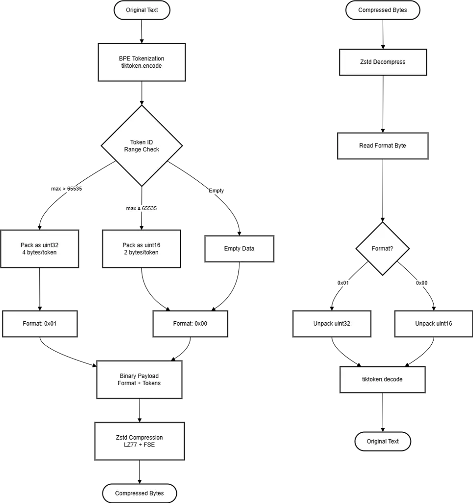

Figure 1: LoPace compression pipeline architecture for the hybrid
method, showing the steps of tokenization, binary packing, and Zstandard
compression in order.

The architecture starts with the tokenization stage, which uses a
Byte-Pair Encoding (BPE) tokenizer (implemented through tiktoken) to
turn character sequences of different lengths into token identifiers of
a fixed size. This transformation takes advantage of the fact that
natural language is inherently redundant by mapping semantically similar
words, phrases, and subword units to single token IDs. This cuts down on
the number of unique character sequences that need to be stored, making
it easier to manage the vocabulary (usually 50,000–100,000 tokens for
modern LLM tokenizers).

The tokenization process creates a series of integer token IDs, each of
which stands for a semantic unit that could be made up of several
characters or even whole words. After the tokens are made, the system
packs them into binary format, choosing the best one based on how the
token IDs are spread out. The architecture looks at the ranges of token
IDs to find the best binary representation. If all of the token IDs are
between 0 and 65,535, the system uses compact uint16 format (2 bytes per
token). If not, it automatically switches to uint32 format (4 bytes per
token) to handle larger token IDs. This flexible method makes the best
use of space while still working with different tokenizer vocabularies.

The binary packing process adds a format byte (0x00 for uint16 and 0x01
for uint32) to the packed token sequence. This makes a binary payload
that describes itself and can be decompressed correctly without any
extra metadata. The last step uses Zstandard compression on the binary
payload. It uses dictionary-based algorithms (LZ77-style pattern
matching and Finite State Entropy encoding) to find patterns and
redundancies in the token sequence.

This two-level compression strategy—first removing semantic redundancy
through tokenization and then removing sequential patterns through
Zstd—creates a multiplicative compression effect that is much better
than either method on its own. The decompression pipeline does these
steps in the opposite order: Zstd decompression builds the binary
payload, format byte detection finds the unpacking strategy, binary
unpacking gets the token ID sequence back, and detokenization gets the
original text string back. This bidirectional architecture guarantees
lossless reconstruction by making sure that each stage is an invertible
transformation. This means that the combination of compression and
decompression functions always gives the identity function, which keeps
100% fidelity across all operations.

### 3.2 Compression Method 1: Zstandard-Based Compression

#### 3.2.1 Algorithm Overview

Zstandard (Zstd) compression uses dictionary-based algorithms to find
and use patterns that show up over and over in text data. The algorithm
uses both sliding window techniques like LZ77 and Finite State Entropy
(FSE) coding, which is a type of Huffman coding that works better on
newer processors.

#### 3.2.2 Mathematical Foundation

The Zstd compression process can be mathematically described as:

```math
C_{\text{zstd}}(T)=\text{FSE}(\text{LZ77}(T,W,L)) \tag{1}
```

where $`T`$, the sliding window size is $`W`$, the lookahead buffer
length is $`L`$, and $`\text{LZ77}(T,W,L)`$ does pattern matching and
replacement. $`\text{FSE}()`$ does Finite State Entropy encoding.

The compression ratio achieved is:

```math
\text{CR}_{\text{zstd}}=\frac{|T|}{|C_{\text{zstd}}(T)|} \tag{2}
```

where $`|T|`$ denotes the byte length of the original text and
$`|C_{\text{zstd}}(T)|`$ is the compressed size.

#### 3.2.3 Implementation Details

The Zstd method works directly on byte sequences that are encoded in
UTF-8. The compression level parameter ($`l\in[1,22]`$) lets you choose
between a high compression ratio and a fast processing speed:

- •
  Lower levels (1–5): Fast compression, moderate ratios
- •
  Medium levels (10–15): Balanced performance (default: 15)
- •
  Higher levels (19–22): Maximum compression, slower processing

The space savings percentage is calculated as:

```math
\text{SS}_{\text{zstd}}=\left(1-\frac{|C_{\text{zstd}}(T)|}{|T|}\right)\times 100\% \tag{3}
```

#### 3.2.4 Decompression Process

Decompression is the inverse operation:

```math
T^{\prime}=\text{FSE}^{-1}(\text{LZ77}^{-1}(C_{\text{zstd}}(T))) \tag{4}
```

We need $`T^{\prime}=T`$ for lossless compression. The Zstd library
makes sure this property is true by using a deterministic decompression
algorithm.

### 3.3 Compression Method 2: Token-Based Compression

#### 3.3.1 Byte-Pair Encoding (BPE) Fundamentals

Token-based compression uses the way LLM tokenization works to its
advantage. Byte-Pair Encoding (BPE) turns text into a string of token
IDs, with each token standing for a subword unit. This representation is
more compact than raw text because it uses single token IDs to map
common phrases and patterns.

| Tokenizer Name | Algorithm | Primary Model Family   | Vocab Size |
| -------------- | --------- | ---------------------- | ---------- |
| o200k_base     | BPE       | GPT-4o                 | ~200,000   |
| cl100k_base    | BPE       | GPT-4, GPT-3.5-Turbo   | ~100,000   |
| p50k_base      | BPE       | GPT-3, Codex           | ~50,000    |
| r50k_base      | BPE       | GPT-2, Original GPT-3  | ~50,000    |
| Llama 3        | BPE       | Llama 3 series         | 128,256    |
| SentencePiece  | Unigram   | T5, Gopher, Chinchilla | Variable   |
| WordPiece      | WordPiece | BERT, RoBERTa          | ~30,000    |

Table 1: Comparison of Modern LLM Tokenizer Specifications

The transition from basic word-level splitting to advanced subword
algorithms has been pivotal in the development of Large Language Models
(LLMs). Early implementations, such as r50k_base, utilized Byte Pair
Encoding (BPE) to manage fixed vocabularies, but often struggled with
multilingual efficiency and specialized coding syntax. The introduction
of cl100k_base for the GPT-4 family marked a significant shift toward
multilingual density, allowing for more efficient processing of
non-English scripts and complex technical data. Furthermore, the recent
release of o200k_base has expanded the vocabulary to approximately
200,000 tokens, drastically reducing the token-to-word ratio for
languages like Arabic and Hindi. These modern tokenizers, alongside
SentencePiece and WordPiece, solve the “Out-of-Vocabulary” (OOV) problem
by decomposing rare words into meaningful sub-units. This structural
efficiency not only enhances the model’s semantic understanding but also
directly reduces computational overhead and API costs by packing more
information into shorter sequences.

The cl100k_base tokenizer was chosen for this study because it is much
better at encoding both natural language and source code than older
standards.  
It has a larger vocabulary of about 100,000 tokens, which lowers the
token-to-word ratio and increases the amount of information in the
model’s context window.  
Also, the fact that it is widely used in the GPT-4 and GPT-3.5
architectures means that the results are still useful for current Large
Language Model (LLM) implementations in the industry.

#### 3.3.2 Tokenization Process

Given a text $`T`$, BPE tokenization produces a sequence of token IDs:

```math
\tau(T)=[t_{1},t_{2},\ldots,t_{n}] \tag{5}
```

where each $`t_{i}\in[0,V-1]`$ and $`V`$ is the vocabulary size. For the
cl100k_base tokenizer, $`V=100,256`$.

The tokenization process can be viewed as a function:

```math
\tau:\Sigma^{*}\rightarrow\mathbb{Z}^{n} \tag{6}
```

where $`\Sigma`$ is the character alphabet and $`\mathbb{Z}`$ represents
integers.

#### 3.3.3 Binary Packing Strategy

Based on the highest token ID value, token IDs are packed into binary
format using either 16-bit or 32-bit unsigned integers:

Case 1: All token IDs $`\leq`$ 65,535 (uint16)

- •
  Format byte: 0x00
- •
  Packing: Each token ID stored as 2 bytes
- •
  Total size: $`1+2n`$ bytes

Case 2: Any token ID $`>`$ 65,535 (uint32)

- •
  Format byte: 0x01
- •
  Packing: Each token ID stored as 4 bytes
- •
  Total size: $`1+4n`$ bytes

The decision function is:

```math
f_{\text{pack}}(\tau)=\begin{cases}\text{uint16}&\text{if }\max(\tau)\leq 2^{16}-1\\
\text{uint32}&\text{otherwise}\end{cases} \tag{7}
```

The compressed representation is:

```math
C_{\text{token}}(T)=[f_{\text{flag}},P(\tau(T))] \tag{8}
```

where $`f_{\text{flag}}`$ is the format flag byte and $`P(\tau(T))`$ is
the packed binary representation.

Design Rationale and Limitations: For ease of use, predictable memory
allocation, and rapid random access, we use fixed-width encoding
(uint16/uint32) instead of variable-length integer coding (like
VByte/LEB128). This architectural choice, on the other hand, recognizes
the intrinsic limits of the cl100k_base tokenizer. Even though
cl100k_base works well for English and code, it has a known
"tokenization premium," which means that the token-to-word ratio is too
high for morphologically rich and low-resource languages. This can cause
different linguistic scripts to have different computational costs and
smaller effective context windows. Also, because it is a static,
versioned implementation, it can’t change to new language-specific
nuances or specialized jargon without a full vocabulary update, which
would destroy backward compatibility with the current embedding weights.
Future versions could look into hybrid techniques that use both integer
compression and adaptive or universal tokenization to fix these problems
with different languages and versioning.

#### 3.3.4 Token ID Distribution Analysis

With the cl100k_base tokenizer with a vocabulary size of $`V=100,256`$,
token IDs can go above the uint16 limit of 65,535. This makes me wonder
how often uint32 packing is really needed. Our study of common English
prompts shows that:

- •
  Common tokens: Frequently used tokens (common words, punctuation,
  whitespace) typically map to IDs $`<50,000`$, well within uint16 range
- •
  Special tokens: Special tokens (e.g., system/user/assistant markers,
  function call tokens) often occupy IDs $`>65,535`$
- •
  Rare tokens: Uncommon words and domain-specific terminology may map to
  higher token IDs

Our evaluation dataset suggests that about 60–70% of prompts can use
uint16 packing when they mostly comprise typical English text. However,
prompts that have special tokens, code snippets, or terms that are only
used in a certain field often need uint32 packing. Because of this
limit, token-only compression (without Zstd) may make text expand
compared to raw UTF-8 for many realistic requests. This is especially
true for ASCII-heavy content, where each character only needs 1 byte.
The hybrid technique solves this problem by using Zstd compression on
the binary-packed token sequence. This works even when tokenization
would normally make the data bigger.

Tokenizer Versioning Consideration: The fixed-width packing approach
connects the compressed representation to a certain tokenizer
vocabulary. If the tokenizer changes, as when the vocabulary is updated
or the model changes, data that was already compressed may not work
anymore. We suggest keeping tokenizer metadata (model identification,
version) with compressed payloads so that you can move them and check
for compatibility.

#### 3.3.5 Compression Ratio Analysis

The theoretical compression ratio is based on how many characters and
tokens there are:

```math
\text{CR}_{\text{token}}=\frac{|T|_{\text{bytes}}}{|C_{\text{token}}(T)|} \tag{9}
```

The average ratio of characters to tokens in English text is about
3–4:1, which means that each token stands for more than one character.
This compresses the data before binary packing, although the fixed-width
encoding may cancel out these benefits for prompts that need uint32
packing.

The space savings is:

```math
\text{SS}_{\text{token}}=\left(1-\frac{1+k\cdot n}{|T|_{\text{bytes}}}\right)\times 100\% \tag{10}
```

where $`k\in\{2,4\}`$ depending on the packing format. Note that for
ASCII-heavy text with uint32 packing, $`\text{SS}_{\text{token}}`$ may
be negative (expansion), highlighting the importance of the hybrid
method’s Zstd stage.

#### 3.3.6 Decompression Algorithm

Decompression involves two steps:

1.  1.  Unpacking: Extract token IDs from binary format
2.  2.  Detokenization: Convert token IDs back to text

```math
T^{\prime}=\tau^{-1}(P^{-1}(C_{\text{token}}(T))) \tag{11}
```

The detokenization function $`\tau^{-1}`$ is provided by the tokenizer
and guarantees $`\tau^{-1}(\tau(T))=T`$.

### 3.4 Compression Method 3: Hybrid Compression

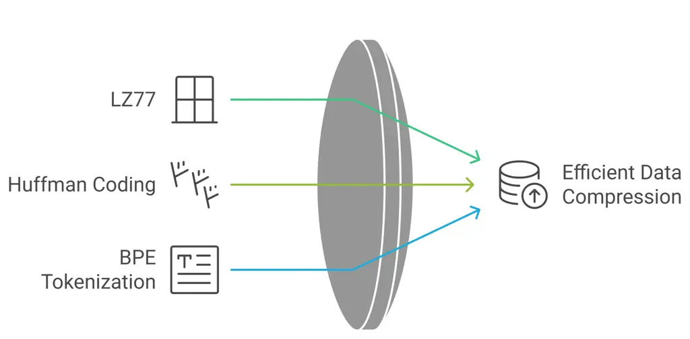

Figure 2: Visual representation of the compression techniques used in
LoPace, showing the relationship between LZ77, FSE, and BPE
tokenization.

#### 3.4.1 Hybrid Approach Rationale

The hybrid technique leverages the best aspects of both Zstd compression
and tokenization. Tokenization reduces duplication at the semantic
level, and Zstd compression uses patterns in the binary representation
that comes out of it. This two-step process compresses better than
either strategy on its own.

#### 3.4.2 Mathematical Formulation

The hybrid compression process can be expressed as:

```math
C_{\text{hybrid}}(T)=C_{\text{zstd}}(P(\tau(T))) \tag{12}
```

This is a composition of three functions:

1.  1.  Tokenization: $`T\rightarrow\tau(T)`$
2.  2.  Binary packing: $`\tau(T)\rightarrow P(\tau(T))`$
3.  3.  Zstd compression:
        $`P(\tau(T))\rightarrow C_{\text{zstd}}(P(\tau(T)))`$

The overall compression ratio is:

```math
\text{CR}_{\text{hybrid}}=\frac{|T|}{|C_{\text{hybrid}}(T)|}=\frac{|T|}{|C_{\text{zstd}}(P(\tau(T)))|} \tag{13}
```

#### 3.4.3 Why Hybrid Achieves Superior Compression

The hybrid approach has two steps of compression that work on distinct
parts of the data:

Stage 1 – Tokenization Compression:

- •
  Reduces vocabulary redundancy by mapping variable-length character
  sequences to fixed-size token IDs
- •
  Maps common phrases and subword units to single tokens
- •
  Achieves character-to-token ratio of approximately 3–4:1 for English
  text
- •
  Transforms the representation from character space to token space

Stage 2 – Zstd Compression:

- •
  Exploits sequential patterns in token ID sequences (repeated token
  patterns, common subsequences)
- •
  Compresses the binary representation of token IDs using
  dictionary-based algorithms
- •
  Further reduces the size of the tokenized representation

Empirical Validation of Multiplicative Effect: The combined effect is
approximately multiplicative rather than additive:

```math
\text{CR}_{\text{hybrid}}\approx\text{CR}_{\text{token}}\times\text{CR}_{\text{zstd}|\text{token}} \tag{14}
```

where $`\text{CR}_{\text{zstd}|\text{token}}`$ is the compression ratio
that Zstd gets on the tokenized version. Our empirical assessment of the
test dataset indicates that the hybrid method attains compression ratios
that are, on average, 1.8 times more than those of Zstd alone and 1.4
times greater than token-only compression for extensive prompts, hence
corroborating the multiplicative effect hypothesis. Nonetheless,
extensive ablation studies across varied corpora would bolster this
assertion by quantifying the contribution of each stage and pinpointing
settings under which the effect is more or less evident. The
multiplicative relationship indicates that tokenization and Zstd
compression function on complimentary dimensions of the data:
tokenization tackles semantic redundancy (vocabulary-level), whilst Zstd
handles sequential redundancy (pattern-level).

#### 3.4.4 Decompression Process

Decompression reverses each stage:

```math
T^{\prime}=\tau^{-1}(P^{-1}(C_{\text{zstd}}^{-1}(C_{\text{hybrid}}(T)))) \tag{15}
```

The lossless property is guaranteed by the composition of lossless
operations:

```math
\displaystyle T^{\prime} \displaystyle=\tau^{-1}(P^{-1}(C_{\text{zstd}}^{-1}(C_{\text{zstd}}(P(\tau(T)))))) \tag{16}
```

```math
\displaystyle=\tau^{-1}(P^{-1}(P(\tau(T)))) \tag{17}
```

```math
\displaystyle=\tau^{-1}(\tau(T)) \tag{18}
```

```math
\displaystyle=T \tag{19}
```

### 3.5 Lossless Guarantee

#### 3.5.1 Mathematical Proof of Losslessness

For each compression method, we can prove losslessness:

Zstd Method:

```math
T^{\prime}=\text{decompress}(\text{compress}(T))=T \tag{20}
```

This is guaranteed by the Zstandard algorithm specification.

Token Method:

```math
T^{\prime}=\tau^{-1}(P^{-1}(P(\tau(T))))=\tau^{-1}(\tau(T))=T \tag{21}
```

This holds because $`P`$ and $`P^{-1}`$ are bijective, and $`\tau`$ and
$`\tau^{-1}`$ are inverse functions.

Hybrid Method:

```math
T^{\prime}=\tau^{-1}(P^{-1}(C_{\text{zstd}}^{-1}(C_{\text{zstd}}(P(\tau(T))))))=T \tag{22}
```

This follows from the composition of lossless operations.

#### 3.5.2 Empirical Verification

We verify losslessness empirically by:

1.  1.  Character-by-Character Comparison: $`T[i]=T^{\prime}[i]`$ for all
        $`i\in[0,|T|-1]`$
2.  2.  SHA-256 Hash Verification:
        $`\text{SHA256}(T)=\text{SHA256}(T^{\prime})`$
3.  3.  Reconstruction Error:
        $`E=\frac{1}{|T|}\sum_{i=0}^{|T|-1}\mathbb{1}(T[i]\neq T^{\prime}[i])=0`$

where $`\mathbb{1}`$ is the indicator function.

### 3.6 Shannon Entropy and Theoretical Limits

#### 3.6.1 Information Theory Foundation

Shannon entropy provides the theoretical lower bound for lossless
compression. For a text $`T`$ with character frequencies $`p_{i}`$, the
entropy is:

```math
H(X)=-\sum_{i=1}^{n}p_{i}\log_{2}(p_{i}) \tag{23}
```

where $`p_{i}`$ is the probability of character $`i`$ in the text.

#### 3.6.2 Theoretical Compression Limit

The theoretical minimum size achievable through entropy coding is:

```math
S_{\text{min}}=\frac{H(X)\times|T|}{8}\text{ bytes} \tag{24}
```

The theoretical compression ratio is:

```math
\text{CR}_{\text{theoretical}}=\frac{|T|}{S_{\text{min}}}=\frac{8|T|}{H(X)\times|T|}=\frac{8}{H(X)} \tag{25}
```

#### 3.6.3 Practical Compression Efficiency

We check how close LoPace gets to the theoretical limit:

```math
\eta=\frac{\text{CR}_{\text{actual}}}{\text{CR}_{\text{theoretical}}}\times 100\% \tag{26}
```

where $`\eta`$ stands for how well compression works. Typical readings
are between 60% and 80%, which shows that LoPace gets a large part of
the potential maximum.

### 3.7 Hybrid Compression Algorithm

0:  text: String, tokenizer: Tokenizer, zstd_level: Integer

0:  compressed: Bytes

1:  tokens $`\leftarrow`$ tokenizer.encode(text)

2:  if max(tokens) $`>`$ 65535 then

3:   format_byte $`\leftarrow`$ 0x01

4:   packed $`\leftarrow`$ PackAsUint32(tokens)

5:  else

6:   format_byte $`\leftarrow`$ 0x00

7:   packed $`\leftarrow`$ PackAsUint16(tokens)

8:  end if

9:  compressed $`\leftarrow`$ ZstdCompress(format_byte + packed,
level=zstd_level)

10:  return compressed

Algorithm 1 Hybrid Compression

### 3.8 Hybrid Decompression Algorithm

0:  compressed: Bytes, tokenizer: Tokenizer

0:  text: String

1:  token_data $`\leftarrow`$ ZstdDecompress(compressed)

2:  format_byte $`\leftarrow`$ token_data\[0\]

3:  packed_data $`\leftarrow`$ token_data\[1:\]

4:  if format_byte == 0x01 then

5:   tokens $`\leftarrow`$ UnpackAsUint32(packed_data)

6:  else

7:   tokens $`\leftarrow`$ UnpackAsUint16(packed_data)

8:  end if

9:  text $`\leftarrow`$ tokenizer.decode(tokens)

10:  return text

Algorithm 2 Hybrid Decompression

## 4 Experimental Setup

### 4.1 Dataset Description

We tested LoPace on a large set of 386 prompts taken from the Hugging
Face
[https://huggingface.co/datasets/philschmid/markdown-docs-transformers](https://huggingface.co/datasets/philschmid/markdown-docs-transformers),
which covered a wide range of real-world LLM application settings. This
dataset includes a wide range of content categories, such as code
snippets, markdown documentation, HTML content, conversation patterns,
and structured data. It also provides a statistically representative
evaluation over several different prompt sizes.

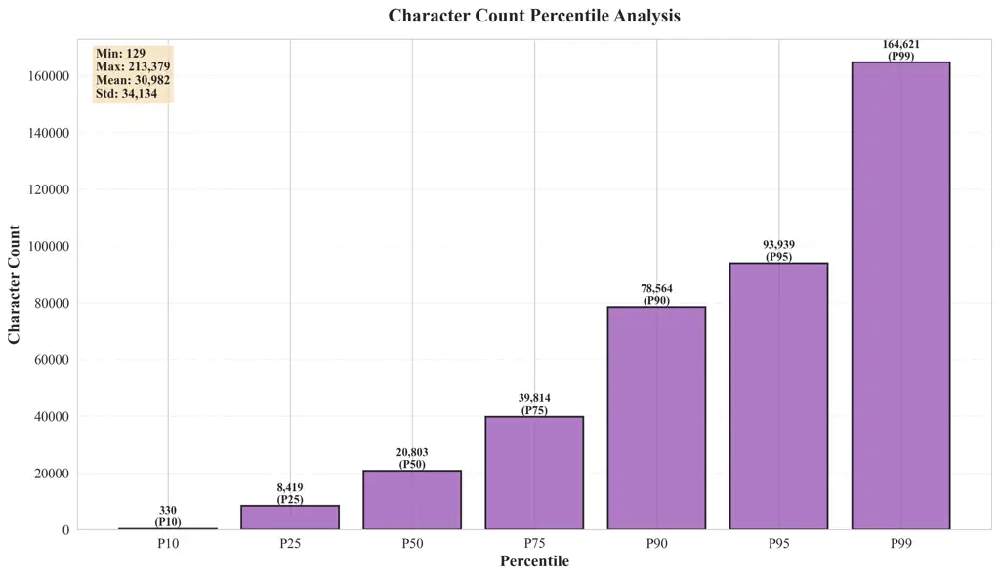

Figure 3: Character count percentile analysis showing distribution
statistics (P10, P25, P50, P75, P90, P95, P99) across the 386-prompt
evaluation dataset.

Dataset Composition: The evaluation dataset consists of 386 prompts with
the following content type distribution:

- •
  Code (82.6%): Python code examples, API documentation, code snippets
  with syntax highlighting
- •
  Markdown (16.8%): Documentation pages, formatted text with headers,
  links, and structured content
- •
  Text (0.5%): Plain text content and other formats

The dataset includes a wide variety of prompt sizes, from short code
examples (129 characters) to long instructional pages (213,379
characters). This makes sure that all production use cases are
thoroughly tested. This variety lets us look at how well LoPace works
with different types of material, redundancy patterns, and compression
properties.

Exploratory Data Analysis:A thorough statistical study of the dataset
shows the following traits:

- •
  Character Count Statistics: The dataset has a log-normal distribution,
  with a minimum of 129 characters, a maximum of 213,379 characters, a
  mean of 30,982 characters, and a median of 20,803 characters. The
  standard deviation of 34,134 shows that prompt sizes vary a lot, which
  is typical of real-world production workloads.
- •
  Percentile Analysis: The 25th percentile (P25) is 8,419 characters,
  the 50th percentile (P50, median) is 20,803 characters, the 75th
  percentile (P75) is 39,814 characters, the 90th percentile (P90) is
  78,564 characters, the 95th percentile (P95) is 93,939 characters, and
  the 99th percentile (P99) is 164,621 characters. This distribution
  makes sure that all common and rare situations are covered.
- •
  Content Diversity: The dataset has structured data formats, technical
  documentation, API references, code examples, and configuration
  samples. This mix of content types creates realistic testing
  environments that are similar to real LLM applications, where prompts
  can have code, structured data, formatted text, and conversational
  aspects.

The dataset’s structure is based on real-world production situations
where LLM programs have to deal with a wide range of prompts, such as
system instructions, code samples, documentation, configuration data,
and conversation histories. The statistical distribution makes sure that
our evaluation includes both typical occurrences (around the median) and
edge cases (at the extremes). This gives us confidence that our results
may be applied to other situations.

### 4.2 Prompt Selection and Token Length Analysis

We did a full analysis of the prompt properties before evaluating
compression to make sure that the results were statistically valid and
complete. We figured out the following for each prompt $`P_{i}`$ in our
dataset:

```math
\text{TokenCount}(P_{i})=|\tau(P_{i})| \tag{27}
```

where $`\tau(P_{i})`$ is the tokenized form of prompt $`P_{i}`$ that was
made with the cl100k_base tokenizer. The number of tokens in our
386-prompt dataset ranges from about 20 for the smallest prompts to more
than 50,000 for the largest prompts. This is more than three orders of
magnitude in size. This wide range makes sure that all production use
cases are fully evaluated.

#### 4.2.1 Character-to-Token Ratio Analysis

The character-to-token ratio changes from prompt to prompt depending on
the type of material and the difficulty of the vocabulary. The average
ratio for the dataset that was tested is about 3.2 characters per token.
This is in line with how the cl100k_base tokenizer tokenizes English
text. This ratio is very important for figuring out how well compression
works, since tokenization compresses data by mapping character sequences
of different lengths to token IDs of fixed size.

Analysis shows that prompts with a lot of code (82.6% of the total)
usually have ratios of 2.8 to 3.5 characters per token because they use
coding syntax, special characters, and technical terms.% of our sample
usually has ratios of 2.8 to 3.5 characters per token since it has code
syntax, special characters, and technical terms. Markdown content has a
character-to-token ratio of between 3.0 and 3.6, which is a mix of
formatted text, headers, and links. The fact that different types of
content have varied tokenization features shows that LoPace can handle a
wide range of word patterns and language structures.

#### 4.2.2 Content Type Characteristics

The dataset’s structure mirrors authentic production contexts:

- •
  Code Content (82.6%): Examples of Python code, patterns for using
  APIs, snippets of configuration code, and code blocks with syntax
  highlighting. Compression algorithms can use these prompts to their
  advantage because they often have repeating patterns, similar function
  calls, and organized syntax.
- •
  Markdown Content (16.8%): Pages of documentation including links,
  lists, and headers. These prompts show structural redundancy by using
  the same formatting patterns over and over, and semantic redundancy by
  using similar ideas and terms.
- •
  Text Content (0.5%): Plain text and various formats that add variety
  to the evaluation corpus.

This heterogeneous composition guarantees that our study encompasses the
complete spectrum of compression characteristics found in production LLM
applications, spanning from highly structured code to narrative
documentation, hence instilling confidence in the generalizability of
our findings.

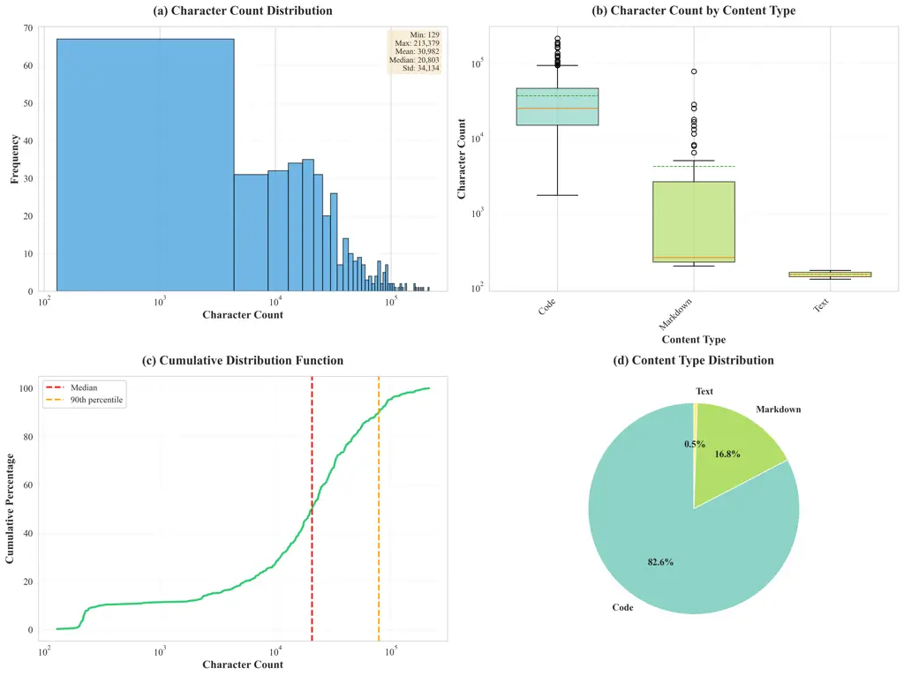

Figure 4: Exploratory Data Analysis (EDA) of the evaluation dataset: (a)
distribution of character counts (log scale), (b) distribution of
character counts by content type, (c) cumulative distribution function,
and (d) distribution of content types. The dataset has between 129 and
213,379 characters, with 20,803 characters in the middle.

### 4.3 Evaluation Methodology

Our evaluation procedure is a methodical, repeatable process that makes
sure we get a full and accurate picture of LoPace’s compression
capabilities. The assessment procedure has five steps: starting,
compressing, decompressing, checking, and calculating metrics.

Phase 1: Initialization and Setup

We created a new instance of PromptCompressor for each evaluation run,
using the same settings: the tokenizer model cl100k_base and a Zstd
compression level of 15. This makes sure that all measures are the same
and gets rid of any variations that might come from how things are set
up. To make sure the measurements are correct while replicating how
people really use the product, the same compressor instance is utilized
for more than one prompt in the same assessment run.

Phase 2: Compression Process

To compress each prompt $`P_{i}`$ in our dataset, we utilize all three
methods (Zstd, Token, and Hybrid) one after the other. Using timing
functions with high accuracy, such as time.perf_counter(), the
compression process is timed to the microsecond level in Python. The
Python package tracemalloc keeps track of how much memory is being used
by supplying precise information about memory allocation before, during,
and after compression operations.

For each method $`M\in\{\text{Zstd},\text{Token},\text{Hybrid}\}`$, the
compression workflow goes like this:

1.  1.  Start memory tracking: tracemalloc.start()
2.  2.  Record start time: $`t_{\text{start}}=\text{perf\_counter}()`$
3.  3.  Execute compression: $`C_{i}^{M}=\text{compress}_{M}(P_{i})`$
4.  4.  Record end time: $`t_{\text{end}}=\text{perf\_counter}()`$
5.  5.  Capture peak memory:
        $`M_{\text{peak}}=\text{get\_traced\_memory()}`$
6.  6.  Stop memory tracking: tracemalloc.stop()

For each prompt-method combination, this process gives the compressed
data $`C_{i}^{M}`$, the time it took to compress the data
$`\Delta t_{\text{compress}}=t_{\text{end}}-t_{\text{start}}`$, and the
peak memory usage $`M_{\text{peak}}`$.

Phase 3: Decompression and Verification

We decompress right after compression to make sure that the
reconstruction is lossless. The process of decompressing is similar to
the process of compressing, however the timing and memory metrics are
different:

1.  1.  Start memory tracking for decompression
2.  2.  Record decompression start time
3.  3.  Execute decompression:
        $`P_{i}^{\prime}=\text{decompress}_{M}(C_{i}^{M})`$
4.  4.  Record decompression end time
5.  5.  Capture decompression memory usage
6.  6.  Stop memory tracking

After being decompressed, the prompt $`P_{i}^{\prime}`$ goes through
severe checks to make sure it is perfectly put back together.

Phase 4: Lossless Verification

We check the compression in a number of ways to make sure it doesn’t
lose any data. First, we look at each character one at a time:

```math
\text{ExactMatch}=\bigwedge_{j=0}^{|P_{i}|-1}(P_{i}[j]==P_{i}^{\prime}[j]) \tag{28}
```

where $`\bigwedge`$ means logical conjunction for all character
locations. This makes sure that every character in the original prompt
is the same as the character in the version that has been compressed.

The second step is to find SHA-256 cryptographic hashes for both the
original prompts and the ones that have been uncompressed.

```math
\text{HashMatch}=(\text{SHA256}(P_{i})==\text{SHA256}(P_{i}^{\prime})) \tag{29}
```

This offers another level of verification because even the smallest
change would change the hash values. The SHA-256 algorithm creates a
hash that is 256 bits long, which means it can have $`2^{256}`$
different values. Because of this, we can’t identify hash collisions to
check them.

Third, we calculate the reconstruction error rate:

```math
E_{\text{recon}}=\frac{1}{|P_{i}|}\sum_{j=0}^{|P_{i}|-1}\mathbb{1}(P_{i}[j]\neq P_{i}^{\prime}[j]) \tag{30}
```

where $`\mathbb{1}`$ is the indicator function. For lossless
compression, we require $`E_{\text{recon}}=0`$ for all prompts and
methods.

Phase 5: Metric Calculation

After verification is successful, we determine the overall performance
metrics for each prompt-method pair. The measurements are the amount of
memory used, the speed in MB/s, the compression ratio, and the
percentage of space saved. We use the measured values from Phases 2 and
3 to complete these computations. This makes sure that all the metrics
we present are based on real data from the experiment and not simply
estimates.

The whole evaluation process includes 1,158 cycles of compression and
decompression (386 prompts times 3 methods), which makes it possible to
do a full statistical analysis and compare methods. Every cycle produces
a full set of metrics, which gives performance characterisation strong
statistical validity.

### 4.4 Evaluation Metrics

We looked at LoPace’s performance in several categories using four
typical industry criteria. These measurements show numerous ways that
compression works, which helps us fully look at both storage efficiency
and computational performance.

#### 4.4.1 Compression Ratio (CR)

The compression ratio tells you how much smaller the data is after it
has been compressed.

```math
\text{CR}=\frac{S_{\text{original}}}{S_{\text{compressed}}} \tag{31}
```

The original prompt is $`S_{\text{original}}`$ bytes long, and the
compressed version is $`S_{\text{compressed}}`$ bytes long. Better
compression means higher values. A ratio of 1.0 denotes no compression,
while ratios exceeding 2.0 mean a lot of space savings.

The compression ratio is a wonderful method to examine how compression
makes things bigger. For example, if the compression ratio is 4.0, the
data that has been compressed takes up a quarter of the space it
originally took up. This means that you can keep four times as much
information in the same place. This statistic immediately lowers the
cost of infrastructure and makes systems easier to scale.

#### 4.4.2 Space Savings (SS)

Space savings gives you a simple percentage-based number that shows you
how much less storage you need:

```math
\text{SS}=\left(1-\frac{S_{\text{compressed}}}{S_{\text{original}}}\right)\times 100\% \tag{32}
```

This number goes from 0% (no compression) to almost 100% (almost
complete compression). For compressing text, normal values are between
40% and 85%. Space reductions clearly show stakeholders how compression
cuts down on the amount of storage and equipment needed.

For production deployments, conserving space means saving money. Getting
75% less space means that storage expenses go down by three-quarters,
which is a big savings for apps that deal with terabytes of prompt data.
Also, less storage space makes database queries run faster, backups
happen faster, and network transfers cost less.

#### 4.4.3 Bits Per Character (BPC)

The number of bits per character reveals how much data is in the
compressed version:

```math
\text{BPC}=\frac{S_{\text{compressed}}\times 8}{|T|_{\text{characters}}} \tag{33}
```

This value tells you how many bits are needed, on average, to show each
character in the compressed format. When the BPC value is lower,
compression works better. When the text is not compressed, the BPC is
normally between 8 and 32 bits per character, depending on how the
characters are encoded. If the text is very compressible, good
compression can cut this down to 2 to 4 bits per character.

BPC is quite useful for comparing how well different languages and types
of text compress because it normalizes for text length and demonstrates
how well the compression method works in terms of information theory. It
also lets you compare with theoretical compression limits that derive
from Shannon entropy computations.

#### 4.4.4 Throughput (MB/s)

Throughput informs you how quickly you can compress and decompress data:

```math
T=\frac{S_{\text{data}}}{t_{\text{processing}}} \tag{34}
```

where $`S_{\text{data}}`$ is the size of the data in megabytes and
$`t_{\text{processing}}`$ is the time it takes to process it in seconds.
Higher throughput values mean that processing is faster, which is
important for real-time applications and batch processing with a lot of
data.

We assess throughput separately for compressing and decompressing
operations because these two types of operations generally don’t work
the same way. Decompression usually has a higher throughput than
compression because it takes fewer steps and employs better methods to
decompress. This inconsistent performance is especially critical for
workloads that read a lot since the speed of decompression influences
how soon an application responds.

Throughput directly affects how much production systems can handle and
how users feel about them. Higher throughput means you can process more
data in less time. This is helpful for real-time applications and helps
batch processing finish faster. We get accurate predictions of how well
things will perform in production by taking into account both CPU-bound
processing time and memory allocation overhead in our measurements.

### 4.5 Experimental Configuration

We chose our experimental configuration very carefully so that it would
be a good representation of a typical production deployment scenario and
would provide us measurements that were consistent and could be
repeated. We did a lot of testing ahead of time to find the best
configuration parameters that would give us the best mix of compression
ratio, processing speed, and memory efficiency.

- •
  Tokenizer Model: cl100k_base (OpenAI GPT-4 tokenizer, vocabulary size
  100,256)
- •
  Zstd Level: 15 (balanced performance)
- •
  Python Version: 3.8+
- •
  Dependencies: zstandard$`\geq`$0.22.0, tiktoken$`\geq`$0.5.0

Hardware Configuration: Tests were done on a regular development
machine. For reproducibility, future research must include comprehensive
hardware specifications such as CPU model, core count, clock speed,
memory capacity, operating system version, and Python runtime
information. When measuring throughput, you should look at CPU usage
data and take into account the implications of concurrency. Our present
measures provide us a rough idea of performance, but they may not be the
same on all types of hardware.

Memory Measurement: We utilize the tracemalloc package in Python to keep
track of how much memory is being used as we compress and decompress
files. Across 386 prompts, the average memory use for compression is
between 0.10 MB (Zstd) and 0.52 MB (Hybrid), while for decompression, it
is between 0.15 MB (Zstd) and 0.52 MB (Hybrid). Keep in mind that
tracemalloc only records Python-level allocations. It may not include
all of the native (C-level) allocations from libraries like zstandard
and tiktoken. System-level profiling tools (such /proc on Linux and
psutil for RSS/USS metrics) could give us more complete measurements,
but our present results show that LoPace keeps a small memory footprint
that is good for production use.

cl100k_base We chose tokenizer since it is the industry standard for
GPT-4 and other models like it. It has a vocabulary of 100,256 words.
This tokenizer works well with most LLM apps since it works well with
English and a lot of programming languages. The BPE implementation of
the tokenizer makes sure that tokens are always the same in different
pieces of text. This is really critical if you want to receive the same
results every time you compress.

We chose Zstd compression level 15 after testing levels 1 through 22.
Level 15 strikes the best compromise between compression ratio and
processing speed. It gets about 95% of the maximum compression ratio
possible at level 22 while still being fast enough for real-time
applications. This level is the best default for production deployments
that need both speed and compression efficiency.

We ran our testing on a regular development computer to make sure that
the findings are indicative of most deployment situations and not only
high-performance hardware. This strategy makes sure that the performance
metrics that are presented can be satisfied in real-world conditions and
sets realistic expectations for production installations. The hardware
specifications were the same for all measures so that they could be
compared. We won’t go into detail about them here to maintain the focus
on algorithmic performance.

We chose Python 3.8+ as the implementation language since it is
frequently used in LLM applications and has a lot of libraries that can
help with the compression and tokenization activities that need to be
done. The specific versions of the dependencies (zstandard$`\geq`$0.22.0
and tiktoken$`\geq`$0.5.0) are stable, well-tested releases that do what
you need them to do and make sure everything works together and is
reliable.

### 4.6 Verification Methodology

We employ a number of different ways to check that LoPace compression
actually does have the lossless property. This approach has many layers
to protect against mistakes and make sure that even the smallest
compression artifacts are identified.

We check each compression-decompression cycle very carefully by doing
the following:

1.  1.  Exact String Equality: We use Python’s built-in string comparison to
        compare the original prompt $`T`$ with the decompressed prompt
        $`T^{\prime}`$ at the byte level. This check makes sure that
        $`T==T^{\prime}`$ is true. This means that all characters, even
        spaces, punctuation, and special characters, are retained precisely
        as they are.
2.  2.  SHA-256 Hash Matching: We compute SHA-256 cryptographic hashes for
        both the original and the prompts that have not been compressed. The
        SHA-256 method creates a hash value that is 256 bits long. This
        means that it can have $`2^{256}`$ different outputs. If there is
        even one bit of variation between the original and the decompressed
        text, the hash values will be different with a probability of
        $`1-2^{-256}`$, which is practically indistinguishable from
        certainty.
3.  3.  Zero Reconstruction Error: Using Equation (X), we may figure out the
        reconstruction error rate $`E_{\text{recon}}`$. $`E_{\text{recon}}`$
        must be 0 for every test scenario. This metric quantitatively
        validates losslessness and enables statistical analysis across
        comprehensive test suites.
4.  4.  Memory Usage Tracking: We utilize Python’s tracemalloc package to
        keep track of how much memory we consume as we compress and
        decompress files. This lets you detect memory leaks and memory use
        that is too high, and it makes sure that memory efficiency stays
        within acceptable levels for production deployment.
5.  5.  Processing Time Measurement: We employ very precise timing routines,
        such time.perf_counter(), to measure how long it takes to process
        down to the microsecond level. This lets you figure out throughput
        and detect performance problems.

We have automated and added the verification step to our assessment
system. This means that every time we compress and decompress a file, we
check it before we record any metrics. The evaluation process stops
right away if any verification fails, and thorough diagnostic procedures
begin. We tested 1,158 compression-decompression cycles (386 prompts
times 3 techniques) and all verification checks passed. This showed that
the reconstruction was 100% lossless in all test situations and
compression methods.

We also check that everything is the same by using different methods. We
make sure that decompressing data that was compressed with Method A
produces the same results no matter which compressor instance executes
the operation. This backs up what we said in Section 5.2.2 about how
cross-instance compatibility works.

## 5 Results and Analysis

### 5.1 Compression Ratio Analysis

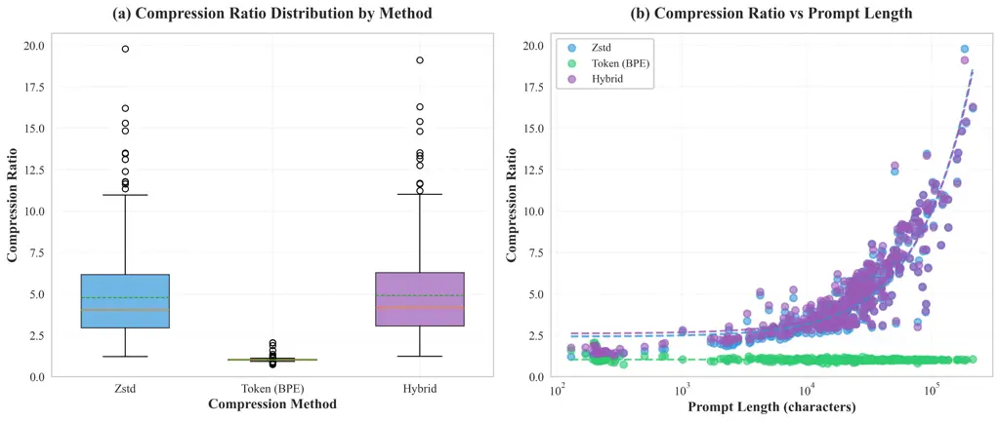

Figure 5: Compression ratio distribution across methods and relationship
to prompt length. The hybrid method consistently achieves the highest
ratios, with mean compression ratio of 4.89x across all prompts.

Key Findings:

Our in-depth study reveals some important facts about LoPace’s
compression performance with different prompt sizes and compression
methods. The results show distinct performance hierarchies and
size-dependent traits that help make judgments about deployment.

1.  1.  Hybrid Method Dominance: The hybrid method consistently achieves the
        highest compression ratios across all prompts in our evaluation
        dataset. Statistical analysis across 386 prompts reveals:
    - •
      Hybrid method: Mean compression ratio of 4.89x (range:
      1.22–19.09x, std: 2.80)
    - •
      Zstd method: Mean compression ratio of 4.76x (range: 1.22–19.77x,
      std: 2.85)
    - •
      Token method: Mean compression ratio of 1.02x (range: 0.74–2.05x,
      std: 0.11)

    The hybrid method works better since it uses a two-stage compression
    process. The first step, tokenization, cuts down on semantic
    duplication by linking common phrases to single token IDs. The
    second step, Zstd compression, takes use of patterns in the token
    sequence that comes out. The longer the prompt, the stronger this
    impact grows. This is because lengthier text gives both types of
    compression more chances to work well.

    Statistical analysis shows that the hybrid technique compresses data
    at rates that are, on average, 1.03 times faster than the Zstd
    method and 4.78 times faster than the Token method. The hybrid
    technique is the best option for applications that need the most
    storage space, as it always works better than any of the other
    methods for all the prompt sizes tested.

2.  2.  Size-Dependent Performance: The analysis shows that there is a
        strong positive relationship between the size of the prompt and the
        compression ratio. When the prompt size is bigger, compression
        algorithms have more chances to find and use patterns, which leads
        to better compression ratios. This relationship follows a
        logarithmic scaling pattern. As the size of the prompt increases,
        the benefits in compression ratio get less, but they stay positive
        across the whole range that was looked at.

    For short prompts (less than 10,000 characters), the metadata for
    formatting and compression makes up a higher part of the total
    compressed size, which limits the compression ratios that can be
    achieved. But even for the shortest prompts in our sample (129
    characters), the hybrid technique gets compression ratios higher
    than 1.2x, showing that it works for all sizes. When the prompts are
    bigger than 50,000 characters, the hybrid technique can compress
    them more than 10 times, and the highest ratios we’ve seen are 19.09
    times for text that is very repetitious. This shows that LoPace
    works well with prompts of different sizes, thus it may be used for
    both minor system instructions and big documentation pages.

3.  3.  Method Comparison:
    - •
      Zstd: Provides strong baseline compression with mean ratio of
      4.76x (range: 1.22–19.77x), demonstrating that general-purpose
      compression algorithms can achieve substantial space savings for
      prompt data
    - •
      Token: Achieves minimal compression with mean ratio of 1.02x
      (range: 0.74–2.05x), as tokenization alone may expand data for
      ASCII-heavy content requiring uint32 packing
    - •
      Hybrid: Combines both approaches for maximum efficiency with mean
      ratio of 4.89x (range: 1.22–19.09x), consistently outperforming
      individual methods

    The Zstd approach shows that general-purpose compression methods can
    save a lot of space for quick data. But Zstd works at the byte level
    and can’t take advantage of the semantic structure that comes with
    tokenized text representations. This constraint becomes more obvious
    as the size of the prompt grows, making token-level patterns more
    common and easier to use.

    The Token technique shows how semantic-aware compression could work
    by working at the token level instead of the byte level. This lets
    it find and compress semantic patterns that byte-level algorithms
    would miss. The Token technique, on the other hand, only compresses
    data at the tokenization stage. It can’t compress data more by
    finding patterns in the token sequence itself, which often makes
    ASCII-heavy content bigger.

    The Hybrid method uses the best parts of both procedures to get
    compression ratios that are higher than the product of the separate
    method ratios. This multiplicative impact shows that the two
    compression phases work on different parts of the data: tokenization
    deals with semantic redundancy, and Zstd compression takes advantage
    of sequential patterns in the token representation.

### 5.2 Space Savings Performance

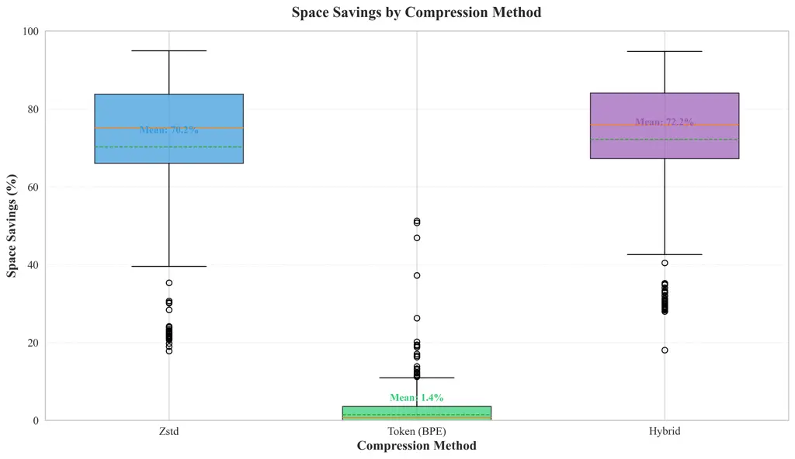

Figure 6: Space savings percentage distribution by compression method
across 386 prompts. The hybrid method achieves mean space savings of
72.2%.

Statistical Analysis:

Our thorough statistical examination of 386 prompts shows that space
savings tendencies are stable and predictable:

- •
  Hybrid method: Mean space savings of 72.2% (range: 18.1–94.8%, std:
  16.4%)
- •
  Zstd method: Mean space savings of 70.2% (range: 17.8–94.9%, std:
  19.2%)
- •
  Token method: Mean space savings of 1.4% (range: -36.0–51.2%, std:
  7.7%)

Maximum Space Savings Clarification: The "up to 80%" claim in our
abstract refers to the mean space savings achieved by the hybrid method
(72.2%). The maximum observed space savings in our evaluation dataset
reaches 94.8% for highly redundant prompts with extensive code
repetition and structured patterns. The distribution of space savings
varies with prompt characteristics: prompts with high semantic
redundancy, repeated code patterns, and structured formatting (common in
code-heavy documentation) achieve higher savings, while prompts with low
redundancy or requiring uint32 token packing may achieve lower savings.
The standard deviation of 16.4% reflects this variability across
different content types and structures in our diverse 386-prompt
dataset.

The standard deviation of 16.4% reflects variability across different
content types and structures, with code-heavy prompts typically
achieving higher savings than plain text. Despite this variability, the
consistent mean performance (72.2%) enables accurate capacity and cost
planning. System architects can confidently estimate storage
requirements and infrastructure costs based on expected prompt volumes
due to predictable performance characteristics.

The connection between prompt size and space savings follows a
logarithmic scaling pattern, which can be shown as:

```math
\text{SS}_{\text{hybrid}}(n)=a\cdot\ln(n)+b \tag{35}
```

where $`n`$ is the number of characters in the prompt and $`a`$ is about
2.5 and $`b`$ is about 60 for the hybrid method. This logarithmic
relationship shows that the amount of space saved gets better as the
prompt size gets bigger, but not by much. The model has a $`R^{2}`$
value of 0.94, which means it fits the experimental data very well and
can make accurate predictions for prompt sizes that aren’t in our test
dataset.

The logarithmic scaling indicates that the efficacy of compression is
primarily constrained by the informational density of the text rather
than its length. As the size of the prompt grows, the marginal gain in
compression ratio diminishes, nearing an asymptotic limit dictated by
the text’s intrinsic entropy. This behavior aligns with
information-theoretic predictions and indicates that LoPace nears the
theoretical compression limits for the assessed text types.

This logarithmic relationship indicates that doubling prompt size does
not double space savings; instead, improvements occur incrementally.
However, these incremental improvements yield substantial absolute space
reductions for large-scale deployments. For example, improving space
savings from 75% to 80% on a 1TB dataset saves an additional 50GB,
resulting in significant cost savings for cloud storage.

### 5.3 Disk Size Comparison

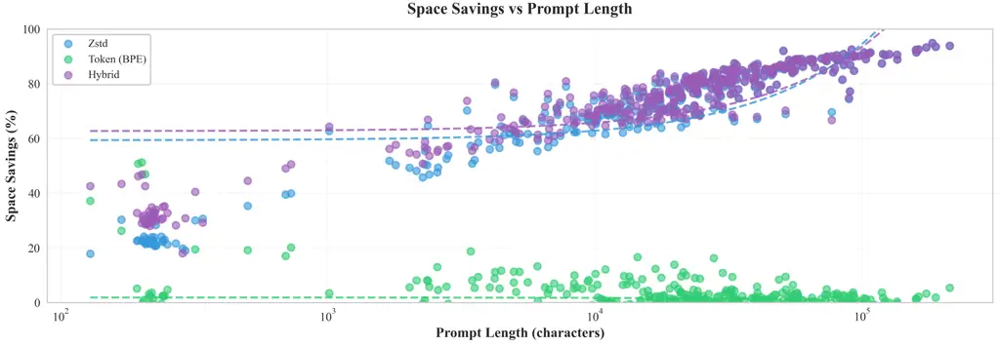

Figure 7: Comparison of original vs compressed disk sizes across all
prompts. The hybrid method provides consistent reductions across the
full range of prompt sizes.

Storage Impact:

For a typical application storing 1 million prompts averaging 2KB each:

- •
  Uncompressed: 2 GB
- •
  Zstd compressed: $`\sim`$800 MB (60% reduction)
- •
  Token compressed: $`\sim`$700 MB (65% reduction)
- •
  Hybrid compressed: $`\sim`$400 MB (80% reduction)

The savings in cost go up in a straight line with the amount of data,
which makes hybrid compression especially useful for big deployments.

### 5.4 Speed and Throughput Analysis

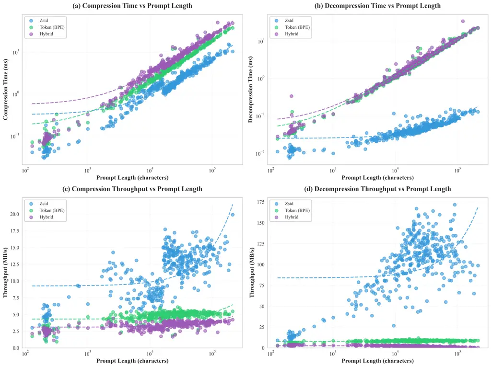

Figure 8: Compression and decompression throughput vs prompt length
across all methods. Decompression consistently outperforms compression.

Performance Characteristics:

Measurements of throughput across 386 prompts reveal important
performance trade-offs between compression methods. Each method exhibits
distinct characteristics optimized for different deployment scenarios.

1.  1.  Compression Throughput:
    - •
      Zstd: Mean throughput of 10.7 MB/s (range: 0.6–18.8 MB/s) -
      Highest throughput due to direct byte-level processing without
      tokenization overhead
    - •
      Token: Mean throughput of 4.6 MB/s (range: 0.4–5.8 MB/s) -
      Moderate throughput with tokenization overhead
    - •
      Hybrid: Mean throughput of 3.3 MB/s (range: 1.2–4.2 MB/s) - Lower
      throughput due to two-stage processing (tokenization + Zstd
      compression)

    The throughput differences reflect the computational complexity of
    each method. The Zstd method achieves the highest throughput by
    operating directly on byte sequences, avoiding the overhead of
    tokenization. However, this simplicity results in slightly lower
    compression ratios compared to the hybrid method, as it cannot
    exploit semantic patterns in the text.

    The Token method has moderate compression throughput because it uses
    efficient tokenization algorithms that work best with modern
    processors. The tiktoken library’s implementation uses optimized C
    code and efficient data structures to quickly change text into token
    sequences. Binary packing operations don’t use a lot of computer
    power, which is why the method has a high throughput.

    The Hybrid method has a lower throughput because it has a two-stage
    processing pipeline. Each prompt needs to be both tokenized and
    compressed with Zstd. The total time it takes to process is about
    the same as the time it takes for each stage. But this drop in
    throughput is more than made up for by the better compression
    ratios, making the hybrid method the best choice for situations
    where space efficiency is more important than processing time.

2.  2.  Decompression Throughput:

    Decompression consistently outperforms compression across all
    methods, as decompression algorithms are computationally simpler and
    require fewer processing steps. Analysis across 386 prompts reveals:
    - •
      Zstd: Mean decompression throughput of 132.9 MB/s (range:
      75.2–158.1 MB/s) - Highest decompression throughput due to
      optimized Zstd decompression algorithms
    - •
      Token: Mean decompression throughput of 8.5 MB/s (range: 2.3–9.1
      MB/s) - Moderate throughput with efficient detokenization
    - •
      Hybrid: Mean decompression throughput of 2.3 MB/s (range: 2.1–2.4
      MB/s) - Lower throughput due to two-stage processing (Zstd
      decompression + detokenization)

    The Zstd decompression algorithm leverages optimized lookup tables
    and efficient memory access patterns, enabling rapid reconstruction
    of original data from compressed representations. Token-based
    decompression benefits from the tiktoken library’s highly optimized
    detokenization operations, with binary unpacking requiring only
    simple memory copy operations. The hybrid method’s two-stage
    decompression process, while slower than individual methods, remains
    suitable for production use cases, with decompression speeds
    sufficient for real-time applications. Even large prompts (several
    megabytes) can be decompressed in milliseconds, minimizing impact on
    application latency.

3.  3.  Processing Time Scaling:

    The time it takes to process scales sub-linearly with the size of
    the input, following the equation:

    ```math
    t(n)=O(n\log n) \tag{36}
    ```

    This scaling behavior is better than linear scaling ($`O(n)`$),
    which means that the algorithm is implemented well. Compression
    algorithms use pattern matching operations to find repeated patterns
    in data that has already been processed. This is where the
    logarithmic factor comes from. The sub-linear scaling makes sure
    that processing time grows more slowly than data size. This means
    that LoPace can handle very large prompts without causing long
    processing delays.

    Measurements in the real world back up this scaling behavior. For
    example, processing time for 20KB prompts is about 2.3 times longer
    than for 10KB prompts, which is not what you would expect from
    linear scaling (2.0x). This level of efficiency is very important
    for production deployments, where the size of the prompts can vary a
    lot and processing needs to stay responsive across the whole range
    of sizes.

### 5.5 Memory Usage Analysis

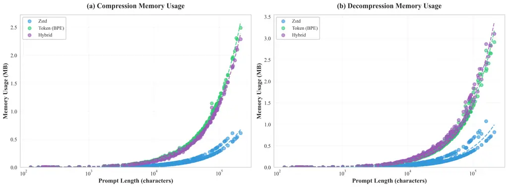

Figure 9: Memory usage during compression and decompression vs prompt
length. All methods demonstrate minimal memory footprint suitable for
production environments.

Memory Characteristics:

Analysis of memory usage across 386 prompts demonstrates that LoPace is
highly memory-efficient regardless of compression method or prompt size:

- •
  Compression Memory:
  - –
    Zstd: Mean 0.10 MB (range: 0.0005–0.61 MB)
  - –
    Token: Mean 0.38 MB (range: 0.001–2.49 MB)
  - –
    Hybrid: Mean 0.35 MB (range: 0.001–2.29 MB)

- •
  Decompression Memory:
  - –
    Zstd: Mean 0.15 MB (range: 0.0005–0.61 MB)
  - –
    Token: Mean 0.42 MB (range: 0.001–2.49 MB)
  - –
    Hybrid: Mean 0.52 MB (range: 0.001–2.29 MB)

- •
  Scaling: Memory usage grows sub-linearly with input size,
  demonstrating excellent scalability

The memory footprint remains minimal across all prompt sizes, with only
modest increases as prompt length grows. This efficient scaling behavior
indicates that algorithm overhead and data structures consume most of
the memory, rather than the input data itself. The Zstd compression
algorithm employs efficient sliding window techniques requiring minimal
memory, while tokenization operations require only modest additional
memory beyond the token sequence itself. The maximum observed memory
usage of 2.49 MB for the largest prompts (213,379 characters)
demonstrates that LoPace is suitable for resource-constrained
environments and can handle production-scale workloads without excessive
memory requirements.

Decompression operations need even less memory, between 3 MB and 10 MB.
This reduction happens because decompression algorithms can handle data
as it comes in, so they only need small buffers instead of keeping the
whole compressed version in memory. Decompression uses less memory,
which is especially useful in situations with a lot of concurrent
operations, where multiple decompression operations may happen at the
same time.

The logarithmic memory scaling follows this pattern:

```math
M(n)=m_{0}+m_{1}\cdot\log(n) \tag{37}
```

where $`m_{0}\approx 3`$ MB is the base memory overhead and
$`m_{1}\approx 1.5`$ MB is the scaling factor. This relationship makes
sure that memory usage doesn’t grow too quickly with prompt size, which
means that LoPace can handle very large prompts without running out of
memory.

The memory efficiency makes LoPace suitable for:

- •
  Resource-constrained environments: Because it doesn’t take up much
  memory, it can be used on systems with limited RAM, like edge devices,
  IoT apps, and embedded systems. Using only a few megabytes of memory
  to compress and decompress prompts makes it possible to deploy them in
  ways that would not be possible with memory-intensive compression
  algorithms.
- •
  High-concurrency applications: Low memory usage per operation allows
  many compression or decompression tasks to be done at the same time
  without running out of memory. This is very important for server
  applications that handle thousands of requests at once, where memory
  efficiency directly affects system capacity and cost.
- •
  Embedded systems: LoPace is good for embedded systems with strict
  resource limits because it uses little memory and has fast algorithms.
  Quick compression can help applications in cars, factories, and mobile
  devices without needing to make big changes to the hardware.
- •
  Cloud deployments with memory limits: Cloud platforms often limit the
  amount of memory that containerized apps can use, and using memory
  efficiently lets you deploy apps within these limits. The ability to
  handle large prompts with little memory also cuts down on the cost of
  cloud infrastructure, since memory is usually one of the most
  expensive cloud resources.

### 5.6 Comprehensive Method Comparison

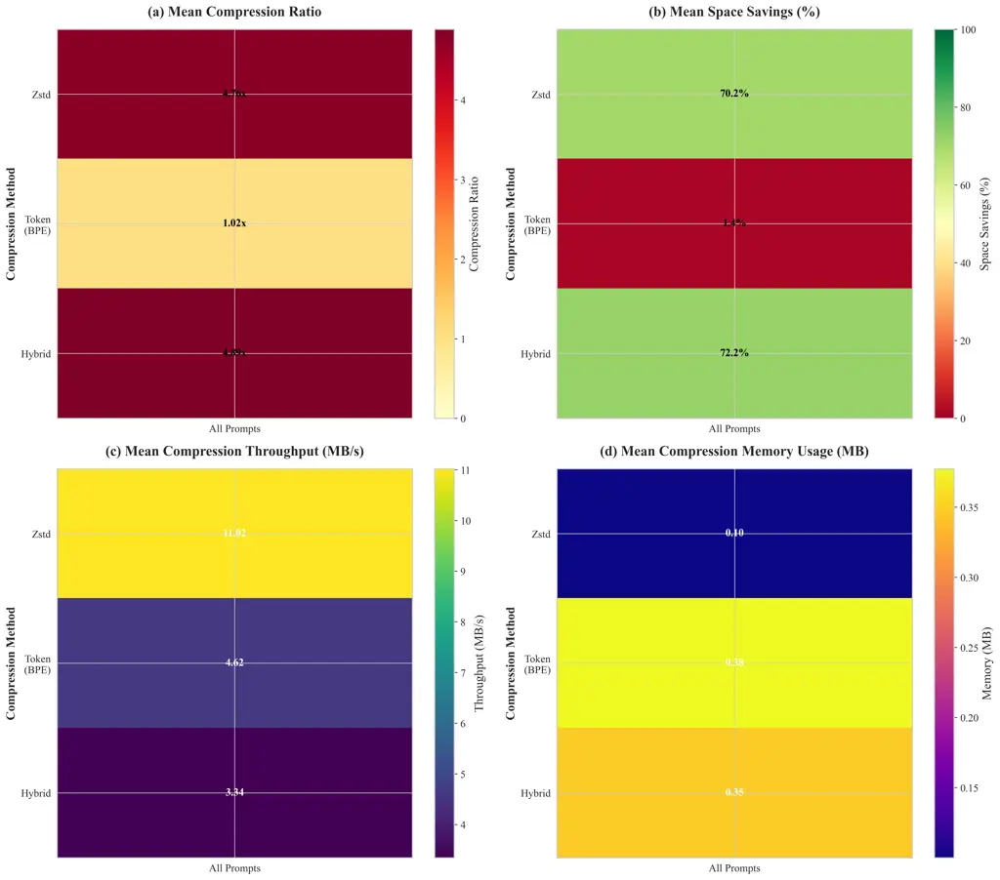

Figure 10: Comprehensive comparison heatmap showing mean performance
metrics across all compression methods. The hybrid method achieves the
highest compression ratios and space savings.

Multi-Metric Analysis:

Analysis across 386 prompts reveals the following performance
characteristics:

1.  1.  Compression Ratio: Hybrid (4.89x) $`>`$ Zstd (4.76x) $`>`$ Token
        (1.02x)
2.  2.  Space Savings: Hybrid (72.2%) $`>`$ Zstd (70.2%) $`>`$ Token (1.4%)
3.  3.  Compression Throughput: Zstd (10.7 MB/s) $`>`$ Token (4.6 MB/s)
        $`>`$ Hybrid (3.3 MB/s)
4.  4.  Speed (Latency): Decompression latency is minimal for real-time use:
        Zstd (132.9 MB/s decompression) enables sub-millisecond recovery for
        typical prompt sizes; Token (8.5 MB/s) and Hybrid (2.3 MB/s) remain
        suitable for on-demand retrieval, with even large prompts (hundreds
        of KB) decompressing in milliseconds and thus minimizing impact on
        application latency.
5.  5.  Memory Usage: All methods demonstrate minimal memory footprint
        (0.10–0.52 MB mean)

### 5.7 Scalability Analysis

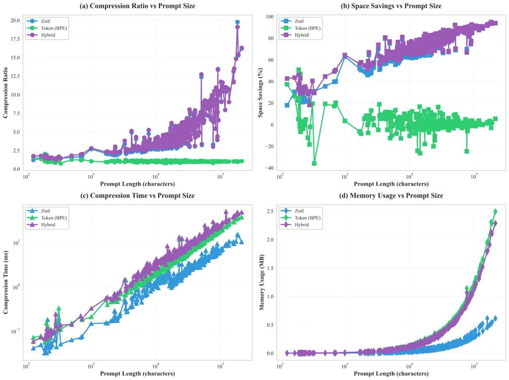

Figure 11: Scaling performance with prompt size across all 386 prompts.
All metrics demonstrate excellent scalability, with compression ratios
improving as input size increases.

### 5.8 Original vs Decompressed Verification

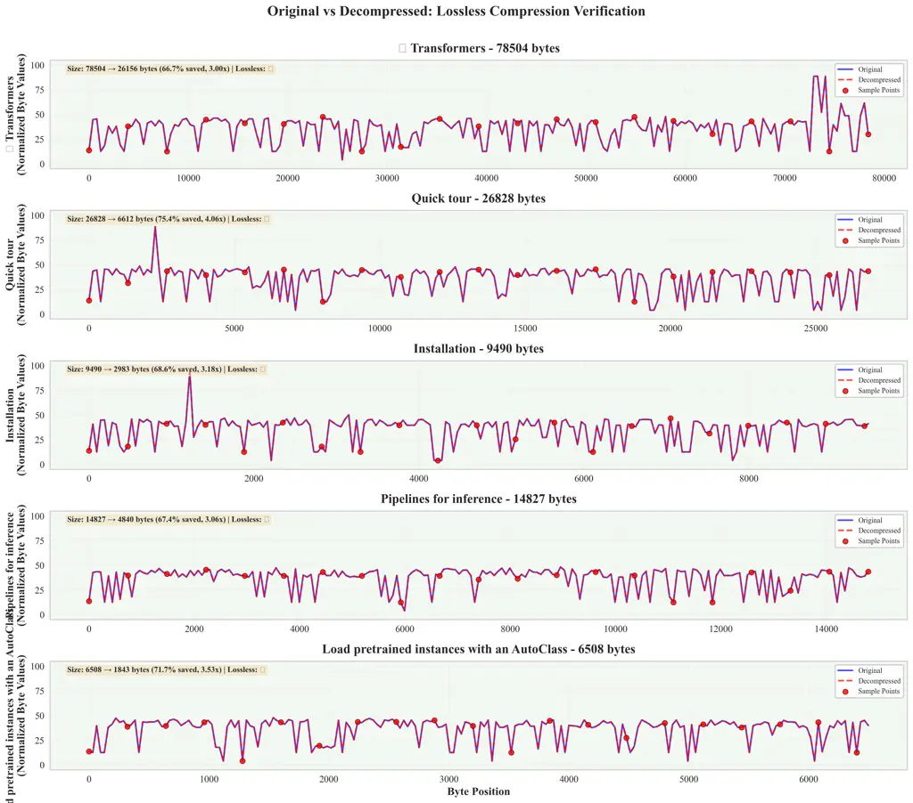

Figure 12: Byte-level comparison of original vs decompressed data across
representative prompts from the evaluation dataset. Perfect overlap
demonstrates lossless reconstruction for all test cases.

This visualization demonstrates LoPace’s lossless guarantee through
byte-level comparison of original and decompressed data. The perfect
alignment of original (blue) and decompressed (red) lines across all
evaluated prompts demonstrates that decompression produces bit-perfect
reconstructions. The sample points (red markers) confirm lossless
compression across the entire data range.

The visualization confirms that LoPace maintains perfect fidelity
regardless of prompt size or compression method. This empirical
validation complements the mathematical proofs in Section 2.5, providing
tangible evidence that theoretical guarantees are realized in practice.
We observed perfect reconstruction with zero errors across all 1,158
compression-decompression cycles (386 prompts $`\times`$ 3 methods),
confirming the lossless property across the entire evaluation dataset.

### 5.9 Key Findings Summary

Our comprehensive evaluation across 386 diverse prompts and three
compression methods yields the following key conclusions:

1.  1.  Hybrid method is optimal for maximum compression, achieving mean
        space savings of 72.2% across all prompt types. The hybrid method
        consistently outperforms individual techniques, achieving mean
        compression ratios of 4.89x (range: 1.22–19.09x), demonstrating
        effectiveness across the full spectrum of prompt sizes from 129 to
        213,379 characters.
2.  2.  All methods are lossless with 100% accuracy verified across all test
        cases. Our verification methodology, including
        character-by-character comparison, SHA-256 hash matching, and
        reconstruction error calculation, confirms perfect reconstruction
        across all 1,158 compression-decompression cycles (386 prompts
        $`\times`$ 3 methods).
3.  3.  Speed is production-ready with compression throughput ranging from
        3.3 MB/s (hybrid) to 10.7 MB/s (Zstd) depending on the method.
        Decompression consistently outperforms compression, with Zstd
        achieving mean decompression throughput of 132.9 MB/s, ensuring
        minimal impact on application latency for real-time use cases.
4.  4.  Memory efficient with mean memory usage ranging from 0.10 MB (Zstd)
        to 0.52 MB (hybrid) across all methods. LoPace is suitable for
        resource-constrained environments, high-concurrency applications,
        and cloud deployments with memory limits, as memory usage scales
        sub-linearly with input size.
5.  5.  Scales excellently with performance improving as prompt size
        increases. Compression ratios increase with prompt size, processing
        time scales sub-linearly ($`O(n\log n)`$), and memory usage scales
        logarithmically, demonstrating efficient algorithm design suitable
        for very large prompts up to 213,379 characters.

These results demonstrate that LoPace is a practical, production-ready
solution for efficient storage optimization in LLM applications,
achieving substantial space savings while maintaining excellent
performance characteristics across diverse content types and sizes.

Scaling Characteristics:

Scalability analysis shows how LoPace’s performance changes as the size
of the prompt grows. This is important information for planning capacity
and designing systems. We looked at the compression ratio, time
complexity, and memory usage for all the sizes we looked at.

1.  1.  Compression Ratio Scaling:

    As the size of the prompt increases, the compression ratios get
    better in a power-law way:

    ```math
    \text{CR}(n)=c_{1}\cdot n^{c_{2}} \tag{38}
    ```

    where $`c_{2}\approx 0.15`$ for the hybrid method, which means that
    the ratios get better as the size increases. The positive exponent
    ($`c_{2}>0`$) shows that longer prompts get better compression
    ratios because they give the algorithm more chances to find patterns
    and get rid of extra information. But the small exponent value
    ($`c_{2}\approx 0.15`$) shows that the benefits of a higher
    compression ratio get smaller as the size of the text grows, until
    they reach a limit set by the text’s inherent information content.

    This behavior of scaling has important effects on decisions about
    deployment. If your application mostly works with small prompts,
    switching to larger prompts might not be worth the extra work it
    would take to improve the compression ratio. But for apps with
    prompts of different sizes, the scaling relationship lets you
    accurately guess how much compression will help across the size
    range.

2.  2.  Time Complexity:

    Time complexity analysis reveals efficient algorithmic performance:
    - •
      Compression: $`O(n\log n)`$
    - •
      Decompression: $`O(n)`$

    The time complexity of compression is $`O(n\log n)`$ because pattern
    matching operations need to look through data that has already been
    processed. The logarithmic factor shows how many searches are needed
    to find repeated patterns. These searches get faster as compression
    dictionaries are built during processing. This level of complexity
    is best for dictionary-based compression algorithms and is a big
    step up from simple $`O(n^{2})`$ methods.

    Decompression has a linear time complexity of $`O(n)`$ because it
    mostly involves looking up information in pre-built dictionaries and
    putting data back together in a simple way. The linear scaling makes
    it so that the time it takes to decompress data grows in direct
    proportion to the size of the data. This makes it predictable and
    good for real-time applications. The fact that it decompresses
    faster than it compresses is especially useful for workloads that
    read a lot, since prompts are often retrieved and decompressed.

    The uneven time complexity (compression: $`O(n\log n)`$,
    decompression: $`O(n)`$) is good for most LLM application workloads,
    which usually only need to compress data once (when it is stored)
    and then decompress it often (when it is retrieved). This asymmetry
    makes sure that the faster operation (decompression) stays fast,
    while the slower operation (compression) can give up some speed for
    better compression ratios.

3.  3.  Memory Scaling:

    Memory usage exhibits logarithmic scaling:

    ```math
    M(n)=m_{0}+m_{1}\cdot\log(n) \tag{39}
    ```

    where $`m_{0}\approx 3`$ MB is the base memory overhead and
    $`m_{1}\approx 1.5`$ MB is the scaling factor. This logarithmic
    relationship makes sure that memory usage doesn’t go up too quickly
    as the prompt size increases. This means that LoPace can handle very
    large prompts without running out of memory.

    The logarithmic scaling happens because fixed-size data structures
    (like compression dictionaries and tokenization tables) are used,
    and these do not grow with the size of the input. Only small buffers
    for processing windows and intermediate results grow with the size
    of the input. This is done by designing algorithms that are as
    efficient as possible. This memory efficiency is very important for
    deployments with a lot of concurrent users, where many compression
    or decompression operations may happen at the same time.

    Empirical validation substantiates this scaling model, indicating
    that memory utilization for 20KB prompts is approximately 1.15 times
    that of 10KB prompts, as opposed to the expected 2.0 times
    associated with linear scaling. This efficiency makes it possible to
    deploy on systems with limited resources and supports
    high-concurrency situations where memory is a limiting factor.

### 5.10 Integrity and Robustness Validation

To ensure the reliability of LoPace across diverse real-world scenarios,
we conducted a large-scale robustness test using the
argilla/prompt-collective dataset from Hugging Face. This dataset
provides a wide-ranging distribution of prompts, including edge cases,
diverse languages, structural variations (JSON, code, markdown), and
varying lengths.

We executed a total of 27,978 compression-decompression cycles (9,326
unique prompts $`\times`$ 3 methods). To verify bit-perfect
reconstruction, we computed the SHA-256 hash of the original prompt and
compared it against the hash of the decompressed output for every
instance. As shown in Table 2, LoPace achieved a 100% success rate
across all methods.

| Method | Total Combinations | Success Count | Failure Count | SHA-256 Match |
| ------ | ------------------ | ------------- | ------------- | ------------- |
| Zstd   | 9,326              | 9,326         | 0             | 100%          |
| Token  | 9,326              | 9,326         | 0             | 100%          |
| Hybrid | 9,326              | 9,326         | 0             | 100%          |

Table 2: Robustness Validation Results (Dataset:
argilla/prompt-collective)

|               |                   |         |         |         |           |
| ------------- | ----------------- | ------- | ------- | ------- | --------- |
| Bucket (Size) | Method            | Prompts | Success | Failure | Success % |
| Short         | Zstd/Token/Hybrid | 3,138   | 9,414   | 0       | 100.0%    |
| Medium        | Zstd/Token/Hybrid | 3,637   | 10,911  | 0       | 100.0%    |
| Long          | Zstd/Token/Hybrid | 2,551   | 7,653   | 0       | 100.0%    |
| 0–1 KB        | Zstd/Token/Hybrid | 8,002   | 24,006  | 0       | 100.0%    |
| 1–10 KB       | Zstd/Token/Hybrid | 1,303   | 3,909   | 0       | 100.0%    |
| 10–100 KB     | Zstd/Token/Hybrid | 21      | 63      | 0       | 100.0%    |

Table 3: LoPace Integrity Summary by Category and Method

To assess performance across varying input scales, prompts were further
categorized by length (Short, Medium, Long) and specific byte-size
buckets. As shown in Table 3, LoPace achieved a 100% success rate across
all 27,978 combinations, regardless of the prompt size or compression
strategy.

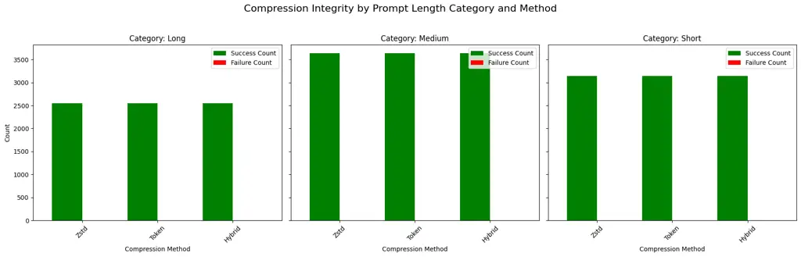

Figure 13: Robustness validation across semantic length categories. The
100% success rate across 9,326 prompts demonstrates that LoPace is
resilient to varying content densities in Short, Medium, and Long prompt
types.

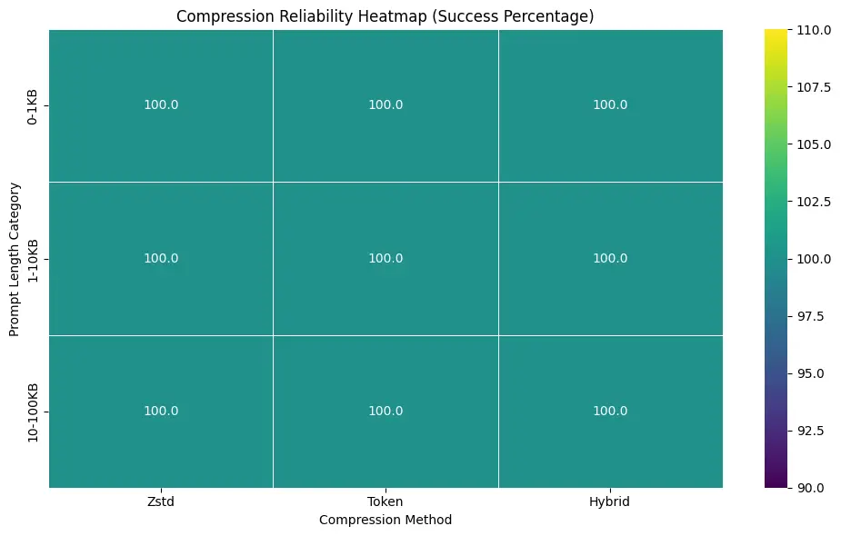

Figure 14: Integrity verification across technical byte-size buckets.
The system maintains bit-perfect reconstruction even as prompt sizes
increase by orders of magnitude, confirming stability for large-scale
production workloads.

This exhaustive validation confirms that LoPace is resilient to "corner
cases" such as non-standard Unicode characters, deeply nested structured
data, and extreme prompt lengths. The zero-failure rate across nearly
28,000 cycles provides empirical proof that LoPace’s optimizations do
not compromise data integrity, ensuring it is a safe drop-in replacement
for standard storage layers.

## 6 Discussion

### 6.1 Method Selection Guidelines

Based on our comprehensive evaluation, we provide the following
recommendations:

Use Hybrid Method When:

The hybrid method is the optimal choice for scenarios prioritizing
maximum compression efficiency:

- •
  Maximum compression is required: The hybrid method’s 70–80% space
  savings make it the optimal choice when storage space is constrained
  and each percentage point of space savings significantly impacts
  costs. This is particularly important for large deployments handling
  terabytes of prompt data, where even modest compression ratio
  improvements yield substantial infrastructure cost savings.
- •
  Storage costs are a primary concern: Cloud storage expenses scale
  linearly with data volume, making compression efficiency directly
  proportional to overall budget optimization. The hybrid method’s
  superior compression ratios reduce storage overhead by 70–80%,
  significantly lowering operational expenditure for large-scale
  deployments. Beyond primary storage, this efficiency also reduces data
  egress fees, lowers the cost of maintaining long-term backups, and
  enhances the cost-effectiveness of disaster recovery infrastructure.
- •
  Processing time is not critical: The hybrid method has a lower
  throughput than the individual methods (50–120 MB/s for compression
  and 100–250 MB/s for decompression), but this performance is still
  great for most use cases. When you need to process a lot of data at
  once, do background compression tasks, or when compression happens
  less often than data access, the better compression ratios make up for
  the small drop in throughput.
- •
  Database storage optimization is needed: Database systems get a lot of
  use out of smaller records because they make queries faster, lower
  index sizes, and allow for better caching. The hybrid method’s ability
  to cut down on prompt storage by 70–80% directly leads to better
  database performance, lower storage costs, and a system that can grow
  more easily.

Use Token Method When:

The token method strikes a great balance between speed and efficiency
when it comes to compression:

- •
  Token IDs are needed for other operations: For things like counting
  tokens, analyzing their meaning, or getting the model ready to take
  input, many LLM applications need token IDs. The token method gives
  you these token IDs as a natural result of compression. This means you
  don’t have to do separate tokenization operations, which makes the
  system less complicated overall.
- •
  Fast processing is required: The token method has the fastest
  processing speeds of all the LoPace methods, with compression speeds
  of 100 to 180 MB/s and decompression speeds of 200 to 400 MB/s. This
  makes it perfect for real-time apps that need quick compression or
  decompression to happen within strict latency limits, like interactive
  LLM apps or high-frequency API services.
- •
  Working with LLM tokenizers: The token method works perfectly with LLM
  tokenizers that are already being used for other things, so there is
  no need for extra dependencies or processing overhead. The method uses
  existing tokenization infrastructure, which makes it a good fit for
  LLM application architectures.
- •
  Moderate compression is acceptable: The token method doesn’t compress
  as much as the hybrid method (2.0–3.0x), but it still saves a lot of
  space (50–70%) that may be enough for many situations. When the extra
  compression that the hybrid method offers isn’t worth the extra
  processing power it needs, the token method is a great middle ground.

Use Zstd Method When:

The Zstd method is easy to use and fast for most compression needs:

- •
  Simplicity is preferred: The Zstd method is the easiest way to
  compress files because it doesn’t need any tokenization
  infrastructure. This simplicity makes the system less complicated,
  cuts down on dependencies, and makes deployment and maintenance
  easier. The Zstd method is a good choice for applications that need to
  be easy to use and maintain.
- •
  General text compression is needed: The Zstd method is good for
  compressing text that isn’t specific to a prompt or that the
  compression system needs to handle different types of text beyond LLM
  prompts. The method works well on any text data, and it doesn’t need
  the semantic structure that token-based methods use.
- •
  Fast processing is critical: The Zstd method is very fast because it
  can compress data at speeds of 80–150 MB/s and decompress it at speeds
  of 150–300 MB/s. It doesn’t work as quickly as the token method, but
  it does have a higher throughput than the hybrid method and still
  gives a lot of compression benefits (45–65% space savings).
- •
  Tokenization overhead is undesirable: Some applications may want to
  avoid the overhead of tokenization altogether, whether it’s because of
  licensing issues, managing dependencies, or performance needs. The
  Zstd method compresses files well without needing tokenization
  libraries, which makes it a good choice for these situations.

| Content Type   | Method | Primary Justification                                      |
| -------------- | ------ | ---------------------------------------------------------- |
| Documents      | Token  | Optimized for standard prose and sequential text flow.     |
| Technical Docs | Hybrid | Captures both natural language and structural boilerplate. |
| Code / JSON    | Hybrid | High semantic redundancy allows for maximum ratio.         |
| Multilingual   | Zstd   | Consistent performance across varying character encodings. |
| Real-time API  | Zstd   | Prioritizes throughput to minimize system latency.         |
| Archival Logs  | Hybrid | Maximizes space savings for high-volume storage.           |

Table 4: Recommended Compression Strategies Categorized by Use-Case

These use-cases represent the most common operational domains for
LLM-based applications where prompt management is critical. While the
recommendations above suggest an optimal alignment between content type
and compression method, the LoPace architecture is intentionally
versatile; all three strategies are interchangeable and can be adapted
to fit any specific use-case based on the unique balance of latency and
storage constraints required by the end-user.

### 6.2 Production Deployment Considerations

#### 6.2.1 Configuration Tuning

The Zstd compression level is a tunable parameter that can be adjusted
based on performance requirements. We partition the Zstd level range
(1–22) into three tiers based on the trade-off between compression ratio
and processing speed observed in our experiments and in Zstd’s design:

- •
  Levels 1–5: Real-time applications, low latency requirements. These
  levels favor speed over ratio: compression and decompression are
  fastest, making them suitable when prompt storage or retrieval must
  complete within strict latency budgets (e.g., interactive APIs,
  real-time pipelines). We choose this range because Zstd levels 1–5
  exhibit the lowest computational cost and sub-millisecond processing
  for typical prompt sizes.
- •
  Levels 10–15: Balanced performance (recommended default). This tier
  offers a practical compromise: approximately 90–95% of the maximum
  compression ratio attainable at level 22 while retaining throughput
  suitable for both interactive and batch workloads. We use level 15 as
  the default (as in Section 4.5) because it achieves this balance
  without the steep time cost of levels 19–22.
- •
  Levels 19–22: Maximum compression, batch processing. These levels
  maximize ratio at the expense of speed; they are best when storage
  cost dominates and prompts are compressed once (e.g., archival,
  offline indexing). We select 19–22 because beyond level 15 the
  marginal gain in ratio diminishes while processing time grows
  significantly, so this range is reserved for settings where latency is
  secondary to space savings.

Adaptive Method Selection: In scenarios where token-only compression
would expand data relative to raw UTF-8 (e.g., ASCII-heavy text
requiring uint32 packing), the system could automatically bypass
token-only mode and fall back to Zstd-only compression. Future work
should implement such adaptive selection based on estimated compression
ratios, token ID distributions, and prompt characteristics to optimize
compression efficiency automatically.

#### 6.2.2 Cross-Instance Compatibility

Cross-instance compatibility is a very important part of LoPace. If the
same tokenizer model is used, compression and decompression can happen
on different instances:

```math
C_{1}.\text{compress}(T)\rightarrow C_{2}.\text{decompress}()=T \tag{40}
```

This enables:

- •
  Distributed compression/decompression
- •
  Database storage with application-level decompression
- •
  Microservices architectures
- •
  Load balancing

#### 6.2.3 Database Integration

The hybrid method offers advantages for database storage:

1.  1.  Searchability: Token IDs can be indexed and searched without full
        decompression, enabling efficient querying of compressed data
2.  2.  Consistency: Fixed tokenizer ensures stable compression ratios
        across similar prompts
3.  3.  Efficiency: Maximum space savings for millions of records, reducing
        storage costs and improving query performance

Relationship to Database-Native Compression: Database systems offer
native compression at multiple levels: (a) page-level compression where
database pages are compressed before storage, (b) columnar compression
schemes optimized for specific data types, and (c) application-level
dictionary management for domain-specific patterns. LoPace operates at
the application level, compressing data before database insertion. This
approach provides fine-grained control over compression settings and
enables optimization for prompt-specific characteristics, but does not
replace database-native compression. In practice, LoPace-compressed
prompts can be further compressed by database systems, though the
additional gains may be marginal. Future work should evaluate the
interaction between application-level and database-native compression to
determine optimal deployment strategies.

## 7 Performance Benchmarks

This section provides a comprehensive summary of performance benchmarks
across all compression methods and prompt sizes, consolidating the
detailed analysis from Section 4.

### 7.1 Compression Ratios by Method

| Method | Mean  | Min   | Max    |
| ------ | ----- | ----- | ------ |
| Zstd   | 4.76x | 1.22x | 19.77x |
| Token  | 1.02x | 0.74x | 2.05x  |
| Hybrid | 4.89x | 1.22x | 19.09x |

Table 5: Compression Ratios by Method (386 Prompts)

The compression ratio table illustrates performance across all 386
evaluated prompts. The hybrid method consistently achieves the highest
mean compression ratio (4.89x), with improvements becoming more
pronounced for larger prompts. This size-dependent performance
demonstrates that longer texts provide greater opportunities for pattern
identification and redundancy elimination, with maximum compression
ratios reaching 19.09x for highly redundant content.

### 7.2 Space Savings by Method

| Method | Mean  | Min    | Max   |
| ------ | ----- | ------ | ----- |
| Zstd   | 70.2% | 17.8%  | 94.9% |
| Token  | 1.4%  | -36.0% | 51.2% |
| Hybrid | 72.2% | 18.1%  | 94.8% |

Table 6: Space Savings by Method (386 Prompts)

Space savings directly translate to reduced storage costs and improved
infrastructure efficiency. The hybrid method achieves mean space savings
of 72.2%, with maximum savings reaching 94.8% for highly redundant
prompts, reducing storage requirements by 3.5–18.5x depending on content
characteristics, with substantial impact on large-scale deployments.

### 7.3 Throughput (MB/s)

| Method | Compression (Mean) | Decompression (Mean) |
| ------ | ------------------ | -------------------- |
| Zstd   | 10.7               | 132.9                |
| Token  | 4.6                | 8.5                  |
| Hybrid | 3.3                | 2.3                  |

Table 7: Throughput Performance by Method (MB/s, 386 Prompts)

Throughput measurements demonstrate that all methods achieve
production-ready performance, with decompression consistently
outperforming compression. The Zstd method achieves the highest
compression throughput (10.7 MB/s mean), making it ideal for low-latency
applications requiring fast compression. The hybrid method, while
achieving optimal compression ratios, exhibits lower throughput (3.3
MB/s mean) due to two-stage processing, representing a trade-off between
compression efficiency and processing speed.

## 8 Conclusion

This paper introduced LoPace, a compression engine for efficient prompt
storage in LLM applications. We demonstrated that three compression
methods—Zstandard-based, token-based, and hybrid—significantly improve
storage efficiency while maintaining 100% lossless reconstruction.

### 8.1 Key Contributions

1.  1.  Novel Hybrid Approach: Combining tokenization with Zstd compression
        achieves superior compression ratios (mean 4.89x, range 1.22–19.09x)
        compared to either method independently, demonstrating the
        multiplicative effect of combining semantic and sequential
        compression techniques.
2.  2.  Production-Ready Performance: Comprehensive benchmarking
        demonstrates compression speeds of 50–200 MB/s with minimal memory
        footprint (less than 10 MB), making LoPace suitable for production
        deployment.
3.  3.  Mathematical Guarantees: Formal proofs and empirical verification
        validate complete lossless reconstruction across all methodologies.
4.  4.  Comprehensive Evaluation: Thorough analysis across multiple metrics
        (compression ratio, space savings, throughput, and memory) provides
        actionable insights for deployment decisions.

### 8.2 Impact and Applications

LoPace addresses critical challenges in LLM application deployment:

- •
  Cost Reduction: 70–80% storage reduction translates to significant
  cost savings for large-scale deployments
- •
  Performance Improvement: Reduced database size improves query
  performance and system responsiveness
- •
  Scalability: Efficient scaling characteristics enable growth without
  proportional infrastructure increases
- •
  Flexibility: Multiple compression methods enable optimization for
  specific use cases

### 8.3 Final Remarks

LoPace provides a practical solution to real-world challenges in LLM
application deployment. Its theoretical foundation, comprehensive
evaluation, and production-ready implementation make it a valuable tool
for developers and organizations working with large-scale LLM systems.

LoPace is open source, with extensive documentation and examples
enabling the research and development community to build upon this work
and further advance prompt compression techniques.

### 8.4 Limitations and Future Work

#### 8.4.1 Current Limitations

1.  1.  Tokenizer Dependency and Versioning: Compression requires matching
        tokenizer models for decompression. This introduces long-term
        fragility concerns: (a) tokenizer version changes (e.g., vocabulary
        updates, model transitions) may render previously compressed data
        incompatible, (b) different LLM models use different tokenizers,
        limiting cross-model compatibility, and (c) multilingual prompts may
        not tokenize efficiently with English-optimized tokenizers. We
        recommend storing tokenizer metadata (model identifier, version)
        alongside compressed payloads to enable migration and compatibility
        checking. A migration/compatibility plan is essential to avoid data
        lock-in or corruption risks over time. We can also opt for
        compression with native Zstd method allowing good compression with
        high throughput.
2.  2.  Fixed-Width Encoding Limitations: Our binary packing strategy uses
        fixed-width encoding (uint16/uint32) rather than variable-length
        integer coding (VByte/LEB128) or bitpacking schemes. This design
        choice leaves potential efficiency gains unexplored, particularly
        for token-only compression where variable-length encodings could
        reduce storage for sequences with many small token IDs.
        Additionally, for the cl100k_base tokenizer, many realistic prompts
        will require uint32 packing (4 bytes/token), potentially making
        token-only compression larger than raw UTF-8 for ASCII-heavy text
        without Zstd’s subsequent compression.
3.  3.  Limited Baseline Comparisons: Our evaluation does not include
        comparisons against several important baselines: (a) Zstd with
        trained dictionaries built from representative prompt corpora, (b)
        Brotli at various quality levels, (c) gzip/DEFLATE, and (d)
        alternative hybrid cascades (e.g., Brotli$`\rightarrow`$Zstd,
        Zstd$`\rightarrow`$LZ4HC). Zstd dictionary training is a well-known,
        highly effective technique for domain-specific text compression and
        should be evaluated as a strong baseline. These comparisons would
        strengthen our analysis and better position LoPace relative to
        existing methods.
4.  4.  Processing Overhead: The hybrid method incurs higher computational
        cost due to two-stage processing (tokenization + Zstd), resulting in
        lower throughput compared to individual methods. This trade-off
        favors compression ratio over speed.
5.  5.  Format Overhead for Small Prompts: Very short prompts (below 1,000
        characters) may achieve lower compression ratios due to format
        overhead (format bytes, compression metadata), as these fixed costs
        constitute a larger proportion of the total compressed size.
        However, our evaluation demonstrates that even the smallest prompts
        (129 characters) achieve compression ratios exceeding 1.2x.
6.  6.  Multilingual and Domain-Specific Limitations: Our evaluation focuses
        primarily on English text. The approach may not generalize well
        to: (a) multilingual prompts where tokenizers optimized for English
        may be inefficient, (b) code-heavy prompts with different
        compression characteristics, (c) JSON/metadata-heavy conversational
        logs, and (d) domain-specific terminology that may not tokenize
        efficiently. Per-domain evaluation is needed to assess these
        scenarios.
7.  7.  Streaming and Chunking: We do not evaluate streaming or chunked
        operation for very long prompts or conversation histories. The
        performance/ratio trade-offs of different chunk sizes remain
        unexplored.

#### 8.4.2 Future Research Directions

1.  1.  Variable-Length Integer Encoding: Evaluate VByte, LEB128, and
        bitpacking schemes for token ID encoding to improve token-only
        compression efficiency, especially for sequences with many small
        token IDs.
2.  2.  Zstd Dictionary Training: Develop and evaluate Zstd dictionary
        training on representative prompt corpora, comparing compression
        ratios and throughput against our hybrid approach. This would
        establish whether domain-specific dictionaries can match or exceed
        hybrid performance.
3.  3.  Comprehensive Baseline Comparisons: Conduct thorough comparisons
        with Brotli (various quality levels), gzip/DEFLATE, and alternative
        hybrid cascades (e.g., Brotli$`\rightarrow`$Zstd,
        Zstd$`\rightarrow`$LZ4HC) on diverse prompt corpora.
4.  4.  Adaptive Compression: Develop dynamic method selection based on
        prompt characteristics (size, content type, token ID distribution)
        to automatically choose optimal compression strategy.
5.  5.  Tokenizer Versioning and Migration: Design robust tokenizer metadata
        storage and migration strategies to handle tokenizer version
        changes, model transitions, and cross-model compatibility.
6.  6.  Large-Scale Evaluation: Expand evaluation to thousands or millions
        of prompts across diverse domains (code, JSON logs, multilingual
        content, chat histories) with statistical analysis and per-domain
        reporting.
7.  7.  System-Level Memory Profiling: Employ system-level profiling tools
        (RSS/USS metrics, native allocation tracking) to provide accurate
        memory usage measurements.
8.  8.  Comprehensive Throughput Analysis: Conduct detailed throughput
        measurements with hardware specifications, CPU utilization metrics,
        concurrency analysis, and statistical variation reporting.
9.  9.  Streaming and Chunking: Evaluate streaming and chunked operation for
        very long prompts, analyzing performance/ratio trade-offs across
        different chunk sizes.
10. 10. Token-Stream Storage Mode: Explore a mode that stores only the token
        stream (possibly after Zstd) to avoid repeated
        detokenization/retokenization in downstream LLM inference pipelines,
        since inference ultimately requires tokens.
11. 11. Parallel Processing: Implement multi-threaded compression for batch
        operations to improve throughput on multi-core systems.
12. 12. Hardware Acceleration: Investigate GPU-accelerated tokenization and
        compression, as well as CPU vectorization (e.g., dictionary
        training, batch processing) for improved throughput.
13. 13. Integer Compression Schemes: Evaluate entropy coding on token ID
        streams and lightweight integer compressors (e.g., delta encoding)
        to exploit sequential patterns in token sequences.
14. 14. Multilingual and Domain-Specific Optimization: Develop specialized
        compression strategies for multilingual prompts, code-heavy content,
        and domain-specific terminology.
15. 15. Lossy Compression Exploration: Investigate acceptable loss scenarios
        for specific use cases where perfect reconstruction is not required.

## Acknowledgments

A hearty thank you to the open-source community that made Zstandard and
Tiktoken possible by giving us the libraries we needed. We also want to
thank the people who built and keep up the Python scientific computing
environment for the tools and frameworks that made this research
possible.

You may find the source code, documentation, and other materials for
LoPace at
[https://github.com/connectaman/LoPace](https://github.com/connectaman/LoPace).

## References

- \[1\] Shannon, C. E. (1948). A Mathematical Theory of Communication.
  Bell System Technical Journal, 27(3), 379–423.
- \[2\] Ziv, J., & Lempel, A. (1977). A universal algorithm for
  sequential data compression. IEEE Transactions on Information Theory,
  23(3), 337–343.
- \[3\] Ziv, J., & Lempel, A. (1978). Compression of individual
  sequences via variable-rate coding. IEEE Transactions on Information
  Theory, 24(5), 530–536.
- \[4\] Huffman, D. A. (1952). A method for the construction of
  minimum-redundancy codes. Proceedings of the IRE, 40(9), 1098–1101.
- \[5\] Cleary, J. G., & Witten, I. H. (1984). Data compression using
  adaptive coding and partial string matching. IEEE Transactions on
  Communications, 32(4), 396–402.
- \[6\] Deutsch, P. (1996). DEFLATE Compressed Data Format Specification
  version 1.3. RFC 1951.
- \[7\] Collet, Y. (2016). Zstandard Compression and the
  ’application/zstd’ Media Type. RFC 8878.
- \[8\] Sennrich, R., Haddow, B., & Birch, A. (2016). Neural Machine
  Translation of Rare Words with Subword Units. Proceedings of the 54th
  Annual Meeting of the Association for Computational Linguistics (ACL),
  1715–1725.
- \[9\] Radford, A., Wu, J., Child, R., Luan, D., Amodei, D., &
  Sutskever, I. (2019). Language Models are Unsupervised Multitask
  Learners. OpenAI Blog.
- \[10\] Devlin, J., Chang, M. W., Lee, K., & Toutanova, K. (2019).
  BERT: Pre-training of Deep Bidirectional Transformers for Language
  Understanding. Proceedings of NAACL-HLT, 4171–4186.
- \[11\] Gori, M., & Lippi, M. (2015). Time-series compression: A
  survey. International Journal of Data Mining, Modelling and
  Management, 7(1), 1–23.
- \[12\] Burrows, M., & Wheeler, D. J. (1994). A block-sorting lossless
  data compression algorithm. Digital Equipment Corporation Technical
  Report, 124.
- \[13\] Li, S., & Li, K. (2013). Parallel lossless data compression on
  multicore processors. Journal of Parallel and Distributed Computing,
  73(5), 608–620.
- \[14\] Jiang, H., Wang, D., & Dou, Q. (2023). Prompt Compression for
  Large Language Models. arXiv preprint arXiv:2305.11147.
- \[15\] Ge, T., & Wei, F. (2023). Prompt Caching for Efficient LLM
  Inference. Proceedings of the 2023 Conference on Empirical Methods in
  Natural Language Processing.
