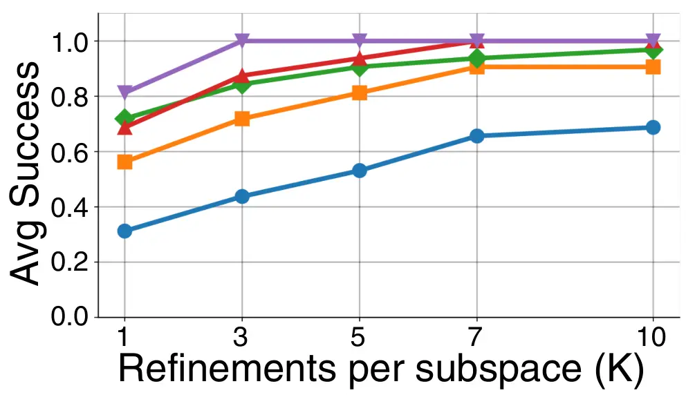
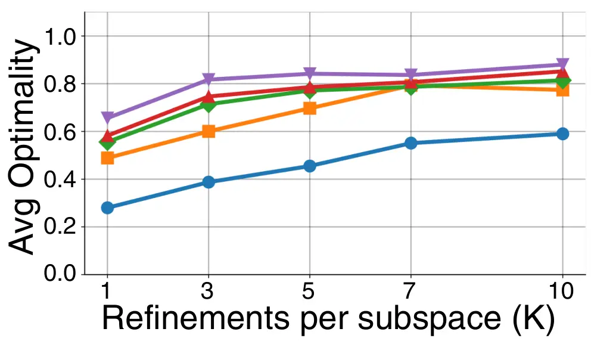
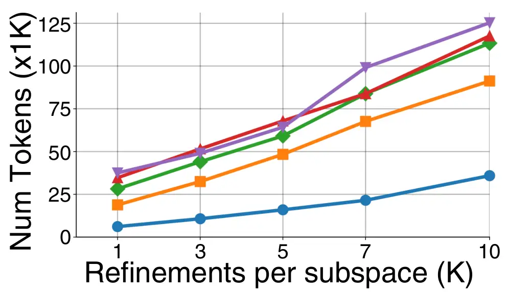
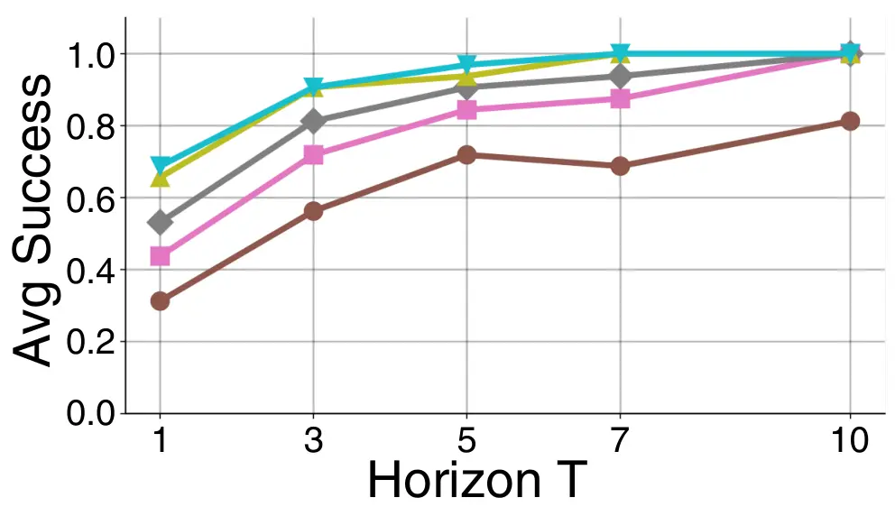
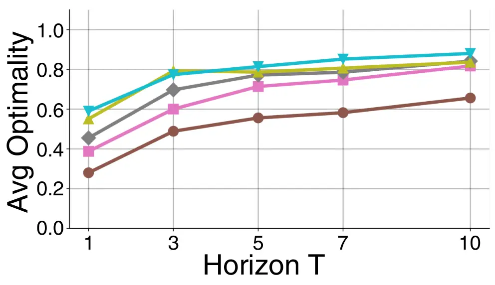
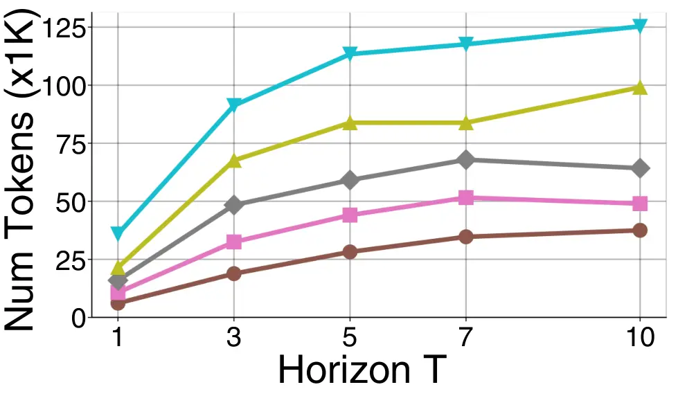

# A General LLM Framework for Query Refinement

Eldar Hacohen Affiliation: Bar-Ilan University, Ramat Gan, Israel email:
<eldar.hacohen@live.biu.ac.il> , Yuval Moskovitch
Affiliation: Ben-Gurion University of the Negev, Beer-Sheva, Israel
email: <yuvalmos@bgu.ac.il> and Amit Somech Affiliation: Bar-Ilan
University, Ramat Gan, Israel email: <somecha@cs.biu.ac.il>

###### Abstract.

Numerous studies have explored the SQL query refinement problem, where
the objective is to minimally modify an input query so that its output
satisfies a specified set of constraints. However, these works typically
target restricted classes of queries or constraints. We present
OmniTune, a general framework for refining arbitrary SQL queries using
LLM-based optimization by prompting (OPRO). OmniTune employs a two-step
OPRO scheme that explores promising refinement subspaces and samples
candidates within them, supported by concise history and skyline
summaries for effective feedback. Experiments on a comprehensive
benchmark demonstrate that OmniTune handles both previously studied
refinement tasks and more complex scenarios beyond the scope of existing
solutions.

###### Keywords: 

Query Refinement, LLM, Optimization by Prompting

## 1. Introduction

The problem of SQL query refinement has been studied in previous
work (Mishra and Koudas, 2009; Koudas et al., 2006; Muslea and Lee,
2005; Chu and Chen, 1994; Li et al., 2023a; Campbell et al., 2024a;
Shetiya et al., 2022; Moskovitch et al., 2022), with the goal of
minimally modifying a given query so that its results satisfy predefined
constraints. Early work (Mishra and Koudas, 2009), for example, focuses
on refining WHERE-clause predicates in conjunctive Select–Project–Join
(SPJ) queries to meet _cardinality_ constraints, adjusting queries that
return too few or too many tuples. More recent studies (Li et al.,
2023a; Campbell et al., 2024a; Shetiya et al., 2022) consider
constraints defined over specific subgroups in the query output.

While effective for their specific target settings, existing approaches
typically assume fixed notions of structured constraints and refinement,
and are often restricted to relatively simple query classes. For
example, Li et. al. (Li et al., 2023a) considers only SPJ queries with
cardinality constraints, the work of  (Campbell et al., 2024a) extends
this setting to SPJ with an `ORDER BY` clause and considers cardinality
constraints over subgroups within the top-$`k`$ results, and (Shetiya
et al., 2022) consider range queries and are limited to the refinement
of numerical predicates with constraint over a single binary attribute.
In practice, however, users may wish to refine a much broader range of
queries—including those with GROUP BY clauses or subqueries—and may
impose application-specific definitions of both constraints and
refinement criteria. To illustrate this gap, we next consider an example
of a group-by query refinement problem.

###### Example 1.1.

In Middle-earth, the Knightly Order plans to launch a pilot continental
scholarship program aimed at identifying and supporting young, promising
warriors. To this end, the Order tasks its chief analyst, Galadriel,
with reviewing the pool of applicants and proposing initial selection
criteria for the program’s first cycle. These criteria include: (i) a
minimum GPA threshold, (ii) an approved set of majors, and (iii) a
minimum representation quota per participating region.

Senior leadership further specifies two program-level constraints that
must be satisfied by any proposed parameterization: (1) geographic
coverage—at least eight distinct regions must be represented in the
pilot cohort; and (2) gender balance—the overall ratio of female to male
recipients should be approximately 1:1.

Galadriel examines the applications database (see Table 1 for a sample),
consisting of five attributes: ID, gender, region, major, and grade
point average (GPA). She issues an initial SQL query¹¹ 1 Note that the
function COUNT_IF is not supported in all databases, yet can be easily
implemented in native SQL: COUNT(CASE gender=F THEN 1 ELSE 0 END;)., as
depicted in Figure 1, representing an intuitively suitable criteria: GPA
threshold of 3.5, majors are Tactics and Archery, and minimum
region-quota of 100 students.

|            |            |            |            |            |
| ---------- | ---------- | ---------- | ---------- | ---------- |
| id         | gender     | region     | major      | GPA        |
| 1          | F          | Shire      | Archery    | 3.7        |
| 2          | M          | Rivendell  | Swordcraft | 3.8        |
| 3          | M          | Mordor     | Tactics    | 3.7        |
| 4          | F          | Rohan      | Melee      | 3.7        |
| 5          | M          | Erebor     | Scouting   | 3.8        |
| $`\cdots`$ | $`\cdots`$ | $`\cdots`$ | $`\cdots`$ | $`\cdots`$ |
| 9996       | F          | Rohan      | Swordcraft | 3.8        |
| 9997       | F          | Khazad-dûm | Stealth    | 3.6        |
| 9998       | M          | Lothlórien | Tactics    | 3.9        |
| 9999       | F          | Shire      | Melee      | 3.6        |
| 10000      | M          | Rohan      | Archery    | 3.5        |

Table 1. The Middle-earth Students dataset $`D`$.

|                                                           |
| --------------------------------------------------------- |
| `SELECT region, avg(GPA), COUNT_IF(gender = F), COUNT(*)` |
| `FROM MiddleEarth_Applicants`                             |
| `WHERE GPA > 3.5 AND major IN ('Tactics', 'Archery')`     |
| `GROUP BY region`                                         |
| `HAVING COUNT(*) > 100`                                   |

Figure 1. Initial Scholarship Query $`Q`$

Galadriel now examines the results (see Table 2); unfortunately, none of
the constraints are satisfied:

1.  (1)
    The initial scholarship design includes only 5 regions, fewer than
    the required 8.
2.  (2)
    The total number of female students is $`170`$, out of $`632`$ which
    is significantly below the required ratio of $`0.5`$.

Consequently, Galadriel needs to _refine_ the selection criteria in
order to meet the stated constraints. ∎

Unfortunately, even the simple query of the example above is not
supported by existing query refinement frameworks (Mishra and Koudas,
2009; Campbell et al., 2024a; Li et al., 2023a; Shetiya et al., 2022),
as none support the refinement of group-by queries with predicates in
the HAVING clause, as well as free-form constraints. Addressing this
would require formally defining the refinement problem, design a
constraint satisfaction framework, and explore adaptations of existing
solutions to support these query settings. Alternatively, refining the
query manually can be a tedious and repetitive task. To this end, we
present a general framework for SQL query refinement problems. Given a
database $`D`$ and starter query $`Q`$, as well as notions for
refinement distance and constraints (represented as Python functions),
our framework iteratively seeks a refined query that is as close as
possible to $`Q`$ while (approximately) satisfying the constraints.

Our solution builds on the optimization-by-prompting (OPRO)
paradigm (Yang et al., 2024; Chen et al., 2024), where an LLM is
iteratively prompted to propose candidate refinements based on a textual
specification of the task, a description of the search domain, and the
history of past candidates. However, as we show empirically, a direct
application of this paradigm performs poorly, due to the vast
combinatorial search space and the long, low-information interaction
histories that fail to effectively guide subsequent proposals. We
therefore design a dedicated two-step OPRO scheme for the query
refinement problem. First, the LLM selects a promising refinement
_subspace_ that aggregates many potential refinements. Then, a
subsequent LLM samples individual refinements that aim to satisfy the
constraints while minimizing the distance from $`Q`$.

We then design OmniTune, an efficient prototype system that instantiates
our query-refinement OPRO scheme in practice. OmniTune addresses several
core challenges, including representing an exponentially large space of
refinement subspaces without materialization, constructing concise,
query-dependent textual descriptions of the database and search domain,
and providing informative yet compact guidance to LLM-based optimizers.

At a high level, OmniTune operates in two phases: (1) a lightweight
pre-processing phase that derives tailored representations of the
database and refinement domain, and (2) an optimization loop that
alternates between selecting promising refinement subspaces and sampling
concrete refinement queries via two specialized LLM modules. Throughout
optimization, OmniTune maintains a skyline of candidate refinement
queries that captures the best observed trade-offs between query
distance and constraint satisfaction; this skyline serves primarily as a
multi-objective signal that guides both subspace selection and
refinement query generation, and additionally enables an effective
early-stopping mechanism when the skyline stabilizes across iterations.

Our empirical evaluation demonstrates the effectiveness of our framework
across a wide range of query refinement tasks: (i) Top-$`k`$ queries
with group-representation constraints (Campbell et al., 2024a), (ii)
range queries with group-ratio constraints (Shetiya et al., 2022), (iii)
diversity-aware SPJ queries (Li et al., 2023a), and (iv) complex queries
beyond the scope of prior dedicated approaches. We compare OmniTune
against strong state-of-the-art LLMs, including OpenAI
GPT-5.6-Luna (OpenAI, 2026) and Google Gemini 3.0 Flash-Thinking (Google
DeepMind, 2025). Our results show that OmniTune achieves performance
close to that of specialized refinement solutions on their native
problem classes, while substantially outperforming LLM-based baselines
and extending effective query refinement to previously unsupported
settings.

|            |          |                    |           |
| ---------- | -------- | ------------------ | --------- |
| region     | Avg. GPA | Count_if(gender=F) | Count(\*) |
| Rivendell  | 3.9      | 50                 | 150       |
| Gondor     | 3.7      | 33                 | 125       |
| Lothlórien | 3.8      | 32                 | 120       |
| Mordor     | 3.8      | 34                 | 135       |
| Erebor     | 3.7      | 21                 | 105       |

Table 2. Query output $`Q(D)`$

We presented an early prototype of OmniTune in (Hacohen et al., 2025),
comprising a Refinement Problem Wizard that translates natural-language
specifications into formal query refinement problems, and an early
prototype of the LLM-based solver engine. This work focuses on the
latter, which we substantially redesign, extend, and evaluate.

#### Contributions & Paper Outline

We next outline our contribution and the organization of the paper.

- •
  We formulate the General Query Refinement problem, which provides a
  unified abstraction encompassing prior refinement settings and a wide
  range of new, previously unsupported scenarios (Section 2).
- •
  We devise a dedicated LLM-based optimization-by-prompting (OPRO)
  scheme for query refinement, addressing the challenges of large,
  combinatorial refinement spaces via structured subspace selection and
  query refinement sampling (Section 3).
- •
  We design OmniTune, an end-to-end prototype instantiating our OPRO
  scheme, including query-conditioned database representations and
  skyline-based multi-objective optimization (Section 4).
- •
  We empirically evaluate OmniTune on a diverse collection of query
  refinement tasks adopted from prior work (Campbell et al., 2024a;
  Shetiya et al., 2022; Li et al., 2023a), as well as on more complex
  query patterns beyond the scope of existing solutions. The results
  show that OmniTune achieves performance close to specialized
  approaches while substantially outperforming strong LLM baselines
  (Section 5).

We survey related work in Section 6 and conclude in Section 7.

## 2. Preliminaries and Problem Definition

In this section, we provide an overview of the General Query Refinement
problem. Notations are summarized in Table 3.

#### Refinable predicates, supported queries.

We build on the widely-accepted notion of query refinement first
introduced in (Mishra and Koudas, 2009). Given a query $`Q`$ over a
dataset $`D`$, a refinement of $`Q`$ modifies one or more of its
_refinable_ predicates. We call a predicate in an SQL query _refinable_
if it is of the form $`\langle A~\mathsf{op}~C\rangle`$, where $`A`$ is
an attribute in $`D`$, $`\mathsf{op}`$ is a comparison operator, and
$`C`$ is a literal constant. The attribute $`A`$ may be either a _base_
(schema-native) attribute or a _derived_ attribute, such as one obtained
via aggregation or column-wise computation. If $`A`$ is _numeric_, then
$`\mathsf{op}\in\{<,\leq,=,\geq,>\}`$ and $`C\in\mathbb{R}`$. If $`A`$
is _categorical_, then $`\mathsf{op}=\mathsf{IN}`$ and $`C`$ denotes a
set of categorical values, such that $`C\subseteq\text{Dom}(A)`$, where
$`\text{Dom}(A)`$ is the set of distinct values appearing in column
$`D(A)`$. We consider general SQL queries containing `WHERE` and/or
`HAVING` clauses, with at least one refinable predicate. Let
$`Preds(Q)`$ denote the set of all refinable predicates in a
query $`Q`$. For each predicate $`p\in Preds(Q)`$, we write $`p.A`$,
$`p.\mathsf{op}`$, and $`p.C`$ to denote its attribute, operator, and
literal(s), respectively.

###### Example 2.1.

Consider again the dataset $`D`$ shown in Table 1 and the query $`Q`$ in
Figure 1. The set of refinable predicates in $`Q`$ consists of three
predicates. The first two appear in the `WHERE` clause:
$`p_{1}=\langle\texttt{GPA}~>3.5\rangle`$ and
$`p_{2}=\langle\texttt{major}~\mathsf{IN}~\{\texttt{Tactics},\texttt{Archery}\}\rangle`$.
The third predicate appears in the `HAVING` clause and is given by
$`p_{3}=\langle\texttt{COUNT(*)}~>100\rangle`$. ∎

#### Query refinement assignment

Following (Mishra and Koudas, 2009), a valid refinement consists of
modifying the literal(s) in $`p.C`$ for any predicate $`p\in Preds(Q)`$.
For predicates over numerical attributes, refinement is performed by
directly altering the value in $`p.C`$, whereas for categorical
predicates, refinement is achieved by adding to or removing items from
the set specified by $`p.C`$.

A _refinement assignment_ is denoted by
$`\theta=\{\theta.p\mid p\in Preds(Q)\}`$, where each component
$`\theta.p`$ specifies a (possibly unchanged) refined literal
$`p.C^{\prime}`$ for predicate $`p`$. We denote by $`Q_{\theta}`$ the
refined query obtained by applying assignment $`\theta`$ to $`Q`$, and
by $`\theta_{0}`$ the baseline assignment, corresponding to the original
query, that is, $`\theta_{0}.p=p.C`$ for all $`p\in Preds(Q)`$.

###### Example 2.2.

Consider again the database $`D`$ and query $`Q`$, as depicted in
Table 1 and Figure 1 (resp.). The baseline assignment
$`\theta_{0}=\{3.5,(\texttt{Tactics},\texttt{Archery}),100\}`$,
corresponding to the original query $`Q`$. A possible refinement
assignment is $`\theta^{\prime}=\{3.6,(\texttt{Tactics}),80\}`$, which
represents the following refined query $`Q_{\theta^{\prime}}`$
(modifications in bold):

```ltx_verbatim
    SELECT region, AVG(GPA), COUNT_IF(gender = F), count(*)
    FROM MiddleEarth_Applicants
    WHERE GPA > 3.6 AND major IN (’Tactics’)
    GROUP BY region
    HAVING COUNT(*) > 80 ∎
```

In the remainder of the paper, we use ’refinement’ to denote both the
assignment $`\theta`$ and the resulting query $`Q_{\theta}`$
interchangeably. We further denote the set of all possible assignments
for $`Q`$ by $`\mathcal{S}(Q)`$.

#### Query output constraints

Expanding the line of work on query refinement for output constraint
satisfaction (Campbell et al., 2024a; Shetiya et al., 2022; Campbell
et al., 2024b; Li et al., 2023a; Li et al., 2023b), we consider general
constraints over the output. Since achieving perfect satisfaction may be
infeasible (Campbell et al., 2024a), we adopt the notion of satisfaction
deviation, relax the goal of exact satisfaction, and allow for
approximate satisfaction. To this end, we define the output constraints
as a function that measures the degree of violation of a query’s result
with respect to the constraints for a given database.

###### Definition 2.3 (Constraint deviation function).

Given a refinement assignment $`\theta`$, a constraints deviation
function $`\psi:\mathcal{S}(Q)\to[0,1]`$ depicts the degree of violation
of the output of the refined query $`Q_{\theta}(D)`$. Given a tolerance
$`\varepsilon\in[0,1)`$, we say that an assignment $`\theta`$ is
$`\varepsilon`$-satisfying, if $`\psi(\theta)\leq\varepsilon`$.

By formulating constraints as functions, we enable the expression of any
general constraint on the query output $`Q(D)`$.

###### Example 2.4.

Recall the constraints specified in Example 1.1: (i) A $`1`$:$`1`$
female-to-male ratio; and (ii) At least $`8`$ distinct regions are
represented. We first define a deviation function for the geographic
coverage constraint. This function counts the number of regions returned
by $`Q_{\theta}(D)`$ and returns the normalized slack when fewer than
$`8`$ regions are selected, and $`0`$ otherwise:

```math
f^{1}(\theta)=\begin{cases}\dfrac{8-|Q_{\theta}(D)|}{8},&\text{if }|Q_{\theta}(D)|<8,\\
0,&\text{otherwise.}\end{cases}
```

The gender-balance deviation is measured by the (normalized) distance of
the fraction of female students from the desired value $`1/2`$,
aggregated across all regions:

```math
f^{2}(\theta)=2\cdot\left|\frac{\text{SUM(\#Female) in }Q_{\theta}(D)}{\text{SUM(Count(*)) in }Q_{\theta}(D)}-\frac{1}{2}\right|.
```

Using $`f^{1}`$ and $`f^{2}`$, we define the overall constraint
deviation function $`\psi`$ as their average:

```math
\psi(\theta)=\tfrac{1}{2}\bigl(f^{1}(\theta)+f^{2}(\theta)\bigr).
```

Consider again the baseline assignment $`\theta_{0}`$ corresponding to
the original query $`Q`$ (Figure 1) and its output $`Q(D)`$, shown in
Table 2. The query result contains $`5`$ distinct regions, and the ratio
of female students among all selected students is $`0.267`$. Therefore,

```math
\psi(\theta_{0})=\tfrac{1}{2}\left(\tfrac{8-5}{8}+2\cdot|0.267-0.5|\right)=\tfrac{1}{2}(0.375+0.466)=0.421.
```

If $`\varepsilon`$ is set to $`0.1`$, then $`\theta_{0}`$ is not
$`\varepsilon`$-satisfying. ∎

In our solution, as described in Section 3, the constraint deviation
function is provided to OmniTune as a Python code (see examples in our
Github repository (Github, 2026)). To facilitate the specification of
such functions, in (Hacohen et al., 2025), we presented a user-friendly
Wizard that translates natural-language specifications into formal query
refinement problems.

#### Refinement distance

The query refinement problem aims to make _minimal_ modifications to the
query to satisfy the constraints. Minimality may be defined in various
ways, such as based on the set of output tuples of the queries (Shetiya
et al., 2022; Campbell et al., 2024a), known as outcome-based
distance (Campbell et al., 2024a), or by the semantic distance in query
predicates (Li et al., 2023a; Campbell et al., 2024a), referred to as
predicate-based distance (Campbell et al., 2024a). It may also involve a
combination of both approaches. To keep our framework general, we use a
refinement distance function
$`\Delta_{\theta_{0},D}:\mathcal{S}(Q)\to\mathbb{R}_{\geq 0}`$ that,
given a refinement $`\theta\in\mathcal{S}(Q)`$, returns a value in
$`\mathbb{R}_{\geq 0}`$ that reflects the distance of $`\theta`$ from
$`\theta_{0}`$ (possibly with respect to $`D`$, as in (Shetiya et al.,
2022)). For brevity, when unambiguous, we write $`\Delta(\theta)`$ in
place of $`\Delta_{\theta_{0},D}(\theta)`$.

###### Example 2.5.

An example refinement distance function supported in OmniTune is the
predicate-based distance defined in (Campbell et al., 2024a), where the
distance is measured with respect to each refinable predicate in the
query. For a numerical predicate, the distance is defined as
$`\frac{|p.C-p.C^{\prime}|}{p.C}`$, where $`p.C^{\prime}`$ is the
constant value of the predicate $`p`$ in the refined query. The
difference is normalized to show deviation from the original value of
$`p`$. For categorical attributes, the distance is measured using
Jaccard distance over the sets $`p.C`$ and $`p.C^{\prime}`$. The overall
distance is then the sum of the per-predicate distance over all the
refinable attributes. Consider again the refinement assignment
$`\theta^{\prime}=\{3.6,[\texttt{Tactics}],80\}`$ and the baseline
assignment
$`\theta_{0}=\{3.5,[\texttt{Tactics},\texttt{Archery}],100\}`$,
described in Example 2.2. Using a predicate-based
$`\Delta(\theta^{\prime})`$ we obtain

```math
\Delta(\theta^{\prime})=\frac{|3.6-3.5|}{3.5}+\big(1-\frac{1}{2}\big)+\frac{|100-80|}{100}=0.029+0.5+0.2=0.729
```

We are now ready to formally define the General Query Refinement
problem.

###### Problem 1 (General Query Refinement).

Given a database $`D`$, a query $`Q`$ with baseline assignment
$`\theta_{0}`$, a constraint-deviation function $`\psi`$ with tolerance
threshold $`\varepsilon`$, and a query distance measure
$`\Delta_{\theta_{0},D}`$, we define an optimal refinement, denoted
$`\theta^{*}`$, as:

```math
\theta^{*}\;=\;\argmin_{\theta\in\mathcal{S}(Q)\,:\,\psi(\theta)\leq\varepsilon}\Delta_{\theta_{0},D}(\theta).
```

As discussed above, our formulation subsumes a wide range of prior work
(e.g., (Campbell et al., 2024a; Shetiya et al., 2022; Li et al.,
2023a)), each of which addresses a restricted variant of the problem
(see Section 6), while also enabling many previously unsupported cases
involving arbitrary constraints, refinement distance measures, and query
types. We refer to a specific instantiation of the problem as a tuple

```math
\mathcal{QRP}=\langle Q,D,\psi,\varepsilon,\Delta\rangle
```

We next present an OPRO scheme for solving any instance of the General
Query Refinement problem, followed by the OmniTune architecture that
instantiates this approach. As shown in our experimental evaluation, our
approach achieves performance close to problem-specific solutions, while
naturally extending to a much broader class of instances covered by the
general formulation.

## 3. OPRO Scheme for Query Refinement

Our solution builds on the optimization-by-prompting (OPRO)
paradigm (Yang et al., 2024; Chen et al., 2024), a recent and promising
approach for general black-box optimization. In OPRO, an LLM-based agent
is given a natural-language specification of the objective and search
domain, and iteratively proposes candidate solutions. Each selection is
conditioned on the full interaction history, enabling the agent to adapt
its decisions based on previously explored candidates and their
evaluated outcomes.

We next describe a naïve, straightforward instantiation of the OPRO
paradigm, followed by our dedicated, two-step OPRO scheme for the
General Query Refinement problem.

#### Naïve OPRO for Query Refinement

Given an instance of the query refinement problem
$`\mathcal{QRP}=\langle Q,D,\psi,\varepsilon,\Delta\rangle`$, the naïve
approach repeatedly prompts the LLM to modify the query $`Q`$ so as to
produce an optimal refinement assignment $`\theta^{*}`$. For a fixed
horizon of $`T`$ iterations, at each iteration $`1\leq t\leq T`$, the
LLM is asked to generate a new candidate refinement assignment
$`\theta_{t}`$, while being provided with the complete interaction
history of prior attempts, including both distance and
constraint-deviation scores, namely,

```math
\left\{\langle\theta_{t^{\prime}},\Delta(\theta_{t^{\prime}}),\psi(\theta_{t^{\prime}})\rangle\right\}_{t^{\prime}=1}^{t^{\prime}<t}.
```

However, as demonstrated in our experimental evaluation (Section 5),
this naïve OPRO approach is largely ineffective. The underlying reasons
are twofold: (i) the combinatorial size of the refinement search space,
and (ii) the growing history of previous attempts, which, when presented
in raw form, provides limited informative signal to guide subsequent
refinements.

We therefore propose a two-step OPRO scheme. In the first step, the
agent selects a promising refinement _subspace_ that contains multiple
candidate assignments. In the second step, the agent samples individual
assignments from the selected subspace with the goal of identifying
$`\varepsilon`$-satisfying refinements that minimize the query distance
from the original query $`Q`$. We next formally define refinement
subspaces and then present our OPRO scheme.

|                                                |                                                                      |
| ---------------------------------------------- | -------------------------------------------------------------------- |
| Notation                                       | Description                                                          |
| $`D;A;D(A)`$                                   | Database; Attribute; Column (att. $`A`$ projected on $`D`$).         |
| $`Q;Q(D)`$                                     | Query; Query results over $`D`$.                                     |
| $`Preds(Q)`$                                   | The set of refinable predicates in $`Q`$.                            |
| $`p=\langle p.A,p.op,p.C\rangle`$              | Attribute, operator and constant of predicate $`p`$.                 |
| $`\text{Dom}(A)`$                              | Set of all distinct values in column $`D(A)`$.                       |
| $`\theta;~\theta_{0}`$                         | A refinement assignment for $`Q`$; Baseline assignment.              |
| $`\theta^{*}`$                                 | A minimal-distance $`\varepsilon`$-satisfying refinement assignment. |
| $`\mathcal{S(Q)}`$                             | The space of all individual assignments for query $`Q`$.             |
| $`\Theta`$; $`\mathcal{S^{+}}(Q)`$             | Refinement subspace; Domain of all subspaces for $`Q`$.              |
| $`\psi,\varepsilon`$                           | Output constraints deviation function, tolerance thresh.             |
| $`\Delta_{\theta_{0}}`$ (or simply $`\Delta`$) | Refinement distance function.                                        |
| $`T`$; $`K`$                                   | Horizon (# of iterations); \# of samples per iteration.              |
| $`\mathcal{H}`$; $`\mathcal{H}_{t}`$           | Refinement history; History at iteration $`t`$.                      |
| $`\mathcal{H}[\Theta_{t}]`$                    | Local refinements history within subspace $`\Theta_{t}`$.            |

Table 3. Notations Summary

#### Refinement Subspace

A refinement subspace, denoted $`\Theta`$, defines a range of
assignments, by restricting the admissible values for each predicate in
$`Preds(Q)`$. For predicates with numerical attributes, this restriction
takes the form of an interval over the value domain, while for
categorical attributes it is defined using set inclusion, following the
partial-order formulation of (Rathke, 2025).

###### Definition 3.1 (Refinement Subspace).

Given a query $`Q`$ and database $`D`$, a refinement subspace is a
collection $`\Theta\;=\;\{\Theta.p\mid p\in\texttt{Preds}(Q)\},`$ where
each component $`\Theta.p`$ constrains the admissible values for
$`p.C`$. For numerical attributes, $`\Theta.p`$ is an interval contained
in $`\bigl[\min(\text{Dom}(p.A)),\max(\text{Dom}(p.A))\bigr]`$. For
categorical attributes, $`\Theta.p`$ is a set-inclusion range
$`[C_{\min},C_{\max}]`$ with
$`C_{\min}\subseteq C_{\max}\subseteq\text{Dom}(p.A)`$.

An assignment $`\theta`$ is _compatible_ with a subspace $`\Theta`$,
denoted by $`\theta\in\Theta`$, if it assigns to each predicate a value
that lies within the range permitted by that subspace. Namely,
$`\theta\in\Theta\iff\theta.p\in\Theta.p\quad\forall p\in Preds(Q)`$.

###### Example 3.2.

Recall again from our running example, $`Preds(Q)`$ contains three
predicates over the GPA, major, and COUNT(\*) attributes of query $`Q`$
(see Figure 1). In Example 2.2 we examine two refinement assignments:
$`\theta_{0}=\{3.5,(\texttt{Tactics},\texttt{Archery}),100\}`$, and
$`\theta^{\prime}=\{3.6,(\texttt{Tactics}),80\}`$.

Now, let us consider the following refinement subspace:

```math
\Theta=\{[3.4,3.7],[(\texttt{Tactics}),(\texttt{Tactics},\texttt{Melee},\texttt{{Stealth}})],[70,120]\}
```

See that $`\theta^{\prime}\in\Theta`$, as $`3.5\in[3.4,3.7]`$,
$`(\texttt{Tactics})\in`$ $`[(\texttt{Tactics})`$,
$`(\texttt{Tactics},\texttt{Melee},\texttt{{Stealth}})]`$, and
$`80\in[70,120]`$; whereas $`\theta_{0}\notin\Theta`$ because
$`(\texttt{Tactics},\texttt{Archery})\nsubseteq(\texttt{Tactics},\texttt{Melee},\texttt{{Stealth}})`$.
∎

We denote the set of all possible refinements subspaces for query $`Q`$
by $`\mathcal{S^{+}}(Q)`$.

Input: Query refinement instance
$`\mathcal{QRP}=\langle Q,D,\psi,\varepsilon,\Delta\rangle`$; Refinement
subspaces domain $`\mathcal{S^{+}}(Q)`$; horizon $`T`$; samples per
iteration $`K`$

Output: $`\varepsilon`$-satisfying assignment $`\theta`$ with min.
refinement distance

1 $`\mathcal{H}\leftarrow\emptyset`$ // Initialize refinement history

2 $`SAT\leftarrow\emptyset`$ // Initialize constraint-satisfying set

3 for _$`t=1`$ to $`T`$_ do

     4
$`\Theta_{t}\leftarrow\mathcal{M}^{s}(\mathcal{S}(Q),\mathcal{H})`$ //
Suggest subspace

     5 if _$`\Theta_{t}\notin\mathcal{H}`$_ then

         6 $`\mathcal{H}[\Theta_{t}]\leftarrow\emptyset`$ // Initialize
subspace-specific history

     7 for _$`k=1`$ to $`K`$_ do

         8
$`\theta_{k}\leftarrow\mathcal{M}^{a}(\Theta_{t},\mathcal{H}[\Theta_{t}])`$
// Suggest refinement

         9 for _$`\Theta\in\mathcal{H}`$_ do // Update history

             10 if _$`\theta_{k}\in\Theta`$_ then

                 11
$`\mathcal{H}[\Theta]\leftarrow\mathcal{H}[\Theta]\cup\{\theta_{k}\!:\!(\Delta(\theta_{k})),\psi(\theta_{k})\}`$

         12 if _$`\psi(\theta_{k})\leq\varepsilon`$_ then // If
constraints are met

             13 $`SAT\leftarrow SAT\cup\{\theta_{k}\}`$

14 return $`\argmin_{\theta\in SAT}\Delta(\theta)`$

Algorithm 1 Two-Step OPRO Scheme for Query Refinement

Building on the definition of refinement subspaces, we devise an OPRO
scheme for the query refinement problem. Our two-step OPRO scheme is
depicted in Algorithm 1. We next describe the inputs and algorithm
steps:

Figure 2. OmniTune Workflow & Architecture

Inputs. The system takes as input: (1) an instance of the General Query
Refinement problem
$`\mathcal{QRP}=\langle Q,D,\psi,\varepsilon,\Delta\rangle`$; (2) the
set $`\mathcal{S^{+}}(Q)`$, representing the domain of all refinement
subspaces (we describe below how a concise textual representation of
$`\mathcal{S^{+}}(Q)`$ is constructed without explicitly materializing
it); and (3) the horizon $`T`$, specifying the maximum number of
iterations, and the number of assignments sampled from each subspace
$`K`$, as detailed below.

Initialization & History Management. As mentioned above, in our
iterative OPRO scheme, we keep the history of previously chosen
assignments. We use a key-value structure, denoted $`\mathcal{H}`$
(Line 1), in which the keys are unique subspaces
$`\Theta_{0},\Theta_{1},\dots`$; and the values are lists of all
individual assignments examined thus far, that are compatible with each
$`\Theta\in\mathcal{H}`$, along with their distance and satisfaction
values. Namely,
$`\mathcal{H}[\Theta]=\{\langle\theta,\Delta(\theta),\psi(\theta)\rangle\mid\theta\in\Theta\}`$.
We also initialize the set $`SAT`$ (Line 1), which will contain all
$`\varepsilon`$-satisfying assignments, throughout the optimization
process.

Subspace-Selection Step (LLM Call \#1). At each iteration $`t`$, we
abstractly model the first step as an LLM call that selects the next
_refinement subspace_ $`\Theta_{t}\in\mathcal{S^{+}}(Q)`$. This call,
denoted $`\mathcal{M}^{s}`$, takes as input the optimization history
$`\mathcal{H}`$ (Line 1) and outputs a candidate subspace
$`\Theta_{t}`$. In Section 4, we detail how this abstract call is
instantiated in OmniTune by the SubspaceLM module, which provides the
LLM with a concise, textual representation for $`\mathcal{S^{+}}(Q)`$
and $`\mathcal{H}`$.

Assignment-Sampling Step (LLM Call \#2). Given the selected subspace
$`\Theta_{t}`$, we issue $`K`$ consecutive LLM calls that sample
_individual_ refinement assignments
$`\{\theta_{k}\in\Theta_{t}\}_{k=1}^{K}`$. We denote this abstract LLM
call by $`\mathcal{M}^{a}`$ (Line 1), where each call is conditioned on
the subspace-specific history $`\mathcal{H}[\Theta_{t}]`$, which
contains assignments previously sampled from $`\Theta_{t}`$. In
OmniTune, this call is instantiated by the AssignmentLM module
(Section 4). After each call, the global history $`\mathcal{H}`$ is
updated, such that each previously generated subspace
$`\Theta\in\mathcal{H}`$ is appended with the currently sampled
assignment $`\theta_{k}`$ whenever $`\theta_{k}\in\Theta`$ (Lines 1–1).
Any $`\theta_{k}`$ that is $`\varepsilon`$-satisfying is appended to
$`SAT`$ (Lines 1–1).

Termination & Return value. Finally, after $`T`$ iterations, we return
the set of $`\varepsilon`$-satisfying assignments stored in $`SAT`$ that
attain the minimum query distance from the baseline assignment
$`\theta_{0}`$ (Line 1).

We next describe the architecture of OmniTune, designed in accordance
with Algorithm 1. The architecture incorporates several key components,
including concise yet effective textual representations of $`D`$ and
$`\mathcal{S^{+}}(Q)`$, mechanisms for summarizing subspace-history
information $`\mathcal{H}[\Theta_{t}]`$, skyline-based objective
definitions for realistic optimization, and an early-stopping mechanism.

## 4. OmniTune Architecture

We designed OmniTune, an efficient system that implements the two-step
OPRO scheme for query refinement, as described above. OmniTune overcomes
numerous challenges, such as producing concise textual representations
for the database $`D`$, subspace domain $`\mathcal{S^{+}}(Q)`$, and
history $`\mathcal{H}`$, as well as introducing realistic objectives for
the LLM calls, and early stopping mechanisms.

#### Formulating the refinement problem

OmniTune receives the constraint-deviation function $`\psi`$ and the
refinement distance $`\Delta`$ as executable Python code (Section 2).
Importantly, users need not write this code themselves: the Refinement
Problem Wizard of our prototype (Hacohen et al., 2025) lets them load a
database, enter the query $`Q`$, and describe the constraints in natural
language. An LLM then generates $`\psi`$ via in-context learning, given
the schema of $`D`$, the query $`Q`$, and implementation guidelines and
examples (e.g., an output range of $`[0,1]`$, normalized across
constraints); the generated code can be further edited by the user. For
$`\Delta`$, users select a predicate-based or an outcome-based distance,
or describe a custom one in natural language. The Wizard code is
available in our repository (Github, 2026).

#### Workflow Overview

Figure 2 illustrates the overall architecture and execution flow of
OmniTune. Given a query refinement problem instance
$`\mathcal{QRP}=\langle Q,D,\psi,\varepsilon,\Delta\rangle`$, OmniTune
operates in two main phases. In the _pre-processing_ phase, OmniTune
constructs concise yet informative textual representations of the
database $`D`$, tailored to the input query $`Q`$, as well as a
representation of the refinement subspace domain $`\mathcal{S^{+}}(Q)`$,
which serves as the search space for subspace generation. In the
_optimization loop_ phase, OmniTune iteratively issues LLM calls via two
specialized modules, in accordance with Algorithm 1: The SubspaceLM
module generates a candidate refinement subspace $`\Theta_{t}`$, while
the AssignmentLM module samples individual refinement assignments from
$`\Theta_{t}`$. To guide this process, OmniTune maintains a compact
summary of the interaction history $`\mathcal{H}`$, which provides the
SubspaceLM with high-level statistics over previously explored subspaces
$`\{\Theta_{t^{\prime}}\mid t^{\prime}<t\}`$. In addition, both modules
are guided by skyline-based objectives derived from the set of
previously observed assignments. Intuitively, the skyline maintains a
set of high-quality assignments that represent the best trade-offs
observed so far between query distance and constraint satisfaction.

Finally, OmniTune employs a skyline-based early-stopping mechanism that
directly builds on this trade-off view: when the skyline remains
unchanged for several consecutive iterations, indicating that no new
assignment improves the current trade-offs between distance and
satisfaction, the system halts and returns the best assignment found so
far. We next elaborate on each part of the system. We start with the
preprocessing phase and then describe in detail the optimization loop
modules. For output examples, see Figure 4; the full prompt scheme is
available in our repository (Github, 2026).

Figure 3. Prompts Formulation

### 4.1. Pre-processing phase

As mentioned above, in this phase, given the problem instance
$`\mathcal{QRP}=\langle Q,D,\psi,\varepsilon,\Delta\rangle`$, we first
generate a concise description of the database $`D`$ and refinement
subspace domain $`\mathcal{S^{+}}(Q)`$:

1. $`Q`$-driven Database description. Producing an effective and concise
   database schema description is a well-recognized challenge in LLM-based
   data management tasks, including text-to-SQL (Trummer, 2024; Kim et al.,
   2020), LLM-based schema matching (Liu et al., 2025), and LLM-driven BI
   and analytics (Jiang et al., 2025). Overly long or exhaustive
   descriptions often degrade LLM performance (see, e.g., the context rot
   problem (Levy et al., 2024)), motivating the need for concise and
   focused task descriptions.

To that end, rather than providing an exhaustive description of the
entire database $`D`$, we derive a concise, query-conditioned
representation tailored to the given query refinement instance. This
representation includes only the tables and attributes that appear in
the query $`Q`$. Specifically, for each table referenced in $`Q`$, we
describe its primary and foreign keys, as well as the names and data
types of the attributes used in $`Q`$. In addition, we provide summary
statistics for each such attribute: for numeric columns, the mean,
standard deviation, and quartile values; and for categorical columns,
the prevalence of each category. Figure 4(a) shows examples of the
textual representations used by OmniTune.

2. Description of the Subspace Domain $`\mathcal{S^{+}}(Q)`$. The goal
   in this component is to provide the SubspaceLM module with a compact yet
   expressive description of the refinement subspace domain
   $`\mathcal{S^{+}}(Q)`$, from which refinement subspaces $`\Theta_{t}`$
   can be generated. Explicitly materializing $`\mathcal{S^{+}}(Q)`$ is
   infeasible, as it contains all possible combinations of per-predicate
   value ranges and would far exceed the context limitations of current
   LLMs. Instead, we construct a concise characterization of
   $`\mathcal{S^{+}}(Q)`$ by specifying, for each refinable predicate
   $`p\in Preds(Q)`$, the admissible range of values for $`p.C`$. For _base
   attributes_ appearing directly in the database $`D`$, this process is
   straightforward: for numerical attributes, we compute the minimum and
   maximum values observed in the data, and for categorical attributes, we
   provide the set of distinct values. However, handling _derived_ or
   _computed_ attributes—such as those appearing in a HAVING clause—poses a
   greater challenge.

To address this case, we employ an LLM-assisted approach in which the
model is prompted to generate auxiliary SQL queries that compute the
minimum and maximum values of each derived field. For example, in our
running scenario (Example 2.2), where the HAVING clause includes the
refinable predicate COUNT(\*) \> 100, the LLM produces the following
query:

```ltx_verbatim
    SELECT MIN(size), MAX(size)
    FROM (SELECT COUNT(*) AS size
          FROM MiddleEarth_Applicants
          GROUP BY region)

```

Figure 4(b) shows an example representation of $`\mathcal{S^{+}}(Q)`$;
the exact prompt is available in our repository (Github, 2026).

```ltx_verbatim
{ "table":"MiddleEarth_Applicants","primary_key":"id",
  "attributes":{
    "GPA":{"type":"float","domain":[2.0,4.0],
        "stats":{"mean":3.12,"std":0.41,
        "q1":2.85,"median":3.10,"q3":3.40}},
    ...
    "gender":{"type":"category","domain":["F","M"],
      "stats":{"distribution":[{"value":"F","p":0.46},
                               {"value":"M","p":0.54}]}}}
```

(a) $`Q`$-driven Database Schema Description.

```ltx_verbatim
[{"attribute": "gpa",
    "value_range": {"min_val":2, "max_val":4}},
 { "attribute": "major",
   "value_range": {"min_val":[], "max_val":
        [Archery, Melee, Spearmanship, Tactics,
        Camouflage, Scouting, Swordship, Horsemanship]}},
 { "attribute": "COUNT(*)",
   "value_range": {"min_val":34, "max_val":452}}]
```

(b) Subspaces Domain Definition $`\mathcal{S^{+}}(Q)`$

```ltx_verbatim
[{ "assignment_id:1, "vals":{3.7,"(Tactics,Archery)",90},
      "dev":0.49, "dist":0.20 },
 { "assignment_id:7, "vals":{3.6,"(Tactics,Archery)",80},
      "dev":0.24, "dist":0.23 },
  ...
 { "assignment_id:13, "vals":{3.9,"(Tactics,Melee)",100},
      "dev":0.20, "dist":0.57 }]
```

(c) Skyline Set $`\mathsf{Sky}(\mathcal{H})`$.

```ltx_verbatim
[{ "subspace_id":1,
    "subspace":{"gpa":[3.4,3.8],
                "major":["Tactics","Archery"],
                "Count(*)":[60,90]},
    "history_size":5,
    "stats":{"deviation":{"med":.49,"std":.25},
            "distance":{"med":.20,"std":.03}} },
 { "subspace_id":2, ...]
```

(d) Subspace-level History Summary.

Figure 4. Example textual representations of OmniTune objects

### 4.2. Optimization loop, prompt formulations

In accordance with Algorithm 1, the main optimization loop runs for a
horizon of $`T`$ iterations. At each iteration $`t`$, OmniTune invokes
the SubspaceLM module to generate a refinement subspace $`\Theta_{t}`$,
and then issues $`K`$ calls to the AssignmentLM module to sample
individual assignments from $`\Theta_{t}`$, while maintaining the
interaction history $`\mathcal{H}`$. We next describe the SubspaceLM and
AssignmentLM modules, with a focus on the formulation of their
respective prompts (see Figure 3 for illustration). In particular, we
introduce two techniques that substantially enhance optimization
performance, as demonstrated in our experimental evaluation (Section 5):
(i) a skyline-based objective, used in place of naïve instructions to
generate the “best” subspace or assignment; and (ii) a concise,
subspace-level summary of the history $`\mathcal{H}`$, employed by the
SubspaceLM module. In (Github, 2026), we provide the exact prompt
templates, as well as numerous example workflows of OmniTune.

#### Shared information

The following items are included in both the SubspaceLM and AssignmentLM
prompts:

1. Description of the instance. We begin with a brief, task-agnostic
   overview of the query refinement problem, then describe the input
   instance $`\langle Q,D,\psi,\varepsilon,\Delta\rangle`$ as follows: The
   $`Q`$-derived representation of the database $`D`$, as described above,
   together with the query $`Q`$ itself. In addition, the distance function
   $`\Delta`$ and the constraint-deviation function $`\psi`$ are provided
   as executable Python code. Code-based representations are widely
   regarded as particularly effective for LLM-based reasoning and
   instruction following (Chen et al., 2023b).

2. Skyline-based Objectives. Prior work has shown that clear,
   context-rich instructions can substantially improve zero-shot LLM
   performance across domains (e.g., (Sivarajkumar et al., 2024;
   Sumanathilaka et al., 2024)). However, in our setting, naively prompting
   an LLM to generate an “optimal” refinement subspace $`\Theta_{t}`$ or
   assignment $`\theta_{k}`$ proves ineffective (see Section 5).

Existing OPRO solutions (Yang et al., 2024) typically instruct the LLM,
at each iteration, to surpass the “best” solution obtained so far with
respect to a single objective. In contrast, our setting is inherently
multi-objective, as assignments must be $`\varepsilon`$-satisfying
w.r.t. $`\psi`$ while simultaneously minimizing the distance $`\Delta`$.
To this end, we devise a skyline-based objective.

Intuitively, a skyline (Borzsony et al., 2001) captures the set of
“best” assignments by retaining only those for which no other assignment
achieves both a smaller query distance $`\Delta(\theta)`$ and a strictly
better constraint deviation $`\psi(\theta)`$. In our setting, all
$`\varepsilon`$-satisfying assignments are treated as equivalent with
respect to constraint satisfaction, which we capture via the
constraints-threshold deviation function

```math
\psi_{\varepsilon}(\theta)\triangleq\min\{\psi(\theta),~\varepsilon\}
```

An assignment $`\theta\in\mathcal{H}`$ is said to belong to the skyline
set, denoted $`\theta\in\mathsf{Sky}(\mathcal{H})`$, if and only if it
is not dominated by any other assignment
$`\theta^{\prime}\in\mathcal{H}`$, that is,

```math
\displaystyle\theta\in\mathsf{Sky}(\mathcal{H})\Leftrightarrow\nexists\,\theta^{\prime}\in\mathcal{H}: \displaystyle\Big(\big(\Delta(\theta^{\prime})<\Delta(\theta)\land\psi_{\varepsilon}(\theta^{\prime})\leq\psi_{\varepsilon}(\theta)\big)
```

```math
\displaystyle\lor\big(\psi_{\varepsilon}(\theta^{\prime})<\psi_{\varepsilon}(\theta)\land\Delta(\theta^{\prime})\leq\Delta(\theta)\big)\Big)
```

Figure 4(c) present an example of the skyline set
$`\mathsf{Sky}(\mathcal{H})`$ representation in OmniTune

#### The SubspaceLM prompt (LLM Call \#1).

Given the problem instance description and the current skyline, as
introduced above, the LLM is instructed to propose a refinement subspace
likely to yield assignments that may improve the skyline. Rather than
providing the full interaction history $`\mathcal{H}`$, we supply a
concise yet informative _subspace-level_ summary. Specifically, for each
previously explored subspace $`\Theta_{t^{\prime}}`$ with
$`t^{\prime}<t`$, we present aggregate statistics over the assignments
sampled from that subspace, as recorded in
$`\mathcal{H}[\Theta_{t^{\prime}}]`$, including the total number of
sampled assignments, as well as the median and standard deviation of
their distance and constraint-deviation scores. An example of the
representation is given in Figure 4(d).

#### AssignmentLM Prompt (LLM Call \#2).

Given the refinement subspace $`\Theta_{t}`$ selected by the SubspaceLM
module, the AssignmentLM is invoked $`K`$ times to generate individual
assignments $`\theta_{k}`$ that are likely to improve the current
skyline $`\mathsf{Sky}(\mathcal{H}_{t})`$ where $`\mathcal{H}_{t}`$ is
the history $`\mathcal{H}`$ at iteration $`t`$. As in the
subspace-generation step, providing the full history $`\mathcal{H}`$ is
unnecessary; instead, the prompt includes only the subspace-specific
history $`\mathcal{H}[\Theta_{t}]`$, containing assignments previously
sampled from the current subspace.

#### Early stopping criteria

Finally, we introduce an early-stopping mechanism (Prechelt, 2002) based
on the skyline set $`\mathsf{Sky}(\mathcal{H})`$ defined above, which
allows OmniTune to terminate the optimization process before reaching
the full horizon $`T`$, thereby reducing LLM token consumption. At
iteration $`t`$, OmniTune halts if:

```math
\mathsf{Sky}(\mathcal{H}_{t})=\mathsf{Sky}(\mathcal{H}_{t-u})
```

That is, if the skyline set remains unchanged for $`u`$ consecutive
iterations. Intuitively, this condition indicates that the system has
failed to identify a new assignment that dominates previously observed
ones with respect to both refinement distance $`\Delta`$ and constraint
satisfaction $`\psi`$. In such cases, OmniTune terminates and returns
the $`\varepsilon`$-satisfying assignment in $`\mathit{SAT}`$ with
minimum distance from the baseline assignment (see Line 1 in
Algorithm 1). In our implementation, we set $`u=2`$.

## 5. Experimental Setup and Evaluation

|                                    |                                                                                                        |
| ---------------------------------- | ------------------------------------------------------------------------------------------------------ |
| Class                              | Databases Used                                                                                         |
| Top-$`k`$ (Campbell et al., 2024a) | Astronauts (ast, 2016), Law Students (law, 2022), MEPS (mep, 2016), TPC-H (tpc, 2019)                  |
| Range (Shetiya et al., 2022)       | Texas Tribune (tex, 2022), COMPAS (com, 2017), Housing Prices (hou, 2021), Fraud Detection (fra, 2024) |
| Diversity (Li et al., 2023a)       | Healthcare (hea, 2021), ACSIncome (aci, 2018), COMPAS, Students (stu, 2018)                            |
| Complex (new)                      | Law Students, Texas Tribune, TPC-H                                                                     |

Figure 4. Datasets used per instance class

We performed an experimental analysis of our proposed solution using a
dedicated benchmark composed of real-life datasets and realistic
scenarios, using the queries and constraints from prior work. We first
examine OmniTune’s ability to produce refinements and the quality of
those refinements, comparing results across different baselines. We
measured the quality of the resulting refinement with respect to
refinements produced by a task-specific dedicated solution for the
instance class (i.e., (Campbell et al., 2024a) for top-$`k`$ instances,
(Li et al., 2023a) for diversity, and (Shetiya et al., 2022) for range).
We conduct an ablation study to evaluate the impact of our two-step OPRO
scheme and the history representation component used in our system
implementation on the resulting refinements. We then present an
assessment of the effect of the horizon ($`T`$) and the number of
refinements per subspace ($`K`$) on the quality of the resulting
refinement and the token costs of generating it. Finally, to demonstrate
the usefulness of OmniTune, we present three case studies of complex
refining instances that are not supported by existing solutions.

### 5.1. Experimental Setup

#### Implementation

OmniTune is implemented in Python 3 and uses DuckDB(DuckDB, nd). The
structural prompt verification utilizes the Pydantic Python
implementation (pyd, 2024). The SubspaceLM and AssignmentLM components
are built into LangChain (lan, 2023) and support various LLM provider
APIs. Across all experiments, the decoding parameters were fixed to
temperature $`=0`$ and top-$`p=0`$. All experiments were run on a
24-core CPU server. The code and data are provided in (Github, 2026). As
default setting, we set the horizon $`T`$ and the number of refinements
per iteration $`K`$ to $`5`$, early stopping criterion $`u=2`$, and use
GPT-5.6-Luna.

#### Benchmark.

To evaluate OmniTune, we constructed a unified benchmark of General
Query Refinement instances. Each instance comprises a dataset, a query,
a constraint function along with a tolerance value, and a distance
function. The benchmark encompasses $`32`$ instances utilizing $`11`$
real-world datasets of varying sizes and attribute dimensions, including
adaptations of instances used in prior works (Campbell et al., 2024a; Li
et al., 2023a; Shetiya et al., 2022). In particular, we consider $`4`$
instance classes: (1) Top-$`k`$ queries as presented in (Campbell
et al., 2024a) with constraint representation over the representation of
different groups in the top-$`k`$ results, (2) Range (Shetiya et al., 2022) queries with constraint over the ratio of data groups in the
output, (3) Diversity in the output of SPJ queries as was studied in (Li
et al., 2023a), and (4) Complex queries derived from each of the
datasets using LLMs, and not supported by previous works. The benchmark
includes eight instances per class. For the instance classes (1)-(3), we
used queries, constraints, and distance functions as defined in the
corresponding prior work, with the addition of four new instances for
the Range class and two additional instances to the Diversity class.
Table 4 depicts the dataset used for each instance class, and their full
description is available in (Github, 2026).

(a) Top-$`k`$ Instances

(b) Range Instances

(c) Diversity Instances

(d) Complex Instances

(e) Top-$`k`$ Instances - Optimality

(f) Range Instances

(g) Diversity Instances

(h) Complex Instances

Figure 5. Comparison of OmniTune and baselines across instance classes.
Top: success rate; bottom: optimality. Base (blue) and Thinking (orange)
denote the basic and reasoning LLM baselines; green denotes OmniTune
using the Base model. The dashed black line denotes random sampling, and
colored lines denote task-specific methods (Campbell et al., 2024b;
Shetiya et al., 2022; Li et al., 2023b), which define the optimality
reference of $`1.0`$ for the top-k, range, and diversity classes
(Complex instances are unsupported by prior work).

#### Evaluation Metrics.

We evaluated the performance of the proposed solution using two
criteria: _success rate_ and _optimality_. The _success rate_ measures
the number of tasks we were able to obtain a refinement that
$`\varepsilon`$-satisfies the constraints function. For each successful
execution, we measure the _optimality_ of the resulting refinement
$`\theta`$ with respect to the resulting refinement $`\theta_{opt}`$
produced by a task-specific dedicated solution for the instance class
(i.e., (Campbell et al., 2024a) for top-$`k`$ instances, (Li et al.,
2023a) for diversity and (Shetiya et al., 2022) for range). The
optimality metric is defined as

```math
\mathrm{Opt}(\theta)=\frac{\Delta_{\max}-\Delta(\theta)}{\Delta_{\max}-\Delta(\theta_{opt})}
```

where $`\Delta_{\max}`$ is the max possible distance value for the given
$`\Delta`$ (e.g., $`1`$ for Jaccard-based distance function, or the
$`|Preds(Q)|`$ for predicate-based distances) and is used to normalize
the result. Since there is no dedicated solution that can handle
instances in the Complex class, we set $`\Delta(\theta_{opt})`$ to $`0`$
for these instances, which provides a lower bound on the possible
distance value. Each experiment was repeated $`5`$ times, and we report
the success rate and maximal $`\mathrm{Opt}`$ score across runs; average
results show similar trends and are reported in Appendix B.

#### Baselines

Our implementation of OmniTune interacts with LLMs via a standard API,
making it compatible with any general-purpose model. To evaluate the
performance of OmniTune, we used three lightweight, general-purpose
LLMs:

- •
  ChatGPT Base OpenAI GPT-5.6-Luna low (OpenAI, 2026)
- •
  Gemini Base Google Gemini 3.0 Flash (Google DeepMind, 2025)
- •
  Mistral Base Mistral 3.1 Small 24B-Instruct (Mistral-AI et al., 2025)

To the best of our knowledge, there is no existing solution that can
handle the General Query Refinement problem. As our framework utilizes
LLMs, they serve as a natural baseline for performance comparison. To
this end, we considered the above lightweight, general-purpose LLMs,
which we used as part of OmniTune, as standalone baseline solutions.
Additionally, as our framework performs iterative multi-step
computation, we further considered models that implement explicit
chain-of-thought or multi-stage reasoning pipelines internally. To this
end, we used

- •
  ChatGPT Thinking OpenAI GPT-5.6-Luna high (OpenAI, 2026)
- •
  Gemini Thinking Google Gemini 3 Flash-Thinking (Google DeepMind, 2025)
- •
  Mistral Thinking Mistral Magistral Small-Thinking (Mistral-AI et al., 2025)

Both the Base and Thinking LLMs, were presented with $`\mathcal{QRP}`$
(using the same representation as in OmniTune), and asked to refine the
query $`Q`$. At each iteration, we also provided the history of previous
outputs. The models were stopped after $`T\cdot K`$ iterations (25), yet
all terminated earlier, due to the limit of their context. See (Github, 2026) for the full implementation details of these baselines. In
addition to the LLM-based baselines, we implemented a sampling-based
baseline, which is given the search-space ranges for each of the
refineable predicates and randomly samples $`100`$ assignments uniformly
from the given ranges. The $`\varepsilon`$-satisfying assignment
$`\theta`$ (if such a refinement exists) with minimal $`\Delta`$ is
returned.

### 5.2. Success rates and optimality

The first set of experiments aims to evaluate the success rates and
optimality scores of our solution compared with baseline approaches.
Figure 5 depicts the success rate and optimality, respectively, for all
instances and baselines. The lightweight, general-purpose LLMs are
denoted as Base (blue bars), multi-stage reasoning models are denoted as
Thinking (orange bars), and the performance of OmniTune is shown in
green. Each category on the $`x`$-axis represents a model family, e.g.,
in the ChatGPT cluster group in Figure 5(a), the success rate of OpenAI
GPT-5.6-Luna low is shown in blue, OpenAI GPT-5.6-Luna high in orange,
and the success rate of OmniTune using GPT-5.6-Luna low is shown in
green. The success rate of the sampling-based baseline solution is shown
as a dashed line.

As shown in Figures 5(a) – 5(d), OmniTune outperforms the baselines in
nearly all settings (matching Gemini Base on Range). Averaged over the
four instance classes, OmniTune achieves a success rate of $`97.5\%`$
when using ChatGPT (the strongest model) and $`100\%`$ when using
Mistral (the weakest model), compared to $`65.0\%`$ and $`78.1\%`$ for
the ChatGPT Base and Thinking baselines, and $`31.3\%`$ and $`21.9\%`$
for the Mistral ones. With Gemini, OmniTune reaches $`88.1\%`$, compared
to $`67.5\%`$ and $`61.3\%`$. The gain is most striking for the weakest
model: OmniTune improves Mistral’s success rate by more than $`3\times`$
over its Base baseline ($`31.3\%`$ to $`100\%`$) and $`4.6\times`$ over
its Thinking baseline ($`21.9\%`$ to $`100\%`$), indicating that
OmniTune’s structure can compensate for limited model capability. For
reference, random sampling averages $`56.3\%`$, outperforming both
Mistral baselines.

In terms of optimality, as with the success rate, OmniTune outperforms
the competitors in nearly all settings. The observed average optimality
across the three LLM families generated by OmniTune achieves $`85.5\%`$,
compared with $`47.4\%`$ for the Base competitor and $`48.6\%`$ for the
Thinking competitor. These correspond to relative improvements of
$`80.4\%`$ and $`75.8\%`$, respectively. Per model, OmniTune achieves
$`87.9\%`$ with ChatGPT (compared to $`71.9\%`$ and $`77.2\%`$ for its
Base and Thinking baselines), $`78.7\%`$ with Gemini ($`47.6\%`$ and
$`49.7\%`$), and $`89.9\%`$ with Mistral ($`22.7\%`$ and $`19.0\%`$),
i.e., an improvement of $`4.0\times`$ and $`4.7\times`$ for the weakest
model. Random sampling averages $`30.5\%`$, above both Mistral
baselines.

|                           |                                        |                  |       |           |         |                           |       |           |         |
| ------------------------- | -------------------------------------- | ---------------- | ----- | --------- | ------- | ------------------------- | ----- | --------- | ------- |
|                           |                                        | Success Rate (%) |       |           |         | Refinement Optimality (%) |       |           |         |
| Model                     | Setting                                | Top-K            | Range | Diversity | Complex | Top-K                     | Range | Diversity | Complex |
| GPT-5.6-Luna (low effort) | Single-Step OPRO (W/O SubspaceLM)      | 95.0             | 85.0  | 97.5      | 95.0    | 79.09                     | 68.18 | 96.84     | 90.24   |
|                           | SubspaceLM + Random (W/O AssignmentLM) | 25.0             | 95.0  | 77.5      | 85.0    | 22.94                     | 65.78 | 93.18     | 80.50   |
|                           | OmniTune (SubspaceLM+AssignmentLM)     | 95.0             | 100.0 | 97.5      | 97.5    | 92.68                     | 69.72 | 98.09     | 91.12   |
| Gemini-3.0-Flash          | Single-Step OPRO (W/O SubspaceLM)      | 67.5             | 90.0  | 95.0      | 87.50   | 55.55                     | 66.81 | 94.40     | 89.45   |
|                           | SubspaceLM + Random (W/O AssignmentLM) | 67.5             | 87.5  | 75.0      | 95.0    | 57.09                     | 46.63 | 67.16     | 84.65   |
|                           | OmniTune (SubspaceLM+AssignmentLM)     | 70.0             | 90.0  | 97.5      | 95.0    | 57.27                     | 67.32 | 96.76     | 93.41   |
| Mistral-Small-3.1-24B     | Single-Step OPRO (W/O SubspaceLM)      | 62.5             | 87.5  | 37.5      | 100.0   | 48.63                     | 63.07 | 34.59     | 85.55   |
|                           | SubspaceLM + Random (W/O AssignmentLM) | 100.0            | 100.0 | 75.0      | 87.5    | 77.50                     | 63.10 | 67.74     | 63.29   |
|                           | OmniTune (SubspaceLM+AssignmentLM)     | 100.0            | 100.0 | 100.0     | 100.0   | 91.06                     | 87.43 | 95.27     | 85.78   |

Table 5. Two-step OPRO scheme ablation Study: Success Rate and
Refinement Optimality.

|                       |                                  |                  |       |           |         |                           |       |           |         |
| --------------------- | -------------------------------- | ---------------- | ----- | --------- | ------- | ------------------------- | ----- | --------- | ------- |
|                       |                                  | Success Rate (%) |       |           |         | Refinement Optimality (%) |       |           |         |
| Model                 | Setting                          | Top-K            | Range | Diversity | Complex | Top-K                     | Range | Diversity | Complex |
| GPT-5.6-Luna          | Complete History (W/O Skyline)   | 50.0             | 85.0  | 45.0      | 90.0    | 40.76                     | 63.07 | 61.09     | 73.78   |
|                       | Summarized History (W/O Skyline) | 90.0             | 87.5  | 92.5      | 97.5    | 76.48                     | 64.08 | 94.60     | 88.97   |
|                       | OmniTune (Summ. History+Skyline) | 95.0             | 100.0 | 97.5      | 97.5    | 92.68                     | 69.72 | 98.09     | 91.12   |
| Gemini-3.0-Flash      | Complete History (W/O Skyline)   | 32.5             | 82.5  | 27.5      | 87.5    | 28.95                     | 57.21 | 36.65     | 54.01   |
|                       | Summarized History (W/O Skyline) | 65.0             | 87.5  | 92.5      | 90.0    | 42.94                     | 59.11 | 94.97     | 63.77   |
|                       | OmniTune (Summ. History+Skyline) | 70.0             | 90.0  | 97.5      | 95.0    | 57.27                     | 67.32 | 96.76     | 93.41   |
| Mistral-Small-3.1-24B | Complete History (W/O Skyline)   | 62.5             | 87.5  | 75.0      | 75.0    | 33.51                     | 60.79 | 67.98     | 64.35   |
|                       | Summarized History (W/O Skyline) | 100.0            | 75.0  | 62.5      | 87.5    | 91.00                     | 49.67 | 57.49     | 69.26   |
|                       | OmniTune (Summ. History+Skyline) | 100.0            | 100.0 | 100.0     | 100.0   | 91.06                     | 87.43 | 95.27     | 85.78   |

Table 6. History Structures Ablation Study: Success Rate and Refinement
Optimality.

### 5.3. Ablation Study

The second set of experiments evaluates the usefulness of components in
the OPRO scheme as well as the OmniTune system.

#### Ablation for the two-step OPRO scheme

To evaluate the effectiveness of the two-step OPRO scheme, we compared
the performance of OmniTune to two variants of the system:

1.  (1)
    _Single-Step OPRO (W/O SubspaceLM)_, which omits subspace selection,
    forcing the AssignmentLM to explore the full refinement space
    $`\mathcal{S}(Q)`$. This corresponds to a naïve instantiation of the
    OPRO paradigm.
2.  (2)
    _SubspaceLM + Random (W/O AssignmentLM)_. In this variant of the
    system, the SubspaceLM agent generates subspaces, and the
    AssignmentLM is replaced with a simple random sampling process that
    selects five random refinements from the subspace.

The success rate and the optimality values of the generated refinements
are presented in Table 5. The results highlight the need for both
AssignmentLM and SubspaceLM. In particular, we observed a substantial
drop in performance for the Single-Step OPRO variant, with up to a
$`62.5\%`$ decrease in success rate and a $`60.7\%`$ decrease in
optimality values for the Diversity instances when using the Mistral
model, reflecting the difficulty of unguided exploration in large
refinement spaces. Similarly, the SubspaceLM + Random variant achieves
lower success scores than the full system in all but one case.

#### Ablation for OmniTune history component implementation

The second ablation study focused on the effect of the history
representation component presented in Section  4 on the performance of
OmniTune. In particular, we aim to study the advantage of using the
skyline component of OmniTune. We therefore considered the following
alternative representation of the history:

1.  (1)
    _Complete History, W/O Skyline_, feeds the full raw conversation
    history of the LLM at every iteration and disables the skyline
    component concatenated to the AssignmentLM’s prompt.
2.  (2)
    _Summarized History, W/O Skyline_, utilizes history-summarization
    instead of the full conversation log, with skyline tracking by the
    AssignmentLM disabled.

Table 6 presents the success rates and optimality values. Across all
models and refinement classes, the complete OmniTune (with both history
summarization and the skyline), achieves the highest scores,
demonstrating the importance of these components. We observed an average
improvement of $`42.6\%`$ in success rate when using OmniTune compared
to the complete history and without the skyline component, with a most
prominent improvement of $`3.5\times`$ (from $`27.5\%`$ to $`97.5\%`$)
for Gemini, in the Diversity class.



(a) Success rate



(b) Optimality Score



(c) Token Cost

Figure 6. Success rate, Optimality score and Token-cost as a function of
refinement per subspace $`K`$



(a) Success Rate



(b) Optimality Score



(c) Token Cost

Figure 7. Success rate, Optimality score and Token-cost as a function of
the number of subspaces $`T`$.

### 5.4. Effect of Parameters

Next, we analyze the impact of the horizon $`T`$ and per-subspace
refinements $`K`$ on success rate, optimality, and token cost.

#### Refinements per Iteration ($`K`$)

Figure 6 shows the success rates, optimality values, and token cost,
respectively, when ranging $`K`$ from $`1`$ to $`10`$ using different
(fixed) numbers of subspaces: ($`T\in\{1,3,5,7,10\}`$). We report the
average over all considered instance classes; for per-instance results,
refer to Appendix C. As expected, we observed an overall improvement in
the success rates and optimality values with the cost of a growing
amount of tokens sent to the LLM model as $`K`$ increases. In
Figure 6(a), we see a notable convergence of success rate for $`K>5`$, a
saturation that is achieved earlier as horizon $`T`$ grows larger,
starting from $`T=3`$. Moreover, we note that for any horizon
$`T\geq 5`$, the increase in success rate for any value of $`K>5`$ is
negligible. A similar pattern can be seen for the measures of average
optimality in Figure 6(b). This pattern suggests that, when the horizon
$`T>1`$, the resulting optimality and success diminish when the number
of refinements crosses the value of $`K=5`$. The observed token cost
(Figure 6(c)) showed, as expected, consistent, linear growth in tokens
used as $`K`$ increases, for all different values of horizon $`T`$.

#### Horizon ($`T`$)

Figure 7 shows the effect of varying the horizon $`T`$ for different
(fixed) numbers of refinements per iteration ($`K\in\{1,3,5,7,10\}`$).
Consistent with the impact of increasing $`K`$ as described above, when
increasing $`T`$, the overall trend is growth in both the quality of the
solution (success rate and optimality values) as well as the token cost.
As with $`K`$, we observed a diminishing improvement in the success rate
(Figure 7(a)) and optimality (Figure 7(b)) beyond the point of $`T=5`$
when using $`5`$ or more refinements per iteration. In contrast to the
linear growth observed in the token cost when increasing $`K`$, we
observed only a moderate growth for increasing values of $`T`$
(Figure 7(c)). This is due to the effect of a higher number of
refinements per subspace, leading to faster convergence in finding the
minimal refinement. Thus, coupled with the early stopping mechanism, the
system requires fewer subspace iterations to yield a successful
refinement and terminate. For a per-instance analysis see Appendix C.


### 5.5. Use cases

Prior query-refinement methods (Campbell et al., 2024a; Li et al.,
2023a; Shetiya et al., 2022) are restricted in the queries and
constraints they can support, leaving many practically important
analytical scenarios unaddressed. To demonstrate the usefulness of
OmniTune, we present three real-life use cases of previously unsupported
settings, including HAVING-clause predicates, nested subqueries,
window-function filters, and output-level constraints defined over
cross-attribute statistics. A summary of the use cases is presented in
Table 7. For a detailed description of each setting, refer to
Appendix A; all additional material is available in our GitHub
repository (Github, 2026). In all cases, we use the predicate-based
refinement distance described in Example 2.5.

[TABLE]

Table 7. Summary of real-world use cases. The queries are represented in
a compact way; the original query values are presented in red, and the
refined query values are in green.

#### Case Study 1: Value-Based Customer Segmentation (Olist (Olist, 2018)).

The Olist (Olist, 2018) dataset is a publicly available Brazilian
e-commerce dataset of orders placed at Olist Store²² 2
[https://www.olist.com/](https://www.olist.com/). An e-commerce
analytics team wants to identify customer segments with frequent
purchases and high average order value for targeted campaigns. For this
purpose, they formulate a query that groups transactions by product
category and customer, requiring at least $`6`$ purchases and an average
order value between $`\$300`$ and $`\$800`$ (Query 1 in Table 7). Senior
management requires the result to comply with the following
company-level constraints: (1) having at least $`4`$ product segments
and a (2) cross-segment average order value of at least $`\$500`$. The
results of the query on the Olist dataset do not meet these constraints:
it returns only two segments, with a cross-segment average order value
of $`\$385`$. OmniTune suggests refining the threshold for required
purchases to 3 and adjusting the allowed range for average order value
to between $`\$400`$ and $`\$900`$. The resulting refined query
satisfies both constraints, as it contains $`4`$ qualifying segments
with a cross-segment average order value of $`\$540`$.

#### Case Study 2: Diversified City-Level Housing Investment.

A real estate investment firm plans to construct an acquisition
portfolio under a cost-per-square-foot budget. To this end, they use the
HomesForSale dataset (RealEstateDataset.com, 2024), an open U.S.
real-estate listings dataset and formulate a query that selects
single-family rental (sfr) and condo candidate properties with area at
or above $`1500`$ square-foot, while from cities with at least $`20`$
overall properties for sale, and average price of at most $`750`$k
(Query 2 in Table 7). To ensure geographic diversification while
maintaining cost efficiency, they require the result to comply with the
following constraints: (1) cover at least six different cities and (2)
maintain an average cost per square foot of at most $`\$520`$. The
results of the original query fails to satisfy the required constraints,
yielding properties from only three cities, with average price per
square foot of $`\$548`$. OmniTune refines the query to include
townhouse properties, sets the minimal area to $`1400`$ and refines the
retained city criteria by reducing required property count to $`15`$ and
maximal average price to $`820`$k. The output of the resulting query
satisfies the constraints, yielding candidates from six cities and
reducing the average price per square foot to $`\$509`$.

#### Case Study 3: Pay-Equity Analysis Across Ethnic Groups.

A public-sector analytics team seeks to compare compensation across
ethnic groups while excluding noisy salary anomalies. To this end, they
formulate a query on the Texas Tribune salary dataset (tex, 2022) that
filters employees by minimum weekly work-hours and annual salary
thresholds, computes PERCENT_RANK() within each ethnicity, and retains
only employees whose salaries fall between the 40th and 90th
percentiles, before aggregating by ethnicity (Query 3 in Table 7).
Senior management requires the result to comply with the following
pay-equity constraints: (1) each ethnic group must have a total monthly
payroll of at least $`3.5`$M, and (2) the ratio between the maximum and
minimum group-average annual salaries must be at most $`1.15`$. After
executing the query on the Texas Tribune dataset, the team finds the
result does not meet these constraints: the minimum group payroll is
only $`2.0`$M, and the max/min salary ratio is $`1.65`$. The team
therefore provides the query and constraints to OmniTune, which
minimally refines the percentile bounds from $`[0.40,0.90]`$ to
$`[0.30,0.92]`$, while refining the work-hours threshold from $`40`$ to
$`25`$ and the annual salary threshold from $`50`$k to $`48`$k. The
refined query satisfies both constraints, with minimum group payroll of
$`3.55M`$ and max/min average-salary ratio of $`1.11`$

In all three cases, OmniTune finds a constraint-satisfying refinement
after 1-2 iterations. These examples show that OmniTune can successfully
refine realistic analytical queries involving HAVING predicates, nested
subqueries, and window-based filters. For full refinement traces and
additional details, refer to Appendix A.

## 6. Related Work

We first survey the space of query refinement research, and then discuss
related work on LLMs for SQL query generation and black-box
optimization.

Query refinement. The problem of query refinement, i.e., modifying
queries to satisfy some output constraints, was studied in a line of
work (Mishra and Koudas, 2009; Koudas et al., 2006; Muslea and Lee,
2005; Chu and Chen, 1994; Tran and Chan, 2010; Tran et al., 2009; Li
et al., 2023a; Campbell et al., 2024a; Shetiya et al., 2022; Li et al.,
2023b; Campbell et al., 2024b; Moskovitch et al., 2022). For example, a
subset of works (Muslea and Lee, 2005; Koudas et al., 2006) aim to relax
queries with an empty result set to produce some answers. Other
works (Mishra and Koudas, 2009; Chu and Chen, 1994) address the issues
of too many or too few answers by refining queries to meet specific
cardinality constraints on the result’s size. A recent line of work has
studied the use of refinement to satisfy diversity constraints (Li
et al., 2023a; Campbell et al., 2024a; Shetiya et al., 2022; Li et al.,
2023b; Campbell et al., 2024b) and primarily focused on SPJ queries,
where a refinement of a query is a set of modifications to the constants
in the WHERE clause. The authors of Shetiya et al. (Shetiya et al., 2022) consider range queries, namely, selection queries with conjunction
of range conditions over predicates of the data, and Campbell et
al. (Campbell et al., 2024a; Campbell et al., 2024b) proposed an
automated approach using linear optimization techniques to refine SPJ
queries with an ORDER BY clause. Different notions of similarity
measures used to define the minimality of refinements were defined in
these works. E.g., in Shetiya et al. (Shetiya et al., 2022), the
similarity between queries is measured by the Jaccard similarity of
their outputs, whereas Li at al. (Li et al., 2023a; Li et al., 2023b)
defines the similarity between queries with respect to the values of the
constants in their WHERE clause. Our proposed solution generalizes the
concept of query refinements to support a broader class of queries,
constraints, and similarity measures. Imposing constraints over answer
sets and performing query relaxation has also been studied in the
context of package queries (Brucato et al., 2016; Brucato et al., 2014).
However, because package queries are not standard SQL, supporting them
was outside the scope of this paper.

LLMs for SQL Generation. Recent work has demonstrated that large
language models (LLMs) achieve state-of-the-art performance on the
text-to-SQL task (Gao et al., 2024; Yu et al., 2018b), in which users
express their information needs in natural language and the system
generates a SQL query whose execution answers those needs (Kim et al.,
2020; Zhang et al., 2025). LLM-based solutions surpass earlier dedicated
architectures (Yu et al., 2018a; Guo et al., 2019), primarily due to
their strong semantic reasoning capabilities, which enable them to
jointly interpret underspecified user intent and database schemas.
Accordingly, most text-to-SQL systems are designed around single-pass
query synthesis pipelines, commonly emphasizing schema linking (Li
et al., 2023c; from ACL Anthology, 2025; Wang et al., 2025),
clause-level SQL generation (Lee, 2019), and execution-based validation
mechanisms (Yang et al., 2025) that are primarily used to detect and
correct syntactic errors or mismatches with the database schema.

In contrast, our setting considers a substantially different problem.
Rather than generating a SQL query from a natural language description,
the model is given an existing query and is tasked with refining it so
as to satisfy a set of constraints while minimizing deviation from the
original query. This refinement process inherently requires iterative
reasoning over query modifications, explicit trade-offs between
competing objectives, and feedback from previous attempts, which goes
beyond execution-based correctness checks and fundamentally differs from
the one-shot generation paradigm underlying most text-to-SQL approaches.

Black-Box and LLM-Based Optimization. In contrast to _white-box_
optimization, where the objective function and constraints are
explicitly specified and structurally accessible to the solver,
_black-box_ optimization treats the objective function as an oracle that
can only be evaluated at sampled points, without access to its internal
structure. Representative approaches include Monte-Carlo sampling,
multi-armed bandits, evolutionary algorithms, and related
population-based methods (Kirkpatrick et al., 1983; Kennedy and
Eberhart, 1995; Hansen and Ostermeier, 2001; Coulom, 2006; van Reiß,
2018). While broadly applicable, these methods rely on the ability to
meaningfully sample the search space and learn solely from observed
objective values, often requiring extensive exploration and struggling
in large, discrete, or highly discontinuous domains.

Recently, large language models have been proposed as optimization
engines in settings where both the search space and the objective can be
expressed in natural language. Prior work shows that LLMs can optimize
prompts, heuristics, and symbolic programs—through iterative
prompting (Meyerson et al., 2023; Chen et al., 2022; Chen et al., 2023a;
Lehman et al., 2022; Yang et al., 2024). However, existing OPRO-style
approaches degrade in large, discrete, and combinatorial domains, where
naïve candidate generation and unstructured interaction histories
provide weak guidance and limit scalability (Yang et al., 2024; Zhang
et al., 2024).

To address these limitations, we build on the OPRO framework and
introduce a dedicated two-step scheme for query refinement, explicitly
structuring both the refinement search space and the optimization
feedback to guide LLMs more effectively.

## 7. Conclusion

We presented OmniTune, a general framework for SQL query refinement that
seeks refinements minimizing distance to an original query while
approximately satisfying user-defined constraints. Our approach adapts
the OPRO paradigm to query refinement via a dedicated two-step scheme
that combines structured subspace exploration with focused refinement
sampling, guided by compact history summarization and skyline-based
feedback. An extensive empirical evaluation demonstrates that OmniTune
is effective and robust across a broad range of existing and novel query
refinement scenarios beyond the scope of prior solutions.

In future work, we plan to further enhance the OPRO scheme and the
OmniTune design, for example by incorporating skyline-aware
exploration–exploitation strategies and extending the LLM modules into
agentic components capable of issuing and analyzing auxiliary analytical
queries.

## Artifacts

The source code of OmniTune, the benchmark (datasets, queries,
constraint and distance functions), and scripts reproducing all
experiments are publicly available at
[https://github.com/analysis-bots/OmniTune](https://github.com/analysis-bots/OmniTune),
with instructions for running them via Docker or locally in Python. The
repository also includes the Refinement Problem Wizard user
interface (Hacohen et al., 2025) (directory demo/).

## References

- mep (2016) 2016. Medical Expenditure Panel Survey Dataset.
  [https://meps.ahrq.gov/data_stats/download_data/pufs/h192/h192doc.shtml](https://meps.ahrq.gov/data_stats/download_data/pufs/h192/h192doc.shtml).
- ast (2016) 2016. NASA Astronauts, 1959-Present (Kaggle).
  [https://www.kaggle.com/datasets/nasa/astronaut-yearbook](https://www.kaggle.com/datasets/nasa/astronaut-yearbook).
- com (2017) 2017. COMPAS Dataset (Kaggle).
  [https://www.kaggle.com/datasets/danofer/compass](https://www.kaggle.com/datasets/danofer/compass).
- aci (2018) 2018. ACS Income Dataset.
  [https://github.com/socialfoundations/folktables](https://github.com/socialfoundations/folktables).
- stu (2018) 2018. Students Performance in Exams (Kaggle).
  [https://www.kaggle.com/datasets/spscientist/students-performance-in-exams](https://www.kaggle.com/datasets/spscientist/students-performance-in-exams).
- tpc (2019) 2019. TPCH Dataset.
  [https://github.com/aleaugustoplus/tpch-data](https://github.com/aleaugustoplus/tpch-data).
- hea (2021) 2021. Healthcare Dataset.
  [https://github.com/stefan-grafberger/mlinspect/tree/master/example_pipelines/healthcare](https://github.com/stefan-grafberger/mlinspect/tree/master/example_pipelines/healthcare).
- hou (2021) 2021. Housing Prices Dataset (Kaggle).
  [https://www.kaggle.com/datasets/yasserh/housing-prices-dataset](https://www.kaggle.com/datasets/yasserh/housing-prices-dataset).
- law (2022) 2022. Law School Admissions Bar Passage Dataset (Kaggle).
  [https://www.kaggle.com/datasets/danofer/law-school-admissions-bar-passage](https://www.kaggle.com/datasets/danofer/law-school-admissions-bar-passage).
- tex (2022) 2022. Texas Tribune Dataset (Kaggle).
  [https://www.kaggle.com/datasets/mexwell/texas-tribune-government-salaries/data](https://www.kaggle.com/datasets/mexwell/texas-tribune-government-salaries/data).
- lan (2023) 2023. LangChain Python Library.
  [https://github.com/langchain-ai/langchain](https://github.com/langchain-ai/langchain).
- fra (2024) 2024. Fraud Detection Transactions Dataset (Kaggle).
  [https://www.kaggle.com/datasets/samayashar/fraud-detection-transactions-dataset](https://www.kaggle.com/datasets/samayashar/fraud-detection-transactions-dataset).
- pyd (2024) 2024. Pydantic Validation Python Library.
  [https://github.com/pydantic/pydantic](https://github.com/pydantic/pydantic).
- Borzsony et al. (2001) S. Borzsony, Donald Kossmann, and Konrad
  Stocker. 2001. The Skyline Operator. _Proceedings - International
  Conference on Data Engineering_, 421 – 430.
  [doi:10.1109/ICDE.2001.914855](https://doi.org/10.1109/ICDE.2001.914855)
- Brucato et al. (2014) Matteo Brucato, Azza Abouzied, and Alexandra
  Meliou. 2014. Improving package recommendations through query
  relaxation. In _Proceedings of the First International Workshop on
  Bringing the Value of" Big Data" to Users (Data4U 2014)_. 13–18.
- Brucato et al. (2016) Matteo Brucato, Juan Felipe Beltran, Azza
  Abouzied, and Alexandra Meliou. 2016. Scalable Package Queries in
  Relational Database Systems. _Proc. VLDB Endow._ 9, 7 (2016), 576–587.
  [doi:10.14778/2904483.2904489](https://doi.org/10.14778/2904483.2904489)
- Campbell et al. (2024a) Felix S. Campbell, Alon Silberstein, Julia
  Stoyanovich, and Yuval Moskovitch. 2024a. Query Refinement for Diverse
  Top-k Selection. _Proc. ACM Manag. Data_ 2, 3 (2024), 166.
  [doi:10.1145/3654969](https://doi.org/10.1145/3654969)
- Campbell et al. (2024b) Felix S. Campbell, Julia Stoyanovich, and
  Yuval Moskovitch. 2024b. Rodeo: Making Refinements for Diverse Top-k
  Queries. _Proc. VLDB Endow._ 17, 12 (2024), 4341–4344.
  [doi:10.14778/3685800.3685870](https://doi.org/10.14778/3685800.3685870)
- Chen et al. (2022) Linnan Chen, Hao Tan, Tianyu Gao, Logan Dery,
  Ruilian Jiang, Xiyou Liu, Ce Deng, and Feng Li. 2022. Multi-step
  Planning for Automated Hyperparameter Optimization with OptFormer.
  _arXiv preprint arXiv:2210.04971_ (2022).
- Chen et al. (2023b) Wenhu Chen, Xueguang Ma, Xinyi Wang, and
  William W. Cohen. 2023b. Program of Thoughts Prompting: Disentangling
  Computation from Reasoning for Numerical Reasoning Tasks.
  _Transactions on Machine Learning Research_ (2023).
  [https://openreview.net/forum?id=YfZ4ZPt8zd](https://openreview.net/forum?id=YfZ4ZPt8zd)
- Chen et al. (2024) Yongchao Chen, Jacob Arkin, Yilun Hao, Yang Zhang,
  Nicholas Roy, and Chuchu Fan. 2024. PRompt Optimization in Multi-Step
  Tasks (PROMST): Integrating Human Feedback and Heuristic-based
  Sampling. In _Proceedings of the 2024 Conference on Empirical Methods
  in Natural Language Processing_, Yaser Al-Onaizan, Mohit Bansal, and
  Yun-Nung Chen (Eds.). Association for Computational Linguistics,
  Miami, Florida, USA, 3859–3920.
  [doi:10.18653/v1/2024.emnlp-main.226](https://doi.org/10.18653/v1/2024.emnlp-main.226)
- Chen et al. (2023a) Zhiyu Chen, Qiusi Guo, Zifan Cai, Xiang Zhang, and
  Yujiu Wang. 2023a. EvoPrompt: Connecting LLMs with Evolutionary
  Algorithms Yields Powerful Prompt Optimizers. _arXiv preprint
  arXiv:2309.08532_ (2023).
- Chu and Chen (1994) Wesley W. Chu and Qiming Chen. 1994. A Structured
  Approach for Cooperative Query Answering. _IEEE Trans. Knowl. Data
  Eng._ 6, 5 (1994), 738–749.
  [doi:10.1109/69.317704](https://doi.org/10.1109/69.317704)
- Coulom (2006) Remi Coulom. 2006. Efficient Selection and Backup
  Operators in Monte-Carlo Tree Search. In _Computers and Games, 5th
  International Conference, CG 2006, Turin, Italy, May 22-24, 2006,
  Revised Selected Papers_ _(Lecture Notes in Computer Science,
  Vol. 4630)_. Springer, 72–83.
  [doi:10.1007/978-3-540-75540-8_7](https://doi.org/10.1007/978-3-540-75540-8_7)
- DuckDB (nd) DuckDB. n.d.. _DuckDB: Documentation_.
  [https://duckdb.org/docs/stable/](https://duckdb.org/docs/stable/)
  Online documentation.
- from ACL Anthology (2025) Authors from ACL Anthology. 2025. GenLink:
  Generation-Driven Schema-Linking via Multi-Task Fine-Tuning for
  Text-to-SQL. In _Proceedings of the 2025 Conference on Empirical
  Methods in Natural Language Processing (EMNLP)_. 1518.
  [https://aclanthology.org/2025.emnlp-main.1518/](https://aclanthology.org/2025.emnlp-main.1518/)
- Gao et al. (2024) Dawei Gao, Haibin Wang, Yaliang Li, Xiuyu Sun,
  Yichen Qian, Bolin Ding, and Jingren Zhou. 2024. Text-to-SQL Empowered
  by Large Language Models: A Benchmark Evaluation. _Proc. VLDB Endow._
  17, 5, 1132–1145.
  [doi:10.14778/3641204.3641221](https://doi.org/10.14778/3641204.3641221)
- Github (2026) OmniTune Github. 2026.
  [https://github.com/analysis-bots/OmniTune](https://github.com/analysis-bots/OmniTune).
- Google DeepMind (2025) Google DeepMind. 2025. _Gemini 3.0 Flash: Model
  Card_. Technical Report. Google DeepMind.
  [https://storage.googleapis.com/deepmind-media/Model-Cards/Gemini-3-Flash-Model-Card.pdf](https://storage.googleapis.com/deepmind-media/Model-Cards/Gemini-3-Flash-Model-Card.pdf)
  Model card.
- Guo et al. (2019) Jiaqi Guo, Zecheng Zhan, Yan Gao, Yan Xiao,
  Jian-Guang Lou, Ting Liu, and Dongmei Zhang. 2019. Towards Complex
  Text-to-SQL in Cross-Domain Database with Intermediate Representation.
  In _Proceedings of the 57th Conference of the Association for
  Computational Linguistics, ACL 2019, Florence, Italy, July 28- August
  2, 2019, Volume 1: Long Papers_, Anna Korhonen, David R. Traum, and
  Lluís Màrquez (Eds.). Association for Computational Linguistics,
  4524–4535.
  [doi:10.18653/V1/P19-1444](https://doi.org/10.18653/V1/P19-1444)
- Hacohen et al. (2025) Eldar Hacohen, Yuval Moskovitch, and Amit
  Somech. 2025. OmniTune: A Universal Framework for Query Refinement via
  LLMs. In _Companion of the 2025 International Conference on Management
  of Data, SIGMOD/PODS 2025, Berlin, Germany, June 22-27, 2025_, Volker
  Markl, Joseph M. Hellerstein, and Azza Abouzied (Eds.). ACM, 111–114.
  [doi:10.1145/3722212.3725121](https://doi.org/10.1145/3722212.3725121)
- Hansen and Ostermeier (2001) Nikolaus Hansen and Andreas
  Ostermeier. 2001. Completely Derandomized Self-Adaptation in Evolution
  Strategies. _Evolutionary Computation_ 9, 2 (2001), 159–195.
- Jiang et al. (2025) Jie Jiang, Haining Xie, Siqi Shen, Yu Shen, Zihan
  Zhang, Meng Lei, Yifeng Zheng, Yang Li, Chunyou Li, Danqing Huang,
  Yinjun Wu, Wentao Zhang, Xiaofeng Yang, Bin Cui, and Peng Chen. 2025.
  SiriusBI: A Comprehensive LLM-powered Solution for Data Analytics in
  Business Intelligence. _Proc. VLDB Endow._ 18, 12 (2025), 4860–4873.
  [https://www.vldb.org/pvldb/vol18/p4860-xie.pdf](https://www.vldb.org/pvldb/vol18/p4860-xie.pdf)
- Kennedy and Eberhart (1995) James Kennedy and Russell Eberhart. 1995.
  Particle Swarm Optimization. In _Proceedings of the IEEE International
  Conference on Neural Networks_. 1942–1948.
- Kim et al. (2020) Hyeonji Kim, Byeong-Hoon So, Wook-Shin Han, and
  Hongrae Lee. 2020. Natural language to SQL: where are we today? _Proc.
  VLDB Endow._ 13, 10 (June 2020), 1737–1750.
  [doi:10.14778/3401960.3401970](https://doi.org/10.14778/3401960.3401970)
- Kirkpatrick et al. (1983) S. Kirkpatrick, C. D. Gelatt, and M. P.
  Vecchi. 1983. Optimization by Simulated Annealing. _Science_ 220, 4598
  (1983), 671–680.
- Koudas et al. (2006) Nick Koudas, Chen Li, Anthony K. H. Tung, and
  Rares Vernica. 2006. Relaxing Join and Selection Queries. In
  _Proceedings of the 32nd International Conference on Very Large Data
  Bases, Seoul, Korea, September 12-15, 2006_, Umeshwar Dayal, Kyu-Young
  Whang, David B. Lomet, Gustavo Alonso, Guy M. Lohman, Martin L.
  Kersten, Sang Kyun Cha, and Young-Kuk Kim (Eds.). ACM, 199–210.
  [http://dl.acm.org/citation.cfm?id=1164146](http://dl.acm.org/citation.cfm?id=1164146)
- Lee (2019) Dongjun Lee. 2019. Clause-Wise and Recursive Decoding for
  Complex and Cross-Domain Text-to-SQL Generation. In _Proceedings of
  the 2019 Conference on Empirical Methods in Natural Language
  Processing and the 9th International Joint Conference on Natural
  Language Processing (EMNLP-IJCNLP)_, Kentaro Inui, Jing Jiang, Vincent
  Ng, and Xiaojun Wan (Eds.). Association for Computational Linguistics,
  Hong Kong, China, 6045–6051.
  [doi:10.18653/v1/D19-1624](https://doi.org/10.18653/v1/D19-1624)
- Lehman et al. (2022) Joel Lehman, Jonathan Gordon, Shawn Jain, Kamal
  Ndousse, Cathy Yeh, and Kenneth O. Stanley. 2022. Evolution through
  Large Models. _arXiv preprint arXiv:2206.08896_ (2022).
- Levy et al. (2024) Mosh Levy, Alon Jacoby, and Yoav Goldberg. 2024.
  Same Task, More Tokens: the Impact of Input Length on the Reasoning
  Performance of Large Language Models. In _62nd Annual Meeting of the
  Association for Computational Linguistics, ACL 2024_. Association for
  Computational Linguistics (ACL), 15339–15353.
- Li et al. (2023c) Haoyang Li, Jing Zhang, Cuiping Li, and Hong Chen.
  2023c. RESDSQL: decoupling schema linking and skeleton parsing for
  text-to-SQL. In _Proceedings of the Thirty-Seventh AAAI Conference on
  Artificial Intelligence and Thirty-Fifth Conference on Innovative
  Applications of Artificial Intelligence and Thirteenth Symposium on
  Educational Advances in Artificial Intelligence_
  _(AAAI’23/IAAI’23/EAAI’23)_. AAAI Press, Article 1466, 9 pages.
  [doi:10.1609/aaai.v37i11.26535](https://doi.org/10.1609/aaai.v37i11.26535)
- Li et al. (2023a) Jinyang Li, Yuval Moskovitch, Julia Stoyanovich, and
  H. V. Jagadish. 2023a. Query Refinement for Diversity Constraint
  Satisfaction. _Proc. VLDB Endow._ 17, 2 (2023), 106–118.
  [doi:10.14778/3626292.3626295](https://doi.org/10.14778/3626292.3626295)
- Li et al. (2023b) Jinyang Li, Alon Silberstein, Yuval Moskovitch,
  Julia Stoyanovich, and H. V. Jagadish. 2023b. ERICA: Query Refinement
  for Diversity Constraint Satisfaction. _Proc. VLDB Endow._ 16, 12
  (2023), 4070–4073.
  [doi:10.14778/3611540.3611623](https://doi.org/10.14778/3611540.3611623)
- Liu et al. (2025) Yurong Liu, Eduardo H. M. Pena, Aécio Santos, Eden
  Wu, and Juliana Freire. 2025. Magneto: Combining Small and Large
  Language Models for Schema Matching. _Proc. VLDB Endow._ 18, 8 (April
  2025), 2681–2694.
  [doi:10.14778/3742728.3742757](https://doi.org/10.14778/3742728.3742757)
- Meyerson et al. (2023) Eric Meyerson, Jason Nelson, Matthew Bradley,
  Adam Gaier, Hanie Moradi, Alexander Hoover, and Joel Lehman. 2023.
  Language Model Crossover: Variation through Few-Shot Prompting. _arXiv
  preprint arXiv:2307.12043_ (2023).
- Mishra and Koudas (2009) Chaitanya Mishra and Nick Koudas. 2009.
  Interactive query refinement. In _EDBT 2009, 12th International
  Conference on Extending Database Technology, Saint Petersburg, Russia,
  March 24-26, 2009, Proceedings_ _(ACM International Conference
  Proceeding Series, Vol. 360)_, Martin L. Kersten, Boris Novikov, Jens
  Teubner, Vladimir Polutin, and Stefan Manegold (Eds.). ACM, 862–873.
  [doi:10.1145/1516360.1516459](https://doi.org/10.1145/1516360.1516459)
- Mistral-AI et al. (2025) Mistral-AI, Abhinav Rastogi, Albert Q. Jiang,
  Andy Lo, Gabrielle Berrada, Guillaume Lample, et al. 2025.
  _Magistral_. Technical Report. arXiv:2506.10910 \[cs.CL\]
  [https://arxiv.org/abs/2506.10910](https://arxiv.org/abs/2506.10910)
- Moskovitch et al. (2022) Yuval Moskovitch, Jinyang Li, and H. V.
  Jagadish. 2022. Bias analysis and mitigation in data-driven tools
  using provenance. In _Proceedings of the 14th International Workshop
  on the Theory and Practice of Provenance, TaPP 2022, Philadelphia,
  Pennsylvania, 17 June 2022_, Adriane Chapman, Daniel Deutch, and Tanu
  Malik (Eds.). ACM, 1:1–1:4.
  [doi:10.1145/3530800.3534528](https://doi.org/10.1145/3530800.3534528)
- Muslea and Lee (2005) Ion Muslea and Thomas J. Lee. 2005. Online Query
  Relaxation via Bayesian Causal Structures Discovery. In _Proceedings,
  The Twentieth National Conference on Artificial Intelligence and the
  Seventeenth Innovative Applications of Artificial Intelligence
  Conference, July 9-13, 2005, Pittsburgh, Pennsylvania, USA_,
  Manuela M. Veloso and Subbarao Kambhampati (Eds.). AAAI Press / The
  MIT Press, 831–836.
  [http://www.aaai.org/Library/AAAI/2005/aaai05-131.php](http://www.aaai.org/Library/AAAI/2005/aaai05-131.php)
- Olist (2018) Olist. 2018. Olist Brazilian E-Commerce Public Dataset.
  [https://www.kaggle.com/datasets/olistbr/brazilian-ecommerce](https://www.kaggle.com/datasets/olistbr/brazilian-ecommerce).
  Public dataset.
- OpenAI (2026) OpenAI. 2026. _GPT-5.6 System Card_. Technical Report.
  OpenAI.
  [https://deploymentsafety.openai.com/gpt-5-6/gpt-5-6.pdf](https://deploymentsafety.openai.com/gpt-5-6/gpt-5-6.pdf)
  System card.
- Prechelt (2002) Lutz Prechelt. 2002. Early stopping-but when? In
  _Neural Networks: Tricks of the trade_. Springer, 55–69.
- Rathke (2025) Alex A. T. Rathke. 2025. _A representation theorem for
  events within lattice structures of state-spaces_. Papers 2505.18615.
  arXiv.org.
  [https://ideas.repec.org/p/arx/papers/2505.18615.html](https://ideas.repec.org/p/arx/papers/2505.18615.html)
- RealEstateDataset.com (2024) RealEstateDataset.com. 2024. U.S. Homes
  for Sale and Rent Dataset.
  [https://www.realestatedataset.com/download](https://www.realestatedataset.com/download).
  Accessed 2026-02-25.
- Shetiya et al. (2022) Suraj Shetiya, Ian P. Swift, Abolfazl Asudeh,
  and Gautam Das. 2022. Fairness-Aware Range Queries for Selecting
  Unbiased Data. In _38th IEEE International Conference on Data
  Engineering, ICDE 2022, Kuala Lumpur, Malaysia, May 9-12, 2022_. IEEE,
  1423–1436.
  [doi:10.1109/ICDE53745.2022.00111](https://doi.org/10.1109/ICDE53745.2022.00111)
- Sivarajkumar et al. (2024) Sonish Sivarajkumar, Mark Kelley, Alyssa
  Samolyk-Mazzanti, Shyam Visweswaran, and Yanshan Wang. 2024. An
  Empirical Evaluation of Prompting Strategies for Large Language Models
  in Zero-Shot Clinical Natural Language Processing: Algorithm
  Development and Validation Study. _JMIR Med Inform_ 12 (Apr 2024),
  e55318. [doi:10.2196/55318](https://doi.org/10.2196/55318)
- Sumanathilaka et al. (2024) Deshan Koshala Sumanathilaka, Nicholas
  Micallef, and Julian Hough. 2024. Can LLMs assist with Ambiguity? A
  Quantitative Evaluation of various Large Language Models on Word Sense
  Disambiguation. _Proceedings of the First International Conference on
  Natural Language Processing and Artificial Intelligence for Cyber
  Security_ (2024).
  [https://aclanthology.org/2024.nlpaics-1.12/](https://aclanthology.org/2024.nlpaics-1.12/)
- Tran and Chan (2010) Quoc Trung Tran and Chee-Yong Chan. 2010. How to
  ConQueR why-not questions. In _Proceedings of the ACM SIGMOD
  International Conference on Management of Data, SIGMOD 2010,
  Indianapolis, Indiana, USA, June 6-10, 2010_, Ahmed K. Elmagarmid and
  Divyakant Agrawal (Eds.). ACM, 15–26.
  [doi:10.1145/1807167.1807172](https://doi.org/10.1145/1807167.1807172)
- Tran et al. (2009) Quoc Trung Tran, Chee-Yong Chan, and Srinivasan
  Parthasarathy. 2009. Query by output. In _Proceedings of the ACM
  SIGMOD International Conference on Management of Data, SIGMOD 2009,
  Providence, Rhode Island, USA, June 29 - July 2, 2009_, Ugur
  Çetintemel, Stanley B. Zdonik, Donald Kossmann, and Nesime Tatbul
  (Eds.). ACM, 535–548.
  [doi:10.1145/1559845.1559902](https://doi.org/10.1145/1559845.1559902)
- Trummer (2024) Immanuel Trummer. 2024. Generating Succinct
  Descriptions of Database Schemata for Cost-Efficient Prompting of
  Large Language Models. _Proceedings of the VLDB Endowment_ 17, 11
  (2024), 3511–3523.
  [https://www.vldb.org/pvldb/vol17/p3511-trummer.pdf](https://www.vldb.org/pvldb/vol17/p3511-trummer.pdf)
- van Reiß (2018) Niki van Reiß. 2018. _Monte Carlo Tree Search for
  Combinatorial Optimization_. Ph. D. Dissertation. Radboud University.
  [https://dblp.org/rec/phd/pt/Rei18.html](https://dblp.org/rec/phd/pt/Rei18.html)
- Wang et al. (2025) Yihan Wang, Peiyu Liu, and Xin Yang. 2025.
  LinkAlign: Scalable Schema Linking for Real-World Large-Scale
  Multi-Database Text-to-SQL. In _Proceedings of the 2025 Conference on
  Empirical Methods in Natural Language Processing (EMNLP)_.
  [https://aclanthology.org/2025.emnlp-main.51](https://aclanthology.org/2025.emnlp-main.51)
- Yang et al. (2024) Chengrun Yang, Xuezhi Wang, Yifeng Lu, Hanxiao Liu,
  Quoc V. Le, Denny Zhou, and Xinyun Chen. 2024. Large Language Models
  as Optimizers. arXiv:2309.03409 \[cs.LG\]
  [https://arxiv.org/abs/2309.03409](https://arxiv.org/abs/2309.03409)
- Yang et al. (2025) Yicun Yang, Zhaoguo Wang, Yu Xia, Zhuoran Wei,
  Haoran Ding, Ruzica Piskac, Haibo Chen, and Jinyang Li. 2025.
  Automated Validating and Fixing of Text-to-SQL Translation with
  Execution Consistency. _Proc. ACM Manag. Data_ 3, 3, Article 134 (June
  2025), 28 pages.
  [doi:10.1145/3725271](https://doi.org/10.1145/3725271)
- Yu et al. (2018a) Tao Yu, Michihiro Yasunaga, Kai Yang, Rui Zhang,
  Dongxu Wang, Zifan Li, and Dragomir Radev. 2018a. SyntaxSQLNet: Syntax
  Tree Networks for Complex and Cross-Domain Text-to-SQL Task. In
  _Proceedings of the 2018 Conference on Empirical Methods in Natural
  Language Processing_, Ellen Riloff, David Chiang, Julia Hockenmaier,
  and Jun’ichi Tsujii (Eds.). Association for Computational Linguistics,
  Brussels, Belgium, 1653–1663.
  [doi:10.18653/v1/D18-1193](https://doi.org/10.18653/v1/D18-1193)
- Yu et al. (2018b) Tao Yu, Rui Zhang, Kai Yang, Michihiro Yasunaga,
  Dongxu Wang, Zifan Li, James Ma, Irene Li, Qingning Yao, Shanelle
  Roman, Zilin Zhang, and Dragomir Radev. 2018b. Spider: A Large-Scale
  Human-Labeled Dataset for Complex and Cross-Domain Semantic Parsing
  and Text-to-SQL Task. In _Proceedings of the 2018 Conference on
  Empirical Methods in Natural Language Processing_, Ellen Riloff, David
  Chiang, Julia Hockenmaier, and Jun’ichi Tsujii (Eds.). Association for
  Computational Linguistics, Brussels, Belgium, 3911–3921.
  [doi:10.18653/v1/D18-1425](https://doi.org/10.18653/v1/D18-1425)
- Zhang et al. (2024) Tuo Zhang, Jinyue Yuan, and Salman
  Avestimehr. 2024. Revisiting OPRO: The Limitations of Small-Scale LLMs
  as Optimizers. In _Findings of the Association for Computational
  Linguistics: ACL 2024_. Association for Computational Linguistics,
  Bangkok, Thailand, 1727–1735.
  [https://aclanthology.org/2024.findings-acl.100](https://aclanthology.org/2024.findings-acl.100)
- Zhang et al. (2025) Yuze Zhang et al. 2025. EVOSCHEMA: Towards
  Text-to-SQL Robustness against Schema Evolution. _Proc. VLDB Endow._
  18 (2025).
  [https://www.vldb.org/pvldb/vol18/p3655-zhang.pdf](https://www.vldb.org/pvldb/vol18/p3655-zhang.pdf)

## Appendix A Case Studies

### A.1. Case Study 1: Refining HAVING Predicates in Value-Based Customer Segmentation (Olist)

#### Setup.

Database. We use the Olist Brazilian E-Commerce public dataset,
consisting of multiple relations including customers, orders,
order_items, and products. The products relation contains
product_category_name, and order_items provides transaction-level price
values.

User intent. A marketplace growth team analyzes purchasing behavior
across product categories to identify customer segments worthy of
targeted marketing and retention investment. Mirroring real e-commerce
practice, where customer segments are often defined using aggregate
behavioral signals to prioritize higher-value customers and allocate
resources more effectively, the team groups Olist transactions by
product category and customer, seeking customer-category pairs that show
repeated purchase activity and high average transaction value.

To support meaningful cross-category planning, the business requires the
query result to contain at least 4 product segments. At the same time,
to ensure the expected revenue from the selected segments justifies the
marketing expenses, the average order value across returned segments
must be at least 500\$.

After applying the initial thresholds, however, the team notices that
only 2 product segments are present. Additionally, the average order
value across returned segments is 385\$. To this end, the team must seek
a minimal refinement of the aggregate thresholds that expands category
coverage while preserving value and stability.

#### Refinement objective.

In this scenario, only HAVING thresholds can be refined, while the join
structure and grouping keys remain fixed.

In this case, to define the subspace domain $`\mathcal{S^{+}}(Q)`$,
OmniTune first generates auxiliary SQL queries to identify the max and
min values for the refinable derived attributes, avg_price and
COUNT(\*). Then, OmniTune uses these values as boundaries to the
subspace domain it then allows SubspaceLM to sample subspaces from.
Columns (d)–(e) in the Case 1 row of Table 8 capture both the distance
metric and the required output constraints.

Prior refinement methods are not applicable in these case studies
because they typically assume refinable predicates are restricted to
top-level SPJ WHERE conditions, whereas our scenarios require refining
richer SQL constructs (e.g., HAVING aggregates, nested-subquery
aggregate predicates, and window-derived filters such as PERCENT_RANK())
together with output-level constraints over grouped and cross-attribute
statistics. In contrast, OmniTune supports all these settings through
the same two-level OPRO process: SubspaceLM proposes bounded refinement
regions, AssignmentLM samples concrete predicate assignments within each
region, each candidate query is executed on $`D`$, required output
statistics are computed, and the skyline of non-dominated (deviation,
distance) trade-offs is updated (See row 1 in Table 8).

#### Running summary.

In the round shown in column (c) of case study 1 in Table 8, SubspaceLM
first bounded the HAVING search region to COUNT(\*) in $`[2,6]`$ and
average-price bounds in $`[200,500]`$/$`[700,900]`$. AssignmentLM then
tested $`k_{0}`$–$`k_{3}`$: $`k_{0}=\{3,400,900\}`$ is the first
assignment with csat $`=0.00`$ (and $`d=0.32`$), while the nearby
alternatives keep nonzero csat violations. Thus, $`k_{0}`$ is selected
as the minimal refinement for this case.

[TABLE]

Table 8. Overview of all three case studies. Each row corresponds to one
case study. Column (a) shows the case number; column (b) shows the
in-place query refinement (red crossed-out $`\to`$ green bold);
column (c) shows an excerpt of one OPRO subspace with sampled
assignments and $`(csat,d)`$ pairs; column (d) formalizes the refinement
distance objective; column (e) lists the formalized output constraints.A
unified five-column table presenting all three case studies side by
side, with case numbers, SQL query refinements, candidate subspace
excerpts, distance objectives, and output constraints.

#### Interpretation.

Given the initial shortfall in both segment coverage and average order
value, SubspaceLM focused on the two HAVING aggregates that most
directly control those outcomes: purchase frequency and price band. It
therefore proposed a bounded region where COUNT(\*) stays in $`[2,6]`$,
the lower price threshold in $`[200,500]`$, and the upper threshold in
$`[700,900]`$, reflecting the hypothesis that moderate relaxation of
support with a value-oriented price window would improve constraint
satisfaction. Within this subspace, AssignmentLM first tested
lower-distance alternatives that still produced nonzero csat, then
shifted toward {3,400,900}, which is the first fully feasible point;
this explains why the selected refinement is slightly farther than some
probes yet operationally better.

#### Outcome.

The refinement process converges to a solution satisfying all
constraints while minimizing distance, as shown by the in-place updates
in the query above.

This refinement result yields 4 different product segments, while
preserving a cross-segment average order-value of 540\$, satisfying both
of the abovementioned constraints, while remaining relatively close to
the original query with a refinement distance of $`d=0.32`$.

### A.2. Case Study 2: Diversified City-Level Investment in Residential Housing

#### Setup.

Database. We use an open U.S. real-estate listings dataset, modeled as a
single relation HomesForSale with attributes including city, price,
sqft, and type.

User intent. A residential real-estate investment firm screens home
listings to construct a geographically diversified acquisition pipeline.
To this end, they first want to identify cities that exhibit sufficient
market depth and acceptable average prices, and then select individual
homes within those cities that satisfy its portfolio criteria:
mid-market homes with sufficient living space and perceived resale
stability.

To satisfy internal diversification policy, the final investment set
must span at least 6 cities. At the same time, to ensure profitability
the firm does not want diversification to come at the expense of cost
efficiency, meaning that the selected properties should maintain an
average cost per square foot of at most 520\$.

After applying initial filters, the firm’s analysts find out that the
candidate portfolio remains concentrated in only 3 different cities,
while the average cost per square foot is as high as 548\$.

#### Refinement objective.

To satisfy diversification requirements while preserving the original
acquisition logic, the team applies _minimal_ adjustments to the numeric
predicates (sqft, nested AVG(price)), the categorical predicate (type),
and the nested support threshold COUNT(\*). To define the subspace
domain $`\mathcal{S^{+}}(Q)`$, OmniTune first generates auxiliary SQL
queries to identify the max and min values for the nested HAVING-clause
predicates, avg_price and COUNT(\*). The Case 2 row of Table 8 (columns
(d)–(e)) summarizes the objective and output requirements.

Prior refinement methods are not applicable in these case studies
because they typically assume refinable predicates are restricted to
top-level SPJ WHERE conditions, whereas our scenarios require refining
richer SQL constructs (e.g., HAVING aggregates, nested-subquery
aggregate predicates, and window-derived filters such as PERCENT_RANK())
together with output-level constraints over grouped and cross-attribute
statistics. In contrast, OmniTune supports all these settings through
the same two-level OPRO process: SubspaceLM proposes bounded refinement
regions, AssignmentLM samples concrete predicate assignments within each
region, each candidate query is executed on $`D`$, required output
statistics are computed, and the skyline of non-dominated (deviation,
distance) trade-offs is updated (See row 2 of Table 8).

#### Running summary.

In the step shown in column (c) of case study 2 in Table 8, SubspaceLM
defines a bounded region over sqft, nested COUNT(\*)/AVG(price), and the
type set to directly target diversification and cost constraints.
AssignmentLM evaluates three candidates in that region and finds that
$`k_{1}=\{1400,15,820\text{k},(sfr,c,t)\}`$ is the first fully feasible
point (csat $`=0.00`$, $`d=0.11`$). Although $`k_{2}`$ is slightly
closer ($`d=0.10`$), its positive csat indicates unresolved constraints,
so $`k_{1}`$ is correctly identified as a minimal constraint satisfying
refinement.

#### Interpretation.

Given that the baseline failed on city diversity and cost efficiency,
SubspaceLM concentrated on predicates that govern market breadth: sqft,
nested city support COUNT(\*), nested AVG(price), and the type set. It
bounded these controls to sqft in $`[1400,1600]`$, COUNT(\*) in
$`[15,25]`$, AVG(price) in $`[75\text{k},85\text{k}]`$, and type sets
from {sfr,condo} to {sfr,condo,townhouse}, consistent with the idea that
broader inventory and slightly looser city viability filters correlate
with better geographic coverage. Within this subspace, AssignmentLM
first evaluated near-original assignments that remained infeasible, then
moved to {1400,15,820k,(sfr,c,t)}, which is the first assignment
satisfying all constraints while remaining close to the original query.

#### Outcome.

After a couple of two-level refinement iterations, OmniTune converges to
the in-place refined thresholds shown in the query above.

This refinement yields properties from 6 different cities, while
maintaining an average price per sqft of 509\$, successfully satisfying
both constraints, keeping the threshold close to the original query’s
values with a refinement distance of $`d=0.11`$.

### A.3. Case Study 3: Fairness-Aware Salary Analysis with Window-Based Filtering (Texas Tribune Salaries)

#### Setup.

Database. We use the Texas Tribune state employee salary dataset,
modeled as a single relation with attributes including ETHNICITY,
ANNUAL, MONTHLY, and HRSWKD.

User intent. A public-sector pay-equity task force analyzes the Texas
Tribune state employee salary dataset to screen for possible
ethnicity-based pay disparities. To prevent possible bias, the team
seeks to compare compensation across ethnic groups among employees who
are more directly comparable, rather than across the entire workforce.
To avoid unwanted anomalous individuals, the analysts want to exclude
both very low-paid tails and extreme top-end outliers, thus they choose
to focus on employees whose salaries fall within a target percentile
range.

To ensure that the resulting cohort is suitable for a preliminary
pay-equity review, the analysts come up with the following output-level
constraints on the query’s result: First, to ensure sufficient monetary
volume, the minimum total monthly support for each selected group must
be at least $`3{,}500{,}000`$. Second, to enforce disparity between
group-average salaries, they require the ratio between the maximum and
minimum average annual salaries,
$`\frac{\max(\texttt{avg\_annual})}{\min(\texttt{avg\_annual})}`$, to be
at most $`1.15`$.

However, the initial query’s grouped output still suffers from weak
payroll support for some ethnicities: the lowest monthly payroll across
ethnicity groups is only $`2{,}000{,}000\$`$, and the ratio between
maximum and minimum average annual salaries is $`1.65`$.

#### Refinement objective.

To satisfy fairness and stability requirements while preserving the
analysts’ intent, the task force applies _minimal_ adjustments to the
numerical predicates (HRSWKD and ANNUAL) as well as to the percentile
window bounds used to filter the CTE output. Columns (d)–(e) in the Case
3 row of Table 8 summarize the objective and required grouped-output
properties.

Prior refinement methods are not applicable in these case studies
because they typically assume refinable predicates are restricted to
top-level SPJ WHERE conditions, whereas our scenarios require refining
richer SQL constructs (e.g., HAVING aggregates, nested-subquery
aggregate predicates, and window-derived filters such as PERCENT_RANK())
together with output-level constraints over grouped and cross-attribute
statistics. In contrast, OmniTune supports all these settings through
the same two-level OPRO process: SubspaceLM proposes bounded refinement
regions, AssignmentLM samples concrete predicate assignments within each
region, each candidate query is executed on $`D`$, required output
statistics are computed, and the skyline of non-dominated (deviation,
distance) trade-offs is updated (See row 3 in Table 8).

#### Running summary.

As seen in column (c) of case study 3 in Table 8, given the low payroll
support and large cross-group salary ratio in the initial result,
SubspaceLM narrows the search to a cohort-shaping region over HRSWKD,
ANNUAL, and percentile-window bounds, with HRSWKD in $`[25,40]`$, ANNUAL
in $`[45\text{K},55\text{K}]`$, and percentile limits in $`[0.30,0.85]`$
and $`[0.45,0.95]`$, under the hypothesis that controlled expansion of
the comparable-employee pool would improve both support mass and
salary-ratio stability. AssignmentLM then probes $`k_{0}`$–$`k_{2}`$
within that subspace and first reaches full feasibility at
$`k_{1}=\{25,48000,0.30,0.92\}`$ with csat $`=0.00`$ and $`d=0.18`$; the
closer alternatives ($`k_{0}`$, $`k_{2}`$) are retained as diagnostics,
but because their csat values remain positive, they are not selected.

#### Outcome.

OmniTune converges to the in-place refined thresholds shown in the query
above.

Under this refined query, the estimated grouped-output statistics become

```math
\displaystyle\min(\texttt{total\_monthly}) \displaystyle\approx 3{,}550{,}000,
```

```math
\displaystyle\frac{\max(\texttt{avg\_annual})}{\min(\texttt{avg\_annual})} \displaystyle\approx 1.11.
```

effectively satisfying both constraints, while the refinement distance
remains low as $`d=0.18`$, remaining practically close to the original
query.

## Appendix B Mean-Trial Optimality

We also report mean-trial optimality, averaging optimality scores over
recorded trials and assigning zero to unsuccessful trials. In Figure 8,
OmniTune exceeds both the Base and Thinking LLM baselines for every
model and instance class. Its mean scores range from 50.71% to 93.63%.
The task-specific reference methods reach 100% on their respective
classes, so OmniTune does not match those reference scores.

(a) Top-$`k`$ Instances - Optimality

(b) Range Instances

(c) Diversity Instances

(d) Complex Instances

Figure 8. Mean trial optimality of OmniTune and the Base and Thinking
LLM baselines across instance classes. Blue and orange bars represent
Base and Thinking, respectively; green bars represent OmniTune using the
Base model. Unsuccessful trials contribute zero optimality. Error bars
show two-sided $`95\%`$ Student-$`t`$ confidence intervals across eight
task means per class, with five trials per task for GPT-5.6-Luna and
Gemini-3-Flash and one recovered historical trial per task for Mistral.
Displayed lower confidence bounds are clipped at zero. Colored
horizontal lines denote task-specific reference methods: RODEO for
Top-$`k`$ (Campbell et al., 2024b), the fairness-aware range-query
method for Range (Shetiya et al., 2022), and ERICA for Diversity (Li
et al., 2023b). These methods define the optimality reference of $`1.0`$
for their respective classes; no corresponding reference is shown for
Complex instances.

Table 9 shows that the full method has the highest mean in 9 of the 12
model–class combinations. It exceeds both history ablations in all 12.
The exceptions to its overall lead are GPT-5.6-Luna on Diversity, where
Single-Step OPRO scores 92.64% versus 91.61%; and Gemini-3-Flash on
Top-$`k`$ and Range, where SubspaceLM + Random and Single-Step OPRO
score 57.09% and 61.74%, respectively, versus OmniTune’s 50.71% and
57.82%.

|                |                                        |           |       |           |         |
| -------------- | -------------------------------------- | --------- | ----- | --------- | ------- |
| Model          | Setting                                | Top-$`k`$ | Range | Diversity | Complex |
| GPT-5.6-Luna   | Single-Step OPRO (W/O SubspaceLM)      | 59.71     | 57.97 | 92.64     | 75.88   |
|                | SubspaceLM + Random (W/O AssignmentLM) | 21.89     | 55.61 | 65.40     | 73.62   |
|                | Complete History (W/O Skyline)         | 24.99     | 47.83 | 43.34     | 56.22   |
|                | Summarized History (W/O Skyline)       | 55.84     | 55.26 | 84.60     | 72.21   |
|                | OmniTune (Full)                        | 77.62     | 60.64 | 91.61     | 81.91   |
| Gemini-3-Flash | Single-Step OPRO (W/O SubspaceLM)      | 50.69     | 61.74 | 90.27     | 71.33   |
|                | SubspaceLM + Random (W/O AssignmentLM) | 57.09     | 46.39 | 46.86     | 81.16   |
|                | Complete History (W/O Skyline)         | 22.26     | 44.94 | 26.27     | 53.68   |
|                | Summarized History (W/O Skyline)       | 42.94     | 55.23 | 91.73     | 63.77   |
|                | OmniTune (Full)                        | 50.71     | 57.82 | 93.63     | 83.42   |
| Mistral        | Single-Step OPRO (W/O SubspaceLM)      | 48.63     | 59.92 | 34.59     | 85.55   |
|                | SubspaceLM + Random (W/O AssignmentLM) | 77.50     | 59.91 | 67.74     | 63.29   |
|                | Complete History (W/O Skyline)         | 33.51     | 60.79 | 67.98     | 64.35   |
|                | Summarized History (W/O Skyline)       | 91.00     | 49.67 | 57.49     | 69.26   |
|                | OmniTune (Full)                        | 91.06     | 77.24 | 72.52     | 85.78   |

Table 9. Mean trial optimality (%) across instance classes, including
unsuccessful trials as zero. Optimality is averaged across the recorded
trials for each model, setting, and instance class, assigning zero to
unsuccessful trials and excluding unfinished trials.

#### Comparison with best-of-five optimality.

The best-of-five results in Figure 5 (Section 5) report the strongest
trial, whereas mean-trial optimality includes unsuccessful trials as
zeros. Accordingly, OmniTune’s mean is lower than or equal to its
best-of-five score in every model–class combination. The largest
difference is for Mistral on Diversity: 72.52% mean versus 95.27%
best-of-five. GPT-5.6-Luna on Top-$`k`$ likewise falls from 92.68% to
77.62%. These differences show how much the strongest attempt can exceed
typical recorded performance.

The ablation ranking is also more nuanced under the mean-trial measure.
OmniTune leads both two-step ablations in every combination in the
best-of-five results (Table 5), but leads all settings in only 9 of 12
combinations by mean-trial optimality. Its advantage over both history
ablations persists in all 12 combinations under both measures (Table 6).

## Appendix C Per-Instance Class Breakdown of the Parameters Effect

In Section 5 we reported the effect of the horizon $`T`$ and
per-subspace refinements $`K`$ on OmniTune using averages over all
instance classes. Here we present the corresponding per-class breakdown
(Top-$`k`$, Range, Diversity, and Complex), which reveals class-specific
trends that the averaged view does not capture.

#### Refinements per Iteration ($`K`$)

Figure 9 presents the per-class success rates, optimality values, and
token cost when ranging $`K`$ from $`1`$ to $`10`$ for different fixed
horizons ($`T`$). The convergence pattern observed in the averaged
results (Figure 6) holds consistently for the Top-$`k`$, Range and
Diversity classes (Figures 9(a)–9(c) and 9(e)–9(g)): when the horizon is
set to $`5`$ or more, incremental gains in both success rate and
optimality become negligible beyond $`K=5`$. For Complex instances
(Figures 9(d) and 9(h)), however, the results did not show a clear
convergence trend when using a low number of subspaces (i.e.,
$`T\leq 3`$). This is due to the more involved structure of the queries
in this class, e.g., including HAVING-clause predicates, which require a
larger number of iterations to improve the quality of the output. The
per-class token cost (Figures 9(i)–9(l)) is consistent with the averaged
view, showing linear growth in tokens as $`K`$ increases across all
classes.

#### Horizon ($`T`$)

Figure 10 provides the per-class view of the effect of varying the
horizon $`T`$, complementing the averaged results in Figure 7. The
general trend of improving quality with growing $`T`$ holds across all
classes, yet we observed some deviations for the Top-$`k`$ class, likely
due to the inherent complexity of the constraint objectives in this
class, which can involve internal trade-offs in certain scenarios. As
with $`K`$, the per-class results confirm a diminishing improvement in
success rate and optimality beyond $`T=5`$ when using $`5`$ or more
refinements per iteration. The moderate growth in token cost for
increasing $`T`$, as opposed to the linear growth observed for $`K`$, is
also consistent across all four classes (Figures 10(i)–10(l)), further
supporting the explanation that higher refinements per subspace lead to
faster convergence, reducing the number of subspace iterations needed
before early stopping.

(a) Success: Top-$`k`$

(b) Success: Range

(c) Success: Diversity

(d) Success: Complex

(e) Optimality: Top-$`k`$

(f) Optimality: Range

(g) Optimality: Diversity

(h) Optimality: Complex

(i) Tokens: Top-$`k`$

(j) Tokens: Range

(k) Tokens: Diversity

(l) Tokens: Complex

Figure 9. Per-class success rate (top row), optimality score (middle
row), and token cost (bottom row) as a function of refinements per
subspace $`K`$.

(a) Success: Top-$`k`$

(b) Success: Range

(c) Success: Diversity

(d) Success: Complex

(e) Optimality: Top-$`k`$

(f) Optimality: Range

(g) Optimality: Diversity

(h) Optimality: Complex

(i) Tokens: Top-$`k`$

(j) Tokens: Range

(k) Tokens: Diversity

(l) Tokens: Complex

Figure 10. Per-class success rate (top row), optimality score (middle
row), and token cost (bottom row) as a function of the number of
subspaces (horizon $`T`$).
