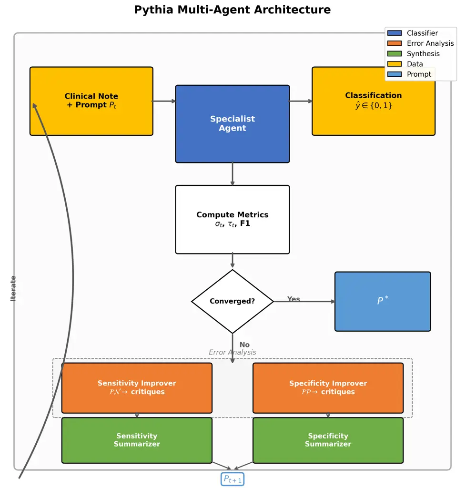
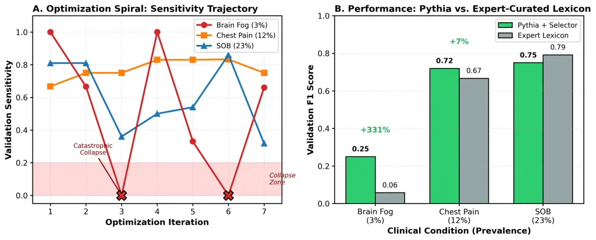

# Optimization Instability in Autonomous Agentic Workflows for Clinical Symptom Detection

Cameron Cagan Affiliation: Department of Medicine, Massachusetts General
Hospital, Boston, MA, USA    Pedram Fard Affiliation: Department of
Medicine, Massachusetts General Hospital, Boston, MA, USA    Jiazi Tian
Affiliation: Department of Medicine, Massachusetts General Hospital,
Boston, MA, USA    Jingya Cheng Affiliation: Department of Medicine,
Massachusetts General Hospital, Boston, MA, USA    Shawn N. Murphy
Affiliation: Department of Neurology, Massachusetts General Hospital,
Boston, MA, USA    Hossein Estiri Affiliation: Department of Medicine,
Massachusetts General Hospital, Boston, MA, USA

###### Abstract

Autonomous agentic workflows that iteratively refine their own behavior
hold considerable promise, yet their failure modes remain poorly
characterized. We investigate optimization instability, a phenomenon in
which continued autonomous improvement paradoxically degrades classifier
performance, using Pythia, an open-source framework for automated prompt
optimization. Evaluating three clinical symptoms with varying prevalence
(shortness of breath at 23%, chest pain at 12%, and Long COVID brain fog
at 3%), we observed that validation sensitivity oscillated between 1.0
and 0.0 across iterations, with severity inversely proportional to class
prevalence. At 3% prevalence, the system achieved 95% accuracy while
detecting zero positive cases, a failure mode obscured by standard
evaluation metrics. We evaluated two interventions: a guiding agent that
actively redirected optimization, amplifying overfitting rather than
correcting it, and a selector agent that retrospectively identified the
best-performing iteration successfully prevented catastrophic failure.
With selector agent oversight, the system outperformed expert-curated
lexicons on brain fog detection by 331% (F1) and chest pain by 7%,
despite requiring only a single natural language term as input. These
findings characterize a critical failure mode of autonomous AI systems
and demonstrate that retrospective selection outperforms active
intervention for stabilization in low-prevalence classification tasks.

##### Data and Code Availability

This paper uses a dataset of 400 chart-reviewed EHR notes, each
annotated with binary yes/no classifications on various signs and
symptoms by clinicians. The dataset is confidential and not publicly
available. The code can be found
[here](https://github.com/clai-group/Pythia).

##### Institutional Review Board (IRB)

This study was approved by the Mass General Brigham IRB.

## 1 Introduction

The effectiveness of large language models in specialized tasks depends
critically on prompt engineering, the iterative process of crafting
instructions that elicit desired behaviors from the model (Brown et al.,
2020; Wei et al., 2022). While prompt engineering has emerged as a
fundamental skill for deploying LLMs in practical applications, it
remains largely a manual craft that requires domain expertise, extensive
trial-and-error experimentation, and implicit knowledge of model
behavior. This manual approach introduces significant barriers:
practitioners must invest substantial time testing variations, lack
systematic frameworks for diagnosing failure modes, and often struggle
to balance competing performance objectives such as precision and
recall.

Current approaches to prompt optimization fall into two categories, each
with fundamental limitations. Meta-learning methods that train models to
generate effective prompts require extensive computational resources and
large training datasets, making them inaccessible for many applications
(Shin et al., 2020; Pryzant et al., 2023). Conversely, heuristic-based
systems that apply rule-based transformations lack the semantic
understanding necessary to address task-specific failure modes, often
producing generic modifications that fail to capture the nuances of
domain-specific requirements (Zhou et al., 2023). Recent work on
autonomous agentic systems has demonstrated that multi-agent
architectures can coordinate specialized reasoning within defined
domains (Park et al., 2023), suggesting an alternative paradigm in which
LLMs themselves drive optimization through interpretable error analysis.

The challenge is particularly acute in binary classification tasks where
performance depends on achieving precise thresholds for both sensitivity
and specificity (He and Garcia, 2009). Medical screening applications,
content moderation systems, and fraud detection pipelines all require
careful calibration of false-positive and false-negative rates. Manual
prompt engineering for these applications becomes a complex optimization
problem in which improving one metric often degrades another, and
practitioners lack principled methods for navigating this trade-off
space.

These challenges are amplified in clinical natural language processing,
where the goal is often to detect signs and symptoms from unstructured
clinical notes (Wang et al., 2018; Rajkomar et al., 2018). Unlike
structured data fields, free text documentation exhibits enormous
variability in how clinicians describe the same clinical phenomenon,
using synonyms, abbreviations, hedging language, and implicit references
that require contextual interpretation. Traditional approaches rely on
expert-curated lexicons: manually assembled vocabularies of relevant
terms that are time-intensive to develop, difficult to maintain, and
often fail to capture the full linguistic diversity of clinical
documentation (Lee et al., 2020). The problem is particularly acute for
subjective symptoms like Long COVID brain fog, a debilitating cognitive
syndrome affecting up to 64% of Long COVID patients (Thaweethai et al.,
2023). Brain fog encompasses heterogeneous presentations, including
memory difficulties, poor concentration, word-finding problems, and
slowed thinking, which patients struggle to articulate and clinicians
document inconsistently (Cummings, 2023; Hampshire et al., 2024). Unlike
shortness of breath or chest pain, which have established clinical
vocabularies and validated screening instruments, brain fog lacks
standardized terminology and computational detection methods (Davis
et al., 2023; Monje and Iwasaki, 2022). With an estimated 65 million
individuals worldwide affected by Long COVID, scalable methods for
identifying brain fog from existing clinical documentation represent an
urgent unmet need (Ceban et al., 2022).

We present an empirical investigation of optimization instability in
autonomous agentic workflows, using Pythia (Tian et al., 2026), an
open-source framework that automates prompt optimization via
interpretable error analysis and targeted refinement. Rather than
treating prompts as opaque parameters to be tuned, Pythia implements a
multi-agent system that diagnoses specific failure modes, synthesizes
targeted improvements in natural language, and adaptively balances
competing performance objectives. By executing all optimization
operations on the target LLM itself, the framework ensures refinements
are intrinsically compatible with the model’s operational
characteristics while maintaining full interpretability throughout the
optimization process. Our central contribution is the characterization
of optimization instability as a failure mode of autonomous systems
operating under class imbalance, and the demonstration that
retrospective selection provides more robust stabilization than active
intervention.

## 2 System Design and Architecture

### 2.1 Overview

Pythia is an open-source framework for automated prompt optimization
that systematically refines prompts to meet user-specified performance
requirements. The system implements a multi-agent architecture in which
specialized components collaborate to diagnose failures, generate
targeted improvements, and perform self-validation. All optimization
operations execute on the user-specified LLM, ensuring prompt
development is inherently compatible with the model’s characteristics.

The framework decomposes prompt engineering (DAIR.AI, 2023) into
distinct subtasks, each handled by dedicated agents. This modular design
enables parallel analysis of different error types and maintains clear
separation between evaluation and optimization Fard et al. (2025).

### 2.2 Agent Architecture

The system comprises five specialized agents, each implementing a
specific role in the optimization pipeline. Agents are constructed using
structured LLM calls with engineered system prompts that define their
behavior. The agents are implemented in Python and use LangChain (Chase, 2023) for prompt formatting.

#### 2.2.1 Specialist Agent

The Specialist Agent serves as the classifier within the optimization
loop. Given prompt $`P\in\mathcal{P}`$, standard operating procedure
$`S`$, and clinical note $`x\in\mathcal{X}`$, the agent generates a
binary classification $`\hat{y}=f_{P}(x)\in\{0,1\}`$. The agent’s
minimal design enables unbiased performance evaluation and clearly
separates the optimization objective from the optimization mechanism.
Performance metrics are computed by comparing predictions
$`\{\hat{y}_{i}\}_{i=1}^{n}`$ against ground truth labels
$`\{y_{i}\}_{i=1}^{n}`$, yielding sensitivity
$`\sigma=\text{TP}/(\text{TP}+\text{FN})`$ and specificity
$`\tau=\text{TN}/(\text{TN}+\text{FP})`$.

#### 2.2.2 Error Analysis Agents

The Improver Agents employ counterfactual reasoning to diagnose errors,
generating detailed natural-language explanations for each
classification error.

The Specificity Improver analyzes false positives. For each instance
$`x\in\mathcal{FP}=\{x_{i}:\hat{y}_{i}=1\land y_{i}=0\}`$, it produces
critique $`c(x)`$ identifying negative indicators that were overlooked.
The Sensitivity Improver performs the analogous operation for false
negatives, where for each
$`x\in\mathcal{FN}=\{x_{i}:\hat{y}_{i}=0\land y_{i}=1\}`$, it produces a
critique $`c(x)`$ highlighting positive signals that were missed.

The key innovation is that, by generating natural-language explanations
rather than abstract error metrics, Pythia produces semantically rich
feedback that can be incorporated into subsequent prompt development.
The Error Analysis Agents perform interpretable error attribution,
converting classification failures into actionable insights expressible
in the same representational space as the prompt itself.

#### 2.2.3 Synthesis Agents

The Summarizer Agents implement multi-document synthesis that aggregates
error critiques and generates targeted prompt modifications. Let
$`C=\{c_{1},c_{2},\ldots,c_{m}\}`$ denote the set of critiques generated
for errors of a particular type, $`P_{t}`$ the current prompt at
iteration $`t`$, and $`S`$ the standard operating procedure. Each
Summarizer generates refined prompt $`P_{t+1}=g(C,P_{t},S)`$.

The Specificity Summarizer focuses on constraint tightening by
identifying overly permissive criteria in $`P_{t}`$ and introducing
exclusion rules and negative indicators. The Sensitivity Summarizer
performs feature expansion by enriching $`P_{t}`$ with detection
patterns that capture previously missed positive signals. The synthesis
operates as a semantic differencing algorithm that identifies the gap
between the current prompt’s implicit decision boundary and the desired
boundary, then generates natural language modifications to shift the
boundary appropriately.

### 2.3 Optimization Pipeline

#### 2.3.1 Development Workflow

The Development Workflow implements a multi-objective optimization
protocol. Let $`P_{0}`$ denote the initial prompt, and let
$`\theta_{\sigma}`$ and $`\theta_{\tau}`$ denote the sensitivity and
specificity thresholds, respectively. At each iteration $`t`$, the
system executes the following operations.

The system first performs evaluation and metric calculation by running
the Specialist Agent on all instances in the development dataset
$`\mathcal{D}_{\text{dev}}`$, computing predictions, and calculating
performance metrics by comparing predictions to ground truth labels:

```math
\displaystyle\sigma_{t} \displaystyle=\frac{|\{x:f_{P_{t}}(x)=1\land y(x)=1\}|}{|\{x:y(x)=1\}|} \tag{1}
```

```math
\displaystyle\tau_{t} \displaystyle=\frac{|\{x:f_{P_{t}}(x)=0\land y(x)=0\}|}{|\{x:y(x)=0\}|} \tag{2}
```

The system then performs convergence checking. If both
$`\sigma_{t}\geq\theta_{\sigma}`$ and $`\tau_{t}\geq\theta_{\tau}`$,
optimization terminates with $`P^{*}=P_{t}`$. Otherwise, the system
prioritizes the metric that has not yet reached its threshold. When both
metrics fall below the threshold, sensitivity receives priority by
default.

Error analysis and prompt synthesis proceed by selecting the appropriate
Improver Agent based on the target metric, generating critiques for all
corresponding errors, filtering meaningful critiques, and invoking the
corresponding Summarizer to generate $`P_{t+1}`$.

This protocol continues until convergence or until the maximum iteration
count $`T_{\max}=7`$ is reached. Dynamic prioritization enables the
system to navigate the sensitivity specificity tradeoff, allocating
computational resources to the limiting performance factor.

#### 2.3.2 Performance Degradation Prevention

To mitigate potential negative performance impacts during iterative
prompt development, Pythia includes a performance monitoring mechanism.
After iteration $`t>0`$, the system compares the current prompt’s
performance against the previous iteration. If
$`\text{F1}(P_{t})<\text{F1}(P_{t-1})`$, the system reverts to improving
the previous prompt, providing the failed prompt as a negative example:

```math
P_{t+1}=g(C,P_{t-1},S,P_{t}^{\text{fail}}) \tag{3}
```

This mechanism serves two purposes: preventing optimization from
spiraling toward suboptimal regions of the prompt space, and providing
the Summarizer with explicit examples of modifications to avoid.

#### 2.3.3 Prompt Selection

After completing all development iterations, Pythia selects the optimal
prompt for validation based on performance on the development set. The
system evaluates all generated prompts $`\{P_{0},P_{1},\ldots,P_{T}\}`$
and selects:

```math
P^{*}={P_{t}}\text{F1}_{\mathcal{D}_{\text{dev}}}(P_{t}) \tag{4}
```

#### 2.3.4 Validation Workflow

Following development, the Validation Workflow evaluates $`P^{*}`$ on
the held out validation dataset $`\mathcal{D}_{\text{val}}`$. This
serves two critical functions: confirming that improvements generalize
beyond the development set, and detecting overspecialization to
idiosyncrasies of $`\mathcal{D}_{\text{dev}}`$.

#### 2.3.5 Formal Characterization

The optimization procedure can be formalized as iterative refinement in
a discrete prompt space. Let $`\mathcal{P}`$ denote the space of valid
prompts, $`\mathcal{L}:\mathcal{P}\times\mathcal{D}\to\mathbb{R}`$ a
loss function (e.g., negative F1), and
$`\mathcal{T}:\mathcal{P}\times 2^{\mathcal{X}}\to\mathcal{P}`$ the
transformation operator implemented by the Summarizer Agents. The
optimization seeks:

```math
P^{*}={P\in\{P_{0},\mathcal{T}(P_{0},\mathcal{E}_{0}),\ldots\}}\mathcal{L}(P,\mathcal{D}_{\text{val}}) \tag{5}
```

where $`\mathcal{E}_{t}`$ denotes the error set at iteration $`t`$. The
key insight is that $`\mathcal{T}`$ operates in natural language space
rather than continuous parameter space, enabling interpretable
optimization but potentially introducing instabilities when the
linguistic transformation fails to correspond to beneficial movement in
the underlying decision boundary.



Figure 1: Pythia multi-agent architecture. The optimization loop begins
with a clinical note and prompt $`P_{t}`$ passed to the Specialist
Agent, which produces binary classification $`\hat{y}\in\{0,1\}`$. The
system computes sensitivity ($`\sigma_{t}`$), specificity
($`\tau_{t}`$), and F1 score. If the convergence criteria are met, the
system outputs the final prompt $`P^{*}`$. Otherwise, Error Analysis
Agents (orange) generate natural language critiques for false negatives
($`\mathcal{FN}`$) or false positives ($`\mathcal{FP}`$), which
Synthesis Agents (green) aggregate into a refined prompt $`P_{t+1}`$.
The loop iterates until convergence or reaches the maximum number of
iterations.

## 3 Methodology

### 3.1 Dataset and Task

We evaluated Pythia on a dataset of 400 clinical notes from electronic
health records, each annotated by clinicians with binary labels
indicating the presence or absence of three symptoms: brain fog, chest
pain, and shortness of breath (SOB). The dataset was partitioned into
development ($`n=200`$) and validation ($`n=200`$) sets. Symptom
prevalence varied substantially across conditions: SOB appeared in 23%
of notes, chest pain in 12%, and brain fog in 3%.

### 3.2 Model Configuration

All experiments used Llama 3.1 70B (Dubey et al., 2024) deployed locally
via llama.cpp (Gerganov, 2023). We configured the model with a
temperature of 0.0 and a maximum output length of 2048 tokens for
deterministic classification, and prompt development.

### 3.3 Baseline Comparison

For each symptom, we constructed expert-curated lexicon baselines using
clinical vocabulary terms identified through a systematic review of
medical literature and clinical documentation. The lexicon classifier
predicted positive when any lexicon term appeared in the clinical note.

### 3.4 Study Design

We evaluated the generalizability of Pythia, an autonomous agentic
workflow originally developed for cognitive concern detection (Tian
et al., 2026), to three clinical symptoms from an independent dataset:
shortness of breath (23% prevalence), chest pain (12%), and brain fog
(3%). Unlike the original study, which utilized multiple clinical notes
per patient, this evaluation used a single note per patient to assess
performance under more constrained conditions.

### 3.5 Experimental Protocol

We initialized Pythia with minimal prompts containing only the target
symptom name (e.g., “brain fog”), providing no additional clinical
context or detection strategies. This neutral initialization maximizes
the observable improvement from autonomous optimization while providing
a fair baseline across tasks. We ran seven optimization iterations per
symptom and recorded performance metrics at each iteration on both
development and validation sets.

## 4 Results

### 4.1 Autonomous Optimization Can Spiral

Across seven optimization iterations, we observed prevalence-dependent
instability in which continued optimization degraded rather than
improved performance. Table 1 presents validation performance at the
first and final iterations.

| Condition  | Prevalence | Iter 1 F1 | Iter 7 F1 | $`\Delta`$ |
| ---------- | ---------- | --------- | --------- | ---------- |
| Brain fog  | 3%         | 0.25      | 0.09      | $`-`$64%   |
| Chest pain | 12%        | 0.72      | 0.60      | $`-`$17%   |
| SOB        | 23%        | 0.75      | 0.41      | $`-`$45%   |

Table 1: Validation performance degradation from first to final
iteration. Continued autonomous optimization reduced F1 scores across
all conditions, with severity inversely proportional to class
prevalence.

Brain fog exhibited the most severe instability. Validation sensitivity
oscillated between 0.0 and 1.0 across iterations, reaching complete
collapse (zero sensitivity) at iterations 3 and 6 (Figure 2A). At these
points, the system detected no positive cases while maintaining high
accuracy (0.95 to 0.97) due to class imbalance, a failure mode masked by
standard evaluation metrics.

The spiral followed a characteristic pattern: the system attempted to
improve specificity; this overcorrection reduced sensitivity; attempts
to recover sensitivity destabilized the system further; and the cycle
repeated with increasing amplitude. Higher-prevalence conditions
exhibited attenuated oscillations but still showed performance
degradation by the final iteration.

### 4.2 Intervention 1: Guiding Agent

To address the optimization spiral, we introduced a guiding agent that
monitored performance after each iteration. When results failed to
improve over the previous iteration, the agent paused optimization and
instructed the system to abandon the current path and explore an
alternative optimization direction.

| Condition  | Dev F1 | Val F1 | Gap       |
| ---------- | ------ | ------ | --------- |
| Brain fog  | 0.47   | 0.00   | 0.47      |
| Chest pain | 0.73   | 0.64   | 0.09      |
| SOB        | 0.70   | 0.75   | $`-`$0.05 |

Table 2: Guiding agent performance. The intervention reduced oscillation
on the development set but amplified overfitting, as evidenced by the
gap between development and validation performance.

Table 2 presents the best performance achieved with the guiding agent.
The intervention successfully reduced oscillation on the development
set; however, validation performance did not improve correspondingly.
For brain fog, the guiding agent achieved the highest development F1
(0.47), while the validation F1 collapsed to 0.0. The intervention
exacerbated overfitting by learning to optimize patterns in the
development set that failed to generalize. The agent effectively learned
to exploit the development set more aggressively rather than learning
generalizable features.

### 4.3 Intervention 2: Selector Agent

We implemented an alternative approach: a selector agent that allowed
all 7 optimization iterations to complete, then retrospectively selected
the iteration with the best development-set F1 score for application to
the validation set. This approach prioritized preventing catastrophic
failure over maximizing performance.

| Condition  | Prev. | Pythia F1 | Lexicon F1 | $`\Delta`$ |
| ---------- | ----- | --------- | ---------- | ---------- |
| Brain fog  | 3%    | 0.25      | 0.058      | +331%      |
| Chest pain | 12%   | 0.72      | 0.67       | +7%        |
| SOB        | 23%   | 0.75      | 0.79       | $`-`$5%    |

Table 3: Selector agent compared to expert curated lexicon baselines on
the validation set. Pythia outperformed lexicons on brain fog (+331%)
and chest pain (+7%) while achieving comparable performance on SOB
($`-`$5%).

Table 3 compares the selector agent against expert curated lexicon
baselines. The selector agent prevented catastrophic failure and
outperformed lexicons on two of three conditions. For brain fog, the
lexicon achieved perfect sensitivity (1.00) but zero specificity (0.00),
flagging all cases as positive, yielding an F1 score of 0.058. Pythia
achieved superior discrimination (F1 = 0.25) despite the 3% prevalence.
Notably, Pythia required only a single natural language term as input,
whereas lexicons required expert curation of domain-specific
vocabularies.

Figure 2B illustrates the comparative performance. Across conditions,
Pythia with selector agent oversight matched or exceeded lexicon
performance while requiring minimal human input.

### 4.4 Selection Was Conservative But Not Optimal

The selector agent’s conservative strategy of choosing the best
development iteration prevented catastrophic failure but did not always
identify the iteration with optimal generalization. Post hoc analysis
revealed that alternative iterations would have outperformed the
selected iteration for some conditions (Table 4).

| Condition  | Selected | Val F1 | Optimal | Val F1 |
| ---------- | -------- | ------ | ------- | ------ |
| Brain fog  | Iter 1   | 0.25   | Iter 2  | 0.44   |
| Chest pain | Iter 1   | 0.72   | Iter 1  | 0.72   |
| SOB        | Iter 1   | 0.75   | Iter 6  | 0.76   |

Table 4: Selected versus optimal iteration on the validation set.
Development set performance did not reliably predict validation
generalization, particularly at low prevalence.

For brain fog, iteration 2 would have achieved F1 = 0.44 compared to the
selected iteration’s F1 = 0.25, a 76% improvement. This gap highlights a
fundamental challenge: at low prevalence, development set performance is
an unreliable proxy for generalization because each iteration is
informed by few positive cases.



Figure 2: Optimization dynamics and comparative performance. (A)
Validation sensitivity across seven optimization iterations. Brain fog
(3% prevalence) exhibited catastrophic collapse, reaching zero
sensitivity at iterations 3 and 6 (marked with X). Higher prevalence
conditions showed oscillation but avoided complete failure. (B)
Validation F1 scores comparing Pythia with selector agent versus expert
curated lexicon baselines. Pythia outperformed lexicons on brain fog
(+331%) and chest pain (+7%), while achieving comparable performance on
SOB ($`-`$5%), despite requiring only a single natural-language term as
input.

## 5 Discussion

This study demonstrates that Pythia, originally developed for cognitive
concern detection, generalizes effectively to diverse clinical symptoms,
including shortness of breath, chest pain, and Long COVID brain fog.
Across all three conditions, Pythia with selector-agent oversight
matched or exceeded the performance of expert-curated lexicons while
requiring only a single natural-language term as input, rather than
extensive domain-knowledge engineering. This finding has significant
practical implications, as traditional lexicon-based approaches require
clinical experts to enumerate comprehensive vocabularies of relevant
terms, a process that is time-intensive, domain-specific, and difficult
to scale. Pythia circumvents this bottleneck by autonomously learning
discriminative patterns from minimal semantic input, dramatically
lowering the barrier to clinical NLP applications.

Brain fog represents one of the most clinically challenging symptoms to
detect computationally. Unlike shortness of breath or chest pain, which
have established clinical vocabularies and diagnostic criteria, brain
fog is characterized by subjective, heterogeneous presentations,
including memory difficulties, poor concentration, word-finding
problems, and cognitive fatigue (Cummings, 2023). Patients often
struggle to articulate these experiences, and clinicians lack
standardized screening instruments (Hampshire et al., 2024). The RECOVER
initiative identified brain fog as one of the most prevalent Long COVID
symptoms, affecting up to 64% of patients in some cohorts (Thaweethai
et al., 2023), yet detection in clinical notes remains exceptionally
difficult because the linguistic markers are subtle, variable, and often
inconsistently documented. No blood test, imaging study, or validated
NLP tool currently exists for systematic brain fog screening (Davis
et al., 2023). Against this backdrop, Pythia’s performance on brain fog
detection merits careful interpretation. At 3% prevalence, reflecting
the proportion of patients with documented brain fog in our dataset, the
system achieved F1 = 0.25, substantially outperforming the
expert-curated lexicon (F1 = 0.058). The lexicon’s failure mode was
instructive: it achieved perfect sensitivity by flagging every case as
positive, providing no discrimination whatsoever. Pythia, starting from
only the phrase “brain fog,” learned to identify cases with meaningful
specificity. While F1 = 0.25 may appear modest in absolute terms, it
represents a 331% improvement over the curated baseline under
extraordinarily challenging conditions: single clinical notes, 3%
prevalence, and minimal semantic input. Post hoc analysis revealed that
an alternative iteration would have achieved F1 = 0.44, a performance
level that approaches clinical utility for a symptom with no existing
computational detection method.

A central contribution of this work is the characterization of
optimization instability in autonomous agentic systems. We observed that
continued self-optimization can degrade performance, causing the system
to oscillate between overcorrection and collapse. This instability was
prevalence dependent, more pronounced at 3% (brain fog) than at 23%
(SOB), suggesting that a sparse positive signal amplifies optimization
noise. The phenomenon can be understood through the lens of empirical
risk minimization under class imbalance (He and Garcia, 2009): when
positive examples are rare, small perturbations to the decision boundary
can dramatically alter sensitivity while having minimal impact on
overall accuracy, creating a loss landscape in which the optimization
trajectory becomes unstable. We evaluated two interventions with
divergent outcomes. The guiding agent, which actively redirected
optimization upon detecting stagnation, paradoxically amplified
overfitting; the system learned to exploit patterns in the development
set more aggressively without improving generalization. The selector
agent, which passively identified the best iteration post hoc,
successfully prevented catastrophic failure while preserving competitive
performance. This finding carries implications beyond clinical NLP. As
autonomous AI systems increasingly engage in self-optimization during
deployment, understanding when and why such optimization fails becomes
critical. Our results suggest that active intervention during
optimization may be counterproductive, whereas retrospective selection
from a trajectory of attempts may be safer and more effective. The
underlying intuition is that active intervention introduces additional
degrees of freedom that the system can exploit to overfit, whereas
retrospective selection constrains the search to prompts generated
without knowledge of the selection criterion.

Several limitations warrant discussion. First, our evaluation used
single clinical notes per patient, whereas real-world deployment might
leverage longitudinal documentation. Future work should evaluate Pythia
on multi-note patient records, where a cumulative signal may improve
detection, particularly for subtle symptoms such as brain fog. Second,
Pythia currently operates on minimal semantic input: a single natural
language term. While this design choice maximizes accessibility, it may
constrain performance on complex symptoms. We hypothesize that
augmenting Pythia with richer initialization strategies, such as
embedding-based initialization using clinical word embeddings trained on
large corpora, integration of publicly available medical vocabularies
from UMLS or SNOMED CT, or web search augmentation that retrieves
current clinical literature on the target symptom, could substantially
improve results. Third, our selector agent used the development F1 as
its selection criterion. More sophisticated approaches, such as
validation-aware selection, ensemble methods, or learned stopping
criteria, may improve the correspondence between selected and optimal
iterations. Fourth, our dataset reflects a single institution’s
documentation practices, and multi-site validation is necessary to
establish generalizability across diverse clinical environments and
documentation styles.

Pythia provides a powerful, generalizable tool for detecting clinical
symptoms from unstructured notes. Despite minimal input requirements,
the system matched or exceeded the performance of expert-curated
lexicons across three diverse clinical conditions. For Long COVID brain
fog, a symptom with no existing computational detection method, Pythia
achieved over 300% improvement relative to lexicon baselines under
challenging low-prevalence conditions. We characterized optimization
instability as a failure mode of autonomous agentic systems and
demonstrated that retrospective selection outperforms active
intervention in mitigating this instability. These findings establish
Pythia as a practical tool for clinical NLP and identify clear
directions for improvement. As healthcare systems increasingly seek
scalable methods for symptom surveillance and phenotyping, autonomous
agentic workflows offer a promising path forward, provided their failure
modes are carefully understood and mitigated.

## References

- Brown et al. \[2020\] Tom Brown, Benjamin Mann, Nick Ryder, Melanie
  Subbiah, Jared D Kaplan, Prafulla Dhariwal, Arvind Neelakantan, Pranav
  Shyam, Girish Sastry, Amanda Askell, et al. Language models are
  few-shot learners. _ArXiv_, 2020. URL
  [https://arxiv.org/abs/2005.14165](https://arxiv.org/abs/2005.14165).
- Ceban et al. \[2022\] Felicia Ceban, Susan Ling, Leanna M W Lui, Yena
  Lee, Hartej Gill, Kayla M Teopiz, Nelson B Rodrigues, Mehala
  Subramaniapillai, Joshua D Di Vincenzo, Bing Cao, Kangguang Lin,
  Rodrigo B Mansur, Roger C Ho, Joshua D Rosenblat, Kamilla W Miskowiak,
  Maj Vinberg, Vladimir Maletic, and Roger S McIntyre. Fatigue and
  cognitive impairment in post-COVID-19 syndrome: A systematic review
  and meta-analysis. _Brain, Behavior, and Immunity_, 101:93–135, 2022.
  doi: 10.1016/j.bbi.2021.12.020.
- Chase \[2023\] Harrison Chase. Langchain: The platform for reliable
  agents, 2023. URL
  [https://github.com/langchain-ai/langchain](https://github.com/langchain-ai/langchain).
- Cummings \[2023\] Louise Cummings. Long COVID: The impact on language
  and cognition. _Language and Health_, 1:2–9, 2023. doi:
  10.1016/j.laheal.2023.05.001.
- DAIR.AI \[2023\] DAIR.AI. Prompt engineering guide, 2023. URL
  [https://www.promptingguide.ai/](https://www.promptingguide.ai/).
- Davis et al. \[2023\] Hannah E Davis, Lisa McCorkell, Julia Moore
  Vogel, and Eric J Topol. Long COVID: Major findings, mechanisms and
  recommendations. _Nature Reviews Microbiology_, 21(3):133–146, 2023.
  doi: 10.1038/s41579-022-00846-2.
- Dubey et al. \[2024\] Abhimanyu Dubey, Abhinav Jauhri, Abhinav Pandey,
  et al. The llama 3 herd of models. _arXiv preprint
  arXiv:2407.21783_, 2024.
- Fard et al. \[2025\] Pedram Fard, Alaleh Azhir, Neguine Rezaii, Jiazi
  Tian, and Hossein Estiri. An n-of-1 artificial intelligence ecosystem
  for precision medicine. _arXiv preprint arXiv:2510.24359_, 2025. doi:
  https://doi.org/10.48550/arXiv.2510.24359.
- Gerganov \[2023\] Georgi Gerganov. llama.cpp: Llm inference in
  c/c++, 2023. URL
  [https://github.com/ggerganov/llama.cpp](https://github.com/ggerganov/llama.cpp).
- Hampshire et al. \[2024\] Adam Hampshire, Adriana Azor, Christina
  Atchison, William Trender, Peter J Hellyer, Valentina Giunchiglia,
  Masud Husain, Graham S Cooke, Emily Cooper, Adam Lound, Neha
  Chaturvedi, Paul Elliott, and Helen Ward. Cognition and memory after
  Covid-19 in a large community sample. _New England Journal of
  Medicine_, 390(9):806–818, 2024. doi: 10.1056/NEJMoa2311330.
- He and Garcia \[2009\] Haibo He and Edwardo A Garcia. Learning from
  imbalanced data. _IEEE Transactions on Knowledge and Data
  Engineering_, 21(9):1263–1284, 2009. doi: 10.1109/TKDE.2008.239.
- Lee et al. \[2020\] Jinhyuk Lee, Wonjin Yoon, Sungdong Kim, Donghyeon
  Kim, Sunkyu Kim, Chan Ho So, and Jaewoo Kang. Biobert: A pre-trained
  biomedical language representation model for biomedical text mining.
  _Bioinformatics_, 36(4):1234–1240, 2020. doi:
  10.1093/bioinformatics/btz682.
- Monje and Iwasaki \[2022\] Michelle Monje and Akiko Iwasaki. The
  neurobiology of long COVID. _Neuron_, 110(21):3484–3496, 2022. doi:
  10.1016/j.neuron.2022.10.006.
- Park et al. \[2023\] Joon Sung Park, Joseph C O’Brien, Carrie J Cai,
  Meredith Ringel Morris, Percy Liang, and Michael S Bernstein.
  Generative agents: Interactive simulacra of human behavior. In
  _Proceedings of the 36th Annual ACM Symposium on User Interface
  Software and Technology_, pages 1–22, 2023. doi:
  10.1145/3586183.3606763.
- Pryzant et al. \[2023\] Reid Pryzant, Dan Iter, Jerry Li, Yin Tat Lee,
  Chenguang Zhu, and Michael Zeng. Automatic prompt optimization with
  ”gradient descent” and beam search. In _Proceedings of the 2023
  Conference on Empirical Methods in Natural Language Processing_, pages
  7957–7968, 2023.
- Rajkomar et al. \[2018\] Alvin Rajkomar, Eyal Oren, Kai Chen, Andrew M
  Dai, Nissan Hajaj, Michaela Hardt, Peter J Liu, Xiaobing Liu, Jake
  Marcus, Mimi Sun, Patrik Sundberg, Hector Yee, Kun Zhang, Yi Zhang,
  Gerardo Flores, Gavin E Duggan, Jamie Irvine, Quoc Le, Kurt Litsch,
  et al. Scalable and accurate deep learning with electronic health
  records. _npj Digital Medicine_, 1:18, 2018. doi:
  10.1038/s41746-018-0029-1.
- Shin et al. \[2020\] Taylor Shin, Yasaman Razeghi, Robert L Logan IV,
  Eric Wallace, and Sameer Singh. Autoprompt: Eliciting knowledge from
  language models with automatically generated prompts. In _Proceedings
  of the 2020 Conference on Empirical Methods in Natural Language
  Processing_, pages 4222–4235, 2020. doi:
  10.18653/v1/2020.emnlp-main.346.
- Thaweethai et al. \[2023\] Tanayott Thaweethai, Sarah E Jolley,
  Elizabeth W Karlson, Emily B Levitan, Bruce Levy, Grace A McComsey,
  Lisa McCorkell, Girish N Nadkarni, Sairam Parthasarathy, Upinder
  Singh, Tiffany A Walker, Caitlin A Selvaggi, Dagny J Shinnick, Caitlin
  C M Schulte, et al. Development of a definition of postacute sequelae
  of SARS-CoV-2 infection. _JAMA_, 329(22):1934–1946, 2023. doi:
  10.1001/jama.2023.8823.
- Tian et al. \[2026\] Jiazi Tian, Pedram Fard, Cameron Cagan, Neguine
  Rezaii, Rebeka Bustamante Rocha, Liqin Wang, Valdery Moura Junior,
  Deborah Blacker, Jennifer S Haas, Chirag J Patel, Shawn N Murphy,
  Lidia M V R Moura, and Hossein Estiri. An autonomous agentic workflow
  for clinical detection of cognitive concerns using large language
  models. _npj Digital Medicine_, 9:51, 2026. doi:
  10.1038/s41746-025-02324-4.
- Wang et al. \[2018\] Yanshan Wang, Liwei Wang, Majid Rastegar-Mojarad,
  Sungrim Moon, Feichen Shen, Naveed Afzal, Sijia Liu, Yuqun Zeng, Saeed
  Mehrabi, Sunghwan Sohn, and Hongfang Liu. Clinical information
  extraction applications: A literature review. _Journal of Biomedical
  Informatics_, 77:34–49, 2018. doi: 10.1016/j.jbi.2017.11.011.
- Wei et al. \[2022\] Jason Wei, Xuezhi Wang, Dale Schuurmans, Maarten
  Bosma, Ed H. Chi, F. Xia, Quoc Le, and Denny Zhou. Chain of thought
  prompting elicits reasoning in large language models. _ArXiv_,
  abs/2201.11903, 2022. URL
  [https://api.semanticscholar.org/CorpusID:246411621](https://api.semanticscholar.org/CorpusID:246411621).
- Zhou et al. \[2023\] Yongchao Zhou, Andrei Ioan Muresanu, Ziwen Han,
  Keiran Paster, Silviu Pitis, Harris Chan, and Jimmy Ba. Large language
  models are human-level prompt engineers. _arXiv preprint
  arXiv:2211.01910_, 2023.
