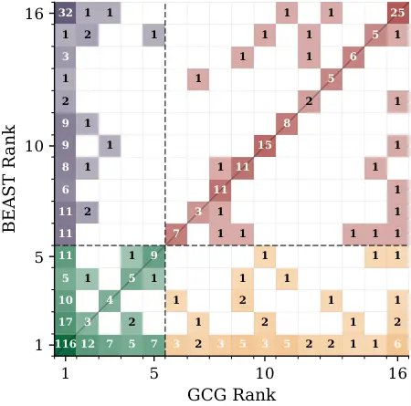
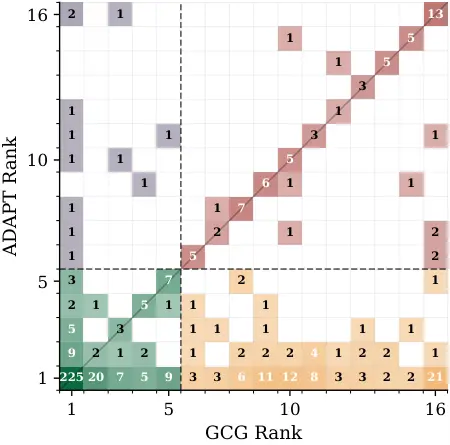
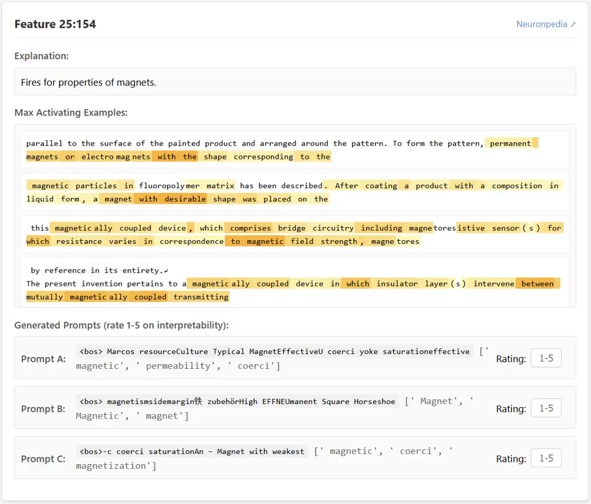

# ADAPT: Hybrid Prompt Optimization for LLM Feature Visualization

João Cardoso Affiliation: Instituto Superior Técnico
Affiliation: INESC-ID    Arlindo L. Oliveira Affiliation: Instituto
Superior Técnico Affiliation: INESC-ID    Bruno Martins
Affiliation: Instituto Superior Técnico Affiliation: INESC-ID
Correspondence to: <joao.n.m.cardoso@tecnico.ulisboa.pt>

###### Abstract

Understanding what features are encoded by learned directions in LLM
activation space requires identifying inputs that strongly activate
them. Feature visualization, which optimizes inputs to maximally
activate a target direction, offers an alternative to costly dataset
search approaches, but remains underexplored for LLMs due to the
discrete nature of text. Furthermore, existing prompt optimization
techniques are poorly suited to this domain, which is highly prone to
local minima. To overcome these limitations, we introduce ADAPT, a
hybrid method combining beam search initialization with adaptive
gradient-guided mutation, designed around these failure modes. We
evaluate on Sparse Autoencoder latents from Gemma 2 2B, proposing
metrics grounded in dataset activation statistics to enable rigorous
comparison, and show that ADAPT consistently outperforms prior methods
across layers and latent types. Our results establish that feature
visualization for LLMs is tractable, but requires design assumptions
tailored to the domain.

###### Keywords: 

Machine Learning, ICML

## 1 Introduction

Neural networks construct rich representations of their inputs, often
assigned to linear directions in their latent activation space.
Understanding the relevant input features encoded by these directions is
essential for interpretability efforts, but identifying the range of
input patterns that activate a given latent direction (henceforth,
latent) is a challenging task. The standard approach is to perform a
dataset search (Paulo et al., 2024; Bills et al., 2023): running the
model on a large corpus and registering what input examples maximally
activate the directions of interest, which is an effective approach for
large-scale surveys where the large computational costs of running a
model on a large corpus can be amortized over thousands of latents in
parallel. Dataset search is often performed for latent directions
learned by sparse autoencoders (SAEs) (Sharkey et al., 2022; Bricken et
al., 2023), which are designed to yield large dictionaries of
interpretable and monosemantic latents. However, with alternate
techniques for obtaining latents of interest or more complex
sub-components such as model circuits or collections of latents, this
approach becomes computationally prohibitive.

An alternate approach is feature visualization (Olah et al., 2017),
which consists of creating an input that is “tailor-made” for a given
latent, via prompt optimization techniques which seek to maximally
activate the target latent. This brings several advantages over dataset
search:

- •
  Overcoming dataset limitations: searched datasets are typically
  smaller than the model’s training dataset, limiting the number of
  illustrative examples for any given latent.
- •
  Disentangling correlated features: if two features happen to be
  correlated in the searched dataset (e.g. a semantic concept and the
  language of the text), it is hard to tease apart the latent’s
  corresponding feature. (Olah et al., 2017)
- •
  Versatility: any feature optimization can be modified to incorporate
  complex objectives and penalties.
- •
  Causal grounding: Correlational methods can produce plausible-looking
  explanations even for randomly initialized networks (Méloux et al.,
  2025). Feature visualization constructs inputs that cause activation,
  sidestepping spurious associations in any fixed corpus.

These advantages are visible in previous vision interpretability work,
which has made extensive use of feature visualization. However, the
application of these techniques to LLMs has been limited, mostly due to
the discrete nature of textual inputs (Thompson et al., 2024), which
precludes direct gradient-based updates. In this work, we take
inspiration from existing adversarial prompt optimization techniques,
where the objective is to induce the model to generate outputs that
bypass its safety training, and from previous LLM feature visualization
work. Our contributions are as follows:

- •
  We introduce ADAPT, a new algorithm that outperforms existing
  baselines by combining beam-search initialization with gradient-guided
  mutation.
- •
  We evaluate ADAPT and previous methods on SAE latents from Gemma 2 2B
  (Gemma Team, 2024), introducing metrics grounded in dataset activation
  statistics to enable systematic comparison of different techniques.
- •
  We analyze the reliability of gradient-based optimization methods for
  this application domain, and investigate the role of fluency penalties
  in prompt optimization for feature visualization.

The remainder of this paper is organized as follows. Section 2 covers
background on SAEs and existing prompt optimization methods. Section 3
introduces ADAPT. Section 4 presents our experimental evaluation,
followed by an analysis of the common failure modes of several existing
methods. In section 5 we extend ADAPT to a dual latent objective, to
illustrate its versatility. We conclude in Section 6.

## 2 Background

We review sparse autoencoders, which provide our evaluation testbed, and
existing prompt optimization methods, whose limitations motivate ADAPT.

### 2.1 Sparse autoencoders

The representation vectors constructed by LLMs are thought to contain
far more features than they have dimensions, by encoding them as
non-orthogonal directions in activation space that do not align with the
neuronal basis (Elhage et al., 2022). Sparse autoencoders (SAEs) learn
to reconstruct a target representation vector through a high-dimension
middle layer (Bricken et al., 2023; Templeton et al., 2024). A sparsity
penalty encourages most latent dimensions to remain inactive after the
activation function, yielding a small set of active directions that
capture the input vector’s variability. These directions have been shown
to be more monosemantic, in the sense of being correlated with single
input features, than individual neurons.

While the proposed ADAPT method can accommodate arbitrary directions or
complex objectives, we focus on SAE latents due to the availability of
open source tools that support the development of our technique, by
mitigating the need to retrieve target latents ourselves, and by
enabling comparison with existing latent interpretation techniques,
namely dataset search, without incurring in high computational costs. In
particular, the Gemma Scope project (Lieberum et al., 2024) has made
publicly available a suite of SAEs, with additional latent statistics
and dataset examples provided via the Neuronpedia API ¹¹ 1
[https://neuronpedia.org/api-doc](https://neuronpedia.org/api-doc).

For feature visualization of SAE latents, our objective is as follows.
Given an input activation vector $`x\in\mathbb{R}^{n}`$, an SAE produces
a reconstruction via:

```math
\hat{x}=W_{\text{dec}}\cdot f(W_{\text{enc}}x+b_{\text{enc}})+b_{\text{dec}}, \tag{1}
```

where $`f(x)\in\mathbb{R}^{M}`$ is the sparse activation vector. For a
target latent $`i`$, the optimization objective is:

```math
x^{*}=\arg\max_{x}f_{i}(x), \tag{2}
```

where $`f_{i}(x)`$ denotes the activation magnitude of the $`i`$-th
latent direction.

### 2.2 Prompt Optimization

Despite the abundance of prompt optimization methods (Ramnath et al.,
2025), most are not applicable to feature visualization, due to
fundamental domain differences. For one, it would be infeasible to use
exceedingly expensive techniques, such as those which involve LLM API
calls (Yang et al., 2024), comprehensive tree searches (Wang et al.,
2024), or model fine-tuning (Cheng et al., 2024). A successful jailbreak
prompt justifies hours of compute because it transfers across contexts,
whereas feature visualization must be quick to run for individual
latents since each requires individual optimization. For another,
approaches that leverage prior knowledge to constrain the search space a
priori are inapplicable, given the variety of roles played by different
latents. Lastly, since latents are specific to each model, surrogate
models (Paulus et al., 2025) or simulation techniques (Zhang et al., 2024) cannot be used. We thus focus on prompt methods which are
self-contained, relatively inexpensive, and devoid of prior assumptions.

#### 2.2.1 Greedy Coordinate Gradient

Greedy Coordinate Gradient (GCG), introduced by Zou et al. (2023)
optimizes directly in the discrete input space, by starting with a
randomly initialized prompt and iteratively swapping out tokens. A
gradient-based estimate technique, first introduced by Ebrahimi et al.
(2018), is used to constrain the token search space. The estimate is
computed by determining the gradient with respect to a one-hot
representation of the input prompt. This is possible due to the
equivalence between the regular embedding procedure, in which an
embedding matrix $`W_{E}`$ is indexed at the $`i`$th position, where
$`i`$ is the token index, and a matrix multiplication $`e_{i}W_{E}`$,
between the one-hot vector $`e_{i}`$ and the embedding matrix. Whereas
indexing is non-differentiable, the multiplication procedure allows the
gradient of the one-hot vector to be computed.

Starting from an initial prompt, GCG computes an estimate by converting
the prompt into a $`\mathrm{prompt\_length}\times\mathrm{vocab\_dim}`$
matrix of one-hot vectors and running a backward pass to compute the
one-hot gradients as described above. Afterwards, a random position is
selected for mutation, and replacements are randomly sampled from the
set of $`k`$ lowest gradient prompts to generate $`B`$ candidate
prompts. The operative assumption is that the gradient value at a given
index is predictive of the loss impact of discretely swapping in the
associated token. Lastly, a forward pass is computed to determine the
loss for each candidate, and the best performing one is retained. This
procedure is repeated until a specified number iterations is reached.

#### 2.2.2 Beam Search

An alternative way to get around the problems posed by input
discreteness is to conduct a gradient-free tree-search over prompt
space. However, given the size of typical vocabularies, the search space
is prohibitively large. (Sadasivan et al., 2024) propose Beam
Search-Based Adversarial Attack (BEAST), which explores prompt space via
beam-search, where new candidates are generated by right-appending
tokens sampled from the model’s own predicted sequence probabilities.
BEAST assumes a complex input structure and optimization objective which
are not relevant for our purposes, but at its core it amounts to a
simple beam-search procedure. At each step, $`k_{1}`$ prompt sequences
are maintained in a beam. For each sequence, $`k_{2}`$ candidates are
generated by sampling and appending one token via top-k sampling. The
$`k_{1}`$ lowest loss candidates are then selected for the next beam.

BEAST’s main advantage is its speed, requiring only forward passes. It
thus avoids the overhead of gradient calculation. Additionally, a single
forward pass serves dual purposes: evaluating candidate scores and
computing logits for the next generation step.

#### 2.2.3 Evolutionary Prompt Optimization

Evolutionary Prompt Optimization (EPO) is an algorithm introduced by
Thompson et al. (2024) specifically for feature visualization in LLMs,
which extends GCG by incorporating an evolutionary framework to balance
fluency and feature activation. Rather than optimizing for a single
objective, EPO maintains a population of prompts distributed along a
Pareto frontier: a trade-off curve between fluency (i.e. the mean
self-cross-entropy of each candidate) and feature activation strength.
Each member of the population optimizes for a different weighting
between these objectives, allowing EPO to discover diverse prompts
ranging from fluent low-activation prompts to disfluent
strongly-activating prompts.

The combined activation and fluency objective can be expressed as
follows:

```math
\mathcal{L}_{\lambda}(t):=f(t)-\frac{\lambda}{n}\sum_{i=0}^{n-1}H(\text{LLM}(t_{\leq i}),t_{i+1}),
```

```math
t^{*}_{\lambda}=\arg\max_{t}\mathcal{L}_{\lambda}(t),
```

where $`f(t)`$ is the target SAE feature activation for prompt $`t`$;
$`\text{LLM}(t_{\leq i})`$ denotes the language model’s predicted
probability distribution over next tokens given prefix $`t_{\leq i}`$;
$`H(\cdot,\cdot)`$ is the cross-entropy operator; $`\lambda\geq 0`$ is a
weighting parameter controlling the trade-off between latent
maximization and fluency; $`n`$ is the number of tokens in prompt $`t`$;
$`t_{\leq i}`$ represents the prefix of sequence $`t`$ up to (and
including) the $`i`$-th token and $`t_{i+1}`$ is the $`(i+1)`$-th token
in $`t`$.

The second term computes the average self-cross-entropy of the sequence,
which is equivalent to the negative log-likelihood under the language
model. Lower cross-entropy corresponds to more ‘fluent’ (i.e. higher
likelihood) text.

A few expansions of EPO have been proposed. Thompson and Sklar (2024)
extend EPO with 3 additional operations: insertions, logit-swaps,
deletions; where the former two sample new tokens from the model’s own
predicted sequence probabilities. While these extensions were made for
an adversarial context, they are easily transferable to the feature
visualization domain.

Shabalin et al. (2024) apply EPO to SAE features obtained from the Gemma
2 2B model, and show that it carries over well, producing moderately
interpretable prompts that activate the target latents.

Graham et al. (2025) present ContextBench, a benchmark for fluent
context modification targeting latent activation and behavior
elicitation, and introduce two extensions to EPO. EPO-Assist
periodically queries a large language model to generate novel variations
of current outputs, which are then incorporated back into the
optimization population. EPO-Inpainting identifies tokens with maximum
per-token activation, freezes them, and uses a bidirectional diffusion
model (LLaDA) to regenerate surrounding tokens, preserving optimization
progress while enhancing fluency.

The authors curate 102 features from Gemma 2 2B across three taxonomic
axes: activation density (how frequently the feature fires), vocabulary
diversity (semantic breadth of activating concepts), and locality
(whether activation is concentrated on single tokens or distributed
across sequences), and use it to benchmark and validate the developed
methods.

## 3 ADAPT: Adaptive DynAmic Prompt Tuning

We describe ADAPT’s three main components: beam-search initialization
(3.2), candidate generation via hybrid mutation (3.3), and
diversity-preserving evaluation and selection (3.4).

### 3.1 Overview

Our proposed method is an extension of GCG which incorporates several
elements that overcome limitations we observed when applied to feature
visualization. In this section, we present the method’s core
architecture, leaving validation of key design decisions to section 4.3.
An illustrative diagram for ADAPT is shown in Figure 1, and code is
included in the supplementary materials.

Figure 1: Diagram for ADAPT.

### 3.2 Initialization

During experiments with GCG, we found that the choice of initialization
strongly affected whether a highly activating prompt was successfully
found for a given latent. We also noticed that the optimization
trajectory resulting from a given initialization was crucial, with
prompts optimized in parallel often achieving drastically different
final losses (see subsection 4.3).

As such, ADAPT initializes via a beam-search procedure, where several
beams are maintained and optimized in parallel, foregoing the need to
initialize with an arbitrary user-defined or randomly generated input
sequence. Starting from a number of single-token sequences, candidates
are generated by right-appending likely next tokens, after which point
the lowest loss candidates are included in the next iteration’s beam.
The number of beams n_groups, the number of initial sequences, the
beam-size $`k1`$, and the expansion factor $`k2`$ are specified by the
user.

We observed that the structure of SAE-latent maximization does not lend
itself well to sole use of right-append operations, since we take the
latent activation magnitude at the last position, which is continuously
relocated to that of the right-appended token. As a hypothetical
example, for a latent that exclusively fires for the token foo, a
right-append-only beam search would converge on the prompt “$`\cdots`$
foo foo foo”, whereas a better prompt might be obtained by refining the
left-hand context instead. As such, the initialization procedure also
performs middle-inserts, by randomly selecting a sequence position and
sampling from the model’s own predicted distribution at that position.

Each beam is independent, which means that our initialization is
equivalent to a parallel run of more than one beam search procedure,
each with its own initial starting set. The aim is to enable better
exploration of the search space, decreasing the likelihood of stagnating
in suboptimal local minima. The initialization returns the best prompts
across all beams and iterations, without losing track of beam
provenance, so that no cross-contamination takes place. Since each
iteration increases the sequence length, but the initialization returns
the best prompts achieved across all iterations, we may start the main
optimization loop with prompts of differing lengths, requiring
appropriate masking.

### 3.3 Candidate Generation

ADAPT optimizes over an adaptively sized population of prompts,
initialized to the best sequences returned by the beam-search
initialization. At each iteration and for each prompt, a fixed,
user-specified number of candidates is generated via one of two mutation
mechanisms: GCG-style swaps, using the aforementioned gradient-based
estimate, and logit-swaps, as in EPO. We multinomially sample the next
iteration’s operation based on a user-specified probability value, and
retain an excess number of candidates in the surviving population if the
next operation is a logit-swap, in order to take advantage of the lower
computational requirements of the gradient-free logit-swap mutation.
Mutation positions are selected either randomly or by sampling from a
distribution over sequence positions that biases towards the selection
of later positions. Since the initialization may return underlength
prompts, we instead perform middle-inserts for logit-swap iterations.

### 3.4 Evaluation and Culling

ADAPT maintains a complex slot management system. First, each prompt has
a group ID, carried over from the initialization procedure. No
cross-group selection takes place, to avoid rapid convergence on minor
variations of the same prompt, thereby aiding in exploration. Not only
does this serve to minimize the likelihood of getting prematurely stuck
in local minima, but it also provides diverse, independent examples for
a single latent. Notwithstanding, the user may define a mergepoint after
which the selection mechanism defaults to a greedy global selection that
disregards group provenance. Second, two types of slots exist. The first
are group-specific “guaranteed” slots, which always contain the group’s
best scoring prompt across all iterations. The second set comprises
“free” slots, which are allocated via global selection of the
highest-improvement candidates, where the improvement is measured as the
difference between the achieved loss and the previous group best. This
dual structure maintains diversity through the guaranteed slots, while
allowing high-performing mutations from any group to claim additional
representation through the free slots. With that said, we cap each group
at twice its proportional share of free slots.

Before the candidate selection phase can occur, each one must be
evaluated. Our evaluator begins by running a forward pass on the
candidates, storing both the latent activations and the logits.
Afterwards, we apply a fluency penalty mechanism. We employ a global
sigmoid fluency penalty schedule, which gradually ramps up depending on
several parameters. The penalty weight at any given time $`\lambda_{t}`$
is a function of the maximum penalty weight $`\lambda_{\max}`$ that was
applied, the iteration of steepest increase $`t_{\text{mid}}`$, and the
parameter $`s`$, which controls the steepness of the increase:

```math
\lambda_{t}=\frac{\lambda_{\text{max}}}{1+\exp(-s\cdot(t-t_{\text{mid}}))}.
```

The user may also choose a fluency threshold. Prompts with a mean
cross-entropy score below this threshold do not incur any fluency
penalty, while prompts above this threshold get penalized in proportion
to how much their mean self-cross-entropy exceeds it. We allow the user
to fully customize the fluency penalty strategy by setting the
cross-entropy threshold to 0 (disabling penalty thresholding), or the
steepness $`s`$ to 0 (disabling the fluency schedule entirely). We
analyze the importance of fluency in Section 4.3.3.

## 4 Experiments

Feature visualization for SAE evinces the strengths and weaknesses of
existing techniques, which informed our design decisions in ADAPT. With
the experiments presented in this section our objectives were twofold:

1.  1.  Comparatively evaluating 4 different methods—ADAPT, GCG, BEAST, and
        EPO—in order to establish the superiority of our method as a whole.
2.  2.  Validating our design decisions through tailored individual
        experiments. The results illustrate the failure modes of different
        techniques, putting into question assumptions held in previous work.

### 4.1 Setup

We first describe implementation details and hyperparameter settings for
all evaluated methods (4.1.1), then our model and feature selection
procedure (4.1.2), and finally the evaluation metrics used for
comparison (4.1.3).

#### 4.1.1 Implementation details

Hyperparameters were set to sensible defaults according to the authors’
own implementations. Individual optimization runs ran in approximately
80s in optimal GPU conditions, for a single NVIDIA A40 48GB GPU setup.

Our implementation of GCG optimizes 6 prompts in parallel, with 32
candidates generated at each iteration. The highest achieved activation
is reported, unless stated otherwise.

BEAST was run with a beam size of 128 and expansion factor of 32. The
beam size is far higher that GCG’s candidate count due to the lower
iteration count (10, corresponding to the prompt length), and the
absence of backward passes.

We took Thompson et al.’s own implementation as the foundation of our
implementation of EPO. Identical hyperparameters were set to match GCG’s
as far as possible, with a few key differences. The fluency penalty was
set to range from 0.1 to 15 across the 6 slots. The prompt lengths were
bounded between 8 and 15, because of the algorithm’s use of
length-altering mutations. Operation probabilities were set as follows:
GCG-swap (0.5), logit-swap (0.2), insert (0.15), and delete (0.15).

ADAPT was configured with 10 prompts maintained across 3 diversity
groups, with 32 candidates generated per iteration. For the beam-based
initialization phase a beam size of 30 and an expansion factor of 32
were used. During optimization, GCG-swap and logit-swap operations were
applied with equal probability (0.5 each). Each group retained two
guaranteed slots; the remaining 4 or 14 slots (depending on iteration
type) were allocated competitively. Cross-entropy regularization was
applied with a maximum penalty of 3.0. The GCG estimator sampled from
the top 512 tokens ranked by gradient magnitude. Target prompt length
was fixed at 10 tokens, and optimization ran for 25 iterations.

We sought to maintain comparable prompt lengths across all methods,
despite EPO’s variable length implementation. Further details are
available in Appendix A.1.

#### 4.1.2 Model and Feature Selection

Our experiments were performed on Gemma 2 2B (Gemma Team, 2024), in
keeping with previous work (Shabalin et al., 2024). We used the 16k-wide
residual stream SAE suite from Gemma Scope (Lieberum et al., 2024). The
residual stream represents the cumulative computation accessible to all
downstream layers, making it the natural target for understanding what
information the model maintains and routes through its depth.

A cursory glance at any set of dataset examples for different latents
will reveal that they vary widely in their activation patterns and
roles. While some activate for specific tokens, others respond to a wide
range of tokens that share some functional or semantic role. Some
latents are active for longer subsequences, or activate more frequently
than others. Accordingly, we designed our latent selection to capture
variance along these axes.

We curated three latent sets of differing sizes. The larger latent set
contains 486 latents sampled from 6 evenly spaced layers (layers 3, 7,
11, 17, 21, and 25) across the model’s 26-layer depth. We began by
classifying the first 1000 latents for each layer according to the the
items in the taxonomy described by Graham et al.—locality (the
narrowness of the range of tokens the latent is active for in the
context), diversity (how many different tokens achieve maximal
activation across several examples), and density (how frequently the
latent activates in the whole dataset). We implemented computational
proxies for these items by leveraging information available via the
Neuronpedia API; our procedure is detailed in Appendix A.2.
Subsequently, we performed stratified sampling, considering the first
1000 latent directions for each SAE, by applying a $`3\times 3\times 3`$
percentile grid based on the density, locality, and diversity scores. We
sampled 4 features from each bin, yielding a total of 81 per layer.

#### 4.1.3 Evaluation

Despite EPO’s and ADAPT’s use of fluency penalties, we consider the raw
activation values in our metrics, relegating our discussion of fluency
to section 4.3. Since activation magnitudes differ from latent to
latent, and also tend to vary across layers—typically, later layers
contain latents with much higher Maximally Activating Examples (MAEs),
as seen in Figure 2—our metrics compare the optimized prompt’s
activation with the corresponding MAEs in two ways. The first metric is
the activation ratio: the ratio between the optimized prompt and the top
MAE. The second metric is the activation rank, which corresponds to the
position the optimized prompt would occupy if ranked among the top 15
de-duplicated MAEs. A prompt with a rank of 1 outperforms all MAEs and,
consequently, its activation ratio is greater than 1, while a prompt
with rank 16 is worse than all 15 MAEs.

Figure 2: Distribution of top dataset activations for latents 0–49 (by
Neuronpedia index) across all layers of Gemma 2 2B.

### 4.2 Overall Performance

Figure 3: Mean activation ratio (the optimized prompt’s activation
divided by the maximally activating dataset example) per layer, for all
4 methods under study.

|       | GCG   | BEAST | EPO   | ADAPT |
| ----- | ----- | ----- | ----- | ----- |
| GCG   | –     | 56.4% | 63.2% | 29.6% |
| BEAST | 43.6% | –     | 50.2% | 12.8% |
| EPO   | 36.8% | 49.8% | –     | 21.4% |
| ADAPT | 70.4% | 84.0% | 78.6% | –     |

Table 1: Row beats column comparison for all 4 methods, considering all
486 latents.

Fig. 3 shows the mean activation ratio per considered layer and for all
methods, showing that ADAPT outperforms or is on par with every other
method on all layers. Among the previous methods, GCG is dominant for
the first layers, while BEAST edges it out on the last layers,
indicating a degrading performance profile for GCG toward later layers.
Furthermore, the failure modes of GCG and BEAST appear to be
complementary, which is corroborated by the fact that ADAPT, which
incorporates both a beam-search procedure and gradient-based mutations,
achieves a more constant performance profile throughout the layers.

The comparison in Table 1 shows that ADAPT achieves higher activation
than GCG on 70.4% of features (Wilcoxon signed-rank $`p<10^{-28}`$),
further corroborating the improved performance profile.

EPO underperforms throughout, despite the complexity of its design. This
is to be expected to a certain extent, since EPO employs a global
selection mechanism which rapidly converges on minor variations of the
same prompt spanning the pareto frontier between activation and fluency,
whereas our implementation of GCG devotes the computational budget to
optimizing 6 prompts independently. In other words, EPO can be seen as
an analogue to a single-slot GCG optimization procedure which devotes
additional resources to exploring fluent variations which may not vary
significantly among themselves, which we are then comparing to the
maximum GCG activation across 6 independently-optimized prompts. While
this does not undermine the overall approach, it is underpinned by an
assumption about the importance of fluency, which we separately revisit
in a later section. Since it is the only design element EPO exclusively
contains, we forego further analysis of EPO in this section.



GCG vs BEAST



GCG vs ADAPT

Figure 4: Comparative ranking matrices for GCG-ADAPT and GCG-BEAST
comparisons.

GCG vs BEAST

GCG vs ADAPT

Figure 5: Quadrant success per layer for GCG-BEAST and GCG-ADAPT
comparisons.

Figure 4 shows two activation rank confusion matrices for the GCG-BEAST
and GCG-ADAPT comparisons. Arbitrarily considering that a rank greater
than 5 corresponds to a successful optimization, the green and red
quadrants indicate joint success and failure, respectively, while the
other quadrants indicate asymmetric success. The stacked bar charts in
Figure 5 indicate the per-layer share of successful vs. unsuccessful
features. The GCG-BEAST comparison further indicates that their failure
modes are complementary, with a significant share of GCG-only successes
toward earlier layers. The GCG-ADAPT comparison shows that the share of
GCG-only successes is marginal, while ADAPT-only successes are
substantial, further establishing the superiority of the method.

### 4.3 Validation Experiments

The overall performance results indicate that the domain is challenging
for existing methods. While the target loss function is continuous, a
successful optimization run should ideally find the pattern encoded by
the latent, which, given the SAE reconstruction objective, is expected
to be discrete and monosemantic. For particularly local and low-density
features, this pattern might consist of a single vocabulary token,
lending a ”needle-in-a-haystack” quality to the task. Additionally,
latents are, by definition, non-orthogonal, which means that there can
be interference between them, especially for prompts eliciting lower
activation magnitudes. In this section, we analyze the effectiveness of
existing techniques at finding the key feature patterns, as well as the
relationship between our metrics and human interpretability.

In order to do so, we curate two smaller latent sets, each with 50
latents sampled from the larger dataset, so as to facilitate targeted
experiments. The first is a “balanced” latent set, where we sample
features from every layer, seeking to maintain a representative
difficulty profile. The second is a “hardness-weighted” latent set, for
which we sample 50 features from the last 3 layers, which contain harder
latents to optimize (for GCG, specifically), and skew our selection
towards more difficult latents.

In order to assess hardness, we determine the inverse of the average
activation ratio obtained by GCG for every iteration, averaged across
all 6 prompts. The average activation ratio is equivalent to the ratio
between the area under the trajectory curve and the area below
$`y=a_{\max}`$, $`a_{\max}`$ being the maximal dataset activation.
Intuitively, an easy latent is one for which GCG rapidly converges on a
solution that is equal to or greater than $`a_{\max}`$ across all 6
slots, in which case the AUC ratio will be 1 or lower. If all
trajectories plateau below the dataset reference maximum, then the
hardness will be far greater than 1. The hardness $`H_{l}`$ for a latent
$`l`$ is given by:

```math
H_{l}=\left(\frac{1}{S\cdot a_{\max}\cdot T}\sum_{s=1}^{S}\sum_{t=1}^{T}\max(L_{s}^{(t)},0)\right)^{-1},
```

where $`S`$ is the number of prompt slots, $`T`$ is the number of
iterations, and $`L_{s}^{(t)}`$ is the loss (negative activation) for
slot $`s`$ at iteration $`t`$.

We divided latents into 5 hardness quintiles based on percentile
boundaries, and sampled features from each quintile according to two
strategies. The uniform sample drew 10 features from each quintile (50
total), while the hardness-weighted sample emphasized harder features
with counts of (5, 8, 10, 12, 15) from the easiest to the hardest
quintiles, respectively (50 total).

#### 4.3.1 The GCG estimate’s signal-to-noise ratio

The gradient-based estimate used in GCG (henceforth, the ‘GCG estimate’)
is predicated on the assumption that the loss impact of discretely
including each token is well-approximated by its corresponding gradient
computed for the one-hot encoding. If the GCG estimate were a perfect
approximation, we would expect low-ranked tokens—the tokens with the
most negative gradient—to lead to the greatest loss decreases.
Conversely, we would also expect the tokens resulting in the largest
loss decreases to have the lowest gradients.

In order to assess these two claims, we perform the following experiment
on the balanced latent set. For each latent, we begin by determining the
two slots which achieved the highest and lowest final activation,
respectively. For each slot, we obtain the cached prompt trajectory from
the main run. Afterwards, we generate 128 new candidate mutations in two
ways. The first 64 are generated via the same GCG estimate procedure as
in the original GCG, with a top-$`k`$ of 1024 (doubling the candidate
count and top-$`k`$). The last 64 are generated by instead performing
top-$`p`$ sampling from the model’s own probabilities, with $`p=0.95`$.
We keep track of all the generated candidates which constitute
improvements over the cached prompt’s activation. We also fix the
trajectory to ensure comparable results between the two candidate
generation methods.

Figure 6: Number of improvements per estimate rank bin.

Figure 7: Improvement mass per estimate rank bin.

Figure 7 shows that the gradient rank distribution for improvements
obtained via GCG is quite close to uniform, indicating that lower
gradient values do not yield remarkably more improvements. Figure 7, on
the other hand, shows that the distribution of the sum of improvements
is more uneven, with the lower gradient bins containing a
disproportionate share of the absolute improvements. This suggests that,
while the GCG estimate is noisy, and a large share of the sampled
candidates are only marginally better than would otherwise be expected,
it is able to occasionally yield disproportionately good candidates
among its highest ranks.

Figure 8: GCG estimate rank distribution for improvement candidates
obtained via the logit-swap procedure.

Figure 9: GCG-Estimate rank distribution for improvement candidates
obtained via the random sampling procedure.

Figure 9 shows the gradient rank distribution for candidates selected
via gradient-free logit sampling. While the lowest gradient bins capture
a disproportionate share of the improvements, the distribution is close
to uniform for the middle bins, indicating that there are many
improvements which the GCG estimate fails to attribute an appropriate
gradient to. Figure 9 further illustrates this, showing the distribution
of the gradient ranks of tokens sampled uniformly from the entire
vocabulary, with lower-gradient ranges containing more improvements. The
bimodal distribution for the logit-swap candidates nonetheless suggests
an interesting relationship between predicted probabilities and the
biases of the GCG estimate. Specifically, the GCG estimate appears to be
biased towards certain commonly occurring tokens more than would be
expected by chance, while systematically undervaluing certain tokens,
even when they bring about loss decreases. Inspecting the sampled tokens
from the last bins, we found that they mostly correspond to punctuation
and formatting tokens.

#### 4.3.2 Consistency of GCG

While the experiments in Subsection 4.3.1 establish the poor
signal-to-noise ratio of GCG, with many good candidates being
underestimated, and many highly estimated candidates underperforming,
questions remain as to how reliably GCG can converge on high activation
regions of prompt space. For this reason, we now analyze how sensitive
GCG is to initialization and trajectory.

For the benchmark in Section 4.2, GCG was configured to optimize six
prompts in parallel. We observed a good deal of inter-slot variability
in final activation. In this subsection, we consider the impact of
initialization on the performance of GCG, by answering two questions:

- •
  Do some specific initial prompts reliably predict higher final
  activations?
- •
  Does GCG consistently attain similar activations across different runs
  initialized with the same prompt?

To answer these questions, we conduct a simple experiment. We begin by
determining which of the 6 initial prompts in the main benchmark
achieved the both the highest and lowest average final activations.
Since the highest-performing prompt was obtained through autoregressive
generation, and the lowest-performing prompt consists of randomly
sampled tokens from the vocabulary, we call them the “autoregressive”
and “random” prompts, respectively. Afterwards, we conduct a benchmark
on the hardness-weighted latent set, where 3 of the 6 initial slots are
initialized with the autoregressive prompt, and the remaining 3 are
initialized with the random prompt.

Figure 10: Distribution of activation variability across runs from
identical initializations, normalized by the MAE.

Figure 11: Comparison of best activations achieved from autoregressive
versus random initializations. Points above diagonal indicate
autoregressive advantage.

Figure 11 shows the intra-prompt distribution of final activation
ranges, normalized by the maximal dataset activation. It is clear that
for both prompts there is significant variability, meaning that the same
initialization can yield very different results depending on the
trajectory, which is selected stochastically. This indicates that GCG is
prone to falling in local minima depending on the specific trajectory
through prompt space.

Figure 11 shows the comparison between the performance for both slots
across all slots, with the mean and max normalized activations,
respectively, in each plot. It illustrates the inter-prompt variability
by establishing that the autoregressive prompt slots consistently obtain
higher activations than the random prompt.

Taken together, these results establish that GCG’s performance is
heavily dependent on location in prompt space. In other words, for some
starting locations, GCG is significantly more likely to converge on
high-activating token patterns, although the greedy candidate selection
often produces trajectories that evolve towards local minima,
highlighting the importance of open-ended exploration.

Figure 11 shows the distribution of activation ranges across runs from
identical initializations, normalized by maximal dataset activation. The
median variability of 0.20 indicates that runs from the same starting
point can diverge substantially, suggesting GCG is prone to converging
on different local minima depending on the stochastically-selected
trajectory through prompt space.

Figure 11 compares best activations achieved from autoregressive versus
random initializations. Autoregressive initialization outperforms random
initialization in 62% of configurations, demonstrating that the starting
location in prompt space meaningfully influences optimization outcomes,
but does not fully predict them.

Taken together, these results establish that GCG’s performance depends
heavily on both initialization and trajectory. While autoregressive
initialization provides a consistent advantage, the substantial
intra-prompt variability highlights the importance of maintaining
diverse exploration to avoid local minima.

#### 4.3.3 The Role of Fluency

GCG usually produces ‘gibberish’ prompts, which contain incoherent token
sequences mixing languages, scripts, punctuation, and subword fragments.
This is due to the lack of any constraint on possible token sequences.
In the adversarial domain, fluency is usually enforced to bypass
perplexity-based filters and to obtain in-distribution prompts. However,
it is not immediately apparent that the same desiderata apply to feature
visualization. For one, perplexity filters have no analogue in this
domain; for another, adversarial behavioral objectives admit multiple
sufficient mechanisms (e.g. simultaneously suppressing refusal
directions and hijacking attention (Arditi et al., 2024)), whereas
targeted latent activation objectives specify the intervention site
directly, achieving mechanistic specificity by construction rather than
requiring auxiliary constraints.

Given the attributes of the feature visualization domain, two putative
roles for fluency are relevant:

- •
  Regularization: preventing optimization from getting stuck in local
  minima, resulting in the return of low activation prompts.
- •
  Interpretability: preventing high activation solutions that are
  uninterpretable or unrelated to the feature pattern (Thompson et al.,
  2024).

Figure 12: Activation ratio distribution for GCG runs with varying
fluency penalty weights.

The first hypothesis suggests that a fluency penalty may reshape the
loss landscape, smoothing over narrow valleys and sharp local minima
that trap optimization in gibberish regions. To test this, we rerun GCG
on the hardness-weighted latent set with an added self-cross-entropy
penalty:

```math
\mathcal{L}(t)=-f(t)+\frac{\lambda}{n}\sum_{i=0}^{n-1}H(\text{LLM}(t_{\leq i}),t_{i+1}),
```

where $`f(t)`$ is the target latent activation, $`H(\cdot,\cdot)`$ is
the cross-entropy, and $`\lambda\in\{0.3,1.0,3.0,9.0\}`$ controls the
fluency-activation tradeoff.

Figure 12 shows that higher values of $`\lambda`$ hinder optimization
across the whole latent set, thereby undermining the hypothesis.
Notwithstanding, we highlight that this experiment does not directly
bear on the fluency configuration used in the ADAPT benchmark, since
higher penalties are only applied in later iterations, leaving the
initialization and early optimization periods relatively unhindered by
fluency.

To assess whether fluency penalties improve interpretability and to
validate ADAPT’s design, we conducted a manual evaluation comparing
three conditions: GCG, GCG with a fluency penalty ($`\lambda=1.0`$), and
ADAPT. Three raters (including one author) evaluated prompts on 60
latents: the 50-latent hardness-weighted set plus 10 additional latents
with activation ratio greater than 1.0, included to better probe whether
high-activation prompts recover interpretable patterns. For each latent,
raters viewed the latent’s explanation, maximally activating dataset
examples, and three prompts (one per condition, order randomized). Since
the patterns captured by certain latents can be hard to infer,
consisting of upweighted predictions which are not necessarily borne out
in the dataset examples, structural properties of the text, or otherwise
unintuitive patterns, the explanations were generated by the authors,
although a set of maximally activating examples was provided²² 2 We have
included the annotation file in the supplementary materials.. Prompts
were rated on a 1–5 scale: (1) no discernible pattern, (2) semantic
ballpark but not discernible, (3) pattern understandable but not evident
from prompt alone, (4) pattern present but differs from examples (e.g.,
different language), (5) pattern obvious and matches examples. We
computed Krippendorff’s $`\alpha`$ for inter-rater agreement, obtaining
$`\alpha=0.650`$.

Figure 13: Rank/rating co-occurrence matrix for GCG, GCG with a
$`\lambda=1.0`$ fluency penalty, and ADAPT, respectively.

Figure 14: Rating distribution for GCG, GCG with a $`\lambda=1.0`$
fluency penalty, and ADAPT, respectively.

Figure 13 shows that, for GCG, higher activation reliably correlates
(Pearson $`r=0.645,p<10^{-5}`$) with more interpretable prompts, despite
the lack of fluency constraints. Indeed, high activation (ratio$`>1.0`$)
prompts seem overwhelmingly interpretable, whereas the correlation is
less clear for lower activation regimes. The $`\lambda=1.0`$ run shows
similar patterns, with no remarkable improvement in interpretability.
Indeed, as Figure 14 shows, the interpretability distribution is
remarkably similar between the two methods, with the penalty appearing
to slightly compress the rating distribution rather than shift it toward
higher interpretability.

Figure 15: Quality rating for each method averaged over all latents and
annotators.

Our analysis also establishes that ADAPT is significantly better at
generating interpretable prompts. Figure 15 shows the mean rating for
each of the methods, establishing the superiority of ADAPT (Wilcoxon
Statistic of $`4459.5`$, $`p<10^{-8}`$), while showing that GCG with
$`\lambda=1.0`$ does not produce significant changes in human-rated
interpretability. Lastly, we note that because the activation ratio is a
mere proxy for human interpretability, these results provide the most
compelling evidence in support of our design decisions in ADAPT.

## 5 Extensions

ADAPT naturally extends to objectives involving multiple latents by
summing their activations. We conducted a brief experiment with dual
latent optimization to illustrate this extension potential. Following
Shabalin et al. (2024), we optimize dual-latent objectives using an
$`L_{0.1}`$ norm, which encourages balanced activation of both latents
rather than maximizing one at the expense of the other:

```math
\mathcal{L}(t)=\left\|\begin{pmatrix}f_{i}(t)\\
f_{j}(t)\end{pmatrix}\right\|_{0.1},
```

where $`f_{i}(t)`$ and $`f_{j}(t)`$ are the activation magnitudes of the
two target latents for prompt $`t`$.

We found not all pairs of latents are amenable to optimization, since
their associated patterns can be mutually exclusive. For instance, if
both are high in locality (firing for narrow subsequences), it might not
be possible to obtain high simultaneous activations on the same
position. Notwithstanding, we achieved success in jointly optimizing
pairs where one latent was local and the other fired for wide contexts.
Table 2 shows combinations of 3 different layer 25 residual stream
latents, and their respective optimized prompts. Latent
[823](https://www.neuronpedia.org/gemma-2-2b/25-gemmascope-res-16k/823)
is a low locality latent which fires for contexts related to the Marvel
Cinematic Universe. Latent
[2738](https://www.neuronpedia.org/gemma-2-2b/25-gemmascope-res-16k/2738)
is highly local and activates for terms like “bit” and “little”. Latent
[1264](https://www.neuronpedia.org/gemma-2-2b/25-gemmascope-res-16k/1264)
is local and fires for the token “syn” and spelling variants. Lastly,
latent
[154](https://www.neuronpedia.org/gemma-2-2b/25-gemmascope-res-16k/154)
is low locality and is active for text describing magnets and their
properties. ADAPT is able to find interesting combinations of the
patterns encoded by each latent which are interpretable, most notably
the last example where the subsequence “Stark magnet” concisely fits the
MCU (Tony Stark) and magnet patterns.

| Latent A   | Latent B      | Optimized Prompt                                 |
| ---------- | ------------- | ------------------------------------------------ |
| 823 (MCU)  | 2738 (bit)    | nearby Avenger/avenulla Rd Avengers is bits      |
| 1264 (syn) | 154 (magnets) | ul magnetism currently ( determinediuminium, syn |
| 823 (MCU)  | 154 (magnets) | times aanki Stark magnet first unveiled as the   |

Table 2: Optimized prompts for dual-latent objectives. All latents from
layer 25. Prompts successfully activate both target latents, with local
features (2738, 1264) appearing as specific tokens and low-locality
features (823, 154) reflected in semantic context.

The results presented here suggest that extending ADAPT to visualization
of circuits or other complex objectives would prove fruitful, though we
leave this to future work.

## 6 Conclusions

We presented ADAPT, a hybrid prompt optimization method for LLM feature
visualization. Through evaluation on SAE latents from Gemma 2 2B, we
identified key failure modes of existing methods: GCG’s gradient-based
estimates exhibit poor signal-to-noise ratios and high sensitivity to
initialization, while gradient-free beam search provides complementary
exploration capabilities but lacks the fine-grained refinement needed
for convergence.

ADAPT addresses these limitations through three principal design
choices: (1) beam-search initialization to start optimization in
favorable regions of prompt space, (2) adaptive mixing of
gradient-guided and logit-based mutations to balance exploitation with
exploration, and (3) a diversity-preserving slot management system that
maintains independent optimization trajectories to avoid premature
convergence to local minima.

Our experiments demonstrate that ADAPT outperforms GCG on 70.4% of
features ($`p<10^{-28}`$) and achieves consistently strong performance
across all model layers, unlike prior methods whose effectiveness varies
with depth. Importantly, our manual evaluation reveals that high
activation correlates strongly with human-rated interpretability
($`r=0.645`$), and that ADAPT produces significantly more interpretable
prompts than baselines, providing direct evidence that optimizing for
activation recovers meaningful feature patterns rather than exploiting
artifacts.

These results establish that feature visualization for LLMs is
tractable, but requires design assumptions tailored to the domain’s
unique challenges: discrete optimization over a vast token space,
interference between non-orthogonal latent directions, and a loss
landscape prone to local minima. We hope ADAPT provides a useful tool
for interpretability research, and welcome extensions for visualization
of steering vectors, circuit components, and other latent directions
where exhaustive dataset search is prohibitive.

##### Limitations and Future Work.

Our evaluation focused on residual stream SAEs from a single model
family. Extending ADAPT to larger models and more diverse latent
extraction methods remains as possible future work. Additionally, while
our metrics provide rigorous comparison, integration with automated
interpretability pipelines that correlate with human judgment (Paulo and
Belrose, 2025) would enable larger-scale evaluation.

## References

- Arditi et al. (2024) A. Arditi, O. Balcells Obeso, A. Syed, D.
  Paleka, N. Rimsky, W. Gurnee, and N. Nanda Refusal in language models
  is mediated by a single direction. In Proceedings of the 38th
  Conference on Neural Information Processing Systems, Cited by: §4.3.3.
- Bills et al. (2023) S. Bills, N. Cammarata, D. Mossing, H. Tillman, L.
  Gao, G. Goh, I. Sutskever, J. Leike, J. Wu, and W. Saunders Language
  models can explain neurons in language models. Note:
  [https://openaipublic.blob.core.windows.net/neuron-explainer/paper/index.html](https://openaipublic.blob.core.windows.net/neuron-explainer/paper/index.html)
  Cited by: §1.
- Bricken et al. (2023) T. Bricken, A. Templeton, J. Batson, B. Chen, A.
  Jermyn, T. Conerly, N. Turner, C. Anil, C. Denison, A. Askell, R.
  Lasenby, Y. Wu, S. Kravec, N. Schiefer, T. Maxwell, N. Joseph, Z.
  Hatfield-Dodds, A. Tamkin, K. Nguyen, B. McLean, J. E. Burke, T.
  Hume, S. Carter, T. Henighan, and C. Olah Towards monosemanticity:
  decomposing language models with dictionary learning. Transformer
  Circuits Thread. External Links:
  [Link](https://transformer-circuits.pub/2023/monosemantic-features/index.html)
  Cited by: §1, §2.1.
- Cheng et al. (2024) J. Cheng, X. Liu, K. Zheng, P. Ke, H. Wang, Y.
  Dong, J. Tang, and M. Huang Black-box prompt optimization: aligning
  large language models without model training. In Proceedings of the
  62nd Annual Meeting of the Association for Computational Linguistics,
  pp. 3201–3219. Cited by: §2.2.
- Ebrahimi et al. (2018) J. Ebrahimi, A. Rao, D. Lowd, and D. Dou
  HotFlip: white-box adversarial examples for text classification. In
  Proceedings of the 56th Annual Meeting of the Association for
  Computational Linguistics (Volume 2: Short Papers), pp. 31–36. Cited
  by: §2.2.1.
- Elhage et al. (2022) N. Elhage, T. Hume, C. Olsson, N. Schiefer, T.
  Henighan, S. Kravec, Z. Hatfield-Dodds, R. Lasenby, D. Drain, C.
  Chen, R. Grosse, S. McCandlish, J. Kaplan, D. Amodei, M. Wattenberg,
  and C. Olah Toy models of superposition. Transformer Circuits Thread.
  External Links:
  [Link](https://transformer-circuits.pub/2022/toy_model/index.html)
  Cited by: §2.1.
- Gemma Team (2024) Gemma Team Gemma 2: improving open language models
  at a practical size. arXiv preprint arXiv:2408.00118. Cited by: 2nd
  item, §4.1.2.
- Graham et al. (2025) R. Graham, E. Stevinson, L. Richter, A. Chia, J.
  Miller, and J. I. Bloom ContextBench: modifying contexts for targeted
  latent activation. arXiv preprint arXiv:2506.15735. Cited by: §2.2.3.
- Lieberum et al. (2024) T. Lieberum, S. Rajamanoharan, A. Conmy, L.
  Smith, N. Sonnerat, V. Varma, J. Kramar, A. Dragan, R. Shah, and N.
  Nanda Gemma scope: open sparse autoencoders everywhere all at once on
  Gemma 2. In Proceedings of the 7th BlackboxNLP Workshop: Analyzing and
  Interpreting Neural Networks for NLP, pp. 278–300. Cited by: §2.1,
  §4.1.2.
- Méloux et al. (2025) M. Méloux, G. Dirupo, F. Portet, and M. Peyrard
  The dead salmons of AI interpretability: the need for a statistical
  inference perspective. arXiv preprint arXiv:2502.08741. Cited by: 4th
  item.
- Olah et al. (2017) C. Olah, A. Mordvintsev, and L. Schubert Feature
  visualization. Distill 2 (11). External Links:
  [Document](https://dx.doi.org/10.23915/distill.00007) Cited by: 2nd
  item, §1.
- Paulo and Belrose (2025) G. Paulo and N. Belrose Evaluating SAE
  interpretability without explanations. arXiv preprint
  arXiv:2507.08473. Cited by: §6.
- Paulo et al. (2024) G. Paulo, A. Mallen, C. Juang, and N. Belrose
  Automatically interpreting millions of features in large language
  models. arXiv preprint arXiv:2410.13928. Cited by: §1.
- Paulus et al. (2025) A. Paulus, A. Zharmagambetov, C. Guo, B. Amos,
  and Y. Tian AdvPrompter: fast adaptive adversarial prompting for LLMs.
  In Proceedings of the 42nd International Conference on Machine
  Learning, Cited by: §2.2.
- Ramnath et al. (2025) K. Ramnath, K. Zhou, S. Guan, S. S. Mishra, X.
  Qi, Z. Shen, S. Wang, S. Woo, S. Jeoung, Y. Wang, H. Wang, H. Ding, Y.
  Lu, Z. Xu, Y. Zhou, B. Srinivasan, Q. Yan, Y. Chen, H. Ding, P. Xu,
  and L. L. Cheong A systematic survey of automatic prompt optimization
  techniques. In Proceedings of the 2025 Conference on Empirical Methods
  in Natural Language Processing, pp. 33078–33110. Cited by: §2.2.
- Sadasivan et al. (2024) V. S. Sadasivan, S. Saha, G. Sriramanan, P.
  Kattakinda, A. Chegini, and S. Feizi Fast adversarial attacks on
  language models in one GPU minute. arXiv preprint arXiv:2402.15570.
  Cited by: §2.2.2.
- Shabalin et al. (2024) S. Shabalin, D. Tan, D. Kharlapenko, N. Nanda,
  and A. Conmy Evolutionary prompt optimization for SAE feature
  visualization. AI Alignment Forum. External Links:
  [Link](https://www.alignmentforum.org/posts/hMBTaFvAzdMNnj29c) Cited
  by: §2.2.3, §4.1.2, §5.
- Sharkey et al. (2022) L. Sharkey, D. Braun, and B. Millidge Taking
  features out of superposition with sparse autoencoders. AI Alignment
  Forum. Cited by: §1.
- Templeton et al. (2024) A. Templeton, T. Conerly, J. Marcus, J.
  Lindsey, T. Bricken, B. Chen, A. Pearce, C. Citro, E. Ameisen, A.
  Jones, H. Cunningham, N. L. Turner, C. McDougall, M. MacDiarmid, C. D.
  Freeman, T. R. Sumers, E. Rees, J. Batson, A. Jermyn, S. Carter, C.
  Olah, and T. Henighan Scaling monosemanticity: extracting
  interpretable features from Claude 3 sonnet. Transformer Circuits
  Thread. External Links:
  [Link](https://transformer-circuits.pub/2024/scaling-monosemanticity/index.html)
  Cited by: §2.1.
- Thompson and Sklar (2024) T. B. Thompson and M. Sklar FLRT: fluent
  student-teacher redteaming. arXiv preprint arXiv:2407.17447. Cited by:
  §2.2.3.
- Thompson et al. (2024) T. B. Thompson, Z. Straznickas, and M. Sklar
  Fluent dreaming for language models. arXiv preprint arXiv:2402.01702.
  Cited by: §1, §2.2.3, 2nd item.
- Wang et al. (2024) X. Wang, C. Li, Z. Wang, F. Bai, H. Luo, J.
  Zhang, N. Jojic, E. P. Xing, and Z. Hu PromptAgent: strategic planning
  with language models enables expert-level prompt optimization. In
  Proceedings of the 12th International Conference on Learning
  Representations, Cited by: §2.2.
- Yang et al. (2024) C. Yang, X. Wang, Y. Lu, H. Liu, Q. V. Le, D. Zhou,
  and X. Chen Large language models as optimizers. In Proceedings of the
  12th International Conference on Learning Representations, Cited by:
  §2.2.
- Zhang et al. (2024) H. Zhang, J. He, R. Righter, and Z. Zheng Language
  model prompt selection via simulation optimization. arXiv preprint
  arXiv:2404.08164. Cited by: §2.2.
- Zou et al. (2023) A. Zou, Z. Wang, N. Carlini, M. Nasr, J. Z. Kolter,
  and M. Fredrikson Universal and transferable adversarial attacks on
  aligned language models. arXiv preprint arXiv:2307.15043. Cited by:
  §2.2.1.

## Appendix A Appendix

### A.1 Implementation Details

Table 3 provides detailed hyperparameter settings for all methods
evaluated in this work.

|                         |     |       |      |       |
| ----------------------- | --- | ----- | ---- | ----- |
| Parameter               | GCG | BEAST | EPO  | ADAPT |
| General                 |     |       |      |       |
| Iterations              | 50  | 10    | 50   | 25    |
| Prompt length           | 10  | 10    | 8–15 | 10    |
| Parallel prompts        | 6   | –     | 6    | 10    |
| Candidate Generation    |     |       |      |       |
| Candidates/iter         | 32  | –     | 32   | 32    |
| Top-$`k`$ (gradient)    | 512 | –     | 512  | 512   |
| Beam size               | –   | 128   | –    | 30    |
| Expansion factor        | –   | 32    | –    | 32    |
| Operation Probabilities |     |       |      |       |
| GCG-swap                | 1.0 | –     | 0.50 | 0.50  |
| Logit-swap              | –   | –     | 0.20 | 0.50  |
| Insert                  | –   | –     | 0.15 | –     |
| Delete                  | –   | –     | 0.15 | –     |
| Fluency                 |     |       |      |       |
| $`\lambda_{\min}`$      | –   | –     | 0.1  | 0.0   |
| $`\lambda_{\max}`$      | –   | –     | 15.0 | 3.0   |
| ADAPT-specific          |     |       |      |       |
| Diversity groups        | –   | –     | –    | 3     |
| Guaranteed slots/group  | –   | –     | –    | 2     |
| Init sequences          | –   | –     | –    | 5000  |

Table 3: Hyperparameter settings for all evaluated methods.

Algorithm 1 presents pseudocode for ADAPT.

0:  Target latent $`f`$, model $`M`$, SAE $`S`$, iterations $`T`$,
prompts $`K`$, groups $`G`$

0:  Optimized prompt $`t^{*}`$

1:  $`\mathcal{P}\leftarrow\textsc{BeamSearchInit}(f,M,S,G)`$ {$`K`$
prompts across $`G`$ groups}

2:  for $`i=1`$ to $`T`$ do

3:   Sample operation $`\text{op}\sim\text{Bernoulli}(p_{\text{gcg}})`$

4:   if $`\text{op}=\textsc{GCG-Swap}`$ then

5:    Compute gradient estimate $`\nabla`$ via one-hot embedding

6:
   $`\mathcal{C}\leftarrow\textsc{GradientMutate}(\mathcal{P},\nabla)`$
{Low-gradient tokens}

7:   else

8:    $`\mathcal{C}\leftarrow\textsc{LogitMutate}(\mathcal{P})`$
{Model’s predictions}

9:   end if

10:   for each candidate $`c\in\mathcal{C}`$ do

11:    $`a_{c}\leftarrow f(c)`$;
 $`\lambda_{i}\leftarrow\lambda_{\max}/(1+e^{-s(i-t_{\text{mid}})})`$

12:
   $`\text{score}_{c}\leftarrow a_{c}-\lambda_{i}\cdot\max(0,\text{CE}(c)-\tau)`$

13:   end for

14:   for $`g=1`$ to $`G`$ do

15:    Keep top candidates from group $`g`$ in guaranteed slots

16:   end for

17:   Fill remaining slots globally by score (with per-group cap)

18:   $`\mathcal{P}\leftarrow`$ selected candidates

19:  end for

20:  return $`\arg\max_{t\in\mathcal{P}}f(t)`$

Algorithm 1 ADAPT optimization procedure

### A.2 Latent Selection Procedure

We computed proxies for the three taxonomic axes described by Graham et
al. using data available via the Neuronpedia API.

##### Density.

A latent’s density corresponds to the frequency with which it activates.
We take the fraction of tokens for which the latent is active, which is
directly provided by the Neuronpedia API as frac_nonzero.

##### Locality.

Locality describes how concentrated a latent’s activation is within a
sequence. A highly local latent exhibits high activation for a single
token with negligible activation for surrounding tokens, whereas a
low-locality latent may activate across entire phrases. Given a set of
$`N`$ maximally activating examples for a latent, let
$`a^{(j)}=(a^{(j)}_{1},\ldots,a^{(j)}_{L_{j}})`$ denote the activation
values across all $`L_{j}`$ tokens in example $`j`$. We define locality
as:

```math
\text{Locality}=\frac{1}{N}\sum_{j=1}^{N}\frac{\max_{i}a^{(j)}_{i}}{\sum_{i}a^{(j)}_{i}}
```

For a highly local latent, this ratio approaches 1, as the maximally
activating token captures most of the activation mass.

##### Diversity.

Diversity indicates the variety of tokens a latent responds to. A
low-diversity latent fires for a specific token, while a high-diversity
latent activates for many different tokens sharing a semantic or
functional role. Given the top $`N`$ maximally activating examples, let
$`T=\{t_{1},\ldots,t_{N}\}`$ be the set of tokens achieving maximal
activation in each example. We define diversity as:

```math
\text{Diversity}=\frac{|\text{lowercase}(T)|}{N}
```

where $`\text{lowercase}(T)`$ applies lowercasing to all tokens before
computing the unique set size. This normalization accounts for
capitalization variants of the same underlying token.

### A.3 Human Evaluation Protocol

Annotators were presented with the following information for each
latent: (1) an explanation of what the latent detects, (2) maximally
activating dataset examples with highlighted tokens showing activation
strength, and (3) three generated prompts from different methods in
randomized order, with the 3 most likely token completions in square
brackets to aid in rating ‘Say X’ features. Annotators could also access
interactive exploration via Neuronpedia. Figure 16 shows a single
latent’s annotation interface.

Prompts were rated on the following 1–5 scale:

1.  1.  No discernible pattern: The prompt appears random or unrelated to
        the latent’s function.
2.  2.  Semantic ballpark: The prompt is in the general semantic area of the
        reference examples but is otherwise uninterpretable.
3.  3.  Pattern understandable: The pattern the prompt is targeting is
        understandable given context, but not discernible from the optimized
        prompt alone.
4.  4.  Pattern present but different: The pattern is clearly present but
        differs in some way from reference examples (e.g., different
        language, domain, or format).
5.  5.  Pattern obvious and matches: The pattern is immediately obvious and
        closely matches the maximally activating dataset examples.



Figure 16: Annotation task example for the ‘magnet’ latent.
