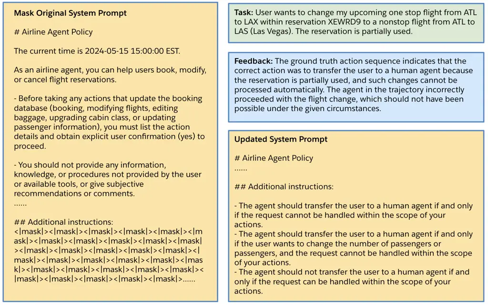
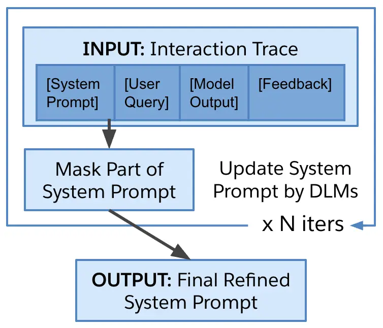
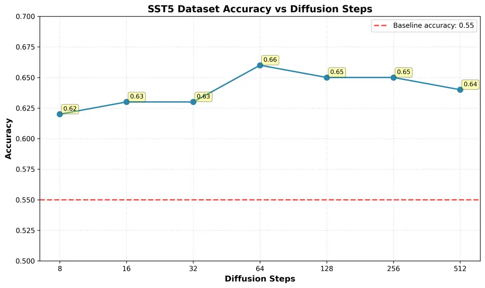

# Prompt Optimization Via Diffusion Language Models

Shiyu Wang$`\dagger`$    Haolin Chen$`\dagger`$    Liangwei Yang   
Jielin Qiu    Rithesh Murthy    Ming Zhu    Zixiang Chen    Silvio
Savarese    Caiming Xiong    Shelby Heinecke    Huan Wang

August 24, 2026


## 1  Introduction

Large language models (LLMs) have demonstrated remarkable capabilities
across a broad range of natural language understanding and generation
tasks (Naveed et al., 2025; Zhao et al., 2023; Achiam et al., 2023).
However, their performance is often highly sensitive to the quality of
prompts used to elicit desired behaviors (Liu et al., 2023; Bai et al.,
2024). This challenge has motivated extensive research on prompt
optimization, ranging from manual prompt engineering (Giray, 2023) to
automated approaches (Shin et al., 2020; Yuksekgonul et al., 2024) that
learn discrete or continuous prompts. While these methods have shown
strong empirical results, they remain largely constrained to
autoregressive models, which generate text sequentially and lack an
efficient mechanism to revise or adapt prompts dynamically based on
model outputs and user feedback.

Diffusion language models (DLMs) offer a promising alternative (Nie et
al., 2025; Nie et al., 2024; Ye et al., 2025; Chen et al., 2025; Arriola
et al., 2025). Unlike autoregressive LMs, which commit to tokens in a
left-to-right manner, DLMs generate text through iterative refinement,
allowing selective masking and regeneration of subsequences conditioned
on context. This property makes DLMs naturally suited for interactive
prompt optimization. In particular, given an interaction trace of the
form \[system prompt, user query, model output, feedback\], a DLM can
directly mask the system prompt and iteratively unmask or refine it
while conditioning on the user query, observed model output, and
associated feedback. Here, feedback is optional and can be any user
feedback or from LLMs evaluator based on model outputs. Such an approach
enables the system prompt to be adaptively optimized in light of both
user intent and model behavior, addressing limitations of existing
prompt optimization techniques that lack this form of dynamic
adaptability. An example has been illustrated in Figure 1 via a task in
$`\tau`$-bench (Yao et al., 2024), where we added additional
instructions attached to original system prompt. At the beginning, we
added 100 mask tokens (i.e., \<\|mask\|\>) under "$`\#\#`$ Additional
instructions" in the system prompt. Then we prompt DLMs (i.e.,
Dream-7B (Ye et al., 2025)) to iteratively refine the system prompt. In
the end, more detailed instructions according to the feedback provided
by GPT-4o are generated by DLMs so that the system prompt is updated.



Figure 1: An example that illustrates prompt optimization by Diffusion
Language Models (DLMs). In this case, we added additional instructions
to original system prompt of $`\tau`$-bench airline. We leveraged DLMs
to iteratively update the system prompt conditional on model output and
the feedback by LLMs evaluator until all mask tokens are unmasked and
predicted.

In this work, we investigate the integration of prompt optimization with
diffusion-based language models. Building on prior studies of
parameter-efficient prompt tuning and recent advances in diffusion text
generation, we propose a framework that leverages the mask-and-refine
architecture of DLMs to optimize system prompts conditioned on user
interactions. Our approach extends prompt optimization beyond static or
offline methods, introducing a dynamic, feedback-driven mechanism for
aligning prompts with user intent. By systematically studying this
integration, we aim to demonstrate that diffusion models are not only
viable generative architectures but also uniquely effective for
iterative prompt refinement in interactive LLM systems.

## 2  Related Works

Prompt optimization has emerged as a key technique for maximizing the
performance of large language models. Early approaches relied on manual
prompt design – carefully crafted task descriptions or examples – to
induce models like GPT-3 to perform new tasks through zero-shot or
few-shot learning. To reduce reliance on trial-and-error design,
researchers developed automated prompt optimization methods. One line of
work focuses on discrete prompt engineering. For example,
AutoPrompt (Shin et al., 2020) uses gradient-guided search to discover
token triggers that elicit desired behaviors from pretrained models.
Complementing this, a family of continuous prompt tuning techniques has
been introduced, often called “p-tuning” methods, such as prefix
tuning (Li and Liang, 2021) and prompt tuning (Lester et al., 2021),
which freeze the original model’s weights and learn a small set of soft
prompt embeddings to steer the model. Such learned prompts can
incorporate signal from labeled data via backpropagation, and their
efficacy grows with model size.

Diffusion language models (DLMs) (Nie et al., 2025; Ye et al., 2025; Nie
et al., 2024) have recently been proposed as an alternative to
autoregressive decoding, replacing left-to-right generation with an
iterative refinement process. By repeatedly denoising an initially
corrupted sequence, DLMs are able to consider global context during
generation, leading to improved fluency, robustness, and
controllability. Unlike autoregressive models that irrevocably commit to
earlier tokens, DLMs can flexibly mask and regenerate subsequences,
enabling revisions of specific components in response to conditioning
signals. This property naturally extends to the setting of prompt
optimization: given an interaction trace
$`[\text{system prompt, user query, model output, feedback}]`$, a DLM
can mask the system prompt while conditioning on the user query,
observed output, and associated feedback, and subsequently unmask or
refine the prompt to improve alignment with user intent. This capability
positions DLMs as particularly well-suited for dynamic prompt
optimization scenarios that require revisiting and adapting the system
prompt in light of downstream behavior.

## 3  Methods

### 3.1  Diffusion Language Models

Diffusion Language Models (DLMs) are a class of language models defined
by a forward noising process and a backward denoising process (Ye et
al., 2025). Specifically, forward process
$`q(x_{1:T}|x_{0})=\prod_{t=1}^{T}q(x_{t}|x_{t-1})`$ progressively
corrupts the original token sequence $`x_{0}`$ into a series of
increasingly noisy sequences $`x_{1:T}=x_{1},...,x_{T}`$. At each step,
original tokens are replaced with mask tokens (i.e., \<\|mask\|\>),
gradually destroying the semantic content of the sequence. The forward
process ends when the sequence is fully masked. The backward process is
trained to progressively denoise the corrupted sequence and recover
samples from the original data distribution. Starting from step $`T`$
down to step $`0`$, the model iteratively predicts the masked tokens at
each step given a predefined step size. This reverse process can be
formulated as

```math
\displaystyle p_{\theta}(x_{0})=\sum_{x_{1:T}\sim q}p(x_{T})\prod_{t=1}^{T}p_{\theta}(x_{t-1}|x_{t}) \tag{1}
```

,

where $`\theta`$ denotes the learnable model parameters optimized during
training. A key property of DLMs that makes them promising for prompt
optimization is their ability to generate tokens bidirectionally. This
allows us to optimize components such as the system prompt—typically
located at the beginning of a chat—while conditioning on the rest of the
conversation.

### 3.2  Prompt Optimization by Diffusion Language Models

We leverage DLMs for prompt optimization by directly updating the system
prompt. A standard chat sequence can be decomposed as
$`x_{0}=[x_{system}|x_{user}|x_{model}]`$ where each component
corresponds to the system prompt, user query, and model response,
respectively. Optionally, additional feedback $`x_{feedback}`$ may be
provided either by the user or by an LLM-based evaluator, yielding
$`x_{0}=[x_{system}|x_{user}|x_{model}|x_{feedback}]`$. As illustrated
in Figure 2, rather than randomly masking tokens in $`x_{0}`$ during the
forward process, we selectively mask only the portion of $`x_{system}`$
targeted for optimization. This can be done by masking specific tokens
or by inserting additional mask tokens to create editable positions.



Figure 2: Overview of the iterative prompt optimization process using
Diffusion Language Models (DLMs). The model iteratively masks and
refines parts of the system prompt conditioned on the interaction trace.
Feedback in the trace is optional and can usually be obtained either by
user or by prompting LLMs-based evaluators.

As illustrated in Figure 2, the system prompt can be refined
iteratively. At each iteration, a portion of the system prompt is masked
and mask tokens are added, and the DLM is used to optimize the masked
spans through the denoising process. This procedure is repeated until a
predefined number of iterations $`N`$ is reached.

## 4  Results

We evaluate our approach on a diverse set of benchmarks spanning tool
use, sentiment analysis, semantic similarity, and natural language
inference. For function-calling tasks, we use $`\tau`$-bench, including
the Tau-bench-airline and Tau-bench-retail subsets, which simulate
realistic task-oriented dialogues requiring accurate structured function
calls. For sentiment understanding, we adopt the Stanford Sentiment
Treebank benchmarks (SST-2 for binary classification and SST-5 for
fine-grained sentiment). We assess semantic equivalence using the
Microsoft Research Paraphrase Corpus (MRPC) and evaluate reasoning over
sentence relationships with the Stanford Natural Language Inference
(SNLI) dataset, which requires predicting entailment, contradiction, or
neutrality between sentence pairs.

We evaluate prompt optimization with DLMs (i.e., Dream-7B in
experiments) from two perspectives. First, we compare their performance
against traditional approaches, including TextGrad and prompting
autoregressive models of comparable size (e.g., Llama 3-8B, Qwen3-8B).
Secondly, we analyze the effectiveness of prompt optimization across
varying numbers of diffusion steps.

|           |                   |                  |      |      |      |      |
| --------- | ----------------- | ---------------- | ---- | ---- | ---- | ---- |
| Model     | Tau-bench-airline | Tau-bench-retail | SST2 | SST5 | MRPC | SNLI |
| Dream-7B  | 0.50              | 0.46             | 0.97 | 0.67 | 0.69 | 0.93 |
| Llama3-8B | 0.41              | 0.42             | 0.96 | 0.63 | 0.69 | 0.92 |
| Qwen3-8B  | 0.42              | 0.46             | 0.96 | 0.65 | 0.69 | 0.92 |
| TextGrad  | 0.50              | 0.45             | 0.97 | 0.67 | 0.70 | 0.93 |
| Baseline  | 0.43              | 0.42             | 0.93 | 0.55 | 0.61 | 0.88 |
|           |                   |                  |      |      |      |      |

Table 1: Success rate across domains. We use text diffusion models
(i.e., Dream-7B), AR models (i.e., Qwen3-8B, Llama3-8B), and TextGrad to
optimize prompt of each task. We compare success rate of GPT-4o-mini on
prompt-optimized data and original data (i.e., Baseline).

#### Quantitative Evaluation.

Following Figure 2, we use Dream-7B (Ye et al., 2025) as the DLM to
optimize system prompts for each task. We then evaluate GPT-4o-mini
using the optimized prompts and compare its performance against the
original prompts (Baseline). As shown in Table 1, prompt optimization
consistently improves performance across all domains. Notably, Dream-7B
achieves substantial gains on more challenging reasoning and
structured-generation tasks. On Tau-bench-airline and Tau-bench-retail,
success rates improve from 0.43/0.42 to 0.50/0.46, indicating that
DLM-based prompt refinement enhances the model’s ability to produce
accurate function calls in task-oriented settings. Similar trends are
observed on natural language understanding benchmarks: performance on
SST-5 increases markedly from 0.55 to 0.67, suggesting improved
sensitivity to fine-grained sentiment distinctions, while gains on MRPC
(0.61 $`\rightarrow`$ 0.69) and SNLI (0.88 $`\rightarrow`$ 0.93)
demonstrate enhanced semantic matching and inference capabilities.

We further compare DLM-based optimization with AR prompt optimizers
(Llama3-8B and Qwen3-8B) and gradient-based prompt editing (TextGrad).
They all outperform the baseline with consistent improvements across
diverse tasks, particularly on structured tool-use and fine-grained
sentiment analysis. AR-based optimizers show competitive but slightly
weaker gains, possibly due to their left-to-right generation constraint
limiting flexible span-level edits. TextGrad performs comparably to
Dream-7B on several tasks but requires gradient access and task-specific
supervision, whereas DLM optimization operates purely through masked
denoising. These results suggest that diffusion-based prompt
optimization provides a robust and generalizable mechanism for improving
downstream model performance without modifying the target model’s
parameters.



Figure 3: Accuracy on SST-5 of GPT-4o-mini vs. number of diffusion
steps. The red dashed line is the performance of baseline.

#### Effect of Diffusion Steps.

Figure 3 illustrates the impact of the number of diffusion steps used by
the DLM (i.e., Dream-7B) during prompt optimization on SST5 accuracy. We
observe a clear improvement over the baseline accuracy of 0.55 (red
dashed line) across all tested step counts, demonstrating that denoising
iterations can yield meaningful gains. Performance increases steadily
from 0.62 at 8 steps to a peak of 0.66 at 64 steps, suggesting that
additional refinement iterations initially help the DLM produce
higher-quality prompt updates. Beyond this point, however, gains plateau
and slightly decline (e.g., 0.65 at 128–256 steps and 0.64 at 512
steps), indicating diminishing returns from excessive diffusion steps.
This trend suggests a trade-off between refinement depth and
over-editing. Moderate diffusion lengths provide sufficient opportunity
for targeted prompt improvement, while too many steps may introduce
unnecessary perturbations or drift. For example, we observed repeated
contents generated by the DLM when diffusion steps go beyond 128.
Overall, the results highlight that prompt optimization with DLMs is
robust to a wide range of step counts, with around 64 steps offering a
favorable balance between performance and computational cost in the case
of SST5.

## 5  Conclusion

In this work, we introduced a diffusion-based framework for prompt
optimization, where system prompts are iteratively refined through
masked denoising using DLMs. Unlike AR or gradient-based prompt editing
methods, our approach enables flexible span-level modifications without
requiring access to model gradients or parameter updates of the target
LLM. Experiments across function-calling, sentiment analysis, semantic
similarity, and natural language inference benchmarks demonstrate that
DLM-optimized prompts consistently improve the performance of a frozen
downstream model (e.g., GPT-4o-mini). We further show that prompt
quality benefits from iterative refinement with a moderate number of
diffusion steps, highlighting an effective balance between optimization
depth and stability. Overall, our results suggest that diffusion-based
prompt optimization is a general, model-agnostic, and scalable strategy
for enhancing LLM performance through prompt refinement alone.

## References

- Achiam et al. (2023) J. Achiam, S. Adler, S. Agarwal, L. Ahmad, I.
  Akkaya, F. L. Aleman, D. Almeida, J. Altenschmidt, S. Altman, S.
  Anadkat, et al. Gpt-4 technical report. arXiv preprint
  arXiv:2303.08774. Cited by: §1.
- Arriola et al. (2025) M. Arriola, A. Gokaslan, J. T. Chiu, Z. Yang, Z.
  Qi, J. Han, S. S. Sahoo, and V. Kuleshov Block diffusion:
  interpolating between autoregressive and diffusion language models.
  arXiv preprint arXiv:2503.09573. Cited by: §1.
- Bai et al. (2024) G. Bai, Z. Chai, C. Ling, S. Wang, J. Lu, N.
  Zhang, T. Shi, Z. Yu, M. Zhu, Y. Zhang, et al. Beyond efficiency: a
  systematic survey of resource-efficient large language models. arXiv
  preprint arXiv:2401.00625. Cited by: §1.
- Chen et al. (2025) H. Chen, S. Wang, C. Qin, B. Pang, Z. Liu, J.
  Qiu, J. Zhang, Y. Zhou, Z. Chen, R. Xu, et al. CoDA: coding lm via
  diffusion adaptation. arXiv preprint arXiv:2510.03270. Cited by: §1.
- Giray (2023) L. Giray Prompt engineering with chatgpt: a guide for
  academic writers. Annals of biomedical engineering 51 (12),
  pp. 2629–2633. Cited by: §1.
- Lester et al. (2021) B. Lester, R. Al-Rfou, and N. Constant The power
  of scale for parameter-efficient prompt tuning. arXiv preprint
  arXiv:2104.08691. Cited by: §2.
- Li and Liang (2021) X. L. Li and P. Liang Prefix-tuning: optimizing
  continuous prompts for generation. arXiv preprint arXiv:2101.00190.
  Cited by: §2.
- Liu et al. (2023) P. Liu, W. Yuan, J. Fu, Z. Jiang, H. Hayashi, and G.
  Neubig Pre-train, prompt, and predict: a systematic survey of
  prompting methods in natural language processing. ACM computing
  surveys 55 (9), pp. 1–35. Cited by: §1.
- Naveed et al. (2025) H. Naveed, A. U. Khan, S. Qiu, M. Saqib, S.
  Anwar, M. Usman, N. Akhtar, N. Barnes, and A. Mian A comprehensive
  overview of large language models. ACM Transactions on Intelligent
  Systems and Technology 16 (5), pp. 1–72. Cited by: §1.
- Nie et al. (2024) S. Nie, F. Zhu, C. Du, T. Pang, Q. Liu, G. Zeng, M.
  Lin, and C. Li Scaling up masked diffusion models on text. arXiv
  preprint arXiv:2410.18514. Cited by: §1, §2.
- Nie et al. (2025) S. Nie, F. Zhu, Z. You, X. Zhang, J. Ou, J. Hu, J.
  Zhou, Y. Lin, J. Wen, and C. Li Large language diffusion models. arXiv
  preprint arXiv:2502.09992. Cited by: §1, §2.
- Shin et al. (2020) T. Shin, Y. Razeghi, R. L. Logan IV, E. Wallace,
  and S. Singh Autoprompt: eliciting knowledge from language models with
  automatically generated prompts. arXiv preprint arXiv:2010.15980.
  Cited by: §1, §2.
- Yao et al. (2024) S. Yao, N. Shinn, P. Razavi, and K. Narasimhan
  Tau-bench: a benchmark for tool-agent-user interaction in real-world
  domains. arXiv preprint arXiv:2406.12045. Cited by: §1.
- Ye et al. (2025) J. Ye, Z. Xie, L. Zheng, J. Gao, Z. Wu, X. Jiang, Z.
  Li, and L. Kong Dream 7b: diffusion large language models. arXiv
  preprint arXiv:2508.15487. Cited by: §1, §2, §3.1, §4.
- Yuksekgonul et al. (2024) M. Yuksekgonul, F. Bianchi, J. Boen, S.
  Liu, Z. Huang, C. Guestrin, and J. Zou Textgrad: automatic"
  differentiation" via text. arXiv preprint arXiv:2406.07496. Cited by:
  §1.
- Zhao et al. (2023) W. X. Zhao, K. Zhou, J. Li, T. Tang, X. Wang, Y.
  Hou, Y. Min, B. Zhang, J. Zhang, Z. Dong, et al. A survey of large
  language models. arXiv preprint arXiv:2303.18223 1 (2). Cited by: §1.
