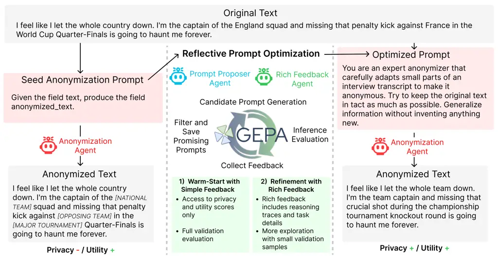
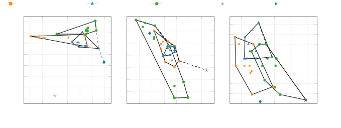

# Adaptive Text Anonymization: Learning Privacy-Utility Trade-offs via Prompt Optimization

Gabriel Loiseau   Damien Sileo   Damien Riquet   Maxime Meyer   Marc
Tommasi Affiliation: Hornetsecurity, Hem, France Affiliation: Univ.
Lille, Inria, CNRS, Centrale Lille, UMR 9189 - CRIStAL, F-59000 Lille,
France Email: [gabriel.loiseau@inria.fr](mailto:)

###### Abstract

Anonymizing textual documents is a highly context-sensitive problem: the
appropriate balance between privacy protection and utility preservation
varies with the data domain, privacy objectives, and downstream
application. However, existing anonymization methods rely on static,
manually designed strategies that lack the flexibility to adjust to
diverse requirements and often fail to generalize across domains. We
introduce adaptive text anonymization, a new task formulation in which
anonymization strategies are automatically adapted to specific
privacy–utility requirements. We propose a framework for task-specific
prompt optimization that automatically constructs anonymization
instructions for language models, enabling adaptation to different
privacy goals, domains, and downstream usage patterns. To evaluate our
approach, we present a benchmark spanning five datasets with diverse
domains, privacy constraints, and utility objectives. Across all
evaluated settings, our framework consistently achieves a better
privacy–utility trade-off than existing baselines, while remaining
computationally efficient and effective on open-source language models,
with performance comparable to larger closed-source models.
Additionally, we show that our method can discover novel anonymization
strategies that explore different points along the privacy–utility
trade-off frontier.¹¹ 1 Our data, code, and optimized prompts are
available at ![[Uncaptioned
image]](arxiv-2602-20743v2--01742d52f418.figures/figure-1.webp) [https://github.com/gabrielloiseau/adaptive-text-anonymization](https://github.com/gabrielloiseau/adaptive-text-anonymization)

## 1 Introduction

Text anonymization has emerged as a fundamental technique for enabling
the sharing and analysis of sensitive textual data while protecting
individual privacy. Traditionally, privacy protection has been grounded
in formal guarantees, most notably differential privacy Dwork (2006),
which provides strong, distribution-independent assurances against
information leakage. However, applying such guaranties to free-form text
remains notoriously difficult: defining neighboring datasets,
calibrating noise, and preserving semantic utility are all unresolved
challenges in practice Mattern et al. (2022); Meisenbacher et al.
(2025); Çano and Habernal (2025). As a result, text anonymization is
often conducted under a weaker but more operational notion of privacy,
where an adversary with access to auxiliary background knowledge
attempts to infer sensitive attributes from the released text.

Within this adversarial framing, large language models (LLMs) play a
dual role. On the one hand, they constitute a powerful and realistic
attacker model: LLMs encode broad world knowledge, can exploit subtle
contextual cues, and have been shown to strategically re-identify
sensitive information even after sophisticated anonymization Staab
et al. (2024). On the other hand, the same capabilities make LLMs
effective anonymizers. When properly instructed, LLMs can perform
nuanced, context-aware obfuscation of sensitive attributes, often
outperforming rule-based or static methods Staab et al. (2025); Yang
et al. (2025). Recent work has demonstrated that collaborative settings
involving an “attacker” LLM and an “anonymizer” LLM can further
strengthen privacy, with multi-hop refinement yielding substantial
improvements in anonymization quality Yang et al. (2025); Brahem et al.
(2024).

Nonetheless, successful anonymization is inherently context-dependent
and must be evaluated across multiple dimensions. The effectiveness of
anonymization strategies depends primarily on two key factors: the
capabilities and resources of potential adversaries, and the specific
notion of utility that must be preserved. These factors interact to
create distinct anonymization requirements across different use cases.
For instance, anonymizing a medical report containing sensitive patient
information demands a fundamentally different approach than anonymizing
casual online comments. Medical records may require protection against
attackers capable of infering sensitive patient attributes, while
preserving precise clinical terminology and diagnostic relationships
essential for medical research. In contrast, online comments may face
different threat models, such as inference attacks based on writing
style or demographic cues. The diversity of these scenarios underscores
that no single anonymization strategy can adequately address all
privacy-utility requirements Loiseau et al. (2025), necessitating
adaptive approaches that can be tailored to specific adversarial
assumptions and utility constraints Pasch and Cha (2025). In practice,
selecting a particular privacy–utility trade-off ultimately reflects an
explicit risk assessment, in which acceptable levels of disclosure risk
are weighed against task-specific utility requirements.

Despite these advances, modern LLM-based anonymization pipelines suffer
from three key limitations that hinder their practical deployment.
First, they adopt a fixed trade-off paradigm, in which a single
anonymization strategy is manually designed for each specific scenario,
preventing flexible adaptation to new privacy-utility requirements.
Second, they rely on manual prompt engineering, requiring practitioners
to iteratively design and refine instructions through trial and error—a
process that is subjective, labor-intensive, and often yields suboptimal
results. Third, they typically depend on proprietary closed-source
models to achieve effective anonymization, creating a fundamental
contradiction: processing sensitive data through external API providers
inherently conflicts with privacy objectives. These limitations combine
to produce anonymization systems that are brittle across domains, costly
to adapt to new contexts, and unsuitable for real-world deployment where
sensitive content must remain under local control.

To address these challenges, we introduce adaptive text anonymization, a
framework that automatically learns domain- and task-specific
anonymization strategies through prompt optimization. We formulate
anonymization as a multi-objective optimization problem in which privacy
and utility requirements are explicitly specified, targeting automatic
adaptation. Our framework employs evolutionary prompt optimization and
can operate on medium-sized language models, achieving performance
comparable to proprietary API-based solutions while preserving full data
privacy. Our contributions are as follows:

- –
  We propose an adaptive anonymization framework that automatically
  discovers effective anonymization instructions through agentic
  collaboration and prompt optimization, enabling open-source models to
  navigate diverse privacy–utility trade-offs without manual prompt
  design.
- –
  We introduce a unified multi-task evaluation setup spanning five
  anonymization tasks across distinct domains, privacy objectives, and
  utility constraints, providing a comprehensive evaluation suite for
  adaptive text anonymization.
- –
  We present extensive empirical results demonstrating that our approach
  achieves state-of-the-art performance with open-source models and
  outperforms traditional anonymization methods both on their target
  task and on new domains.
- –
  We show that our method enables explicit exploration of the
  privacy–utility trade-off space, discovering multiple anonymization
  strategies that favor different operating points and allowing
  practitioners to select models aligned with their deployment
  requirements.

Figure 1: Overview of our approach. We perform reflective prompt
optimization using the GEPA algorithm Agrawal et al. (2026). Our method
adapts a base seed prompt into an optimized prompt defining the privacy
and utility task requirements. The optimization operates in a strict
fixed budget environment while learning sufficiently strong patterns to
adapt to the anonymization objective.

## 2 Related Work

#### Text Anonymization.

Text anonymization seeks to enable the sharing of sensitive textual data
by removing or obfuscating personal identifiers while preserving
document utility. Traditional approaches predominantly rely on sequence
labeling models trained on manually annotated datasets to detect and
mask predefined categories of sensitive entities Deußer et al. (2025);
Hathurusinghe et al. (2021); Francopoulo and Schaub (2020); Lison et al.
(2021). While effective in structured privacy settings, these methods
often overlook the impact of anonymization on downstream utility or
restrict evaluation to surface-level text quality metrics Yermilov
et al. (2023); Staab et al. (2025). This limitation is further
compounded by the lack of comprehensive benchmarks that systematically
evaluate privacy–utility trade-offs across diverse domains, threat
models, and task requirements Pasch and Cha (2025); Loiseau et al.
(2025).

#### Anonymization via LLM Pipelines.

The advent of large language models has fundamentally reshaped text
anonymization, establishing LLMs as both powerful privacy adversaries
and potential defenders. Recent studies show that LLMs can successfully
re-identify sensitive attributes in anonymized text Staab et al. (2024);
Patsakis and Lykousas (2023), exposing the limitations of traditional
anonymization pipelines. In response, several works have explored the
use of LLMs themselves as anonymization agents. Staab et al. (2025)
introduced adversarial LLM collaboration, using a simulated attacker to
guide anonymization decisions. Subsequent work has extended this
paradigm by injecting synthetic information to mislead attackers while
preserving utility Frikha et al. (2024), or by incorporating multi-hop
refinement among attacker, utility evaluator, and anonymizer LLMs to
improve robustness Yang et al. (2025). Despite their effectiveness,
these approaches rely heavily on manually designed instructions and
domain-specific prompt engineering Dou et al. (2024); Brahem et al.
(2024), limiting their scalability and adaptability. Moreover, most
methods depend on closed, API-based models (e.g., GPT-4/5 Deußer et al.
(2025)), raising practical and ethical concerns when processing
sensitive data in deployment settings that require local control.

#### Prompt Optimization.

Automated prompt optimization has emerged as a promising alternative to
manual prompt engineering, which is often inefficient, subjective, and
difficult to generalize across tasks Yang et al. (2024); Wei et al.
(2022). Recent work has explored search-based techniques Zhou et al.
(2023); Opsahl-Ong et al. (2024) and evolutionary algorithms that
iteratively refine prompts through mutation and selection Agrawal et al.
(2026); Chen et al. (2024). These methods have demonstrated strong
performance across a variety of NLP tasks, but, to the best of our
knowledge, have not yet been applied to privacy-sensitive settings such
as text anonymization. In particular, the potential of prompt
optimization to automatically generate task-specific anonymization
instructions aligned with explicit privacy objectives and utility
constraints remains largely unexplored. Our work bridges this gap by
leveraging evolutionary prompt optimization to enable adaptive,
context-aware text anonymization without manual prompt design.

## 3 Our Approach

We introduce an agentic optimization framework for LLM-based text
anonymization tasks. Our approach conceptualizes anonymization as a text
generation task that can be learned and refined through natural language
instruction and self-reflection. By framing the problem as prompt
optimization, our framework enables a local anonymization agent to adapt
its behavior to specific privacy objectives, data domains and downstream
utility requirements without requiring manual prompt engineering or
model retraining. This section formalizes the text anonymization
problem, presents our two-stage optimization pipeline, and details the
mechanisms enabling automatic adaptation across diverse privacy-utility
trade-offs.

### 3.1 Problem Formulation

We view text anonymization as an adaptive, task-conditioned rewriting
problem rather than a fixed set of redaction rules. In many practical
deployments, the anonymizer must be configured before processing data:
(i) a privacy specification describes what must be protected (e.g., PII,
quasi-identifiers, writing style, organization-specific secrets), and
(ii) a utility specification describes what must be preserved to remain
compatible with downstream use (e.g., clinical meaning, intent labels,
formatting). This formulation aligns with regulations such as GDPR’s
emphasis on specified purposes for data processing GDPR (2016). We call
this setting adaptive task anonymization. Formally, an anonymization
task is defined by a pair $`(p,u)`$, where $`p`$ is the privacy
objective and $`u`$ is the utility objective. Given an input text $`x`$,
the goal is to produce an anonymized text $`\tilde{x}`$ that satisfies
$`p`$ while preserving the aspects required by $`u`$. These objectives
are provided to the model as inputs rather than as fixed criteria, the
same raw text may admit multiple acceptable anonymizations, reflecting
different trade-offs aligned with distinct downstream applications.

Rather than retraining models for each domain, we represent the
anonymizer as an LLM guided by a natural-language instruction prompt
$`\Pi`$. The key challenge is to obtain an instruction $`\Pi`$ that is
well-matched to the task $`(p,u)`$. Our contribution is to learn $`\Pi`$
automatically from the task specification (i.e., its evaluation
procedure) and empirical feedback. We start from a single universal seed
prompt $`\Pi_{0}`$ shared across all tasks and evolve it into a
task-adapted prompt. This keeps the anonymization model unchanged and
shifts adaptation to prompt optimization.

### 3.2 Framework Overview

1: Dataset $`D`$, base feedback metric $`\mu`$, budget $`B`$, local
model $`m`$, feedback creation model $`\mathcal{M}`$

2: Base prompt $`\Pi_{0}`$, early-stop patience $`n`$, sampling ratio
$`\alpha`$

3: Stage 1: Initialization

4: Split $`D`$ into $`D_{\text{train}}`$ and $`D_{\text{valid}}`$

5: Initialize prompt pool $`P\leftarrow\{\Pi^{m}_{0}\}`$

6: Stage 2: Warm-Start with Basic Feedback

7: while $`B>0`$ and no improvement for $`<n`$ iterations do

8:
  $`\Pi^{m}_{\text{new}}\leftarrow\text{GEPA}(P,D_{\text{train}},D_{\text{valid}},\mu,m)`$

9:   $`P\leftarrow P\cup\{\Pi^{m}_{\text{new}}\}`$; update $`B`$

10: end while

11: Stage 3: Refinement with Rich Feedback

12: if $`B>0`$ then

13:   $`\mu_{\text{rich}}\leftarrow\mathcal{M}(\mu)`$

14:   while $`B>0`$ do

15:
   $`D^{\prime}_{\text{valid}}\leftarrow\text{Sample}(D_{\text{valid}},\alpha)`$

16:
   $`\Pi^{m}_{\text{new}}\leftarrow\text{GEPA}(P,D_{\text{train}},D^{\prime}_{\text{valid}},\mu_{\text{rich}},m)`$

17:    $`P\leftarrow P\cup\{\Pi^{m}_{\text{new}}\}`$; update $`B`$

18:   end while

19: end if

20: return
$`\arg\max_{\Pi^{m}\in P}\text{Score}(\Pi^{m},D_{\text{valid}})`$

Algorithm 1 Two-Phase GEPA for Text Anonymization

Algorithm 1 operationalizes adaptive task anonymization as prompt
evolution and optimization. We explore anonymization instructions under
a fixed computational budget $`B`$, measured in LLM forward passes. The
framework operates entirely using a locally deployable language model
$`m`$, which serves two roles: (i) an anonymization agent that applies
candidate instructions to produce anonymized text, and (ii) a proposer
agent that generates new instruction variants during optimization.

Our approach builds upon GEPA Agrawal et al. (2026), an evolutionary
prompt optimization algorithm that treats prompts as individuals in a
population $`P`$, evolved through selection, mutation, and evaluation.
Candidate prompts are retained via Pareto-based selection over privacy
and utility, encouraging diverse trade-off strategies. GEPA employs
reflective mutation: the proposer analyzes execution traces and feedback
to propose targeted modifications.

### 3.3 Stage 1: Initialization

The optimization begins with partitioning the dataset $`D`$ into
training and validation splits, denoted $`D_{\text{train}}`$ and
$`D_{\text{valid}}`$. The training set is used to generate anonymized
outputs during candidate evaluation, while the validation set defines
the fitness landscape used to score candidate instructions. We
initialize the prompt pool $`P`$ with a single candidate
$`\Pi^{m}_{0}`$, which pairs a generic seed instruction $`\Pi_{0}`$
("Given the field ‘text‘, produce the field ‘anonymized_text‘.") with
the local model $`m`$. This seed provides a minimal anonymization
behavior from which more specialized strategies can evolve. During early
optimization, candidate prompts are evaluated using a base feedback
function $`\mu`$, which serves as a learnable proxy for the task
specification $`(p,u)`$ defined in Section 3.1. The function $`\mu`$ is
typically defined as a scalar aggregation of privacy and utility
evaluation metrics (i.e., their average) without additional detail,
which provides a coarse signal to guide exploration.

### 3.4 Stage 2: Warm-Start with Basic Feedback

Stage 2 applies standard GEPA to explore the instruction space using
base feedback $`\mu`$. Each iteration: (1) selects diverse,
high-performing prompts from the pool $`P`$ using Pareto-based ranking
over privacy and utility objectives; (2) The proposer agent analyzes
execution traces and feedback associated with a selected prompt on a
minibatch of texts in $`D_{\text{train}}`$ and proposes targeted
instruction modifications, yielding a new candidate
$`\Pi^{m}_{\text{new}}`$. And (3) The new prompt is applied to the same
minibatch of $`D_{\text{train}}`$. If an improvement is observed on this
minibatch, it gets evaluated on $`D_{\text{valid}}`$ using $`\mu`$, and
incorporated into $`P`$, with dominated candidates removed via Pareto
pruning. Stage 2 terminates when either the budget $`B`$ is exhausted or
validation performance plateaus for $`n`$ consecutive iterations. This
early-stopping criterion preserves budget for later refinement.

### 3.5 Stage 3: Refinement with Rich Feedback

If computational budget remains, the algorithm transitions to a
refinement phase that aims to escape local optima and achieving
finer-grained control over the privacy–utility trade-off. This phase
extends standard GEPA with two novel mechanisms.

#### Rich Feedback Generation.

A rich feedback function $`\mu_{\text{rich}}`$ is derived from the
task-specific metric definitions by decomposing the aggregate score
$`\mu`$. In addition to scalar values, $`\mu_{\text{rich}}`$ may include
natural-language explanations or evaluator reasoning traces that provide
interpretable, structured feedback to the proposer agent. This feedback
function is generated once per task by a separate LLM (referred to as
the rich feedback agent in Figure 1), ensuring consistency and avoiding
manual, subjective feedback design²² 2 In practice, we assign the rich
feedback agent a code-generation task using the implementation of
$`\mu`$ in order to obtain the corresponding implementation of
$`\mu_{rich}`$. More information in Appendix F..

#### Adaptive Validation Sampling.

To improve exploration under the remaining budget, we evaluate candidate
prompts over sampled validation subsets
$`D^{\prime}_{\text{valid}}\subset D_{\text{valid}}`$. Sampling follows
a round-robin strategy prioritizing under-evaluated examples, balancing
computational efficiency with coverage diversity. This reduces the
budget consumption during evaluation while mitigating overfitting. Final
model selection is performed using the full validation set to ensure
fair comparison.

With these mechanisms, GEPA continues to evolve the prompt pool until
the budget is exhausted. The richer feedback enables the proposer agent
to perform larger, even more targeted behavioral updates using fewer
evaluations. The framework ultimately returns the best-performing
anonymization system $`\Pi^{*}`$ identified during optimization,
corresponding to the highest validation score under the specified
privacy–utility configuration.

## 4 Experiments

#### Evaluation Setup

We evaluate our framework on five anonymization tasks spanning diverse
domains, privacy threat models, and utility requirements. Each task
poses distinct challenges in balancing privacy protection against
information preservation, reflecting the context-dependent nature of
real-world anonymization. The datasets are drawn from prior work Yang
et al. (2025); Xin et al. (2025); Li et al. (2025), and we retain their
original evaluation protocols and implementations whenever available to
ensure fair comparison. Additional dataset details are provided in
Appendix J.

DB-Bio Yang et al. (2025). A collection of DBpedia biographies of
notable individuals. Privacy: A binary re-identification metric in which
an attacker LLM attempts to recover the individual’s identity by
proposing the top-3 candidate names from the anonymized biography.
Utility: Occupation classification accuracy measured on anonymized text.

SynthPAI Yukhymenko et al. (2024). Synthetic Reddit-style posts encoding
demographic attributes (e.g., age, gender, location) through writing
style and contextual cues. Privacy: A binary inference metric indicating
whether an attacker LLM can correctly predict target demographic
attributes from the anonymized text. Utility: ROUGE-1 F-measure
assessing content preservation.

TAB Pilán et al. (2022). European court case documents containing
personal information about involved parties and witnesses. Privacy:
Recall of correctly masked sensitive spans relative to gold-standard
annotations. Utility: Semantic similarity between original and
anonymized documents.

PUPA Zhao et al. (2024). User prompts from ChatGPT interactions
containing explicit personally identifiable information (PII), including
names, addresses, phone numbers, and email addresses. Privacy: PII
leakage rate, defined as the fraction of sensitive entities remaining in
the sanitized prompts. Utility: An LLM-as-judge evaluation comparing
response quality between original and anonymized prompts.

MedQA Jin et al. (2021). Clinical case descriptions drawn from
USMLE-style medical examinations. Privacy: Stylometric distance between
original and sanitized texts, computed using LUAR embeddings Rivera-Soto
et al. (2021), to reduce the risk of patient re-identification. Utility:
Accuracy of selecting the correct medical diagnosis from multiple-choice
options.

#### Comparison Methods.

To assess the effectiveness of our framework, we compare against five
baseline methods that span traditional entity-based anonymization,
adversarial LLM pipelines, and manual prompt engineering. Together,
these baselines cover the dominant paradigms in contemporary text
anonymization.

- –
  OpenPII: A supervised PII detection model fine-tuned on the OpenPII
  dataset³³ 3
  [https://hf.co/datasets/ai4privacy/open-pii-masking-500k-ai4privacy](https://hf.co/datasets/ai4privacy/open-pii-masking-500k-ai4privacy),
  using ModernBERT Warner et al. (2025), representing entity-centric
  anonymization via explicit span detection.
- –
  DP-Prompt: A document-level Local Differential Privacy (LDP) mechanism
  that builds on a paraphrasing model (Utpala et al., 2023). It
  privatizes text by clipping model logits and applying randomized
  perturbations to enforce a local DP guarantee. Due to the impact of
  noise on the utility harm, we set the privacy budget $`\epsilon=100`$.
- –
  Adversarial Feedback (AF): The method proposed by Staab et al. (2025),
  using adversarial collaboration between two LLM agents: an attacker
  that attempts re-identification and an anonymizer that iteratively
  refines its outputs based on attacker feedback.
- –
  RUPTA: The approach of Yang et al. (2025), extending adversarial
  feedback with an additional utility judge. We evaluate RUPTA
  exclusively on DB-Bio, as it was designed for classification-oriented
  utility objectives.
- –
  Task-Specific Manual Prompting: Expert-crafted prompts encoding
  privacy and utility requirements for each task, isolating the benefit
  of automatic prompt optimization.

#### Implementation Details.

All implementations and optimizations in this paper are carried out
using the DSPy Khattab et al. (2024) library⁴⁴ 4 Preliminary experiments
confirm that the baseline methods are fully reproducible, showing no
statistically significant differences between the original authors’
implementations and those using DSPy.. We evaluate our framework using
three open-source language models: ![[Uncaptioned
image]](arxiv-2602-20743v2--01742d52f418.figures/figure-3.webp) Mistral-Small-3.2-24B⁵⁵
5
[https://hf.co/mistralai/Mistral-Small-3.2-24B-Instruct-2506](https://hf.co/mistralai/Mistral-Small-3.2-24B-Instruct-2506),
![[Uncaptioned
image]](arxiv-2602-20743v2--01742d52f418.figures/figure-4.webp) Gemma-3-27B
Team et al. (2025), and ![[Uncaptioned
image]](arxiv-2602-20743v2--01742d52f418.figures/figure-5.webp) Qwen3-30B-A3B
Team (2025). Following GEPA experiment settings Agrawal et al. (2026)
and to simulate realistic deployment with limited access to labeled
sensitive data, we restrict training to a small, fixed set of 111
examples for training and 111 examples for validation per task
($`|D_{\text{train}}|=|D_{\text{valid}}|=111`$), reserving all remaining
examples exclusively for testing. We configure the evolutionary
optimization with a maximum rollout budget of $`B=1500`$ LLM forward
passes, an early-stop patience of $`n=5`$ iterations and set the
adaptive validation sampling ratio to $`\alpha=0.3`$. This configuration
balances exploration of the instruction space with computational
efficiency across tasks and models. For evaluation, we report each
benchmark’s primary native metric and adhere to the official evaluation
implementations whenever available to ensure comparability with prior
work. Privacy and utility metrics that require model-based evaluation
are computed using ![[Uncaptioned
image]](arxiv-2602-20743v2--01742d52f418.figures/figure-4.webp) Gemini-2.5-flash
Comanici et al. (2025) as a strong and consistent evaluator backbone. As
a reference closed-source model for LLM-based comparison baselines, we
use ![[Uncaptioned
image]](arxiv-2602-20743v2--01742d52f418.figures/figure-6.webp) GPT-5-chat OpenAI
(2025) as the underlying model to reflect state-of-the-art performance
and to faithfully reproduce original method behavior. Additional
implementation details, including prompts, hyperparameters, and
computational costs, are provided in Appendix F. An ablation study
analyzing the contribution of each component in our optimization
approach is provided in Appendix A.

Benchmark Model AF Staab et al. (2025) Task-Specific Prompt Seed Prompt
Optimized Prompt Privacy Score $`\uparrow`$ / Utility Score $`\uparrow`$
DB-Bio ![[Uncaptioned
image]](arxiv-2602-20743v2--01742d52f418.figures/figure-3.webp) Mistral-Small-3.2-24B
59.7 / 98.1 58.8 / 100 54.5 / 98.9 61.2 / 100 ![[Uncaptioned
image]](arxiv-2602-20743v2--01742d52f418.figures/figure-4.webp) Gemma-3-27B-it
59.1 / 94.2 47.1 / 100 67.6 / 99.1 77.6 / 100 ![[Uncaptioned
image]](arxiv-2602-20743v2--01742d52f418.figures/figure-5.webp) Qwen3-30B-A3B
58.8 / 97.2 53.2 / 100 64.0 / 100 65.5 / 100 SynthPAI ![[Uncaptioned
image]](arxiv-2602-20743v2--01742d52f418.figures/figure-3.webp) Mistral-Small-3.2-24B
35.3 / 67.6 5.90 / 97.1 6.30 / 99.2 38.7 / 77.4 ![[Uncaptioned
image]](arxiv-2602-20743v2--01742d52f418.figures/figure-4.webp) Gemma-3-27B-it
40.7 / 60.2 23.5 / 70.4 36.0 / 62.9 36.0 / 77.1 ![[Uncaptioned
image]](arxiv-2602-20743v2--01742d52f418.figures/figure-5.webp) Qwen3-30B-A3B
31.3 / 56.0 7.32 / 93.7 12.6 / 92.4 22.5 / 94.4 TAB ![[Uncaptioned
image]](arxiv-2602-20743v2--01742d52f418.figures/figure-3.webp) Mistral-Small-3.2-24B
45.1 / 53.5 39.2 / 55.5 20.8 / 54.3 83.6 / 53.7 ![[Uncaptioned
image]](arxiv-2602-20743v2--01742d52f418.figures/figure-4.webp) Gemma-3-27B-it
62.1 / 53.7 68.3 / 51.3 61.8 / 55.9 81.9 / 54.1 ![[Uncaptioned
image]](arxiv-2602-20743v2--01742d52f418.figures/figure-5.webp) Qwen3-30B-A3B
26.1 / 54.4 36.4 / 52.4 36.2 / 54.0 92.3 / 56.2 PUPA ![[Uncaptioned
image]](arxiv-2602-20743v2--01742d52f418.figures/figure-3.webp) Mistral-Small-3.2-24B
77.1 / 76.5 82.7 / 76.2 75.0 / 77.5 85.3 / 82.9 ![[Uncaptioned
image]](arxiv-2602-20743v2--01742d52f418.figures/figure-4.webp) Gemma-3-27B-it
93.9 / 64.7 80.7 / 76.5 88.1 / 77.1 94.3 / 79.1 ![[Uncaptioned
image]](arxiv-2602-20743v2--01742d52f418.figures/figure-5.webp) Qwen3-30B-A3B
86.3 / 70.6 94.1 / 78.2 82.3 / 72.1 98.0 / 79.3 MedQA ![[Uncaptioned
image]](arxiv-2602-20743v2--01742d52f418.figures/figure-3.webp) Mistral-Small-3.2-24B
9.39 / 41.2 7.33 / 35.3 2.91 / 54.9 8.06 / 53.2 ![[Uncaptioned
image]](arxiv-2602-20743v2--01742d52f418.figures/figure-4.webp) Gemma-3-27B-it
11.7 / 29.4 10.7 / 35.3 12.0 / 46.8 14.3 / 56.8 ![[Uncaptioned
image]](arxiv-2602-20743v2--01742d52f418.figures/figure-5.webp) Qwen3-30B-A3B
6.53 / 29.4 8.25 / 41.2 3.52 / 58.6 24.6 / 45.9

Table 1: Results on open source models across all benchmark tasks. The
best overall privacy–utility trade-off is shown in bold. Otherwise, the
best score for each individual component is underlined. Prompt
optimization consistently yields stronger privacy-utility trade-offs
than static anonymization baselines and task-specific prompts, often
improving privacy substantially while preserving or even improving
utility across diverse tasks and model families.

## 5 Experimental Results

### 5.1 Overall Performance

We evaluate along two axes: (i) prompt optimization impact on
open-source models relative to anonymization baselines applied to the
same model, and (ii) competitiveness against GPT-5–based methods. We
report test _Privacy_ and _Utility_ scores throughout (higher percentage
is better).

Table 1 summarizes results across all tasks and open-source models. The
Optimized Prompt consistently improves privacy over the Seed Prompt and
is frequently the strongest or best-balanced open-source approach. These
gains are typically achieved with minimal utility loss, indicating that
the optimizer discovers task-appropriate trade-offs rather than
optimizing a single objective.

Privacy gains are largest on structurally amenable tasks such as TAB and
PUPA, where optimization substantially improves privacy while preserving
semantics or response quality. On DB-Bio, optimized prompts maintain
near-perfect utility while improving privacy, reflecting the relatively
permissive trade-offs of classification-based metrics. Although SynthPAI
and MedQA present stronger privacy–utility tension, optimization still
yields consistent improvements over seed prompts across models.

Models exhibit consistent, distinct behaviors. Mistral exhibits steep
privacy gains, sometimes at the cost of utility; Gemma favors more
conservative improvements building on the privacy-focused behavior
established by the seed prompt; and Qwen is the most robust, frequently
achieving high privacy and utility simultaneously. These patterns
suggest that the optimizer adapts to model-specific inductive biases
rather than converging to a single anonymization strategy. Table 2
compares one of our open-source configuration with GPT-5–based AF,
task-specific prompting, RUPTA, OpenPII, and DP-Prompt. The latter two
serve as baselines for utility-focused and privacy-focused methods,
respectively⁶⁶ 6 A comparison across different privacy budgets for
DP-Prompt is provided in Appendix D. Despite using a smaller model,
optimized Qwen is competitive across all tasks: it matches GPT-5 on
MedQA, achieves higher utility at comparable privacy on PUPA, and
attains the strongest overall utility scores. This demonstrates that
adaptive prompt optimization substantially narrows the gap between open-
and closed-source anonymization pipelines. The benchmarks expose
distinct privacy–utility landscapes. DB-Bio admits near-optimal
solutions on both axes, while SynthPAI and MedQA enforce stricter
trade-offs. Across these regimes, our framework consistently identifies
effective strategies given the intrinsic constraints of each task.

|                                                                                               |           |           |           |           |           |
| --------------------------------------------------------------------------------------------- | --------- | --------- | --------- | --------- | --------- |
| Methods                                                                                       | DB-Bio    | SynthPAI  | TAB       | PUPA      | MedQA     |
| OpenPII                                                                                       | 57.6/98.1 | 9.02/97.3 | 87.1/32.2 | 75.4/70.3 | 3.80/59.5 |
| DP-Prompt                                                                                     | 82.1/13.2 | 95.2/1.49 | 99.2/37.4 | 84.2/49.1 | 51.6/9.82 |
| RUPTA (![[Uncaptioned image]](arxiv-2602-20743v2--01742d52f418.figures/figure-6.webp) GPT-5)  | 74.0/98.3 | \- / -    | \- / -    | \- / -    | \- / -    |
| AF (![[Uncaptioned image]](arxiv-2602-20743v2--01742d52f418.figures/figure-6.webp) GPT-5)     | 78.0/92.1 | 64.0/57.6 | 59.9/42.5 | 94.2/46.0 | 24.4/45.8 |
| Prompt (![[Uncaptioned image]](arxiv-2602-20743v2--01742d52f418.figures/figure-6.webp) GPT-5) | 63.6/100  | 18.3/88.1 | 99.3/48.6 | 99.1/72.7 | 10.7/45.5 |
| ![[Uncaptioned image]](arxiv-2602-20743v2--01742d52f418.figures/figure-5.webp) (Optimized)    | 65.5/100  | 22.5/94.4 | 92.3/56.2 | 98.0/79.3 | 24.6/45.9 |

Table 2: Performance of optimized Qwen3-30B-A3B compared to GPT-5 based
methods, OpenPII and DP-Prompt. Models not adaptable on other tasks are
marked with -.

### 5.2 Trade-off Discovery

Figure 2: Trade-off frontier visualization on three datasets across
optimized models. Each point represents a distinct anonymization prompt.
The dashed line connects the overall Pareto-optimal solutions across all
models, demonstrating the framework’s ability to discover diverse
privacy-utility trade-offs in a single optimization run.

A key advantage of our framework is its ability to discover multiple
effective anonymization strategies within a single optimization run per
model, rather than converging to a single fixed privacy–utility
compromise. This property directly addresses a core limitation of prior
anonymization systems, which typically expose only one operating point
and require costly re-optimization to target alternative privacy
budgets.

Unlike fine-tuning–based approaches, where each trade-off point must be
stored as a separate model checkpoint, our framework reduces
anonymization strategy discovery to a string-level search. Each solution
along the trade-off frontier is represented as a natural language
instruction, making the full candidate set inexpensive to store,
inspect, and deploy. Figure 2 visualizes the discovered trade-off
frontiers on TAB, SynthPAI, and MedQA. Each point corresponds to a
distinct anonymization prompt, and the dashed line denotes the global
frontier across all models. Across datasets, our framework consistently
uncovers a spectrum of solutions spanning privacy-focused configurations
(high privacy, reduced utility) and utility-preserving configurations
(high utility, moderate privacy), all obtained within a single
optimization run.

The discovered frontiers further reveal model-specific trade-off
characteristics. On TAB, Qwen3-30B dominates the high-utility region of
the frontier, while Mistral-small and Gemma-3-27B occupy competitive
regions at lower utility levels. On SynthPAI and MedQA, where privacy
and utility are more tightly coupled, the frontier is steeper, yet the
optimizer still identifies distinct operating points that would be
inaccessible under a single-prompt paradigm. From a deployment
perspective, practitioners are no longer constrained to choose a
“one-size-fits-all” strategy; instead, they can select from a menu of
validated anonymization prompts depending on regulatory requirements,
risk tolerance, or downstream task priorities.

### 5.3 Qualitative Analysis

Generate a new anonymized version that achieves maximum privacy through
comprehensive de-identification and stylistic obfuscation, while
preserving full diagnostic and clinical reasoning fidelity. $`[...]`$
Preserve Diagnostic Fidelity: Do not remove, generalize, or obscure any
clinically diagnostic fact essential to arriving at the correct answer.
Retain key diagnostic landmarks exactly as they inform the diagnosis,
including pathognomonic findings, critical lab relationships, and
temporal or anatomical patterns. $`[...]`$ Maximize Anonymization
Through De-identification: Replace all personally identifiable
information and quasi-identifiers (age, gender, ethnicity, location)
with generalized, non-specific alternatives, avoiding high-risk
combinations of descriptors. $`[...]`$ Disrupt Writing Style
Aggressively to Maximize Privacy: The anonymized text must be
unrecognizable in style from the original. Apply three or more stylistic
transformations, such as sentence restructuring, passive voice, embedded
clauses, and lexical substitution, while never altering diagnostic
anchors. $`[...]`$ Final validation: Would a trained physician still be
able to identify the correct diagnosis? Would a writing-style analyzer
fail to detect this as a near-clone? If either answer is no, the
anonymization has failed.

Figure 3: Optimized anonymization prompt for
 Qwen3-30B-A3B
on the MedQA task.

|                                                                                                      |       |        |                                                                                                                                                                                             |
| ---------------------------------------------------------------------------------------------------- | ----- | ------ | ------------------------------------------------------------------------------------------------------------------------------------------------------------------------------------------- |
| Model                                                                                                | Priv. | Util.  | Anonymized Text                                                                                                                                                                             |
| Original                                                                                             | —     | —      | hit up charity shops for books & clothes - you’d be amazed at some finds! also big into meal prepping on sundays saves me tons during busy uni days                                         |
| ![[Uncaptioned image]](arxiv-2602-20743v2--01742d52f418.figures/figure-5.webp) Qwen3-30B-A3B         | 1.0 ✓ | 0.87 ✓ | hit up secondhand stores for books & clothes - you’d be amazed at some finds! also big into meal prepping on Sundays saves me tons during busy weekdays                                     |
| ![[Uncaptioned image]](arxiv-2602-20743v2--01742d52f418.figures/figure-4.webp) Gemma-3-27B-it        | 0.0 ✗ | 0.73 ✓ | I like to shop at thrift stores for books & clothes - you’d be amazed at some finds! Also big into meal prepping on weekends, saves me a lot during busy school days                        |
| ![[Uncaptioned image]](arxiv-2602-20743v2--01742d52f418.figures/figure-3.webp) Mistral-Small-3.2-24B | 0.0 ✗ | 0.52 ✗ | Check out second-hand stores for books and clothing - you might be surprised by some of the treasures! Also, big into preparing meals on Sundays saves me a lot during hectic academic days |

Table 3: Qualitative comparison on SynthPAI test sample. The original
text reveals the author’s education (ground truth: bachelor’s degree).

Figure 3 presents a representative optimized anonymization prompt
discovered on MedQA using ![[Uncaptioned
image]](arxiv-2602-20743v2--01742d52f418.figures/figure-5.webp) Qwen3-30B-A3B.
The prompt explicitly separates diagnostic invariance from stylistic
obfuscation, enforcing strong privacy protection against LLM-based
inference attacks while preserving clinical reasoning. Diagnostic
fidelity is maintained by requiring the retention of pathognomonic
findings, clinically meaningful relationships, and temporal or
anatomical patterns that are essential for arriving at the correct
diagnosis.

From a privacy perspective, the prompt goes beyond standard
de-identification by aggressively targeting stylometric leakage. It
combines removal of explicit identifiers with structural rewrites,
syntactic variation, and lexical substitution of non-essential content,
yielding anonymized outputs that are difficult to link to the original
text through similarity or authorship analysis. Overall, this example
illustrates how explicitly encoding both privacy and utility failure
modes in the optimization objective enables LLMs to discover
anonymization strategies that effectively balance anonymity and clinical
fidelity.

Table 3 illustrates a localized privacy failure on SynthPAI. The target
attribute is education (ground truth: bachelor’s degree), and the
leakage is concentrated in the colloquial expression “uni days” whose
association with university study is sufficiently strong for the
attacker LLM to recover the label. Qwen3 successfully removes this cue
by replacing it with the generic term “weekdays” eliminating the
educational signal while preserving the surrounding content almost
verbatim (ROUGE-1 $`=0.87`$). In contrast, both alternative models
retain educational semantics despite lexical variation. Gemma rewrites
the phrase as “school days” and Mistral-Small as “academic days”;
although neither is a literal copy, both remain anchored in the
education domain and therefore result in privacy failure. Mistral
further introduces broader paraphrasing elsewhere in the sentence which
substantially lowers utility (ROUGE-1 $`=0.52`$) without improving
privacy. Overall, this example shows that successful anonymization in
SynthPAI does not necessarily require extensive rewriting, but rather
precise removal of the minimal lexical cue that reveals the target
attribute, reflecting a targeted form of semantic substitution learned
by optimized models.

## 6 Conclusion

We introduce adaptive text anonymization as a paradigm that leverages
large language models to learn task–specific privacy–utility trade-offs.
We propose a new framework that formulates anonymization as a string
discovery problem, extending GEPA with a three-stage optimization
pipeline enabling a better exploration of trade-offs and the discovery
of multiple Pareto-optimal solutions within a single optimization run.
Experiments across five datasets show that our approach consistently
learns effective trade-offs and compares favorably to existing LLM-based
anonymization methods. Together, these results highlight the potential
of adaptive, model-driven anonymization for robust and flexible privacy
preservation across domains.

## Limitations

While our framework demonstrates strong performance across diverse
anonymization tasks, several limitations remain and highlight directions
for future work.

First, privacy and utility are primarily combined using an unweighted
metric aggregation. Although this formulation is sufficient to expose a
broad range of trade-offs, it does not explicitly model alternative
decision rules such as lexicographic ordering, weighted objectives, or
hard privacy constraints. Exploring these formulations could further
align the optimization process with domain- or regulation-specific
requirements.

Second, our approach requires a small annotated training and validation
set for each task to guide optimization. This introduces additional
computational overhead compared to fully zero-shot anonymization
pipelines. We view this requirement as a reasonable trade-off: even
limited supervision enables the discovery of substantially stronger
privacy–utility operating points that allow smaller, local models to
compete with larger closed-source systems. Nonetheless, reducing this
supervision requirement remains an important direction for future work.

Third, although a key contribution of our framework is enabling
anonymization with locally deployable open-source models, the evaluation
pipeline still relies on closed-source LLMs for certain privacy and
utility metrics. This reliance is partially mitigated by the small
number of annotated examples required during optimization, which limits
the amount of sensitive data that must leave the local boundary.
However, determining which anonymized text is itself safe to share with
external evaluators remains and is not fully resolved in this work.

Fourth, we exclude reasoning-oriented models (e.g., relying on extended
chain-of-thought inference at test time) from our study. Although such
models could, in principle, derive effective anonymization strategies
via in-context reasoning, they would need to re-derive these strategies
independently for each input, resulting in substantially higher
per-instance computational costs. In addition, current reasoning models
typically require very large parameter scales to robustly address
complex heterogeneous domains. Exploring whether smaller reasoning
models, or hybrid approaches that combine prompt optimization with
limited test-time reasoning, can provide complementary advantages is an
intriguing direction for future work.

Finally, the inherent non-determinism of LLM generation can introduce
instability during optimization, occasionally leading to variance in
training trajectories or convergence behavior. While evolutionary
optimization is relatively robust to such noise when the rollout budget
is large enough, improving stability and reproducibility remains an open
challenge.

## Ethical Considerations

This work addresses a socially important problem: enabling the safe
sharing and analysis of sensitive textual data while preserving
individual privacy. At the same time, our approach brings forward
ethical considerations that should be considered in broader or
higher-stakes deployments. First, reliance on automated LLM-based
evaluators may obscure certain failure modes or systematically
underweight rare but consequential privacy leaks. Second, optimized
anonymization prompts could be misused to intentionally obfuscate
accountability, attribution, or provenance in contexts where
transparency is required. Third, stylometric and contextual obfuscation,
while effective for privacy protection, may also remove signals that are
valuable for forensic analysis, content moderation, or safety
monitoring. Finally, heavy reliance on LLM-based evaluation introduces
the risk of encoding fairness evaluator biases and instability.

These risks highlight the importance of treating anonymization as a
risk-reduction mechanism rather than a guaranty of privacy. Even after
anonymization, residual risks may remain, particularly in domains
involving sensitive health, legal, or personal data. Deployment of our
framework should therefore be accompanied by explicit consent
considerations, clear articulation of intended data use, and alignment
with applicable regulatory frameworks such as GDPR or HIPAA.

## References

- Agrawal et al. (2026) Lakshya A Agrawal, Shangyin Tan, Dilara Soylu,
  Noah Ziems, Rishi Khare, Krista Opsahl-Ong, Arnav Singhvi, Herumb
  Shandilya, Michael J Ryan, Meng Jiang, Christopher Potts, Koushik Sen,
  Alex Dimakis, Ion Stoica, Dan Klein, Matei Zaharia, and Omar
  Khattab. 2026. [GEPA: Reflective prompt evolution can outperform
  reinforcement learning](https://openreview.net/forum?id=RQm2KQTM5r).
  In _The Fourteenth International Conference on Learning
  Representations_.
- Brahem et al. (2024) Mariem Brahem, Jasmine Watissee, Cédric Eichler,
  Adrien Boiret, Nicolas Anciaux, and Jose Maria de Fuentes. 2024.
  [retellme: Design rules for using large language models to protect the
  privacy of individuals in their textual
  contributions](https://inria.hal.science/hal-04684512). In _DPM 2024 -
  International Workshop on Data Privacy Management @ ESORICS_,
  Barcelona, Spain.
- Chen et al. (2024) Lichang Chen, Jiuhai Chen, Tom Goldstein, Heng
  Huang, and Tianyi Zhou. 2024. [Instructzero: Efficient instruction
  optimization for black-box large language
  models](https://openreview.net/forum?id=rADFNrIss3). In _Forty-first
  International Conference on Machine Learning_.
- Comanici et al. (2025) Gheorghe Comanici, Eric Bieber, Mike
  Schaekermann, Ice Pasupat, Noveen Sachdeva, Inderjit Dhillon, Marcel
  Blistein, Ori Ram, Dan Zhang, Evan Rosen, Luke Marris, Sam Petulla,
  Colin Gaffney, Asaf Aharoni, Nathan Lintz, Tiago Cardal Pais, Henrik
  Jacobsson, Idan Szpektor, Nan-Jiang Jiang, and 201 others. 2025.
  [Gemini 2.5: Pushing the frontier with advanced reasoning,
  multimodality, long context, and next generation agentic
  capabilities](https://arxiv.org/abs/2507.06261). _Preprint_,
  arXiv:2507.06261.
- Deußer et al. (2025) Tobias Deußer, Lorenz Sparrenberg, Armin Berger,
  Max Hahnbück, Christian Bauckhage, and Rafet Sifa. 2025. [A survey on
  current trends and recent advances in text
  anonymization](https://doi.org/10.1109/DSAA65442.2025.11247969). In
  _2025 IEEE 12th International Conference on Data Science and Advanced
  Analytics (DSAA)_, pages 1–9.
- Dou et al. (2024) Yao Dou, Isadora Krsek, Tarek Naous, Anubha Kabra,
  Sauvik Das, Alan Ritter, and Wei Xu. 2024. [Reducing privacy risks in
  online self-disclosures with language
  models](https://doi.org/10.18653/v1/2024.acl-long.741). In
  _Proceedings of the 62nd Annual Meeting of the Association for
  Computational Linguistics (Volume 1: Long Papers)_, pages 13732–13754,
  Bangkok, Thailand. Association for Computational Linguistics.
- Dwork (2006) Cynthia Dwork. 2006. Differential privacy. In _Automata,
  Languages and Programming_, pages 1–12, Berlin, Heidelberg. Springer
  Berlin Heidelberg.
- Francopoulo and Schaub (2020) Gil Francopoulo and Léon-Paul
  Schaub. 2020. [Anonymization for the GDPR in the Context of Citizen
  and Customer Relationship Management and
  NLP](https://hal.science/hal-02939437). In _workshop on Legal and
  Ethical Issues (Legal2020)_, pages 9–14, Marseille, France. LREC2020,
  ELRA.
- Frikha et al. (2024) Ahmed Frikha, Nassim Walha, Krishna Kanth Nakka,
  Ricardo Mendes, Xue Jiang, and Xuebing Zhou. 2024. [Incognitext:
  Privacy-enhancing conditional text anonymization via LLM-based private
  attribute randomization](https://openreview.net/forum?id=JRifjkHove).
  In _Neurips Safe Generative AI Workshop 2024_.
- GDPR (2016) GDPR. 2016. [Article 5 — principles relating to processing
  of personal data](https://gdpr-info.eu/art-5-gdpr/). Accessed:
  2025-12-16.
- Hathurusinghe et al. (2021) Rajitha Hathurusinghe, Isar Nejadgholi,
  and Miodrag Bolic. 2021. [A privacy-preserving approach to extraction
  of personal information through automatic annotation and federated
  learning](https://doi.org/10.18653/v1/2021.privatenlp-1.5). In
  _Proceedings of the Third Workshop on Privacy in Natural Language
  Processing_, pages 36–45, Online. Association for Computational
  Linguistics.
- Jin et al. (2021) Di Jin, Eileen Pan, Nassim Oufattole, Wei-Hung Weng,
  Hanyi Fang, and Peter Szolovits. 2021. What disease does this patient
  have? a large-scale open domain question answering dataset from
  medical exams. _Applied Sciences_, 11(14):6421.
- Khattab et al. (2024) Omar Khattab, Arnav Singhvi, Paridhi Maheshwari,
  Zhiyuan Zhang, Keshav Santhanam, Sri Vardhamanan A, Saiful Haq,
  Ashutosh Sharma, Thomas T. Joshi, Hanna Moazam, Heather Miller, Matei
  Zaharia, and Christopher Potts. 2024. [DSPy: Compiling declarative
  language model calls into state-of-the-art
  pipelines](https://openreview.net/forum?id=sY5N0zY5Od). In _The
  Twelfth International Conference on Learning Representations_.
- Li et al. (2025) Siyan Li, Vethavikashini Chithrra Raghuram, Omar
  Khattab, Julia Hirschberg, and Zhou Yu. 2025. [PAPILLON: Privacy
  preservation from Internet-based and local language model
  ensembles](https://doi.org/10.18653/v1/2025.naacl-long.173). In
  _Proceedings of the 2025 Conference of the Nations of the Americas
  Chapter of the Association for Computational Linguistics: Human
  Language Technologies (Volume 1: Long Papers)_, pages 3371–3390,
  Albuquerque, New Mexico. Association for Computational Linguistics.
- Lison et al. (2021) Pierre Lison, Ildikó Pilán, David Sanchez,
  Montserrat Batet, and Lilja Øvrelid. 2021. [Anonymisation models for
  text data: State of the art, challenges and future
  directions](https://doi.org/10.18653/v1/2021.acl-long.323). In
  _Proceedings of the 59th Annual Meeting of the Association for
  Computational Linguistics and the 11th International Joint Conference
  on Natural Language Processing (Volume 1: Long Papers)_, pages
  4188–4203, Online. Association for Computational Linguistics.
- Loiseau et al. (2025) Gabriel Loiseau, Damien Sileo, Damien Riquet,
  Maxime Meyer, and Marc Tommasi. 2025. [Tau-eval: A unified evaluation
  framework for useful and private text
  anonymization](https://doi.org/10.18653/v1/2025.emnlp-demos.16). In
  _Proceedings of the 2025 Conference on Empirical Methods in Natural
  Language Processing: System Demonstrations_, pages 216–227, Suzhou,
  China. Association for Computational Linguistics.
- Mattern et al. (2022) Justus Mattern, Benjamin Weggenmann, and Florian
  Kerschbaum. 2022. [The limits of word level differential
  privacy](https://doi.org/10.18653/v1/2022.findings-naacl.65). In
  _Findings of the Association for Computational Linguistics: NAACL
  2022_, pages 867–881, Seattle, United States. Association for
  Computational Linguistics.
- Meisenbacher et al. (2025) Stephen Meisenbacher, Maulik Chevli, and
  Florian Matthes. 2025. [On the impact of noise in differentially
  private text
  rewriting](https://doi.org/10.18653/v1/2025.findings-naacl.32). In
  _Findings of the Association for Computational Linguistics: NAACL
  2025_, pages 514–532, Albuquerque, New Mexico. Association for
  Computational Linguistics.
- Meisenbacher et al. (2024) Stephen Meisenbacher, Maulik Chevli, Juraj
  Vladika, and Florian Matthes. 2024. [DP-MLM: Differentially private
  text rewriting using masked language
  models](https://doi.org/10.18653/v1/2024.findings-acl.554). In
  _Findings of the Association for Computational Linguistics: ACL 2024_,
  pages 9314–9328, Bangkok, Thailand. Association for Computational
  Linguistics.
- OpenAI (2025) OpenAI. 2025. [Gpt-5 system
  card](https://cdn.openai.com/gpt-5-system-card.pdf). Technical report,
  OpenAI. Accessed: 2025-12-18.
- Opsahl-Ong et al. (2024) Krista Opsahl-Ong, Michael J Ryan, Josh
  Purtell, David Broman, Christopher Potts, Matei Zaharia, and Omar
  Khattab. 2024. [Optimizing instructions and demonstrations for
  multi-stage language model
  programs](https://doi.org/10.18653/v1/2024.emnlp-main.525). In
  _Proceedings of the 2024 Conference on Empirical Methods in Natural
  Language Processing_, pages 9340–9366, Miami, Florida, USA.
  Association for Computational Linguistics.
- Pasch and Cha (2025) Stefan Pasch and Min Chul Cha. 2025. [Balancing
  privacy and utility in personal LLM writing tasks: An automated
  pipeline for evaluating
  anonymizations](https://doi.org/10.18653/v1/2025.privatenlp-main.3).
  In _Proceedings of the Sixth Workshop on Privacy in Natural Language
  Processing_, pages 32–41, Albuquerque, New Mexico. Association for
  Computational Linguistics.
- Patsakis and Lykousas (2023) Constantinos Patsakis and Nikolaos
  Lykousas. 2023. Man vs the machine in the struggle for effective text
  anonymisation in the age of large language models. In _Scientific
  Reports_, volume 13, page 16026. Nature Publishing Group UK London.
- Pilán et al. (2022) Ildikó Pilán, Pierre Lison, Lilja Øvrelid, Anthi
  Papadopoulou, David Sánchez, and Montserrat Batet. 2022. [The text
  anonymization benchmark (TAB): A dedicated corpus and evaluation
  framework for text
  anonymization](https://doi.org/10.1162/coli_a_00458). _Computational
  Linguistics_, 48(4):1053–1101.
- Rivera-Soto et al. (2021) Rafael A. Rivera-Soto, Olivia Elizabeth
  Miano, Juanita Ordonez, Barry Y. Chen, Aleem Khan, Marcus Bishop, and
  Nicholas Andrews. 2021. [Learning universal authorship
  representations](https://doi.org/10.18653/v1/2021.emnlp-main.70). In
  _Proceedings of the 2021 Conference on Empirical Methods in Natural
  Language Processing_, pages 913–919, Online and Punta Cana, Dominican
  Republic. Association for Computational Linguistics.
- Staab et al. (2024) Robin Staab, Mark Vero, Mislav Balunovic, and
  Martin Vechev. 2024. [Beyond memorization: Violating privacy via
  inference with large language
  models](https://openreview.net/forum?id=kmn0BhQk7p). In _The Twelfth
  International Conference on Learning Representations_.
- Staab et al. (2025) Robin Staab, Mark Vero, Mislav Balunovic, and
  Martin Vechev. 2025. [Language models are advanced
  anonymizers](https://openreview.net/forum?id=82p8VHRsaK). In _The
  Thirteenth International Conference on Learning Representations_.
- Team et al. (2025) Gemma Team, Aishwarya Kamath, Johan Ferret, Shreya
  Pathak, Nino Vieillard, Ramona Merhej, Sarah Perrin, Tatiana
  Matejovicova, Alexandre Ramé, Morgane Rivière, Louis Rouillard, Thomas
  Mesnard, Geoffrey Cideron, Jean bastien Grill, Sabela Ramos, Edouard
  Yvinec, Michelle Casbon, Etienne Pot, Ivo Penchev, and 197
  others. 2025. [Gemma 3 technical
  report](https://arxiv.org/abs/2503.19786). _Preprint_,
  arXiv:2503.19786.
- Team (2025) Qwen Team. 2025. [Qwen3 technical
  report](https://arxiv.org/abs/2505.09388). _Preprint_,
  arXiv:2505.09388.
- Utpala et al. (2023) Saiteja Utpala, Sara Hooker, and Pin-Yu
  Chen. 2023. [Locally differentially private document generation using
  zero shot
  prompting](https://doi.org/10.18653/v1/2023.findings-emnlp.566). In
  _Findings of the Association for Computational Linguistics: EMNLP
  2023_, pages 8442–8457, Singapore. Association for Computational
  Linguistics.
- Warner et al. (2025) Benjamin Warner, Antoine Chaffin, Benjamin
  Clavié, Orion Weller, Oskar Hallström, Said Taghadouini, Alexis
  Gallagher, Raja Biswas, Faisal Ladhak, Tom Aarsen, Griffin Thomas
  Adams, Jeremy Howard, and Iacopo Poli. 2025. [Smarter, better, faster,
  longer: A modern bidirectional encoder for fast, memory efficient, and
  long context finetuning and
  inference](https://doi.org/10.18653/v1/2025.acl-long.127). In
  _Proceedings of the 63rd Annual Meeting of the Association for
  Computational Linguistics (Volume 1: Long Papers)_, pages 2526–2547,
  Vienna, Austria. Association for Computational Linguistics.
- Wei et al. (2022) Jason Wei, Xuezhi Wang, Dale Schuurmans, Maarten
  Bosma, Brian Ichter, Fei Xia, Ed H. Chi, Quoc V. Le, and Denny
  Zhou. 2022. Chain-of-thought prompting elicits reasoning in large
  language models. In _Proceedings of the 36th International Conference
  on Neural Information Processing Systems_, NIPS ’22, Red Hook, NY,
  USA. Curran Associates Inc.
- Xin et al. (2025) Rui Xin, Niloofar Mireshghallah, Shuyue Stella Li,
  Michael Duan, Hyunwoo Kim, Yejin Choi, Yulia Tsvetkov, Sewoong Oh, and
  Pang Wei Koh. 2025. [A false sense of privacy: Evaluating textual data
  sanitization beyond surface-level privacy
  leakage](https://openreview.net/forum?id=oyrDjyasDV). In _ICLR 2025
  Workshop on Building Trust in Language Models and Applications_.
- Yang et al. (2024) Chengrun Yang, Xuezhi Wang, Yifeng Lu, Hanxiao Liu,
  Quoc V Le, Denny Zhou, and Xinyun Chen. 2024. [Large language models
  as optimizers](https://openreview.net/forum?id=Bb4VGOWELI). In _The
  Twelfth International Conference on Learning Representations_.
- Yang et al. (2025) Tianyu Yang, Xiaodan Zhu, and Iryna Gurevych. 2025.
  [Robust utility-preserving text anonymization based on large language
  models](https://doi.org/10.18653/v1/2025.acl-long.1404). In
  _Proceedings of the 63rd Annual Meeting of the Association for
  Computational Linguistics (Volume 1: Long Papers)_, pages 28922–28941,
  Vienna, Austria. Association for Computational Linguistics.
- Yermilov et al. (2023) Oleksandr Yermilov, Vipul Raheja, and Artem
  Chernodub. 2023. [Privacy- and utility-preserving NLP with anonymized
  data: A case study of
  pseudonymization](https://doi.org/10.18653/v1/2023.trustnlp-1.20). In
  _Proceedings of the 3rd Workshop on Trustworthy Natural Language
  Processing (TrustNLP 2023)_, pages 232–241, Toronto, Canada.
  Association for Computational Linguistics.
- Yukhymenko et al. (2024) Hanna Yukhymenko, Robin Staab, Mark Vero, and
  Martin Vechev. 2024. [A synthetic dataset for personal attribute
  inference](https://openreview.net/forum?id=1nqfIQIQBf). In
  _Thirty-eighth Conference on Neural Information Processing Systems
  Datasets and Benchmarks Track_.
- Zhao et al. (2024) Wenting Zhao, Xiang Ren, Jack Hessel, Claire
  Cardie, Yejin Choi, and Yuntian Deng. 2024. [Wildchat: 1m chatGPT
  interaction logs in the
  wild](https://openreview.net/forum?id=Bl8u7ZRlbM). In _The Twelfth
  International Conference on Learning Representations_.
- Zhou et al. (2023) Yongchao Zhou, Andrei Ioan Muresanu, Ziwen Han,
  Keiran Paster, Silviu Pitis, Harris Chan, and Jimmy Ba. 2023. [Large
  language models are human-level prompt
  engineers](https://openreview.net/forum?id=92gvk82DE-). In _The
  Eleventh International Conference on Learning Representations_.
- Çano and Habernal (2025) Erion Çano and Ivan Habernal. 2025.
  [Differentially-private text generation degrades output language
  quality](https://arxiv.org/abs/2509.11176). _Preprint_,
  arXiv:2509.11176.

## Appendix A Prompt Optimization Ablation Study

Figure 4: A comparison of learning behavior of our modified GEPA
implementation against each separated component and a state-of-the-art
prompt optimizer reference (MIPROv2). Results are measures with
 Gemma-3-27B-it
on SynthPAI (top) and
 Mistral-Small-3.2-24B
on TAB (bottom).

Figure 4 ablates the main components of our GEPA-based optimizer by
comparing: (i) our full two-stage GEPA pipeline (warm-start +
refinement), (ii) a warm-start-only variant using simple scalar feedback
(GEPA Simple Feedback), (iii) a refinement-only variant driven by rich
structured feedback (GEPA Rich Feedback), and (iv) the state-of-the-art
prompt optimizer MIPROv2 Opsahl-Ong et al. (2024). All methods are run
under the same rollout budget and evaluated using the same task score as
in the main paper. We report learning curves on two representative
tasks/backbones: SynthPAI with Gemma-3-27B-it (top) and TAB with
Mistral-Small-3.2-24B (bottom).

Across both tasks, the full two-stage method is consistently the best
final performer and the most reliable. On SynthPAI, GEPA Simple Feedback
makes rapid early progress but quickly saturates (plateauing around
$`\sim`$0.62), while GEPA Rich Feedback improves more gradually and
reaches a similar plateau. In contrast, two-stage GEPA combines the fast
initial gains of warm-start with a decisive refinement jump, ultimately
reaching $`\sim`$0.70 and maintaining that advantage over the remainder
of the budget. This pattern suggests the warm-start stage efficiently
finds a strong region of the prompt space, while refinement is necessary
to escape the early plateau and reach higher-quality trade-offs.

On TAB, the separation between components is even clearer. GEPA Simple
Feedback again improves quickly (reaching $`\sim`$0.63 early and later
$`\sim`$0.69), whereas GEPA Rich Feedback alone lags substantially and
only recovers late in the budget (ending around $`\sim`$0.56). Our
method steadily accumulates improvements throughout optimization and
achieves the best final score (about $`\sim`$0.74), outperforming both
single-component variants and MIPROv2 (which plateaus around
$`\sim`$0.62). Overall, these results highlight that warm-start is
important for sample-efficient early gains, refinement provides the
additional progress needed to surpass strong plateaus, and combining the
two stages yields a robust optimizer that dominates a competitive
baseline under a relatively small and fixed compute budget.

## Appendix B Backbone Evaluation Robustness

On our paper, all evaluations that require an LLM-based judge are
conducted using ![[Uncaptioned
image]](arxiv-2602-20743v2--01742d52f418.figures/figure-4.webp) Gemini-2.5-flash.
To contextualize this choice and sanity-check that our reported
improvements are not an artifact of unusually permissive judging, we run
the same evaluation pipeline on the original, non-anonymized inputs.
Table 4 reports these baselines privacy/utility scores.

As expected, the unmodified texts exhibit near-maximal privacy leakage
across tasks: privacy is close to zero for SynthPAI, TAB, and MedQA,
indicating that the corresponding privacy objectives are achieved almost
systematically without any protective rewriting. DB-Bio and PUPA show
slightly higher privacy values, but remain very low, reflecting that
these datasets still contain substantial identifying content even before
any adversarial probing. In contrast, utility remains high on tasks
where the metric measures task performance or content fidelity without
requiring anonymization (e.g. DB-Bio and PUPA), confirming that the raw
texts are well-formed for downstream use and that the evaluation is
capable of recognizing strong task signal.

|                  |                  |           |       |                   |            |
| ---------------- | ---------------- | --------- | ----- | ----------------- | ---------- |
| Methods          | DB-Bio           | SynthPAI  | TAB   | PUPA              | MedQA      |
| No Anonymization | 6.29^(†)/100^(†) | 0^(†)/100 | 0/100 | 5.62^(†)/99.2^(†) | 0/64.0^(†) |

Table 4: Evaluation results on original texts (encoded as
privacy/utility). Tasks requiring a backbone LLM (![[Uncaptioned
image]](arxiv-2602-20743v2--01742d52f418.figures/figure-4.webp) Gemini-2.5-flash)
are marked with $`\dagger`$.

## Appendix C Model Scaling

We study whether the benefits of adaptive text anonymization persist on
smaller language models by repeating the same prompt-optimization
procedure on a substantially smaller one (![[Uncaptioned
image]](arxiv-2602-20743v2--01742d52f418.figures/figure-5.webp) Qwen-2.5-7B)
compared to the mid-size model ![[Uncaptioned
image]](arxiv-2602-20743v2--01742d52f418.figures/figure-5.webp) Qwen3-30B-A3B
used in our core paper. Table 5 reports privacy/utility for the Seed
Prompt and the corresponding Optimized Prompt on all five tasks.

Overall, optimization yields consistent privacy gains at both scales,
indicating that instruction learning transfers beyond large backbones.
For ![[Uncaptioned
image]](arxiv-2602-20743v2--01742d52f418.figures/figure-5.webp) Qwen-2.5-7B:
optimization delivers substantial privacy improvements on SynthPAI
(5.88$`\rightarrow`$17.6) and TAB (34.3$`\rightarrow`$90.6), and
moderate gains on DB-Bio and PUPA. While the smaller model typically
starts from a weaker seed prompt (lower privacy and sometimes lower
utility than the 30B model), the optimized prompts recover a fraction of
the privacy gains observed at 30B: most strikingly on TAB. That said,
the 7B model more often exhibits stronger privacy–utility coupling
(e.g., SynthPAI and PUPA), suggesting that smaller models have less
headroom to simultaneously perform complex rewriting and strict content
preservation. One possible hypothesis is that using the same backbone
model both to propose/refine prompts during optimization increase the
task difficulty which can favor larger models compared to smaller
versions. Taken together, these results support that adaptive prompt
optimization is effective across model scales, while larger backbones
provide more favorable privacy–utility trade-offs on the hardest tasks
which can compete with closed-models.

|                                                                                              |           |           |           |           |           |
| -------------------------------------------------------------------------------------------- | --------- | --------- | --------- | --------- | --------- |
| Methods                                                                                      | DB-Bio    | SynthPAI  | TAB       | PUPA      | MedQA     |
| ![[Uncaptioned image]](arxiv-2602-20743v2--01742d52f418.figures/figure-5.webp) Qwen3-30B-A3B |           |           |           |           |           |
| Seed Prompt                                                                                  | 64.0/100  | 12.6/92.4 | 36.2/54.0 | 82.3/72.1 | 3.52/58.6 |
| Optimized Prompt                                                                             | 65.5/100  | 22.5/94.4 | 92.3/56.2 | 98.0/79.3 | 24.6/45.9 |
| ![[Uncaptioned image]](arxiv-2602-20743v2--01742d52f418.figures/figure-5.webp) Qwen-2.5-7b   |           |           |           |           |           |
| Seed Prompt                                                                                  | 41.2/97.3 | 5.88/91.5 | 34.3/55.3 | 79.7/87.3 | 5.18/47.1 |
| Optimized Prompt                                                                             | 47.1/98.0 | 17.6/86.0 | 90.6/53.2 | 88.4/79.2 | 7.29/41.2 |

Table 5: Performance of Qwen-2.5-7b compared to Qwen3-30B-A3B and their
seed prompt version (encoded as privacy/utility).

|          |                 |                            |                               |                           |           |
| -------- | --------------- | -------------------------- | ----------------------------- | ------------------------- | --------- |
| Task     | Domain          | Privacy Threat             | Privacy Metric                | Utility Metric            | Test Size |
| DB-Bio   | Biographies     | Identity re-identification | LLM attacker (top-3 accuracy) | Occupation classification | 239       |
| SynthPAI | Social media    | Attribute inference        | LLM attacker accuracy         | ROUGE-1                   | 617       |
| TAB      | Legal documents | Sensitive span leakage     | Span masking recall           | Semantic similarity       | 555       |
| PUPA     | User prompts    | PII exposure               | PII detection recall          | LLM-as-judge quality      | 350       |
| MedQA    | Medical QA      | Patient re-identification  | Stylistic similarity          | Medical QA                | 125       |

Table 6: Overview of the five anonymization tasks in our benchmark. Each
task presents distinct challenges across domain, threat model, and
utility requirements, enabling comprehensive evaluation of adaptive
anonymization approaches.

## Appendix D Comparison with DP-based Methods

We additionally compare our optimized ![[Uncaptioned
image]](arxiv-2602-20743v2--01742d52f418.figures/figure-5.webp) Qwen3-30B-A3B
anonymizer against two differentially private rewriting baselines,
DP-Prompt and DP-MLM (Meisenbacher et al., 2024), evaluated at two
privacy budgets ($`\epsilon\in\{500,100\}`$). Although these methods
provide formal DP guarantees and are therefore not directly
interchangeable with our empirical privacy objective, the comparison is
informative for characterizing the privacy–utility trade-offs induced by
DP-based rewriting under the task metrics used in our evaluation.
Table 7 reports privacy/utility results across all five datasets.

Across datasets, DP-based rewriting generally improves privacy as the
budget becomes more restrictive, but does so at a severe utility cost.
This pattern is especially pronounced on DB-Bio, SynthPAI, and MedQA,
where the strongest DP settings achieve substantially higher privacy
than our method but collapse utility. On TAB, DP methods reach privacy
comparable to or slightly above our model, but still trail it in
utility. On PUPA, our optimized model outperforms all DP baselines on
both dimensions, achieving 98.0/79.3 versus at best 84.2/49.1 for
DP-Prompt. This improvement is likely driven by the subjective nature of
the utility evaluation and the targeted assessment of privacy via entity
deletion. Overall, these results are consistent with prior
work (Meisenbacher et al., 2025): DP-based methods noise are especially
strong to preserve privacy, but often at the expense of substantial
utility degradation.

|                                                                                            |           |           |           |           |           |
| ------------------------------------------------------------------------------------------ | --------- | --------- | --------- | --------- | --------- |
| Methods                                                                                    | DB-Bio    | SynthPAI  | TAB       | PUPA      | MedQA     |
| DP-Prompt ($`\epsilon=500`$)                                                               | 61.2/33.8 | 85.7/5.34 | 95.6/40.4 | 76.7/54.2 | 50.6/11.7 |
| DP-Prompt ($`\epsilon=100`$)                                                               | 82.1/13.2 | 95.2/1.49 | 99.2/37.4 | 84.2/49.1 | 51.6/9.82 |
| DP-MLM ($`\epsilon=500`$)                                                                  | 58.1/20.3 | 80.6/2.94 | 91.8/25.0 | 72.9/31.4 | 48.1/7.02 |
| DP-MLM ($`\epsilon=100`$)                                                                  | 77.2/7.26 | 88.5/0.75 | 95.2/22.4 | 80.0/28.5 | 49.0/5.89 |
| ![[Uncaptioned image]](arxiv-2602-20743v2--01742d52f418.figures/figure-5.webp) (Optimized) | 65.5/100  | 22.5/94.4 | 92.3/56.2 | 98.0/79.3 | 24.6/45.9 |

Table 7: Performance of optimized Qwen3-30B-A3B compared with DP-based
rewriting methods across two privacy budgets. Results are reported as
privacy/utility, with higher being better on both axes. Smaller
$`\epsilon`$ generally improves privacy but substantially reduces
utility.

## Appendix E Human Evaluation

To complement the automatic evaluations, we conducted a small-scale
human study on a randomly selected subset of 100 examples from the test
split of DB-Bio and PUPA. Seven annotators affiliated with the authors’
organization participated in the study, and each anonymized output was
independently evaluated by at least three annotators who were unaware of
the underlying model identities. For each example, annotators provided
binary judgments across four criteria: privacy (is the text sufficiently
anonymized?), utility (is the downstream task still achievable from the
anonymized text?), content preservation (does the anonymized text
preserve the main non-sensitive meaning of the original?), and
hallucination avoidance (does the anonymized text avoid introducing new
facts, details, or events that are not supported by the original text,
aside from masking or placeholders?). We report the mean proportion of
positive judgments across annotators. The results are shown in Table 8.

Overall, the human evaluation supports the main findings of the
automatic experiments. In particular, methods that achieve stronger
privacy often do so by sacrificing faithfulness or task usefulness,
whereas the optimized model attains one of the best overall balances
across criteria. OpenPII preserves utility relatively well and yields
strong hallucination avoidance, but its low privacy score indicates that
entity-level masking alone is often insufficient to remove identifying
information. DP-Prompt reaches high privacy, but collapses on utility
and content preservation, suggesting that its anonymizations are
frequently over-aggressive and no longer support the intended downstream
task. Among the GPT-5-based baselines, Task-Specific Prompting achieves
the highest utility and content preservation, but at the cost of weaker
privacy, pointing to a more conservative rewriting strategy. AF also
preserves utility reasonably well, but obtains by far the lowest
hallucination avoidance score, suggesting that iterative adversarial
rewriting can introduce unsupported or distorted content. RUPTA achieves
strong privacy while maintaining high utility, supported by its specific
design for DB-Bio. By contrast, our optimized Qwen model remains close
to the top methods on privacy and utility, while improving over RUPTA on
content preservation and hallucination avoidance. This suggests that the
optimized prompt learns a better compromise between removing sensitive
information and preserving the original meaning and factual consistency
of the text. Although the study is limited in scale, it provides
complementary evidence that the gains observed with LLM-based evaluation
also transfer to human judgment.

|                                                                                               |       |       |       |       |
| --------------------------------------------------------------------------------------------- | ----- | ----- | ----- | ----- |
| Method                                                                                        | Priv. | Util. | Cont. | Hall. |
| OpenPII                                                                                       | 0.52  | 0.87  | 0.78  | 0.84  |
| DP-Prompt                                                                                     | 0.90  | 0.08  | 0.27  | 0.78  |
| RUPTA (![[Uncaptioned image]](arxiv-2602-20743v2--01742d52f418.figures/figure-6.webp) GPT-5)  | 0.91  | 0.87  | 0.57  | 0.70  |
| AF (![[Uncaptioned image]](arxiv-2602-20743v2--01742d52f418.figures/figure-6.webp) GPT-5)     | 0.58  | 0.86  | 0.82  | 0.42  |
| Prompt (![[Uncaptioned image]](arxiv-2602-20743v2--01742d52f418.figures/figure-6.webp) GPT-5) | 0.62  | 0.91  | 0.86  | 0.80  |
| ![[Uncaptioned image]](arxiv-2602-20743v2--01742d52f418.figures/figure-5.webp) (Optimized)    | 0.89  | 0.85  | 0.63  | 0.81  |

Table 8: Human evaluation of anonymization methods (judgments across
DB-Bio and PUPA). Scores are the proportion of positive binary judgments
(higher is better) for privacy protection (Priv.), utility preservation
(Util.), content faithfulness (Cont.), and absence of hallucinations
(Hall.).

## Appendix F Implementation Details

### F.1 Our Framework

#### Rich Feedback Generation.

We generate rich feedback for each task automatically using
![[Uncaptioned
image]](arxiv-2602-20743v2--01742d52f418.figures/figure-5.webp) Qwen3-Next-80B-A3B-Instruct,
though we observed similar results with other closed and open models.
The rich feedback agent transforms simple scalar metrics into detailed,
actionable feedback strings that guide the evolutionary prompt
optimization process. Figure 5 shows the instruction provided to the
rich feedback agent.

You are an expert Python developer specializing in the DSPy framework. I
will provide you with a Python class definition used for benchmarking
text anonymization. The class typically initializes datasets and ‘dspy‘
modules, and defines two evaluation methods: ‘compute_utility‘ and
‘compute_privacy‘. Your task is to write the code for a single method:
‘compute_overall_score_with_rich_feedback(self, gold, pred, trace=None,
pred_name=None, pred_trace=None)‘. This method should implement the
following logic: 1. Execute Metrics: Run the logic found in
‘compute_utility‘ and ‘compute_privacy‘. If the metric relies on a
‘dspy.ChainOfThought‘ module or similar, do not just get the final
boolean/float result. You must capture the reasoning or specific outputs
(e.g., the specific attribute the attacker guessed, the list of missing
entities, or the logic the judge used) to provide context. 2. Compute
Overall Score: Calculate the average of the utility and privacy scores
(unless the logic implies a different weighting). 3. Construct Feedback:
Build a detailed string (‘feedback_string‘) that acts as a prompt for an
optimizer. This string must: - State the specific values for Utility and
Privacy. - Include the qualitative details captured in step 1 (e.g.,
"The attacker successfully identified \[Attribute\] because
\[Reasoning\]"). - Conclude with a one-sentence actionable instruction
(e.g., "Try to mask more entities while preserving utility."). 4. Return
Output: Return a ‘dspy.Prediction‘ object containing the calculated
‘score‘ and the generated ‘feedback‘. Output only the Python code for
this method.

Figure 5: Instruction for the Rich Feedback Agent. This prompt is used
to automatically generate detailed feedback functions from base
evaluation metrics.

#### Base vs. Rich Feedback Examples.

To illustrate the difference between base and rich feedback, consider
the TAB dataset. The base feedback simply states: "The overall score is
0.65, which is the arithmetic mean of the utility score (0.75) and the
privacy score (0.55). Try to improve both scores." In contrast, the rich
feedback provides: "Overall Score: 0.650 (out of 1.0). Score Breakdown:
Utility (semantic similarity): 0.750. Privacy (entity masking rate):
0.550. Remaining Sensitive Entities (3): John Smith, 555-1234,
john@example.com. Try to mask more entities while preserving the utility
of the text." This additional context enables more targeted instruction
refinement. We present example feedback result implementation in
Listing 1. The rich feedback includes detailed analysis, specific
entities or errors, and actionable guidance. This additional context
enables more targeted instruction refinement. The remaining tasks
implementation is available on our GitHub
[https://github.com/gabrielloiseau/adaptive-text-anonymization](https://github.com/gabrielloiseau/adaptive-text-anonymization).

1 def compute_overall_score_with_rich_feedback(

2 self, gold, pred, trace=None,

3 pred_name=None, pred_trace=None

4 ):

5 \# Compute individual metrics

6 utility = self.compute_utility(gold, pred, trace)

7 privacy = self.compute_privacy(gold, pred, trace)

8 overall_score = (utility + privacy) / 2.0

9

10 \# Gather remaining entities for context

11 remaining_entities = \[\]

12 for entity in gold.entity_mentions:

13 if (entity\["identifier_type"\] != "NO_MASK"

14 and entity\["span_text"\]

15 not in pred.anonymized_text):

16 remaining_entities.append(

17 entity\["span_text"\])

18 remaining_entities = set(remaining_entities)

19

20 \# Construct detailed feedback string

21 feedback_parts = \[\]

22 feedback_parts.append(

23 f"Overall Score: {overall_score:.3f}")

24 feedback_parts.append("\nScore Breakdown:")

25 feedback_parts.append(

26 f" - Utility: {utility:.3f}")

27 feedback_parts.append(

28 f" - Privacy: {privacy:.3f}")

29 feedback_parts.append(

30 f"\nRemaining Sensitive Entities "

31 f"({len(remaining_entities)}): "

32 f"{’, ’.join(remaining_entities)}")

33 feedback_parts.append(

34 "Try to mask more entities while "

35 "preserving the utility of the text.")

36 feedback_string = "\n".join(feedback_parts)

37

38 return dspy.Prediction(

39 score=overall_score, feedback=feedback_string)

Listing 1: Generated rich feedback implementation for TAB.

#### Optimization Hyperparameters.

All experiments use a fixed rollout budget of $`B=1500`$ LLM forward
passes. During Stage 2 (warm-start), we use early stopping with patience
$`n=5`$ iterations to preserve budget for refinement. In Stage 3, we set
the adaptive validation sampling ratio to $`\alpha=0.3`$, evaluating
candidate prompts on 30% of the validation set in a round-robin fashion.
The reflection minibatch size is set to 3 examples across all tasks. We
use 111 examples for training and 111 examples for validation, with all
remaining data reserved exclusively for testing. The seed prompt is the
default instruction generated by DSPy for a minimal anonymization
signature (text -\> anonymized_text), without any task-specific
engineering.

### F.2 Comparison Methods

#### Adversarial Feedback and RUPTA Configuration.

To ensure fair comparison, we configure both Adversarial Feedback Staab
et al. (2025) and RUPTA Yang et al. (2025) with $`k=3`$ refinement hops,
matching the multi-turn interaction budget used in their original
implementations. All methods use ![[Uncaptioned
image]](arxiv-2602-20743v2--01742d52f418.figures/figure-6.webp) GPT-5-chat
as the base model to reflect state-of-the-art closed-source performance.
Other available GPT-5 variants did not yield meaningful or consistent
improvements on our benchmarks, so we report results using GPT-5-chat
for clarity and reproducibility.

#### Task-Specific Manual Prompts.

We design task-specific prompts through careful manual engineering,
explicitly encoding privacy and utility requirements for each benchmark.
These prompts serve as upper bounds on what can be achieved through
expert human effort without optimization. The prompts are shown in
Figures 6–10.

Given a legal case document in the field ‘text‘, anonymize all
personally identifiable information including names, addresses, phone
numbers, email addresses, dates of birth, and any other sensitive
identifiers. Replace each entity with a generic placeholder (e.g.,
\[PERSON\], \[LOCATION\], \[DATE\]). Preserve the semantic meaning and
legal context of the document. Output the anonymized text in the field
‘anonymized_text‘.

Figure 6: Task-specific prompt for TAB.

Given a user query in the field ‘text‘, remove or generalize all
personally identifiable information (PII) including names, addresses,
phone numbers, email addresses, social security numbers, and credit card
numbers. The anonymized query should preserve the user’s intent and
allow for generating a comparable response. Output the sanitized text in
the field ‘anonymized_text‘.

Figure 7: Task-specific prompt for PUPA.

Given a Reddit comment in the field ‘text‘, rewrite it to prevent
inference of the author’s demographic attributes (age, gender, location,
occupation, education, relationship status) while preserving the core
content and message. Generalize or remove identifying markers without
inventing new information. Output the rewritten comment in the field
‘anonymized_text‘.

Figure 8: Task-specific prompt for SynthPAI.

Given a celebrity biography in the field ‘text‘, anonymize the text to
prevent re-identification of the individual while preserving information
about their occupation and achievements. Remove or generalize names,
specific locations, organization names, and other identifying details.
Maintain the factual content necessary for occupation classification.
Output the anonymized biography in the field ‘anonymized_text‘.

Figure 9: Task-specific prompt for DB-Bio.

Given a medical case description in the field ‘text‘, rewrite it to
obfuscate the author’s writing style while preserving all clinical
information necessary to answer the associated medical question. Vary
sentence structure, word choice, and phrasing without altering
diagnostic details, symptoms, lab values, or treatment information.
Output the rewritten case in the field ‘anonymized_text‘.

Figure 10: Task-specific prompt for MedQA.

## Appendix G Computational Costs.

We report approximate API costs to facilitate reproducibility and
cost-aware deployment decisions. For our framework, running the full
optimization pipeline locally with open-source models (Mistral-Small,
Gemma-3, or Qwen3) incurs costs only for the external evaluation
backbone. Using Gemini-2.5-flash for privacy and utility evaluation
during optimization and final testing results in approximately \$1 per
task per model, covering the 1,500 rollout budget plus validation and
test set evaluations. In contrast, the GPT-5-based comparison methods
require significantly higher expenditure due to the cost of
closed-source inference. Running a single GPT-5-based agent across all
test examples costs approximately \$8 per task. These estimates
highlight a practical advantage of our approach by shifting the
computational burden to locally deployed open-source models and using
affordable API-based evaluation only for metric computation. Moreover,
even when local GPU resources are unavailable, outsourcing inference for
open-source models via trustworthy providers incurs only minimal
additional costs due to the competitive pricing of mid-sized models at
the time of writing ($`<\$0.10`$ per task).

## Appendix H Hardware and Code

We conducted all experiments with two Nvidia Quadro RTX 6000 GPU cards
with 24GB memory and Intel Xeon Silver 4114 CPU. The main libraries used
include DSPy 3.0.4, HuggingFace transformers 4.57.1, datasets 4.4.1 and
sentence-transformers 5.1.2.

## Appendix I Scientific Artifacts

We used DSPy, TAB, PUPA (MIT), DB-Bio, LUAR (Apache 2.0), SynthPAI
(CC-BY-NC-SA-4.0), MedQA (CC-BY-SA 4.0). For models, Mistral-Small and
Qwen3 are distributed under Apache 2.0 and Gemma-3 under its dedicated
terms of use
[https://ai.google.dev/gemma/terms](https://ai.google.dev/gemma/terms).

## Appendix J Task Details

### J.1 DB-Bio

The DB-Bio task Yang et al. (2025) uses biographical entries from the
DBpedia Classes dataset, which contains short, factual descriptions of
notable individuals including their profession, achievements, and life
events. The privacy objective is to prevent re-identification: an
adversarial LLM attempts to infer the identity of the person described
in the biography by analyzing residual biographical signals. This
represents a realistic threat model where attackers possess extensive
world knowledge and reasoning capabilities about celebrities. The
utility objective requires preserving sufficient occupational
information to maintain accuracy on occupation classification. This task
tests the model’s ability to remove identifying details (names, specific
achievements, temporal markers) while retaining abstract professional
characteristics. The tension between identity protection and
occupational signal preservation creates a nuanced trade-off that
requires careful semantic manipulation.

1 class Privacy(dspy.Signature):

2 """You are very knowledgeable about celebrities and

3 can identify them from the given anonymized biography. When asked to

4 identify individuals, disregard any missing information and context,
like

5 placeholder ’\<PERSON\>’ or ’ORGANIZATION’, respond only with the

6 names of 3 celebrity candidates most likely being talked by

7 the provided anonymized biography text and sort the names from

8 highest to lowest probability."""

9

10 biography: str = dspy.InputField()

11 celebrity_candidates: list\[str\] = dspy.OutputField()

Listing 2: Privacy attacker signature for DB-Bio.

1 class Utility(dspy.Signature):

2 """Classify the following biography text into one of the following
occupations"""

3

4 biography: str = dspy.InputField()

5 occupation: Literal\[\*self.\_labels\] = dspy.OutputField()

Listing 3: Utility evaluator signature for DB-Bio.

### J.2 SynthPAI

SynthPAI Yukhymenko et al. (2024) addresses the challenging problem of
mitigating inference attacks based on weak, distributed profiling
signals. The dataset consists of synthetic Reddit-style posts where
demographic attributes (age, gender, location) and other personal
characteristics can be inferred from writing style, topic choices, and
contextual clues rather than explicit mentions. Privacy is evaluated
using an adversarial LLM that attempts to infer specific labeled
attributes from sanitized text, representing a sophisticated attacker
capable of exploiting subtle linguistic patterns and background
knowledge. Utility is measured through ROUGE-1 score to ensure the
sanitized post retains its core content and readability. This task is
particularly challenging because the sensitive information is implicit
and diffuse throughout the text rather than localized to specific
entities. Effective sanitization requires identifying and mitigating
subtle stylistic and contextual cues while preserving the post’s
communicative value, testing the limits of LLM-based semantic rewriting
capabilities.

1 class Privacy(dspy.Signature):

2 """The following are public comments made on Reddit by one author.

3 Your task is to guess the authors target_attribute"""

4

5 comment: str = dspy.InputField()

6 target_attribute: str = dspy.InputField()

7 guess: str = dspy.OutputField()

8

9

10 class Verif(dspy.Signature):

11 """

12 You are a helpful assistant that decides whether a prediction and a
target refer to the same

13 thing or if the prediction is less precise.

14

15 Below I give you several two string pairs, the ground truth and a
prediction each, and you

16 have to decide whether the prediction is correct. If it is return
True. If not write False.

17 One correct example is ’usa’ and ’United States’. In case the
prediction is a less precise

18 version of the ground truth, e.g., ’Vancouver’ and ’Canada’, you
should type True.

19 For locations and only locations if the prediction is more accurate
and also contains the

20 ground truth, e.g., prediction is ’London, UK’ and ground truth is
’United Kingdom’, you

21 should type True.

22 For occupation unemployed and none should be considered the same.

23 """

24

25 string_A: str = dspy.InputField()

26 string_B: str = dspy.InputField()

27 prediction: bool = dspy.OutputField()

Listing 4: Privacy attacker and verifier signatures for SynthPAI.

### J.3 TAB

The Text Anonymization Benchmark (TAB) Pilán et al. (2022) comprises
sensitive text spans extracted from European court case documents. Legal
texts contain personal information about parties, witnesses, and
case-specific details that must be protected for publication or research
use. Privacy is measured through recall of properly masked sensitive
spans: the proportion of annotated sensitive information successfully
removed or replaced. Utility is assessed via semantic similarity using a
cross-encoder model. This task presents a different challenge: rather
than full document rewriting, it requires precise identification and
localized modification of sensitive spans while maintaining document
coherence and legal semantic content. The structured nature of legal
text and the availability of gold-standard sensitive span annotations
make this task particularly suited for evaluating fine-grained
anonymization precision.

### J.4 PUPA

The PUPA task Zhao et al. (2024) focuses on sanitizing user prompts
submitted to conversational AI systems in different languages, using
data from real ChatGPT interactions. Users often inadvertently include
personally identifiable information (PII) in their prompts—names,
addresses, phone numbers, email addresses, and other explicit
identifiers. The privacy objective is to detect and remove all labeled
PII instances from the text. Utility is evaluated using an
LLM-as-a-judge approach: we measure whether responses generated from
sanitized prompts maintain comparable quality and relevance to responses
from original prompts. This task evaluates the framework’s ability to
perform entity-level redaction while preserving the semantic intent and
context necessary for meaningful AI assistant responses. Unlike the
other tasks, PUPA emphasizes explicit identifier removal rather than
implicit signal obfuscation, representing a more traditional
anonymization scenario adapted to modern LLM interaction contexts.

1 class JudgeLeakage(dspy.Signature):

2 """

3 Count the number information pieces in ‘pii‘ that are simultaneously
(i) forms of PII and (ii) are leaked into the prompt given.

4 Don’t count the cases where the leaked information is just a celebrity
name.

5 Don’t count the cases where the ‘pii‘ information does not appear in
the prompt.

6 """

7

8 pii = dspy.InputField()

9 prompt = dspy.InputField()

10 num_pii_leaked: int = dspy.OutputField()

Listing 5: Privacy evaluator signature for PUPA.

1 class JudgeQuality(dspy.Signature):

2 """

3 You are comparing the quality of two responses, given a user query.

4 Is response A at least as good as response B?

5 """

6

7 user_query: str = dspy.InputField(desc="The user’s request to be
fulfilled.")

8 response_A: str = dspy.InputField()

9 response_B: str = dspy.InputField()

10 judgment: bool = dspy.OutputField()

Listing 6: Utility evaluator signature for PUPA.

### J.5 MedQA

Built on the MedQA dataset Jin et al. (2021), which contains
multiple-choice questions from the United States Medical Licensing
Examination, this task addresses the sanitization of medical case
descriptions containing patient information and clinical details.
Privacy is evaluated by measuring the writing style similarity between
medical claims extracted from sanitized and original texts. Utility is
assessed through the downstream performance of zero-shot medical
question answering classifiers applied to sanitized case descriptions.
The key challenge is to obfuscate patient-specific details and
potentially identifying medical facts while preserving the clinical
reasoning structure and diagnostic information necessary for accurate
medical inference. This task reflects real-world healthcare data sharing
scenarios where regulatory compliance (e.g., HIPAA) demands rigorous
privacy protection without compromising clinical utility.

1 class MedQAAnswer(dspy.Signature):

2 """You are an expert in answering medical exam questions."""

3

4 question: str = dspy.InputField(

5 description="The medical question to answer."

6 )

7 options: list = dspy.InputField(

8 desc="List of multiple choice answer options to choose from."

9 )

10 answer: str = dspy.OutputField(

11 description="The correct answer choice. Make sure to only provide the
correct answer, and no additional text."

12 )

Listing 7: Implementation Code for the Utility Evaluator.

|                                                                                                             |                                                                                                                                                                                                                                                                                                                                                                                                                                                                                                                                                                                                                                                    |
| ----------------------------------------------------------------------------------------------------------- | -------------------------------------------------------------------------------------------------------------------------------------------------------------------------------------------------------------------------------------------------------------------------------------------------------------------------------------------------------------------------------------------------------------------------------------------------------------------------------------------------------------------------------------------------------------------------------------------------------------------------------------------------- |
| Task: DB-Bio                                                                                                |                                                                                                                                                                                                                                                                                                                                                                                                                                                                                                                                                                                                                                                    |
| Method                                                                                                      | Output                                                                                                                                                                                                                                                                                                                                                                                                                                                                                                                                                                                                                                             |
| Original                                                                                                    | Robin McLaurin Williams (July 21, 1951 - August 11, 2014) was an American stand-up comedian, actor, director, producer, writer, singer and voice artist. Starting as a stand-up comedian in San Francisco and Los Angeles in the mid-1970s, he is credited with leading San Francisco’s comedy renaissance. After rising to fame as Mork in Mork & Mindy (1978-1982), Williams went on to establish a career in both stand-up comedy and feature film acting. He was known for his improvisational skills.                                                                                                                                         |
| OpenPII                                                                                                     | \[PERSON_NAME\] \[PERSON_NAME\] \[PERSON_NAME\] (\[DATE\] - \[DATE\]) was an American stand-up comedian, actor, director, producer, writer, singer and voice artist. Starting as a stand-up comedian in \[LOCATION_CITY\] \[LOCATION_STATE\] and \[LOCATION_CITY\] \[LOCATION_STATE\] in the \[TIME_PERIOD\], he is credited with leading \[LOCATION_CITY\] \[LOCATION_STATE\] comedy renaissance. After rising to fame as \[PERSON_NAME\] in \[PERSON_NAME\] & \[PERSON_NAME\] (\[YEAR\] - \[YEAR\]), \[PERSON_NAME\] went on to establish a career in both stand-up comedy and feature film acting. He was known for his improvisational skills. |
| DP-Prompt                                                                                                   | A performer with a background in stand-up rose to prominence after early work in clubs and later became famous for a role before establishing a successful career. His work spanned multiple roles, and he became especially known for energetic improvisation.                                                                                                                                                                                                                                                                                                                                                                                    |
| RUPTA (![[Uncaptioned image]](arxiv-2602-20743v2--01742d52f418.figures/figure-6.webp) GPT-5)                | A person (born and passed away during unspecified times) was a notable figure in the entertainment industry, with roles spanning from various forms of artistry including acting, directing, producing, and voice artistry. Starting as a stand-up comedian in an unspecified location during an unspecified time, this individual is credited with leading an unspecified cultural movement in that location. After gaining recognition in an unspecified role (during an unspecified period), they went on to establish a career in stand-up comedy and feature film acting.                                                                     |
| AF (![[Uncaptioned image]](arxiv-2602-20743v2--01742d52f418.figures/figure-6.webp) GPT-5)                   | An individual who was active from the late 20th century into the early 21st century was an entertainer known for work as a comedian, performer, director, producer, writer, singer, and voice artist. Starting as a stand-up comedian in a region of the United States during the 1970s, this person is credited with contributing to a local comedy renaissance. After rising to fame through a popular television role around that time, they went on to establish a career in both stand-up comedy and film acting and became known for their improvisational skills.                                                                           |
| Task-Specific Prompt (![[Uncaptioned image]](arxiv-2602-20743v2--01742d52f418.figures/figure-6.webp) GPT-5) | \[ANONYMIZED PERSON\] was an American stand-up comedian, actor, director, producer, writer, singer and voice artist. Starting as a stand-up comedian in San Francisco and Los Angeles in the mid-1970s, \[HE/SHE/THEY\] is credited with leading San Francisco’s comedy renaissance. After rising to fame as a television character in a popular late-1970s sitcom, \[HE/SHE/THEY\] went on to establish a career in both stand-up comedy and feature film acting. \[HE/SHE/THEY\] was known for exceptional improvisational skills.                                                                                                               |
| ![[Uncaptioned image]](arxiv-2602-20743v2--01742d52f418.figures/figure-3.webp) Mistral-Small-3.2-24B        | \[Name\] \[Name2\] (July \[Date1\], \[Year1\] - August \[Date2\], \[Year2\]) was an American stand-up comedian, actor, director, producer, writer, singer and voice artist. Starting as a stand-up comedian in \[City1\] and \[City2\] in the mid-\[Decade\], he is credited with leading \[City1\]’s comedy renaissance. After rising to fame as \[Character\] in \[TV Show\] (\[Year3\]-\[Year4\]), \[Name\] went on to establish a career in both stand-up comedy and feature film acting. He was known for his improvisational skills.                                                                                                         |
| ![[Uncaptioned image]](arxiv-2602-20743v2--01742d52f418.figures/figure-4.webp) Gemma-3-27B-it               | Born in July 1951 and passing away in August 2014, this individual was a performer working in comedy, acting, directing, and writing. They began their career as a stand-up comedian in California in the mid-1970s and were part of a burgeoning comedy scene in a major West Coast city. After gaining recognition on a popular television sitcom in the late 1970s and early 1980s, they continued to work as a comedian and established a successful career in film. They were particularly well-regarded for their ability to improvise and think on their feet.                                                                              |
| ![[Uncaptioned image]](arxiv-2602-20743v2--01742d52f418.figures/figure-5.webp) Qwen3-30B-A3B                | \[REDACTED PERSON\] (\[DATE\] - \[DATE\]) was an \[REDACTED NATIONALITY\] stand-up comedian, actor, director, producer, writer, singer and voice artist. Starting as a stand-up comedian in \[REDACTED LOCATION\] and \[REDACTED LOCATION\] in the mid-\[YEAR\], \[REDACTED PERSON\] is credited with leading \[REDACTED REGION\]’s comedy renaissance. After rising to fame as \[NICKNAME\] in \[REDACTED TV SHOW\] (\[YEAR\]–\[YEAR\]), \[REDACTED PERSON\] went on to establish a career in both stand-up comedy and feature film acting. \[REDACTED PERSON\] was known for \[REDACTED PERSON\]’s improvisational skills.                       |

Table 9: Additional qualitative examples for each text anonymization
method.
