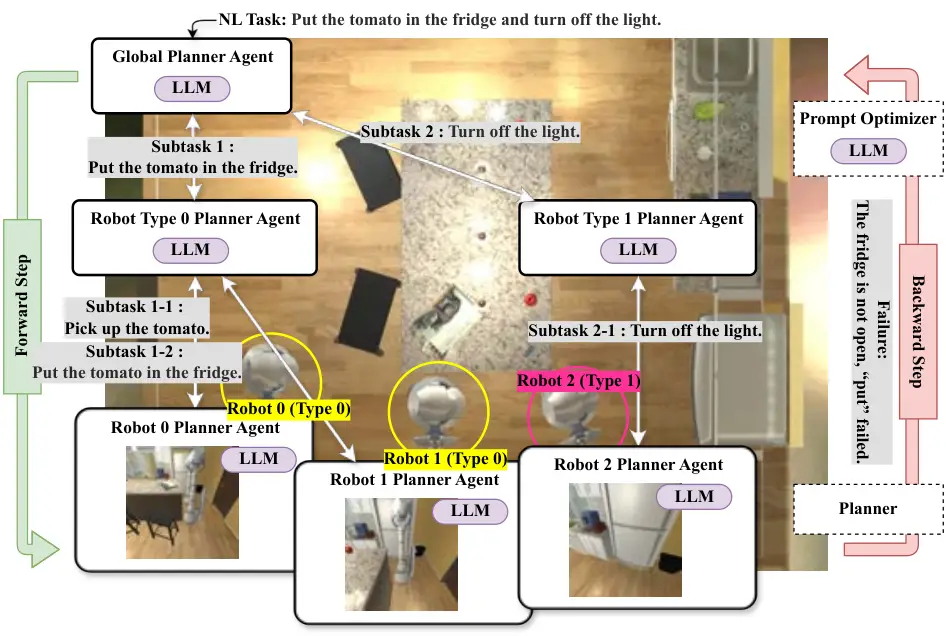

# Hierarchical LLM-Based Multi-Agent Framework with Prompt Optimization for Multi-Robot Task Planning

Tomoya Kawabe Affiliation: T. Kawabe and R. Takano are with Data Science
Laboratories, NEC Corporation, 1753, Shimonumabe, Nakahara-ku, Kawasaki,
Kanagawa, 211-8666, Japan. {tomoya-kawabe, rin_takano}@nec.com    Rin
Takano ^(†)^(†)thanks: ©˜2026 IEEE. Personal use of this material is
permitted. Permission from IEEE must be obtained for all other uses, in
any current or future media, including reprinting/republishing this
material for advertising or promotional purposes, creating new
collective works, for resale or redistribution to servers or lists, or
reuse of any copyrighted component of this work in other works.
Affiliation: T. Kawabe and R. Takano are with Data Science Laboratories,
NEC Corporation, 1753, Shimonumabe, Nakahara-ku, Kawasaki, Kanagawa,
211-8666, Japan. {tomoya-kawabe, rin_takano}@nec.com

###### Abstract

Multi-robot task planning requires decomposing natural-language
instructions into executable actions for heterogeneous robot teams.
Conventional Planning Domain Definition Language (PDDL) planners provide
rigorous guarantees but struggle to handle ambiguous or long-horizon
missions, while large language models (LLMs) can interpret instructions
and propose plans but may hallucinate or produce infeasible actions. We
present a hierarchical multi-agent LLM-based planner with prompt
optimization: an upper layer decomposes tasks and assigns them to
lower-layer agents, which generate PDDL problems solved by a classical
planner. When plans fail, the system applies TextGrad-inspired
textual-gradient updates to optimize each agent’s prompt and thereby
improve planning accuracy. In addition, meta-prompts are learned and
shared across agents within the same layer, enabling efficient prompt
optimization in multi-agent settings. On the MAT-THOR benchmark, our
planner achieves success rates of 0.95 on compound tasks, 0.84 on
complex tasks, and 0.60 on vague tasks, improving over the previous
state-of-the-art LaMMA-P by 2, 7, and 15 percentage points respectively.
An ablation study shows that the hierarchical structure, prompt
optimization, and meta-prompt sharing contribute roughly +59, +37, and
+4 percentage points to the overall success rate.

## I Introduction

Multi-robot task planning has become an essential capability for
robotics applications in household assistance, warehouse automation, and
disaster response \[1, 2\]. These scenarios typically involve
heterogeneous robots with distinct capabilities, where high-level
missions must be decomposed into executable subtasks and efficiently
allocated among team members. Conventional planning approaches, such as
symbolic planners based on the Planning Domain Definition Language
(PDDL) \[3\], provide formal correctness guarantees. However, they
require precise problem specifications and scale poorly when applied to
long-horizon, ambiguous, or dynamically changing tasks.

Advances in large language models (LLMs) have demonstrated remarkable
potential to bridge this gap. LLMs are strong at interpreting natural
language instructions, applying commonsense reasoning, and generating
structured outputs such as action sequences or PDDL descriptions. This
has enabled a new class of frameworks that leverage LLMs for robotic
task planning. Unlike classical planners, LLM-based approaches can
flexibly handle underspecified or ambiguous commands, decompose
long-horizon tasks into manageable subtasks, and integrate external
knowledge for reasoning. However, they also suffer from inherent
limitations: hallucinations, logical inconsistencies, and a lack of
formal guarantees often result in plans that are suboptimal or even
infeasible.



Fig. 1: Multi-robot task planning in home environments. Forward step:
Decomposing long-horizon tasks using a hierarchical LLM agent structure.
Feedback step: Optimizing LLM agent prompts based on results verified by
the planner.

To address these limitations, hybrid frameworks that combine the
generative reasoning of LLMs with the rigorous verification of classical
or optimization-based planners have been proposed. While promising
results, most existing methods have limitations such as relying on a
single centralized LLM planner, which leads to computational bottlenecks
and a lack of scalability as the number of robots or tasks increases.
Moreover, most existing methods operate as open-loop pipelines: once a
plan is generated, execution failures are not propagated back to revise
the decomposition or allocation policies. Furthermore, the construction
of feedback prompts strongly influences replanning quality, motivating
automated prompt optimization rather than manual design.

To address these challenges, we propose a hierarchical multi-agent
LLM-based planning system that distributes reasoning across multiple
agents and that incorporates iterative prompt optimization to improve
feasibility and scalability in complex multi-robot domains (see
Figure 1).

The key contributions of our work are as follows:

- •
  We propose a hierarchical multi-agent architecture that distributes
  task decomposition and allocation across layers of LLM agents,
  enabling scalability to large environments and long-horizon missions.
- •
  We introduce a feedback-driven prompt optimization mechanism inspired
  by TextGrad \[4\], allowing agents to iteratively refine their prompts
  when execution failures occur.
- •
  We further improve efficiency through meta-prompt sharing across
  homogeneous agents, leveraging ideas from meta-learning to accelerate
  adaptation in multi-agent settings.

## II Related Work

### II-A Natural-language tasking with LLMs

LLMs enable robots to be instructed in natural language (NL) while
exploiting broad world knowledge for task interpretation and subtasking.
SayPlan grounds NL instructions in large multi-room environments via 3D
scene graphs to produce plans executable by navigation/manipulation
stacks \[5\]. SMART-LLM utilizes staged prompting with a single LLM to
decompose and allocate tasks to heterogeneous robots \[6\]. These
systems demonstrate flexible NL tasking but also expose typical failure
modes of monolithic LLM planning—hallucinated preconditions,
inconsistent dependency structures, and degraded reasoning on long
horizons—stemming from a single model carrying decomposition and
allocation within a limited context. More recently, Wang et al. \[7\]
integrate augmented scene graphs with LLMs to generate LTL-based task
sequences for cross-regional multi-robot environments and select optimal
plans via a heuristic function. While their approach strengthens spatial
reasoning for task allocation, it operates as an open-loop pipeline
without iterative prompt refinement from execution feedback.

### II-B Hybrid LLM + classical/optimization planners

To improve executability and correctness, hybrid approaches delegate
search/verification to structured planners while using LLMs for NL
understanding and problem shaping. LLM+P translates NL problems into
PDDL, invokes a classical planner, and verbalizes the resulting plan
back into NL \[8\]. DELTA decomposes long-horizon goals into subgoals
and solves each with a planner, improving the success and efficiency in
complex scenes \[9\]. Optimization- and constraint-centric variants
similarly integrate LLM reasoning with formal solvers, e.g., linear
programming in LiP-LLM \[10\], STL/TAMP translation in AutoTAMP \[11\],
and constraint extraction/compilation in CaStL \[12\]. While these
hybrids curb hallucinations and raise executability, most pipelines
centralize task decomposition and problem construction in a single LLM;
as task horizons and environment scale increase—especially in
multi-robot settings—this centralization strains context length and
reduces planning fidelity.

### II-C From centralized to distributed reasoning: multi-LLM agent systems

To address scale, systems distribute reasoning across multiple LLM
agents with explicit roles and interfaces. LaMMA-P instantiates
role-specialized LLM modules (e.g., precondition identification, task
allocation, problem generation, validation assistance) coupled with a
PDDL planner, reporting state-of-the-art results on long-horizon,
multi-robot household tasks \[13\]. RoCo and HMAS-II assign an LLM to
each robot and coordinates subtask allocation via inter-agent dialogue
before invoking a multi-arm motion planner \[14, 15\]. Cognitive-loop
designs such as LLaMAR structure planning, acting, correction, and
verification for multi-robot teams without relying on a single
centralized LLM \[16\]. Division of labor alleviates single-model
context limits and supports heterogeneous skills, but many pipelines
remain largely unidirectional: once PDDL (or a validated plan) is
produced, there are limited mechanisms to propagate failures upstream to
revise decomposition/allocation policies or shared guidance. Addressing
reliability from a different angle, Wang et al. \[17\] apply conformal
prediction to distributed LLM-based action selection, achieving
guaranteed mission success rates while mitigating hallucinations at
decision time—in contrast to our post-hoc prompt optimization driven by
planner-verified feedback.

The trajectory progresses from single-LLM NL tasking (flexible but
fragile), to hybrid LLM+planner pipelines (feasible but centralized), to
multi-LLM agent architectures (scalable via specialization). A remaining
gap is a feedback-driven mechanism that connects planner-verified
outcomes back to the prompts that generated them, including shared
updates within layers of agents. Our work targets this gap by combining
a hierarchical multi-agent design with iterative, planner-informed
prompt updates and meta-prompt sharing.

## III Multi-Robot Planning Problem Formulation

Long-horizon tasks for heterogeneous robot teams require reasoning over
the joint abilities of multiple robots, the environment state, and the
order in which actions must be executed. Classic planners formalize a
planning problem as a tuple that includes a set of actions and a
transition function, but they usually assume a single robot and do not
directly account for the allocation of tasks among multiple robots.
Following work on language-model-driven planning, we cast our setting as
a cooperative Multi-Robot Planning task. This section introduces the
notation for the robotic planning problem; the LLM-based reasoning
agents and hierarchy are defined later in Section IV-A.

### III-A Multi-Robot planning problem definition

We define the robot set $`R=\{r_{1},\dots,r_{N}\}`$, which contains the
physical robots that execute actions in the environment. Robots belong
to distinct types, which determine their skill sets. Let $`\mathcal{T}`$
be the finite set of types, and let $`\mathsf{type}:R\to\mathcal{T}`$
assign each robot to a type. Types correspond to PDDL domains: robots of
the same type share the same PDDL domain and therefore the same skill
primitives and action operators. We denote the domain associated with
type $`\tau`$ by $`D_{\tau}`$, and we denote the set of skills available
to robots of type $`\tau`$ by $`\mathsf{cap}(\tau)\subseteq\Sigma`$,
where $`\Sigma`$ is the whole set of skill primitives.

For clarity, we define $`N:=|R|`$ to be the number of robots and
$`M:=|\mathcal{T}|`$ to be the number of types of robots. We will use
these quantities when describing algorithmic complexity and
hyper-parameters later in the paper.

Formally, our multi-robot task planning problem is specified by the
tuple

```math
\Pi=\langle R,\,\mathcal{T},\,\mathsf{type},\,\mathsf{cap},\,P,\,I,\,G,\,{\{A^{r}\}}_{r\in R}\rangle, \tag{1}
```

where:

- •
  Robots $`R`$. The set of physical robots available to perform the
  task.
- •
  Types $`\mathcal{T}`$. Each type $`\tau\in\mathcal{T}`$ defines a PDDL
  domain with predicates and operators. The mapping $`\mathsf{type}`$
  assigns every robot $`r`$ to a type $`\mathsf{type}(r)`$.
- •
  Skills $`\mathsf{cap}`$. The function
  $`\mathsf{cap}:\mathcal{T}\to 2^{\Sigma}`$ maps each type to the set
  of skills (capabilities) it can perform. Robots of the same type have
  the same set of skills. For instance, a mobile base may have skills
  $`\{\mathrm{move}\}`$, while a manipulator may have skills
  $`\{\mathrm{move},\mathrm{pickup},\mathrm{putdown}\}`$. Throughout
  this paper we use the term “skills” for these sets and write
  $`\mathsf{cap}(\tau)`$ for the skills of type $`\tau`$.
- •
  State atoms $`P`$. A finite set of propositional atoms (fluents)
  describing the world state, such as object locations, robot locations
  and grasping status.
- •
  Initial state $`I`$. A subset $`I\subseteq P`$ describing the state
  before planning begins.
- •
  Goal condition $`G`$. A subset $`G\subseteq P`$ describing the desired
  state after task completion.
- •
  Action sets $`A^{r}`$. For each robot $`r`$, the action set $`A^{r}`$
  consists of parameterized actions built from the skills in
  $`\mathsf{cap}(\mathsf{type}(r))`$. Each action $`a\in A^{r}`$ is
  defined by a pair $`\langle\mathrm{pre}(a),\mathrm{eff}(a)\rangle`$,
  where $`\mathrm{pre}(a)\subseteq P`$ is the set of preconditions and
  where $`\mathrm{eff}(a)\subseteq P\cup\{\lnot p\mid p\in P\}`$ is the
  set of effects. The PDDL representation of actions uses human-readable
  names; for example, the PickupObject operator has preconditions
  (at-location ?object ?location) and (at ?robot ?location) and effects
  (holding ?robot ?object).

The transition function $`\delta(s,a)`$ applies an action $`a`$ to a
state $`s\subseteq P`$ by adding its positive effects and by removing
its negative effects:

```math
\delta(s,a)=\bigl(s\cup\{p\mid p\in\mathrm{eff}(a)\}\bigr)\setminus\{p\mid\lnot p\in\mathrm{eff}(a)\}. \tag{2}
```

An action $`a\in A^{r}`$ is applicable in state $`s`$ if and only if
$`\mathrm{pre}(a)\subseteq s`$. A multi-robot plan \[18\] for $`\Pi`$ is
an ordered set of action instances

```math
\Pi_{g}=\langle\Delta,\prec\rangle, \tag{3}
```

where $`\Delta\subseteq\bigcup_{r\in R}A^{r}`$ is a set of ground
actions (each assigned to a specific robot) and where $`\prec`$ is a
strict partial order of encoding precedence constraints. If
$`a\prec b`$, then action $`a`$ must precede $`b`$. Actions that are not
related by $`\prec`$ can be executed concurrently by different robots.
Final state that can be obtained by executing $`\Pi_{g}`$ from $`I`$
must satisfy the goal condition $`G`$.

The cost of a sequential plan is defined as the number of action steps,
denoted as $`|\Pi|`$. When actions execute concurrently, the plan cost
(or makespan) is the number of parallel time steps required. Our
objective is to find a plan with minimal cost subject to feasibility .

## IV Proposed Method: Hierarchical LLM-Based Multi-Agent Planning

In this section we present a hierarchical MAP framework that combines
the high-level reasoning and language understanding of large language
models (LLMs) with the rigor of classical planning. A team of LLM-driven
agents is organized into a hierarchy. Upper layers decompose a
natural-language task into subtasks and assign them to downstream
agents, while leaf agents translate their assigned subtasks into formal
PDDL problems and use a classical planner to generate executable plans.
After each iteration, agents refine their prompts through
textual-gradient feedback and share meta-prompt updates with their peers
to improve efficiency and robustness.

### IV-A Hierarchical LLM Agent Architecture and Notation

We introduce the agent set $`\mathcal{E}`$, which contains the logical
LLM-based reasoning agents distinct from the physical robots $`R`$. To
capture the hierarchical structure used in our framework, we partition
$`\mathcal{E}`$ into layers indexed by $`l\in\{0,1,\dots,L-1\}`$. Let
$`\mathcal{E}_{l}=\{E_{l,0},E_{l,1},\dots,E_{l,|\mathcal{E}_{l}|-1}\}`$
denote the set of agents in layer $`l`$, and define the overall agent
set as the union of layer-specific sets:

```math
\mathcal{E}=\bigcup_{l=0}^{L-1}\mathcal{E}_{l}. \tag{4}
```

In particular, agents in layer $`0`$ form the highest level of
abstraction (global reasoning), while agents in deeper layers refine
tasks and eventually generate PDDL plans. Each agent $`E_{l,i}`$
maintains:

- •
  a task $`\Psi(E_{l,i})`$, represented as natural-language or
  structured text;
- •
  a prompt $`\theta_{E_{l,i}}`$, which conditions its LLM behavior;
- •
  a layer-shared meta-prompt $`\hat{\theta}_{l}`$.

When $`l<L-1`$, $`E_{l,i}`$ performs task decomposition for the next
layer; when $`l=L-1`$, $`E_{l,i}`$ performs PDDL generation. This
hierarchical design distributes reasoning across agents, avoiding the
scalability bottleneck of a single monolithic LLM planner and enabling
parallelism.

Fig. 2: Overview of the hierarchical MAP framework. The red flows
indicate prompt optimization for each agent, while the blue flows denote
meta-prompt optimization across layers.

| Step                | Description                                                                                                                                              |
| ------------------- | -------------------------------------------------------------------------------------------------------------------------------------------------------- |
| _Inputs_            | Task instruction $`u`$; agents $`\mathcal{E}`$ with prompts $`\theta_{E_{l,i}}`$ and meta-prompts $`\hat{\theta}_{l}`$; maximum iterations $`K_{\max}`$. |
| Data structures     | Plan list $`\Phi`$, task map $`\Psi`$, set of sub-plans (PDDL specifications).                                                                           |
| Initialization      | Set iteration counter $`k\!\leftarrow\!0`$, $`\Phi\!\leftarrow\![E_{0,0}]`$, $`\Psi(E_{0,0})\!\leftarrow\!u`$.                                           |
| Top-down reasoning  | For each layer $`l=0`$ to $`L-1`$: each agent $`E_{l,i}`$ decomposes its task into subtasks; leaf agents generate PDDL problems.                         |
| Classical planning  | Each PDDL problem is solved with a planner; success/failure recorded.                                                                                    |
| Replanning          | Failed agents climb hierarchy by LLM decision (“self” vs. “parent”).                                                                                     |
| Prompt optimization | Agents update prompts via textual gradients; layers update meta-prompts.                                                                                 |
| Termination         | If all sub-plans succeed, output them; else increment $`k`$ and repeat until success or $`K_{\max}`$.                                                    |

TABLE I: Algorithm overview

1: Task $`u`$; layered agent set
$`\mathcal{E}=\bigcup_{l=0}^{L-1}\mathcal{E}_{l}`$; agent prompts
$`\{\theta_{E_{l,i}}\}`$; meta-prompts $`\{\hat{\theta}_{l}\}`$; max
iterations $`K_{\max}`$

2: $`k\leftarrow 0`$ $`\triangleright`$ iteration counter

3: $`\Phi\leftarrow[E_{0,0}]`$ $`\triangleright`$ root agent in plan
list

4: $`\Psi(E_{0,0})\leftarrow u`$ $`\triangleright`$ assign root task

5: while true do

6:   if $`k=K_{\max}`$ then

7:    return failure $`\triangleright`$ stop if iteration limit reached

8:   end if

9:   $`\mathcal{S}\leftarrow\emptyset`$ $`\triangleright`$ candidate
sub-plans (PDDL specs)

10:   for $`l\leftarrow 0`$ to $`L-1`$ do $`\triangleright`$ top-down
reasoning

11:    $`S_{l}\leftarrow[\,E\in\Phi\mid E\in\mathcal{E}_{l}\,]`$

12:    for all $`E_{l,i}\in S_{l}`$ do

13:     if $`l<L-1`$ then $`\triangleright`$ intermediate layer

14:
    $`\{u_{e}\}\leftarrow LLM(\theta_{E_{l,i}},\hat{\theta}_{l},\Psi(E_{l,i}))`$

15:     for all $`E_{l+1,e}\in\mathcal{E}_{l+1}`$ do

16:      $`\Phi.\mathrm{append}(E_{l+1,e})`$

17:      $`\Psi(E_{l+1,e})\leftarrow u_{e}`$

18:     end for

19:     else$`\triangleright`$ leaf layer: PDDL generation

20:
    $`\mathrm{pddl\_spec}\leftarrow LLM(\theta_{E_{l,i}},\hat{\theta}_{l},\Psi(E_{l,i}))`$

21:     $`\mathcal{S}\leftarrow\mathcal{S}\cup\{\mathrm{pddl\_spec}\}`$

22:     end if

23:    end for

24:   end for

25:   for all $`sp\in\mathcal{S}`$ do $`\triangleright`$ classical
planning & validation

26:
   $`(\,\mathrm{plan},\,E_{\mathrm{src}})\leftarrow\mathrm{PDDL\_Planning\_And\_Validate}(sp)`$

27:    if planning/validation fails for $`sp`$ then

28:     $`E^{\prime}\leftarrow E_{\mathrm{src}}`$

29:     while true do $`\triangleright`$ decide where to replan: self vs
parent

30:
    $`\mathrm{decision}\leftarrow LLM(\breve{\theta}_{E^{\prime}},sp)`$

31:     if $`\mathrm{decision}=\text{``self''}\lor E^{\prime}=E_{0,0}`$
then

32:      $`\Phi.\mathrm{append}(E^{\prime})`$; break

33:     else

34:      $`E^{\prime}\leftarrow\mathrm{ParentOf}(E^{\prime})`$

35:     end if

36:     end while

37:
    $`(\Phi,\{\theta_{E_{l,i}}\},\{\hat{\theta}_{l}\})\leftarrow\textsc{promptUpdate}(\Phi,\{\theta_{E_{l,i}}\},\{\hat{\theta}_{l}\})`$
$`\triangleright`$ Algorithm 2

38:     $`k\leftarrow k+1`$; continue $`\triangleright`$ start next
outer iteration

39:    end if

40:   end for

41:   return $`\mathcal{S}`$ $`\triangleright`$ all sub-plans validated

42: end while

Algorithm 1 Hierarchical Multi-Agent LLM-Based Planning with
Textual-Gradient Optimization

1: function
PromptUpdate($`\Phi,\{\theta_{E_{l,i}}\},\{\hat{\theta}_{l}\}`$)

2:   $`\mathrm{RemoveChildrenFrom}\,\Phi()`$ $`\triangleright`$ prune
obsolete child agents $`\triangleright`$ _(A) Agent-level inner
updates:_ $`\theta^{(k)}\to\theta^{(k+1)}`$

3:   for all $`E_{l,i}\in\Phi`$ do

4:
   $`\mathrm{loss}^{\mathrm{pre}}_{E_{l,i}}\leftarrow\mathrm{loss\_fn}(\theta_{E_{l,i}})`$
$`\triangleright`$ compute loss

5:
   $`g_{E_{l,i}}\leftarrow\nabla_{\theta_{E_{l,i}}}\,\mathrm{loss}^{\mathrm{pre}}_{E_{l,i}}`$
$`\triangleright`$ gradient from feedback

6:
   $`\theta_{E_{l,i}}\leftarrow\mathrm{TGD.step}(\theta_{E_{l,i}},g_{E_{l,i}})`$
$`\triangleright`$ update agent prompt

7:
   $`\mathrm{loss}^{\mathrm{post}}_{E_{l,i}}\leftarrow\mathrm{loss\_fn}(\theta_{E_{l,i}})`$
$`\triangleright`$ re-evaluate _after_ update

8:   end for$`\triangleright`$ _(B) Layer-level outer updates_

9:   for $`l\leftarrow 1`$ to $`L-1`$ do

10:
   $`\text{loss}_{l}\leftarrow\mathcal{A}_{l}\!\left(\{\mathrm{loss}^{\mathrm{post}}_{E_{l,i}}\mid E_{l,i}\in\mathcal{E}_{l}\}\right)`$
$`\triangleright`$ meta-loss

11:
   $`\hat{g}_{l}\leftarrow\nabla_{\hat{\theta}_{l}}\,\text{loss}_{l}`$
$`\triangleright`$ meta-gradient

12:
   $`\hat{\theta}_{l}\leftarrow\mathrm{TGD.step}(\hat{\theta}_{l},\hat{g}_{l})`$
$`\triangleright`$ update meta-prompt

13:   end for

14:   return $`(\Phi,\{\theta_{E_{l,i}}\},\{\hat{\theta}_{l}\})`$

15: end function

Algorithm 2 PromptUpdate: Agent- and Layer-level Prompt Updates
(MAML \[19\] inspired)

### IV-B Overview of Algorithm

Assume a user issues a high-level instruction $`u`$ to accomplish a
long-horizon task. The framework maintains a set of LLM agents
$`\mathcal{E}=\bigcup_{l=0}^{L-1}\mathcal{E}_{l}`$, partitioned by
layer $`l`$ (Section III-A). Each agent $`E_{l,i}`$ has its own prompt
$`\theta_{E_{l,i}}`$ and shares a _meta-prompt_ $`\hat{\theta}_{l}`$
with peers in its layer. Iterations continue until all leaf PDDL plans
are validated or until a maximum number of iterations $`K_{\max}`$ is
reached.

Algorithm 1 depicts the procedure at a high level. The outer loop
(lines 4-41) controls the iterations. At each iteration it clears the
set of _candidate sub-plans_ and performs a top-down pass over the
hierarchy (lines 9-23):

- •
  Task decomposition (lines 12-17): For every agent $`E_{l,i}`$ not at
  the leaf layer, the LLM uses its prompt $`\theta_{E_{l,i}}`$, the
  layer meta-prompt $`\hat{\theta}_{l}`$ and its assigned task
  $`\Psi(E_{l,i})`$ to generate a set of subtasks for the agents in
  layer $`l+1`$. The plan list $`\Phi`$ is updated to include these
  child agents, and their tasks are stored in $`\Psi`$.
- •
  PDDL generation (lines 19-20): For every leaf agent ($`l=L-1`$), the
  LLM produces a domain and problem in PDDL form. These _sub-plans_ are
  collected for validation.

After the top-down pass, each candidate sub-plan is passed to a
classical planner/validator. We use an off-the-shelf PDDL planner such
as Fast Downward \[20\]. If all the plans succeed, they are returned as
the solution. Otherwise, we identify the agent whose plan failed and
climb the hierarchy until either the agent chooses to revise its plan or
the root is reached. Similar to the two-step optimization pipeline
proposed by Shen et al. \[21\] for multi-agent systems, our system then
performs targeted prompt updates: each failing agent (and its ancestors)
calculates a textual loss using its LLM, back-propagates a textual
gradient to its prompt, and updates its prompt via a TextGrad-style
optimizer \[4\]. Finally, each layer aggregates losses across agents and
applies a meta-prompt update (lines 8-11 in Algorithm 2), analogous to
meta-learning across homogeneous agents.

Algorithm 1 describes the high-level procedure, while Figure 2 provides
a visual overview of the hierarchical agent interactions and
optimization flows.

### IV-C Hierarchical Multi-Agent Architecture

The hierarchy $`\mathcal{E}`$ organizes reasoning agents into layers
$`l=0,\dots,L-1`$. Agents in higher layers decompose tasks, while leaf
agents generate PDDL problems. Each agent $`E_{l,i}`$ maintains (i) a
task $`\Psi(E_{l,i})`$, (ii) a prompt $`\theta_{E_{l,i}}`$, and (iii) an
optional layer-shared meta-prompt $`\hat{\theta}_{l}`$.

In our experiments we adopted a three-layer hierarchy: a global planner
layer interprets the user instruction, a type layer distributes subtasks
to robot types based on their skills, and a robot layer generates PDDL
for individual robots. This decomposition avoids the scalability
bottleneck of a single monolithic LLM planner and enables parallel
execution across heterogeneous agents.

### IV-D Classical Planning and Validation

Once the leaf agents generate PDDL specifications, the proposed method
invokes a classical planner to compute executable plans. We utilize the
Fast Downward planner with the search and heuristic settings recommended
in prior work \[20\]. For each PDDL problem $`sp`$, a plan in returned
or failure is indicated. If a plan exists, it is validated to ensure
that applying the actions from the initial state achieves the goal. This
validation step is critical: language models can produce syntactically
valid but logically inconsistent PDDL that fails at runtime \[20\]. Only
after all sub-plans succeed at planning and validation does the method
terminate successfully.

If some sub-plans fail, the system must decide where to replan. Each
failing agent $`E`$ consults a replanning prompt $`\breve{\theta}_{E}`$
to determine whether it should attempt to revise its sub-task
(decision “self”) or request a higher-level agent to rethink the
decomposition (decision “parent”). This strategy is inspired by
hierarchical error propagation in multi-agent systems \[21\].

### IV-E Textual-Gradient Prompt Optimization

The quality of LLM outputs depends heavily on the prompts. To improve
reliability over multiple iterations, our framework incorporates a
_textual-gradient optimization_ mechanism \[4\]. After each iteration,
every agent $`E_{l,i}`$ receives feedback indicating how its output
failed. These errors are summarized as a textual loss
$`\text{loss}_{E_{l,i}}`$. Each agent’s prompt $`\theta_{E_{l,i}}`$ and
each layer’s meta-prompt $`\hat{\theta}_{l}`$ are then updated using
textual-gradient descent, as outlined in Algorithm 1 and executed in
Algorithm 2.

#### Agent-level update.

For each agent $`E_{l,i}`$, natural-language feedback from the classical
planner and downstream agents is mapped to a textual loss via the same
loss function used throughout Algorithm 2. With the iteration index
managed in Algorithm 1, the agent-level inner update at iteration $`k`$
is:

```math
\displaystyle\mathrm{loss}^{(k)}_{E_{l,i}}\; \displaystyle:=\;\mathrm{loss\_fn}\!\bigl(\theta^{(k)}_{E_{l,i}}\bigr), \tag{5}
```

```math
\displaystyle g^{(k)}_{E_{l,i}}\; \displaystyle:=\;\nabla_{\theta_{E_{l,i}}}\,\mathrm{loss}^{(k)}_{E_{l,i}}, \tag{6}
```

```math
\displaystyle\theta^{(k+1)}_{E_{l,i}}\; \displaystyle:=\;\mathrm{TGD.step}\!\bigl(\theta^{(k)}_{E_{l,i}},\,g^{(k)}_{E_{l,i}}\bigr). \tag{7}
```

Here, $`\mathrm{TGD.step}`$ denotes a textual gradient descent step that
_rewrites_ the prompt $`\theta_{E_{l,i}}`$ by applying a small set of
ranked edit operations suggested by the LLM (e.g., adding clarifying
constraints or reordering checks). No auxiliary parameters are
introduced beyond the prompt itself and its textual “gradient”
$`g^{(k)}_{E_{l,i}}`$. Equations (5)–(7) correspond to the agent-level
inner loop in Algorithm 2.

#### Layer-level update.

After the agent-level inner updates (Algorithm 2, lines 4–10), we
evaluate each updated agent prompt with the same loss function:

```math
\text{loss}_{E_{l,i}}^{(k+1)}\;:=\;\mathrm{loss\_fn}\!\bigl(\theta_{E_{l,i}}^{(k+1)}\bigr),\qquad E_{l,i}\in\mathcal{E}_{l}. \tag{8}
```

To obtain a single layer-wise signal, we aggregate the per-agent textual
losses using an LLM-based operator $`\mathcal{A}_{l}`$ that
_deduplicates overlapping elements, normalizes phrasing, and
consolidates common edits_ across agents in layer $`l`$:

```math
\text{loss}_{l}^{(k+1)}\;=\;\mathcal{A}_{l}\!\Big(\big\{\text{loss}_{E_{l,i}}^{(k+1)}\big\}_{E_{l,i}\in\mathcal{E}_{l}}\Big). \tag{9}
```

We then compute a textual “gradient” of this meta-loss with respect to
the layer meta-prompt and apply one textual-gradient descent step:

```math
\displaystyle\hat{g}_{l}^{(k+1)}\; \displaystyle=\;\nabla_{\hat{\theta}_{l}}\,\text{loss}_{l}^{(k+1)}, \tag{10}
```

```math
\displaystyle\hat{\theta}_{l}^{(k+1)}\; \displaystyle=\;\mathrm{TGD.step}\!\bigl(\hat{\theta}_{l}^{(k)},\,\hat{g}_{l}^{(k+1)}\bigr). \tag{11}
```

This realizes a MAML \[19\] inspired bilevel structure in discrete text
space: inner (agent) adaptation produces $`\theta_{E_{l,i}}^{(k+1)}`$
and post-update losses (8), while the outer (layer) update aggregates
them via (9) and updates the shared meta-prompt via (11). Notationally,
the iteration index $`k`$ is maintained in Algorithm 1; PromptUpdate
(Algorithm 2) takes the current
$`\Phi^{(k)},\{\theta^{(k)}\},\{\hat{\theta}^{(k)}\}`$ and returns
$`\Phi^{(k+1)},\{\theta^{(k+1)}\},\{\hat{\theta}^{(k+1)}\}`$ without
requiring $`k`$ as an explicit argument. The operator
$`\mathcal{A}_{l}`$ is implemented as a prompt that consolidates
per-agent textual losses into a single layer-level objective and a
ranked set of candidate edits; only the consolidated objective is used
to compute $`\hat{g}_{l}^{(k+1)}`$.

### IV-F Example Multi-Agent Configuration

A concrete example of the hierarchical architecture clarifies its
operation. Consider a household assistance domain. The top layer
contains a global planner agent that receives a natural-language
instruction such as “tidy the living room and prepare tea.” This agent
decomposes the instruction into subtasks and assigns them to agents in
the second layer, where each type agent corresponds to a category of
robots (e.g., mobile base, manipulator). Type agents further refine
their assigned subtasks and assign them to individual robot agents in
the third layer. For instance, the mobile-base agent might generate a
PDDL problem requiring movement to specific locations, while the
manipulator agent produces a PDDL problem involving “pickup” and
“putdown” actions.

To illustrate PDDL generation, suppose the manipulator agent is assigned
the task “place the laptop on the desk.” It constructs a PDDL domain and
problem following standard syntax. The domain includes an operator such
as


and a corresponding operator for PutdownObject. The problem file defines
the initial state (object and robot locations) and the goal (holding ?r
?o) or (at ?o desk) as appropriate. These PDDL specifications are passed
to the classical planner, which returns a sequence of actions. By
varying the decomposition and agent assignment, the same framework can
support other domains such as warehouse automation or disaster response.

## V Numerical Experiments

We empirically evaluate our hierarchical multi-agent planner on the
MAT-THOR benchmark for long-horizon household tasks, originally proposed
in LaMMA-P \[13\]. MAT-THOR extends the AI2-THOR \[22\] simulator and
provides 70 tasks across five floor plans with increasing complexity and
ambiguous instructions. Each task is annotated with a natural-language
instruction, a ground-truth PDDL domain, and a goal condition. To
account for simulator stochasticity, we execute each task with five
random initializations and report the averages.

### V-A Task categories and dataset

MAT-THOR organizes its 70 tasks into three categories based on their
structure. _Compound_ tasks contain two to four largely independent
subtasks and can be executed in parallel. _Complex_ tasks consist of six
or more subtasks with causal dependencies, often requiring robots with
complementary skills. _Vague command_ tasks deliberately omit crucial
details, forcing the agent to infer missing information from context.
The benchmark includes 30 compound tasks, 20 complex tasks, and 20 vague
commands, providing detailed specifications of initial states, robot
skill sets, and success conditions. These tasks support the evaluation
of task decomposition, allocation, and execution efficiency by
heterogeneous teams of two to four robots.

| Method                   | Compound |      |      |      | Complex |      |      |      | Vague |      |      |      |
| ------------------------ | -------- | ---- | ---- | ---- | ------- | ---- | ---- | ---- | ----- | ---- | ---- | ---- |
|                          | SR       | GCR  | RU   | Eff  | SR      | GCR  | RU   | Eff  | SR    | GCR  | RU   | Eff  |
| CoT \[23\] (GPT-4o)      | 0.32     | 0.40 | 0.72 | 0.59 | 0.00    | 0.12 | 0.47 | 0.38 | 0.00  | 0.00 | 0.00 | 0.00 |
| SMART-LLM \[6\] (GPT-4o) | 0.70     | 0.82 | 0.78 | 0.64 | 0.20    | 0.33 | 0.65 | 0.56 | 0.06  | 0.42 | 0.68 | 0.42 |
| LaMMA-P \[13\] (GPT-4o)  | 0.93     | 0.94 | 0.91 | 0.90 | 0.77    | 0.83 | 0.87 | 0.67 | 0.45  | 0.48 | 0.71 | 0.65 |
| Ours (GPT-4o)            | 0.95     | 0.95 | 1.00 | 0.90 | 0.84    | 0.84 | 1.00 | 0.75 | 0.60  | 0.60 | 1.00 | 0.75 |

TABLE II: Performance comparison on MAT-THOR. Higher values are better
for all metrics.

### V-B Evaluation metrics and baselines

Following LaMMA-P \[13\], we assess plan quality using four metrics:
success rate (SR), goal condition recall (GCR), robot utilization (RU),
and efficiency (Eff). The SR is the fraction of tasks in which all goal
conditions are achieved. The GCR is the ratio of achieved goal atoms to
the ground-truth goal set. The RU measures how efficiently robot actions
are used by comparing the total transition count to the ground truth.
The Eff captures the temporal efficiency of the plan as the ratio
between the makespan of the generated plan and the ground-truth
solution; both the RU and Eff are computed only on successful
executions.

We compare our method against three baselines. Chain-of-Thought
(CoT) \[23\] prompting uses GPT-4o to directly translate the instruction
into action sequences for each robot. SMART-LLM \[6\] decomposes and
allocates subtasks sequentially and relies on a motion planner for
trajectory generation. LaMMA-P \[13\] combines LLM reasoning with PDDL
planning and currently achieves state-of-the-art performance on
MAT-THOR. For a fair comparison, all methods utilize the same PDDL
planner (Fast Downward with the LAMA heuristic) \[20\] and are evaluated
in identical simulation environments. The CoT \[23\] and SMART-LLM \[6\]
baselines are run using GPT-4o, following the configuration described in
the LaMMA-P \[13\].

### V-C Implementation details and hyperparameters

All the LLM agents in our hierarchy –global, type, and robot– are
implemented using GPT-4o. Each agent starts from an initial prompt that
conveys its role: the global agent is instructed to summarize the user’s
instruction and decompose it into high-level subtasks; type-level agents
allocate these subtasks to robots based on capability descriptions;
robot-level agents generate PDDL domains and problems describing their
assigned sub-task. A shared meta-prompt per layer provides additional
context about typical household tasks and the available skill types. The
maximum number of prompt-optimization iterations is set to
$`K_{\max}=5`$. The execution is simulated in AI2-THOR \[22\]. All of
the methods share identical simulation settings to ensure comparability.

### V-D Case study: prompt optimization in practice

To illustrate how textual feedback improves performance, we consider a
compound task from MAT-THOR: “_put the tomato in the fridge and turn off
the room light._” In our initial run, the Robot Type 0 agent assigns the
fridge task to Robot 0, which generates a PDDL problem. The classical
planner succeeds at Pickup but fails at Put with a precondition error
because the fridge has not been opened. The failing agent logs this
feedback and uses the textual gradient mechanism to suggest inserting an
Open action before any Put into a receptacle with open/close affordance.
After updating its prompt, the agent adds a subtask assigning Robot 1 to
open the fridge. The second iteration, however, fails with a
path-planning error because Robot 1 remains in front of the fridge. A
further prompt update instructs the robot to move to a non-blocking
waypoint after opening, and the third iteration completes successfully.
These small prompt edits, generalised through meta-prompt sharing,
eliminate entire classes of failures without manual intervention. The
supplementary video walks through this example in detail. Detailed
examples of these prompt updates are provided in Appendix A.

### V-E Overall performance

Table II compares our hierarchical planner with the baselines on
MAT-THOR. The numbers for CoT \[23\] and SMART-LLM \[6\] are taken from
LaMMA-P’s evaluation \[13\]. Our method achieves the highest success
rates across all task categories. For compound tasks, the success rate
reaches 0.95, slightly higher than LaMMA-P’s 0.93. On complex tasks, our
method attains a success rate of 0.84, representing a clear improvement
of 7 percentage points over LaMMA-P’s 0.77 and much higher than
SMART-LLM’s 0.20. Even on vague command tasks, which are particularly
challenging due to underspecified instructions, our approach achieves
0.60, substantially higher than LaMMA-P’s 0.45 and far above other
baselines. These results highlight that our hierarchical decomposition
and feedback-driven prompt optimization yield significant gains in
success rate, especially in the most demanding task categories.

### V-F Ablation study

To evaluate the contributions of each component, we perform an ablation
study in which hierarchical decomposition (H), local prompt optimization
(P), and meta-prompt sharing (M) are removed individually or in
combination. The results are summarized in Table III.

Removing the hierarchy (–H) and relying on a single LLM agent causes the
most severe degradation, dropping the success rate to 0.25 (-59.3%).
This highlights the critical role of hierarchical decomposition in
limiting input length and enabling parallelism. Disabling both prompt
and meta-prompt optimization (–(P, M)) reduces the success rate to 0.47
(-37.0%), showing that feedback-driven prompt adaptation is essential
for executability and recovery from planning errors. Removing only
meta-prompt optimization (–M) has a smaller effect, lowering the success
rate to 0.80 (-4.2%), but still demonstrates the benefit of sharing
prompt refinements across homogeneous agents to accelerate convergence.

We also compare the average computation time across variants. The full
method requires 173 seconds on average. Removing the hierarchy (–H)
shortens runtime to 140 seconds. Removing meta-prompt optimization (–M)
reduces runtime further to 116 seconds. Disabling both prompt and
meta-prompt optimization (–(P, M)) makes planning fastest at just 32
seconds, but executability and success rate suffer significantly.
Overall, the hierarchy delivers the largest performance gain, prompt
optimization enables significant recovery from mistakes, and meta-prompt
sharing provides incremental improvements, while computation-time
results highlight the trade-off between efficiency and reliability.

| Variant                          | SR            | Time           |
| -------------------------------- | ------------- | -------------- |
| Full method (H+P+M)              | 0.84          | 173 s          |
| –H (single-LLM agent)            | 0.25 (-59.3%) | 140 s (-18.9%) |
| –M (no meta-prompt optimization) | 0.80 (-4.2%)  | 116 s (-33.1%) |
| –(P, M) (no prompt optimization) | 0.47 (-37.0%) | 32 s (-81.3%)  |

TABLE III: Ablation study on our method (GPT-4o). Values are averages
over the entire dataset. Both SR (success rate) and Time are reported
relative to the full method (H+P+M).

## VI Conclusion

We presented a hierarchical multi-agent LLM-based planning framework
that integrates natural-language reasoning with classical PDDL planning
and feedback-driven prompt optimization. The system improves scalability
and reliability in multi-robot task planning by distributing tasks
across layered agents and refining prompts through textual gradients. On
the MAT-THOR benchmark, it outperforms prior LLM-based planners, with
gains of up to 9.1% on complex tasks and 33.3% on vague commands.
Ablation studies confirm that hierarchy and prompt optimization are
critical to performance.

Limitations remain: the fixed hierarchy reduces adaptability, full
observability is assumed, and prompt optimization still faces issues of
convergence speed and stability. Future work will explore adaptive
hierarchies, integration with perception in partially observable
settings, and more robust optimization for real-world deployment.

## Appendix A Prompt update examples

The prompt update examples illustrate how textual gradients modify
assignment prompts during the case study described in Section V-D. At
each iteration, a failure triggers a suggestion to add a specific check
or precondition. These changes accumulate, and because the meta-prompt
is shared within each layer, subsequent tasks benefit from the updated
instructions.


In subsequent iterations, no further updates were necessary; the
accumulated prompt modifications successfully eliminated the observed
failure modes. Agents of the same type avoided similar mistakes in
future tasks by propagating the modifications through the shared
meta-prompt.

## References

- \[1\] A. Bolu and Ö. Korçak (2021) Adaptive task planning for
  multi-robot smart warehouse. IEEE Access 9 (), pp. 27346–27358.
  External Links:
  [Document](https://dx.doi.org/10.1109/ACCESS.2021.3058190) Cited by:
  §I.
- \[2\] S. Chen, Y. Chen, R. Jain, X. Zhang, Q. Nguyen, and S. K.
  Gupta (2024) Accounting for travel time and arrival time coordination
  during task allocations in legged-robot teams. In 2024 IEEE
  International Conference on Robotics and Automation (ICRA), Vol. ,
  pp. 16588–16594. External Links:
  [Document](https://dx.doi.org/10.1109/ICRA57147.2024.10610869) Cited
  by: §I.
- \[3\] M. Ghallab, C. Knoblock, D. Wilkins, A. Barrett, D.
  Christianson, M. Friedman, C. Kwok, K. Golden, S. Penberthy, D.
  Smith, Y. Sun, and D. Weld (1998) PDDL - the planning domain
  definition language. pp. . Cited by: §I.
- \[4\] M. Yuksekgonul, F. Bianchi, J. Boen, S. Liu, Z. Huang, C.
  Guestrin, and J. Zou (2024) TextGrad: automatic ”differentiation” via
  text. External Links: 2406.07496 Cited by: 2nd item, §IV-B, §IV-E.
- \[5\] K. Rana, J. Haviland, S. Garg, J. Abou-Chakra, I. Reid, and N.
  Suenderhauf (2023) SayPlan: grounding large language models using 3d
  scene graphs for scalable robot task planning. In Proceedings of The
  7th Conference on Robot Learning, Proceedings of Machine Learning
  Research, Vol. 229, pp. 23–72. Cited by: §II-A.
- \[6\] S. S. Kannan, V. L. N. Venkatesh, and B. Min (2024) SMART-LLM:
  smart multi-agent robot task planning using large language models. In
  2024 IEEE/RSJ International Conference on Intelligent Robots and
  Systems (IROS), Vol. , pp. 12140–12147. External Links:
  [Document](https://dx.doi.org/10.1109/IROS58592.2024.10802322) Cited
  by: §II-A, §V-B, §V-E, TABLE II.
- \[7\] Y. Wang, Y. Dong, Y. Yang, X. Zhang, Y. Wang, Y. Wang, C. Wang,
  and M. Q.-H. Meng (2025) LLM-driven hierarchical planning:
  long-horizon task allocation for multi-robot systems in cross-regional
  environments. In 2025 IEEE/RSJ International Conference on Intelligent
  Robots and Systems (IROS), Vol. , pp. 14140–14147. External Links:
  [Document](https://dx.doi.org/10.1109/IROS60139.2025.11247013) Cited
  by: §II-A.
- \[8\] B. Liu, Y. Jiang, X. Zhang, Q. Liu, S. Zhang, J. Biswas, and P.
  Stone (2023) LLM+P: empowering large language models with optimal
  planning proficiency. ArXiv abs/2304.11477. Cited by: §II-B.
- \[9\] Y. Liu, L. Palmieri, S. Koch, I. Georgievski, and M.
  Aiello (2025) DELTA: decomposed efficient long-term robot task
  planning using large language models. In 2025 IEEE International
  Conference on Robotics and Automation (ICRA), Vol. , pp. 10995–11001.
  External Links:
  [Document](https://dx.doi.org/10.1109/ICRA55743.2025.11127838) Cited
  by: §II-B.
- \[10\] K. Obata, T. Aoki, T. Horii, T. Taniguchi, and T. Nagai (2024)
  LiP-LLM: integrating linear programming and dependency graph with
  large language models for multi-robot task planning. Note: arXiv
  preprint arXiv:2410.21040 Cited by: §II-B.
- \[11\] Y. Chen, J. Arkin, C. Dawson, Y. Zhang, N. Roy, and C.
  Fan (2024) AutoTAMP: autoregressive task and motion planning with llms
  as translators and checkers. In 2024 IEEE International Conference on
  Robotics and Automation (ICRA), Vol. , pp. 6695–6702. External Links:
  [Document](https://dx.doi.org/10.1109/ICRA57147.2024.10611163) Cited
  by: §II-B.
- \[12\] W. Guo, Z. Kingston, and L. E. Kavraki (2025) CaStL:
  constraints as specifications through llm translation for long-horizon
  task and motion planning. In 2025 IEEE International Conference on
  Robotics and Automation (ICRA), Vol. , pp. 11957–11964. External
  Links: [Document](https://dx.doi.org/10.1109/ICRA55743.2025.11127555)
  Cited by: §II-B.
- \[13\] X. Zhang, H. Qin, F. Wang, Y. Dong, and J. Li (2025) LaMMA-P:
  generalizable multi-agent long-horizon task allocation and planning
  with lm-driven pddl planner. pp. 10221–10221. External Links:
  [Document](https://dx.doi.org/10.1109/ICRA55743.2025.11127951) Cited
  by: §II-C, §V-B, §V-B, §V-E, TABLE II, §V.
- \[14\] Z. Mandi, S. Jain, and S. Song (2024) RoCo: dialectic
  multi-robot collaboration with large language models. In 2024 IEEE
  International Conference on Robotics and Automation (ICRA), Vol. ,
  pp. 286–299. External Links:
  [Document](https://dx.doi.org/10.1109/ICRA57147.2024.10610855) Cited
  by: §II-C.
- \[15\] Y. Chen, J. Arkin, Y. Zhang, N. Roy, and C. Fan (2024) Scalable
  multi-robot collaboration with large language models: centralized or
  decentralized systems?. In 2024 IEEE International Conference on
  Robotics and Automation (ICRA), Vol. , pp. 4311–4317. External Links:
  [Document](https://dx.doi.org/10.1109/ICRA57147.2024.10610676) Cited
  by: §II-C.
- \[16\] S. Nayak, A. M. Orozco, M. T. Have, V. Thirumalai, J. Zhang, D.
  Chen, A. Kapoor, E. Robinson, K. Gopalakrishnan, J. Harrison, B.
  Ichter, A. Mahajan, and H. Balakrishnan (2024) Long-horizon planning
  for multi-agent robots in partially observable environments. In
  Proceedings of the 38th International Conference on Neural Information
  Processing Systems, NIPS ’24, Red Hook, NY, USA. External Links: ISBN
  9798331314385 Cited by: §II-C.
- \[17\] J. Wang, G. He, and Y. Kantaros (2025) Probabilistically
  correct language-based multi-robot planning using conformal
  prediction. IEEE Robotics and Automation Letters 10 (1), pp. 160–167.
  External Links:
  [Document](https://dx.doi.org/10.1109/LRA.2024.3504233) Cited by:
  §II-C.
- \[18\] A. Torreño, E. Onaindia, A. Komenda, and M. Štolba (2017)
  Cooperative multi-agent planning: a survey. ACM Comput. Surv. 50 (6).
  External Links: ISSN 0360-0300,
  [Document](https://dx.doi.org/10.1145/3128584) Cited by: §III-A.
- \[19\] C. Finn, P. Abbeel, and S. Levine (2017) Model-agnostic
  meta-learning for fast adaptation of deep networks. In Proceedings of
  the 34th International Conference on Machine Learning - Volume 70,
  ICML’17, pp. 1126–1135. Cited by: §IV-E, Algorithm 2.
- \[20\] M. Helmert (2006) The fast downward planning system. J. Artif.
  Int. Res. 26 (1), pp. 191–246. External Links: ISSN 1076-9757 Cited
  by: §IV-B, §IV-D, §V-B.
- \[21\] M. Shen, R. Shu, A. Pratik, J. Gung, Y. Ge, M. Sunkara, and Y.
  Zhang (2025) Optimizing LLM-based multi-agent system with textual
  feedback: A case study on software development. CoRR abs/2505.16086.
  External Links:
  [Document](https://dx.doi.org/10.48550/ARXIV.2505.16086), 2505.16086
  Cited by: §IV-B, §IV-D.
- \[22\] E. Kolve, R. Mottaghi, W. Han, E. VanderBilt, L. Weihs, A.
  Herrasti, M. Deitke, K. Ehsani, D. Gordon, Y. Zhu, A. Kembhavi, A.
  Gupta, and A. Farhadi (2017) AI2-THOR: an interactive 3d environment
  for visual AI. ArXiv abs/1712.05474. Cited by: §V-C, §V.
- \[23\] J. Wei, X. Wang, D. Schuurmans, M. Bosma, B. Ichter, F.
  Xia, E. H. Chi, Q. V. Le, and D. Zhou (2022) Chain-of-thought
  prompting elicits reasoning in large language models. In Proceedings
  of the 36th International Conference on Neural Information Processing
  Systems, NIPS ’22, Red Hook, NY, USA. External Links: ISBN
  9781713871088 Cited by: §V-B, §V-E, TABLE II.
