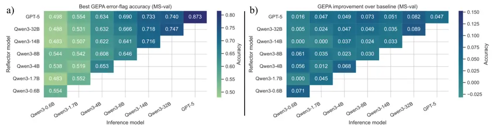
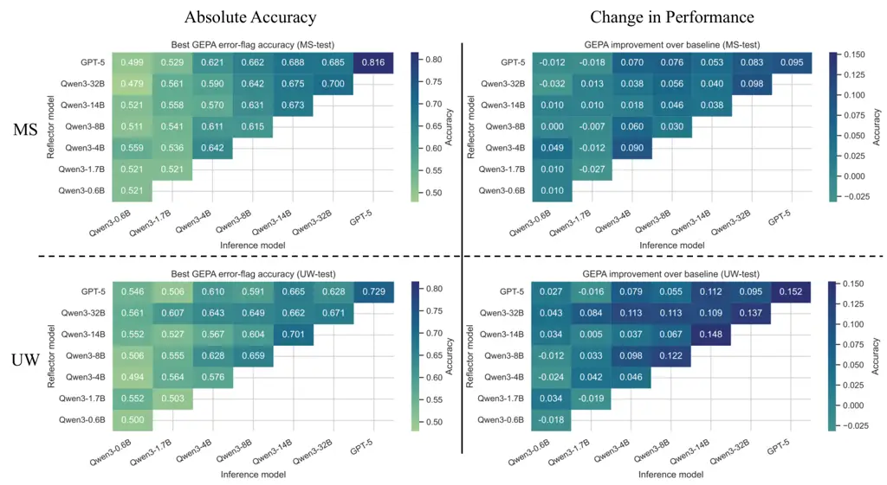
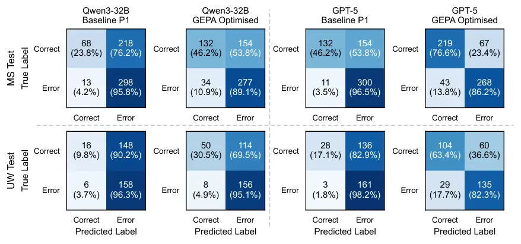

# Importance of Prompt Optimisation for Error Detection in Medical Notes Using Language Models

Craig Myles Affiliation: University of St Andrews, St Andrews, United
Kingdom    Patrick Schrempf Affiliation: University of St Andrews, St
Andrews, United Kingdom Affiliation: Canon Medical Research Europe Ltd.,
Edinburgh, United Kingdom
Correspondence:[cggm1@st-andrews.ac.uk](mailto:email@domain)    David
Harris-Birtill Affiliation: University of St Andrews, St Andrews, United
Kingdom

###### Abstract

Errors in medical text can cause delays or even result in incorrect
treatment for patients. Recently, language models have shown promise in
their ability to automatically detect errors in medical text, an ability
that has the opportunity to significantly benefit healthcare systems. In
this paper, we explore the importance of prompt optimisation for small
and large language models when applied to the task of error detection.
We perform rigorous experiments and analysis across frontier language
models and open-source language models. We show that automatic prompt
optimisation with Genetic-Pareto (GEPA) improves error detection over
the baseline accuracy performance from 0.669 to 0.785 with GPT-5 and
0.578 to 0.690 with Qwen3-32B, approaching the performance of medical
doctors and achieving state-of-the-art performance on the MEDEC
benchmark dataset. Code available on GitHub:
[https://github.com/CraigMyles/clinical-note-error-detection](https://github.com/CraigMyles/clinical-note-error-detection)

Figure 1: Diagram highlighting our experiment workflow, showing that we
utilise the MS training and validation subsets from the MEDEC
dataset (Ben Abacha et al., 2025) for prompt optimisation with
GEPA Agrawal et al. (2025). The data contains medical text (indicated by
the Report text) with binary labels indicating whether or not the text
contains an error. The MS and UW test sets are used for evaluation only.
We evaluate seven different models, including the GPT-5 frontier
model (OpenAI, 2025) and various open-source Qwen3 models (Yang et al.,
2025), in 28 different configurations.

## 1 Introduction

Medical errors are common and cause considerable morbidity and
mortality Cresswell et al. (2013). Unsafe primary care is a global
concern, with the importance of identifying interventions that enhance
safety of primary care provision at the centre of discussions Cresswell
et al. (2013). Most people will be subject to a diagnostic error in
their lifetime National Academies of Sciences, Engineering, and Medicine
(2015). In England, there are an estimated 237 million medication errors
that occur annually, of which 66 million are potentially clinically
significant Elliott et al. (2021). “Definitely avoidable” adverse drug
events are estimated to cost the NHS £98M per year, consuming 181k
bed-days and contributing to 1,708 deaths Elliott et al. (2021). There
is an important need for safeguards and error-checking mechanisms for
both clinician-generated texts as well as AI generated texts and
reports.

Large language models (LLMs) have shown promise for many natural
language processing tasks, with many commercial providers making online
models available via application programming interfaces (APIs) only.
Multiple open-source alternatives are also available, such as the Qwen3
models (Yang et al., 2025). In the medical domain, and particularly with
medical text, data contains sensitive and confidential information
relating to patients and their medical history. Therefore, online LLMs
are often not suitable for use due to privacy and security concerns.
Small language models (SLM) – defined here as models with 4B parameters
or less – may be a suitable secure alternative that can be run within
hospital networks and safe havens.

The MEDEC paper (Ben Abacha et al., 2025) introduces a benchmark dataset
consisting of multiple tasks related to error detection and correction
in medical text. The benchmark paper shows that even strong frontier
language models struggle with the task of detecting errors in medical
text. The paper further suggests that language models may not excel at
this task since the paradigm is not common online or in textbooks. In
particular, they have shown that performance drops when testing on an
unseen private test dataset from the University of Washington – a subset
which is almost certainly not part of most LLM pretraining datasets.
This motivates methods which can systematically improve model behaviour
for error detection without requiring expensive retraining. Furthermore,
any robust solution to the problem would provide an opportunity not only
for verifying clinical notes generated by medical doctors and other
healthcare practitioners but also has applications in checking AI/LLM
generated reports.

When developing solutions for use in clinical practice, it is important
to consider their auditability. For prompt-based language models, the
main input to the system is the prompt and clinical data, where the
prompt can easily be stored and accessed to enable auditing. The
European Society for Medical Oncology have released guidance on the use
of Large Language Models in Clinical Practice (ELCAP) (Wong et al.,
2025). Under the ELCAP regime, Type 3 - Background AI systems would
apply to developed solutions which “implement continuous performance
monitoring to detect potential errors” (Wong et al., 2025). In such a
case, “systems could catch errors early, but clinicians should retain
final authority”. In this paper, we utilise and explore the use of
Genetic-Pareto (GEPA) (Agrawal et al., 2025) for automated prompt
engineering, which produces new prompts based on a set of training data.
Figure 1 provides an overview of our experimental workflow. Once the
process is complete, the resulting prompt can be checked and audited to
ensure that it complies with data regulations and agreements.
Furthermore, there is also opportunity for clinicians to review the
prompts before use in clinical practice.

In this paper, we make the following contributions:

1.  1.  Evaluate frontier models and local model performance for error
        detection in medical notes.
2.  2.  Investigate the potential of automated prompt engineering for
        improving error detection in medical notes.
3.  3.  Show that the performance of small and large language models can be
        optimised effectively with the use of both commercial LLMs,
        GPT-5 (OpenAI, 2025), as well as open-source models, Qwen3 (Yang
        et al., 2025), which can be run locally.
4.  4.  Achieve state-of-the-art results for error detection in medical
        notes on the MEDEC benchmark (Ben Abacha et al., 2025) using GEPA
        prompt optimisation (Agrawal et al., 2025).

## 2 Related Work

The MEDEC dataset (Ben Abacha et al., 2025) is an evolution of the
MEDIQA-CORR shared task dataset (Ben Abacha et al., 2024), designed for
medical error detection and correction in clinical notes. MEDEC
comprises two distinct subsets named after the institutions that created
them: MS (Microsoft), containing clinical scenarios derived from MedQA
exam-board examples (Jin et al., 2021) with errors injected by
annotators, and UW (University of Washington), containing real
de-identified clinical notes from UW Medicine hospitals into which
annotators manually introduced errors. The MS subset provides training
(2,189 texts), validation (574 texts), and test (597 texts) splits,
while the UW subset contains only validation (160 texts) and test (328
texts) splits, with no training set provided. Due to these different
data sources and creation methods, the UW subset exhibits authentic
clinical documentation style rather than exam-like scenarios, making it
a valuable out-of-distribution test set for evaluating generalisation.

Although this work focuses on the MEDEC dataset, the underlying
distribution may reflect documentation practices and healthcare
observations from a single geographic setting. Initiatives such as
AfriMed-QA (Nimo et al., 2025) aim to reduce regional bias by
constructing large medical QA datasets sourced across African healthcare
contexts. While such datasets improve the global representativeness of
medical evaluation, their question-answer format is not directly
suitable for clinical note error detection, which requires
sentence-level error annotation. This present study therefore focuses on
the MEDEC collection, which to the best of the authors’ knowledge is
currently the only publicly available dataset structured for this
specific task. An example from the MEDEC-MS train dataset is presented
in Figure 2, and Figure 3 shows the distribution of correct samples and
error types across these splits.

Figure 2: Illustrative example from the MS-Train dataset, selected from
the shortest 1% of erroneous examples in the dataset. The narrative
contains one injected diagnostic medical error (sentence 2). We show the
corresponding correction for clarity.

Figure 3: Distribution of sample categories across MEDEC dataset splits.

Automated prompt engineering methods have been shown to improve
performance for language models on a range of tasks (Opsahl-Ong et al.,
2024; Agrawal et al., 2025). The DSPy library (Khattab et al., 2024),
provides a useful framework for implementation of automated prompt
engineering methods such as the Genetic-Pareto (GEPA) algorithm (Agrawal
et al., 2025), which uses a reasoning model to iteratively improve the
inference model.

Prompt engineering is a widely used approach for adapting LLMs to
specialised tasks. Methods ranging from zero-shot instructions and
few-shot demonstrations (Brown et al., 2020) to chain-of-thought
prompting (Wei et al., 2022) have shown that carefully designed prompts
can elicit substantially stronger reasoning behaviour than naive
instructions. Yet manual prompt design is typically hands on, brittle to
distribution shifts, and difficult to optimise systematically across
different models or tasks (Lu et al., 2022). These properties are
particularly limiting in clinical settings, where prompts should be
stable, auditable, and maintainable. In previous work by Jeong et al.
(2024), it has been shown that domain-specific language models (for the
medical domain) may often receive more prompt engineering than general
language models. With the use of automated prompt engineering methods, a
fairer comparison can be achieved across different models.

In parallel, recent work has explored higher-complexity inference-time
strategies, such as multi-agent debate with web retrieval for medical
error detection (Maiga et al., 2025). These approaches require multiple
model calls and external retrieval, whereas our method uses a single
optimised prompt and a single model call for inference.

An alternative to prompt engineering is fine-tuning, but for many
clinical NLP tasks this approach is expensive and operationally
demanding. It typically requires large labelled datasets, long training
runs, and can surface hurdles relating to governance for deployment. For
narrower problems, such as medical error detection, improving model
instructions can be a more light-weight approach to boost performance.
This paradigm is particularly desirable when combined with automated
optimisation.

Automated prompt engineering methods have recently become competitive
with fine tuning Agrawal et al. (2025). Genetic Pareto (GEPA) prompt
evolution combines reflective prompt improvement with Pareto frontier
selection, which helps to avoid local minima during search. GEPA has
been reported to outperform reinforcement learning based prompt
optimisation baselines such as Group Relative Policy Optimisation
(GRPO) Shao et al. (2024); Agrawal et al. (2025). It has also been shown
to consistently outperform other optimisers including Multi-prompt
Instruction Proposal Optimiser (MIPROv2) Opsahl-Ong et al. (2024), a
paradigm which jointly optimises instructions and few-shot examples.
GEPA prompts are often substantially shorter than those produced by
MIPROv2 Agrawal et al. (2025). While other works have shown that
accumulation of context can be beneficial for agentic and task-specific
performance Zhang et al. (2025), reduced input context length may be
particularly beneficial for locally deployed small language models with
limited context windows.

Figure 4: Performance of different inference–reflector pairs using GEPA
optimisation on the MEDEC-MS validation set. a) shows the absolute
performance. b) shows the difference between the base prompt and
optimised prompt performance.

## 3 Methods

We utilise the MEDEC dataset Ben Abacha et al. (2025), focusing on the
task of error detection. Each clinical note is given as one sentence per
line, where each line begins with a sentence identifier. A note is
either fully correct or contains exactly one medical error sentence.
Models must identify whether or not there is an error present within the
given narrative.

### 3.1 Models

We benchmark frontier commercial models, namely GPT-5-2025-08-07 OpenAI
(2025), Grok-4-0709 xAI (2025), Gemini-2.5-Pro Comanici et al. (2025),
and Claude-Sonnet-4-5-20250929 Anthropic (2025), and all currently
publicly released dense Qwen3 models (32B, 14B, 8B, 4B, 1.7B, and
0.6B) (Yang et al., 2025). Qwen3 models are run locally on nodes
containing 4$`\times`$ NVIDIA A100-SXM4-80GB GPUs. Across the
experiments reported in this paper, runs utilising local models
accounted for approximately 652 GPU-hours. Commercial models are queried
via APIs and are used with their default or recommended temperature and
thinking-effort values where applicable, however we apply the same
max_tokens that Qwen3 can support (n=32,768) to all commercial models.

### 3.2 GEPA-based context engineering

To optimise prompts, we use the DSPy Khattab et al. (2024) framework
implementation of GEPA with the heavy auto configuration. GEPA
alternates between running the current inference prompt on minibatches
and using the resulting traces to generate reflective revisions. Each
reflective step uses a reflector model that receives a scalar reward
derived from the task accuracy as well as a textual feedback. The
revised prompt is then evaluated and potentially added to a Pareto
frontier of candidate prompts.

### 3.3 Train and validation splits

The MEDEC-MS train split is used as the feedback set which is fed into
the inference model in mini-batches. Subsequent traces, scalar reward,
and textual feedback are used by the reflection model to drive
improvement. This reflection process also carries out the combining of
successful prompt elements from the diverse Pareto frontier to generate
new candidates. The validation set is used to maintain the Pareto
frontier, a particular selection of prompt candidates, where each prompt
is retained because it demonstrates superior performance on at least one
specific validation instance, helping to preserve a diverse range of
successful strategies. The validation inputs and outputs are never shown
to the reflector model. This separation prevents data-leakage and
encourages the finding of prompts which exhibit high generalisation
capability by optimising for performance on the unseen validation data,
helping to avoid prompt-specific overfitting to the feedback examples.

### 3.4 Rich feedback

For each rollout, GEPA produces a natural language critique which
accompanies the prediction and ground truth. The feedback explicitly
explains the classification outcome, for instance flagging when the
model predicts CORRECT despite a true ERROR, representing a false
positive. Additionally, the textual feedback provides the actual
erroneous sentence in addition to its corrected pairing, rather than
just a simple binary signal. This approach enables the reflector to
infer the underlying clinical reasoning gap, such as an incorrect
pharmacotherapy given the symptoms, and encode the appropriate logic or
medical context into subsequent prompt revisions.

### 3.5 Model pairing and decoupling

The inference and reflector paradigm inherently enables the two models
to differ, or indeed match. The inference model refers to the model that
ultimately runs on clinical notes at deployment time, while the
reflection model is an optimisation phase in which another model can
analyse errors and rewrite prompts. This decoupling makes it possible to
use a very strong but costly frontier model to evolve prompts for
smaller, local models. Once an effective prompt has been found, the
reflector is no longer required, leaving only the optimised prompt and
the local inference model for deployment.

## 4 Experiments

We first evaluate all models on the MEDEC-MS and MEDEC-UW validation
splits using the benchmark P#1 prompt defined alongside the official
MEDEC release Ben Abacha et al. (2024) (Appendix A). Additional details
of the zero shot evaluation protocol are provided in Appendix B. These
runs establish an initial baseline and inform reflector choice. GPT-5
achieves the strongest MS validation performance, and we therefore adopt
it as our primary commercial reflector for subsequent optimisation.

Next, we run GEPA across all reflector–inference pairs, including GPT-5
reflecting for each inference model and each Qwen3 model reflecting for
itself and for smaller Qwen3 variants (see Figure 4). We choose this
setup as we assume that the most powerful language model that can be run
by a user should be used as the reflector. GEPA is trained using
MEDEC-MS train as feedback data and MEDEC-MS validation for Pareto
selection. For each pair, we retain the best validation prompt from the
Pareto frontier.

Finally, we evaluate all resulting model prompt combinations on the
held-out MEDEC-MS test split and on the out-of-distribution MEDEC-UW
test split. This yields a total of twenty eight post-optimisation prompt
configurations. We describe and discuss results in detail in the next
section.

|                                             |                    |                    |       |
| ------------------------------------------- | ------------------ | ------------------ | ----- |
| Model                                       | MS-test            | UW-test            | MS+UW |
| Benchmark paper doctors                     |                    |                    |       |
| Doctor \#1 Ben Abacha et al. (2025)         | 0.813              | 0.760              | 0.796 |
| Doctor \#2 Ben Abacha et al. (2025)         | 0.689              | 0.772              | 0.716 |
| Benchmark paper models (P#1 prompt)         |                    |                    |       |
| Claude 3.5 Sonnet Ben Abacha et al. (2025)  | 0.675              | 0.750              | 0.702 |
| o1-preview Ben Abacha et al. (2025)         | 0.729              | 0.576              | 0.675 |
| o1-mini Ben Abacha et al. (2025)            | n/a                | n/a                | 0.691 |
| MediFact Saeed (2024)                       | n/a                | n/a                | 0.737 |
| Our models (P#1 prompt, 3 runs)             |                    |                    |       |
| GPT-5-2025-08-07 OpenAI (2025)              | $`0.720\pm 0.004`$ | $`0.576\pm 0.003`$ | 0.669 |
| Grok-4-0709 xAI (2025)                      | $`0.694\pm 0.009`$ | $`0.637\pm 0.012`$ | 0.674 |
| Gemini-2.5-Pro Comanici et al. (2025)       | $`0.560\pm 0.005`$ | $`0.524\pm 0.004`$ | 0.547 |
| Claude-Sonnet-4-5-20250929 Anthropic (2025) | $`0.625\pm 0.003`$ | $`0.719\pm 0.006`$ | 0.658 |
| Qwen3-32B (Yang et al., 2025)               | $`0.602\pm 0.008`$ | $`0.534\pm 0.009`$ | 0.578 |
| Qwen3-14B (Yang et al., 2025)               | $`0.635\pm 0.008`$ | $`0.553\pm 0.010`$ | 0.606 |
| Qwen3-8B (Yang et al., 2025)                | $`0.585\pm 0.010`$ | $`0.537\pm 0.013`$ | 0.568 |
| Qwen3-4B (Yang et al., 2025)                | $`0.552\pm 0.008`$ | $`0.530\pm 0.025`$ | 0.544 |
| Qwen3-1.7B (Yang et al., 2025)              | $`0.548\pm 0.007`$ | $`0.522\pm 0.005`$ | 0.539 |
| Qwen3-0.6B (Yang et al., 2025)              | $`0.511\pm 0.012`$ | $`0.518\pm 0.032`$ | 0.513 |
| Our models (GEPA optimised)                 |                    |                    |       |
| GPT-5-2025-08-07 OpenAI (2025)              | 0.816              | $`0.729`$          | 0.785 |
| Qwen3-32B (Yang et al., 2025)               | $`0.700`$          | $`0.671`$          | 0.690 |
| Qwen3-14B (Yang et al., 2025)               | $`0.673`$          | $`0.701`$          | 0.683 |
| Qwen3-8B (Yang et al., 2025)                | $`0.615`$          | $`0.659`$          | 0.631 |
| Qwen3-4B (Yang et al., 2025)                | $`0.642`$          | $`0.576`$          | 0.619 |
| Qwen3-1.7B (Yang et al., 2025)              | $`0.521`$          | $`0.503`$          | 0.515 |
| Qwen3-0.6B (Yang et al., 2025)              | $`0.521`$          | $`0.500`$          | 0.514 |

Table 1: Detection accuracy on the MEDEC MS-test and UW-test subsets,
and a combined MS+UW score. Paper models use the original benchmark
results on each subset; our implementations use the P#1 prompt with
three random seeds (mean $`\pm`$ standard deviation). The MS+UW column
for our results is a weighted mean using $`N_{\mathrm{MS}}=597`$ and
$`N_{\mathrm{UW}}=328`$. Bold items highlight the best metric in each
column, double underlined items show the second best metric, underlined
items show the third best metric.

Figure 5: Benchmark P1 accuracy on the combined MEDEC test sets, with
MS+UW weighted by their respective sample counts; comparing previously
benchmarked Ben Abacha et al. (2025); Saeed (2024) (orange) vs our P1
benchmarks (blue) as well as GEPA optimised.

Figure 6: GEPA prompt optimisation performance across reflector and
inference model pairings on the MEDEC MS test set (top) and the out of
distribution MEDEC UW test set (bottom). Left panels report absolute
error detection accuracy for the best GEPA optimised prompt found for
each pairing. Right panels show the corresponding improvement over the
P1 baseline (optimised minus baseline).

Figure 7: Confusion matrices highlighting shift in performance before
and after the introduction of GEPA optimisation for both Qwen3-32B and
GPT-5. In both the Qwen3-32B and GPT-5 examples, GEPA optimisation was
run with GPT-5 as the reflector model.

## 5 Results

Baseline results with the P1 prompt broadly reproduce the benchmark
trends (see Table 1), with frontier models outperforming local dense
models, particularly on the MS test set, with almost all models
exhibiting reduced accuracy on UW. This is consistent with the
distribution shift between the MS and UW subsets. An exception to this
trend is the Claude Sonnet models which perform better on UW than MS.
Conversely, we note that Gemini-2.5-Pro performs poorly on both MS-test
and UW-test.

Figure 4 shows that after GEPA optimisation, validation performance
improves for most reflector–inference pairs, indicating that reflective
context evolution can systematically strengthen error detection even
without gradient-based training. Interestingly, the best reflector for
improving performance with GEPA was typically either GPT-5 or the
matching Qwen3 self-sized pair. Furthermore, when optimising Qwen3-0.6B,
GPT-5 as the reflector performed much worse than using Qwen3-0.6B with
respect to validation performance. This is counter-intuitive and may be
due to “overfitting” of the prompt for this model to the validation
data.

Notably, the largest models show some of the largest absolute gains from
GEPA, including GPT-5. This is somewhat surprising, as one might expect
frontier models to be less dependent on prompt engineering, yet our
results suggest that automated prompt evolution can still unlock
substantial additional capability.

Figure 5 shows that our GEPA-optimised GPT-5 model achieves
state-of-the-art performance on this task within the MEDEC benchmark,
highlighting that automated prompt engineering can significantly improve
performance of language models. Furthermore, this underlines the
importance that the prompt plays in performance of both commercial and
open source language models, with performance gains observed across the
board.

To understand how these aggregate gains arise across model pairings and
test distributions, Figure 6 decomposes performance by
reflector–inference pairing on each test set. On the MEDEC-MS test set
(top), GEPA-optimised prompts mostly yield positive gains over P1,
particularly when GPT-5 is the reflector. Improvements are also observed
when larger Qwen3 models act as reflectors for smaller Qwen3 inference
models, suggesting that local reflection can be an effective
privacy-preserving alternative to commercial optimisation.

On the MEDEC-UW test set (see bottom half of Figure 6), GEPA again
improves performance in most settings. A notable exception is the
smallest Qwen3 variants, where gains on MS do not always translate to UW
and in a few cases performance drops slightly. This pattern is not
observed for larger Qwen3 models, implying that very small models may be
more sensitive to over specialisation during prompt evolution. Looking
at the right-hand side of Figure 6, we see that the improvements on the
UW test set using the prompts optimised by GEPA (recall that this is
optimised using the MS dataset only) are actually larger in most cases
than the improvements on the MS test dataset, showing that prompts
learned on one dataset can transfer to an unseen clinical distribution.

Compared with prior task-specific systems on MEDIQA-CORR style
evaluation, MediFact reports 0.737 error-flag accuracy (Saeed, 2024),
whereas our GEPA-optimised GPT-5 achieves 0.785 on the combined MS+UW
test sets (Table 1). A recent multi-agent debate approach reports 78.8%
accuracy on a balanced 500-sample subset of the MS collection using
GPT-4o with web retrieval (Maiga et al., 2025). This evaluation differs
from ours in both subset construction and inference setup, however, our
best single-model setting exceeds this score on the full MS-test split
(0.816) while requiring only a single model call at inference time.

Figure 7 provides further insight into how GEPA changes model behaviour.
The confusion matrices reveal that baseline models tend to over-predict
errors, exhibiting high false positive rates (e.g., 76.2% for Qwen3-32B
on MS-test). After GEPA optimisation, both models become more balanced,
with substantially improved specificity (correctly identifying
error-free texts) at the cost of a slight reduction in sensitivity.

Inspection of the GEPA-optimised prompts reveals how this shift arises.
The P1 baseline provides minimal guidance on decision thresholds,
leading models to over-flag errors. In contrast, GEPA-evolved prompts
explicitly instruct conservative classification, for example, treating
acceptable practice variations as correct rather than erroneous,
directly addressing the high false positive rates observed with P1. The
prompts also incorporate domain-specific medical examples, such as
expected pathogens for infective endocarditis, that help disambiguate
clinically similar cases. A full example is provided in Appendix C.

## 6 Conclusion

We investigated automated prompt optimisation for medical error
detection in clinical notes. We achieve state-of-the-art performance on
the MEDEC benchmark dataset. Furthermore, we show that Genetic Pareto
optimisation consistently improves accuracy for a range of inference
models, including privacy-preserving and computationally-efficient Qwen3
models. Notably, our best setting achieves accuracy comparable to
medical professionals, outperforming one of the two doctor baselines
reported for MEDEC. Our results highlight the importance of prompt
optimisation when using language models.

For GPT-5, GEPA yields absolute accuracy gains of 9.5 percentage points
on the held-out MEDEC-MS test set and 15.2 percentage points on the
out-of-distribution MEDEC-UW test set, despite optimisation being
performed only on MS-train and MS-val. This indicates that prompt
evolution learned on MS generalises beyond its source clinical setting.

Beyond accuracy, this approach offers governance advantages. Prompts are
short, explicit, and fully auditable, enabling clinical review for
hidden failures or unintended data leakage. They can also be updated as
clinical workflows change, unlike fine-tuned behaviours that are
difficult to revise or unlearn once internalised by a model. In summary,
we show that reflective prompt evolution can provide a practical route
towards background AI alert systems that continuously monitor electronic
health record text for medical errors while remaining compatible with
secure local deployment.

## 7 Limitations

In this work, we have assumed that the best reasoning model is the model
that performs best on the MS split on the validation set. It is possible
that a better reasoning model exists and it may differ across datasets.

Since we benchmark directly off the P1 prompt from Ben Abacha et al.
(2025), the starting prompt may have some influence over GEPA’s rollout.
It is possible that a different (such as a more descriptive) initial
prompt could lead to different results.

In some GEPA rollouts, the Qwen3 reflection output reached the 32k
completion cap and was truncated, which may slightly limit the
optimiser’s ability to fully utilise the reflection space. Models with
larger limits on max tokens may overcome this potential bottleneck but
these require powerful hardware and therefore could not be run as part
of our experiments.

## Code and Data Availability

The code used in this study is available on GitHub at
[https://github.com/CraigMyles/clinical-note-error-detection](https://github.com/CraigMyles/clinical-note-error-detection)
and is released under the permissive CC BY 4.0 licence. The MEDEC-MS
dataset used in this study is available via
[https://github.com/abachaa/MEDEC](https://github.com/abachaa/MEDEC).
The MEDEC-UW subset is available upon request from the same location,
subject to a data usage agreement.

## Acknowledgements

This work is in part funded by the UK Medical Research Council (MRC)
Impact Acceleration Account (IAA) (MR/X502716/1) awarded to the
University of St Andrews. This work has been carried out in
collaboration with Canon Medical Research Europe Ltd. This research and
use of data has been approved by the University of St Andrews School of
Computer Science Ethics Committee (Approval Code: CS-0688-930-2025)

## References

- Agrawal et al. (2025) Lakshya A Agrawal, Shangyin Tan, Dilara Soylu,
  Noah Ziems, Rishi Khare, Krista Opsahl-Ong, Arnav Singhvi, Herumb
  Shandilya, Michael J Ryan, Meng Jiang, and 1 others. 2025. GEPA:
  Reflective prompt evolution can outperform reinforcement learning.
  _arXiv preprint arXiv:2507.19457_.
- Anthropic (2025) Anthropic. 2025. [Claude sonnet 4.5 system
  card](https://www.anthropic.com/claude-sonnet-4-5-system-card).
  Technical report, Anthropic PBC. System card.
- Ben Abacha et al. (2024) Asma Ben Abacha, Wen-wai Yim, Yujuan Fu,
  Zhaoyi Sun, Fei Xia, and Meliha Yetisgen. 2024. [Overview of the
  MEDIQA-CORR 2024 shared task on medical error detection and
  correction](https://doi.org/10.18653/v1/2024.clinicalnlp-1.57). In
  _Proceedings of the 6th Clinical Natural Language Processing
  Workshop_, pages 596–603, Mexico City, Mexico. Association for
  Computational Linguistics.
- Ben Abacha et al. (2025) Asma Ben Abacha, Wen-wai Yim, Yujuan Fu,
  Zhaoyi Sun, Meliha Yetisgen, Fei Xia, and Thomas Lin. 2025. [MEDEC: A
  benchmark for medical error detection and correction in clinical
  notes](https://doi.org/10.18653/v1/2025.findings-acl.1159). In
  _Findings of the Association for Computational Linguistics: ACL 2025_,
  pages 22539–22550, Vienna, Austria. Association for Computational
  Linguistics.
- Brown et al. (2020) Tom Brown, Benjamin Mann, Nick Ryder, Melanie
  Subbiah, Jared D Kaplan, Prafulla Dhariwal, Arvind Neelakantan, Pranav
  Shyam, Girish Sastry, Amanda Askell, and 1 others. 2020. Language
  models are few-shot learners. _Advances in neural information
  processing systems_, 33:1877–1901.
- Comanici et al. (2025) Gheorghe Comanici, Eric Bieber, Mike
  Schaekermann, Ice Pasupat, Noveen Sachdeva, Inderjit Dhillon, Marcel
  Blistein, Ori Ram, Dan Zhang, Evan Rosen, and 1 others. 2025. Gemini
  2.5: Pushing the frontier with advanced reasoning, multimodality, long
  context, and next generation agentic capabilities. _arXiv preprint
  arXiv:2507.06261_. Technical report.
- Cresswell et al. (2013) Kathrin M Cresswell, Sukhmeet S Panesar,
  Sarah A Salvilla, Andrew Carson-Stevens, Itziar Larizgoitia, Liam J
  Donaldson, David Bates, Aziz Sheikh, and World Health Organization’s
  (WHO) Safer Primary Care Expert Working Group. 2013. Global research
  priorities to better understand the burden of iatrogenic harm in
  primary care: an international delphi exercise. _PLoS medicine_,
  10(11):e1001554.
- Elliott et al. (2021) Rachel Ann Elliott, Elizabeth Camacho, Dina
  Jankovic, Mark J Sculpher, and Rita Faria. 2021. Economic analysis of
  the prevalence and clinical and economic burden of medication error in
  england. _BMJ Quality & Safety_, 30(2):96–105.
- Jeong et al. (2024) Daniel P Jeong, Saurabh Garg, Zachary Chase
  Lipton, and Michael Oberst. 2024. [Medical adaptation of large
  language and vision-language models: Are we making
  progress?](https://doi.org/10.18653/v1/2024.emnlp-main.677) In
  _Proceedings of the 2024 Conference on Empirical Methods in Natural
  Language Processing_, pages 12143–12170, Miami, Florida, USA.
  Association for Computational Linguistics.
- Jin et al. (2021) Di Jin, Eileen Pan, Nassim Oufattole, Wei-Hung Weng,
  Hanyi Fang, and Peter Szolovits. 2021. What disease does this patient
  have? a large-scale open domain question answering dataset from
  medical exams. _Applied Sciences_, 11(14):6421.
- Khattab et al. (2024) Omar Khattab, Arnav Singhvi, Paridhi Maheshwari,
  Zhiyuan Zhang, Keshav Santhanam, Sri Vardhamanan, Saiful Haq, Ashutosh
  Sharma, Thomas T. Joshi, Hanna Moazam, Heather Miller, Matei Zaharia,
  and Christopher Potts. 2024. Dspy: Compiling declarative language
  model calls into self-improving pipelines.
- Lu et al. (2022) Yao Lu, Max Bartolo, Alastair Moore, Sebastian
  Riedel, and Pontus Stenetorp. 2022. [Fantastically ordered prompts and
  where to find them: Overcoming few-shot prompt order
  sensitivity](https://doi.org/10.18653/v1/2022.acl-long.556). In
  _Proceedings of the 60th Annual Meeting of the Association for
  Computational Linguistics (Volume 1: Long Papers)_, pages 8086–8098,
  Dublin, Ireland. Association for Computational Linguistics.
- Maiga et al. (2025) Abdine Maiga, Anoop Shah, and Emine Yilmaz. 2025.
  [Error detection in medical note through multi agent
  debate](https://doi.org/10.18653/v1/2025.bionlp-1.12). In _Proceedings
  of the 24th Workshop on Biomedical Language Processing_, pages
  124–135, Viena, Austria. Association for Computational Linguistics.
- National Academies of Sciences, Engineering, and Medicine (2015)
  National Academies of Sciences, Engineering, and Medicine. 2015.
  [_Improving Diagnosis in Health
  Care_](https://doi.org/10.17226/21794). The National Academies Press,
  Washington, DC.
- Nimo et al. (2025) Charles Nimo, Tobi Olatunji, Abraham Toluwase
  Owodunni, Tassallah Abdullahi, Emmanuel Ayodele, Mardhiyah Sanni,
  Ezinwanne C. Aka, Folafunmi Omofoye, Foutse Yuehgoh, Timothy Faniran,
  Bonaventure F. P. Dossou, Moshood O. Yekini, Jonas Kemp, Katherine A
  Heller, Jude Chidubem Omeke, Chidi Asuzu Md, Naome A Etori, Aïmérou
  Ndiaye, Ifeoma Okoh, and 7 others. 2025. [AfriMed-QA: A pan-African,
  multi-specialty, medical question-answering benchmark
  dataset](https://doi.org/10.18653/v1/2025.acl-long.96). In
  _Proceedings of the 63rd Annual Meeting of the Association for
  Computational Linguistics (Volume 1: Long Papers)_, pages 1948–1973,
  Vienna, Austria. Association for Computational Linguistics.
- OpenAI (2025) OpenAI. 2025. [Gpt-5 system
  card](https://cdn.openai.com/gpt-5-system-card.pdf). Technical report,
  OpenAI. System card.
- Opsahl-Ong et al. (2024) Krista Opsahl-Ong, Michael J Ryan, Josh
  Purtell, David Broman, Christopher Potts, Matei Zaharia, and Omar
  Khattab. 2024. [Optimizing instructions and demonstrations for
  multi-stage language model
  programs](https://doi.org/10.18653/v1/2024.emnlp-main.525). In
  _Proceedings of the 2024 Conference on Empirical Methods in Natural
  Language Processing_, pages 9340–9366, Miami, Florida, USA.
  Association for Computational Linguistics.
- Saeed (2024) Nadia Saeed. 2024. [MediFact at MEDIQA-CORR 2024: Why AI
  needs a human
  touch](https://doi.org/10.18653/v1/2024.clinicalnlp-1.32). In
  _Proceedings of the 6th Clinical Natural Language Processing
  Workshop_, pages 346–352, Mexico City, Mexico. Association for
  Computational Linguistics.
- Shao et al. (2024) Zhihong Shao, Peiyi Wang, Qihao Zhu, Runxin Xu,
  Junxiao Song, Xiao Bi, Haowei Zhang, Mingchuan Zhang, YK Li, Yang Wu,
  and 1 others. 2024. Deepseekmath: Pushing the limits of mathematical
  reasoning in open language models. _arXiv preprint arXiv:2402.03300_.
- Wei et al. (2022) Jason Wei, Xuezhi Wang, Dale Schuurmans, Maarten
  Bosma, Fei Xia, Ed Chi, Quoc V Le, Denny Zhou, and 1 others. 2022.
  Chain-of-thought prompting elicits reasoning in large language models.
  _Advances in neural information processing systems_, 35:24824–24837.
- Wong et al. (2025) EYT Wong, L Verlingue, M Aldea, MA Franzoi,
  R Umeton, S Halabi, N Harbeck, A Indini, A Prelaj, E Romano, and 1
  others. 2025. Esmo guidance on the use of large language models in
  clinical practice (elcap). _Annals of Oncology_.
- xAI (2025) xAI. 2025. [Grok 4 model
  card](https://data.x.ai/2025-08-20-grok-4-model-card.pdf). Technical
  report, xAI. Model card.
- Yang et al. (2025) An Yang, Anfeng Li, Baosong Yang, Beichen Zhang,
  Binyuan Hui, Bo Zheng, Bowen Yu, Chang Gao, Chengen Huang, Chenxu Lv,
  Chujie Zheng, Dayiheng Liu, Fan Zhou, Fei Huang, Feng Hu, Hao Ge,
  Haoran Wei, Huan Lin, Jialong Tang, and 41 others. 2025. Qwen3
  technical report. _arXiv preprint arXiv:2505.09388_.
- Zhang et al. (2025) Qizheng Zhang, Changran Hu, Shubhangi Upasani,
  Boyuan Ma, Fenglu Hong, Vamsidhar Kamanuru, Jay Rainton, Chen Wu,
  Mengmeng Ji, Hanchen Li, and 1 others. 2025. Agentic context
  engineering: Evolving contexts for self-improving language models.
  _arXiv preprint arXiv:2510.04618_.

Appendix

## Appendix A P#1 Benchmark Prompt

The following is the benchmarked zero-shot prompt from Ben Abacha et al.
(2025):

## Appendix B Zero-shot validation LLM inference

Figure 8: Validation performance on MEDEC-MS using P1, measured by error
detection accuracy. Qwen3 results are mean with standard deviation bars
across three random seeds.

Figure 9: Validation performance on MEDEC-UW using P1, measured by error
detection accuracy. Qwen3 results are mean with standard deviation bars
across three random seeds.

## Appendix C GEPA optimised Prompt Example

Top performing prompt generated with GEPA using GPT-5 as reflector model
for GPT-5 inference.

