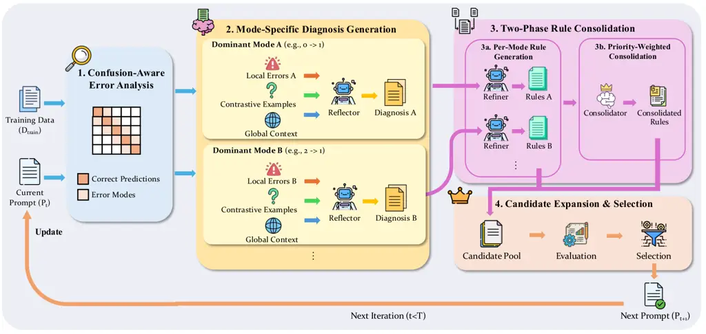
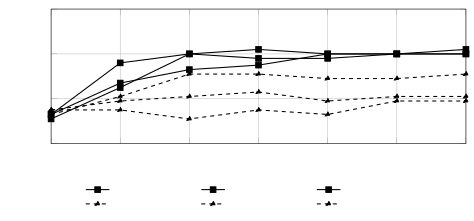

# Confusion-Aware Rubric Optimization for LLM-based Automated Grading

Yucheng Chu

Hang Li

Kaiqi Yang Address: Michigan State University Email: <chuyuch2@msu.edu>
Address: Michigan State University Email: <lihang4@msu.edu>
Address: Michigan State University Email: <kqyang@msu.edu>    Yasemin
Copur-Gencturk

Joseph Krajcik

Namsoo Shin Address: University of Southern California
Email: <copurgen@usc.edu> Address: Michigan State University
Email: <krajcik@msu.edu> Address: Michigan State University
Email: <namsoo@msu.edu>    Jiliang Tang Address: Michigan State
University Email: <tangjili@msu.edu>

###### Abstract

Accurate and unambiguous guidelines are critical for large language
model (LLM) based graders, yet manually crafting these prompts is often
sub-optimal as LLMs can misinterpret expert guidelines or lack necessary
domain specificity. Consequently, the field has moved toward automated
prompt optimization to refine grading guidelines without the burden of
manual trial and error. However, existing frameworks typically aggregate
independent and unstructured error samples into a single update step,
resulting in “rule dilution” where conflicting constraints weaken the
model’s grading logic. To address these limitations, we introduce
Confusion-Aware Rubric Optimization (CARO), a novel framework that
enhances accuracy and computational efficiency by structurally
separating error signals. CARO leverages the confusion matrix to
decompose monolithic error signals into distinct modes, allowing for the
diagnosis and repair of specific misclassification patterns
individually. By synthesizing targeted “fixing patches" for dominant
error modes and employing a diversity-aware selection mechanism, the
framework prevents guidance conflict and eliminates the need for
resource-heavy nested refinement loops. Empirical evaluations on teacher
education and STEM datasets demonstrate that CARO significantly
outperforms existing SOTA methods. These results suggest that replacing
mixed-error aggregation with surgical, mode-specific repair yields
robust improvements in automated assessment scalability and precision.

###### keywords

Automatd Grading, Large Language Models, Automated Prompt Optimization,
Confusion Matrices.

## 1 Introduction

The rapid shift toward personalized and competency-based learning has
placed unprecedented challenges for traditional assessment frameworks.
As personalized learning relies on understanding the specific needs for
each learner, it necessitates high-quality formative assessment. In
modern pedagogy, providing frequent and high-quality assessment feedback
on students’ open-ended work is essential for diagnosing misconceptions
and fostering deep conceptual understanding black1998assessment;
hattie2007power; shute2008focus. Yet these benefits are hard to deliver
at scale. Constructed-response tasks, such as short answers or
explanations, capture students’ reasoning more directly than
multiple-choice formats, but they are substantially more time-consuming
to assign and evaluate. Furthermore, they can exhibit nontrivial scorer
disagreement even under rubric-based evaluation
livingston2009constructed. Notably, this disagreement often stems from
the linguistic diversity and variability inherent in student answers.
This “grading bottleneck” is reflected in teachers’ reported workloads,
where scoring and correcting student work consumes a sizable share of
working time across education systems oecd2025results. As a result,
educational practice often trades off authenticity for scalability by
reducing the use of open-ended items or returning feedback after long
delays. These compromises weaken the instructional value of assessment
and motivate automated grading as a way to preserve the pedagogical
benefits of constructed responses without prohibitive cost or latency
attali2006automated; leacock2003c.

Traditional methods of automated grading primarily relied on
hand-crafted features, such as keyword matching, latent semantic
analysis (LSA), or surface-level linguistic metrics
foltz1999intelligent. These approaches requires task-specific feature
engineering and fails to capture the semantic nuances of student
reasoning, resulting in rigid evaluations that often penalize creative
but correct answers dikli2006overview. The advent of deep learning
introduced fine-tuning techniques using encoder-based models like BERT,
which significantly improved semantic understanding and scoring accuracy
devlin2019bert; mayfield2020should. However, these models require
extensive labeled datasets for training before applicable to the new
tasks, making them impractical for dynamic classroom environments where
assignments change frequently. Recent advancements demonstrate that
large language models (LLMs) overcome this data barrier. Unlike their
predecessors, LLMs can leverage zero-shot and few-shot capabilities
(i.e., they can operate effectively with little to no labeled data) to
grade open-ended student responses with performance approaching
human-to-human agreement levels chen2025grading. Despite this promise,
the transition from human grading to LLM-driven assessment is fraught
with technical hurdles. In particular, reliability is heavily contingent
on the quality of the grading prompt, with the instructions and rubric
operationalization constraining the model’s decision-making
chen2025grading; jiang2024short. Simply treating a human rubric as an
instruction for an LLM is often sub-optimal; human rubrics, while
intuitive for expert educators, often contain linguistic ambiguities
that misalign with the causal reasoning of an LLM. This “alignment gap”
necessitates extensive prompt engineering, a process that is often
manual and driven by iterative trial and error, making it difficult to
scale chu2025llm; zhang2025prompt. Consequently, the field has moved
toward _automated prompt optimization_ (APO), where algorithms
iteratively refine instructions based on quantitative performance
feedback zhou2022large; chu2025llm.

While state-of-the-art frameworks like GradeOpt chu2025llm leverage
reflective optimization to diagnose errors, they are limited by their
naive treatment of the error signal, which incurs substantial
computational overhead when searching over large prompt spaces.
Specifically, these methods aggregate heterogeneous error samples into a
composite feedback signal, combining distinct failure types such as
hallucination, excessive strictness, and rubric misunderstanding into a
single optimization step without separation. This confounding of error
types leads to rule dilution. That is, by attempting to address a
mixture of conflicting signals simultaneously, the optimizer generates
generalized, weak instructions that fail to enforce clear decision
boundaries. Consequently, to find even a marginally improved prompt,
these methods rely on resource-heavy exploration, generating and
evaluating large pools of candidates.

To address this, we introduce CARO (Confusion-Aware Rubric for
Optimization), a framework that achieves superior accuracy and
computational efficiency by structurally separating error signals. We
observe that grading errors are not random mixtures, but structured
clusters. CARO leverages the confusion matrix to decompose the
monolithic error signal into distinct error modes, eliminating the
inefficiency of trying to address conflicting error types
simultaneously. Specifically, CARO targets the single dominant error
mode at each step (e.g., a specific tendency to confuse a score of 0
with 1), transforming the optimization into a structured
diagnosis-and-repair pipeline. By isolating a single, clear failure
pattern, CARO generates targeted “rule patches” that are specific and
highly effective. Contributing to its precision, CARO produces robust
prompts with significantly fewer iterations and lower token usages
compared to the existing APO baselines. Our empirical results confirm
that CARO significantly outperforms these frameworks across multiple
datasets while utilizing the same cost-effective backbone (GPT-4o-mini¹¹
1 https://platform.openai.com/docs/models/gpt-4o-mini).

## 2 Related Work

#### Automated short-answer grading (ASAG)

Early ASAG systems relied on hand-crafted lexical features and latent
semantic analysis to predict scores (mohler2009text). The field later
transitioned to neural architectures, utilizing recurrent models and
Transformer encoders trained on graded corpora to capture deeper
semantic dependencies (vaswani2017attention; haller2022survey). Despite
their improved accuracy, these supervised pipelines require extensive
labeled data for each specific question and lack the interpretability of
rubric-based assessment. This limitation motivated the shift toward
Large Language Models (LLMs), which offer zero-shot flexibility and the
capacity to generate human-readable feedback alongside scores.

#### LLM-based grading and prompt optimization

Recent studies demonstrate that LLMs can achieve high agreement with
human graders, though performance remains heavily dependent on rubric
specificity and prompt design (jiang2024short; chamieh2024llms). While
frameworks like RAG can improve domain grounding (chu2025enhancing), the
challenge of manual tuning has accelerated the adoption of Automatic
Prompt Optimization (APO). APO treats instructions as trainable
parameters, ranging from iterative meta-optimization in OPRO and DSPy
(yang2023large; khattab2024dspy) to the “natural-language gradients”
used in ProTeGi (pryzant2023automatic). In the educational domain,
GradeOpt applies these principles to refine grading guidelines via
self-reflection (chu2025llm). However, these systems generally aggregate
heterogeneous errors into a single feedback signal, often obscuring the
distinct failure patterns critical for precise assessment.



Figure 1: Framework of the CARO algorithm.

## 3 Problem Formulation

We formalize the task of automated rubric optimization as a discrete
search problem over the space of natural language instructions. Unlike
fine-tuning LLM parameters, which requires extensive labeled data and
computational resources, we focus on optimizing the rubric prompt in the
text space. This approach leverages the in-context learning capability
of pre-trained LLMs while maintaining interpretability so that graders
can inspect and validate the optimized rubric before deployment. Let
$`\mathcal{D}=\{(x_{n},y_{n})\}_{n=1}^{N}`$ be a dataset of student
responses $`x`$ and ground-truth scores $`y\in\mathcal{Y}`$, where
$`\mathcal{Y}=\{0,1,\dots,K-1\}`$ represents an ordinal grading scale.
An LLM-based grader can be defined as a function $`f_{\theta}`$ that
estimates the probability $`P_{\theta}(y|x,\mathcal{P})`$ of a score
$`y`$ given a response $`x`$ and a rubric prompt $`\mathcal{P}`$. The
predicted score is obtained as
$`\hat{y}=\arg\max_{y\in\mathcal{Y}}P_{\theta}(y|x,\mathcal{P})`$. The
objective of Automated Prompt Optimization (APO) is to identify an
optimal prompt $`\mathcal{P}^{*}`$ that maximizes a performance metric
$`\mathcal{M}`$ (e.g., classification accuracy or quadratic weighted
kappa) over a validation dataset:

```math
\mathcal{P}^{*}=\arg\max_{\mathcal{P}\in\mathcal{S}}\mathcal{M}\big(\{\hat{y}_{n},y_{n}\}_{n=1}^{N}\big) \tag{1}
```

where $`\mathcal{S}`$ denotes the discrete search space of candidate
prompts. Since the optimization targets the natural language prompt
directly to ensure the rubric remains human-readable, standard
differentiable optimization methods applicable to continuous parameters
are not viable. Instead, APO methods approximate the gradient by
generating textual feedback $`g`$ based on the discrepancy between
predicted scores $`\hat{y}`$ and true scores $`y`$, effectively
performing a semantic descent step
$`\mathcal{P}_{t+1}\leftarrow\text{Update}(\mathcal{P}_{t},g)`$.

The goal of our work is to address the structural inefficiency problem
of the feedback signal $`g`$ when generated from aggregated error data.
In the context of ordinal grading, errors are not uniform; they
constitute distinct directional error modes captured by the confusion
matrix $`\mathbf{C}`$, where an entry $`C_{ij}`$ represents the
frequency of true class $`i`$ being misclassified as $`j`$. Existing APO
frameworks typically aggregate a batch of heterogeneous error samples by
mixing instances of $`i\to j`$ confusion with $`k\to l`$ confusion to
generate a single, composite feedback signal. We define this aggregation
as the source of rule dilution. By exposing multiple error modes
simultaneously, such methods require the optimizer model to solve a
multi-objective task that demands high reasoning capacity to disentangle
competing patterns. To address this challenge, we adopt a multi-agent
decomposition strategy that separates the complex task into focused
sub-problems: (1) a Mode-Specific Reflector that analyzes each confusion
cell $`(i,j)`$ independently to generate targeted feedback, and (2) a
Consolidator that synthesizes per-mode refinements into a coherent,
non-redundant rule set while maintaining global consistency.

Furthermore, this optimization landscape is characterized by high
inter-dependency between grading criteria, leading to mode interference.
Addressing a specific error mode $`C_{ij}`$ in isolation can act as a
perturbation to the decision boundary between classes $`i`$ and $`j`$.
Due to the semantic continuity of the rubric, this perturbation often
propagates to adjacent boundaries, inadvertently increasing the error
rate in a connected mode $`C_{jk}`$ or $`C_{ji}`$. This phenomenon
creates a non-monotonic optimization trajectory where the reduction of
one error type systematically amplifies another. Consequently, the
optimization objective shifts from merely minimizing the total error
count to identifying a structured sequence of rule refinements that
effectively _decomposes_ the confusion matrix $`\mathbf{C}`$ without
causing regression in previously stabilized modes. Our framework
addresses this via a decomposition strategy that first generates
mode-specific rules with global context awareness, then consolidating
them with explicit priority ordering and cross-mode safety checks.

## 4 Method

We propose CARO (Confusion-Aware Rubric for Optimization), a framework
designed to overcome the limitations of aggregating feedback in
automated rubric optimization. Existing methods often suffer from rule
dilution, where conflicting error signals lead to vague instructions. To
address this, CARO structurally decomposes the optimization problem
using confusion matrices, treating grading errors not as random noise
but as distinct, diagnosable modes. Our approach operates in three
iterative phases: confusion-aware error analysis, mode-specific gradient
generation, and priority-weighted rule consolidation.

### 4.1 Framework Overview

Figure 1 illustrates the complete CARO pipeline. To efficiently navigate
the extensive search space of natural language prompts, CARO employs an
iterative, minibatch-based optimization loop. In each iteration $`t`$,
rather than evaluating on the entire training set, which is
computationally expensive and may obscure minority error patterns, we
sample a focused subset of data (a minibatch) to estimate the current
rubric’s performance. This iterative design allows the framework to
progressively refine the rubric, addressing the most prominent error
modes in early rounds before fine-tuning for edge cases.

The framework operates as a closed-loop optimization system with four
interconnected components. Components 1–3 form the core optimization
loop within a single round: (1) Confusion-Aware Error Analysis grades
the minibatch and extracts structured error patterns; (2) Mode-Specific
Gradient Generation produces targeted feedback for each confusion cell
using a Reflector LLM; and (3) Two-Phase Rule Consolidation synthesizes
per-mode rules into a unified rubric. These three components pass
information sequentially within each optimization round. Component 4
(Candidate Selection and Sampling) operates at a different granularity
as it governs the inter-round dynamics. It acts as a bridge between
iterations by determining which candidate prompts survive to round
$`t+1`$ and constructing the specific training minibatch that will be
used to evaluate it. This separation reflects the algorithmic structure:
Components 1–3 generate candidate prompts within a single round, while
Component 4 decides which candidates propagate across rounds and what
data they will be evaluated on next. The dashed connection in the figure
indicates this temporal decoupling.

The complete procedure is summarized in Algorithm 1. Given an initial
rubric prompt $`\mathcal{P}_{0}`$, a training dataset
$`\mathcal{D}_{\text{train}}`$, and a LLM predictor $`f_{\theta}`$, our
objective is to iteratively optimize the prompt to minimize
classification errors while ensuring stability across different score
categories. The optimization process functions as a directed search. At
each iteration $`t`$, we first evaluate the current prompt on a
minibatch to generate a confusion matrix $`\mathbf{C}^{(t)}`$
(Algorithm 1, lines 4–7). From this matrix, we identify the top-$`K`$
error modes, denoted as
$`\mathcal{M}=\{(i_{1},j_{1}),\dots,(i_{K},j_{K})\}`$, ranked by
frequency (line 8). Unlike standard methods that aggregate these errors,
CARO generates distinct gradients for each mode (lines 10–16), which are
subsequently consolidated into coherent rule updates (lines 18–23). This
cycle repeats until convergence or a maximum step count $`T`$ is
reached.

0:  Initial rubric prompt $`\mathcal{P}_{0}`$, training data
$`\mathcal{D}_{\text{train}}`$, LLM predictor $`f_{\theta}`$, rounds
$`T`$, beam size $`B`$, top-$`K`$ modes, diversity weight $`\lambda`$

0:  Optimized rubric prompt $`\mathcal{P}^{*}`$

1:  $`\mathcal{P}^{(0)}\leftarrow\{\mathcal{P}_{0}\}`$ {Initialize
candidate set}

2:  for $`t=1`$ to $`T`$ do

3:   // 1. Confusion-Aware Error Analysis

4:
  $`\text{Minibatch}^{(t)}\leftarrow\text{SBERTSample}(\text{TopMisconf}^{(t-1)},\mathcal{D}_{\text{train}})`$

5:   for each $`\mathcal{P}\in\mathcal{P}^{(t-1)}`$ do

6:    Evaluate $`\mathcal{P}`$ on $`\text{Minibatch}^{(t)}`$ to obtain
$`\mathbf{C}^{(t)}_{\mathcal{P}}`$

7:   end for

8:   $`\mathcal{M}\leftarrow\text{TopKModes}(\mathbf{C}^{(t)},K)`$
{Identify top-$`K`$ error modes}

9:   // 2. Mode-Specific Diagnosis Generation

10:   $`\mathcal{G}\leftarrow\emptyset`$

11:   for each mode $`(i,j)\in\mathcal{M}`$ do

12:    $`\mathcal{E}_{i\to j}\leftarrow`$ Extract error examples with
true label $`i`$, predicted $`j`$

13:    $`\mathcal{E}^{+}_{i},\mathcal{E}^{+}_{j}\leftarrow`$ Sample
high-misconfidence correct examples

14:
   $`g_{i\to j}\leftarrow\text{Reflector}(\text{Rules}^{(t)},\mathcal{E}_{i\to j},\mathcal{E}^{+}_{i},\mathcal{E}^{+}_{j},\mathbf{C}^{(t)},\mathcal{M})`$

15:    $`\mathcal{G}\leftarrow\mathcal{G}\cup\{g_{i\to j}\}`$

16:   end for

17:   // 3. Two-Phase Rule Consolidation

18:   $`\mathcal{R}\leftarrow\emptyset`$

19:   for each $`(i,j)\in\mathcal{M}`$ do

20:
   $`r_{i\to j}\leftarrow\text{Refiner}(\text{Rules}^{(t)},g_{i\to j},\mathcal{M}\setminus\{(i,j)\},\mathbf{C}^{(t)})`$

21:    $`\mathcal{R}\leftarrow\mathcal{R}\cup\{(r_{i\to j},(i,j))\}`$

22:   end for

23:
  $`r_{\text{consolidated}}\leftarrow\text{PriorityConsolidate}(\mathcal{R},\mathbf{C}^{(t)})`$

24:   // 4. Candidate Expansion and Selection

25:
  $`\mathcal{P}_{\text{new}}\leftarrow\{\mathcal{P}\oplus r:\mathcal{P}\in\mathcal{P}^{(t-1)},r\in\mathcal{R}\cup\{r_{\text{consolidated}}\}\}`$

26:   Score each $`\mathcal{P}\in\mathcal{P}_{\text{new}}`$ via
UCB-based evaluation

27:
  $`\mathcal{P}^{(t)}\leftarrow\text{DiverseSelect}(\mathcal{P}_{\text{new}},B,\lambda)`$
{Eq. 5}

28:  end for

29:  return
$`\arg\max_{\mathcal{P}\in\mathcal{P}^{(T)}}\kappa(\mathcal{P},\mathcal{D}_{\text{val}})`$

Algorithm 1 CARO: Confusion-Aware Rubric Optimization


Figure 2: Example Reflector prompt for analyzing the dominant error mode
$`(0\to 1)`$. The prompt provides: (1) global context via the full
confusion matrix, (2) local error examples with model reasoning traces,
and (3) contrastive correct examples to establish decision boundaries.


Figure 3: Structured diagnosis output from the Reflector for mode
$`(0\to 1)`$. The output identifies root causes, misleading patterns,
and proposes targeted rule modifications with safety considerations.


Figure 4: Refiner prompt structure showing how cross-mode awareness is
incorporated. The Refiner receives information about all active error
modes to generate compatible rule fixes.

### 4.2 Confusion-Aware Error Analysis

The diagnostic phase begins by explicitly evaluating the current rubric
$`\mathcal{P}^{(t)}`$ on the sampled minibatch to generate a set of
predictions and their corresponding reasoning traces. By comparing these
predictions $`\hat{y}`$ against ground truth $`y`$, we construct a
confusion matrix $`\mathbf{C}^{(t)}`$ (lines 4–7). Based on this
performance data, we construct a comprehensive context for the
optimizer. For each identified confusion mode $`(i,j)\in\mathcal{M}`$,
we assemble three distinct types of information to ground the model’s
reasoning. First, we extract local error context. This consists of
specific examples $`\mathcal{E}_{i\to j}=\{(x,y,\hat{y},r)\}`$ where the
true label $`y`$ is $`i`$, but the model predicted $`\hat{y}=j`$,
accompanied by the model’s reasoning trace $`r`$ (line 12). Second, to
establish clear decision boundaries, we sample contrastive correct
examples. These are instances correctly classified as $`i`$ or $`j`$ but
which exhibit high model uncertainty (line 13). We quantify this
uncertainty using a misconfidence score chu2025llm:

```math
\text{misconf}(x)=\begin{cases}-\log P_{\theta}(\hat{y}|x)&\text{if }\hat{y}=y\\
\left|\frac{\log P_{\theta}(\hat{y}|x)}{\log P_{\theta}(y|x)}\right|&\text{if }\hat{y}\neq y\end{cases} \tag{2}
```

where $`P_{\theta}(c|x)`$ denotes the predicted probability for class
$`c`$. High misconfidence in correct predictions signals boundary cases
that provide high-value discriminative signals. Finally, we provide
global context via the full confusion matrix summary,
$`\text{GlobalContext}(\mathbf{C})`$. This summary includes the error
distribution across all classes, ensuring that the optimizer remains
aware of the global performance landscape and avoids overfitting to a
single error type at the expense of others.

### 4.3 Mode-Specific Feedback Generation

To repair the identified errors, CARO avoids the “rule dilution" of
baseline methods by generating separate diagnosis for each error mode
(lines 10–16). We employ a Reflector LLM to analyze the confusion
pattern $`(i,j)`$ specifically. The gradient generation process is
formalized as:

```math
g_{i\to j}=\text{Reflector}(\text{Rules}^{(t)},\mathcal{E}_{i\to j},\mathcal{E}^{+}_{i},\mathcal{E}^{+}_{j},\text{GlobalContext}(\mathbf{C}),\mathcal{M}) \tag{3}
```

Here, $`\mathcal{E}^{+}_{i}`$ and $`\mathcal{E}^{+}_{j}`$ represent the
contrastive correct examples. We have shown a demonstration of the
Reflector’s prompt in Figure 2.

As exemplified by Figure 3, the resulting gradient $`g_{i\to j}`$
provides a structured diagnosis, identifying the root cause of the
confusion, creating discriminative criteria to distinguish score $`i`$
from $`j`$, and performing a safety check to predict potential negative
side effects on other score categories.

### 4.4 Two-Phase Rule Consolidation

A critical innovation of CARO is the consolidation strategy, which
converts discrete error diagnostics into a unified, coherent rubric
(lines 18–23). We execute this in two phases to balance specificity with
logical consistency.

#### Phase 1: Per-Mode Rule Generation

We translate the gradients into specific rule refinements (lines 19–22).
For each mode $`(i,j)`$, a Refiner module generates a rule update
$`r_{i\to j}`$. Crucially, the Refiner receives information about all
other targeted error modes $`\mathcal{M}\setminus\{(i,j)\}`$ as
additional context. This cross-mode awareness enables the Refiner to
anticipate potential interactions. We show an example of the prompt to
Refiner in Figure 4: when generating a rule to prevent $`0\to 1`$
misclassification, it can avoid phrasing that would inadvertently
increase $`1\to 2`$ or $`0\to 2`$ errors if these modes are also being
addressed in the same round.

#### Phase 2: Priority-Weighted Consolidation

Rather than simply concatenating all new rules, which often leads to
bloated or contradictory prompts, we organize rules based on the
frequency of the error modes they address (line 23). The consolidated
rule set for the next iteration is derived as:

```math
\text{Rules}^{(t+1)}=\text{Consolidate}(\{r_{i\to j}\}_{(i,j)\in\mathcal{M}},\mathbf{C}) \tag{4}
```

As shown in Figure 5, the consolidation assigns explicit precedence
levels: the dominant error mode (highest $`C_{ij}`$) receives Priority 1
with 2–3 detailed rules; secondary modes receive Priority 2+ with
single-sentence guards. When rules from different priority levels
suggest different scores for an edge case, we insert explicit
tie-breaker directives, e.g., “If Priority 1 criteria suggest score
$`X`$ but Priority 2 criteria suggest score $`Y`$, assign score $`X`$
unless \[specific exception condition\].” This prioritization ensures
that the optimization creates a stable “diagnosis-and-repair" pipeline,
systematically eliminating the most significant failure patterns before
addressing long-tail errors.


Figure 5: Two-phase rule consolidation. Phase 1 generates per-mode rules
with cross-mode awareness. Phase 2 synthesizes them into a
priority-weighted consolidated ruleset with explicit conflict resolution
directives.

### 4.5 Candidate Selection and Sampling

The final phase bridges the current iteration to the next by performing
two distinct operations (lines 24–26): (1) candidate selection, which
determines which prompt variants effectively resolved errors and should
survive to the next round, and (2) minibatch sampling, which constructs
the optimal training data for the subsequent iteration to prevent
overfitting and ensure robust evaluation.

#### Diversity-Aware Candidate Selection

CARO maintains a beam of $`B`$ candidate prompts across iterations. Each
candidate prompt $`\mathcal{P}`$ generated in “Two-Phase Rule
Consolidation” is tagged with its target mode
$`m(\mathcal{P})\in\mathcal{M}`$, indicating which confusion cell it was
designed to address. To prevent the beam from collapsing to variants of
a single mode fix, we employ a greedy selection strategy that balances
empirical performance with mode coverage:

```math
\text{SelectScore}(\mathcal{P})=\widetilde{\kappa}(\mathcal{P})+\lambda\cdot\mathbb{1}[m(\mathcal{P})\notin\mathcal{S}] \tag{5}
```

where $`\widetilde{\kappa}(\mathcal{P})`$ is the min-max normalized
Cohen’s $`\kappa`$ score cohen1960coefficient, $`\mathcal{S}`$
represents the set of error modes already covered by previously selected
candidates in the current selection round, and $`\lambda`$ is a
hyperparameter controlling the diversity bonus. The indicator function
$`\mathbb{1}[\cdot]`$ awards a bonus to candidates targeting modes not
yet represented in the selected set $`\mathcal{S}`$, encouraging
exploration of diverse rule modifications.

#### Semantic Minibatch Sampling

Instead of random minibatch construction, we use an
SBERT reimers2019sentence-based similarity selector to focus
optimization effort on challenging regions of the input space. We
retrieve training examples that are semantically similar to the
high-misconfidence instances identified in previous rounds:

```math
\text{Minibatch}^{(t)}=\bigcup_{x\in\text{TopMisconf}^{(t-1)}}\text{kNN}_{k}(x,\mathcal{D}_{\text{train}}) \tag{6}
```

where $`\text{kNN}_{k}`$ retrieves the $`k`$ nearest neighbors based on
SBERT embeddings. This ensures that refined rules are stress-tested
against examples where the current rubric is most ambiguous,
accelerating convergence on difficult boundary cases.

### 4.6 Inference with Optimized Prompt

Upon the termination of the optimization procedure, we select the rubric
prompt $`\mathcal{P}^{*}`$ that maximizes the evaluation metric (Cohen’s
$`\kappa`$) on the validation set:

```math
\mathcal{P}^{*}=\arg\max_{\mathcal{P}\in\mathcal{P}^{(T)}}\kappa(\mathcal{P},\mathcal{D}_{\text{val}}) \tag{7}
```

This globally optimized prompt serves as the fixed instruction set for
the final inference phase on the held-out test dataset
$`\mathcal{D}_{\text{test}}`$. For a given student response
$`x\in\mathcal{D}_{\text{test}}`$, the predicted score is obtained as:

```math
\hat{y}=\arg\max_{y\in\mathcal{Y}}P_{\theta}(y\mid x,\mathcal{P}^{*}) \tag{8}
```

where $`P_{\theta}(y\mid x,\mathcal{P}^{*})`$ denotes the probability
assigned by the LLM predictor $`f_{\theta}`$ to score $`y`$ given the
student response $`x`$ and the optimized rubric $`\mathcal{P}^{*}`$. The
model generates a completion that includes both a reasoning trace $`r`$
and a final numerical score, extracted via regular expression parsing:

```math
(\hat{y},r)=\text{Parse}\big(f_{\theta}(x\oplus\mathcal{P}^{*};\tau=0)\big) \tag{9}
```

By enforcing the reasoning trace through the structure of
$`\mathcal{P}^{*}`$, the inference process provides not only a
quantitative grade but also an interpretable justification that reflects
the resolved decision boundaries established during optimization.

## 5 Experiments

### 5.1 Experimental Setup

#### Datasets

We evaluate CARO on three educational grading datasets spanning K-12
science education and teacher education:

Interaction Dataset ($`\mathcal{D}_{I}`$): This dataset contains 252
high school student responses to a physics assessment item on electrical
interactions kaldaras2021developing. Each response is evaluated against
11 binary rubric categories (labeled 0/1), where 0 indicates the
requirement is “not met” and 1 indicates it is “met.” The categories
assess distinct aspects of student understanding, ranging from basic
concept recognition to complex reasoning about charge interactions.

Elementary Item Response Dataset ($`\mathcal{D}_{E}`$): This dataset
comprises elementary student responses to five science assessment tasks
graded on an ordinal scale $`\{0,1,2,3,4\}`$. The tasks assess
foundational science concepts with varying levels of complexity.

Teacher Education Dataset ($`\mathcal{D}_{T}`$): This dataset evaluates
teachers’ pedagogical content knowledge in mathematics education
copur2022mathematics. It contains eight grading tasks organized into
three knowledge dimensions:

- •
  KSMT (Knowledge of Students’ Mathematical Thinking): Tasks T1–T3
  assess teachers’ ability to interpret student mathematical reasoning.
- •
  KMT (Knowledge of Mathematical Tasks): Tasks T4–T6 evaluate
  understanding of task design and cognitive demand.
- •
  KT (Knowledge of Teaching): Tasks T7–T8 assess pedagogical
  decision-making.

All tasks in $`\mathcal{D}_{T}`$ use ordinal labels $`\{0,1,2\}`$,
representing absent, partial, and complete understanding respectively.

We partition each dataset into train/validation/test splits using a
7:1:2 ratio following chu2025llm. Dataset statistics are summarized in
Table 1.

| Dataset             | Domain            | \#Samples      | Scores      |
| ------------------- | ----------------- | -------------- | ----------- |
| $`\mathcal{D}_{I}`$ | Interaction       | 252            | {0,1}       |
| $`\mathcal{D}_{T}`$ | Teacher Education | 224$`\sim`$236 | {0,1,2}     |
| $`\mathcal{D}_{E}`$ | Elementary        | 199$`\sim`$434 | {0,1,2,3,4} |

Table 1: A summary of statistics of the datasets

#### Baselines

We compare CARO against two baselines. First is Naive Prompting, which
uses direct zero-shot prompting with an expert-written rubric, without
any optimization. Secondly, we compare with GradeOpt chu2025llm, a
state-of-the-art automatic prompt optimization framework that
iteratively refines rubrics using aggregated error feedback.

#### Implementation Details

We use GPT-4o-mini as both the grading predictor $`f_{\theta}`$ and the
optimization agents (Reflector and Refiner) across all methods for fair
comparison. For CARO, we set: top-$`K`$ error modes $`K=4`$, beam size
$`B=4`$, diversity weight $`\lambda=0.3`$, and maximum rounds $`T=6`$.
The edit budget is set to “medium” (2–3 rule modifications per mode).
For GradeOpt, we use the default hyperparameters from chu2025llm and set
the maximum rounds to $`T=6`$ to align with computational constraints of
CARO. To mitigate the inherent stochasticity of LLM generation and
ensure the reliability of our findings, we conducted 3 independent runs
for all methods (CARO and baselines) across each task. The reported
results represent the average performance on the held-out test set
across these 3 trials.

#### Evaluation Metrics

We report classification accuracy (Acc) and Cohen’s $`\kappa`$
coefficient cohen1960coefficient. While accuracy measures overall
correctness, $`\kappa`$ accounts for class imbalance and chance
agreement, making it the primary metric for grading reliability
assessment. A $`\kappa>0.6`$ is generally considered substantial
agreement landis1977measurement.

### 5.2 Main Results

#### Teacher Education Dataset ($`\mathcal{D}_{T}`$)

Table 2 presents results on the teacher education dataset. CARO achieves
consistent improvements across all eight tasks, with an average accuracy
improvement of $`+11\%`$ over GradeOpt and $`+41\%`$ over Naive
prompting.

|         |      |       |            |          |            |      |            |
| ------- | ---- | ----- | ---------- | -------- | ---------- | ---- | ---------- |
| Type    | Task | Naive |            | GradeOpt |            | CARO |            |
|         |      | Acc   | $`\kappa`$ | Acc      | $`\kappa`$ | Acc  | $`\kappa`$ |
| KSMT    | T1   | 0.40  | 0.20       | 0.61     | 0.41       | 0.67 | 0.47       |
| KSMT    | T2   | 0.58  | 0.42       | 0.74     | 0.61       | 0.79 | 0.69       |
| KSMT    | T3   | 0.39  | 0.09       | 0.51     | 0.25       | 0.55 | 0.30       |
| KSMT    | Avg  | 0.46  | 0.24       | 0.62     | 0.42       | 0.67 | 0.49       |
| KMT     | T4   | 0.30  | 0.05       | 0.55     | 0.28       | 0.76 | 0.57       |
| KMT     | T5   | 0.59  | 0.28       | 0.60     | 0.31       | 0.74 | 0.46       |
| KMT     | T6   | 0.68  | 0.44       | 0.76     | 0.58       | 0.76 | 0.59       |
| KMT     | Avg  | 0.52  | 0.26       | 0.64     | 0.39       | 0.75 | 0.54       |
| KT      | T7   | 0.45  | 0.29       | 0.74     | 0.60       | 0.77 | 0.65       |
| KT      | T8   | 0.60  | 0.34       | 0.70     | 0.48       | 0.72 | 0.52       |
| KT      | Avg  | 0.52  | 0.32       | 0.72     | 0.54       | 0.75 | 0.59       |
| Overall | Avg  | 0.51  | 0.27       | 0.65     | 0.44       | 0.72 | 0.53       |

Table 2: Performance Comparison for Teacher Education Dataset
$`\mathcal{D}_{T}`$

The most substantial gains occur on tasks with severe baseline confusion
patterns. For instance, on T4 (KMT), CARO improves $`\kappa`$ from 0.28
(GradeOpt) to 0.57, which is a relative improvement of 104%. This task
exhibits significant $`0\to 1`$ confusion in the baseline, which CARO
directly addresses through mode-specific gradient generation. Similarly,
T5 shows a $`\kappa`$ improvement from 0.31 to 0.46, demonstrating
CARO’s effectiveness on tasks where GradeOpt’s aggregate feedback fails
to resolve specific confusion patterns. Notably, CARO’s improvements are
most pronounced in the KMT dimension, where grading criteria involve
subtle distinctions between “no understanding” and “partial
understanding”, which is precisely the type of adjacent-class confusion
that CARO is designed to resolve.

#### Interaction Dataset ($`\mathcal{D}_{I}`$)

Table 3 shows results on the binary classification tasks. Despite the
simpler label space, several categories exhibit class imbalance that
inflates accuracy while depressing $`\kappa`$. CARO achieves the highest
$`\kappa`$ on 10 of 11 categories. The improvements are particularly
striking on challenging categories:

- •
  Category 3: $`\kappa`$ improves from 0.61 (GradeOpt) to 0.89, a 46%
  relative gain.
- •
  Category 4: $`\kappa`$ improves from 0.36 to 0.62, resolving severe
  confusion in this low-agreement task.
- •
  Category 8: Accuracy jumps from 0.44 to 0.74 (+68%), with $`\kappa`$
  improving from 0.04 to 0.12.

Categories 6, 8, and 9 exhibit persistently low $`\kappa`$ despite high
accuracy improvements, indicating extreme class imbalance where the
minority class remains difficult to identify. Nevertheless, CARO
substantially outperforms baselines in accuracy, suggesting improved
discrimination even when $`\kappa`$ is constrained by distributional
factors.

| Category | Naive |            | GradeOpt |            | CARO |            |
| -------- | ----- | ---------- | -------- | ---------- | ---- | ---------- |
|          | Acc   | $`\kappa`$ | Acc      | $`\kappa`$ | Acc  | $`\kappa`$ |
| 1        | 0.94  | 0.79       | 0.96     | 0.84       | 0.98 | 0.92       |
| 2        | 0.86  | 0.71       | 0.88     | 0.76       | 0.93 | 0.87       |
| 3        | 0.82  | 0.52       | 0.85     | 0.61       | 0.95 | 0.89       |
| 4        | 0.52  | 0.19       | 0.64     | 0.36       | 0.81 | 0.62       |
| 5        | 0.62  | 0.18       | 0.95     | 0.72       | 0.96 | 0.78       |
| 6        | 0.42  | 0.03       | 0.73     | 0.09       | 0.87 | 0.21       |
| 7        | 0.77  | 0.11       | 0.95     | 0.48       | 0.97 | 0.54       |
| 8        | 0.22  | 0.03       | 0.44     | 0.04       | 0.74 | 0.12       |
| 9        | 0.15  | -0.04      | 0.27     | 0.01       | 0.90 | -0.02      |
| 10       | 0.42  | 0.14       | 0.72     | 0.41       | 0.82 | 0.47       |
| 11       | 0.60  | 0.14       | 0.90     | 0.50       | 0.94 | 0.64       |
| Avg      | 0.58  | 0.25       | 0.75     | 0.43       | 0.90 | 0.55       |

Table 3: Performance Comparison for Interaction Dataset
$`\mathcal{D}_{I}`$

| Task | Naive |            | GradeOpt |            | CARE |            |
| ---- | ----- | ---------- | -------- | ---------- | ---- | ---------- |
|      | Acc   | $`\kappa`$ | Acc      | $`\kappa`$ | Acc  | $`\kappa`$ |
| T1   | 0.16  | -0.08      | 0.63     | 0.35       | 0.63 | 0.39       |
| T2   | 0.49  | 0.30       | 0.74     | 0.64       | 0.75 | 0.66       |
| T3   | 0.57  | 0.25       | 0.79     | 0.67       | 0.81 | 0.70       |
| T4   | 0.48  | 0.20       | 0.71     | 0.57       | 0.74 | 0.62       |
| T5   | 0.50  | 0.04       | 0.70     | 0.46       | 0.73 | 0.56       |
| Avg  | 0.44  | 0.14       | 0.71     | 0.54       | 0.73 | 0.59       |

Table 4: Performance Comparison for EIR Dataset $`\mathcal{D}_{E}`$

#### Elementary Item Response Dataset ($`\mathcal{D}_{E}`$)

Table 4 presents results on the elementary response dataset. CARO
achieves consistent improvements across all five tasks, with an average
$`\kappa`$ of 0.59 compared to 0.54 for GradeOpt and 0.14 for Naive
prompting. The most notable improvement occurs on T5, where $`\kappa`$
increases from 0.46 (GradeOpt) to 0.56, which represents a 22% relative
improvement. This task involves distinguishing between partial and
complete understanding, a boundary that benefits from CARO’s contrastive
example selection.

#### Summary of Improvements

Table 5 summarizes the aggregated performance across all datasets. On
average, CARO improves accuracy from 0.51 (Naive prompting) to 0.78,
representing a 53% increase compared to GradeOpt (37% increase from 0.51
to 0.70). CARO achieves an overall average $`\kappa`$ of 0.56,
representing a 19% relative improvement over GradeOpt (0.47) and a 155%
improvement over Naive prompting (0.22).

| Dataset                   | Naive |            | GradeOpt |            | CARO |            |
| ------------------------- | ----- | ---------- | -------- | ---------- | ---- | ---------- |
|                           | Acc   | $`\kappa`$ | Acc      | $`\kappa`$ | Acc  | $`\kappa`$ |
| $`\mathcal{D}_{I}`$ (avg) | 0.58  | 0.25       | 0.75     | 0.43       | 0.90 | 0.55       |
| $`\mathcal{D}_{T}`$ (avg) | 0.51  | 0.27       | 0.65     | 0.44       | 0.72 | 0.53       |
| $`\mathcal{D}_{E}`$ (avg) | 0.44  | 0.14       | 0.71     | 0.54       | 0.73 | 0.59       |
| Overall                   | 0.51  | 0.22       | 0.70     | 0.47       | 0.78 | 0.56       |

Table 5: Summary of average performance across datasets.

### 5.3 Ablation Studies

We conduct ablation studies to analyze the key design choices and
advantages of CARO.

#### Per-Mode vs. Consolidated Rules

As described in Section 3.4, CARO generates two types of candidate rules
during the Two-Phase Rule Consolidation: (1) per-mode rules
$`r_{i\to j}`$ that target individual confusion cells, and (2)
consolidated rules $`r_{\text{consolidated}}`$ that synthesize all
per-mode rules into a unified, priority-weighted ruleset via Eq. 4. Both
types are included in the candidate pool (Algorithm 1, line 24), and the
diversity-aware selection mechanism (Eq. 5) determines which candidates
propagate to subsequent rounds. Table 6 reports which candidate type
achieves the best validation $`\kappa`$ across all tasks.

We observe that per-mode rules are selected as the final best prompt in
over 90% of cases across all datasets. This indicates that targeted
fixes for specific confusion cells typically outperform holistic
rewrites that attempt to address multiple error patterns simultaneously.
The consolidated rules, despite being carefully synthesized with
priority weighting and conflict resolution directives, tend to dilute
the specificity needed for precise decision boundaries. However,
consolidated rules are occasionally preferred (6–8% of cases) in tasks
with strongly interacting error modes, where coherent integration
prevents the rule conflicts that can arise from independently applying
multiple per-mode fixes.

| Dataset             | Per-Mode | Consolidated | Best $`\kappa`$ |
| ------------------- | -------- | ------------ | --------------- |
| $`\mathcal{D}_{I}`$ | 93.9%    | 6.1%         | Per-Mode        |
| $`\mathcal{D}_{T}`$ | 91.7%    | 8.3%         | Per-Mode        |
| $`\mathcal{D}_{E}`$ | 93.3%    | 6.7%         | Per-Mode        |
| Avg                 | 93.0%    | 7.0%         | \-              |

Table 6: Ablation: Per-mode vs. consolidated rule selection. Values show
the percentage of final best prompts using each strategy.

#### Convergence Analysis

Figure 6 shows the optimization trajectory across rounds for a
representative task T4 in $`\mathcal{D}_{I}`$ over three independent
runs. Several patterns emerge from this comparison.

Rapid initial gains. CARO demonstrates substantially faster early-stage
improvement, achieving an average accuracy of 0.69 after just one round
(from 0.52 baseline), compared to GradeOpt’s 0.58. By Round 2, all CARO
runs reach or exceed 0.73 accuracy, while all GradeOpt runs remain below
0.71.

Stability vs. oscillation. CARO exhibits monotonic or near-monotonic
improvement with stable convergence around 0.80 accuracy by Round 3–4.
In contrast, GradeOpt displays the oscillation characteristic of
aggregate feedback methods: Run 2 drops from 0.55 to 0.51 at Round 2,
and Run 1 regresses from 0.63 to 0.59 at Round 4. This instability
reflects mode interference, where fixing one error pattern inadvertently
amplifies another.

Final performance gap. After 6 rounds, CARO achieves a final accuracy of
0.80–0.82 across all runs (avg. 0.81), while GradeOpt plateaus at
0.59–0.71 (avg. 0.64). This gap demonstrates that CARO’s mode-specific
updates not only converge faster but also reach superior optima by
avoiding the destructive interference inherent in consolidated feedback
approaches.



Figure 6: Convergence comparison on T4 ($`\mathcal{D}_{I}`$). CARO
achieves faster convergence and higher final accuracy.

#### API Cost Analysis

Table 7 compares the computational cost of CARO and GradeOpt. Despite
using the same number of optimization rounds, CARO requires 80% fewer
API calls, translating to approximately 60% cost reduction. This
efficiency benefits from CARO’s targeted optimization strategy: rather
than exhaustively sampling errors across all confusion cells to generate
aggregate feedback, CARO focuses gradient generation on only the
top-$`K`$ error modes per round. Additionally, the mode-specific
Reflector and Refiner operate on refined subsets of error examples
(Eq. 3), whereas GradeOpt’s aggregate approach requires broader sampling
to capture diverse error patterns within a single feedback signal.

| Method    | Rounds | API Calls      | Est. Cost   |
| --------- | ------ | -------------- | ----------- |
| GradeOpt  | 6      | $`\sim`$40,000 | $`\sim`$\$5 |
| CARO      | 6      | $`\sim`$8,000  | $`\sim`$\$2 |
| Reduction | –      | 80%            | 60%         |

Table 7: API cost comparison (average per task). Costs estimated using
GPT-4o-mini pricing (\$0.15/1M input, \$0.60/1M output tokens).

| Round 0 | Round 2 | Round 4 |
| ------- | ------- | ------- |

| $`\begin{bmatrix}2&1&0&0&1\\
7&41&0&0&0\\
1&\pagecolor{red!30}\mathbf{24}&0&0&0\\
0&\pagecolor{red!30}\mathbf{8}&2&0&0\\
0&1&0&0&0\end{bmatrix}`$ | $`\begin{bmatrix}\pagecolor{green!25}4&0&0&0&0\\
4&35&\pagecolor{orange!25}9&0&0\\
0&\pagecolor{green!25}4&\pagecolor{green!25}\mathbf{21}&0&0\\
0&0&10&0&0\\
0&0&1&0&0\end{bmatrix}`$ | $`\begin{bmatrix}2&1&0&0&1\\
3&\pagecolor{green!25}\mathbf{40}&\pagecolor{green!25}5&0&0\\
0&4&\pagecolor{green!25}\mathbf{21}&0&0\\
0&0&9&\pagecolor{green!25}1&0\\
0&0&1&0&0\end{bmatrix}`$ |
| Acc = 0.49, $`\kappa`$ = 0.02 | Acc = 0.68, $`\kappa`$ = 0.49 | Acc = 0.73, $`\kappa`$ = 0.55 |

XDominant error mode   X Emerging secondary error   X Improved
classification

Figure 7: Confusion matrix progression on T5 ($`\mathcal{D}_{E}`$). Rows
represent true labels; columns represent predictions. CARO’s iterative
refinement first resolves the dominant $`2\to 1`$ collapse (Round 0–2),
then addresses the emergent $`1\to 2`$ over-correction (Round 2–4),
achieving balanced diagonal improvement.

### 5.4 Qualitative Analysis

#### Case Study: Iterative Error Resolution on T5 ($`\mathcal{D}_{E}`$)

We illustrate CARO’s “diagnosis-and-repair” pipeline through a detailed
case study on T5 ($`\mathcal{D}_{E}`$), which assesses elementary
students’ understanding of how a Peregrine Falcon perceives a rock
pigeon through a four-step light perception process (light travels to
pigeon $`\to`$ reflects off pigeon $`\to`$ enters falcon’s eyes $`\to`$
brain processes images). The task uses a 5-point ordinal scale
$`\{0,1,2,3,4\}`$ where Score 2 requires mentioning 1–2 steps, while
Score 1 is reserved for responses containing no accurate steps. Figure 7
traces the confusion matrix evolution across optimization rounds,
revealing how CARO systematically resolves cascading error patterns.

Round 0: Identifying the Dominant Mode. The initial classifier exhibits
severe collapse toward Score 1, with the $`2\to 1`$ cell containing 24
errors (53% of all misclassifications, highlighted in red). Analysis
reveals that responses mentioning partial steps, such as “the light
source is the sun and the light travels to the eye and that’s how the
falcon can see the pigeon”, were incorrectly penalized for omitting
steps rather than credited for partial understanding. A secondary
$`3\to 1`$ pattern (8 errors) compounds this collapse, resulting in zero
correct predictions for Scores 2–4 and a near-chance $`\kappa=0.02`$.

Round 2: Resolving the Primary Collapse. CARO’s Reflector diagnoses the
root cause: the original rubric lacks explicit guidance for recognizing
partial scientific understanding. The generated rule states: “If a
response includes at least one correct element related to the four steps
(e.g., light traveling, reflecting, or entering the eyes), classify as
Score 2, provided it does not contain entirely irrelevant information.”
As shown in the Round 2 matrix, this intervention reduces $`2\to 1`$
errors from 24 to 4 ($`-83\%`$, green), while correct Score-2
predictions increase from 0 to 21. Class 0 achieves perfect
classification (orange). However, the fix reveals an emergent secondary
pattern: $`1\to 2`$ confusion (9 errors, orange) as the model now
over-awards partial credit to responses lacking any valid steps.

Round 4: Addressing the Secondary Mode. CARO shifts focus to the
$`1\to 2`$ over-correction, introducing a discriminative rule:
“Responses must include at least one identifiable step describing
light’s journey; vague statements about ‘seeing’ without mechanistic
detail remain Score 1.” The Round 4 matrix shows this refinement reduces
$`1\to 2`$ errors from 9 to 5 while improving Score-1 correct
predictions to 40 (up from 35). Crucially, the $`2\to 1`$ gains are
preserved (4 errors), and Score 3 achieves its first correct prediction.
The final $`\kappa=0.55`$ reflects balanced diagonal improvement across
all classes.

This progression exemplifies CARO’s core mechanism. Instead of treating
error reduction as a single, monolithic task, the framework isolates
specific confusion patterns within the matrix. This decomposition turns
a complex optimization challenge into a sequential and interpretable
repair process. Crucially, this step-by-step approach ensures that
corrections for one error type build upon previous improvements without
causing regression in other classes.

## 6 Discussion

The experimental results demonstrate that the Confusion-Aware Rubric
Optimization (CARO) framework significantly advances the state of
automated grading by addressing the structural inefficiencies of prior
prompt optimization methods. While existing frameworks such as GradeOpt
rely on aggregating heterogeneous error signals, our findings confirm
that such aggregation leads to rule dilution, where the optimizer
struggles to satisfy conflicting constraints simultaneously. By
decomposing the optimization context into distinct error modes via the
confusion matrix, CARO transforms the complex prompt refinement into a
series of targeted repairs.

A primary implication of this study is the relationship between
optimization specificity and efficiency. Our analysis reveals that CARO
achieves superior performance with approximately 60% lower computational
costs compared to baseline methods. This efficiency stems from the
mode-specific gradient generation, which prevents the optimization
process from cycling through redundant rule changes. Instead of
requiring extensive exploration to find a marginally better prompt, the
structured diagnosis allows the model to identify and resolve dominant
failure patterns, such as the confusion between partial and complete
understanding, with the first few iterations. This suggests that for
ordinal grading tasks, structural error analysis (with confusion matrix)
is a more resource-efficient method for improvement than simply
increasing the volume of feedback or the size of the optimizer model.

Furthermore, the pedagogical utility of automated assessment relies
heavily on interpretability and trust. This distinguishes our approach
from traditional automated grading methods, such as latent semantic
analysis or BERT-based fine-tuning, which process inputs through
high-dimensional vectors and lack visibility into the decision-making
process. Unlike these earlier supervised pipelines that function as
black-box systems, CARO optimizes the natural language rubric itself.
The resulting prompts contain explicit reasoning traces and
priority-weighted decision rules. This transparency allows educators to
validate the grading criteria before deployment, ensuring that automated
system aligns with instructional goals.

Despite these strengths, there are limitations to consider. The current
framework relies on the capability of the backbone LLM to self-reflect
and generate diagnostic feedback. While our experiments utilized
GPT-4o-mini effectively, the performance of CARO on smaller, open-source
models remain an area for future investigation.

## 7 Conclusion

This study introduced Confusion-Aware Rubric Optimization (CARO), a
novel framework designed to bridge the alignment gap between expert
grading criteria and LLM logic. By identifying that grading errors are
not random noise but structured clusters, we developed a method that
replaces aggregate feedback with mode-specific diagnosis and repair.
Through the systematic decomposition of confusion matrices, CARO
isolates specific misclassification patterns and generates targeted rule
patches that resolve ambiguities without degrading global performance.

Our empirical evaluation across three distinct educational datasets
confirms that CARO significantly outperforms state-of-the-art prompt
optimization methods in both accuracy and inter-rater reliability.
Critically, the framework achieves these gains while reducing
computational overhead, offering a scalable solution for high-quality
formative assessment. By providing a transparent, efficient, and precise
method for rubric refinement, CARO represents a substantial step
reliable and scalable automated feedback in complex learning
environments.

## References
