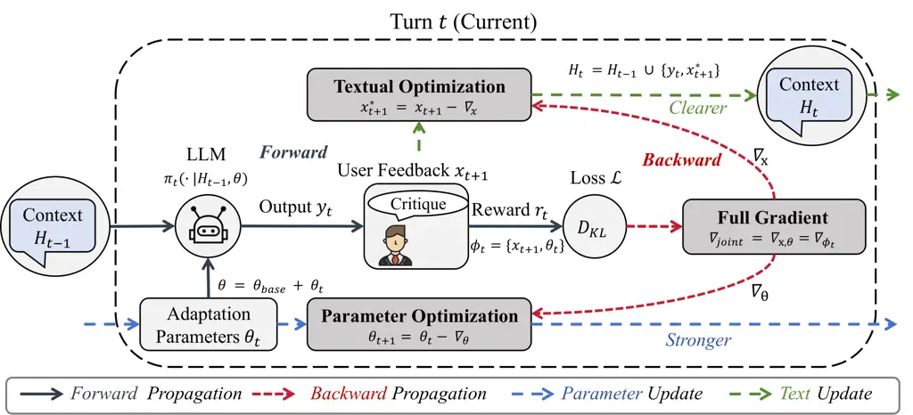

# Words & Weights: Streamlining Multi-Turn Interactions via Co-Adaptation

Chenxing Wei Affiliation: Shenzhen University Affiliation: Guangdong
Laboratory of Artificial Intelligence and Digital Economy (SZ)
Affiliation: Bytedance    Hong Wang Affiliation: University of Science
and Technology of China    Ying He Affiliation: Shenzhen University   
Zhongxiang Dai Affiliation: The Chinese University of Hong Kong
(Shenzhen)    Bo Jiang Affiliation: Bytedance    F. Richard Yu
Affiliation: Carleton University    Yao Shu Affiliation: Hong Kong
University of Science and Technology (Guangzhou) Correspondence to:
<yaoshu@hkust-gz.edu.cn>

###### Abstract

Test-time policy adaptation for multi-turn interactions (T²PAM) is
essential for aligning Large Language Models (LLMs) with dynamic user
needs. However, existing paradigms typically treat adaptation as a
single-axis problem by either purely refining instructions or solely
updating weights. This bifurcated approach overlooks the fact that
interaction failures arise from a coupled mixture of context ambiguity
and model incapacity. To address this, we propose ROSA2, a framework
that reformulates T²PAM as a joint optimization problem over the
heterogeneous space of Words and Weights. Within this framework, the
semantic stream acts as a feedback normalizer that transforms noisy or
ambiguous user feedback into actionable instructions, ensuring that
parametric adaptation is performed on semantically clarified
trajectories. Theoretically, we prove that this semantic
pre-conditioning strictly reduces the required parameter shift for
convergence. Empirically, ROSA2 consistently outperforms
state-of-the-art baselines across diverse mathematical, general
reasoning, and coding benchmarks. It achieves up to a 37.8% accuracy
improvement while reducing average interaction turns by 40%,
demonstrating that ROSA2 unlocks the true potential of parameter
updates.

###### Keywords: 

Machine Learning, ICML

## 1 Introduction

Large Language Models (LLMs) have demonstrated remarkable capabilities
across a wide array of general-purpose tasks (Yang et al., 2025; OpenAI,
2025; Google, 2025), increasingly serving as collaborative agents that
engage in complex, multi-turn dialogues to solve open-ended problems (Yi
et al., 2025). However, a fundamental mismatch persists between static
alignment paradigms (e.g., SFT (Ouyang et al., 2022; Wei et al., 2025a),
RLHF (Shao et al., 2024; Wei et al., 2025c)) and the dynamic nature of
real-world deployments (Li et al., 2025b; Laban et al., 2025).
Consequently, pre-trained models frequently struggle during extended
interactions (Wang et al., 2024). They exhibit limited adaptability (Yi
et al., 2025) and poor self-correction capabilities (Deshpande et al.,
2025), which ultimately leads to the performance stagnation documented
in recent literature (Wei et al., 2025b). To bridge this gap without the
prohibitive costs of continuous retraining, Test-Time Policy Adaptation
for Multi-Turn Interactions (T²PAM) (Wei et al., 2025b) has emerged as a
critical paradigm. T²PAM dynamically optimizes the model policy during
ongoing sessions to ensure continuous alignment with user preferences,
thereby significantly enhancing response accuracy.

Despite the significant promise of T²PAM, existing paradigms
predominantly treat test-time adaptation as a single-axis problem. They
typically resort to either purely refining instructions (Prompt
Engineering) (Yi et al., 2025) or exclusively adjusting model weights
(Test-Time Training), as demonstrated by representative approaches like
ROSA (Wei et al., 2025b) and TTRL (Zuo et al., 2025). We challenge this
bifurcated perspective by explicitly modeling the effective policy of an
LLM as a coupled function $`\pi(x,\theta)`$ that depends simultaneously
on its internal parameters (Weights) and the external context (Words).
Conditional optimization strategies, which update one variable while
freezing the other, overlook a fundamental reality: interaction failures
stem from a complex interplay of context ambiguity and model
incapacity (Keluskar et al., 2024). Addressing these factors in
isolation has proven insufficient. Parameter-centric methods risk
overfitting to noisy interaction histories, whereas prompt-centric
methods frequently encounter intrinsic capability ceilings. This
methodological misalignment ultimately harms downstream performance,
resulting in low accuracy and unnecessarily prolonged interaction (Tang
et al., 2025a). A comprehensive discussion of related work is provided
in Appendix A.



Figure 1: Overview of the ROSA2 Framework. We formulate T²PAM as a joint
optimization over the coupled variables
$`\phi_{t}=\{x_{t+1},\theta_{t}\}`$. During the Forward Phase (solid
lines), the model generates a response $`y_{t}`$ conditioned on history
$`H_{t-1}`$. The Backward Phase (dashed lines) approximates the full
gradient $`\nabla_{\text{joint}}`$ of the interaction loss
$`\mathcal{L}`$ through two synergistic modules. Textual Optimization
(top, green) uses textual gradients ($`\nabla_{\mathrm{x}}`$) to refine
user feedback into a clarified instruction
($`x_{t+1}\rightarrow x_{t+1}^{*}`$), resolving context ambiguity.
Simultaneously, Parameter Optimization (bottom, blue) applies gradient
updates ($`\nabla_{\theta}`$) to adjust adapter weights
($`\theta_{t}\rightarrow\theta_{t+1}`$), enhancing the intrinsic
capability of the model. This co-adaptation ensures the system is both
“Clearer” and “Stronger” for the next turn.

To overcome these limitations, effective adaptation requires resolving a
fundamental error attribution dilemma:

> When a model fails in a multi-turn context, is it due to a lack of
> intrinsic capability (parameter misalignment) or a misunderstanding of
> the task intent (context ambiguity)?

Addressing these factors in isolation proves insufficient (Chen et al.,
2025). Pure prompt engineering cannot remedy intrinsic capability
deficits (Lee et al., 2025), whereas pure parameter adaptation is prone
to learning spurious mappings from noisy inputs (Li et al., 2025a). As
visualized in Figure 2(b), the optimization landscape of T²PAM is
characterized by coupled semantic and parametric gaps. Approaching this
coupled system via independent updates, which is analogous to following
partial derivatives, leads to convergence at suboptimal local minima.
Specifically, solely optimizing parameters gravitates towards an
Overfitting Trap, while solely refining the context stalls in a Deficit
Trap. Consequently, we posit that T²PAM must be reformulated as a joint
optimization problem.

Crucially, we argue that these optimization paths are not merely
additive but profoundly synergistic. We establish that semantic clarity
acts as a pre-conditioner for parametric alignment. By prioritizing the
elimination of semantic ambiguity, we effectively cleanse the learning
signal. This ensures that the gradient descent for parameters is
strictly oriented towards the true task intent rather than fitting
accumulated noise. Furthermore, the Words stream functions as more than
a conventional prompt optimizer for well-defined task instructions. In
realistic multi-turn interactions, user feedback is frequently vague,
noisy, incomplete, or even partially incorrect. ROSA2 treats such
feedback as raw observational evidence rather than a direct optimization
target. The semantic stream distills the entire interaction history into
a refined instruction alongside an internal adaptation signal. This
normalization process ensures that subsequent parameter updates are
computed on semantically clarified trajectories instead of raw, noisy
prompts. This design enables ROSA2 to operate robustly in generalized
open-ended dialogue settings where explicit ground-truth rewards are
often unavailable. Qualitative examples demonstrating this feedback
canonicalization process, along with open-ended dialogue evaluations,
are provided in Appendix E. This perspective also aligns with recent
research on model alignment (Liu et al., 2023; Bo et al., 2026).

Figure 2: Empirical Observations and Theoretical Landscape. Figure (a)
In the experimental results on MATH (Qwen3-8B) reveal that single-axis
methods (Green/Blue solid lines) suffer from premature stagnation.
However, the immediate recovery observed in the Switch experiments
(Green/Blue dashed lines) suggests this bottleneck is structural. Figure
(b) We map these dynamics to the optimization landscape using consistent
color and line styling: the Prompt-Only path (Green) stalls in the
Deficit Trap (Hitting capability ceilings), while the Param-Only path
(Blue) gravitates towards the Overfitting Trap (Memorizing noise). The
dashed arrows in Figure (b) visualize how the Switch Method escapes
these local minima by activating the missing axis. Crucially, ROSA2
(Red) approximates the joint gradient $`\nabla_{\text{joint}}`$, forming
an Optimal Trajectory that bypasses these traps and proceeds directly to
the Success Zone, corresponding to the superior convergence shown in
Figure (a).

Driven by this insight, we introduce ROSA2, a unified framework designed
to approximate the full gradient of the interaction objective by
co-adapting the semantic context and model parameters. Instead of
treating error signals as a monolith, our approach effectively
disentangles the optimization process. It employs textual gradients to
sharpen the user intent (Words) and utilizes closed-form updates to
enhance the intrinsic execution capabilities of the model (Weights).
Theoretically, we demonstrate that this semantic pre-conditioning is
rigorous, proving that it strictly bounds the magnitude of parameter
shifts required to reach the optimal policy. This theoretical advantage
translates directly into substantial empirical gains. ROSA2 establishes
a new state-of-the-art across multiple benchmarks, achieving an accuracy
improvement of up to 37.8% while simultaneously cutting interaction
costs by reducing average turns by 40%. These results validate our core
hypothesis: accurate context is crucial for maximizing the effectiveness
of parameter adaptation. Our contributions are summarized as follows:

- •
  We propose ROSA2, a joint optimization framework over context and
  parameters that resolves the error attribution dilemma. Its Words
  stream normalizes noisy feedback into refined instructions for robust
  adaptation (Section 3).
- •
  We prove that semantic pre-conditioning strictly reduces parameter
  shift (Theorem 4.1) and guarantees faster convergence (Theorem 4.2)
  (Section 4).
- •
  Empirically, ROSA2 achieves up to a 37.8% accuracy gain and a 40% turn
  reduction with negligible overhead. Comprehensive ablations are in the
  Appendix (Section 5).

## 2 Motivation: The Traps of Conditional Optimization

T²PAM inherently requires joint optimization over the external context
$`x`$ (Words) and model weights $`\theta`$ (Weights). We demonstrate
that conditionally optimizing either dimension in isolation inevitably
traps the model in suboptimal states, manifesting as either persistent
reasoning deficits or prompt overfitting. The following subsections
empirically and theoretically validate this conclusion to motivate our
joint co-adaptation framework.

### 2.1 Experimental Setup

To empirically validate this hypothesis, we conducted a controlled study
using the Qwen3-8B model on the MATH dataset (Hendrycks et al., 2021b)
to simulate a challenging 10-turn interaction scenario. We compared four
distinct optimization settings to isolate the effects of different
variables. First, Standard Inference evaluates the model performing
multi-turn reasoning with both the prompt and model parameters frozen.
Second, Prompt Optimization freezes the model parameters and exclusively
updates the system prompt using TextGrad. Third, Parameter Optimization
fixes the system prompt and exclusively updates the model parameters via
ROSA. Fourth, the Switch Method tests the limitations of conditional
optimization methods by implementing a crossover intervention at the
observed stagnation point, specifically Turn 5. For the model initially
optimizing prompts, we freeze the prompt and switch to updating
parameters. Conversely, for the model initially optimizing parameters,
we freeze the weights and switch to updating the prompt. Consequently,
the Switch Method serves as a decoupled pipeline baseline. It tests
whether a simple sequential combination of the two optimization axes can
recover the behavior of continuous co-adaptation.

### 2.2 Observation: Stagnation and Recovery

The empirical results illustrated in Figure 2(a) demonstrate a notable
trend. The Baseline curve exhibits limited self-correction capability
and remains nearly flat. Furthermore, conditional optimization methods
suffer from diminishing returns and eventual premature stagnation
despite their initial gains. Specifically, the Prompt-Only method is
constrained by policy misalignment, where semantic updates alone fail to
bridge the intrinsic reasoning gap. Concurrently, the Param-Only method
plateaus early due to overfitting. Crucially, a turning point occurs
upon intervention. Implementing the Switch Method at Turn 5 triggers a
distinct performance improvement. This rapid recovery indicates that the
preceding stagnation was fundamentally driven by the structural
limitations of conditional optimization.

### 2.3 Theoretical Landscape and Joint Optimization

We map these empirical results to the theoretical optimization landscape
in Figure 2(b) to identify two distinct failure modes inherent to
conditional updates. Specifically, the Prompt-Only method stalls in a
Deficit Trap because purely semantic updates cannot rectify intrinsic
reasoning deficits. Conversely, the Param-Only method falls into an
Overfitting Trap because parameter updates easily overfit to ambiguous
prompts without prior context refinement. The Switch experiments
validate that escaping these suboptimal local minima strictly requires
the presence of both semantic clarity and parametric capability.
Building on this insight, we propose ROSA2 to implement a joint
optimization strategy. Unlike the sequential Switch intervention, ROSA2
simultaneously updates both the semantic and parametric states after
each failed interaction to prepare for the subsequent turn. By
approximating the effect of the joint gradient of the interaction
objective from the very first turn, ROSA2 leverages the complementary
strengths of both dimensions to systematically bypass the aforementioned
traps. As depicted in Figure 2(a), it follows an Optimal Trajectory
(solid red line) that achieves significantly faster convergence and
higher overall accuracy. Driven by this theoretical foundation, the
subsequent section details the mathematical formulation and architecture
of the ROSA2 framework.

## 3 Joint Optimization via Full-Gradient Approximation

Building upon the motivation established in Section 2, we propose ROSA2.
This novel framework treats T²PAM strictly as a joint optimization
problem. By viewing the effective policy as a coupled function of Words
(the external context) and Weights (the internal parameters), ROSA2
approximates the effect of the joint gradient of the interaction
objective through trajectory-coupled updates. This mechanism seamlessly
aligns the model policy with the latent optimal user preference.

### 3.1 Problem Formulation: Joint Optimization in the Current Turn

As illustrated in Figure 1, we consider the $`t`$-th turn of a
multi-turn interaction session. Let
$`H_{t-1}=\{(x_{1},y_{1}),\dots,(x^{*}_{t-1},y_{t-1}),x^{*}_{t}\}`$
denote the immutable interaction history accumulated prior to generating
the current response. This history contains the completed dialogue pairs
from all previous turns alongside the refined query $`x^{*}_{t}`$
prepared for the current turn. At the current turn $`t`$, the model
operates using the composed parameters
$`\theta=\theta_{\text{base}}+\theta_{t}`$, where $`\theta_{t}`$
represents the current learnable adapter weights. The system generates
the response $`y_{t}`$ according to the current policy $`\pi_{\theta}`$
conditioned on the accumulated history:

```math
y_{t}\sim\pi_{t}(\cdot\mid H_{t-1},\theta). \tag{1}
```

Subsequently, the user provides feedback denoted as $`x_{t+1}`$, which
serves as the raw query for the subsequent turn. This feedback need not
be a clean scalar reward. In open-ended interactions, it is frequently
vague, noisy, incomplete, or even partially incorrect. Distinct from
standard paradigms, we treat this feedback $`x_{t+1}`$ as an optimizable
variable alongside the model parameters $`\theta_{t}`$. Specifically,
the semantic stream canonicalizes the raw feedback into a refined
instruction $`x^{*}_{t+1}`$ and an internal adaptation signal. This
normalization allows the parametric stream to compute updates based on
semantically clarified trajectories. Consequently, we define the set of
joint optimization variables for the current step as
$`\phi_{t}=\{x_{t+1},\theta_{t}\}`$.

#### The Joint Optimal Policy Construction.

We postulate the existence of a Joint Optimal Policy $`\pi^{*}`$ that
represents the ideal response distribution for the current interaction
turn. Following the established principles of reward-weighted
regression (Rafailov et al., 2023), we construct this target
distribution by re-weighting the policy from the previous turn, denoted
as $`\pi_{t-1}`$. In our co-adaptation setting, $`\pi_{t-1}`$
consistently serves as the reference policy for the current adaptation
step (Wei et al., 2025b). Formally, we define this as:

```math
\pi^{*}_{t}(y\mid H_{t-1})\triangleq\frac{1}{Z_{t}}\pi_{t-1}(y\mid H_{t-1})\exp\left(\frac{r(y)}{\beta}\right), \tag{2}
```

where $`r(y)`$ represents the internal adaptation signal derived from
the user feedback and the task environment. Crucially, the partition
function $`Z_{t}`$ depends exclusively on the previous policy
$`\pi_{t-1}`$ and the fixed interaction history:

```math
Z_{t}=\mathbb{E}_{y\sim\pi_{t-1}}\left[\exp\left(\frac{r(y)}{\beta}\right)\right]. \tag{3}
```

Therefore, $`Z_{t}`$ acts as a constant scalar with respect to the
current joint optimization variables
$`\phi_{t}=\{x_{t+1},\theta_{t}\}`$.

#### Optimization Objective.

Our primary objective is to update the current policy $`\pi_{t}`$, which
is parameterized by both $`x`$ and $`\theta`$, to approximate this
optimal target $`\pi^{*}_{t}`$. We mathematically formulate this goal as
minimizing the Forward KL Divergence, denoted as the interaction loss
function $`\mathcal{L}`$:

```math
\mathcal{L}(\phi_{t})=D_{KL}\Big(\pi^{*}_{t}(\cdot\mid\phi_{t})\;\Big\|\;\pi_{t}(\cdot\mid\phi_{t})\Big). \tag{4}
```

Expanding the KL divergence yields:

```math
\mathcal{L}(\phi_{t})=\underbrace{\mathbb{E}_{y\sim\pi^{*}_{t}}[\log\pi^{*}_{t}(y)]}_{-E(\pi^{*}_{t})}-\mathbb{E}_{y\sim\pi^{*}_{t}}[\log\pi_{t}(y\mid\phi_{t})]. \tag{5}
```

The target policy $`\pi^{*}_{t}`$ is strictly fixed by the forward pass,
as it is determined solely by $`\pi_{t-1}`$ and the signal $`r`$. Thus,
its entropy term $`E(\pi^{*}_{t})`$ remains entirely independent of the
optimizable variables $`\phi_{t}`$. Consequently, minimizing this
divergence is mathematically equivalent to minimizing the cross-entropy,
which equates to maximizing the expected log-likelihood of the optimal
policy:

```math
\mathcal{L}(\phi_{t})\cong-\mathbb{E}_{y\sim\pi^{*}}\left[\log\pi_{t}(y\mid\phi_{t})\right]. \tag{6}
```

#### Total Derivative and Co-Adaptation.

To execute this update, we analyze the total differential
$`d\mathcal{L}`$ with respect to the joint variables $`\phi_{t}`$. We
employ importance sampling to estimate the gradient expectation under
the policy distribution $`\pi_{t}`$:

```math
\displaystyle\nabla_{\phi_{t}}\mathcal{L}=-\mathbb{E}_{y\sim\pi_{t}}\left[\frac{\pi^{*}(y)}{\pi_{t}(y)}\nabla_{\phi_{t}}\log\pi_{t}(y\mid\phi_{t})\right] \tag{7}
```

```math
\displaystyle=-\mathbb{E}_{y\sim\pi_{t}}\Bigg[\frac{1}{Z_{t}}\exp\left(\frac{r(y)}{\beta}\right)\nabla_{\phi_{t}}\log\pi_{t}(y\mid\phi_{t})\Bigg].
```

Expanding the gradient operator $`\nabla_{\phi_{t}}`$ explicitly reveals
the highly coupled nature of this optimization process. To strictly
decrease the divergence, the total change in the loss function must
follow the full gradient within the joint space:

```math
\begin{aligned} &d\mathcal{L}\propto\\
-\frac{1}{Z_{t}}&\mathop{\mathbb{E}\quad}\limits_{y\sim\pi_{t}}\Bigg[\underbrace{\exp\left(\frac{r(y)}{\beta}\right)}_{\text{Reward Weight}}\Bigg(\underbrace{\nabla_{x}\log\pi_{t}\cdot dx}_{\text{Optimizing Prompt}}+\underbrace{\nabla_{\theta}\log\pi_{t}\cdot d\theta}_{\text{Optimizing Params}}\Bigg)\Bigg].\end{aligned} \tag{8}
```

Equation 8 theoretically mandates the necessity of joint co-adaptation
for T²PAM. Since $`Z_{t}`$ operates as a constant scaling factor derived
from the prior turn, approximating the joint optimal policy strictly
requires rectifying the query context $`x`$ and updating the internal
parameters $`\theta`$ along the direction of the reward-weighted
log-likelihood. Operationally, ROSA2 realizes this objective through
cross-turn pre-conditioning. By enforcing this mechanism, interaction
trajectories generated under refined Words provide significantly cleaner
evidence for all subsequent Weight updates.

### 3.2 The ROSA2 Algorithm

Guided by the total differential derivation in Equation 8, we propose
ROSA2, a co-adaptation framework designed to iteratively approximate the
joint optimal policy throughout multi-turn interactions. The complete
protocol is formalized in Algorithm 1. The process begins by
initializing the turn counter $`t=1`$, setting the learnable adapter
parameters $`\theta_{1}`$ to zero, and establishing the current
interaction history $`H`$ with the initial user query $`x_{1}`$ (lines
1-2 in Algorithm 1). At each turn $`t`$, the workflow executes two
distinct phases:

#### Phase 1: Generation and Evaluation.

To leverage the previously adapted knowledge, the system constructs the
effective model parameters $`\theta`$ by adding the current adapter
weights $`\theta_{t}`$ to the frozen base model parameters
$`\theta_{\text{base}}`$ (line 5). A response $`\hat{y}_{t}`$ is
subsequently generated using the current policy $`\pi_{\theta}`$
conditioned on the accumulated history $`H`$ (line 6). Following
generation, the system receives an internal adaptation signal $`r_{t}`$
alongside user feedback intended for the next turn, denoted as
$`x_{t+1}`$ (line 7). If the response is accepted ($`r_{t}=+1`$) or the
maximum turn limit $`T_{\max}`$ is reached, the process terminates and
returns the successful response $`\hat{y}_{t}`$ (lines 8-9).

#### Phase 2: Joint Optimization.

If the response is rejected ($`r_{t}=-1`$) and the session continues,
ROSA2 triggers the co-adaptation process to jointly optimize the system
state for the next interaction. First, the Semantic Stream activates to
resolve context ambiguity. It utilizes the specific deficiencies
detected in the current response $`\hat{y}_{t}`$ to compute a textual
gradient. This gradient is then applied to refine the raw incoming
feedback $`x_{t+1}`$ into a precise and actionable query $`x_{t+1}^{*}`$
(lines 12-14). Uniquely, even if explicit user feedback is completely
absent (i.e., $`x_{t+1}=\emptyset`$), this stream autonomously
synthesizes a corrective instruction based on the error signal derived
from the failure in $`\hat{y}_{t}`$. If the provided feedback is vague
or noisy, the semantic stream processes it strictly as raw observational
evidence. It canonicalizes this noise into a rigorously structured
instruction for the subsequent turn. This mechanism guarantees that the
model consistently receives a semantically optimized prompt regardless
of the actual user guidance quality. By systematically generating this
fine-grained and normalized feedback in every iteration, the system
effectively bridges the semantic gap between the true intent of the user
and the execution boundary of the model.

1:  Input: Initial Query $`x_{1}`$, Base Model Parameters
$`\theta_{\text{base}}`$, Max Turns $`T_{\max}`$.

2:  Initialize: Turn Counter $`t\leftarrow 1`$, Adaptation Parameters
$`\theta_{1}\leftarrow\mathbf{0}`$, Current History
$`H_{0}\leftarrow\{x_{1}\}`$.

3:  while $`t\leq T_{\max}`$ do

4:   // Phase 1: Generation and Evaluation

5:   Compose parameters:
$`\theta\leftarrow\theta_{\text{base}}+\theta_{t}`$.

6:   Generate response:
$`\hat{y}_{t}\sim\pi(\cdot\mid H_{t-1},\theta)`$.

7:   Receive reward $`r_{t}`$ and feedback $`x_{t+1}`$ (next turn query)
from Environment/User.

8:   if $`r_{t}=+1`$ or $`t=T_{\max}`$ then

9:    Return $`\hat{y}_{t}`$ // Task completed or limit reached

10:   end if

11:   // Phase 2: Joint Optimization

12:   // Step A: Semantic Update (TextGrad)

13:   Compute semantic gradient and refine query:

14:
  $`x_{t+1}^{*}\leftarrow x_{t+1}-\nabla_{\text{text}}\mathcal{L}(\hat{y}_{t})`$

15:   // Step B: Parametric Update (ROSA)

16:   Construct target distribution $`\pi^{*}`$ using $`\pi_{\theta}`$
and $`r_{t}`$.

17:
  $`\theta_{t+1}\leftarrow\theta_{t}-\nabla_{\theta}\mathcal{L}(\theta\mid r_{t},\pi^{*},\pi_{\theta})`$

18:   Update History:
$`H_{t}\leftarrow H_{t-1}\cup\{\hat{y}_{t},x_{t+1}^{*}\}`$

19:   $`t\leftarrow t+1`$

20:  end while

Algorithm 1 ROSA2 Co-Adaptation Protocol

Simultaneously, the Parametric Stream utilizes the adaptation signal
($`r_{t}`$) and the current policy $`\pi_{\theta}`$ to estimate the
latent target policy of the user, denoted as $`\pi^{*}`$. It
subsequently computes a parameter update $`\Delta\theta_{t}`$ to align
the model policy $`\pi_{t}`$ more closely with this estimated target
$`\pi^{*}`$ (lines 15-17). This parameter update is computed directly
from the current failure trajectory, which was generated under the
refined Words established in previous turns. Consequently, Words
effectively pre-condition Weights throughout the multi-turn trajectory.
Meanwhile, the current textual and parametric updates can be executed
entirely in parallel to prepare $`x^{*}_{t+1}`$ and $`\theta_{t+1}`$ for
the subsequent response. The computational efficiency of this parallel,
one-step update mechanism makes it highly suitable for real-time
multi-turn interactions. It allows for rapid iterative updates that
continuously align the model policy with the evolving preferences of the
user.

Finally, the system prepares for the next iteration by updating the
interaction history $`H`$. This update incorporates both the current
response $`\hat{y}_{t}`$ and the refined query $`x_{t+1}^{*}`$, thereby
ensuring that all subsequent generations are strictly conditioned on the
optimized context (lines 19-20).

#### Advantages.

The ROSA2 framework provides a robust solution to T²PAM that is
explicitly derived from the joint-gradient approximation. By co-adapting
both the semantic context and the model parameters, it systematically
overcomes the intrinsic limitations of conditional optimization
baselines. Specifically, the Semantic Stream normalizes raw feedback
into clear, actionable instructions. This mechanism effectively
addresses scenarios where explicit feedback is absent, ambiguous, or
highly noisy. Complementarily, the Parametric Stream ensures that the
model possesses the intrinsic capability required to execute these
refined instructions. This synergistic loop enables ROSA2 to robustly
handle ambiguous inputs and autonomously recover from errors. As a
result, it significantly improves the overall success rate in complex,
multi-turn tasks. Additional open-ended evaluations and qualitative
examples detailing this feedback normalization process are provided in
Appendix E.

## 4 Theoretical Results

Building upon the joint optimization formulation established in
Section 3.1, we now establish the convergence properties of the ROSA2
framework. Specifically, we analyze how the joint updates of the
semantic query $`x`$ and the model parameters $`\theta`$ (Equation 8)
theoretically drive the model policy toward the latent optimal user
policy $`\pi_{\text{user}}^{*}`$. This theoretical analysis proceeds in
two distinct stages. First, we examine the mechanistic synergy in
Section 4.1. We prove that semantic refinement strictly reduces the norm
of the required parameter shift (Theorem 4.1). Subsequently, we extend
this local property to a global perspective in Section 4.2. We derive a
unified convergence bound (Theorem 4.2) that explicitly quantifies the
reduction in divergence from the optimal user policy while rigorously
accounting for approximation errors.

### 4.1 Mechanism: Parametric Error Reduction

We first analyze the impact of optimizing the context $`\mathbf{x}`$ on
the parametric optimization of $`\theta`$. A fundamental insight is that
refining the context $`\mathbf{x}`$ significantly reduces the magnitude
of the parameter shifts required to achieve alignment. We formalize this
phenomenon in the following theorem.

###### Theorem 4.1 (Reduction of Parameter Shift).

Let $`\Delta\theta_{t}(\mathbf{x})`$ denote the solution to the
linearized parameter update defined in Equation (6) of ROSA (Wei et al.,
2025b) given a query $`\mathbf{x}`$. If we successfully update the query
from $`\mathbf{x}_{t}`$ to $`\mathbf{x}_{t}^{*}`$ such that the semantic
gap to the user intent is reduced (i.e.,
$`D_{\text{KL}}(\pi_{\text{user}}^{*}\|\pi(\cdot|\mathbf{x}_{t}^{*}))<D_{\text{KL}}(\pi_{\text{user}}^{*}\|\pi(\cdot|\mathbf{x}_{t}))`$),
then the norm of the required parameter update satisfies:

```math
\|\Delta\theta_{t}(\mathbf{x}_{t}^{*})\|_{2}<\|\Delta\theta_{t}(\mathbf{x}_{t})\|_{2} \tag{9}
```

Remark. The detailed mathematical proof is provided in Section B.1.
Theorem 4.1 underscores the synergistic necessity of co-adapting both
$`\mathbf{x}`$ and $`\theta`$. By aligning the input context with the
existing knowledge boundary of the model first, we minimize the residual
error that the parameters must ultimately correct.

Empirical Evidence. Experimental observations illustrated in Figure 3
strongly corroborate this mechanism. The parametric error of ROSA2 (blue
line, $`\|\Delta\theta\|^{2}`$) is significantly reduced compared to the
ROSA baseline (gray line). This structural reduction confirms that
semantic refinement strictly decreases the optimization difficulty for
the parametric stream.

### 4.2 Unified Convergence Bound

Building upon Theorem 4.1, we derive a unified bound that quantifies the
overall performance of the co-adaptation framework. This theorem extends
Theorem 4 from (Wei et al., 2025b) by explicitly accounting for the
approximation errors in both the semantic and parametric spaces.

###### Theorem 4.2 (Unified Convergence Bound).

Assume that the local second-order expansion of the KL divergence is
smooth over the Cartesian product of the token-embedding space and the
adapter-parameter space. Let the block Hessian spectral norms be bounded
by $`L_{x}`$, $`L_{\theta}`$, and $`L_{x\theta}`$, and define
$`\bar{L}=\max(L_{x}+L_{x\theta},L_{\theta}+L_{x\theta})`$. After $`T`$
turns of co-adaptation, the divergence between the final policy
$`\pi_{\phi_{T}}`$ and the optimal user policy $`\pi_{\text{user}}^{*}`$
is bounded by:

```math
\displaystyle D_{\text{KL}}(\pi_{\text{user}}^{*}\|\pi_{\phi_{T}})\leq\underbrace{D_{\text{KL}}(\pi_{\text{user}}^{*}\|\pi_{\phi_{0}})\vphantom{-C\sum_{t=1}^{T}\pi_{\theta_{t-1}}(\mathbf{y}_{t}|\mathbf{x}^{*}_{t})}}_{\text{Initial Error}} \tag{10}
```

```math
\displaystyle-\underbrace{C\sum_{t=1}^{T}\pi_{\theta_{t-1}}(\mathbf{y}_{t}|\mathbf{x}^{*}_{t})}_{\text{Improvement}}+\underbrace{\frac{\bar{L}}{2}\sum_{t=1}^{T}\left(\|\Delta\mathbf{x}_{t}\|^{2}_{2}+\|\Delta\theta_{t}\|^{2}_{2}\right)}_{\text{Approx. Error}}\ .
```

where the scalar $`C>0`$ absorbs the reward-weighting constant.
Furthermore, the magnitude $`\|\Delta\mathbf{x}_{t}\|^{2}_{2}`$ is
computed strictly within the continuous token-embedding space, and
$`\|\Delta\theta_{t}\|^{2}_{2}`$ is evaluated within the
adapter-parameter space.

Figure 3: Dynamics of approximation error terms on MATH using Qwen3-8B.
The semantic update magnitude $`\|\Delta\mathbf{x}_{t}\|_{2}^{2}`$ is
computed as an $`L_{2}`$ distance in the continuous token-embedding
space. The parametric curve of ROSA2 and the ROSA baseline start from
the same adapter initialization at Turn 1. The total error includes both
semantic and parametric components, so it can start higher due to the
non-zero initial semantic discrepancy.

|                               |          |                        |              |                   |              |                        |              |              |
| ----------------------------- | -------- | ---------------------- | ------------ | ----------------- | ------------ | ---------------------- | ------------ | ------------ |
|                               |          | Mathematical Reasoning |              | General Reasoning |              | Multilingual Reasoning |              | Code Gen.    |
| Model                         | Method   | MATH                   | MATH-500     | MMLU-R            | SuperGPQA    | MT-AIME24              | MT-MATH100   | HumanEval    |
| Qwen2.5-0.5B -Instruct        | Baseline | 23.0                   | 24.0         | 9.4               | 3.8          | 2.6                    | 15.4         | 31.1         |
|                               | TextGrad | 31.2 (+8.2)            | 29.6 (+5.6)  | 12.4 (+3.0)       | 3.8 (+0.0)   | 2.2 (-0.4)             | 18.4 (+3.0)  | 36.6 (+5.5)  |
|                               | ROSA     | 29.2 (+6.2)            | 30.4 (+6.4)  | 11.4 (+2.0)       | 4.0 (+0.2)   | 3.8 (+1.2)             | 19.6 (+4.2)  | 38.4 (+7.3)  |
|                               | ROSA2    | 40.8 (+17.8)           | 39.6 (+15.6) | 18.4 (+9.0)       | 6.4 (+2.6)   | 4.4 (+1.8)             | 25.2 (+9.8)  | 44.5 (+13.4) |
| Qwen3-0.6B -Instruct          | Baseline | 19.6                   | 22.4         | 24.0              | 3.8          | 3.2                    | 26.2         | 41.5         |
|                               | TextGrad | 65.0 (+45.4)           | 62.0 (+39.6) | 46.4 (+22.4)      | 3.8 (+0.0)   | 7.0 (+3.8)             | 62.2 (+36.0) | 65.8 (+24.4) |
|                               | ROSA     | 66.2 (+46.6)           | 63.0 (+40.6) | 48.8 (+24.8)      | 4.0 (+0.2)   | 7.2 (+4.0)             | 62.0 (+35.8) | 72.0 (+30.5) |
|                               | ROSA2    | 70.8 (+51.2)           | 71.6 (+49.2) | 50.0 (+26.0)      | 6.4 (+2.6)   | 9.6 (+6.4)             | 73.4 (+47.2) | 81.7 (+40.2) |
| Qwen2.5-7B -Base              | Baseline | 47.0                   | 49.4         | 39.8              | 17.8         | 17.0                   | 60.4         | 57.9         |
|                               | TextGrad | 54.8 (+7.8)            | 54.0 (+4.6)  | 60.2 (+20.4)      | 46.4 (+28.6) | 37.6 (+20.6)           | 75.4 (+15.0) | 72.0 (+14.0) |
|                               | ROSA     | 63.4 (+16.4)           | 62.4 (+13.0) | 60.2 (+20.4)      | 47.8 (+30.0) | 37.0 (+20.0)           | 70.4 (+10.0) | 74.4 (+16.5) |
|                               | ROSA2    | 68.4 (+21.4)           | 67.2 (+17.8) | 63.0 (+23.2)      | 48.8 (+31.0) | 37.8 (+20.8)           | 78.2 (+17.8) | 79.9 (+22.0) |
| Qwen3-8B                      | Baseline | 50.0                   | 42.8         | 57.0              | 24.2         | 29.4                   | 75.2         | 78.0         |
|                               | TextGrad | 63.4 (+13.4)           | 62.4 (+19.6) | 70.6 (+13.6)      | 40.0 (+15.8) | 40.0 (+10.6)           | 81.2 (+6.0)  | 82.3 (+4.3)  |
|                               | ROSA     | 62.2 (+12.2)           | 60.8 (+18.0) | 75.8 (+18.8)      | 38.6 (+14.4) | 38.6 (+9.2)            | 88.4 (+13.2) | 83.7 (+5.6)  |
|                               | ROSA2    | 80.8 (+30.8)           | 80.6 (+37.8) | 84.4 (+27.4)      | 52.4 (+28.2) | 44.4 (+15.0)           | 93.6 (+18.4) | 88.4 (+10.4) |
| DeepSeek-R1 -Distill-Llama-8B | Baseline | 27.6                   | 22.8         | 23.6              | 10.4         | 4.8                    | 17.8         | 25.0         |
|                               | TextGrad | 34.0 (+6.4)            | 31.6 (+8.8)  | 43.4 (+19.8)      | 20.8 (+10.4) | 16.2 (+11.4)           | 30.4 (+12.6) | 39.0 (+14.0) |
|                               | ROSA     | 37.8 (+10.2)           | 37.6 (+14.8) | 42.8 (+19.2)      | 21.4 (+11.0) | 17.2 (+12.4)           | 38.6 (+20.8) | 39.3 (+14.3) |
|                               | ROSA2    | 54.2 (+26.6)           | 54.6 (+31.8) | 59.4 (+35.8)      | 35.0 (+24.6) | 21.4 (+16.6)           | 50.6 (+32.8) | 40.2 (+15.2) |

Table 1: Main Results on Standard Reasoning Benchmarks. We report the
accuracy (%) across mathematical (MATH, MATH-500), general (MMLU-R,
SuperGPQA), multilingual (MT-AIME24, MT-MATH100), and code generation
(HumanEval) tasks. The gains are calculated relative to the Baseline.
Best scores are bolded, and second-best scores are underlined.

Figure 4: Performance trajectory on challenging benchmarks. We plot the
accuracy on AIME25, GPQA-Diamond, M_IMO, and BigCodeBench-Hard as a
function of interaction turns. ROSA2 (red line) demonstrates sustained
accuracy improvements, successfully solving complex problems where
baselines plateau.

Remark. The detailed mathematical proof is provided in Section B.2.
Theorem 4.2 formally decomposes the convergence dynamics into three
interconnected components. First, the Initial Error serves as the
constant baseline divergence at the beginning of the interaction.
Second, the Improvement term quantifies the cumulative error reduction
driven by user feedback. Crucially, the joint adaptation process
amplifies this term by refining the query into an optimal form
$`\mathbf{x}_{t}^{*}`$. This refinement ensures that the model generates
responses $`\mathbf{y}_{t}`$ with significantly higher probability mass
under the latent optimal user policy $`\pi_{\text{user}}^{*}`$. Finally,
the Approx. Error reflects the penalty incurred from inexact iterative
updates. Although ROSA2 introduces an additional semantic cost
$`\|\Delta\mathbf{x}_{t}\|^{2}_{2}`$, it systematically mitigates the
total error through the mechanism established in Theorem 4.1. This
mitigation is visually corroborated by the red line in Figure 3.

Empirical Evidence. As illustrated in Figure 3, the query context
$`\mathbf{x}_{t}`$ progressively approaches the optimal form
$`\mathbf{x}^{*}`$. Correspondingly, the squared norm of the semantic
update $`\|\Delta\mathbf{x}_{t}\|^{2}_{2}`$ exhibits an exponential
decay, which is depicted by the green line. Consequently, the total
approximation error of ROSA2 is initially high due to the large initial
semantic discrepancy. However, this error rapidly drops and remains
significantly lower than that of the isolated baseline method, as shown
by the red and gray lines respectively. This rapid stabilization
empirically validates that ROSA2 achieves a strictly lower overall
approximation error throughout the interaction trajectory.

## 5 Empirical Results

Following the protocol established in Section 2.1, we employ an
automated evaluation pipeline across verifiable benchmarks, where
correctness is rigorously validated via ground-truth matching for
reasoning tasks or execution-based unit tests for coding and agentic
tasks. This controlled setting provides highly reproducible feedback
signals. Interactions persist until the model succeeds or reaches a
predefined turn limit, allowing for the simultaneous measurement of
efficacy (success rate) and efficiency (turn count). Comprehensive
details regarding the experimental setup and hyperparameter
configurations are deferred to Appendix C. Our empirical analysis
focuses on three primary dimensions: (1) reasoning performance
(Section 5.1), (2) adaptability in sparse-reward environments
(Section 5.2), and (3) computational cost (Section 5.3).

### 5.1 Performance and Efficiency in Diverse Tasks

Overcoming Single-Axis Limitations. As shown in Table 1, ROSA2
consistently outperforms the single-axis baselines, namely TextGrad
(Words-only) and ROSA (Weights-only), across all evaluated model sizes
(0.5B to 8B) and domains. This performance gap validates our core
hypothesis regarding error attribution. TextGrad is effective at
refining prompts but frequently hits a capability ceiling on complex
tasks where the frozen model simply lacks the intrinsic knowledge to
execute the instruction. Conversely, ROSA updates parameters on
potentially ambiguous inputs and therefore tends to overfit to noise,
leading to the stagnation observed in Figure 4. ROSA2 systematically
breaks these bottlenecks because the semantic updates unlock the true
potential for parameter adaptation, enabling rapid improvements on
challenging tasks. Furthermore, this superiority extends beyond basic
test-time adaptation methods. ROSA2 consistently surpasses stronger
test-time scaling and self-correction paradigms, including Best-of-16
sampling and offline fine-tuning, demonstrating that joint co-adaptation
breaks the performance ceiling of static scaling laws (Appendix C.7).
Similarly, ROSA2 achieves higher interaction efficiency and final
accuracy compared to advanced reinforcement learning baselines like SDPO
without requiring an expensive prior training stage (Appendix C.8).

Pre-Conditioning Effect. To understand the source of our efficiency, we
analyze the interaction dynamics detailed in Table 2. ROSA2 achieves the
highest Correction Uplift (e.g., 81.4% on MATH), confirming that the
Semantic Stream successfully rectifies initial misunderstandings. More
importantly, ROSA2 significantly reduces the Avg Turn required to reach
a solution (e.g., a 40% reduction compared to ROSA). This reduction
provides direct empirical validation for Theorem 4.2. As the interaction
progresses, the continuous semantic refinement actively suppresses the
gradient estimation noise, ensuring that the cumulative Approximation
Error remains significantly lower than that of ROSA. Consequently, this
minimization leads to a tighter alignment with the latent user policy
$`\pi_{\text{user}}^{*}`$, which directly translates into the observed
higher correction rates and lower turn counts. Crucially, this
efficiency is highly robust to optimization randomness. Evaluations
across multiple independent random seeds confirm that ROSA2 consistently
maintains a exceptionally low variance in both final accuracy and
average turns, firmly validating the stability of our co-adaptation loop
(Appendix C.6).

| Dataset   | Method   | Correction Uplift ($`\uparrow`$) | Avg Turn ($`\downarrow`$) |
| --------- | -------- | -------------------------------- | ------------------------- |
| MATH      | Baseline | 70.0%                            | 7.2                       |
|           | TextGrad | 75.1% (+5.1%)                    | 6.0 (-1.2)                |
|           | ROSA     | 77.3% (+7.3%)                    | 6.3 (-0.9)                |
|           | ROSA2    | 81.4% (+11.4%)                   | 4.4 (-2.8)                |
| MMLU      | Baseline | 50.9%                            | 6.6                       |
|           | TextGrad | 59.5% (+8.6%)                    | 5.2 (-1.4)                |
|           | ROSA     | 60.7% (+9.8%)                    | 5.0 (-1.6)                |
|           | ROSA2    | 64.9% (+14.0%)                   | 4.1 (-2.5)                |
| MT-AIME24 | Baseline | 66.7%                            | 9.0                       |
|           | TextGrad | 74.5% (+7.8%)                    | 7.9 (-1.1)                |
|           | ROSA     | 73.1% (+6.4%)                    | 8.2 (-0.8)                |
|           | ROSA2    | 77.5% (+10.8%)                   | 7.7 (-1.3)                |

Table 2: Analysis of Interaction Dynamics on Qwen3-8B. Correction Uplift
indicates the percentage of eventually solved problems that were
corrected after the initial failure. Avg Turn denotes the average
interaction turns required to solve a problem.

Failure Analysis on Hard Benchmarks. Figure 4 also reveals the boundary
of test-time co-adaptation. On MT-AIME24, the learning curve plateaus
when the model encounters cross-lingual mathematical concepts that are
poorly represented in the base model. Semantic refinement can clarify
the intent and reduce ambiguity, but it cannot synthesize entirely
missing multilingual mathematical knowledge from a single interaction
trajectory. A similar phenomenon appears on BigCodeBench-Hard, where
late-turn stagnation often corresponds to missing knowledge regarding
niche APIs or external library behaviors. These failure cases clarify
that ROSA2 is most effective at eliciting, aligning, and stabilizing
latent capabilities under evolving feedback. It does not replace
external knowledge retrieval when the requisite domain knowledge is
fundamentally absent.

### 5.2 Adaptability in Sparse-Reward Environments

We evaluate ROSA2 on UI agent tasks (OSWorld (Xie et al., 2024),
AndroidWorld (Rawles et al., 2025)) that are characterized by sparse
rewards and precise execution demands. Table 3 confirms robust
improvements across both SFT and DPO backbones, highlighting the
absolute necessity of joint optimization. Single-axis methods
universally fail in these environments. TextGrad (Words-only) cannot
rectify low-level motor precision errors, while ROSA (Weights-only)
struggles to converge given the highly sparse signals.

ROSA2 effectively navigates this dilemma by leveraging Semantic
Pre-conditioning to bridge the reward gap. Specifically, the Textual
Optimization module retrospectively analyzes the sequence of unrewarded
actions and synthesizes fine-grained corrective instructions that
pinpoint specific execution failures. This process effectively densifies
the feedback, transforming a vague, delayed failure signal into a
detailed supervision signal for the next attempt. Consequently, the
Parameter Optimization stream utilizes this clarified context as a
pre-conditioner to fine-tune the execution policy with exact precision,
rather than blindly searching within a sparse reward landscape. This
operational synergy, where semantic retrospective feedback directly
guides parametric actuation, is the fundamental reason ROSA2 achieves
superior adaptability in complex agentic tasks.

| Model                             | OSWorld      | AndroidWorld |
| --------------------------------- | ------------ | ------------ |
| UI-TARS-7B-SFT (Qin et al., 2025) | 13.2         | 27.6         |
| UI-TARS-7B-SFT + TextGrad         | 13.7 (+0.5)  | 28.3 (+0.7)  |
| UI-TARS-7B-SFT + ROSA             | 17.8 (+4.6)  | 30.9 (+3.3)  |
| UI-TARS-7B-SFT + ROSA2            | 23.6 (+10.4) | 35.3 (+7.7)  |
| UI-TARS-7B-DPO                    | 14.8         | 28.9         |
| UI-TARS-7B-DPO + TextGrad         | 14.9 (+0.1)  | 28.7 (-0.2)  |
| UI-TARS-7B-DPO + ROSA             | 18.0 (+3.2)  | 31.7 (+2.8)  |
| UI-TARS-7B-DPO + ROSA2            | 24.4 (+10.6) | 36.6 (+7.7)  |

Table 3: Adaptability in sparse-reward environments (UI Agents).

### 5.3 Computational Cost Analysis

Finally, we analyze the practical deployment costs in terms of latency
and memory. As shown in Table 4, ROSA2 achieves a remarkable reduction
in Avg Time per problem. This gain is driven by two synergistic factors.
First, the continuous optimization of Words and Weights enables the
model to resolve problems using significantly more concise
Chain-of-Thought (CoT) trajectories, drastically cutting the per-turn
inference time (intra-turn efficiency). Second, the framework
substantially reduces the total conversation turns required for success
(inter-turn efficiency). Regarding memory, ROSA2 introduces negligible
overhead, peaking at a maximum of $`+3.1`$ GB on the MATH dataset.
Because the textual and parametric updates consume the same failure
trajectory, they can be executed entirely in parallel during the
adaptation phase. This parallel preparation ensures that the framework
scales efficiently to larger models, such as Qwen3-32B, without
disrupting the token-by-token streaming experience for the end user
(Appendix D).

| Dataset           | Method   | Avg Time (s) ($`\downarrow`$) | Peak Memory (GB) ($`\downarrow`$) |
| ----------------- | -------- | ----------------------------- | --------------------------------- |
| MATH              | Baseline | 334.5                         | 90.6                              |
|                   | ROSA2    | 297.6 (-36.9)                 | 93.7 (+3.1)                       |
| AIME25            | Baseline | 557.4                         | 94.9                              |
|                   | ROSA2    | 467.2 (-90.2)                 | 95.4 (+0.5)                       |
| HumanEval         | Baseline | 543.7                         | 94.8                              |
|                   | ROSA2    | 521.3 (-22.4)                 | 95.2 (+0.4)                       |
| BigCodeBench-Hard | Baseline | 677.9                         | 95.2                              |
|                   | ROSA2    | 590.6 (-87.3)                 | 95.5 (+0.3)                       |

Table 4: Computational Cost Analysis on Qwen3-8B.

## 6 Conclusion and Limitations

We introduced ROSA2, a joint optimization framework over context and
parameters that resolves the error attribution dilemma. By bypassing the
local minima of conditional baselines, ROSA2 achieves state-of-the-art
accuracy and interaction efficiency across diverse benchmarks. However,
because it strictly aligns latent capabilities rather than retrieving
external information, adaptation plateaus when core domain knowledge is
absent.

## Impact Statement

This paper presents work whose goal is to advance the field of Machine
Learning, specifically within the domain of test-time adaptation for
multi-turn interactions. Our framework demonstrates that co-adapting
context and parameters can unlock state-of-the-art performance on
reasoning and agentic benchmarks. While this work primarily contributes
to the technical efficiency and accuracy of LLMs, it also highlights the
potential for more capable UI agents. We believe there are no specific
negative societal consequences that must be highlighted here, beyond the
general considerations associated with the deployment of increasingly
capable generative AI models.

## References

- AIME (2025) AIME AIME problems and solutions. External Links:
  [Link](https://artofproblemsolving.com/wiki/index.php/AIME_Problems_and_Solutions)
  Cited by: 2nd item.
- Bo et al. (2026) X. Bo, R. Li, Z. Sun, Q. Dai, Z. Zhang, Z. Tian, X.
  Chen, and Z. Dong Prompt and parameter co-optimization for large
  language models. In The Fourteenth International Conference on
  Learning Representations, External Links:
  [Link](https://openreview.net/forum?id=WPJnLvQrP3) Cited by: Appendix
  A, §1.
- Chen et al. (2021) M. Chen, J. Tworek, H. Jun, Q. Yuan, H. P. de
  Oliveira Pinto, J. Kaplan, H. Edwards, Y. Burda, N. Joseph, G.
  Brockman, A. Ray, R. Puri, G. Krueger, M. Petrov, H. Khlaaf, G.
  Sastry, P. Mishkin, B. Chan, S. Gray, N. Ryder, M. Pavlov, A.
  Power, L. Kaiser, M. Bavarian, C. Winter, P. Tillet, F. P. Such, D.
  Cummings, M. Plappert, F. Chantzis, E. Barnes, A. Herbert-Voss, W. H.
  Guss, A. Nichol, A. Paino, N. Tezak, J. Tang, I. Babuschkin, S.
  Balaji, S. Jain, W. Saunders, C. Hesse, A. N. Carr, J. Leike, J.
  Achiam, V. Misra, E. Morikawa, A. Radford, M. Knight, M. Brundage, M.
  Murati, K. Mayer, P. Welinder, B. McGrew, D. Amodei, S. McCandlish, I.
  Sutskever, and W. Zaremba Evaluating large language models trained on
  code. External Links: 2107.03374,
  [Link](https://arxiv.org/abs/2107.03374) Cited by: §C.1.
- Chen et al. (2025) M. Chen, R. Sun, T. Pfister, and S. O. Arik
  Learning to clarify: multi-turn conversations with action-based
  contrastive self-training. In The Thirteenth International Conference
  on Learning Representations, External Links:
  [Link](https://openreview.net/forum?id=SIE6VFps9x) Cited by: Appendix
  A, §1.
- DeepSeek-AI et al. (2025) DeepSeek-AI, D. Guo, D. Yang, H. Zhang, J.
  Song, R. Zhang, R. Xu, Q. Zhu, S. Ma, P. Wang, X. Bi, X. Zhang, X.
  Yu, Y. Wu, Z. F. Wu, Z. Gou, Z. Shao, Z. Li, Z. Gao, A. Liu, B.
  Xue, B. Wang, B. Wu, B. Feng, C. Lu, C. Zhao, C. Deng, C. Zhang, C.
  Ruan, D. Dai, D. Chen, D. Ji, E. Li, F. Lin, F. Dai, F. Luo, G.
  Hao, G. Chen, G. Li, H. Zhang, H. Bao, H. Xu, H. Wang, H. Ding, H.
  Xin, H. Gao, H. Qu, H. Li, J. Guo, J. Li, J. Wang, J. Chen, J.
  Yuan, J. Qiu, J. Li, J. L. Cai, J. Ni, J. Liang, J. Chen, K. Dong, K.
  Hu, K. Gao, K. Guan, K. Huang, K. Yu, L. Wang, L. Zhang, L. Zhao, L.
  Wang, L. Zhang, L. Xu, L. Xia, M. Zhang, M. Zhang, M. Tang, M. Li, M.
  Wang, M. Li, N. Tian, P. Huang, P. Zhang, Q. Wang, Q. Chen, Q. Du, R.
  Ge, R. Zhang, R. Pan, R. Wang, R. J. Chen, R. L. Jin, R. Chen, S.
  Lu, S. Zhou, S. Chen, S. Ye, S. Wang, S. Yu, S. Zhou, S. Pan, S. S.
  Li, S. Zhou, S. Wu, S. Ye, T. Yun, T. Pei, T. Sun, T. Wang, W.
  Zeng, W. Zhao, W. Liu, W. Liang, W. Gao, W. Yu, W. Zhang, W. L.
  Xiao, W. An, X. Liu, X. Wang, X. Chen, X. Nie, X. Cheng, X. Liu, X.
  Xie, X. Liu, X. Yang, X. Li, X. Su, X. Lin, X. Q. Li, X. Jin, X.
  Shen, X. Chen, X. Sun, X. Wang, X. Song, X. Zhou, X. Wang, X.
  Shan, Y. K. Li, Y. Q. Wang, Y. X. Wei, Y. Zhang, Y. Xu, Y. Li, Y.
  Zhao, Y. Sun, Y. Wang, Y. Yu, Y. Zhang, Y. Shi, Y. Xiong, Y. He, Y.
  Piao, Y. Wang, Y. Tan, Y. Ma, Y. Liu, Y. Guo, Y. Ou, Y. Wang, Y.
  Gong, Y. Zou, Y. He, Y. Xiong, Y. Luo, Y. You, Y. Liu, Y. Zhou, Y. X.
  Zhu, Y. Xu, Y. Huang, Y. Li, Y. Zheng, Y. Zhu, Y. Ma, Y. Tang, Y.
  Zha, Y. Yan, Z. Z. Ren, Z. Ren, Z. Sha, Z. Fu, Z. Xu, Z. Xie, Z.
  Zhang, Z. Hao, Z. Ma, Z. Yan, Z. Wu, Z. Gu, Z. Zhu, Z. Liu, Z. Li, Z.
  Xie, Z. Song, Z. Pan, Z. Huang, Z. Xu, Z. Zhang, and Z. Zhang
  DeepSeek-r1: incentivizing reasoning capability in llms via
  reinforcement learning. External Links: 2501.12948,
  [Link](https://arxiv.org/abs/2501.12948) Cited by: §C.2.
- Deshpande et al. (2025) K. Deshpande, V. Sirdeshmukh, J. B. Mols, L.
  Jin, E. Hernandez-Cardona, D. Lee, J. Kritz, W. E. Primack, S. Yue,
  and C. Xing MultiChallenge: a realistic multi-turn conversation
  evaluation benchmark challenging to frontier LLMs. In Findings of the
  Association for Computational Linguistics: ACL 2025, W. Che, J.
  Nabende, E. Shutova, and M. T. Pilehvar (Eds.), Vienna, Austria,
  pp. 18632–18702. External Links:
  [Link](https://aclanthology.org/2025.findings-acl.958/),
  [Document](https://dx.doi.org/10.18653/v1/2025.findings-acl.958), ISBN
  979-8-89176-256-5 Cited by: §1.
- Google (2025) Google Gemini 3. Note:
  [https://aistudio.google.com/models/gemini-3](https://aistudio.google.com/models/gemini-3)Accessed:
  2025 Cited by: §1.
- Hendrycks et al. (2021a) D. Hendrycks, C. Burns, S. Basart, A. Zou, M.
  Mazeika, D. Song, and J. Steinhardt Measuring massive multitask
  language understanding. Proceedings of the International Conference on
  Learning Representations (ICLR). Cited by: 2nd item.
- Hendrycks et al. (2021b) D. Hendrycks, C. Burns, S. Kadavath, A.
  Arora, S. Basart, E. Tang, D. Song, and J. Steinhardt Measuring
  mathematical problem solving with the math dataset. NeurIPS. Cited by:
  1st item, §2.1.
- Keluskar et al. (2024) A. Keluskar, A. Bhattacharjee, and H. Liu Do
  llms understand ambiguity in text? a case study in open-world question
  answering. External Links: 2411.12395,
  [Link](https://arxiv.org/abs/2411.12395) Cited by: §1.
- Laban et al. (2025) P. Laban, H. Hayashi, Y. Zhou, and J. Neville LLMs
  get lost in multi-turn conversation. External Links: 2505.06120,
  [Link](https://arxiv.org/abs/2505.06120) Cited by: §1.
- Lee et al. (2025) Y. Lee, J. Boen, and C. Finn Feedback descent:
  open-ended text optimization via pairwise comparison. External Links:
  2511.07919, [Link](https://arxiv.org/abs/2511.07919) Cited by:
  Appendix A, §1.
- Li et al. (2025a) Y. Li, X. Hu, X. Qu, L. Li, and Y. Cheng Test-time
  preference optimization: on-the-fly alignment via iterative textual
  feedback. In Forty-second International Conference on Machine
  Learning, External Links:
  [Link](https://openreview.net/forum?id=ArifAHrEVD) Cited by: Appendix
  A, §1.
- Li et al. (2025b) Y. Li, X. Shen, X. Yao, X. Ding, Y. Miao, R.
  Krishnan, and R. Padman Beyond single-turn: a survey on multi-turn
  interactions with large language models. External Links: 2504.04717,
  [Link](https://arxiv.org/abs/2504.04717) Cited by: §1.
- Lightman et al. (2023) H. Lightman, V. Kosaraju, Y. Burda, H.
  Edwards, B. Baker, T. Lee, J. Leike, J. Schulman, I. Sutskever, and K.
  Cobbe Let’s verify step by step. arXiv preprint arXiv:2305.20050.
  Cited by: 3rd item.
- Liu et al. (2023) J. Liu, H. Zhang, Z. Zhuang, Y. Kang, D. Wang,
  and B. Wang Design from policies: conservative test-time adaptation
  for offline policy optimization. In Thirty-seventh Conference on
  Neural Information Processing Systems, External Links:
  [Link](https://openreview.net/forum?id=jZYf1GxH1V) Cited by: §1.
- OpenAI (2025) OpenAI Introducing gpt-5.2. Note:
  [https://openai.com/index/introducing-gpt-5-2/](https://openai.com/index/introducing-gpt-5-2/)Accessed:
  2025 Cited by: §1.
- Ouyang et al. (2022) L. Ouyang, J. Wu, X. Jiang, D. Almeida, C. L.
  Wainwright, P. Mishkin, C. Zhang, S. Agarwal, K. Slama, A. Ray, J.
  Schulman, J. Hilton, F. Kelton, L. Miller, M. Simens, A. Askell, P.
  Welinder, P. Christiano, J. Leike, and R. Lowe Training language
  models to follow instructions with human feedback. External Links:
  2203.02155, [Link](https://arxiv.org/abs/2203.02155) Cited by: §1.
- Qin et al. (2025) Y. Qin, Y. Ye, J. Fang, H. Wang, S. Liang, S.
  Tian, J. Zhang, J. Li, Y. Li, S. Huang, et al. UI-tars: pioneering
  automated gui interaction with native agents. arXiv preprint
  arXiv:2501.12326. Cited by: Table 3.
- Qwen et al. (2025) Qwen, :, A. Yang, B. Yang, B. Zhang, B. Hui, B.
  Zheng, B. Yu, C. Li, D. Liu, F. Huang, H. Wei, H. Lin, J. Yang, J.
  Tu, J. Zhang, J. Yang, J. Yang, J. Zhou, J. Lin, K. Dang, K. Lu, K.
  Bao, K. Yang, L. Yu, M. Li, M. Xue, P. Zhang, Q. Zhu, R. Men, R.
  Lin, T. Li, T. Tang, T. Xia, X. Ren, X. Ren, Y. Fan, Y. Su, Y.
  Zhang, Y. Wan, Y. Liu, Z. Cui, Z. Zhang, and Z. Qiu Qwen2.5 technical
  report. External Links: 2412.15115,
  [Link](https://arxiv.org/abs/2412.15115) Cited by: §C.2, §C.2.
- Rafailov et al. (2023) R. Rafailov, A. Sharma, E. Mitchell, C. D.
  Manning, S. Ermon, and C. Finn Direct preference optimization: your
  language model is secretly a reward model. In Thirty-seventh
  Conference on Neural Information Processing Systems, External Links:
  [Link](https://openreview.net/forum?id=HPuSIXJaa9) Cited by: §3.1.
- Rawles et al. (2025) C. Rawles, S. Clinckemaillie, Y. Chang, J.
  Waltz, G. Lau, M. Fair, A. Li, W. Bishop, W. Li, F. Campbell-Ajala, D.
  Toyama, R. Berry, D. Tyamagundlu, T. Lillicrap, and O. Riva
  AndroidWorld: a dynamic benchmarking environment for autonomous
  agents. External Links: 2405.14573,
  [Link](https://arxiv.org/abs/2405.14573) Cited by: §5.2.
- Rein et al. (2024) D. Rein, B. L. Hou, A. C. Stickland, J.
  Petty, R. Y. Pang, J. Dirani, J. Michael, and S. R. Bowman GPQA: a
  graduate-level google-proof q&a benchmark. In First Conference on
  Language Modeling, External Links:
  [Link](https://openreview.net/forum?id=Ti67584b98) Cited by: 1st item.
- Shao et al. (2024) Z. Shao, P. Wang, Q. Zhu, R. Xu, J. Song, X. Bi, H.
  Zhang, M. Zhang, Y. K. Li, Y. Wu, and D. Guo DeepSeekMath: pushing the
  limits of mathematical reasoning in open language models. External
  Links: 2402.03300, [Link](https://arxiv.org/abs/2402.03300) Cited by:
  §1.
- Son et al. (2025) G. Son, J. Hong, H. Ko, and J. Thorne Linguistic
  generalizability of test-time scaling in mathematical reasoning. arXiv
  preprint arXiv:2502.17407. Cited by: §C.1.
- Tang et al. (2025a) A. Tang, L. Soulier, and V. Guigue Clarifying
  ambiguities: on the role of ambiguity types in prompting methods for
  clarification generation. In Proceedings of the 48th International ACM
  SIGIR Conference on Research and Development in Information Retrieval,
  SIGIR ’25, New York, NY, USA, pp. 20–30. External Links: ISBN
  9798400715921, [Link](https://doi.org/10.1145/3726302.3729922),
  [Document](https://dx.doi.org/10.1145/3726302.3729922) Cited by: §1.
- Tang et al. (2025b) A. Tang, L. Soulier, and V. Guigue Clarifying
  ambiguities: on the role of ambiguity types in prompting methods for
  clarification generation. External Links: 2504.12113,
  [Link](https://arxiv.org/abs/2504.12113) Cited by: Appendix A.
- Team et al. (2025) M. Team, X. Du, Y. Yao, K. Ma, B. Wang, T.
  Zheng, K. Zhu, M. Liu, Y. Liang, X. Jin, Z. Wei, C. Zheng, K. Deng, S.
  Guo, S. Jia, S. Jiang, Y. Liao, R. Li, Q. Li, S. Li, Y. Li, Y. Li, D.
  Ma, Y. Ni, H. Que, Q. Wang, Z. Wen, S. Wu, T. Xing, M. Xu, Z.
  Yang, Z. M. Wang, J. Zhou, Y. Bai, X. Bu, C. Cai, L. Chen, Y. Chen, C.
  Cheng, T. Cheng, K. Ding, S. Huang, Y. Huang, Y. Li, Y. Li, Z. Li, T.
  Liang, C. Lin, H. Lin, Y. Ma, Z. Peng, Z. Peng, Q. Qi, S. Qiu, X.
  Qu, Y. Tan, Z. Wang, C. Wang, H. Wang, Y. Wang, Y. Wang, J. Xu, K.
  Yang, R. Yuan, Y. Yue, T. Zhan, C. Zhang, J. Zhang, X. Zhang, X.
  Zhang, Y. Zhang, Y. Zhao, X. Zheng, C. Zhong, Y. Gao, Z. Li, D.
  Liu, Q. Liu, T. Liu, S. Ni, J. Peng, Y. Qin, W. Su, G. Wang, S.
  Wang, J. Yang, M. Yang, M. Cao, X. Yue, Z. Zhang, W. Zhou, J. Liu, Q.
  Lin, W. Huang, and G. Zhang SuperGPQA: scaling llm evaluation across
  285 graduate disciplines. External Links: 2502.14739,
  [Link](https://arxiv.org/abs/2502.14739) Cited by: 3rd item.
- Wang et al. (2024) X. Wang, Z. Wang, J. Liu, Y. Chen, L. Yuan, H.
  Peng, and H. Ji MINT: evaluating LLMs in multi-turn interaction with
  tools and language feedback. In The Twelfth International Conference
  on Learning Representations, External Links:
  [Link](https://openreview.net/forum?id=jp3gWrMuIZ) Cited by: §1.
- Wei et al. (2025a) C. Wei, Y. Shu, Y. T. He, and F. Yu Flexora:
  flexible low-rank adaptation for large language models. In Proceedings
  of the 63rd Annual Meeting of the Association for Computational
  Linguistics (Volume 1: Long Papers), W. Che, J. Nabende, E. Shutova,
  and M. T. Pilehvar (Eds.), Vienna, Austria, pp. 14643–14682. External
  Links: [Link](https://aclanthology.org/2025.acl-long.713/),
  [Document](https://dx.doi.org/10.18653/v1/2025.acl-long.713), ISBN
  979-8-89176-251-0 Cited by: §1.
- Wei et al. (2025b) C. Wei, H. Wang, Y. T. He, F. Yu, and Y. Shu
  Test-time policy adaptation for enhanced multi-turn interactions with
  LLMs. In First Workshop on Multi-Turn Interactions in Large Language
  Models, External Links:
  [Link](https://openreview.net/forum?id=6eN5FZJuLI) Cited by: Appendix
  A, Appendix A, §B.1, §B.2, §1, §1, §3.1, §4.2, Theorem 4.1.
- Wei et al. (2025c) C. Wei, J. Yu, Y. T. He, H. Dong, Y. Shu, and F. Yu
  ReDit: reward dithering for improved LLM policy optimization. In The
  Thirty-ninth Annual Conference on Neural Information Processing
  Systems, External Links:
  [Link](https://openreview.net/forum?id=pG1Y63MqHm) Cited by: §1.
- Xie et al. (2024) T. Xie, D. Zhang, J. Chen, X. Li, S. Zhao, R.
  Cao, T. J. Hua, Z. Cheng, D. Shin, F. Lei, Y. Liu, Y. Xu, S. Zhou, S.
  Savarese, C. Xiong, V. Zhong, and T. Yu OSWorld: benchmarking
  multimodal agents for open-ended tasks in real computer environments.
  External Links: 2404.07972, [Link](https://arxiv.org/abs/2404.07972)
  Cited by: §5.2.
- Yang et al. (2025) A. Yang, A. Li, B. Yang, B. Zhang, B. Hui, B.
  Zheng, B. Yu, C. Gao, C. Huang, C. Lv, C. Zheng, D. Liu, F. Zhou, F.
  Huang, F. Hu, H. Ge, H. Wei, H. Lin, J. Tang, J. Yang, J. Tu, J.
  Zhang, J. Yang, J. Yang, J. Zhou, J. Zhou, J. Lin, K. Dang, K. Bao, K.
  Yang, L. Yu, L. Deng, M. Li, M. Xue, M. Li, P. Zhang, P. Wang, Q.
  Zhu, R. Men, R. Gao, S. Liu, S. Luo, T. Li, T. Tang, W. Yin, X.
  Ren, X. Wang, X. Zhang, X. Ren, Y. Fan, Y. Su, Y. Zhang, Y. Zhang, Y.
  Wan, Y. Liu, Z. Wang, Z. Cui, Z. Zhang, Z. Zhou, and Z. Qiu Qwen3
  technical report. External Links: 2505.09388,
  [Link](https://arxiv.org/abs/2505.09388) Cited by: §C.2, §C.2, §1.
- Yi et al. (2025) Z. Yi, J. Ouyang, Z. Xu, Y. Liu, T. Liao, H. Luo,
  and Y. Shen A survey on recent advances in llm-based multi-turn
  dialogue systems. External Links: 2402.18013,
  [Link](https://arxiv.org/abs/2402.18013) Cited by: Appendix A, §1, §1.
- Zuo et al. (2025) Y. Zuo, K. Zhang, L. Sheng, S. Qu, G. Cui, X.
  Zhu, H. Li, Y. Zhang, X. Long, E. Hua, B. Qi, Y. Sun, Z. Ma, L.
  Yuan, N. Ding, and B. Zhou TTRL: test-time reinforcement learning. In
  The Thirty-ninth Annual Conference on Neural Information Processing
  Systems, External Links:
  [Link](https://openreview.net/forum?id=VuVhgEiu20) Cited by: Appendix
  A, §1.

## Appendix A Related Work

Adaptation via Context Refinement (Words). Approaches focusing on the
“Words” axis, broadly categorized under Prompt Engineering, aim to
optimize the external context $`x`$ while keeping the model parameters
$`\theta`$ frozen. Yi et al. (2025) review the progression of these
methods from manual instruction design to automated strategies that
dynamically refine inputs to align with user needs. Recent work has
further emphasized the importance of clarifying input intent; for
instance, Tang et al. (2025b) investigate the role of ambiguity types in
prompting, demonstrating that sharpening semantic clarity can improve
generation quality. However, these context-centric optimization methods
face a fundamental theoretical ceiling: they cannot induce capabilities
that do not exist within the frozen parameters. As argued by Chen et al.
(2025) and Lee et al. (2025), semantic refinement alone is insufficient
to remedy intrinsic capability deficits. Consequently, such methods
often plateau in what Wei et al. (2025b) describe as a “Deficit Trap,”
where the model understands the task intent but lacks the execution
capacity to solve it.

Adaptation via Parameter Updates (Weights). Conversely, the paradigm of
Test-Time Training (TTT) or Test-Time Policy Adaptation ($`T^{2}PAM`$)
focuses on the “Weights” axis, allowing for the real-time update of
internal parameters $`\theta`$ during inference. Wei et al. (2025b)
introduced ROSA, a method that employs low-rank adaptation (LoRA) to
minimize the divergence from a reward-weighted policy, effectively
bridging the capability gap observed in frozen models. Similarly, Zuo et
al. (2025) proposed Test-Time Reinforcement Learning (TTRL), which
treats each interaction turn as a policy optimization step driven by
reward signals. While these parameter-centric approaches offer a
mechanism to enhance intrinsic model capabilities, they are highly
sensitive to the quality of the learning signal. Li et al. (2025a)
highlight that performing parameter updates on noisy or ambiguous
interaction histories often leads to the learning of spurious
correlations. Without the pre-conditioning of a clear context, these
methods are prone to gravitating towards an “Overfitting Trap,”
resulting in performance degradation over extended interaction turns.

Joint Optimization of Prompts and Parameters. Recent literature has
begun exploring the intersection of prompt and parameter tuning to
overcome single-axis limitations. For instance, MetaTuner (Bo et al., 2026) propose a co-optimization framework for large language models.
However, such approaches primarily focus on static or training-time
joint optimization paradigms. In contrast, ROSA2 is specifically
designed for dynamic, multi-turn test-time adaptation. Crucially, ROSA2
does not merely optimize prompts and weights in parallel; it treats the
semantic stream as a feedback normalizer that pre-conditions the
multi-turn interaction trajectory. This cross-turn coupling ensures that
the parametric stream is updated based on clarified intents rather than
raw, noisy user feedback, effectively addressing the error attribution
dilemma unique to real-time interactions.

## Appendix B Proofs

### B.1 Proof of Theorem 4.1

The proof follows from the closed-form solution of the linearized
parameter update in ROSA.

Step 1: The Residual-Driven Update. According to Eq. (6) in ROSA (Wei et
al., 2025b), the parameter update $`\Delta\theta`$ is the least-squares
solution to fitting the residual between the target distribution
$`\tilde{\pi}^{*}`$ and the current policy $`\pi`$:

```math
(J^{T}J)\Delta\theta=J^{T}R(x),\quad\text{where }R(x)=\tilde{\pi}^{*}(\cdot|x)-\pi(\cdot|x,\theta_{t-1}) \tag{11}
```

The magnitude of the update is bounded by the magnitude of this residual
vector $`R(x)`$:

```math
||\Delta\theta_{t}(x)||_{2}\leq\frac{1}{\sigma_{\min}(J)}||R(x)||_{2} \tag{12}
```

Step 2: Effect of Semantic Refinement. The Semantic Stream updates
$`x_{t}\to x_{t}^{*}`$ to minimize the semantic discrepancy, effectively
bringing the current policy’s distribution closer to the user’s optimal
policy $`\pi_{user}^{*}`$. Since the target $`\tilde{\pi}^{*}`$ is
constructed based on $`\pi_{user}^{*}`$, reducing the distance to
$`\pi_{user}^{*}`$ also reduces the distance to $`\tilde{\pi}^{*}`$.
Therefore, the refined query yields a smaller residual vector:

```math
||R(x_{t}^{*})||_{2}<||R(x_{t})||_{2} \tag{13}
```

Step 3: Conclusion. Substituting the reduced residual back into the
bound from Step 1, we obtain:

```math
||\Delta\theta_{t}(x_{t}^{*})||_{2}\leq C\cdot||R(x_{t}^{*})||_{2}<C\cdot||R(x_{t})||_{2}\approx||\Delta\theta_{t}(x_{t})||_{2} \tag{14}
```

Thus, optimizing the query reduces the norm of the required parameter
update. ∎

### B.2 Proof of Theorem 4.2

The proof relies on decomposing the total error into a ”theoretical
improvement” component and an ”approximation error” component. We
analyze the change in KL divergence at step $`t`$ by introducing the
theoretical target $`\tilde{\pi}_{t}^{*}`$ as an intermediate point.
Using the telescoping sum property, the total error after $`T`$ turns
can be written as:

```math
\displaystyle D_{KL}(\pi_{user}^{*}||\pi_{\phi_{T}})-D_{KL}(\pi_{user}^{*}||\pi_{\phi_{0}}) \displaystyle=\sum_{t=1}^{T}\left(D_{KL}(\pi_{user}^{*}||\pi_{\phi_{t}})-D_{KL}(\pi_{user}^{*}||\pi_{\phi_{t-1}})\right) \tag{15}
```

```math
\displaystyle=\sum_{t=1}^{T}\Bigg(\underbrace{D_{KL}(\pi_{user}^{*}||\tilde{\pi}_{t}^{*})-D_{KL}(\pi_{user}^{*}||\pi_{\phi_{t-1}})}_{\text{Term A: Ideal Gain}}
```

```math
\displaystyle+\underbrace{D_{KL}(\pi_{user}^{*}||\pi_{\phi_{t}})-D_{KL}(\pi_{user}^{*}||\tilde{\pi}_{t}^{*})}_{\text{Term B: Approximation Cost}}\Bigg)
```

Bounding Term A. Since our target construction follows reward-weighted
regression, we invoke the monotonic improvement argument from ROSA (Wei
et al., 2025b). For a positive constant $`C`$ that absorbs the
reward-weighting and normalization terms, the ideal update satisfies:

```math
D_{KL}(\pi_{user}^{*}||\tilde{\pi}_{t}^{*})-D_{KL}(\pi_{user}^{*}||\pi_{\phi_{t-1}})\leq-C\pi_{\theta_{t-1}}(\mathbf{y}_{t}|\mathbf{x}_{t}^{*}) \tag{16}
```

The refined instruction $`\mathbf{x}_{t}^{*}`$ strengthens this term
because it increases the probability mass assigned to responses aligned
with the latent user policy.

Bounding Term B. We avoid defining a naive Euclidean norm over the
heterogeneous pair $`\phi_{t}=\{\mathbf{x}_{t},\theta_{t}\}`$. Instead,
we work in the Cartesian product of the continuous token-embedding space
and the adapter-parameter space. In a local neighborhood of the current
trajectory, the second-order Taylor expansion of the KL divergence is
governed by a block Hessian:

```math
H=\begin{bmatrix}H_{xx}&H_{x\theta}\\
H_{\theta x}&H_{\theta\theta}\end{bmatrix}. \tag{17}
```

Assume the spectral norms of the blocks are locally bounded as
$`\|H_{xx}\|_{2}\leq L_{x}`$,
$`\|H_{\theta\theta}\|_{2}\leq L_{\theta}`$, and
$`\|H_{x\theta}\|_{2}\leq L_{x\theta}`$. Then the approximation cost is
bounded by the corresponding quadratic form:

```math
\displaystyle\text{Term B} \displaystyle\leq\frac{L_{x}}{2}\|\Delta x_{t}\|_{2}^{2}+\frac{L_{\theta}}{2}\|\Delta\theta_{t}\|_{2}^{2}+L_{x\theta}\|\Delta x_{t}\|_{2}\|\Delta\theta_{t}\|_{2}. \tag{18}
```

Applying Young’s inequality to the cross term gives:

```math
L_{x\theta}\|\Delta x_{t}\|_{2}\|\Delta\theta_{t}\|_{2}\leq\frac{L_{x\theta}}{2}\|\Delta x_{t}\|_{2}^{2}+\frac{L_{x\theta}}{2}\|\Delta\theta_{t}\|_{2}^{2}. \tag{19}
```

Therefore:

```math
\text{Term B}\leq\left(\frac{L_{x}+L_{x\theta}}{2}\right)\|\Delta x_{t}\|_{2}^{2}+\left(\frac{L_{\theta}+L_{x\theta}}{2}\right)\|\Delta\theta_{t}\|_{2}^{2}. \tag{20}
```

Defining $`\bar{L}=\max(L_{x}+L_{x\theta},L_{\theta}+L_{x\theta})`$
recovers the decoupled bound:

```math
\text{Term B}\leq\frac{\bar{L}}{2}\left(\|\Delta x_{t}\|_{2}^{2}+\|\Delta\theta_{t}\|_{2}^{2}\right). \tag{21}
```

Summing these bounds over $`t=1\dots T`$ yields Theorem 4.2. ∎

### B.3 Local Smoothness and Empirical Validation

The bound above requires only local smoothness along the adaptation
trajectory, not a global Lipschitz assumption over the entire LLM
parameter space. This local condition is natural in ROSA2 because the
adapter is initialized at zero, the LoRA rank is small, and the number
of interaction turns is bounded by $`T_{\max}=10`$. Empirically, both
semantic and parametric update magnitudes remain small and decay over
turns, supporting the local approximation used in Theorem 4.2.

| Interaction Turn | Parameter Update | Semantic Update | Policy Shift |
| ---------------- | ---------------- | --------------- | ------------ |
| Turn 1           | 0.0352           | 0.0018          | 0.142        |
| Turn 5           | 0.0114           | 0.0004          | 0.051        |
| Turn 10          | 0.0021           | $`<0.0001`$     | 0.008        |

Table 5: Empirical validation of local smoothness on MATH using
Qwen3-8B.

#### Advantage: Locality and Stable Micro-Updates.

Table 5 shows that the parameter update, semantic update, and resulting
policy shift all decrease monotonically as the interaction proceeds.
This behavior supports the central design of ROSA2: semantic refinement
performs a fast macro-level correction early in the dialogue, while the
low-rank adapter performs small and stable micro-updates. Therefore, the
theory does not rely on an unrealistic global smoothness assumption over
the full LLM; it only requires a local neighborhood induced by bounded
turns, low-rank updates, and progressively stabilized Words. This also
explains why the approximation error in Figure 3 decays instead of
accumulating across turns.

## Appendix C Experimental Setup

To rigorously evaluate the efficacy, efficiency, and generalizability of
ROSA2, we conducted comprehensive experiments across a wide spectrum of
tasks and model architectures. This section details the datasets,
models, evaluation metrics, and reward mechanisms employed in our study.

### C.1 Datasets

We assessed ROSA2 on a diverse suite of challenging benchmarks
categorized into four distinct domains: Mathematical Reasoning, General
Reasoning, Code Generation, and Multilingual Reasoning. Table 6
summarizes the statistics of these datasets.

|                        |              |            |           |
| ---------------------- | ------------ | ---------- | --------- |
| Domain                 | Dataset      | Train Size | Test Size |
| Mathematical Reasoning | MATH         | 7,500      | 5,000     |
|                        | AIME25       | N/A        | 30        |
|                        | MATH-500     | N/A        | 500       |
| General Reasoning      | GPQA-diamond | N/A        | 198       |
|                        | MMLU-Redux   | N/A        | 3,000     |
|                        | SuperGPQA    | 26,500     | N/A       |
| Code Generation        | HumanEval    | N/A        | 164       |
| Multilingual Reasoning | MCLM         | N/A        | 156       |

Table 6: Summary of benchmarks used for evaluation. ”N/A” denotes
datasets primarily used for testing that lack a standard pre-defined
training split.

#### Mathematical Reasoning.

This domain targets complex, multi-step problem-solving. We employed
three standard benchmarks:

- •
  MATH (Hendrycks et al., 2021b): A collection of 12,500 challenging
  high-school level competition problems spanning algebra, geometry, and
  calculus.
- •
  AIME25 (AIME, 2025): A curated subset of 25 extremely difficult
  problems from the American Invitational Mathematics Examination,
  designed to probe advanced reasoning limits.
- •
  MATH-500 (Lightman et al., 2023): A widely recognized evaluation
  subset of the MATH test set, consisting of 500 problems selected for
  efficient model assessment.

#### General Reasoning.

To evaluate knowledge application across broad topics, we utilized three
expert-level QA datasets:

- •
  GPQA-diamond (Rein et al., 2024): A high-difficulty set of
  graduate-level questions written by domain experts; the ”diamond”
  subset ensures the highest quality.
- •
  MMLU-Redux (Hendrycks et al., 2021a): A refined version of the Massive
  Multitask Language Understanding benchmark, covering 57 subjects
  ranging from elementary math to professional law.
- •
  SuperGPQA (Team et al., 2025): An expansion of GPQA containing nearly
  5,000 expert-validated questions across 285 graduate-level
  disciplines.

#### Code Generation.

We assessed code synthesis capabilities using HumanEval (Chen et al.,
2021). This benchmark comprises 164 hand-written programming problems
equipped with function signatures, docstrings, and unit tests to verify
functional correctness.

#### Multilingual Reasoning.

Cross-lingual reasoning was evaluated using MCLM (Son et al., 2025),
which translates challenging English benchmarks into multiple languages.
Our evaluation specifically focuses on the multilingual versions of IMO,
AIME, and MATH problems (M-IMO, MT-AIME24, and MT-MATH100).

#### Evaluation Protocol.

To simulate real-world deployment, our primary evaluation is conducted
on official, held-out test sets. In cases where a dedicated test set is
unavailable, or for specific ablation studies, we utilized corresponding
training or development sets. Specifically, for SuperGPQA, we sampled a
portion of the training data for testing purposes; for all other
benchmarks, standard test sets were strictly observed.

### C.2 Models

We selected a diverse array of open-source Large Language Models (LLMs)
to ensure the robustness of our findings irrespective of model
architecture or scale. As detailed in Table 7, our selection includes
instruction-tuned variants designed for chat and instruction-following
tasks. Note that to mitigate potential data contamination concerns with
the Qwen2.5 series on specific benchmarks, we also validated results
using the more recent Qwen3 and DeepSeek-R1 models.

| Category          | Model                        | Params | Type      |
| ----------------- | ---------------------------- | ------ | --------- |
| Small-Scale       | Qwen2.5-0.5B-Instruct        | 0.5B   | Instruct  |
|                   | Qwen3-0.6B                   | 0.6B   | Base      |
| Large-Scale       | Qwen2.5-7B-Instruct          | 7B     | Instruct  |
|                   | Qwen3-8B                     | 8B     | Base      |
| Reasoning-Focused | DeepSeek-R1-Distill-Llama-8B | 8B     | Reasoning |
|                   | DeepSeek-R1-Distill-Qwen-7B  | 7B     | Reasoning |

Table 7: Categorization of language models used in experiments.

#### Small-Scale Models.

To evaluate ROSA2 in resource-constrained settings, we selected compact
models from the Qwen family: Qwen2.5-0.5B-Instruct (Qwen et al., 2025),
optimized for instruction following, and Qwen3-0.6B (Yang et al., 2025),
representing the newer generation with architectural enhancements.

#### Large-Scale Models.

We tested scalability using capable base models:
Qwen2.5-7B-Instruct (Qwen et al., 2025), a standard 7B parameter
instruction-tuned model, and its successor Qwen3-8B (Yang et al., 2025).

#### Reasoning-Focused Models.

We specifically included the DeepSeek-R1 series (DeepSeek-AI et al.,
2025), which are optimized via reinforcement learning for complex
reasoning. We utilized distilled variants based on both Llama
(DeepSeek-R1-Distill-Llama-8B) and Qwen (DeepSeek-R1-Distill-Qwen-7B)
architectures to allow for controlled architectural comparisons.

### C.3 Evaluation Metrics

Our evaluation framework focuses on two critical dimensions: downstream
task performance and computational efficiency.

#### Performance Metrics.

- •
  Accuracy: Defined as the proportion of unique problems correctly
  solved within a maximum of $`K`$ conversational turns. Let
  $`\mathcal{P}`$ be the set of problems and $`S_{i}\in\{0,1\}`$ be an
  indicator variable where $`S_{i}=1`$ if problem $`i`$ is solved at any
  turn $`t\leq K`$. Accuracy is calculated as:

  ```math
  \text{Accuracy}=\frac{\sum_{i\in\mathcal{P}}S_{i}}{|\mathcal{P}|} \tag{22}
  ```

- •
  Correction Uplift: This metric quantifies the model’s capacity to
  self-correct. It represents the percentage of problems initially
  answered incorrectly that were subsequently solved in later turns. Let
  $`\mathcal{P}_{\text{fail}}\subset\mathcal{P}`$ denote problems failed
  at turn $`t=1`$. The metric is defined as:

  ```math
  \text{Correction Uplift}=\frac{\sum_{i\in\mathcal{P}_{\text{fail}}}S_{i}}{|\mathcal{P}_{\text{fail}}|}\times 100\% \tag{23}
  ```

#### Efficiency Metrics.

To measure computational overhead, we track:

- •
  Avg Time : The average time solve per problem.
- •
  Peak GPU Memory: The maximum VRAM usage observed during the inference
  and update process.

### C.4 Reward Models

We employed two distinct reward mechanisms to simulate varying feedback
granularities found in real-world applications.

#### Rule-Based Reward Model (Sparse Feedback).

This model simulates scenarios with definitive, binary judgments. It
programmatically extracts the final answer (e.g., from a `\boxed{}`
environment) and matches it against the ground truth. A reward of
$`+1.0`$ is assigned for an exact match, and $`-1.0`$ otherwise. The
core implementation logic is provided below.


### C.5 Reproducibility, Hyperparameters, and Fairness Protocol

All multi-turn methods use the same base checkpoint, the same initial
prompt, the same interaction budget, and exactly one response per turn.
The only exception is Best-of-16, which is explicitly labeled as a
static test-time sampling baseline and receives 16 independent
generations in a single turn. The TextGrad critic is the current base
model itself, not an external oracle.

|                                    |                                    |
| ---------------------------------- | ---------------------------------- |
| Hyperparameter                     | Value / Configuration              |
| Interaction Limit ($`T_{\max}`$)   | 10 turns                           |
| Responses per Turn                 | $`N=1`$ for all multi-turn methods |
| LoRA Rank ($`r`$)                  | 1                                  |
| LoRA Alpha ($`\alpha`$)            | 8                                  |
| Learning Rate (Param Optimization) | $`1\times 10^{-4}`$                |
| KL Penalty Coefficient ($`\beta`$) | 1.0                                |
| TextGrad Critic Model              | Current base model                 |
| TextGrad Optimization Steps / Turn | 1 step                             |
| Best-of-N Baseline                 | $`N=16`$ independent generations   |
| SDPO Train-time Sampling           | $`N=8`$ responses per prompt       |

Table 8: Comprehensive hyperparameter setup for ROSA2 and core
baselines.

#### Advantage: Strictly Self-Contained Adaptation.

The hyperparameter setup highlights that ROSA2 does not rely on a
stronger external critic or a hidden inference budget. The same base
model is used for generation, semantic refinement, and parametric
adaptation, which isolates the gain to the co-adaptation mechanism
itself. The extremely small LoRA rank ($`r=1`$) further emphasizes that
ROSA2 does not obtain its gains by introducing a large trainable module;
instead, it uses Words to reduce the difficulty of the required Weight
update.

#### Multi-turn Baseline.

The standard inference baseline is also a multi-turn interaction
baseline. At each turn, if the model fails, we append the uniform
feedback prompt: “Wrong answer, please rethink and try another way of
thinking!” This ensures that the baseline receives the same interaction
budget as the adaptive methods, but without updating either Words or
Weights.

This baseline isolates the value of adaptation from the value of merely
having more turns. Its poor performance shows that repeated prompting
with generic feedback cannot reliably overcome the Deficit Trap: the
model may see the same failure signal many times, but without a refined
semantic trajectory or a parameter update, it remains constrained by the
frozen policy.

#### Zero-shot Protocol and Official Benchmark Differences.

The Qwen3-8B baseline on MATH is lower than the official report because
our evaluation uses a simple zero-shot CoT template to simulate
realistic users who begin with a naive query and refine it through
interaction. Official reports often use highly engineered few-shot
prompts or majority voting. All methods in our comparison use the same
zero-shot template, so relative improvements are directly comparable.

This setup stresses the practical advantage of ROSA2: instead of
assuming that the user already provides an expert prompt, ROSA2 turns a
naive starting point into an increasingly clarified interaction. The
improvement therefore reflects test-time elicitation and alignment of
latent capabilities, rather than additional prompt engineering performed
before deployment.

#### Negative Feedback Updates.

ROSA2 can update parameters from a single rejected trajectory. The
target distribution down-weights the failed response through the
reward-weighted term $`\exp(r/\beta)`$, thereby reducing the probability
of repeating that specific incorrect trajectory. The Words stream
provides the complementary positive direction by converting the failure
history into a refined instruction for the next turn.

This mechanism is important in realistic multi-turn dialogue, where
users often provide only a rejection or a short complaint rather than a
correct reference answer. The Parametric Stream supplies a negative push
away from the observed failure, while the Words Stream supplies a
positive pull toward a clearer next attempt. Their combination allows
ROSA2 to learn from errors without requiring multiple positive samples
per turn.

### C.6 Robustness Across Random Seeds

We rerun the core Qwen3-8B/MATH interaction dynamics experiment across
five independent random seeds. The previously drafted value
$`68.4\pm 0.3`$ for ROSA2 final accuracy was a typo; the correct value
is $`80.8\pm 0.3`$.

| Method   | Final Acc.               | Correction Uplift        | Avg Turn                |
| -------- | ------------------------ | ------------------------ | ----------------------- |
| Baseline | $`50.0\pm 5.3`$          | $`70.0\pm 3.9`$          | $`7.2\pm 1.2`$          |
| TextGrad | $`63.4\pm 1.7`$          | $`75.1\pm 0.6`$          | $`6.0\pm 0.2`$          |
| ROSA     | $`62.2\pm 0.9`$          | $`77.3\pm 0.8`$          | $`6.3\pm 0.3`$          |
| ROSA2    | $`\mathbf{80.8\pm 0.3}`$ | $`\mathbf{81.4\pm 0.5}`$ | $`\mathbf{4.4\pm 0.1}`$ |

Table 9: Robustness across five random seeds on Qwen3-8B/MATH. Final
Acc. is solved-within-$`T_{\max}`$ accuracy, while Correction Uplift is
computed only over problems that fail at Turn 0.

#### Advantage: Robustness to Optimization Randomness.

The standard deviations in Table 9 are small for both final accuracy and
average turns, especially for ROSA2. This indicates that the gain is not
caused by a lucky prompt trajectory or a favorable adapter
initialization. Instead, the co-adaptation loop consistently reduces the
number of interaction turns and improves correction uplift across random
seeds. The low variance of the average turn metric is particularly
important for deployment, because it means the user experience is
predictably shorter rather than occasionally improved.

### C.7 Stronger Baselines and Semantic-Stream Ablations

To further stress-test the practical advantage of ROSA2, we compare
against static test-time scaling, offline fine-tuning, and stronger
prompt-only self-correction baselines. The TextGrad row in Table 10
follows the prompt protocol used to align with Self-Critique/Reflexion;
therefore, it is not directly identical to the TextGrad prompt used in
the main benchmark table. The row ROSA2 (ROSA + Self-Critique) is a
semantic-stream ablation that replaces the default TextGrad semantic
optimizer with Self-Critique-style refinement.

| Method                       | Paradigm            | Avg. Time to Solve | Accuracy |
| ---------------------------- | ------------------- | ------------------ | -------- |
| Zero-Shot (Base)             | Static              | 1.0x               | 50.0%    |
| SFT Before Test              | Offline Training    | $`\sim`$1.2x       | 64.4%    |
| Best-of-16 (Voting)          | Test-Time Sampling  | $`\sim`$16.0x      | 67.8%    |
| Self-Critique / Reflexion    | LLM Self-Correction | $`\sim`$2.1x       | 70.8%    |
| TextGrad                     | LLM Self-Correction | $`\sim`$2.2x       | 71.4%    |
| ROSA2 (ROSA + Self-Critique) | Joint Optimization  | $`\sim`$4.1x       | 81.6%    |
| ROSA2 (ROSA + TextGrad)      | Joint Optimization  | $`\sim`$4.1x       | 80.8%    |

Table 10: Comparison with stronger optimization baselines on
Qwen3-8B/MATH.

#### Advantage: Breaking the Prompt-Only Ceiling.

Table 10 shows that static test-time scaling (Best-of-16), offline SFT,
and prompt-only self-correction all improve over the zero-shot baseline,
but they remain below ROSA2. This pattern supports the Deficit Trap
hypothesis: when the correct reasoning trajectory is outside the frozen
model’s active distribution, sampling more outputs or rewriting the
prompt alone still hits a ceiling. By contrast, ROSA2 modifies both the
semantic trajectory and the local policy, allowing it to move beyond the
prompt-only ceiling.

#### Advantage: Semantic-Stream Modularity.

The ROSA2 (ROSA + Self-Critique) row shows that the benefit is not tied
to a single prompt optimizer. Replacing TextGrad with a
Self-Critique-style semantic stream still produces strong performance,
demonstrating that the key ingredient is the Words–Weights co-adaptation
pattern: semantic refinement prepares a cleaner trajectory, and
parametric adaptation internalizes the corrected direction. This
modularity suggests that stronger future semantic optimizers can be
plugged into ROSA2 without changing the parametric update principle.

### C.8 SDPO Comparison

We also compare against SDPO under a strictly aligned multi-turn setting
with $`N=1`$ response per test-time turn. We evaluate two SDPO variants:
pure test-time adaptation from the base model, and a train+test setting
where train-time SDPO is first performed on the MATH training set.

| Method                          | Prior Training | Turn-0 Acc. | Final Acc. | Avg Turns |
| ------------------------------- | -------------- | ----------- | ---------- | --------- |
| Baseline (Multi-turn Prompting) | None           | 15.8%       | 50.0%      | 7.2       |
| SDPO (Test-time only)           | None           | 15.8%       | 53.6%      | 6.7       |
| ROSA2                           | None           | 15.8%       | 80.8%      | 4.4       |
| SDPO (Train + Test)             | Train-time RL  | 34.0%       | 69.0%      | 5.9       |

Table 11: Test-time adaptation comparison with SDPO on MATH using
Qwen3-8B. Turn-0 Acc. is the correctness of the first response only;
Final Multi-turn Acc. is the cumulative solved-within-10-turn accuracy.

The pure test-time SDPO variant struggles in the strict $`N=1`$ regime,
while train-time SDPO improves stability at the cost of an additional
offline RL stage. In contrast, ROSA2 reaches stronger final accuracy
without a prior task-specific training stage.

#### Advantage: Train-Free Test-Time Alignment.

The SDPO comparison highlights a different strength from Table 10. SDPO
becomes substantially stronger only after reshaping the model with
train-time RL on MATH, which changes the initial policy before test-time
adaptation begins. ROSA2 starts from the same base model as the
multi-turn baseline and still outperforms the train+test SDPO pipeline.
This shows that semantic pre-conditioning can stabilize
single-trajectory test-time updates without requiring an expensive
preparatory RL stage.

#### Advantage: Higher Interaction Efficiency.

Even when SDPO improves final accuracy, it requires more turns than
ROSA2. The reduction from 5.9 to 4.4 average turns against the trained
SDPO pipeline means that ROSA2 not only solves more problems but also
reaches acceptance faster. This directly supports our objective of
streamlining multi-turn interactions rather than merely improving final
solved rate.

## Appendix D Computational Decomposition and Scalability

Table 12 decomposes the per-turn cost on a single H20 GPU with vLLM.
ROSA2 preserves token-level streaming because adaptation occurs between
turns. The Words-precondition-Weights relation is realized through the
interaction trajectory: the current failed trajectory is generated under
previously refined Words. Therefore, after a rejection, the semantic
update for the next prompt and the parametric update for the next
adapter can be executed in parallel, both preparing the next turn.

|                                             |                   |                   |
| ------------------------------------------- | ----------------- | ----------------- |
| Metric per Turn                             | Qwen3-8B          | Qwen3-32B         |
| Baseline Peak Memory (Generation)           | 90.6 GB           | 93.1 GB           |
| Peak Semantic Update Memory (Words)         | 91.2 GB           | 93.2 GB           |
| Peak Parametric Update Memory (Weights)     | 93.6 GB           | 94.6 GB           |
| ROSA2 Parallel Peak Memory                  | 93.6 GB (+3.0 GB) | 94.6 GB (+1.5 GB) |
| Baseline Avg. Generation Time               | 46.4s             | 67.2s             |
| ROSA2 Avg. Generation Time                  | 37.6s             | 49.9s             |
| ROSA2 Avg. Semantic Update Time (Words)     | 30.1s             | 40.6s             |
| ROSA2 Avg. Parametric Update Time (Weights) | 29.6s             | 41.8s             |
| ROSA2 Parallel Total Turn Time              | 67.2s (+20.8s)    | 90.5s (+23.3s)    |

Table 12: Per-turn computational decomposition on one H20 GPU with vLLM.

As the conversation proceeds, the context becomes longer and each
subsequent generation becomes more expensive. ROSA2 reduces the number
of required turns and tends to produce shorter corrected trajectories,
which lowers the total generation cost. Although each rejected turn
introduces an adaptation phase, the semantic and parametric updates for
the next turn can be executed in parallel because both consume the
current failed trajectory. This explains why ROSA2 can have a higher
per-turn cost but a lower average time per solved problem.

#### Advantage: Streaming-Preserving Adaptation.

The decomposition shows that ROSA2 does not interrupt token-by-token
decoding. The model first streams a normal response; only after the user
rejects the response does the system enter the adaptation phase. Once
$`x_{t+1}^{*}`$ and $`\theta_{t+1}`$ are prepared, the next response is
again generated with standard autoregressive streaming. This is
important for user experience because the adaptation cost appears as a
bounded between-turn thinking phase rather than slower token emission.

#### Advantage: Parallel Preparation for the Next Turn.

Although Words pre-condition Weights causally across turns, the two
updates after a rejection consume the same current failure trajectory
and can therefore be run in parallel. This is why the parallel total
turn time is much smaller than the sum of generation, semantic update,
and parametric update. The Qwen3-32B results also show that the memory
overhead remains modest relative to the already allocated generation
memory, suggesting that the approach scales beyond the 8B setting
evaluated in the main tables.

## Appendix E Open-Ended Feedback and Words-Stream Analysis

To verify that ROSA2 is not restricted to exact-match rewards, we
additionally evaluate open-ended dialogue alignment on MT-Bench using
GPT-5.2 as an LLM judge to simulate user acceptance. The judge is used
only for evaluation and user simulation in this open-ended study; it is
not used as the TextGrad critic in the main experiments.

| Method             | Avg Turn to Acceptance | Win Rate vs. Base |
| ------------------ | ---------------------- | ----------------- |
| One-Turn           | N/A                    | 50.0%             |
| Standard Prompting | 4.8                    | 62.3%             |
| TextGrad Only      | 3.5                    | 71.5%             |
| ROSA               | 3.8                    | 75.5%             |
| ROSA2              | 2.1                    | 85.4%             |

Table 13: Open-ended dialogue alignment on MT-Bench with
GPT-5.2-as-a-Judge.

#### Advantage: Beyond Verifiable Binary Rewards.

Table 13 demonstrates that ROSA2 can operate when no exact ground-truth
answer exists. The improvement in both win rate and average turns
indicates that the Words stream can translate subjective critiques into
useful adaptation targets. Compared with TextGrad-only and ROSA-only
variants, the joint method is better at both understanding the user’s
evolving preference and internalizing it into the policy for later
turns.

#### Qualitative Words-Stream Example.

The Words stream converts raw feedback into an actionable instruction
before the next response. For example, if the user feedback is “This is
not what I meant; make it more practical,” the Semantic Stream refines
it into: “The user rejects the abstract explanation and wants a
concrete, implementation-oriented answer with step-by-step operational
details and fewer high-level claims.” This refined instruction preserves
the user’s intent while removing ambiguity, allowing the next response
and the subsequent parameter update to target the clarified trajectory.

As a second example, consider the noisy feedback “No, the tone is off
and the answer still feels wrong.” A direct parameter update on this
sentence would be ambiguous: the user may object to style, factual
content, or both. The Words stream rewrites it into a structured
instruction such as: “Revise the answer to be more concise and neutral
in tone; re-check the factual claim before giving the final response.”
This shows the denoising role of Words: it separates preference
correction from factual correction before the next model response is
generated. Consequently, the Weights stream is not asked to fit an
emotionally phrased complaint directly; it is updated on a clearer
trajectory produced by the refined instruction.

#### Advantage: Protection Against Noisy Feedback.

These qualitative examples illustrate why Words are necessary even when
a binary accept/reject signal is available. A rejection alone tells the
system that the previous response failed, but it does not identify the
reason. The Semantic Stream transforms that weak signal into a
structured correction, preventing the Parametric Stream from overfitting
to noisy or underspecified feedback. This is the mechanism by which
ROSA2 extends from verifiable tasks to realistic multi-turn
conversations.
