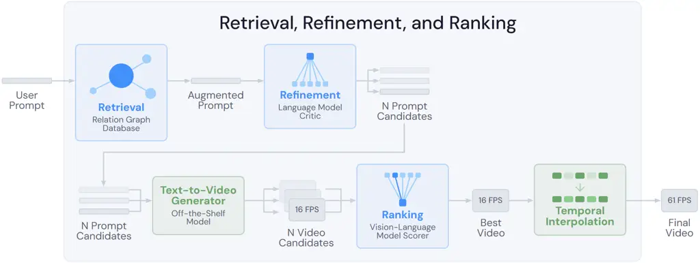
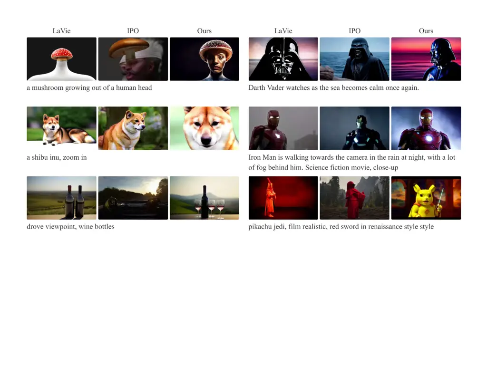
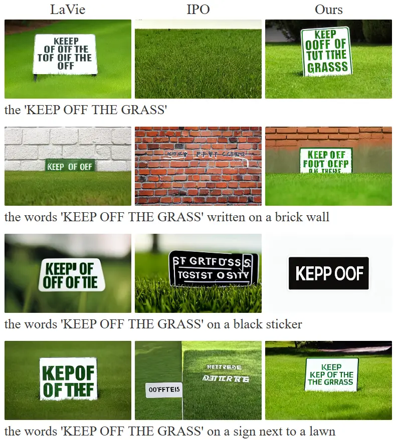

# Retrieval, Refinement, and Ranking for Text-to-Video Generation via Prompt Optimization and Test-Time Scaling

Zillur Rahman ^(†)^(†)thanks: Correspondance to: zillur.mle@gmail.com
Affiliation: Algoverse AI    Alex Sheng Affiliation: Algoverse AI   
Cristian Meo Affiliation: Algoverse AI

###### Abstract

While large-scale datasets have driven significant progress in
Text-to-Video (T2V) generative models, these models remain highly
sensitive to input prompts, demonstrating that prompt design is critical
to generation quality. Current methods for improving video output often
fall short: they either depend on complex, post-editing models, risking
the introduction of artifacts, or require expensive fine-tuning of the
core generator, which severely limits both scalability and
accessibility. In this work, we introduce 3R, a novel RAG based prompt
optimization framework. 3R utilizes the power of current
state-of-the-art T2V diffusion model and vision language model. It can
be used with any T2V model without any kind of model training. The
framework leverages three key strategies: RAG-based modifiers extraction
for enriched contextual grounding, diffusion-based Preference
Optimization for aligning outputs with human preferences, and temporal
frame interpolation for producing temporally consistent visual contents.
Together, these components enable more accurate, efficient, and
contextually aligned text-to-video generation. Experimental results
demonstrate the efficacy of 3R in enhancing the static fidelity and
dynamic coherence of generated videos, underscoring the importance of
optimizing user prompts.

|     |
| --- |
|     |

## 1 Introduction

Due to exciting advancements in diffusion-based generative models and
large-scale training procedures, modern text-to-video (T2V) models have
achieved impressive capabilities for using natural language prompts to
generate photorealistic video content (Peebles and Xie, 2023) (Ramesh et
al., 2022).

Despite rapid uptake in natural language processing (NLP) and subsequent
innovations in text-to-image (T2I) generation Podell et al. (2023);
Esser et al. (2024), and improving image aesthetics (Chen et al.,
2024a), their impact on video quality is limited (Hao et al., 2023).
Besides, the application of test-time optimization (Zhang et al., 2025b)
in text-to-video settings remains in early exploratory stages, with
meaningful open challenges (Gu et al., 2025). This presents valuable
opportunities to address problems in T2V like prompt adherence, visual
quality, physical plausibility, and temporal coherence.

To generate videos from texts, users provide a short text prompt to the
video generation model. Recent works show that a long detailed text
prompt generates better quality videos than the short user provided
prompt (Hao et al., 2023; Yang et al., 2025b). This underscores the
importance of enhancing the user prompt before feeding it to a T2V
model. The short user prompts do not contain detailed contextual
information required to generate vivid visual content. Moreover, videos
generated from the same prompt differ in quality due to the stochastic
nature of the diffusion models. So generating multiple videos from one
prompt and selecting the one that better fits the user prompt with
better visual quality could be effective.

To address these, in this paper, we explore avenues combining retrieval,
refinement, and ranking within this emerging paradigm of inference-time
compute algorithms to improve video generation quality in T2V settings.
We study a black-box problem definition that is designed for direct
plug-and-play applicability to off-the-shelf T2V models in real-world
settings.

Our contributions can be summarized as follows:

- •
  We propose Retrieval-Refinement-Ranking (3R), a retrieval based
  training free prompt optimization framework for T2V generation.
- •
  We propose an initial prompt refinement module that creates a detailed
  context rich description aligning with the user prompt.
- •
  We validate the effectiveness of 3R on EvalCrafter benchmark where it
  achieves SOTA results among open-source models.

## 2 Related Works

Text-to-Video Models Text-to-video generation models (OpenAI, 2024;
Rombach et al., 2021; Wang et al., 2024; Zhang et al., 2025a) have seen
rapid advances in both model capabilities and practical accessibility.
T2V models receive input prompts consisting of natural language
descriptions, and comprehend described scenes, actions, objects and
generate visual contents. T2V models are being used in generating
animations (Chen et al., 2023), movies (Zhao et al., 2025), commercials,
etc.

Prompt Optimization Frameworks IPO (Yang et al., 2025a) introduces an
iterative optimization algorithm to align video foundation models with
human preferences. It creates a human preference dataset and trains a
critique model with that dataset. An iterative optimization loop is used
to align a base T2V model with human preference, and thus improving
subject consistency, motion smoothness, and aesthetic quality. CCC (Gu
et al., 2025) introduces a simple vision language model for text to
video generation. Each candidate video is queried multiple times to get
a list of issues and a content score is computed from the number of
common issues. Based on those issues, initial prompts are refined to
generate better results. In (Gao et al., 2025), authors introduced RAPO:
a RAG based prompt optimization model for text to video generation. A
dataset is used to extract relevant modifiers to augment the user
prompt. Then a fine-tuned Llama3 model (Grattafiori et al., 2024) is
used to refactor the augmented prompt into the format of training
prompts. Finally, another fine-tuned LLama3 is used to select the better
prompt between the refactored prompt and a refined user prompt. Google
publishes VISTA (Long et al., 2025), one of the most computationally
expensive models where pairwise video comparison is used to select
candidate videos that are evaluated by multi-modal language models for
their visual, audio, and context quality. Then, LLMs review the issues
and refine the original prompts to generate videos again. The entire
model runs for maximum 5 iterations and each iteration can have maximum
30 videos, making it 150 videos per prompt.

## 3 Method

This section discusses the key design choices of 3R. The overall
pipeline is illustrated in Fig. 1 and a pseudo algorithm is illustrated
in Appendix A.1.



Figure 1: Overview of 3R pipeline. A short user prompt $`I`$ is used to
extract a few relevant subject, scene, actions modifiers from a relation
database $`\mathcal{D}`$. Then $`{M}_{LLM}`$ is used to merge those
modifiers iteratively to the original user prompt to get detaild prompt
$`P_{m}`$, and $`{R}_{LLM}`$ checks $`P_{m}`$ for any contradictory or
missing information from the original prompt $`I`$, and generate $`N`$
refined prompts. The refined prompts are fed to a T2V base model
$`\mathcal{G}`$ to generate initial videos for each prompt. Next, a
video selection model selects the best candidate based on a question
answering test, and a temporal interpolation network enhances temporal
consistency of the final video.

#### Modifiers

Using synthetic data augmentation to rearrange knowledge for more
data-efficient learning has been proven an effective pathway to mitigate
the challenge of adapting a pre-trained model to a small corpus of
domain-specific documents (Yang et al., 2024). Its main purpose is to
overcome the model’s context limitations, enabling effective context
construction for diverse user queries. Given an original user prompt
intent $`I`$, first, scene modifiers $`p_{j}`$ are extracted from a
relation database $`\mathcal{D}`$ using a pre-trained sentence
transformer. Then using cosine similarity score, we select scenes from
the relation graph if it is above a threshold $`\tau`$. Each scene comes
with its list of subject, action and environment modifiers. We select
top-k modifiers for each scene.

```math
P_{ret}=\{p_{j}\in\mathcal{D}\mid\text{sim}(\phi(I),\phi(p_{j}))>\tau\} \tag{1}
```

We iteratively merge each modifier with $`I`$ using a pre-trained LLM
$`M_{LLM}`$ in a few-shot manner. Existing method like RAPO (Gao et al., 2025) uses a large comma separated list of all the modifiers as an
initial description and prompts the LLM to merge each modifier. However,
this process sometimes generates incorrect and misleading results since
some modifiers have little to no relevance to the $`I`$. To mitigate
this issue, we initialize the description with only $`I`$. We show such
an example in Appendix Table 3.

```math
P_{m}=M_{LLM}(I\mid P_{ret}) \tag{2}
```

#### Refine Descriptions

After merging is completed, we get a detailed description $`P_{m}`$ of
each user prompt. To eliminate any contradictory, misleading information
or add any useful missing information, we prompt an LLM to further
refine the description. This LLM aims to refine $`P_{m}`$ based on
information such as characters, actions, attributes like color, counts
from $`I`$. This step is crucial for quality video generation. In our
experiment section, we demonstrate the importance of the initial prompt.
If the information in the initial prompt is not coherent, the generated
video will not represent user intents. We use $`R_{LLM}`$ in a few-shot
manner and generate $`N`$ distinct detailed prompts, maintaining the
original user intent. The goal is to generate multiple videos that may
have different positive and negative aspects so that we can choose the
best candidate as the final video. The prompt for this step is
illustrated in Appendix C.1.

```math
\{P_{n}\}_{n=1}^{N}=R_{LLM}(I\mid P_{m}) \tag{3}
```

#### Video Generation

Each prompt in our approach is passed to a T2V base model
$`\mathcal{G}`$. T2V model is treated as a black box that is only
assumed to take a natural language input prompt and return a generated
video output. This setup preserves practical applicability, as our
approach does not require access beyond black-box text-to-video queries.
By adhering to this framing, our algorithm is applicable to any
off-the-shelf T2V model, regardless of whether they are open-source
models or proprietary inference APIs.

```math
\{V_{n}\}_{n=1}^{N}=\{\mathcal{G}(P_{n})\mid P_{n}\in\{P_{1},\dots,P_{N}\}\} \tag{4}
```

We explain the video selection and enhancement sections in details in
Appendix A.2.

## 4 Experiments

Experimental Setup We use the EvalCrafter (Liu et al., 2023) benchmark
for quantitative performance evaluation. This comprehensive text2video
evaluation benchmark has 17 raw dimensions such as clip score, motion
score, face consistency score, etc. These raw metrics are aggregated
into 4 categories: Text-Video Alignment, Visual Quality, Motion Quality
and Temporal Consistency. We compare our approach to 4 other models that
reported their performance on EvalCrafter benchmark: Lavie (Wang et al., 2024) with original short prompts, IPO (Yang et al., 2025a), Show-1
(Zhang et al., 2025a) and Videocrafter2 (Chen et al., 2024b). We
reproduced the IPO results, and for others, we use the results and
metrics reported in the EvalCrafter benchmark leader-board. We report
the implementation details in Appendix B.1.

### 4.1 Results

Table 1 reports the results of 3R in comparison with Show-1, LaVie, IPO,
and Videocrafter2 on the four benchmark metrics of EvalCrafter. 3R
approach achieves the highest total score, demonstrating the
effectiveness of our inference-time approach for improving text-to-video
performance. Compared with the LaVie text-to-video base model without
additional inference-time processing, our approach (implemented with
LaVie as the base model) demonstrates a consistently higher score on all
four EvalCrafter metrics, showing general and direct performance lifts
across multiple facets of video generation output quality contributed by
the addition of our inference-time approach. This result would be
consistent with the assumption that increasing compute at inference time
can be used to improve output quality with an unchanged base model. We
report the qualitative performance of 3R in Appendix B.2. Fig. 2 and
Fig. 3 demonstrate 3R’s superior text-video alignment performance in
complex prompts such as mushroom growing out of a human head. 3R can
also visualize fictional characters such as Pikachu Jedi and understand
the meaning of close-up or zoom-in better.

|               |             |                |                      |                |                      |
| ------------- | ----------- | -------------- | -------------------- | -------------- | -------------------- |
| Model         | Total Score | Motion Quality | Text-Video Alignment | Visual Quality | Temporal Consistency |
| Show-1        | 229         | 53.74          | 62.07                | 52.19          | 60.83                |
| LaVie         | 234         | 52.83          | 68.49                | 57.99          | 54.23                |
| IPO           | 234         | 53.39          | 54.62                | 62.56          | 63.40                |
| Videocrafter2 | 243         | 54.82          | 63.16                | 63.98          | 61.46                |
| 3R            | 245         | 54.72          | 68.73                | 58.79          | 62.65                |

Table 1: Results on EvalCrafter benchmark. The first and second best
results in each column are highlighted in the corresponding colors. 3R
achieves the best total result, and either best or second best results
in most of the individual metrics.

Importance of the Initial Prompt Augmentation. As shown in Table 4 (row
2), incorporating RAG-based prompt augmentation significantly improves
performance. The total score increases by +7, motion quality improves by
+2, and temporal consistency improves by +4, with only a slight decrease
of 1 point in text-video alignment. These results underscore the
importance of high quality initial prompts, suggesting that the
limitations of the base model are often rooted in under-specification in
user prompts rather than architectural incapacity.

Effectiveness of Increasing Test-Time Compute. Our results in Table 4
demonstrate that increasing test-time compute is a highly effective
training-free strategy to close the performance gap between base models
and state-of-the-art video generators. By shifting the burden from model
parameters to inference-time logic, specifically through LLM-based
prompt refinement, multiple-candidate sampling for video selection, and
temporal interpolation, we observed a cumulative increase in the total
score from 234 to 245. We report the details of other experiments in
Appendix B.3.

## 5 Conclusion

In this paper, we propose 3R, a novel framework for prompt optimization
to improve the quality of T2V generated videos. We show that
inference-time augmentation of a text-to-video model with retrieval,
refinement, and ranking elements leads to performance gains in aggregate
scores combining video generation metrics like motion quality,
text-video alignment, visual quality, and temporal consistency. Our
results contribute to a better understanding of the different
inference-time pathways for improving output quality when using
text-to-video models in a black-box setting.

Despite these gains, the 3R pipeline introduces increased inference
latency due to multiple-candidate sampling and dense temporal
interpolation. Furthermore, our ablation study highlights a critical
“feedback bottleneck”: contemporary vision-language models (VLMs) often
provide over-corrective or semantically drifted critiques. Future
research will explore more efficient sampling strategies and
video-critique architectures that provide more grounded feedback,
potentially enabling a truly iterative “generate-and-verify” loop that
avoids the pitfalls of current VLM over-correction.

## References

- Chen et al. (2024a) C. Chen, C. Tseng, L. Tsao, and H. Shuai A cat is
  a cat (not a dog!): unraveling information mix-ups in text-to-image
  encoders through causal analysis and embedding optimization. External
  Links: 2410.00321, [Link](https://arxiv.org/abs/2410.00321) Cited by:
  §1.
- Chen et al. (2024b) H. Chen, Y. Zhang, X. Cun, M. Xia, X. Wang, C.
  Weng, and Y. Shan VideoCrafter2: overcoming data limitations for
  high-quality video diffusion models. External Links: 2401.09047,
  [Link](https://arxiv.org/abs/2401.09047) Cited by: §4.
- Chen et al. (2023) X. Chen, Y. Wang, L. Zhang, S. Zhuang, X. Ma, J.
  Yu, Y. Wang, D. Lin, Y. Qiao, and Z. Liu SEINE: short-to-long video
  diffusion model for generative transition and prediction. External
  Links: 2310.20700, [Link](https://arxiv.org/abs/2310.20700) Cited by:
  §2.
- Esser et al. (2024) P. Esser, S. Kulal, A. Blattmann, R. Entezari, J.
  Müller, H. Saini, Y. Levi, D. Lorenz, A. Sauer, F. Boesel, D.
  Podell, T. Dockhorn, Z. English, K. Lacey, A. Goodwin, Y. Marek,
  and R. Rombach Scaling rectified flow transformers for high-resolution
  image synthesis. External Links: 2403.03206,
  [Link](https://arxiv.org/abs/2403.03206) Cited by: §1.
- Gao et al. (2025) B. Gao, X. Gao, X. Wu, Y. Zhou, Y. Qiao, L. Niu, X.
  Chen, and Y. Wang The devil is in the prompts: retrieval-augmented
  prompt optimization for text-to-video generation. In Proceedings of
  the IEEE/CVF Conference on Computer Vision and Pattern Recognition
  (CVPR), pp. 3173–3183. Cited by: §B.1, §2, §3.
- Grattafiori et al. (2024) A. Grattafiori, A. Dubey, A. Jauhri, A.
  Pandey, A. Kadian, A. Al-Dahle, A. Letman, A. Mathur, A. Schelten, A.
  Vaughan, et al. The llama 3 herd of models. arXiv preprint
  arXiv:2407.21783. Cited by: §2.
- Gu et al. (2025) J. Gu, A. Nagarajan, T. Polu, K. Zheng, R. Zha, J.
  Yang, and X. E. Wang CCC: enhancing video generation via structured
  MLLM feedback. In Second Workshop on Test-Time Adaptation: Putting
  Updates to the Test! at ICML 2025, External Links:
  [Link](https://openreview.net/forum?id=B4eaJfAbCP) Cited by: §1, §2.
- Hao et al. (2023) Y. Hao, Z. Chi, L. Dong, and F. Wei Optimizing
  prompts for text-to-image generation. External Links: 2212.09611,
  [Link](https://arxiv.org/abs/2212.09611) Cited by: §1, §1.
- Jiang et al. (2023) A. Q. Jiang, A. Sablayrolles, A. Mensch, C.
  Bamford, D. S. Chaplot, D. de las Casas, F. Bressand, G. Lengyel, G.
  Lample, L. Saulnier, L. R. Lavaud, M. Lachaux, P. Stock, T. L.
  Scao, T. Lavril, T. Wang, T. Lacroix, and W. E. Sayed Mistral 7b.
  External Links: 2310.06825, [Link](https://arxiv.org/abs/2310.06825)
  Cited by: §B.1.
- Liu et al. (2023) Y. Liu, X. Cun, X. Liu, X. Wang, Y. Zhang, H.
  Chen, Y. Liu, T. Zeng, R. Chan, and Y. Shan Evalcrafter: benchmarking
  and evaluating large video generation models. arXiv preprint
  arXiv:2310.11440. Cited by: §4.
- Long et al. (2025) D. X. Long, X. Wan, H. Nakhost, C. Lee, T. Pfister,
  and S. Ö. Arık VISTA: a test-time self-improving video generation
  agent. External Links: 2510.15831,
  [Link](https://arxiv.org/abs/2510.15831) Cited by: §2.
- OpenAI et al. (2024) OpenAI et al. GPT-4 technical report. External
  Links: 2303.08774, [Link](https://arxiv.org/abs/2303.08774) Cited by:
  §B.1.
- OpenAI (2024) OpenAI Video generation models as world simulators.
  Note:
  [https://openai.com/index/video-generation-models-as-world-simulators/](https://openai.com/index/video-generation-models-as-world-simulators/)Accessed:
  2026-01-06 Cited by: §2.
- Park et al. (2023) S. Park, M. Son, S. Jang, Y. C. Ahn, J. Kim, and N.
  Kang Temporal interpolation is all you need for dynamic neural
  radiance fields. External Links: 2302.09311,
  [Link](https://arxiv.org/abs/2302.09311) Cited by: §A.2.
- Peebles and Xie (2023) W. Peebles and S. Xie Scalable diffusion models
  with transformers. External Links: 2212.09748,
  [Link](https://arxiv.org/abs/2212.09748) Cited by: §1.
- Podell et al. (2023) D. Podell, Z. English, K. Lacey, A. Blattmann, T.
  Dockhorn, J. Müller, J. Penna, and R. Rombach SDXL: improving latent
  diffusion models for high-resolution image synthesis. External Links:
  2307.01952, [Link](https://arxiv.org/abs/2307.01952) Cited by: §1.
- Ramesh et al. (2022) A. Ramesh, P. Dhariwal, A. Nichol, C. Chu, and M.
  Chen Hierarchical text-conditional image generation with clip latents.
  External Links: 2204.06125, [Link](https://arxiv.org/abs/2204.06125)
  Cited by: §1.
- Rombach et al. (2021) R. Rombach, A. Blattmann, D. Lorenz, P. Esser,
  and B. Ommer High-resolution image synthesis with latent diffusion
  models. CoRR abs/2112.10752. External Links:
  [Link](https://arxiv.org/abs/2112.10752), 2112.10752 Cited by: §2.
- Ronneberger et al. (2015) O. Ronneberger, P. Fischer, and T. Brox
  U-net: convolutional networks for biomedical image segmentation. In
  International Conference on Medical image computing and
  computer-assisted intervention, pp. 234–241. Cited by: §A.2.
- Sun et al. (2018) X. Sun, R. Szeto, and J. J. Corso A temporally-aware
  interpolation network for video frame inpainting. External Links:
  1803.07218, [Link](https://arxiv.org/abs/1803.07218) Cited by: §A.2.
- Wan et al. (2025) T. Wan, A. Wang, B. Ai, B. Wen, C. Mao, C. Xie, D.
  Chen, F. Yu, H. Zhao, J. Yang, et al. Wan: open and advanced
  large-scale video generative models. arXiv preprint arXiv:2503.20314.
  Cited by: §B.1.
- Wang et al. (2020) W. Wang, F. Wei, L. Dong, H. Bao, N. Yang, and M.
  Zhou MiniLM: deep self-attention distillation for task-agnostic
  compression of pre-trained transformers. External Links: 2002.10957
  Cited by: §B.1.
- Wang et al. (2024) Y. Wang, X. Chen, X. Ma, S. Zhou, Z. Huang, Y.
  Wang, C. Yang, Y. He, J. Yu, P. Yang, et al. LAVIE: high-quality video
  generation with cascaded latent diffusion models. IJCV. Cited by:
  §B.1, §2, §4.
- Xu et al. (2024) J. Xu, Y. Huang, J. Cheng, Y. Yang, J. Xu, Y.
  Wang, W. Duan, S. Yang, Q. Jin, S. Li, J. Teng, Z. Yang, W. Zheng, X.
  Liu, M. Ding, X. Zhang, X. Gu, S. Huang, M. Huang, J. Tang, and Y.
  Dong VisionReward: fine-grained multi-dimensional human preference
  learning for image and video generation. External Links: 2412.21059,
  [Link](https://arxiv.org/abs/2412.21059) Cited by: §B.1.
- Yang et al. (2025a) X. Yang, Z. Tan, and H. Li IPO: iterative
  preference optimization for text-to-video generation. External Links:
  2502.02088, [Link](https://arxiv.org/abs/2502.02088) Cited by: §2, §4.
- Yang et al. (2025b) Z. Yang, J. Teng, W. Zheng, M. Ding, S. Huang, J.
  Xu, Y. Yang, W. Hong, X. Zhang, G. Feng, D. Yin, Y. Zhang, W. Wang, Y.
  Cheng, B. Xu, X. Gu, Y. Dong, and J. Tang CogVideoX: text-to-video
  diffusion models with an expert transformer. External Links:
  2408.06072, [Link](https://arxiv.org/abs/2408.06072) Cited by: §1.
- Yang et al. (2024) Z. Yang, N. Band, S. Li, E. Candès, and T.
  Hashimoto Synthetic continued pretraining. External Links: 2409.07431,
  [Link](https://arxiv.org/abs/2409.07431) Cited by: §3.
- Zhang et al. (2025a) D. J. Zhang, J. Z. Wu, J. Liu, R. Zhao, L.
  Ran, Y. Gu, D. Gao, and M. Z. Shou Show-1: marrying pixel and latent
  diffusion models for text-to-video generation. External Links:
  2309.15818, [Link](https://arxiv.org/abs/2309.15818) Cited by: §2, §4.
- Zhang et al. (2025b) Q. Zhang, F. Lyu, Z. Sun, L. Wang, W. Zhang, W.
  Hua, H. Wu, Z. Guo, Y. Wang, N. Muennighoff, I. King, X. Liu, and C.
  Ma A survey on test-time scaling in large language models: what, how,
  where, and how well?. External Links: 2503.24235,
  [Link](https://arxiv.org/abs/2503.24235) Cited by: §1.
- Zhao et al. (2025) C. Zhao, M. Liu, W. Wang, W. Chen, F. Wang, H.
  Chen, B. Zhang, and C. Shen MovieDreamer: hierarchical generation for
  coherent long visual sequence. External Links: 2407.16655,
  [Link](https://arxiv.org/abs/2407.16655) Cited by: §2.

## Appendix A 3R Model

### A.1 Algorithm

1: procedure GenerateVideo($`I,\mathcal{D},N`$) $`\triangleright`$
$`I`$: User Intent, $`\mathcal{D}`$: Database, $`N`$: Candidates

2:   /\* Step 1: Retrieval \*/

3:   $`\bm{e}_{I}\leftarrow\phi(I)`$ $`\triangleright`$ Encode user
intent using embedding function $`\phi`$

4:
  $`P_{ret}\{(p_{j}\in\mathcal{D}\mid\text{cosine\_similarity}(\bm{e}_{I},\phi(p_{j}))>\tau\}`$

5:   /\* Step 2: Refinement & Merging \*/

6:   $`M_{LLM}\leftarrow\text{LLM\_Reasoning}(I,P_{ret})`$
$`\triangleright`$ Merge user intent with retrieved knowledge

7:
  $`\{P_{1},\dots,P_{N}\}\leftarrow\text{GenerateVariants}(R_{LLM},N)`$
$`\triangleright`$ Sample $`N`$ refined prompts

8:   /\* Step 3: Generation \*/

9:   for $`n\leftarrow 1`$ to $`N`$ do

10:    $`V_{n}\leftarrow\mathcal{G}(P_{n})`$ $`\triangleright`$ Generate
candidate video using T2V model $`\mathcal{G}`$

11:   end for

12:   /\* Step 4: Ranking \*/

13:   for $`n\leftarrow 1`$ to $`N`$ do

14:    $`\text{TotalScore}_{n}\leftarrow 0`$

15:    for $`i\leftarrow 1`$ to 29 do $`\triangleright`$ Evaluate 29
weighted VQA questions

16:      $`s_{i,n}\leftarrow f_{vqa}(V_{n},Q_{i})`$

17:
     $`\text{TotalScore}_{n}\leftarrow\text{TotalScore}_{n}+(\omega_{i}\times s_{i,n})`$

18:    end for

19:   end for

20:   $`V^{*}\leftarrow V_{\arg\max}(\text{TotalScore})`$
$`\triangleright`$ Select best candidate

21:   /\* Step 5: Enhancement \*/

22:   $`V_{final}\leftarrow\mathcal{E}(V^{*})`$ $`\triangleright`$ Apply
super-resolution/smoothing $`\mathcal{E}`$

23:   return $`V_{final}`$

24: end procedure

Algorithm 1 3R Methodology

### A.2 3R Method

#### Video Selection

We adopt a video selection model $`f_{vqa}`$ that evaluates each
generated video by asking a set of questions $`Q_{i}`$ covering
text-video alignment, motion smoothness, and visual quality. Each
question is associated with a learned weight $`w_{i}`$ that reflects how
strongly it correlates with human video preferences. Some highly
weighted questions are illustrated in Table 2. The highest weights are
assigned to questions related to prompt alignment (e.g., whether the
video satisfies all requirements of the text), physical realism (e.g.,
whether object motion is realistic), and fine detail quality. In
contrast, questions pertaining to subjective aesthetics (e.g., whether
lighting is beautiful) receive much smaller weights. Consequently, the
reward model places greater emphasis on semantic correctness and
physical plausibility, allowing it to reliably select the best candidate
among a set of generated videos.

```math
V^{*}=\arg\max_{V_{n}}\mathcal{S}(V_{n})\quad\text{where}\quad\mathcal{S}(V_{n})=\sum_{i=1}^{29}w_{i}\cdot f_{vqa}(V_{n},Q_{i}) \tag{5}
```

|      |        |                                                                                              |
| ---- | ------ | -------------------------------------------------------------------------------------------- |
| Rank | Weight | Question                                                                                     |
| 1    | 1.1418 | Does the video not completely fail to meet the requirements stated in the text “\[prompt\]”? |
| 2    | 0.9544 | Does the video meet all the requirements stated in the text “\[prompt\]”?                    |
| 3    | 0.4390 | Is the object’s movement completely realistic?                                               |
| 4    | 0.4293 | Are the details very refined?                                                                |
| 5    | 0.3942 | Is the video content part of the physical world?                                             |

Table 2: Top 5 weighted questions used in VisionReward-Video scoring out
of 29 questions. Higher scores are assigned to text-video alignment
questions.

#### Video Enhancement

Previous work (Park et al., 2023; Sun et al., 2018) has used temporal
interpolation techniques to learn meaningful representations for dynamic
scenes. In our approach, our goal is to specifically improve motion
smoothness and enrich temporal detail by extracting features through a
temporal interpolation network $`\mathcal{E}`$. This network first
duplicates current frames to match the number of target frames with
randomly initialized gaussian noise. Then it uses a pre-trained UNet
diffusion model (Ronneberger et al., 2015) to denoise and results in
interpolated frames. Besides, it uses the user prompt to guide the
interpolation process to ensure proper temporal coherence and alignment
with the user intent.

```math
V_{final}=\mathcal{E}(V^{*}) \tag{6}
```

|                     |                                                                                                                                                                                                                                                                                                                                                                                                          |
| ------------------- | -------------------------------------------------------------------------------------------------------------------------------------------------------------------------------------------------------------------------------------------------------------------------------------------------------------------------------------------------------------------------------------------------------- |
| Category            | Content                                                                                                                                                                                                                                                                                                                                                                                                  |
| User Prompt         | A tranquil tableau of barn.                                                                                                                                                                                                                                                                                                                                                                              |
| Retrieved Modifiers | a lively and energetic performance, walking inside, eating hay, being kept in the barn for some purpose, appears to be a farmer, a lively and joyful scene, wearing pink outfits, in a barn, preparing for a shooting competition, dancing in a barn, laying on the ground, a barn, opening the door of a barn, inside a barn                                                                            |
| RAPO                | A lively and energetic performance is taking place inside a barn. A farmer, wearing pink outfits, is walking inside, eating hay, and appears to be preparing for a shooting competition. The scene is lively and joyful, and the animals seem to be laying on the ground. The farmer opens the door of the barn and invites the audience to witness the performance, which includes dancing in the barn. |
| 3R                  | In a peaceful countryside setting, a barn sits quietly surrounded by lush green fields. The wooden structure, weathered yet sturdy, is bathed in the warm glow of the afternoon sun.                                                                                                                                                                                                                     |

Table 3: Comparison of Prompt Optimization Outputs. RAPO contains
information such as ‘eating hay’ or ‘shooting competition’ that has no
relevance to the user intent ‘a tranquil tableau of barn’ while 3R
filters out irrelevant modifiers and generates relevant ones like
‘wooden structure’ and ‘peaceful countryside setting’.

## Appendix B Experiments

### B.1 Implementation Details

We use the relation graph from RAPO (Gao et al., 2025) to extract
relevant and useful modifiers. As the sentence transformer, we use
all-MiniLML6-v2 to get the embeddings of sentences (Wang et al., 2020).
To merge the retrieved modifiers with the user prompt, we use Mistral
model (Jiang et al., 2023) with cosine similarity threshold $`\tau=0.5`$
between an user prompt and a modifier. In our final model, we use GPT4o
(OpenAI and others, 2024) as the prompt refiner. We create 4 prompt
candidates with variations by keeping the original user intent intact.
As our final base text2video generation model, we use Lavie (Wang et
al., 2024). We choose Lavie because it is faster than other diffusion
models like Wan (Wan et al., 2025) and generates quality video using
minimal resources. In our Nvidia H200 GPU, it takes around 5s to
generate one video. As for the video selection model, we use
Vision-Reward Model (Xu et al., 2024). It generates scores for all 4
candidate videos using multimodal visual question answering technique.
The selected video is used as input to the temporal interpolation
network (Wang et al., 2024) that increases the number of frames to 61.
For the VLM Critique ablation study, we use GPT4o (OpenAI and others,
2024). We run the overall pipeline two times with two random seeds and
report the average results in Table 1.

### B.2 Qualitative Results

In this section, we illustrate a few challenging examples from the
EvalCrafter benchmark. We compare the qualitative performance of 3R with
Lavie base model and IPO.



Figure 2: Qualitative comparison of Lavie, IPO, and 3R in two common
video generation failure modes. The left side shows prompts and video
frames representing challenges in semantic alignment such as mushroom
growing out of human head or zoom-in and the right side shows prompts
and video frames representing challenges in addressing fictional
references such as Darth Vedar or Pikachu Jedi.



Figure 3: Qualitative comparison of approaches in the common failure
mode of generating videos containing text. We compare the first frame of
the videos generated by Lavie (left), IPO (middle), and 3R (right) in
the common failure mode of text generation in videos, as observed from
prompts provided by the EvalCrafter benchmark. All three approaches show
strong limitations in generating correct text, but 3R manages to
generate qualitatively more legible text where the intended text in the
prompt (”keep off the grass” or ”keep off”) can still be partially
inferred despite typos. The prompts and respective video frames show how
our approach can address prompts requiring multiple semantic conditions
while producing less distorted outputs.

### B.3 Ablation Study

We explain the results of other research questions in details here.

Impact of Video Selection. Table 4 (row 3) presents the impact of
incorporating the video selection module. Adding a vision-based reward
through diffusion-based human preference alignment increases the total
score by +2, driven primarily by a +2 improvement in text-video
alignment. This highlights the crucial role of preference alignment. The
selection module reliably filters out semantically inconsistent
generations. Example videos show that the selected outputs more
faithfully reflect user intent compared to their unfiltered
counterparts.

Temporal Interpolation and Consistency. Increasing the number of frames
generated from 16 to 61 leads to a noticeable improvement in temporal
smoothness, as reflected in the temporal consistency score. Videos with
higher frame density exhibit reduced flicker, smoother motion
trajectories, and fewer disjoint transitions. Offline visual comparisons
clearly show the improvement in motion coherence, particularly in scenes
with significant camera or object movement.

Efficacy of VLM Critque As shown in Table 4 (row 4), introducing a video
critique module does not produce measurable performance gains.
Inspection of the VLM-generated critique text reveals several misleading
or incorrect interpretations, frequently exhibit semantic drift or
unnecessary over-corrections, underscoring the unreliability of critique
signals for this task. Two examples are illustrated in Appendix C.3
where VLM either tries to over-correct or the T2V model fails to follow
the VLM instructions, resulting in degradation in video quality in both
cases. The specific prompt used to extract critique data is detailed in
Appendix C.2.

Overall, the ablation results confirm that each component: RAG-based
augmentation, diffusion-based preference alignment, and temporal-aware
interpolation, contributes meaningfully to the 3R pipeline, offering
complementary improvements across evaluation dimensions.

|                                   |             |                |                      |                |                      |
| --------------------------------- | ----------- | -------------- | -------------------- | -------------- | -------------------- |
| Model                             | Total Score | Motion Quality | Text-Video Alignment | Visual Quality | Temporal Consistency |
| LaVie (Baseline)                  | 234         | 52.83          | 68.49                | 57.99          | 54.23                |
| One Prompt                        | 241         | 54.73          | 67.54                | 59.75          | 58.75                |
| $`N`$ Prompts + Video Selection   | 243         | 54.64          | 69.44                | 59.86          | 58.94                |
| Video Selection + VLM Critique    | 241         | 54.89          | 66.35                | 60.20          | 59.74                |
| Video Selection + Temporal Inter. | 245         | 54.72          | 68.73                | 58.79          | 62.65                |

Table 4: Ablation results. The first and second best results in each
column are highlighted in the corresponding colors. Initial prompt
refinement, video selection model, and temporal interpolation model each
contribute to the total score while vision-language model critique
degrades text-video alignment severely due to it’s over-correction
nature.

## Appendix C Prompts

In this section, we report all LLM prompts in the same format we used in
this study.

### C.1 User Prompt Refinement


### C.2 Vision Language Model Feedback Prompt


### C.3 VLM Feedback Output


