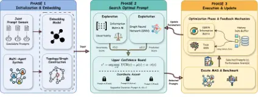
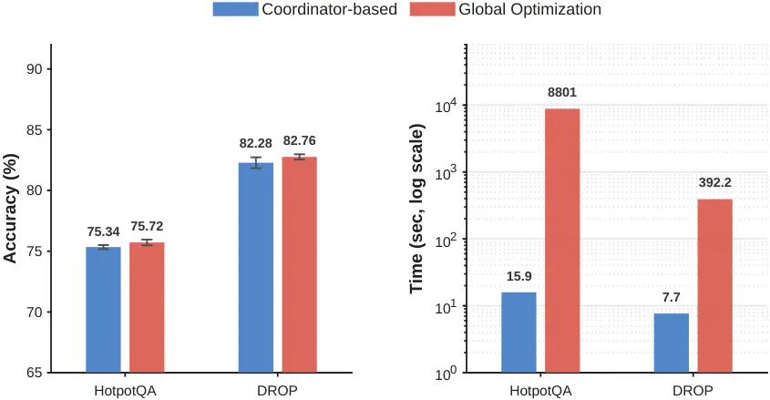

# MASPOB: Bandit-Based Prompt Optimization for Multi-Agent Systems with Graph Neural Networks

Zhi Hong Affiliation: The Chinese University of Hong Kong, Shenzhen
Affiliation: South China University of Technology    Qian Zhang
Affiliation: The Chinese University of Hong Kong, Shenzhen
Affiliation: Ritsumeikan University    Jiahang Sun Affiliation: The
Chinese University of Hong Kong, Shenzhen    Zhiwei Shang
Affiliation: The Chinese University of Hong Kong, Shenzhen    Mingze
Kong Affiliation: The Chinese University of Hong Kong, Shenzhen   
Xiangyi Wang Affiliation: The Chinese University of Hong Kong, Shenzhen
   Yao Shu Affiliation: The Hong Kong University of Science and
Technology (Guangzhou) Correspondence to: <yaoshu@hkust-gz.edu.cn>   
Zhongxiang Dai Affiliation: The Chinese University of Hong Kong,
Shenzhen Correspondence to: <daizhongxiang@cuhk.edu.cn>

###### Abstract

Large Language Models (LLMs) have achieved substantial success in
real-world applications, particularly as the cognitive backbone of
Multi-Agent Systems (MAS) for orchestrating complex workflows. Since
many deployments preclude workflow modifications while MAS performance
is highly prompt-sensitive, prompt optimization becomes a critical
strategy for improvement. However, real-world prompt optimization for
MAS is impeded by three key challenges: (1) the need of sample
efficiency due to prohibitive evaluation costs, (2) topology-induced
coupling among prompts, and (3) the combinatorial explosion of the
search space. To address these challenges, we introduce MASPOB
(Multi-Agent System Prompt Optimization via Bandits), a novel
sample-efficient framework based on bandits. By leveraging Upper
Confidence Bound (UCB) to quantify uncertainty, the bandit framework
balances exploration and exploitation, maximizing gains within a
strictly limited budget. To handle topology-induced coupling, MASPOB
integrates Graph Neural Networks (GNNs) to capture structural priors,
learning topology-aware representations of prompt semantics.
Furthermore, it employs coordinate ascent to decompose the optimization
into univariate sub-problems, reducing search complexity from
exponential to linear. Extensive experiments across diverse benchmarks
demonstrate that MASPOB achieves state-of-the-art performance,
consistently outperforming existing baselines. Our code is available at
[https://github.com/HZ1008/MASPOB](https://github.com/HZ1008/MASPOB).

###### Keywords: 

Machine Learning, ICML

^(†)^(†)affiliationnotice: Equal contribution

## 1 Introduction

Large Language Models (LLMs) are increasingly deployed as
_collaborative_ Multi-Agent Systems (MAS), where multiple specialized
agents communicate through a workflow to solve complex tasks (Wu et al.,
2024a; Hong et al., 2023; Qian et al., 2024; Chen et al., 2023b; Tang et
al., 2023). By decomposing problems such as code generation and
mathematical reasoning into coordinated multi-agent interactions, MAS
can outperform monolithic models. Importantly, MAS performance is shaped
not only by the underlying LLMs but also by _system design_
choices—including the workflow topology and, critically, the prompts
that govern the behavior of each agent (Khattab et al., 2023).

Although some recent work explores automating workflow topology and
agent-role design (Zhang et al., 2024; Zhuge et al., 2024; Hu et al.,
2025; Liu et al., 2023; Yu et al., 2024), many real-world deployments
rely on workflows that have undergone expert vetting, safety validation,
and compliance review (e.g., medical SOPs and financial auditing) (Wu et
al., 2025; Bodnari and Travis, 2025; Wells et al., 2025; Yang et al.,
2024). Such workflows are therefore _rarely modified in practice_: even
minor changes can trigger expensive re-validation procedures or may be
prohibited altogether. Consequently, optimizing _agent-specific_ prompts
becomes the primary lever for improving system performance (Brown et
al., 2020; Kojima et al., 2022).

However, prompt optimization for MAS presents a challenging
combinatorial black-box optimization problem, characterized by three
difficulties. (i) Expensive evaluations: evaluating a candidate prompt
configuration requires end-to-end MAS execution, often involving
multiple LLM calls, which severely limits the evaluation budget. (ii)
Topology-induced coupling: changing an upstream prompt shifts the input
distribution of downstream agents, making the objective non-separable
and rendering independent optimization unstable. (iii) Combinatorial
search: the joint prompt space is a discrete Cartesian product whose
size grows exponentially with the number of agents, making exhaustive
search infeasible. These constraints raise a question: How can we
perform sample-efficient and topology-aware prompt optimization for MAS
under a combinatorial search space?



Figure 1: The MASPOB framework. (1) Initialization: Constructs agent
topology and generates prompt embeddings. (2) Search: Selects optimal
prompts via Coordinate Ascent, balancing exploitation (GNN prediction)
and exploration (Linear UCB uncertainty). (3) Update: Refines the GNN
model and information matrix using execution feedback.

Despite this motivation, existing prompt optimizers do not fully address
the above setting. Single-agent optimizers (Guo et al., 2023; Lin et
al., 2023; Chen et al., 2023a), such as OPRO (Yang et al., 2023) and
PromptBreeder (Fernando et al., 2023), refine prompts in isolation and
therefore ignore topology-induced coupling and the resulting
distribution shift across agents. Multi-stage prompt optimizers like
MIPRO (Opsahl-Ong et al., 2024b) apply Bayesian optimization to chained
workflows, but typically capture dependencies only implicitly (e.g., via
TPE) and remain largely topology-agnostic. Under costly evaluations and
a combinatorial search space, this can be sample-inefficient and may
miss _coordinated_ prompt combinations that respect the MAS structure.

(a) Performance comparison across benchmarks.

(b) Overall performance comparison.

Figure 2: Performance evaluation of prompt optimization methods. (a)
Detailed comparison across six diverse benchmarks including question
answering (HotpotQA, DROP), code generation (HumanEval, MBPP), and
mathematical reasoning (GSM8K, MATH). (b) Overall ranking based on
average performance. MASPOB demonstrates superior performance with an
average improvement of 12.02% over the IO baseline.

To address this gap, we propose MASPOB (Multi-Agent System Prompt
Optimization via Bandits), which integrates uncertainty-guided
exploration, topology-aware modeling, and scalable combinatorial search.

Uncertainty-driven exploration. To achieve sample efficiency under a
strict evaluation budget, MASPOB frames prompt optimization as a
contextual bandit problem (Kong et al., 2025; Lin et al., 2024; Wu et
al., 2024b) and performs exploration using an Upper Confidence Bound
(UCB) criterion. Specifically, it estimate epistemic uncertainty via an
information matrix (Abbasi-Yadkori et al., 2011; Li et al., 2010; Chu et
al., 2011) in the learned representation space, and combine this
uncertainty with the surrogate’s predicted performance to construct an
acquisition score. This UCB-style objective prioritizes prompt
configurations that are not only promising but also informative,
enabling efficient allocation of limited evaluations.

Topology-aware surrogate. MASPOB employs a Graph Neural Network (GNN)
surrogate to explicitly encode the MAS workflow and model how prompt
changes propagate along inter-agent edges. By representing agents as
nodes and aggregating information via message passing, the surrogate
provides a structural inductive bias beyond treating the MAS as an
unstructured black box. The surrogate’s topology-aware representations
serve as features for the bandit objective, enabling more reliable
generalization from limited evaluations (Zhang et al., 2025b).

Scalable combinatorial search. Finally, to mitigate combinatorial
explosion, MASPOB adopts a Coordinate Ascent strategy that decomposes
the global search into a sequence of tractable univariate updates while
still accounting for inter-agent coupling through the topology-aware
surrogate and the UCB objective.

In summary, our key contributions are as follows:

- •
  We formalize prompt optimization for MAS as a budgeted black-box
  problem with topology-induced coupling and a discrete combinatorial
  search space, and identify key limitations of existing prompt
  optimizers in this setting.
- •
  We propose MASPOB, combining a topology-aware GNN surrogate with
  uncertainty-guided bandit exploration and coordinate ascent to enable
  sample-efficient optimization under a strict evaluation budget.
- •
  We evaluate MASPOB on six benchmarks, spanning question answering,
  code generation, and mathematical reasoning, and observe consistent
  improvements over strong baselines under matched evaluation budgets.

## 2 Problem Setting

We study prompt optimization for Large Language Model (LLM)-based
Multi-Agent Systems (MAS), where multiple specialized agents collaborate
to solve complex tasks. Each agent is powered by an LLM and is steered
by a role-specific prompt; consequently, system-level performance
emerges from inter-agent interactions rather than from any single prompt
in isolation.

MAS Workflow as a Directed Acyclic Graph. We model an MAS workflow as a
directed acyclic graph (DAG) $`\mathcal{G}=(\mathcal{V},\mathcal{E})`$,
where nodes $`\mathcal{V}=\{a_{1},a_{2},\ldots,a_{N}\}`$ denote $`N`$
agents and directed edges
$`\mathcal{E}\subseteq\mathcal{V}\times\mathcal{V}`$ represent
information flow. An edge $`(a_{i},a_{j})\in\mathcal{E}`$ means that the
output produced by agent $`a_{i}`$ is included in the input context of
agent $`a_{j}`$. For an input query $`x`$, agents execute in a
topological order: each agent $`a_{i}`$ aggregates messages from its
predecessors $`\{a_{j}:(a_{j},a_{i})\in\mathcal{E}\}`$, performs an LLM
invocation, and forwards its output to downstream agents. The workflow
terminates with a final system output $`\hat{y}`$. This DAG assumption
applies only to inter-agent information flow within a single execution:
individual agents may still perform retries, reflection,
self-correction, or iterative refinement internally, while cross-agent
feedback cycles are excluded.

Prompt-Controlled Agent Behavior. Each agent $`a_{i}`$ is associated
with a prompt $`p_{i}`$ that acts as an instruction template specifying
how the agent should interpret its inputs and format its outputs.
Changing $`p_{i}`$ can alter the agent’s reasoning strategy, output
structure, and thus the quality of the information propagated to
downstream agents. We denote by $`\mathcal{P}_{i}`$ the prompt domain
(candidate set) for agent $`a_{i}`$. Because agents typically play
different roles (e.g., reasoning, code generation, verification), their
prompt domains can be heterogeneous, which further complicates prompt
optimization and motivates topology-aware modeling that accounts for
inter-agent dependencies.

Prompt Combination and Evaluation. A _prompt combination_ is a tuple
$`c=(p_{1},p_{2},\ldots,p_{N})`$ with $`p_{i}\in\mathcal{P}_{i}`$. The
global search space is the Cartesian product
$`\mathcal{P}=\mathcal{P}_{1}\times\mathcal{P}_{2}\times\cdots\times\mathcal{P}_{N}`$,
whose size is $`\prod_{i=1}^{N}|\mathcal{P}_{i}|`$. Given a dataset
$`\mathcal{D}=\{(x,y)\}`$ and an evaluation metric $`m(\cdot,\cdot)`$,
we define the expected performance of the MAS under $`c`$ as

```math
s(c\mid\mathcal{D})=\mathbb{E}_{(x,y)\in\mathcal{D}}\bigl[m(\mathrm{MAS}(c,x),y)\bigr], \tag{1}
```

where $`\mathrm{MAS}(c,x)`$ denotes the output produced by executing the
MAS with prompt combination $`c`$ on input $`x`$.

Optimization Objective. Given a validation set $`\mathcal{D}_{v}`$ and a
budget of $`T`$ evaluations, we seek the prompt combination that
maximizes validation performance:

```math
c^{*}=\arg\max_{c\in\mathcal{P}}s(c\mid\mathcal{D}_{v}). \tag{2}
```

We then report the final test performance
$`s(c^{*}\mid\mathcal{D}_{t})`$ on a held-out test set
$`\mathcal{D}_{t}`$. Overall, this is a combinatorial black-box
optimization problem: $`s(\cdot)`$ can only be queried through expensive
end-to-end MAS executions, while the search space grows exponentially
with the number of agents.

Budgeted Optimization Protocol. In practice, evaluating
$`s(c\mid\mathcal{D}_{v})`$ is costly because it requires running the
full end-to-end MAS workflow on validation instances. We assume a fixed
budget $`T`$ and frame prompt optimization as a sequential,
feedback-driven process over combinations $`c^{(1)},\ldots,c^{(T)}`$,
where validation scores guide subsequent selections. The key challenge
is budget allocation: early evaluations explore diverse regions, while
later evaluations exploit promising regions to refine the
best-performing combination. This setting motivates modeling shared
structure and inter-agent dependencies, rather than treating each
combination independently.

## 3 Methodology

We present MASPOB, a framework for optimizing prompt combinations in
Multi-Agent Systems. For a prompt combination
$`c=(p_{1},\ldots,p_{N})`$, we encode each prompt $`p_{i}`$ into a
$`d`$-dimensional embedding $`\Phi(p_{i})\in\mathbb{R}^{d}`$ using a
pre-trained text encoder, and represent the MAS workflow topology with
an adjacency matrix $`\mathbf{A}_{\mathcal{G}}\in\{0,1\}^{N\times N}`$
derived from the dependency graph
$`\mathcal{G}=(\mathcal{V},\mathcal{E})`$.

Our framework consists of three components. (i) A topology-aware Graph
Neural Network (GNN) surrogate predicts the performance of a prompt
combination by modeling inter-agent dependencies; we instantiate it with
a Graph Attention Network (GAT) (Veličković et al., 2017) that takes
prompt embeddings as node features and the workflow topology as the
graph structure (§3.1). (ii) We cast prompt search as a contextual
bandit problem and apply LinUCB (Abbasi-Yadkori et al., 2011) to balance
exploitation of high-scoring combinations with exploration of uncertain
regions (§3.2). (iii) We use coordinate ascent to approximately maximize
the UCB acquisition function by decomposing the joint search into a
sequence of single-agent subproblems, reducing the per-iteration
complexity from $`O\!\left(\prod_{i=1}^{N}|\mathcal{P}_{i}|\right)`$ to
$`O\!\left(\sum_{i=1}^{N}|\mathcal{P}_{i}|\right)`$, where
$`N=|\mathcal{V}|`$ is the number of agents (§3.3). Algorithm 1
summarizes the full procedure. For notational convenience, let
$`c_{-i}`$ denote the prompts of all agents except agent $`i`$, and
write $`(c_{-i},p)`$ for the prompt combination obtained by setting the
$`i`$-th prompt to $`p\in\mathcal{P}_{i}`$ while keeping the other
prompts fixed.

### 3.1 Topology-Aware Performance Prediction

Graph Construction. We represent the MAS workflow as a directed graph
where each node corresponds to an agent. For agent $`a_{i}`$, its node
feature is initialized with the prompt embedding
$`\Phi(p_{i})\in\mathbb{R}^{d}`$. The adjacency matrix
$`\mathbf{A}_{\mathcal{G}}`$ encodes the workflow dependencies,
augmented with self-loops to facilitate information propagation across
the entire workflow structure.

Attention-Based Message Passing. We instantiate the surrogate with a
standard multi-head Graph Attention Network (GAT). Each layer uses $`K`$
attention heads to update node representations through
attention-weighted message passing, enabling the model to learn the
relative importance of different agent interactions.

For intermediate GAT layers, the outputs of each head are concatenated:

```math
\mathbf{h}_{i}^{(l+1)}=\Big\|_{k=1}^{K}\,\sigma\!\left(\sum_{j\in\mathcal{N}(i)\cup\{i\}}\alpha_{ij}^{(k)}\mathbf{W}^{(l,k)}\mathbf{h}_{j}^{(l)}\right), \tag{3}
```

where $`\mathcal{N}(i)`$ denotes the neighbors of node $`i`$,
$`\mathbf{W}^{(l,k)}`$ is the learnable projection matrix for attention
head $`k`$ at layer $`l`$, $`\sigma`$ is a nonlinear activation
function, and $`\|`$ denotes concatenation across heads.

For the final GAT layer, the outputs of all heads are averaged instead
of concatenated:

```math
\mathbf{h}_{i}^{(L)}=\sigma\!\left(\frac{1}{K}\sum_{k=1}^{K}\sum_{j\in\mathcal{N}(i)\cup\{i\}}\alpha_{ij}^{(k)}\mathbf{W}^{(L,k)}\mathbf{h}_{j}^{(L-1)}\right). \tag{4}
```

The attention coefficient $`\alpha_{ij}^{(k)}`$ for head $`k`$
quantifies the importance of agent $`j`$’s information to agent $`i`$.
Following the standard GAT formulation, the unnormalized attention score
is computed by applying a shared attention vector to the transformed
target and source features:

```math
e_{ij}^{(k)}=\text{LeakyReLU}\!\left(\mathbf{a}^{(k)\top}\left[\mathbf{W}^{(l,k)}\mathbf{h}_{i}^{(l)}\|\mathbf{W}^{(l,k)}\mathbf{h}_{j}^{(l)}\right]\right), \tag{5}
```

```math
\alpha_{ij}^{(k)}=\frac{\exp\!\left(e_{ij}^{(k)}\right)}{\displaystyle\sum_{r\in\mathcal{N}(i)\cup\{i\}}\exp\!\left(e_{ir}^{(k)}\right)}, \tag{6}
```

where $`\mathbf{a}^{(k)}`$ is a learnable attention vector for head
$`k`$ and $`\|`$ denotes concatenation.

Performance Prediction. After $`L`$ layers of message passing, we obtain
a graph-level representation through mean pooling over all node
features:

```math
\mathbf{z}=\frac{1}{N}\sum_{i=1}^{N}\mathbf{h}_{i}^{(L)}. \tag{7}
```

The predicted performance score is computed by a multi-layer perceptron:

```math
\mu(c)=\text{MLP}(\mathbf{z})\in[0,1]. \tag{8}
```

This prediction serves as the exploitation signal in our optimization
framework, guiding the search toward promising regions of the prompt
space.

GNN Initialization. MASPOB initializes the GNN surrogate through a
limited warm-up phase: it randomly samples $`T_{0}`$ complete prompt
combinations, evaluates them on the validation set, and trains the GAT
predictor on the resulting observations
$`(\Phi(c),s(c\mid\mathcal{D}_{v}))`$. This gives the surrogate an
initial topology-aware performance estimate, while the subsequent
UCB-guided search continues to explore high-uncertainty regions.

### 3.2 Bandit-Based Exploration-Exploitation Tradeoff

A fundamental challenge in prompt optimization is balancing exploitation
of known good combinations with exploration of uncertain regions under a
limited evaluation budget. We formulate this as a _contextual bandit_
problem and adopt Linear Upper Confidence Bound (LinUCB) to achieve a
principled tradeoff. More details about the UCB design and additional
empirical validation are provided in Appendix B.

#### Uncertainty Quantification.

We maintain an information matrix
$`\mathbf{M}\in\mathbb{R}^{Nd\times Nd}`$ that accumulates information
from evaluated prompt combinations. Given a prompt combination $`c`$, we
construct its combined embedding by concatenating individual prompt
embeddings:

```math
\Phi(c)=\left[\Phi(p_{1});\Phi(p_{2});\ldots;\Phi(p_{N})\right]\in\mathbb{R}^{Nd}. \tag{9}
```

The information matrix is initialized as
$`\mathbf{M}=\lambda\mathbf{I}`$ with regularization coefficient
$`\lambda`$, and updated after each evaluation:

```math
\mathbf{M}\leftarrow\mathbf{M}+\Phi(c)\Phi(c)^{\top}. \tag{10}
```

The uncertainty of a prompt combination is then estimated as:

```math
\sigma(c)=\sqrt{\Phi(c)^{\top}\mathbf{M}^{-1}\Phi(c)}, \tag{11}
```

which measures the novelty of $`c`$ relative to previously evaluated
combinations. Combinations in unexplored regions of the embedding space
yield higher uncertainty values.

#### Upper Confidence Bound.

The UCB acquisition function combines the predicted performance with an
uncertainty bonus:

```math
\text{UCB}(c)=\mu(c)+\alpha\cdot\sigma(c), \tag{12}
```

where $`\alpha>0`$ is the exploration coefficient. The first term
encourages exploitation by favoring combinations with high predicted
performance, while the second term promotes exploration by assigning
higher scores to uncertain combinations. This principled tradeoff
ensures efficient utilization of the limited evaluation budget.

### 3.3 Coordinate Ascent Search

Exhaustively evaluating all prompt combinations is computationally
prohibitive, as the search space grows exponentially with the number of
agents. To efficiently navigate this combinatorial space, we adopt
coordinate ascent, which decomposes the joint optimization into a
sequence of tractable single-agent optimizations.

Starting from the current best combination
$`c^{*}=(p_{1}^{*},\ldots,p_{N}^{*})`$, we sequentially optimize the
prompt for each agent while keeping others fixed:

```math
p_{i}^{*}\leftarrow\arg\max_{p\in\mathcal{P}_{i}}\text{UCB}(p_{1}^{*},\ldots,p_{i-1}^{*},p,p_{i+1}^{*},\ldots,p_{N}^{*}). \tag{13}
```

This procedure reduces the per-iteration search complexity from
$`O(\prod_{i=1}^{N}|\mathcal{P}_{i}|)`$ to
$`O(\sum_{i=1}^{N}|\mathcal{P}_{i}|)`$, requiring UCB evaluations that
scale linearly with the number of agents. Since UCB evaluation only
requires forward passes through the GAT model without actual MAS
execution, this search process incurs negligible computational overhead
compared to evaluating prompt combinations on the validation set.

For strongly coupled topologies, MASPOB can optionally use small
block-coordinate updates over tightly connected agents. Rather than
optimizing the full prompt tuple jointly, this variant updates only a
local block, such as an upstream agent and a downstream agent connected
by a workflow edge, while keeping the remaining prompts fixed. This
preserves the efficiency of coordinate search while allowing the
acquisition function to capture stronger prompt interactions along
direct dependencies. We use single-agent updates by default, and provide
block-coordinate details and empirical analysis in Appendix C.

0:  MAS workflow $`\mathcal{G}=(\mathcal{V},\mathcal{E})`$; prompt
domains $`\{\mathcal{P}_{i}\}_{i=1}^{N}`$; validation set
$`\mathcal{D}_{v}`$; warm-up rounds $`T_{0}`$; total budget $`T`$;
exploration coefficient $`\alpha`$; regularization $`\lambda`$

0:  Optimized prompt combination $`c^{*}`$

1:  Compute prompt embeddings $`\Phi(p)`$ for all
$`p\in\bigcup_{i=1}^{N}\mathcal{P}_{i}`$

2:  Construct adjacency matrix $`\mathbf{A}_{\mathcal{G}}`$ from
workflow $`\mathcal{G}`$

3:  Initialize information matrix
$`\mathbf{M}\leftarrow\lambda\mathbf{I}`$; history
$`\mathcal{H}\leftarrow\emptyset`$

4:  Initialize best pair $`(s^{*},c^{*})\leftarrow(0,\text{null})`$

5:  for $`t=1`$ to $`T_{0}`$ do

6:   Randomly sample a full combination $`c`$ and obtain score
$`s(c\mid\mathcal{D}_{v})`$ via end-to-end MAS execution

7:   Update $`\mathcal{H}`$, $`\mathbf{M}`$, and incumbent
$`(s^{*},c^{*})`$

8:  end for

9:  Train the GAT on the warm-up observations in $`\mathcal{H}`$

10:  for $`t=T_{0}+1`$ to $`T`$ do

11:   // Coordinate ascent with UCB guidance

12:   Initialize search point $`c\leftarrow c^{*}`$ for coordinate
ascent

13:   for $`i=1`$ to $`N`$ do

14:    // GNN prediction (exploitation)

15:
   $`\mu_{p}\leftarrow\text{GAT}(\Phi(c_{-i},p),\mathbf{A}_{\mathcal{G}})`$
for all $`p\in\mathcal{P}_{i}`$

16:    // UCB uncertainty (exploration)

17:
   $`\sigma_{p}\leftarrow\sqrt{\Phi(c_{-i},p)^{\top}\mathbf{M}^{-1}\Phi(c_{-i},p)}`$

18:
   $`p_{i}\leftarrow\arg\max_{p\in\mathcal{P}_{i}}[\mu_{p}+\alpha\cdot\sigma_{p}]`$

19:    Update $`c\leftarrow(c_{-i},p_{i})`$

20:   end for

21:   // Evaluation and model update

22:   Obtain $`s(c\mid\mathcal{D}_{v})`$ by executing the MAS with
prompt combination $`c`$

23:
  $`\mathcal{H}\leftarrow\mathcal{H}\cup\{(\Phi(c),s(c\mid\mathcal{D}_{v}))\}`$

24:   $`\mathbf{M}\leftarrow\mathbf{M}+\Phi(c)\Phi(c)^{\top}`$ // update
information matrix

25:   Retrain the GAT predictor on $`\mathcal{H}`$ // update parameters

26:   if $`s(c\mid\mathcal{D}_{v})>s^{*}`$ then

27:    $`s^{*}\leftarrow s(c\mid\mathcal{D}_{v})`$;
$`c^{*}\leftarrow c`$

28:   end if

29:  end for

30:  return $`c^{*}`$

Algorithm 1 MASPOB: Multi-Agent System Prompt Optimization with Bandit

## 4 Experiments

### 4.1 Experiment Setup

|                                       |            |            |            |            |            |            |       |
| ------------------------------------- | ---------- | ---------- | ---------- | ---------- | ---------- | ---------- | ----- |
|                                       | QA         |            | Code       |            | Math       |            |       |
| Method                                | HotpotQA   | DROP       | HumanEval  | MBPP       | GSM8K      | MATH       | Avg.  |
| IO (GPT-4o-mini)                      | 60.36±0.48 | 53.09±0.36 | 89.31±2.02 | 69.11±1.19 | 87.80±0.44 | 51.71±0.43 | 68.56 |
| CoT (Wei et al., 2022)                | 67.62±0.48 | 58.27±0.42 | 89.57±1.16 | 69.89±1.19 | 88.34±0.18 | 52.47±1.25 | 71.03 |
| ReAct (Yao et al., 2022)              | 65.61±0.22 | 67.25±0.85 | 87.79±1.32 | 66.08±1.48 | 88.91±0.24 | 52.61±0.62 | 71.38 |
| PromptBreeder (Fernando et al., 2023) | 68.76±0.18 | 71.85±0.87 | 88.80±2.45 | 70.38±0.36 | 91.97±0.80 | 52.13±0.97 | 73.98 |
| Instinct (Lin et al., 2023)           | 69.92±0.17 | 71.90±0.53 | 90.08±2.76 | 70.23±1.14 | 92.64±0.39 | 52.40±1.52 | 74.53 |
| AFlow (Zhang et al., 2024)            | 73.42±0.38 | 79.48±0.12 | 91.09±0.44 | 79.96±0.67 | 93.36±0.43 | 53.83±0.40 | 78.52 |
| MIPRO (Opsahl-Ong et al., 2024a)      | 74.37±1.07 | 79.13±0.59 | 91.35±0.44 | 80.65±0.36 | 92.80±0.42 | 54.90±0.61 | 78.87 |
| MASPOB                                | 75.43±0.27 | 82.28±0.55 | 94.15±0.44 | 80.65±0.29 | 93.90±0.15 | 57.05±0.51 | 80.58 |

Table 1: Performance comparison across six benchmarks. We report mean
accuracy (%) ± standard deviation over three runs. Bold indicates the
best result for each benchmark.

Datasets. Following established practices in agentic workflows (Zhang et
al., 2024), we evaluate on six widely used public benchmarks:
HotpotQA (Yang et al., 2018), DROP (Dua et al., 2019), HumanEval (Chen
et al., 2021), MBPP (Austin et al., 2021), GSM8K (Cobbe et al., 2021),
and MATH (Hendrycks et al., 2021). These benchmarks span question
answering, code generation, and mathematical reasoning. For fair
comparisons, We follow AFlow’s dataset construction protocol, but use a
different validation/test split. Additional dataset details are provided
in Appendix A.1.

Baselines. We compare MASPOB with representative methods from three
categories: ($`i`$) single-agent prompting without prompt optimization,
including IO (a direct LLM call), CoT (Wei et al., 2022), and ReAct (Yao
et al., 2022); ($`ii`$) single-agent prompt optimization, including
PromptBreeder (Fernando et al., 2023) and Instinct (Lin et al., 2023);
and ($`iii`$) multi-agent systems, including AFlow (Zhang et al., 2024)
and MIPRO (Opsahl-Ong et al., 2024b) (a multi-agent _prompt
optimization_ baseline). More details can be seen in Appendix A.2

Metrics. We use standard task-specific metrics. For mathematical
reasoning benchmarks (GSM8K and MATH\_(lv5\*)), we report the solve rate
(%). For code generation (HumanEval and MBPP), we report Pass@1
following (Chen et al., 2021). For question answering (HotpotQA and
DROP), we report the F1 score.

Implementation Details. We use Qwen3-Embedding-8B (Zhang et al., 2025a)
as the text embedding model and GPT-4o-mini (Hurst et al., 2024) as the
backbone LLM for agent execution, unless otherwise specified. For
fairness, each prompt optimization method is given the same validation
budget of 50 evaluations to select the best prompt combination (i.e.,
the one with the highest validation performance). We then evaluate the
selected combination three times on the test set and report the mean as
the final score. Additional implementation details are provided in
Appendix A.3.

| Method | HotpotQA    | DROP        | HumanEval   | Avg.  |
| ------ | ----------- | ----------- | ----------- | ----- |
| Aflow  | 73.38± 0.36 | 80.28± 1.07 | 89.57± 0.44 | 81.08 |
| MIPRO  | 74.03± 0.38 | 79.99± 0.78 | 86.77± 1.16 | 80.26 |
| MASPOB | 74.43± 0.37 | 81.55± 1.29 | 90.08± 0.76 | 82.02 |

Table 2: Performance on more complex MAS structures. We generate
structures with greater topological complexity using AFlow (8, 7, and 7
agents for HotpotQA, DROP, and HumanEval, respectively), compared to the
original simpler topologies (3, 2, and 3 agents). All other experimental
settings are kept unchanged. We report mean accuracy (%) ± standard
deviation over three runs. Bold indicates the best result for each
benchmark.

### 4.2 Experimental Results and Analysis

Figure 3: Optimization convergence on validation and test sets. The
curves show the average validation accuracy, computed by averaging over
every five rounds, and the test accuracy at rounds 5, 10, …, 50. For
each selected test combination, the accuracy at these rounds is
evaluated and averaged over three runs.

Main Results. Table 1 reports test performance across all benchmarks.
MASPOB achieves the best result on every benchmark, with an average
score of 80.58%. Compared with IO, AFlow, and MIPRO, MASPOB improves the
average score by 12.02%, 2.06%, and 1.71%, respectively. Under the same
validation budget of 50 evaluations per method, these results indicate
that MASPOB is more sample-efficient and consistently outperforms the
existing baselines in terms of overall performance. Beyond average
gains, MASPOB improves both reasoning-heavy tasks (e.g., hotpotQA and
math) and structured-output tasks (e.g., code generation). This suggests
that the benefit is not limited to a single task format, but instead
comes from better coordination among agents.

Convergence Trend. Figure 3 illustrates convergence on both the
validation set and the corresponding test set performance of the prompt
combination selected at different rounds. MASPOB improves steadily as
the number of evaluations increases, and the selected prompt combination
stabilizes on the test set at round 35. This indicates that MASPOB can
identify well-coordinated prompts early in the search process, achieving
near-optimal performance with relatively few validation evaluations
under a fixed budget.

|                       |            |            |            |            |            |            |       |
| --------------------- | ---------- | ---------- | ---------- | ---------- | ---------- | ---------- | ----- |
| Method                | HotpotQA   | DROP       | HumanEval  | MBPP       | GSM8K      | MATH       | Avg.  |
| AFlow                 | 73.42±0.38 | 79.48±0.12 | 91.09±0.44 | 79.96±0.67 | 93.36±0.43 | 53.83±0.40 | 78.52 |
| MIPRO                 | 74.37±1.07 | 79.13±0.59 | 91.35±0.44 | 80.65±0.36 | 92.80±0.42 | 54.90±0.61 | 78.87 |
| MASPOB                | 75.43±0.27 | 82.28±0.55 | 94.15±0.44 | 80.65±0.29 | 93.90±0.15 | 57.05±0.51 | 80.58 |
|    w/o GNN            | 74.38±0.44 | 79.20±0.64 | 90.33±1.08 | 79.18±0.77 | 92.95±0.31 | 53.57±0.83 | 78.27 |
| $`\Delta`$ (GNN Gain) | +1.05      | +3.08      | +3.82      | +1.47      | +0.95      | +3.48      | +2.31 |

Table 3: Ablation study replacing the GNN with an MLP. We replace the
GNN module with a multi-layer perceptron (MLP) while keeping all other
components unchanged. We report mean accuracy (%) $`\pm`$ standard
deviation over three runs. Bold indicates the best result for each
benchmark.

| Method | DROP        | HumanEval   | MATH        | Avg.  |
| ------ | ----------- | ----------- | ----------- | ----- |
| Aflow  | 84.73± 0.48 | 92.11± 0.44 | 69.97± 0.32 | 82.27 |
| MIPRO  | 85.28± 0.02 | 93.64± 0.54 | 70.70± 1.25 | 83.21 |
| Our    | 85.31± 0.47 | 94.15± 0.44 | 70.84± 0.48 | 83.43 |

Table 4: Generalization to Qwen-3-32B. Results using Qwen-3-32B as the
backbone LLM, replacing GPT-4o-mini while keeping all other settings
unchanged. We report mean accuracy (%) ± standard deviation over three
runs. Bold indicates the best result for each benchmark.

Generalization to Complex MAS Structures. To assess robustness to more
complex workflows, we evaluate all methods on MAS structures with higher
topological complexity. As shown in Table 2, MASPOB remains the
best-performing method, indicating strong generalization across
different workflow complexities.

In this setting, MIPRO underperforms AFlow, likely because its TPE
optimizer only implicitly captures inter-variable dependencies from past
evaluations and does not explicitly leverage the DAG topology. In
contrast, MASPOB explicitly encodes the workflow structure via the GNN
surrogate, enabling more efficient identification of coordinated prompt
combinations.

Finally, MASPOB performs better on the original (simpler) workflows than
on the more complex counterparts across benchmarks. This suggests that,
in many practical settings, a simple but well-designed workflow may
suffice, and prompt optimization alone (without modifying the workflow
structure) can yield substantial gains.

Generalization to Different Prompt Domains. To assess robustness to
prompt-domain construction, we evaluate MASPOB on an alternative
candidate set produced by MIPRO, which generates prompt domain via
different strategies (data-aware, program-aware, fewshot-aware, and
tip-aware). As shown in Table 5, the results are close across the two
domains, suggesting that MASPOB’s gains mainly come from topology-aware
contextual-bandit optimization rather than from a single prompt-domain
construction recipe. At the same time, the quality and diversity of
candidate prompts can still affect absolute performance, since the
optimizer can only select from the provided prompt domain. We also
present the construction details of our prompt domain in Appendix A.3.

| Prompt Domain | DROP             | MATH             | Avg.  |
| ------------- | ---------------- | ---------------- | ----- |
| MIPRO domain  | 82.81$`\pm`$0.15 | 57.45$`\pm`$0.61 | 70.13 |
| MASPOB domain | 82.28$`\pm`$0.55 | 57.05$`\pm`$0.51 | 69.67 |

Table 5: Prompt-domain robustness. We replace the MASPOB prompt domain
with MIPRO’s while keeping the MASPOB optimizer unchanged. We report
mean accuracy (standard deviation over three runs. Bold indicates the
best result for each benchmark.

## 5 Ablation Study

Effectiveness of Graph Neural Networks. To quantify the contribution of
the GNN surrogate in modeling topology-induced interactions during
prompt search, we replace the GNN with a multi-layer perceptron (MLP)
while keeping all other components unchanged. As shown in Table 3,
removing the GNN reduces the average performance by 2.31%, resulting in
slightly worse performance than AFlow (by 0.2%). This indicates that
explicitly modeling the workflow topology is important for capturing
inter-agent couplings and identifying coordinated prompt combinations.

Beyond overall averages, the GNN yields consistent gains across
benchmarks, indicating that topology-aware inductive bias remains
beneficial even as the number of agents and prompt domains vary.

The performance drop is larger on tasks with rich intermediate messages
(e.g., multi-hop QA and multi-step math), where downstream agents
heavily depend on complete and well-structured context; here,
topology-aware message passing provides a stronger inductive bias than
treating prompts as an unordered vector.

Generalization to Other LLMs. To test whether the gains of MASPOB
transfer to different backbone LLMs, we replace GPT-4o-mini with
Qwen3-32B (Yang et al., 2025) and keep all other settings unchanged.
Table 4 shows that MASPOB remains the best-performing method across all
three benchmarks, suggesting that the improvements are not specific to a
single LLM. This further supports that MASPOB mainly improves _prompt
coordination_ across agents, rather than exploiting idiosyncrasies of a
particular model.

Coordinate Ascent vs. Global Search. To evaluate the effectiveness of
coordinate ascent for optimizing the acquisition function, we compare it
with a global-search baseline that enumerates all prompt combinations at
each iteration. As shown in Table 6 and Figure 4, coordinate ascent
achieves performance comparable to global search, with only minor
degradation, while reducing runtime by 99.8% on HotpotQA and 98% on
DROP. This demonstrates a favorable trade-off between optimization
quality and computational cost.

|            |             |                     |             |                     |
| ---------- | ----------- | ------------------- | ----------- | ------------------- |
| Method     | HotpotQA    |                     | DROP        |                     |
|            | Perf.(%)    | Time(s)             | Perf.(%)    | Time(s)             |
| Coordinate | 75.43± 0.27 | 15.9                | 82.28± 0.55 | 7.7                 |
| Global     | 75.72± 0.29 | 8801                | 82.76± 0.27 | 392                 |
| $`\Delta`$ | -0.29       | 99.8%$`\downarrow`$ | -0.48       | 98.0%$`\downarrow`$ |

Table 6: Performance and runtime comparison between Coordinate Ascent
and Global Search. We replace the coordinate ascent strategy with an
exhaustive global search on the HotpotQA and DROP benchmarks, while
keeping all other experimental settings unchanged. We report mean
accuracy (%) $`\pm`$ standard deviation over three runs.



Figure 4: Performance and runtime comparison between coordinate ascent
and global search. The figure illustrates optimization trajectories and
time costs on selected benchmarks.

## 6 Related Work

Prompt Optimization. Prompt optimization has evolved from manual,
heuristic prompt engineering to automated optimization methods. Prior
work has shown that prompting strategies such as Chain-of-Thought
(CoT) (Wei et al., 2022), Tree-of-Thoughts (ToT) (Yao et al., 2023a),
ReAct (Yao et al., 2023b), and Self-Consistency (Wang et al., 2023b) can
substantially improve the reasoning capability of large language models
(LLMs). To reduce human effort, a growing body of work studies automated
prompt optimization. Early methods such as APE (Zhou et al., 2022) and
OPRO (Yang et al., 2023) use LLMs as optimizers. Later approaches
explored evolutionary search (e.g., PromptBreeder (Fernando et al.,
2023), EvoPrompt (Guo et al., 2023)), gradient-inspired or
gradient-based methods (e.g., TextGrad (Yuksekgonul et al., 2024),
ProTeGi (Pryzant et al., 2023)), as well as edit-based search (Prasad et
al., 2023) and reinforcement learning (Deng et al., 2022) for discrete
prompt tuning. Beyond text-only LLMs, related optimization objectives
have also been explored in multimodal settings, where stabilizing
vision–language representations can improve zero-shot adversarial
robustness (Dong et al., 2025).

Most of these methods target single-agent settings. For multi-stage
pipelines, MIPRO (Opsahl-Ong et al., 2024a), built on the DSPy
framework (Khattab et al., 2023), performs multi-stage optimization of
instructions and few-shot demonstrations via Bayesian optimization over
modular programs. Since an MAS can be viewed as a computation graph of
LLM calls, MIPRO is a strong and natural baseline. However, generic
multi-stage optimizers are often challenged by topology-induced
dependencies in MAS: small changes to upstream prompts can shift the
input distribution of downstream agents, leading to cascading effects
and a non-stationary optimization landscape.

MAS Workflows. Agentic frameworks such as AutoGen (Wu et al., 2024a),
MetaGPT (Hong et al., 2023), CAMEL (Li et al., 2023), and ChatDev (Qian
et al., 2024) have enabled the construction of complex collaboration
workflows. Much recent work studies _structural search_, which aims to
discover effective interaction graphs and team compositions dynamically
(e.g., GPTSwarm (Zhuge et al., 2024), AFlow (Zhang et al., 2024), and
DyLAN (Liu et al., 2023)).

In contrast, many high-stakes industrial applications (e.g., financial
auditing, medical diagnosis, and automated standard operating
procedures) require workflows to follow expert-validated topologies for
compliance and auditability (Pei et al., 2025; Nandi et al., 2025; Ye et
al., 2025). Such _frozen-topology_ settings are not well served by
structural search, as modifying the workflow structure may be infeasible
or undesirable. Semantic Backpropagation (Wang et al., 2024) is also
closely related, as it treats language-based agentic systems as
computational graphs and propagates semantic feedback backward to
optimize node-level prompts or instructions. The closest prior work to
ours is MAPRO (Zhang et al., 2025c), which formulates multi-agent prompt
optimization as a maximum a posteriori (MAP) inference problem and
proposes a language-guided variant of belief propagation. While MAPRO
explicitly accounts for inter-agent dependencies and provides a
principled formulation, it relies on intricate inference procedures that
may raise efficiency concerns in large combinatorial spaces.

Beyond inference complexity, a major bottleneck in optimizing such MAS
is the prohibitive evaluation cost—carrying out a single evaluation of
systems like Voyager (Wang et al., 2023a) requires numerous LLM API
calls, rendering data-intensive techniques like RL or large-scale
evolution (Guo et al., 2023) impractical. While sample-efficient methods
like Contextual Bandits (e.g., LinUCB (Li et al., 2010)) offer a
potential solution, existing algorithms are mostly ”structure-blind” in
that they treat the search space as independent vectors, ignoring the
strong topological priors in MAS. Although GNNs have demonstrated strong
structure modeling capabilities in combinatorial optimization (Li et
al., 2018), a bandit method that effectively leverages GNNs to navigate
the structured search space of fixed-topology MAS remains a missing
piece.

## 7 Conclusion and Future Work

We study prompt optimization for LLM-based multi-agent systems (MAS),
where multiple LLM-driven agents interact over a fixed workflow topology
and must be evaluated end-to-end at high cost. We propose MASPOB, a
sample-efficient optimizer that models topology-induced prompt coupling
with a GNN surrogate and guides search via a LinUCB-style bandit and
coordinate ascent. Across six benchmarks spanning QA, code generation,
and mathematical reasoning, MASPOB consistently outperforms strong
single-agent and multi-agent baselines under the same evaluation budget.
Ablations further confirm that explicit topology encoding and
uncertainty-aware exploration are key contributors to the observed
gains, suggesting that prompt optimization alone can deliver meaningful
improvements without altering expert-designed workflows.

Outlook. Beyond improving average accuracy, our results highlight the
importance of exploiting workflow structure when optimizing multi-agent
prompts under tight budgets. We believe MASPOB provides a practical
foundation for deploying topology-aware prompt optimization in
real-world agentic systems, where workflows are often specified by
domain experts and must remain auditable and reproducible.

Limitations. MASPOB assumes a static DAG for inter-agent information
flow, which matches our target setting of frozen-topology MAS deployment
where workflows are designed by experts and kept auditable. This
assumption still allows intra-agent retry, reflection, and refinement
loops, but does not explicitly model cross-agent feedback cycles or
dynamic conditional paths within a single execution. Extending MASPOB to
such cyclic or dynamically routed inter-agent workflows is an important
direction for future work, for example by estimating conditional or
recurrent edge weights and incorporating them into condition-aware
message passing.

## Impact Statement

This paper presents work whose goal is to advance the field of Machine
Learning. There are many potential societal consequences of our work,
none which we feel must be specifically highlighted here.

## Acknowledgements

This work was supported in part by the National Natural Science
Foundation of China (Grant No. 62506319), the Guangdong Basic and
Applied Basic Research Foundation (Grant No. 2026A1515030032), the
Shenzhen Science and Technology Program (Grant
No. JCYJ20250604141031003) and the Pearl River Talent Program of
Guangdong Province (Grant No. 2024QN11X069).

## References

- Abbasi-Yadkori et al. (2011) Y. Abbasi-Yadkori, D. Pál, and C.
  Szepesvári Improved algorithms for linear stochastic bandits. Advances
  in neural information processing systems 24. Cited by: §1, §3.
- Austin et al. (2021) J. Austin, A. Odena, M. Nye, M. Bosma, H.
  Michalewski, D. Dohan, E. Jiang, C. Cai, M. Terry, Q. Le, et al.
  Program synthesis with large language models. arXiv preprint
  arXiv:2108.07732. Cited by: §4.1.
- Bodnari and Travis (2025) A. Bodnari and J. Travis Scaling enterprise
  ai in healthcare: the role of governance in risk mitigation
  frameworks. npj Digital Medicine 8 (1), pp. 272. Cited by: §1.
- Brown et al. (2020) T. Brown, B. Mann, N. Ryder, M. Subbiah, J. D.
  Kaplan, P. Dhariwal, A. Neelakantan, P. Shyam, G. Sastry, A. Askell,
  et al. Language models are few-shot learners. Advances in neural
  information processing systems 33, pp. 1877–1901. Cited by: §1.
- Chen et al. (2023a) L. Chen, J. Chen, T. Goldstein, H. Huang, and T.
  Zhou Instructzero: efficient instruction optimization for black-box
  large language models. arXiv preprint arXiv:2306.03082. Cited by: §1.
- Chen et al. (2021) M. Chen, J. Tworek, H. Jun, Q. Yuan, H. P. D. O.
  Pinto, J. Kaplan, H. Edwards, Y. Burda, N. Joseph, G. Brockman, et al.
  Evaluating large language models trained on code. arXiv preprint
  arXiv:2107.03374. Cited by: §4.1, §4.1.
- Chen et al. (2023b) W. Chen, Y. Su, J. Zuo, C. Yang, C. Yuan, C.
  Chan, H. Yu, Y. Lu, Y. Hung, C. Qian, et al. Agentverse: facilitating
  multi-agent collaboration and exploring emergent behaviors. In The
  Twelfth International Conference on Learning Representations, Cited
  by: §1.
- Chu et al. (2011) W. Chu, L. Li, L. Reyzin, and R. Schapire Contextual
  bandits with linear payoff functions. In Proceedings of the fourteenth
  international conference on artificial intelligence and statistics,
  pp. 208–214. Cited by: §1.
- Cobbe et al. (2021) K. Cobbe, V. Kosaraju, M. Bavarian, M. Chen, H.
  Jun, L. Kaiser, M. Plappert, J. Tworek, J. Hilton, R. Nakano, et al.
  Training verifiers to solve math word problems. arXiv preprint
  arXiv:2110.14168. Cited by: §4.1.
- Deng et al. (2022) M. Deng, J. Wang, C. Hsieh, Y. Wang, H. Guo, T.
  Shu, M. Song, E. Xing, and Z. Hu Rlprompt: optimizing discrete text
  prompts with reinforcement learning. In Proceedings of the 2022
  conference on empirical methods in natural language processing,
  pp. 3369–3391. Cited by: §6.
- Dong et al. (2025) J. Dong, P. Koniusz, X. Qu, and Y. Ong Stabilizing
  modality gap & lowering gradient norms improve zero-shot adversarial
  robustness of vlms. In Proceedings of the 31st ACM SIGKDD Conference
  on Knowledge Discovery and Data Mining V. 1, pp. 236–247. Cited by:
  §6.
- Dua et al. (2019) D. Dua, Y. Wang, P. Dasigi, G. Stanovsky, S. Singh,
  and M. Gardner DROP: a reading comprehension benchmark requiring
  discrete reasoning over paragraphs. arXiv preprint arXiv:1903.00161.
  Cited by: §4.1.
- Fernando et al. (2023) C. Fernando, D. Banarse, H. Michalewski, S.
  Osindero, and T. Rocktäschel Promptbreeder: self-referential
  self-improvement via prompt evolution. arXiv preprint
  arXiv:2309.16797. Cited by: §A.2, §1, §4.1, Table 1, §6.
- Guo et al. (2023) Q. Guo, R. Wang, J. Guo, B. Li, K. Song, X. Tan, G.
  Liu, J. Bian, and Y. Yang Connecting large language models with
  evolutionary algorithms yields powerful prompt optimizers. arXiv
  preprint arXiv:2309.08532. Cited by: §1, §6, §6.
- Hendrycks et al. (2021) D. Hendrycks, C. Burns, S. Kadavath, A.
  Arora, S. Basart, E. Tang, D. Song, and J. Steinhardt Measuring
  mathematical problem solving with the math dataset. arXiv preprint
  arXiv:2103.03874. Cited by: §4.1.
- Hong et al. (2023) S. Hong, M. Zhuge, J. Chen, X. Zheng, Y. Cheng, J.
  Wang, C. Zhang, Z. Wang, S. K. S. Yau, Z. Lin, et al. MetaGPT: meta
  programming for a multi-agent collaborative framework. In The twelfth
  international conference on learning representations, Cited by: §A.1,
  §1, §6.
- Hu et al. (2025) S. Hu, C. Lu, and J. Clune Automated design of
  agentic systems. In International Conference on Learning
  Representations, Vol. 2025, pp. 21344–21377. Cited by: §A.1, §1.
- Hurst et al. (2024) A. Hurst, A. Lerer, A. P. Goucher, A. Perelman, A.
  Ramesh, A. Clark, A. Ostrow, A. Welihinda, A. Hayes, A. Radford, et
  al. Gpt-4o system card. arXiv preprint arXiv:2410.21276. Cited by:
  §4.1.
- Khattab et al. (2023) O. Khattab, A. Singhvi, P. Maheshwari, Z.
  Zhang, K. Santhanam, S. Vardhamanan, S. Haq, A. Sharma, T. T.
  Joshi, H. Moazam, et al. Dspy: compiling declarative language model
  calls into self-improving pipelines. arXiv preprint arXiv:2310.03714.
  Cited by: §1, §6.
- Kojima et al. (2022) T. Kojima, S. S. Gu, M. Reid, Y. Matsuo, and Y.
  Iwasawa Large language models are zero-shot reasoners. Advances in
  neural information processing systems 35, pp. 22199–22213. Cited by:
  §1.
- Kong et al. (2025) M. Kong, Z. Wang, Y. Shu, and Z. Dai Meta-prompt
  optimization for llm-based sequential decision making. arXiv preprint
  arXiv:2502.00728. Cited by: §1.
- Li et al. (2023) G. Li, H. Hammoud, H. Itani, D. Khizbullin, and B.
  Ghanem Camel: communicative agents for” mind” exploration of large
  language model society. Advances in Neural Information Processing
  Systems 36, pp. 51991–52008. Cited by: §6.
- Li et al. (2010) L. Li, W. Chu, J. Langford, and R. E. Schapire A
  contextual-bandit approach to personalized news article
  recommendation. In Proceedings of the 19th international conference on
  World wide web, pp. 661–670. Cited by: §1, §6.
- Li et al. (2018) Z. Li, Q. Chen, and V. Koltun Combinatorial
  optimization with graph convolutional networks and guided tree search.
  Advances in neural information processing systems 31. Cited by: §6.
- Lin et al. (2024) X. Lin, Z. Dai, A. Verma, S. Ng, P. Jaillet,
  and B. K. H. Low Prompt optimization with human feedback. arXiv
  preprint arXiv:2405.17346. Cited by: Appendix B, §1.
- Lin et al. (2023) X. Lin, Z. Wu, Z. Dai, W. Hu, Y. Shu, S. Ng, P.
  Jaillet, and B. K. H. Low Use your instinct: instruction optimization
  using neural bandits coupled with transformers. arXiv preprint
  arXiv:2310.02905. Cited by: §A.2, Appendix B, §1, §4.1, Table 1.
- Liu et al. (2023) Z. Liu, Y. Zhang, P. Li, Y. Liu, and D. Yang Dynamic
  llm-agent network: an llm-agent collaboration framework with agent
  team optimization. arXiv preprint arXiv:2310.02170. Cited by: §1, §6.
- Nandi et al. (2025) S. Nandi, A. Datta, N. Vichare, I.
  Bhattacharya, H. Raja, J. Xu, S. Ray, G. Carenini, A. Srivastava, A.
  Chan, et al. SOP-bench: complex industrial sops for evaluating llm
  agents. arXiv preprint arXiv:2506.08119. Cited by: §6.
- Opsahl-Ong et al. (2024a) K. Opsahl-Ong, M. J. Ryan, J. Purtell, D.
  Broman, C. Potts, M. Zaharia, and O. Khattab Optimizing instructions
  and demonstrations for multi-stage language model programs. arXiv
  preprint arXiv:2406.11695. Cited by: §A.2, Table 1, §6.
- Opsahl-Ong et al. (2024b) K. Opsahl-Ong, M. J. Ryan, J. Purtell, D.
  Broman, C. Potts, M. Zaharia, and O. Khattab Optimizing instructions
  and demonstrations for multi-stage language model programs. arXiv
  preprint arXiv:2406.11695. Cited by: §1, §4.1.
- Pei et al. (2025) C. Pei, Z. Wang, F. Liu, Z. Li, Y. Liu, X. He, R.
  Kang, T. Zhang, J. Chen, J. Li, et al. Flow-of-action: sop enhanced
  llm-based multi-agent system for root cause analysis. In Companion
  Proceedings of the ACM on Web Conference 2025, pp. 422–431. Cited by:
  §6.
- Prasad et al. (2023) A. Prasad, P. Hase, X. Zhou, and M. Bansal Grips:
  gradient-free, edit-based instruction search for prompting large
  language models. In Proceedings of the 17th Conference of the European
  Chapter of the Association for Computational Linguistics,
  pp. 3845–3864. Cited by: §6.
- Pryzant et al. (2023) R. Pryzant, D. Iter, J. Li, Y. T. Lee, C. Zhu,
  and M. Zeng Automatic prompt optimization with” gradient descent” and
  beam search. arXiv preprint arXiv:2305.03495. Cited by: §6.
- Qian et al. (2024) C. Qian, W. Liu, H. Liu, N. Chen, Y. Dang, J.
  Li, C. Yang, W. Chen, Y. Su, X. Cong, et al. Chatdev: communicative
  agents for software development. In Proceedings of the 62nd Annual
  Meeting of the Association for Computational Linguistics (Volume 1:
  Long Papers), pp. 15174–15186. Cited by: §1, §6.
- Tang et al. (2023) N. Tang, C. Yang, J. Fan, L. Cao, Y. Luo, and A.
  Halevy VerifAI: verified generative ai. arXiv preprint
  arXiv:2307.02796. Cited by: §1.
- Veličković et al. (2017) P. Veličković, G. Cucurull, A. Casanova, A.
  Romero, P. Lio, and Y. Bengio Graph attention networks. arXiv preprint
  arXiv:1710.10903. Cited by: §3.
- Wang et al. (2023a) G. Wang, Y. Xie, Y. Jiang, A. Mandlekar, C.
  Xiao, Y. Zhu, L. Fan, and A. Anandkumar Voyager: an open-ended
  embodied agent with large language models. arXiv preprint
  arXiv:2305.16291. Cited by: §6.
- Wang et al. (2024) W. Wang, H. A. Alyahya, D. R. Ashley, O.
  Serikov, D. Khizbullin, F. Faccio, and J. Schmidhuber How to correctly
  do semantic backpropagation on language-based agentic systems. arXiv
  preprint arXiv:2412.03624. Cited by: §6.
- Wang et al. (2023b) X. Wang, J. Wei, D. Schuurmans, Q. Le, E. Chi, S.
  Narang, A. Chowdhery, and D. Zhou Self-consistency improves chain of
  thought reasoning in language models. External Links: 2203.11171,
  [Link](https://arxiv.org/abs/2203.11171) Cited by: §6.
- Wei et al. (2022) J. Wei, X. Wang, D. Schuurmans, M. Bosma, F. Xia, E.
  Chi, Q. V. Le, D. Zhou, et al. Chain-of-thought prompting elicits
  reasoning in large language models. Advances in neural information
  processing systems 35, pp. 24824–24837. Cited by: §4.1, Table 1, §6.
- Wells et al. (2025) B. J. Wells, H. M. Nguyen, A. McWilliams, M.
  Pallini, A. Bovi, A. Kuzma, J. Kramer, S. Chou, T. Hetherington, P.
  Corn, et al. A practical framework for appropriate implementation and
  review of artificial intelligence (fair-ai) in healthcare. NPJ digital
  medicine 8 (1), pp. 514. Cited by: §1.
- Wu et al. (2025) J. Wu, W. Deng, X. Li, S. Liu, T. Mi, Y. Peng, Z.
  Xu, Y. Liu, H. Cho, C. Choi, et al. Medreason: eliciting factual
  medical reasoning steps in llms via knowledge graphs. arXiv preprint
  arXiv:2504.00993. Cited by: §1.
- Wu et al. (2024a) Q. Wu, G. Bansal, J. Zhang, Y. Wu, B. Li, E. Zhu, L.
  Jiang, X. Zhang, S. Zhang, J. Liu, et al. Autogen: enabling next-gen
  llm applications via multi-agent conversations. In First Conference on
  Language Modeling, Cited by: §1, §6.
- Wu et al. (2024b) Z. Wu, X. Lin, Z. Dai, W. Hu, Y. Shu, S. Ng, P.
  Jaillet, and B. K. H. Low Prompt optimization with ease? efficient
  ordering-aware automated selection of exemplars. Advances in Neural
  Information Processing Systems 37, pp. 122706–122740. Cited by:
  Appendix B, §1.
- Yang et al. (2025) A. Yang, A. Li, B. Yang, B. Zhang, B. Hui, B.
  Zheng, B. Yu, C. Gao, C. Huang, C. Lv, et al. Qwen3 technical report.
  arXiv preprint arXiv:2505.09388. Cited by: §5.
- Yang et al. (2023) C. Yang, X. Wang, Y. Lu, H. Liu, Q. V. Le, D. Zhou,
  and X. Chen Large language models as optimizers. In The Twelfth
  International Conference on Learning Representations, Cited by: §1,
  §6.
- Yang et al. (2024) H. Yang, B. Zhang, N. Wang, C. Guo, X. Zhang, L.
  Lin, J. Wang, T. Zhou, M. Guan, R. Zhang, et al. Finrobot: an
  open-source ai agent platform for financial applications using large
  language models. arXiv preprint arXiv:2405.14767. Cited by: §1.
- Yang et al. (2018) Z. Yang, P. Qi, S. Zhang, Y. Bengio, W. Cohen, R.
  Salakhutdinov, and C. D. Manning HotpotQA: a dataset for diverse,
  explainable multi-hop question answering. In Proceedings of the 2018
  conference on empirical methods in natural language processing,
  pp. 2369–2380. Cited by: §4.1.
- Yao et al. (2023a) S. Yao, D. Yu, J. Zhao, I. Shafran, T.
  Griffiths, Y. Cao, and K. Narasimhan Tree of thoughts: deliberate
  problem solving with large language models. Advances in neural
  information processing systems 36, pp. 11809–11822. Cited by: §6.
- Yao et al. (2023b) S. Yao, J. Zhao, D. Yu, N. Du, I. Shafran, K.
  Narasimhan, and Y. Cao ReAct: synergizing reasoning and acting in
  language models. External Links: 2210.03629,
  [Link](https://arxiv.org/abs/2210.03629) Cited by: §6.
- Yao et al. (2022) S. Yao, J. Zhao, D. Yu, N. Du, I. Shafran, K. R.
  Narasimhan, and Y. Cao React: synergizing reasoning and acting in
  language models. In The eleventh international conference on learning
  representations, Cited by: §4.1, Table 1.
- Ye et al. (2025) A. Ye, Q. Ma, J. Chen, M. Li, T. Li, F. Liu, S.
  Mai, M. Lu, H. Bao, and Y. You SOP-agent: empower general purpose ai
  agent with domain-specific sops. arXiv preprint arXiv:2501.09316.
  Cited by: §6.
- Yu et al. (2024) J. Yu, R. He, and R. Ying Thought propagation: an
  analogical approach to complex reasoning with large language models.
  In International Conference on Learning Representations, Vol. 2024,
  pp. 10989–11015. Cited by: §1.
- Yuksekgonul et al. (2024) M. Yuksekgonul, F. Bianchi, J. Boen, S.
  Liu, Z. Huang, C. Guestrin, and J. Zou Textgrad: automatic”
  differentiation” via text. arXiv preprint arXiv:2406.07496. Cited by:
  §6.
- Zhang et al. (2024) J. Zhang, J. Xiang, Z. Yu, F. Teng, X. Chen, J.
  Chen, M. Zhuge, X. Cheng, S. Hong, J. Wang, et al. Aflow: automating
  agentic workflow generation. arXiv preprint arXiv:2410.10762. Cited
  by: §A.2, §1, §4.1, §4.1, Table 1, §6.
- Zhang et al. (2025a) Y. Zhang, M. Li, D. Long, X. Zhang, H. Lin, B.
  Yang, P. Xie, A. Yang, D. Liu, J. Lin, et al. Qwen3 embedding:
  advancing text embedding and reranking through foundation models.
  arXiv preprint arXiv:2506.05176. Cited by: §4.1.
- Zhang et al. (2025b) Y. Zhang, Y. Hou, B. Tang, S. Chen, M. Zhang, X.
  Dong, and S. Chen Gnns as predictors of agentic workflow performances.
  arXiv preprint arXiv:2503.11301. Cited by: §1.
- Zhang et al. (2025c) Z. Zhang, L. Ge, H. Li, W. Zhu, C. Zhang, and Y.
  Ye MAPRO: recasting multi-agent prompt optimization as maximum a
  posteriori inference. External Links: 2510.07475,
  [Link](https://arxiv.org/abs/2510.07475) Cited by: §6.
- Zhou et al. (2020) D. Zhou, L. Li, and Q. Gu Neural contextual bandits
  with ucb-based exploration. In International conference on machine
  learning, pp. 11492–11502. Cited by: Appendix B.
- Zhou et al. (2022) Y. Zhou, A. I. Muresanu, Z. Han, K. Paster, S.
  Pitis, H. Chan, and J. Ba Large language models are human-level prompt
  engineers. In The eleventh international conference on learning
  representations, Cited by: §6.
- Zhuge et al. (2024) M. Zhuge, W. Wang, L. Kirsch, F. Faccio, D.
  Khizbullin, and J. Schmidhuber Gptswarm: language agents as
  optimizable graphs. In Forty-first International Conference on Machine
  Learning, Cited by: §1, §6.

## Appendix A Experimental Details

### A.1 Dataset Partitioning

We use six public benchmarks in our experiments. For each benchmark, we
construct validation and test splits with a validation-to-test ratio
between 1:4 and 1:8. We use the full datasets for GSM8K, HumanEval, and
MBPP. For HotpotQA and DROP, we randomly sample 1,000 instances from
each dataset, following (Hu et al., 2025). For MATH, we follow (Hong et
al., 2023) and select 617 level-5 problems from four representative
categories (Combinatorics & Probability, Number Theory, Pre-algebra, and
Pre-calculus). Table 7 summarizes the resulting split sizes.

| Dataset   | Validation | Test  |
| --------- | ---------- | ----- |
| DROP      | 100        | 800   |
| HotpotQA  | 100        | 800   |
| GSM8K     | 150        | 1,055 |
| MATH      | 100        | 486   |
| MBPP      | 86         | 341   |
| HumanEval | 33         | 131   |

Table 7: Dataset splits used in our experiments. Validation samples are
used for prompt optimization, while test samples are held out for final
evaluation.

### A.2 Baselines

We compare MASPOB against both single-agent and multi-agent baselines.

#### Single-Agent Baselines.

For single-agent baselines without prompt optimization, IO
(input–output) directly queries the LLM in a single pass, without
additional reasoning structures. Optimized single-agent baselines
include PromptBreeder (Fernando et al., 2023) and Instinct (Lin et al.,
2023), which evolve or refine prompts using the LLM itself via
evolutionary or gradient-free optimization strategies.

#### Multi-Agent Baselines.

For multi-agent baselines, we first generate MAS structures (including
the number of agents, roles, initial prompts, and topology) using
AFlow (Zhang et al., 2024) with default settings. We then keep the
structure fixed, and run MASPOB (ours) and MIPRO (Opsahl-Ong et al.,
2024a) to optimize prompts on top of this structure. This setup isolates
the effect of prompt optimization from workflow design.

### A.3 Implementation Details

We provide the hyperparameter settings used in our experiments for
reproducibility. Unless otherwise specified, all experiments use
GPT-4o-mini for both prompt generation and workflow execution. Table 8
summarizes the hyperparameters used in MASPOB.

#### Prompt Domain Generation

For each agent, we construct a prompt domain $`\mathcal{P}_{i}`$
containing 20 prompt variants. The first prompt is the original template
generated from AFlow, serving as the baseline. The remaining 19 variants
are generated via LLM-based paraphrasing using GPT-4o-mini. Rather than
treating prompt generation as unconstrained free-form rewriting, we
construct role-aligned alternatives that preserve each agent’s semantic
intent, required input/output placeholders, and workflow-specific
responsibilities. This design is important for MAS settings because
agents typically have predefined roles such as planner, solver,
verifier, programmer, or formatter; changing the role itself would
confound prompt optimization with workflow redesign.

To increase diversity within this role-preserving space, we use a
style-controlled rewriting process. Specifically, we define multiple
style dimensions, such as reasoning style, output format, verification
strategy, error-handling behavior, instruction explicitness, and
conciseness. We then sample style configurations and convert them into
rewriting instructions for GPT-4o-mini, producing candidate prompts that
vary along task-relevant directions while maintaining the original agent
role and all required placeholders. This yields a diverse but
well-scoped candidate set for each agent. The prompt-domain robustness
experiment in Section 4 further evaluates MASPOB under an alternative
candidate set produced by MIPRO.

|                  |                                        |                     |
| ---------------- | -------------------------------------- | ------------------- |
| Category         | Parameter                              | Value               |
| Optimization     | Maximum optimization rounds            | 45                  |
|                  | Prompt variants per agent              | 20                  |
|                  | Pretraining rounds                     | 5                   |
|                  | Search strategy                        | Coordinate          |
|                  | Random seed                            | 42                  |
| UCB              | Exploration coefficient $`\alpha`$     | 0.2                 |
|                  | Regularization coefficient $`\lambda`$ | 1.0                 |
|                  | Fisher matrix update coefficient       | 10                  |
|                  | UCB type                               | Linear              |
| GNN Architecture | Hidden dimension                       | 32                  |
|                  | Number of GAT layers                   | 1                   |
|                  | Dropout rate                           | 0.05                |
|                  | Learning rate                          | $`5\times 10^{-3}`$ |
|                  | Weight decay                           | $`1\times 10^{-5}`$ |
|                  | Pretraining epochs                     | 800                 |
|                  | Early stopping patience                | 200                 |
| Test Evaluation  | Test repetitions                       | 3                   |
|                  | Concurrent API calls                   | 50                  |

Table 8: Hyperparameter configurations for MASPOB.

#### Prompt Embeddings.

We use Qwen3-Embedding-8B to obtain 1024-dimensional embeddings for each
prompt variant. These embeddings are used as the feature representation
in the bandit model and as node features for the GNN surrogate.

## Appendix B Why Linear (vs. Neural) Uncertainty?

MASPOB follows a NeuralLinear-style decomposition: the GNN surrogate
provides an expressive topology-aware representation for exploitation,
while the LinUCB bonus estimates uncertainty in this learned
representation space using a closed-form information matrix. This design
avoids relying on the GNN itself to produce calibrated uncertainty from
very few observations. Neural uncertainty estimators (Zhou et al., 2020;
Lin et al., 2024; Wu et al., 2024b; Lin et al., 2023) (e.g.,
NeuralUCB-style methods that form a UCB bonus using neural features,
often instantiated as the gradient of the network output with respect to
its parameters under a local linearization/NTK interpretation) can be
more expressive than linear models, but they are less suitable for our
low-budget setting. Each bandit round requires an expensive end-to-end
MAS execution, and with only 50 evaluations, neural uncertainty
estimates can be poorly calibrated, sensitive to training instability,
and slow to converge. In contrast, the LinUCB bonus provides a stable
and computationally lightweight uncertainty estimate via the information
matrix, and integrates naturally with coordinate ascent, which requires
many inexpensive acquisition evaluations per round. Empirically,
replacing the LinUCB-style linear uncertainty with a neural uncertainty
estimator consistently reduces performance (Table 10) and leads to much
slower uncertainty reduction over 45 rounds (Figure 5).

|              |                  |                  |                  |       |
| ------------ | ---------------- | ---------------- | ---------------- | ----- |
| Method       | HotpotQA         | DROP             | HumanEval        | Avg.  |
| AFlow        | 73.42$`\pm`$0.31 | 79.48$`\pm`$0.10 | 91.09$`\pm`$0.36 | 81.33 |
| MIPRO        | 75.09$`\pm`$0.25 | 80.91$`\pm`$0.37 | 91.35$`\pm`$0.36 | 82.45 |
| MASPOB       | 75.43$`\pm`$0.17 | 82.28$`\pm`$0.45 | 94.15$`\pm`$0.36 | 83.95 |
| w/ Neural U. | 74.42$`\pm`$0.15 | 78.84$`\pm`$0.47 | 91.35$`\pm`$0.36 | 81.54 |
| $`\Delta`$   | -1.01            | -3.44            | -2.80            | -2.41 |

Table 9: Ablation on uncertainty estimation. We replace MASPOB’s
LinUCB-style linear uncertainty bonus with a neural uncertainty
estimator while keeping all other components fixed. Results are mean
accuracy (%) $`\pm`$ standard deviation over three runs; best results
are bolded.

| Warm-up | DROP             | MATH             | Avg.  |
| ------- | ---------------- | ---------------- | ----- |
| 1       | 79.34$`\pm`$0.15 | 56.35$`\pm`$0.77 | 67.85 |
| 5       | 82.28$`\pm`$0.55 | 57.05$`\pm`$0.51 | 69.67 |
| 10      | 82.60$`\pm`$0.31 | 54.67$`\pm`$0.25 | 68.64 |

Table 10: Sensitivity to the warm-up budget. We vary the number of
initial evaluations used to initialize the GNN surrogate while keeping
the total budget fixed at 50 evaluations and leaving all other optimizer
settings unchanged. This study tests whether MASPOB needs many random
initial observations before UCB-guided search begins. Results are mean
accuracy (%) $`\pm`$ standard deviation over three runs; best results
are bolded.

Figure 5: Uncertainty convergence over optimization rounds. Linear
uncertainty decreases by 71.68%, whereas neural uncertainty decreases by
22.48% within 45 rounds, suggesting that neural uncertainty may require
more exploration to reach comparable confidence.

## Appendix C Additional Robustness and Sensitivity Analyses

This section provides additional robustness and sensitivity analyses for
MASPOB. We examine five implementation choices: the warm-up budget,
prompt embedding backbone, uncertainty approximation, coordinate-search
granularity, and UCB exploration coefficient. Unless otherwise
specified, all experiments follow the main protocol: we keep the
validation budget, backbone LLM, workflow structure, and evaluation
procedure fixed, and vary only the factor under study. This controlled
design isolates the effect of each component and tests whether MASPOB’s
gains remain stable under practical design variations.

### C.1 Warm-up Sensitivity

We vary the number of warm-up rounds while keeping the total budget
fixed at 50 evaluations. As shown in Table 10, five warm-up rounds
achieve the best average performance, whereas using either fewer or more
warm-up evaluations lowers the final score. This suggests that a
moderate warm-up budget is sufficient to initialize the GNN surrogate,
while leaving enough evaluations for UCB-guided optimization. Notably,
MASPOB remains competitive even with only one warm-up round, indicating
that the UCB bonus can partially compensate for early surrogate
uncertainty.

### C.2 Embedding-Model Sensitivity

We evaluate MASPOB with three prompt embedding backbones: MPNet,
BGE-Large, and Qwen3-8B. Table 12 shows that stronger embeddings
generally lead to better optimization performance, with Qwen3-8B
achieving the best average score. At the same time, MPNet and BGE-Large
remain competitive and still exceed the corresponding AFlow and MIPRO
averages of 66.66 and 67.02 under the same DROP–MATH setting. These
results suggest that MASPOB benefits from high-quality semantic
representations, but does not rely on a single embedding model to
outperform strong baselines.

### C.3 Diagonal LinUCB for Larger-Scale Settings

For larger MAS workflows, inverting the full LinUCB information matrix
can become computationally expensive. We therefore evaluate a diagonal
approximation that reduces the cost of uncertainty estimation. Table 12
shows that this approximation underperforms full Linear UCB, as
expected, because it ignores feature correlations. Nevertheless, its
average score of 67.90 still exceeds the corresponding AFlow and MIPRO
averages of 66.66 and 67.02 under the same DROP–MATH setting. This
result suggests that diagonal LinUCB offers a practical
accuracy–efficiency tradeoff for larger-scale deployments.

|           |                  |                  |       |
| --------- | ---------------- | ---------------- | ----- |
| Embedding | DROP             | MATH             | Avg.  |
| MPNet     | 80.46$`\pm`$0.22 | 56.76$`\pm`$0.74 | 68.61 |
| BGE-Large | 82.20$`\pm`$0.22 | 55.14$`\pm`$0.44 | 68.67 |
| Qwen3-8B  | 82.28$`\pm`$0.55 | 57.05$`\pm`$0.51 | 69.67 |

Table 11: Sensitivity to the prompt-embedding backbone. We compare three
embedding models for constructing prompt features while keeping the
optimizer, workflow, and evaluation budget unchanged. Results are mean
accuracy (%) $`\pm`$ standard deviation over three runs; best results
are bolded.

| UCB Type    | DROP             | MATH             | Avg.  |
| ----------- | ---------------- | ---------------- | ----- |
| Diag-Linear | 80.04$`\pm`$0.46 | 55.76$`\pm`$0.62 | 67.90 |
| Linear      | 82.28$`\pm`$0.55 | 57.05$`\pm`$0.51 | 69.67 |

Table 12: Full versus diagonal Linear UCB. The diagonal variant
approximates the uncertainty matrix to reduce estimation cost while
keeping the remaining MASPOB components unchanged. This comparison
isolates the accuracy–efficiency tradeoff of the uncertainty
approximation. Results are mean accuracy (%) $`\pm`$ standard deviation
over three runs; best results are bolded.

### C.4 Block-Coordinate Search under Stronger Coupling

We view standard coordinate ascent as a practical search strategy for
our current budgeted setting, especially when combined with UCB
exploration. As shown in Table 6, coordinate ascent achieves performance
close to exhaustive global search while reducing runtime by 98–99.8%.
Intuitively, the UCB bonus assigns larger acquisition values to
under-explored prompt combinations, which provides global perturbations
that help coordinate ascent avoid poor local optima.

To examine whether single-agent coordinate ascent becomes too
restrictive when prompts are more strongly coupled, we evaluate a
block-coordinate variant that jointly updates small groups of connected
agents. Table 14 shows that block size 2 improves over standard
coordinate ascent on HotpotQA and GSM8K. This indicates that local joint
updates can better capture upstream–downstream dependencies, while
remaining substantially cheaper than exhaustive search over the full
prompt tuple. As MAS workflows grow larger, block-coordinate updates
over tightly connected agents provide a natural extension, trading
higher per-step cost for better modeling of local prompt interactions.

### C.5 Exploration-Coefficient Sensitivity

Finally, we study the sensitivity to the UCB exploration coefficient
$`\alpha`$. Table 14 shows that moderate exploration performs best:
insufficient exploration may miss promising prompt regions, whereas
overly aggressive exploration can waste the limited evaluation budget on
uncertain but low-value combinations. Based on this result, we set
$`\alpha=0.2`$ in the main experiments.

| Block | HotpotQA         | GSM8K            | Avg.  |
| ----- | ---------------- | ---------------- | ----- |
| 2     | 75.62$`\pm`$0.19 | 94.06$`\pm`$0.11 | 84.84 |
| 1     | 75.43$`\pm`$0.27 | 93.90$`\pm`$0.15 | 84.67 |

Table 13: Block-coordinate search under stronger coupling. Block size 1
is standard coordinate ascent, whereas block size 2 jointly updates
connected agents while keeping the search budget fixed. Results are mean
accuracy (%) $`\pm`$ standard deviation over three runs; best results
are bolded.

| $`\alpha`$ | DROP             | MATH             | Avg.  |
| ---------- | ---------------- | ---------------- | ----- |
| 0.05       | 79.27$`\pm`$0.16 | 55.97$`\pm`$0.90 | 67.62 |
| 0.2        | 82.28$`\pm`$0.55 | 57.05$`\pm`$0.51 | 69.67 |
| 1.0        | 82.38$`\pm`$0.15 | 55.49$`\pm`$0.99 | 68.94 |

Table 14: Sensitivity to the UCB exploration coefficient $`\alpha`$. We
vary the exploration strength while keeping the validation budget and
all other MASPOB components fixed. Results are mean accuracy (%) $`\pm`$
standard deviation over three runs; best results are bolded.

## Appendix D Prompt Combinations and MAS Workflows for Different Datasets

This section presents the optimal prompt combinations discovered by
MASPOB for each benchmark dataset. For every dataset, we provide: (1)
the optimized prompts assigned to each agent in the multi-agent system,
and (2) the workflow implementation showing how agents collaborate to
solve tasks. These configurations were identified through our
bandit-guided optimization process, which efficiently explored the
combinatorial prompt space while balancing exploration and exploitation.

### D.1 Agent Definitions and Implementation

This subsection provides the implementation details of all agents used
in our multi-agent system workflows. Each agent is implemented as an
asynchronous operator that interfaces with the language model through a
unified API. The self.prompt attribute can be dynamically injected by
MASPOB during optimization.


### D.2 Default Workflow


The HotpotQA workflow employs three agents. The AnswerGenerate agent is
executed three times to generate diverse candidate answers through
multi-hop reasoning. The ScEnsemble agent performs majority voting to
select the most frequent answer. Finally, the FormatAnswer agent
extracts a concise final answer.


The DROP workflow employs two agents. The Solve agent performs reading
comprehension and numerical calculation with step-by-step reasoning. The
Format agent extracts a concise final answer using multiple paraphrased
instructions for robust formatting.


The HumanEval workflow employs three agents. The CustomCodeGenerate
agent is executed three times to generate diverse code solutions with
step-by-step implementation. The ScEnsemble agent performs majority
voting to select the most consistent solution among candidates. Finally,
the Test agent executes the code against public test cases and
iteratively refines the solution if failures occur.


The MBPP workflow employs four agents. The CodeGenerate agent is
executed three times in parallel to generate diverse code solutions. The
ScEnsemble agent performs majority voting to select the most consistent
solution. The Test agent executes the code against public test cases and
identifies failures. Finally, the FixCode agent analyzes error messages
and proposes corrections while preserving the original function
signature.


The GSM8K workflow employs four agents in a sequential pipeline. The
Solve agent is executed three times to generate diverse step-by-step
solutions with clearly marked numerical answers. The ScEnsemble agent
performs majority voting to select the most consistent solution. The
Programmer agent then verifies the calculation by executing Python code.
Finally, the Extract agent parses the solution to return only the final
numerical answer.


The MATH workflow employs five agents organized in a parallel branching
structure. The Programmer agent generates Python code to solve the
problem, and its output is passed to the RefineAnswer agent for
formatting with LaTeX notation. Concurrently, the DetailedSolution agent
provides a comprehensive educational solution, while the
GenerateSolution agent is executed twice to generate additional
step-by-step solutions. Finally, the ScEnsemble agent performs majority
voting across all four branches to select the most consistent final
answer.

### D.3 Complex Workflow on HotpotQA, DROP, and HumanEval


This complex workflow for HotpotQA implements an 8-stage multi-hop
question answering pipeline with verification and refinement. The
AnswerGenerate agent first produces an initial answer with reasoning.
Two parallel extraction branches then process the question:
HotpotQAExtractDirect extracts entities directly from the question,
while HotpotQAExtractContext uses the reasoning context to identify
relevant facts. The HotpotQAVerify agent validates the answer against
both extraction results. Subsequently, HotpotQATerminology refines the
answer using precise terminology, and HotpotQACrossReference performs
comprehensive cross-referencing to ensure completeness. The ScEnsemble
agent applies majority voting across multiple answer candidates, and
finally, FormatAnswer produces a concise, well-formatted final response.


This complex workflow for DROP implements a 7-stage numerical question
answering pipeline with multi-level verification. The DropQA agent first
extracts numerical values from the passage with a focus on accuracy. The
DropNumerical agent then validates all numbers and calculations by
cross-checking with alternative methods. The DropCalc agent performs
precise mathematical validation including percentage, time, and quantity
calculations. The DropVerify agent ensures proper formatting by
converting word numbers to digits. Subsequently, the AnswerGenerate
agent produces a comprehensive answer with reasoning, followed by the
Format agent which condenses the response to a concise phrase. Finally,
the ScEnsemble agent performs majority voting across multiple answer
candidates to select the most reliable final answer.


This complex workflow for HumanEval implements a 7-stage code generation
and verification pipeline with multi-level validation. The
CustomCodeGenerate agent first produces an optimized Python function
with proper input validation and edge case handling. The
HumanEvalAnalyzePattern agent then evaluates whether the code
demonstrates appropriate algorithmic patterns and data structure usage.
Next, the HumanEvalAnalyzeComplexity agent assesses optimal time and
space complexity. The HumanEvalValidateCode agent verifies clean Python
syntax and single-function structure. Subsequently, the
HumanEvalVerifySolution agent confirms that the solution meets all
problem requirements and expected output formats. The ScEnsemble agent
performs majority voting across multiple code candidates to select the
most reliable implementation. Finally, the Test agent reflects on any
test failures and proposes fixes by analyzing edge cases and logical
errors.
