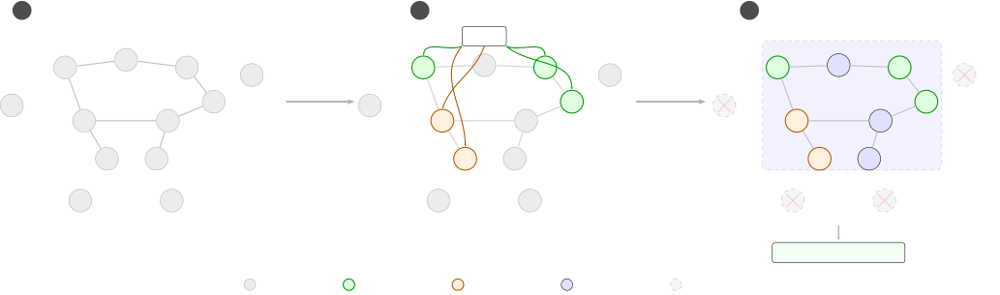
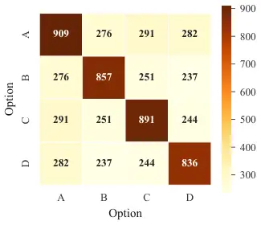
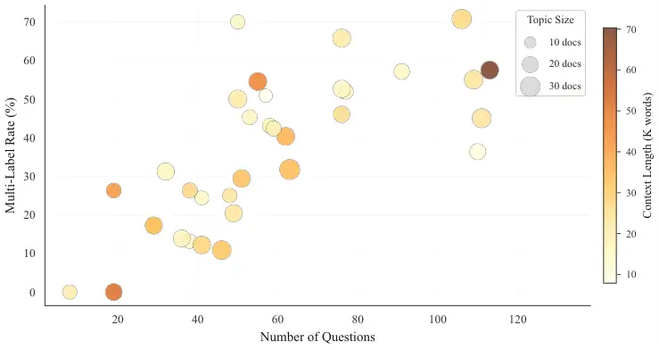
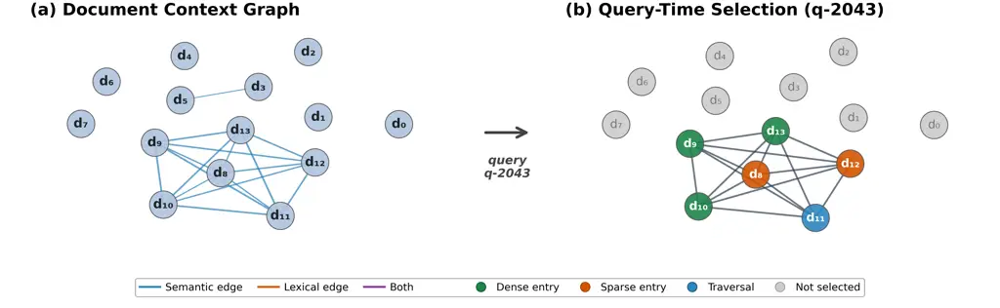
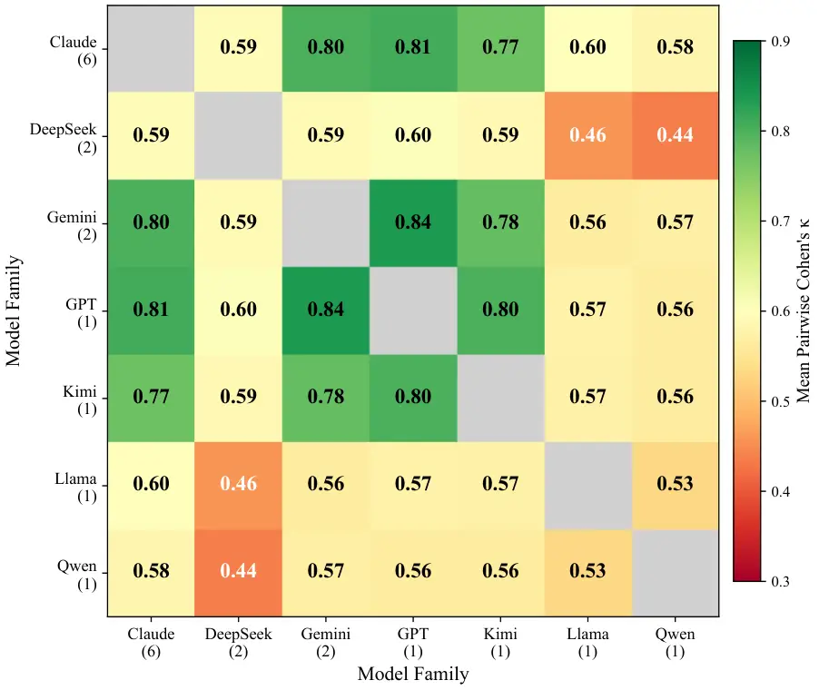

# AILS-NTUA at SemEval-2026 Task 12: Graph-Based Retrieval and Reflective Prompting for Abductive Event Reasoning

Nikolas Karafyllis    Maria Lymperaiou    Giorgos Filandrianos
Affiliation: Athanasios Voulodimos, Giorgos Stamou Affiliation: School
of Electrical and Computer Engineering, AILS Laboratory
Affiliation: National Technical University of Athens
Affiliation: [nickarafyllis@gmail.com](mailto:nickarafyllis@gmail.com),
{[marialymp](mailto:marialymp@ails.ece.ntua.gr),
[geofila](mailto:geofila@ails.ece.ntua.gr)}@ails.ece.ntua.gr,
Affiliation: [thanosv@mail.ntua.gr](mailto:thanosv@mail.ntua.gr),
[gstam@cs.ntua.gr](mailto:gstam@cs.ntua.gr)

###### Abstract

We present a winning three-stage system for SemEval 2026 Task 12:
Abductive Event Reasoning that combines graph-based retrieval,
LLM-driven abductive reasoning with prompt design optimized through
reflective prompt evolution, and post-hoc consistency enforcement; our
system ranks first on the evaluation-phase leaderboard with an accuracy
score of 0.95. Cross-model error analysis across 14 models (7 families)
reveals three shared inductive biases: causal chain incompleteness,
proximate cause preference, and salience bias, whose cross-family
convergence (51% cause-count reduction) indicates systematic rather than
model-specific failure modes in multi-label causal reasoning.

## 1 Introduction

In a rapidly evolving digital world, information travels at an
unprecedented scale, resulting in a constant flood of events. Such
dissemination of information does not occur in isolation; instead, it
triggers interconnected event chains in which each specific occurrence
can act as the root cause of subsequent events. Thus, understanding why
an event happens within context becomes critical, requiring the
discrimination of true cause-and-effect relationships from mere
correlations.

Large Language Models (LLMs) have demonstrated great potential in event
extraction and prediction Chang et al. (2025); Tanev et al. (2025);
Srivastava et al. (2025); Li et al. (2025). Still, this ability does not
account for abductive reasoning, which concerns inferring the most
plausible cause from incomplete information. Naturally, abduction
explains why an event most possibly happened within a causal chain,
offering valuable insights and interpretations for chains of events.

A large body of research focuses on LLM reasoning Giadikiaroglou et al.
(2024); Ke et al. (2025); Liu et al. (2025), yet abductive reasoning
remains particularly challenging, since it engages parallel streams of
thinking and implicit causal attribution rather than applying
deterministic inference rules. For this reason, it serves as a stress
test for LLMs, exposing limitations that are less apparent in
hypothesis-free reasoning settings Xu et al. (2025); Floridi et al.
(2025); He and Chen (2025).

Motivated by the challenges entailed within real-world, uncertainty-rich
data setups, SemEval 2026 Task 12 Abductive Event Reasoning: Towards
Real-World Event Causal Inference for Large Language Models  Cao et al.
(2026) investigates LLMs’ abilities in event-level causal reasoning:
given an event and a set of retrieved documents, the LLM is tasked with
identifying the most direct and plausible cause and forming the best
explanation by harnessing prior knowledge, context understanding and
hypothesis justification. In our work, we address this task through a
three-stage pipeline that ranks first on the evaluation leaderboard
scoring at 0.95/1.00. Overall, our contributions are:

- •
  We evaluate 18 model configurations across seven families,
  characterizing the performance landscape and persistent challenges of
  frontier LLMs on abductive event reasoning.
- •
  We perform a thorough error analysis across 14 models (7 families),
  identifying three shared inductive biases: causal chain
  incompleteness, proximate cause preference, and salience bias, that
  produce conservative cause selection as the dominant failure mode.

The code for our system is available on GitHub¹¹ 1
https://github.com/nickarafyllis/semeval-2026-task12.

## 2 Background

#### Task description

The task targets the selection of the most direct, plausible cause of a
real-world event, as evidenced via a single-step reasoning process based
on the given textual evidence. Each instance comprises an event, context
and four candidate explanation options, framing abductive reasoning
within a multiple-choice question-answering setup. The event field
contains a textual description of a real-world event; context refers to
a set of documents that may either be related to the event or act as
distractors; finally, one or more candidate explanations may be correct
given the input context, while an option stating that “None of the
causes is correct” is always included. An LLM is evaluated on its
ability to reason over the context for an event by selecting suitable
candidate explanations. A full match between predicted and ground truth
responses yields 1 point, a partial match earns 0.5 points, and a
wrong/invalid selection receives 0 points.

#### Related work

Abductive reasoning with LLMs has received some notable contributions in
recent years. First benchmarks, such as aNLI, established the field by
requiring the selection of the best explanatory bridge between
observations Bhagavatula et al. (2020). With the rise of LLMs,
generation of plausible hypotheses is feasible but often inconsistent,
especially under ambiguous evidence Pareschi (2023). Genuine abduction
may also be obscured by dataset artifacts, which can be compromised via
appropriate prompting Balepur et al. (2024). In parallel, abduction is
reframed as verifiable reasoning, promoting faithful hypothesis
evaluation and robustness to noise He and Lu (2024). Additional work
evaluates abduction in more formal logical settings (e.g., syllogistic
forms), revealing systematic biases and limitations that persist even in
advanced LLMs Abe et al. (2025). At the same time, works emphasizing
abduction as a stress test for LLMs shows that generating explanations
under uncertainty is particularly challenging compared to other forms of
reasoning Xu et al. (2025), while evaluating explanations within diverse
viewpoints provides insightful probing for LLM failures He et al.
(2025). In total, robust abductive inference persists as a key
challenge, despite promising evidence arising from prompting and task
design Dougrez-Lewis et al. (2025).


Figure 1: System pipeline. Stage 1 constructs a hybrid document graph
(Figure 2), selects dense/sparse entry points, retrieves the connected
component, and filters disconnected distractors. Stage 2 performs
structured analysis-before-answer prompting with self-consistency.
Stage 3 applies eight post-hoc consistency heuristics.

## 3 System Overview

Our proposed system follows a three-stage pipeline, illustrated in
Figure 1: 1) graph-based retrieval for distractor filtering, 2) an
LLM-based abductive reasoner with reflectively optimized prompt design,
3)  post-hoc consistency enforcement.

### 3.1 Retrieval: Distractor Filtering

#### Hybrid Document Graphs.

For each topic, we construct a document similarity graph $`G=(V,E)`$
(Figure 2) where each node $`v\in V`$ is a context document and edges
encode hybrid similarity combining dense and sparse (BM25+ with entity
boosting) signals Lewis et al. (2020); Luan et al. (2021):

```math
w(d_{i},d_{j})=\alpha\cdot\mathrm{sim_{sem}}(d_{i},d_{j})+(1-\alpha)\cdot\mathrm{sim_{lex}}(d_{i},d_{j})
```

$`w(d_{i},d_{j})`$ is the hybrid edge weight between documents
$`d_{i}`$, $`d_{j}`$, $`\mathrm{sim_{sem}}`$ denotes cosine similarity
over dense embeddings, $`\mathrm{sim_{lex}}`$ is BM25+ lexical
similarity with entity boosting, and $`\alpha{=}0.7`$ (Table 1).



Figure 2: Hybrid document-graph retrieval in three steps. Step 1: Build
a hybrid similarity graph ($`\alpha{=}0.7`$ dense $`+`$ $`0.3`$ sparse);
disconnected documents ($`d_{9}`$–$`d_{12}`$) are potential distractors.
Step 2: At query time, pick entry points from dense and sparse signals
(3$`+`$2, deduplicated). Step 3: Retrieve the full connected component
from the seeds, filter disconnected documents, and pass the selected
topic context to the LLM reasoner.

Unlike entity-centric GraphRAG Edge et al. (2024), which extracts named
entities as nodes, our graph preserves intact documents, retaining the
full narrative context needed for causal reasoning. At query time, we
identify _entry points_, e.g. the top-ranked documents by each signal
(3 dense, 2 sparse), deduplicated so that a document retrieved by both
signals counts once. From these seeds, we traverse the graph via
breadth-first search (BFS) over the full connected component, collecting
every reachable document. This prioritizes recall over precision: a
missing document can break a multi-hop causal chain, whereas extra
documents add manageable noise. The traversal enables multi-hop evidence
discovery, where indirectly connected documents may provide critical
causal evidence Wang et al. (2025).

| Component        | Description                                                          |
| ---------------- | -------------------------------------------------------------------- |
| Dense embeddings | Cohere Embed v4 (1024-dim)                                           |
| Sparse retrieval | BM25+ Robertson and Zaragoza (2009) with 3$`\times`$ entity boosting |
| Hybrid weighting | $`\alpha{=}0.7`$ dense $`+`$ $`0.3`$ sparse                          |
| Entry points     | 3 dense $`+`$ 2 sparse (deduplicated)                                |
| Traversal        | Full connected component                                             |

Table 1: Hybrid document graph retrieval configuration.

#### Topic-Wide Aggregation.

Since questions within the same topic retrieve heavily overlapping
document sets, we aggregate retrieved documents across all questions
within each topic into a single _topic-wide context_. The first question
per topic populates the cache, and subsequent questions reuse
it Anthropic (2024), yielding a 91% cache hit rate and 87% cost
reduction (Table 12). Retrieval selects 73% of available documents per
topic, excluding 27% as likely distractors (Table 13).

### 3.2 Inference

#### Structured Prompting.

We use an XML-structured prompt with an analysis-before-answer format
that forces the LLM to verbalize its reasoning before committing to a
final answer. This acts as a structured scratchpad Nye et al. (2021),
eliciting chain-of-thought (CoT) reasoning Wei et al. (2022) within a
constrained output format: an \<analysis\> block containing per-option
reasoning followed by an \<answer\> block restricted to valid option
letters. The prompt specifies explicit reasoning criteria (requiring
direct textual support and logical sufficiency), selection rules
(supporting multi-label answers), and quality checks (enforcing
disciplined evaluation per candidate).

#### Prompt Design.

As prompt optimizer, we implement GEPA Agrawal et al. (2026) via
DSPy Khattab et al. (2024) to explore the space of effective prompt
formulations through automatic reflective prompt evolution. Rather than
deploying GEPA-optimized prompts directly as black-box solutions, which
raises concerns about data contamination and overfitting to the
optimization set, we use the evolved prompts as a source of insight. The
structural heuristics surfaced by GEPA (e.g., single-step causal
reasoning, explicit causal language prioritization, duplicate option
handling) inform the final prompt design: duplicate option consistency
and “None” mutual exclusivity are implemented as post-hoc verification
heuristics (Section 3.3) rather than prompt instructions (Appendix C.2).

#### Self-Consistency.

We sample $`k{=}3`$ responses at temperature $`\tau{=}1.0`$ and
aggregate via per-option majority voting Wang et al. (2023); Taubenfeld
et al. (2025), with an inclusion threshold of 0.5. For questions
containing “None of the others”, we apply conflict resolution where the
higher-voted category prevails. We compare majority voting against
union, intersection, and confidence-weighted aggregation (App. D.5).

### 3.3 Post-Hoc Consistency Enforcement

We apply eight de-hallucination and consistency-aware heuristics that
enforce logical invariants the LLM may violate (e.g. selecting mutually
exclusive options simultaneously or assigning different truth values to
identical candidates) iteratively until convergence (typically
2 iterations). Details and per-heuristic impact are reported in
Appendix A.9.

## 4 Experimental Setup

We evaluate our system on the SemEval 2026 Task 12 development set,
comparing 18 model configurations under zero-shot structured prompting
with optional inference enhancements.

#### Dataset

The development set comprises 400 questions across 36 topics (775
documents), where zero to four out of the four candidate explanations
may be correct. Notably, 43.6% of questions have multiple correct
answers. Questions are grouped by topic, with sibling questions sharing
document context, a property exploited for caching and consistency
enforcement (Sections 3.1, 3.3; App. A).

#### Evaluation Metric

We use the task’s multi-label classification metric with partial credit.
The final score is computed as the unweighted arithmetic mean across all
questions: a model predicts a subset
$`\hat{y}\subset\{\text{A},\text{B},\text{C},\text{D}\}`$ per question,
compared against the gold label set $`y`$ via set-based evaluation:

- •
  Exact match ($`\hat{y}=y`$): score $`=1.0`$
- •
  Partial match ($`\hat{y}\subset y`$, $`\hat{y}\neq\emptyset`$): score
  $`=0.5`$
- •
  All other cases: score $`=0.0`$

Partial credit rewards models that correctly identify at least one valid
cause without requiring full recall, thereby providing a finer-grained
evaluation signal.

#### Models

We evaluate models accessed through AWS Bedrock, Google’s Gemini API,
and the OpenAI API. Table 2 summarizes the evaluated configurations.
Standard LLMs use default decoding, while reasoning LLMs employ extended
thinking (Claude’s extended_thinking, Gemini’s high thinking level,
OpenAI’s xhigh reasoning effort, and DeepSeek R1’s native CoT). All
models employ zero-shot structured prompting (Section 3.2), with
self-consistency ($`k{=}3`$, $`\tau{=}1.0`$) selectively applied due to
cost-related concerns.

| Family   | Standard              | Reasoning           |
| -------- | --------------------- | ------------------- |
| Claude   | Haiku 4.5, Sonnet 4,  | Sonnet 4 Thinking,  |
|          | Sonnet 4.5, Opus 4.0, | Sonnet 4.5 Thinking |
|          | Opus 4.5              |                     |
| Gemini   | —                     | Flash 3 Preview     |
| OpenAI   | —                     | GPT-5.2 (xhigh)     |
| DeepSeek | V3.1                  | V3.1 Think, R1      |
| Llama    | 3.3-70B               | —                   |
| Kimi     | —                     | K2 Think            |
| Qwen     | 3-32B                 | —                   |

Table 2: Model configurations evaluated. _Reasoning_ models use extended
thinking or chain-of-thought.

## 5 Results and Analysis

Table 3 reports zero-shot dev performance across 15 LLMs (scores ranging
between 0.611-0.828), highlighting the gap between open-weight and
frontier models. Extended thinking consistently helps: Sonnet 4.5
Thinking (0.828) surpasses Sonnet 4.5 by 3.8 pp. GPT-5.2 (0.810) and
Gemini 3 Flash (0.804) are competitive, while DeepSeek models
underperform relative to their scale and Qwen3-32B (0.611) confirms the
mid-size open-weight capacity gap.

[TABLE]

Table 3: Zero-shot baseline results (dev set). Bold marks the best score
within each group under the partial-credit metric (Section 4).

Graph-based retrieval (Section 3.1) provides marginal accuracy gains for
frontier LLMs but yields a $`+`$9 pp improvement for Haiku 3.5
(Table 13), consistent with findings that retrieval disproportionately
benefits smaller models Xu et al. (2024), while reducing cost by 87% via
topic-wide caching, mitigating accuracy degradation Liu et al. (2024);
Du et al. (2025) and inference cost Li et al. (2024) of long-context
processing. Self-consistency ($`k{=}3`$, $`\tau{=}1.0`$) yields modest
gains (e.g., $`+`$1.6 pp for Sonnet 4.5); majority voting across three
systems reaches 0.811 (Table 17, App. D.5). Post-hoc heuristics
(Section 3.3) produces the single largest gain: Sonnet 4.5 Thinking
improves from 0.828 to 0.884 ($`+`$5.6 pp), with 85.4% of corrections
being genuine improvements. Cross-question checks contribute the largest
individual gains (details in App. A.9).

#### Test Set

Table 4 reports results on the held-out test set (612 questions, 18.3%
multi-answer). Post-hoc heuristics again yield the largest gains
($`+`$4.8 pp for Claude, $`+`$3.7 pp for GPT-5.2), consistent with the
dev-set pattern, while self-consistency alone has minimal impact: the
gain materializes only when combined with post-hoc heuristics (0.943,
$`+`$4.1 pp). The multi-model ensemble reaches 0.926 without heuristics
but falls short of the best individual model with heuristics (Claude
Sonnet 4.5 Thinking at 0.952). The higher test-set scores reflect the
lower multi-answer prevalence (18.3% vs. 47.5%), consistent with the
inherently greater difficulty of multi-answer questions.

[TABLE]

Table 4: Test set results. Post-hoc = deterministic consistency
enforcement via heuristics. SC = self-consistency with majority voting;
$`\theta`$ = inclusion threshold.

### 5.1 Error Analysis

LLMs exhibit systematic biases in causal inference, including the
_post-hoc_ fallacy Joshi et al. (2024) and degraded multi-hop
reasoning Chi et al. (2024); Yu et al. (2025). Cross-validation across
all 14 models (7 families) yields Fleiss’ $`\kappa=0.690`$ Fleiss (1971)
(_substantial_ agreement), with within-family agreement
($`\kappa=0.794`$) exceeding cross-family agreement ($`\kappa=0.661`$;
Figure 17). Only 3 questions are truly _unbreakable_ (all 14 models
score zero), but 42 receive no exact match from any model, 38 of which
are multi-answer under-selection failures (Figure 20). An oracle
selecting the best model per question achieves 0.895, indicating 6.7 pp
headroom from model complementarity (App. D.4).

#### Single vs. Multi-Answer Performance.

All models show lower multi-answer accuracy (Table 5), with gaps of
25-56 pp across 14 models. Total under-selections (1,389) vastly exceed
over-selections (52), confirming conservative cause selection as the
dominant bias (Figure 21).

| System                   | Single | Multi | $`\boldsymbol{\Delta}`$ |
| ------------------------ | ------ | ----- | ----------------------- |
| GPT-5.2                  | 91.0   | 52.6  | $`-`$38.4               |
| Claude Son. 4.5 Thinking | 88.6   | 60.5  | $`-`$28.1               |
| Gemini 3 Flash           | 85.2   | 63.7  | $`-`$21.5               |

Table 5: Exact-match accuracy (%) by answer cardinality across three
frontier systems. Multi-answer questions (190/400, 47.5%) are inherently
harder due to the combinatorial requirement.

#### Failure Taxonomy.

Of the 42 no-exact-match questions (3 truly unbreakable; Table 14,
App. D.1), models select on average 1.2 options when gold requires 2.4,
a 51% cause-count reduction, and in 83% of cases the consensus is a
_single option_ (App. D.3). Three shared inductive biases persist across
all seven model families: (1) *causal chain incompleteness* Chi et al.
(2024); Yu et al. (2025), the most prevalent pattern (18/42), where
models select one link of a multi-step causal chain and omit the rest;
(2) *proximate cause preference* Joshi et al. (2024) (11/42), which
favors the most recent antecedent over enabling conditions; and
(3) *salience bias* (9/42), where models select dramatic, newsworthy
causes over subtler contributing factors. These biases are correlated
across families (error overlap ratio $`2.0\times`$ above independence),
suggesting shared pretraining priors rather than prompt-specific
artifacts Chi et al. (2024).

## 6 Conclusion

Our proposed three-stage system (graph-based retrieval, GEPA-informed
prompt design, deterministic consistency enforcement via heuristics)
ranks first on the evaluation-phase leaderboard (0.95), with post-hoc
heuristics providing the largest dev-set gain ($`+`$5.6 pp). Our error
analysis across 14 models (7 families) identifies three shared inductive
biases: causal chain incompleteness (18/42), proximate cause preference
(11/42), and salience bias (9/42), which together produce a single-cause
default (51% cause-count reduction, 83% of failures converging on one
option). With an oracle upper bound of 0.895 (best of 14 models per
question), no single family dominates across all question types,
suggesting that targeted ensemble or multi-agent architectures could
close much of the remaining gap.

## Limitations

#### Task-Specific Assumptions.

The post-hoc consistency enforcement via heuristics step exploits
task-specific structural properties (topic groupings, duplicate options,
“None” exclusivity) and would require adaptation for other benchmarks.

#### Model Coverage.

Our evaluation focuses on frontier-scale to mid-size (32B) models;
smaller open-weight models remain unexplored.

## References

- Abe et al. (2025) H. Abe, R. Ando, T. Morishita, K. Ozeki, K.
  Mineshima, and M. Okada Abductive reasoning with syllogistic forms in
  large language models. In Human and Artificial Rationalities. Advances
  in Cognition, Computation, and Consciousness: Third International
  Conference, HAR 2024, Paris, France, September 17–20, 2024,
  Proceedings, Berlin, Heidelberg, pp. 3–17. External Links: ISBN
  978-3-031-84594-9,
  [Link](https://doi.org/10.1007/978-3-031-84595-6_1),
  [Document](https://dx.doi.org/10.1007/978-3-031-84595-6%5F1) Cited by:
  §2.
- Agrawal et al. (2026) L. A. Agrawal, S. Tan, D. Soylu, N. Ziems, R.
  Khare, K. Opsahl-Ong, A. Singhvi, H. Shandilya, M. J. Ryan, M.
  Jiang, C. Potts, K. Sen, A. G. Dimakis, I. Stoica, D. Klein, M.
  Zaharia, and O. Khattab GEPA: reflective prompt evolution can
  outperform reinforcement learning. In Proceedings of the Fourteenth
  International Conference on Learning Representations (ICLR), Note:
  Oral presentation External Links:
  [Link](https://arxiv.org/abs/2507.19457) Cited by: §C.2, §3.2.
- Anthropic (2024) Anthropic Introducing contextual retrieval. Note:
  [https://www.anthropic.com/news/contextual-retrieval](https://www.anthropic.com/news/contextual-retrieval)Accessed:
  2026-02-06 External Links:
  [Link](https://www.anthropic.com/news/contextual-retrieval) Cited by:
  §3.1.
- Balepur et al. (2024) N. Balepur, A. Ravichander, and R. Rudinger
  Artifacts or abduction: how do LLMs answer multiple-choice questions
  without the question?. In Proceedings of the 62nd Annual Meeting of
  the Association for Computational Linguistics (Volume 1: Long
  Papers), L. Ku, A. Martins, and V. Srikumar (Eds.), Bangkok, Thailand,
  pp. 10308–10330. External Links:
  [Link](https://aclanthology.org/2024.acl-long.555/),
  [Document](https://dx.doi.org/10.18653/v1/2024.acl-long.555) Cited by:
  §2.
- Bhagavatula et al. (2020) C. Bhagavatula, R. L. Bras, C. Malaviya, K.
  Sakaguchi, A. Holtzman, H. Rashkin, D. Downey, W. Yih, and Y. Choi
  Abductive commonsense reasoning. In International Conference on
  Learning Representations, External Links:
  [Link](https://openreview.net/forum?id=Byg1v1HKDB) Cited by: §2.
- Cao et al. (2026) P. Cao, Y. Chen, M. Yang, C. Zhang, M. Liu, K. Liu,
  and J. Zhao SemEval-2026 task 12: abductive event reasoning: towards
  real-world event causal inference for large language models. In
  Proceedings of the 20th International Workshop on Semantic Evaluation
  (SemEval-2026), Note: Forthcoming External Links:
  [Link](https://semeval.github.io/SemEval2026/tasks.html) Cited by: §1.
- Chang et al. (2025) H. Chang, C. Ye, Z. Tao, J. Wu, Z. Yang, Y. Ma, X.
  Huang, and T. Chua A comprehensive evaluation of large language models
  on temporal event forecasting. External Links: 2407.11638,
  [Link](https://arxiv.org/abs/2407.11638) Cited by: §1.
- Chi et al. (2024) H. Chi, H. Li, W. Yang, F. Liu, L. Lan, X. Ren, T.
  Liu, and B. Han Unveiling causal reasoning in large language models:
  reality or mirage?. In Advances in Neural Information Processing
  Systems, Vol. 37. External Links:
  [Link](https://proceedings.neurips.cc/paper_files/paper/2024/file/af2bb2b2280d36f8842e440b4e275152-Paper-Conference.pdf)
  Cited by: §D.3, §5.1, §5.1.
- Dougrez-Lewis et al. (2025) J. Dougrez-Lewis, M. E. Akhter, F.
  Ruggeri, S. Löbbers, Y. He, and M. Liakata Assessing the reasoning
  capabilities of LLMs in the context of evidence-based claim
  verification. In Findings of the Association for Computational
  Linguistics: ACL 2025, W. Che, J. Nabende, E. Shutova, and M. T.
  Pilehvar (Eds.), Vienna, Austria, pp. 20604–20628. External Links:
  [Link](https://aclanthology.org/2025.findings-acl.1059/),
  [Document](https://dx.doi.org/10.18653/v1/2025.findings-acl.1059),
  ISBN 979-8-89176-256-5 Cited by: §2.
- Du et al. (2025) Y. Du, M. Tian, S. Ronanki, S. Rongali, S.
  Bodapati, A. G. Galstyan, A. Wells, R. Schwartz, E. A. Huerta, and H.
  Peng Context length alone hurts LLM performance despite perfect
  retrieval. In Findings of the Association for Computational
  Linguistics: EMNLP 2025, External Links:
  [Link](https://aclanthology.org/2025.findings-emnlp.1264/) Cited by:
  §5.
- Edge et al. (2024) D. Edge, H. Trinh, N. Cheng, J. Bradley, A.
  Chao, A. Mody, S. Truitt, D. Metropolitansky, R. O. Ness, and J.
  Larson From local to global: a graph RAG approach to query-focused
  summarization. arXiv preprint arXiv:2404.16130. External Links:
  [Link](https://arxiv.org/abs/2404.16130) Cited by: §3.1.
- Fleiss (1971) J. L. Fleiss Measuring nominal scale agreement among
  many raters. Psychological Bulletin 76 (5), pp. 378–382. External
  Links: [Document](https://dx.doi.org/10.1037/h0031619),
  [Link](https://doi.org/10.1037/h0031619) Cited by: Table 16, §5.1.
- Floridi et al. (2025) L. Floridi, J. Morley, C. Novelli, and D. Watson
  What kind of reasoning (if any) is an llm actually doing? on the
  stochastic nature and abductive appearance of large language models.
  External Links: 2512.10080, [Link](https://arxiv.org/abs/2512.10080)
  Cited by: §1.
- Giadikiaroglou et al. (2024) P. Giadikiaroglou, M. Lymperaiou, G.
  Filandrianos, and G. Stamou Puzzle solving using reasoning of large
  language models: a survey. In Proceedings of the 2024 Conference on
  Empirical Methods in Natural Language Processing, Y. Al-Onaizan, M.
  Bansal, and Y. Chen (Eds.), Miami, Florida, USA, pp. 11574–11591.
  External Links: [Link](https://aclanthology.org/2024.emnlp-main.646/),
  [Document](https://dx.doi.org/10.18653/v1/2024.emnlp-main.646) Cited
  by: §1.
- He and Lu (2024) J. He and F. Lu CauseJudger: identifying the cause
  with llms for abductive logical reasoning. External Links: 2409.05559,
  [Link](https://arxiv.org/abs/2409.05559) Cited by: §2.
- He and Chen (2025) K. He and Z. Chen From reasoning to learning: a
  survey on hypothesis discovery and rule learning with large language
  models. Transactions on Machine Learning Research. Note: Survey
  Certification External Links: ISSN 2835-8856,
  [Link](https://openreview.net/forum?id=d7W38UzUg0) Cited by: §1.
- He et al. (2025) K. He, P. Wu, M. Zhang, K. Wan, W. Zhao, X. Du,
  and Z. Chen GEAR: a general evaluation framework for abductive
  reasoning. External Links: 2509.24096,
  [Link](https://arxiv.org/abs/2509.24096) Cited by: §2.
- Joshi et al. (2024) N. Joshi, A. Saparov, Y. Wang, and H. He LLMs are
  prone to fallacies in causal inference. In Proceedings of the 2024
  Conference on Empirical Methods in Natural Language Processing,
  pp. 10553–10569. External Links:
  [Document](https://dx.doi.org/10.18653/v1/2024.emnlp-main.590),
  [Link](https://aclanthology.org/2024.emnlp-main.590/) Cited by: §D.1,
  §D.3, Table 14, §5.1, §5.1.
- Ke et al. (2025) Z. Ke, F. Jiao, Y. Ming, X. Nguyen, A. Xu, D. X.
  Long, M. Li, C. Qin, P. Wang, silvio savarese, C. Xiong, and S. Joty A
  survey of frontiers in LLM reasoning: inference scaling, learning to
  reason, and agentic systems. Transactions on Machine Learning
  Research. Note: Survey Certification External Links: ISSN 2835-8856,
  [Link](https://openreview.net/forum?id=SlsZZ25InC) Cited by: §1.
- Khattab et al. (2024) O. Khattab, A. Singhvi, P. Maheshwari, Z.
  Zhang, K. Santhanam, S. Vardhamanan, S. Haq, A. Sharma, T. T.
  Joshi, H. Moazam, H. Miller, M. Zaharia, and C. Potts DSPy: compiling
  declarative language model calls into state-of-the-art pipelines. In
  Proceedings of the Twelfth International Conference on Learning
  Representations (ICLR), External Links:
  [Link](https://arxiv.org/abs/2310.03714) Cited by: §C.2, §3.2.
- Koo et al. (2024) R. Koo, M. Lee, V. Raheja, J. I. Park, Z. M. Kim,
  and D. Kang Benchmarking cognitive biases in large language models as
  evaluators. In Findings of the Association for Computational
  Linguistics: ACL 2024, pp. 517–545. External Links:
  [Document](https://dx.doi.org/10.18653/v1/2024.findings-acl.29),
  [Link](https://aclanthology.org/2024.findings-acl.29/) Cited by: §D.3.
- Krippendorff (2011) K. Krippendorff Computing Krippendorff’s
  alpha-reliability. Communication Methods and Measures 5 (1), pp. 1–12.
  External Links:
  [Document](https://dx.doi.org/10.1080/19312458.2011.568376),
  [Link](https://doi.org/10.1080/19312458.2011.568376) Cited by: Table 16.
- Lewis et al. (2020) P. Lewis, E. Perez, A. Piktus, F. Petroni, V.
  Karpukhin, N. Goyal, H. Küttler, M. Lewis, W. Yih, T. Rocktäschel, S.
  Riedel, and D. Kiela Retrieval-augmented generation for
  knowledge-intensive NLP tasks. In Advances in Neural Information
  Processing Systems 33 (NeurIPS), External Links:
  [Link](https://proceedings.neurips.cc/paper/2020/hash/6b493230205f780e1bc26945df7481e5-Abstract.html)
  Cited by: §3.1.
- Li et al. (2025) B. Li, X. Han, J. Liu, Y. Ding, L. Jing, Z. Zhang, J.
  Li, X. Du, F. Li, M. Zhang, M. Zhang, A. Sun, P. S. Yu, and H. Fei
  Event extraction in large language model. External Links: 2512.19537,
  [Link](https://arxiv.org/abs/2512.19537) Cited by: §1.
- Li et al. (2024) Z. Li, C. Shi, X. Gao, S. Chen, Y. Zhu, Z. Li, Y.
  Shen, and X. Yan Retrieval augmented generation or long-context LLMs?
  a comprehensive study and hybrid approach. In Proceedings of the 2024
  Conference on Empirical Methods in Natural Language Processing,
  External Links: [Link](https://aclanthology.org/2024.emnlp-main.184/)
  Cited by: §5.
- Liu et al. (2025) H. Liu, Z. Fu, M. Ding, R. Ning, C. Zhang, X. Liu,
  and Y. Zhang Logical reasoning in large language models: a survey.
  External Links: 2502.09100, [Link](https://arxiv.org/abs/2502.09100)
  Cited by: §1.
- Liu et al. (2024) N. F. Liu, K. Lin, J. Hewitt, A. Paranjape, M.
  Bevilacqua, F. Petroni, and P. Liang Lost in the middle: how language
  models use long contexts. Transactions of the Association for
  Computational Linguistics 12, pp. 157–173. External Links:
  [Document](https://dx.doi.org/10.1162/tacl%5Fa%5F00638),
  [Link](https://aclanthology.org/2024.tacl-1.9/) Cited by: §5.
- Luan et al. (2021) Y. Luan, J. Eisenstein, K. Toutanova, and M.
  Collins Sparse, dense, and attentional representations for text
  retrieval. Transactions of the Association for Computational
  Linguistics 9, pp. 329–345. External Links:
  [Document](https://dx.doi.org/10.1162/tacl%5Fa%5F00369),
  [Link](https://aclanthology.org/2021.tacl-1.20/) Cited by: §3.1.
- Nye et al. (2021) M. Nye, A. J. Andreassen, G. Gur-Ari, H.
  Michalewski, J. Austin, D. Bieber, D. Dohan, A. Lewkowycz, M.
  Bosma, D. Luan, C. Sutton, and A. Odena Show your work: scratchpads
  for intermediate computation with language models. arXiv preprint
  arXiv:2112.00114. External Links:
  [Link](https://arxiv.org/abs/2112.00114) Cited by: §3.2.
- Pareschi (2023) R. Pareschi Abductive reasoning with the gpt-4
  language model: case studies from criminal investigation, medical
  practice, scientific research. External Links: 2307.10250,
  [Link](https://arxiv.org/abs/2307.10250) Cited by: §2.
- Robertson and Zaragoza (2009) S. Robertson and H. Zaragoza The
  probabilistic relevance framework: BM25 and beyond. Foundations and
  Trends® in Information Retrieval 3 (4), pp. 333–389. External Links:
  [Document](https://dx.doi.org/10.1561/1500000019),
  [Link](https://dl.acm.org/doi/10.1561/1500000019) Cited by: Table 1.
- Srivastava et al. (2025) S. Srivastava, S. Pati, and Z. Yao
  Instruction-tuning LLMs for event extraction with annotation
  guidelines. In Findings of the Association for Computational
  Linguistics: ACL 2025, W. Che, J. Nabende, E. Shutova, and M. T.
  Pilehvar (Eds.), Vienna, Austria, pp. 13055–13071. External Links:
  [Link](https://aclanthology.org/2025.findings-acl.677/),
  [Document](https://dx.doi.org/10.18653/v1/2025.findings-acl.677), ISBN
  979-8-89176-256-5 Cited by: §1.
- Tanev et al. (2025) H. Tanev, N. Stefanovitch, T. Harmatha, and D. F.
  Sousa Exploring the performance of large language models for event
  detection and extraction in the health domain. In Proceedings of the
  15th International Conference on Recent Advances in Natural Language
  Processing - Natural Language Processing in the Generative AI Era, G.
  Angelova, M. Kunilovskaya, M. Escribe, and R. Mitkov (Eds.), Varna,
  Bulgaria, pp. 1237–1247. External Links:
  [Link](https://aclanthology.org/2025.ranlp-1.143/) Cited by: §1.
- Taubenfeld et al. (2025) A. Taubenfeld, T. Sheffer, E. Ofek, A.
  Feder, A. Goldstein, Z. Gekhman, and G. Yona Confidence improves
  self-consistency in LLMs. In Findings of the Association for
  Computational Linguistics: ACL 2025, External Links:
  [Link](https://aclanthology.org/2025.findings-acl.1030/),
  [Document](https://dx.doi.org/10.18653/v1/2025.findings-acl.1030)
  Cited by: §3.2.
- Wang et al. (2023) X. Wang, J. Wei, D. Schuurmans, Q. Le, E. Chi, S.
  Narang, A. Chowdhery, and D. Zhou Self-consistency improves chain of
  thought reasoning in language models. In Proceedings of the Eleventh
  International Conference on Learning Representations (ICLR), External
  Links: [Link](https://arxiv.org/abs/2203.11171) Cited by: §3.2.
- Wang et al. (2025) Y. Wang Q. Han et al. CausalRAG: integrating causal
  graphs into retrieval-augmented generation. In Findings of the
  Association for Computational Linguistics: ACL 2025, External Links:
  [Link](https://aclanthology.org/2025.findings-acl.1165/) Cited by:
  §3.1.
- Wei et al. (2022) J. Wei, X. Wang, D. Schuurmans, M. Bosma, B.
  Ichter, F. Xia, E. Chi, Q. V. Le, and D. Zhou Chain-of-thought
  prompting elicits reasoning in large language models. In Advances in
  Neural Information Processing Systems 35 (NeurIPS), External Links:
  [Link](https://arxiv.org/abs/2201.11903) Cited by: §3.2.
- Xu et al. (2025) F. Xu, Q. Lin, J. Han, T. Zhao, J. Liu, and E.
  Cambria Are large language models really good logical reasoners? a
  comprehensive evaluation and beyond. IEEE Trans. on Knowl. and Data
  Eng. 37 (4), pp. 1620–1634. External Links: ISSN 1041-4347,
  [Link](https://doi.org/10.1109/TKDE.2025.3536008),
  [Document](https://dx.doi.org/10.1109/TKDE.2025.3536008) Cited by: §1,
  §2.
- Xu et al. (2024) P. Xu, W. Ping, X. Wu, L. McAfee, C. Zhu, Z. Liu, S.
  Subramanian, E. Bakhturina, M. Shoeybi, and B. Catanzaro Retrieval
  meets long context large language models. In Proceedings of the
  Twelfth International Conference on Learning Representations (ICLR),
  External Links: [Link](https://arxiv.org/abs/2310.03025) Cited by:
  Table 13, §5.
- Yu et al. (2025) L. Yu, D. Chen, S. Xiong, Q. Wu, D. Li, Z. Chen, X.
  Pan, and L. Pan CausalEval: towards better causal reasoning in
  language models. In Proceedings of the 2025 Conference of the Nations
  of the Americas Chapter of the Association for Computational
  Linguistics: Human Language Technologies (Volume 1: Long Papers),
  pp. 12512–12540. External Links:
  [Document](https://dx.doi.org/10.18653/v1/2025.naacl-long.622),
  [Link](https://aclanthology.org/2025.naacl-long.622/) Cited by: §D.3,
  §5.1, §5.1.

## Appendix A Exploratory Data Analysis

### A.1 Dataset formulation

The questions file is represented in a jsonl object with the following
format for a specific instance:


Example. Input instance object.

Consequently, the context comprises records in the docs file, with a
jsonl instance as following:


Example. Background context for an event.

### A.2 Overview and Statistics

The dataset comprises 2,831 questions distributed across multiple splits
as shown in Table 6. Each question presents a target event and four
candidate explanations, where one or more may be correct causes.

|                  |       |      |      |
| ---------------- | ----- | ---- | ---- |
| Statistic        | Train | Dev  | Test |
| Questions        | 1,819 | 400  | 612  |
| Topics           | 36    | 36   | 24   |
| Documents        | 775   | 775  | 405  |
| Multi-answer (%) | 42.7  | 47.5 | –    |
| Avg. Q/Topic     | 50.5  | 11.1 | 25.5 |
| Avg. Doc Length  | 1188  | 1188 | 899  |

Table 6: Dataset statistics across splits. Multi-answer percentage
indicates questions with more than one correct answer.

[TABLE]

Table 7: Representative examples illustrating each answer cardinality.
Correct options are shown in bold. Option texts are abbreviated for
space.

Figure 3 illustrates the composition of each data split, showing the
distribution of questions, topics, and documents.

Table 7 shows representative examples from the dataset, one for each
answer cardinality. Each question presents a target event and four
candidate options; the task is to identify all plausible causes.

Figure 3: Dataset composition across splits.

### A.3 Answer Distribution

A distinctive characteristic of this dataset is its multi-label nature:
43.6% of questions have multiple correct answers. Table 8 details the
answer distribution.

| Category          | Count | Percentage |
| ----------------- | ----- | ---------- |
| Option A selected | 909   | 41.0%      |
| Option B selected | 857   | 38.6%      |
| Option C selected | 891   | 40.2%      |
| Option D selected | 836   | 37.7%      |
| Single answer     | 928   | 41.8%      |
| Two answers       | 660   | 29.7%      |
| Three answers     | 307   | 13.8%      |
| “None sufficient” | 324   | 14.6%      |

Table 8: Answer distribution analysis on the combined train and dev
sets.

The answer options (A, B, C, D) are roughly balanced, indicating no
positional bias in the correct answers. Figure 4 shows the frequency
distribution, and Figure 5 visualizes the answer cardinality breakdown.

Figure 4: Answer frequency by option.

Figure 5: Distribution of answer cardinality.

Figure 6 illustrates the most common multi-answer combinations,
revealing patterns in how answers co-occur.

Figure 6: Most common multi-answer combinations.

### A.4 Multi-Label Characteristics

The multi-label nature of the dataset poses unique challenges for
evaluation. We compute standard multi-label metrics, such as label
cardinality, density and multi-label rate (Table 9).

| Metric            | Value |
| ----------------- | ----- |
| Label cardinality | 1.574 |
| Label density     | 0.394 |
| Multi-label rate  | 43.6% |

Table 9: Multi-label characteristics of the dataset.

The label cardinality of 1.574 indicates that on average, each question
has approximately 1.5 correct answers. This is higher than typical
single-label QA datasets and reflects the inherent ambiguity in causal
reasoning, since multiple events can plausibly cause a given outcome.

Figure 7 shows the co-occurrence matrix of answer labels, revealing
which answer pairs frequently appear together in multi-label questions.
There are no significant discrepancies in label combination frequencies;
combinations containing label A are more prevalent, since A is the most
frequent answer option in the dataset (Figure 4).



Figure 7: Answer co-occurrence matrix.

### A.5 Topic Analysis

The dataset covers 36 real-world news topics spanning significant events
from 2016 to 2025, including political events (Brexit, US elections),
technological developments (ChatGPT, Huawei), and natural disasters
(California wildfires, earthquakes).

| ID  | Topic Description                              | Questions | Docs | Multi% | Context |
| --- | ---------------------------------------------- | --------- | ---- | ------ | ------- |
| 19  | Historic winter storm paralyzes Texas, causin… | 132       | 24   | 53.0   | 18,289  |
| 30  | Killing of George Floyd by police sparks Blac… | 113       | 25   | 57.5   | 70,271  |
| 23  | Japan begins discharging treated Fukushima nu… | 111       | 24   | 45.0   | 38,702  |
| 24  | Halloween crowd crush in Seoul’s Itaewon kill… | 111       | 28   | 45.0   | 14,375  |
| 22  | Iranian General Qasem Soleimani killed by US … | 110       | 20   | 36.4   | 12,160  |
| 32  | Taliban regains control of Afghanistan after … | 109       | 27   | 55.0   | 24,098  |
| 21  | Myanmar military stages coup, detains Aung Sa… | 106       | 29   | 70.8   | 27,639  |
| 3   | Trump supporters storm US Capitol              | 91        | 19   | 57.1   | 15,253  |
| 25  | Yellow Vest movement sparks widespread protes… | 77        | 18   | 51.9   | 17,805  |
| 13  | Facebook changes company name to Meta to focu… | 76        | 21   | 46.1   | 26,242  |

Table 10: Topic-level statistics (top 10 topics by question count). Full
table in supplementary materials.

Figure 8 provides a comprehensive view of topic characteristics, showing
the relationship between question count, complexity, and context size.



Figure 8: Topic characteristics: questions vs complexity (bubble size =
document count, color = context length).

### A.6 Document Corpus

Each topic is associated with a set of retrieved documents providing
context for causal reasoning. Figure 9 shows the distribution of
document lengths.

Figure 9: Distribution of document lengths (99th percentile shown).

Document lengths vary substantially, from 11 to 44,818 words (median:
719 words), reflecting the heterogeneous, long-tailed nature of
web-sourced content. This variation presents challenges for models with
limited context windows. Moreover, the long-tailed nature of this curve
may trigger length biases in LLMs, showing preference to the most
frequently occurring length over truly consulting the documents’
context.

### A.7 Linguistic Analysis

Target events are concise descriptions averaging 13.3 words (Figure 10).
Candidate options have similar lengths across positions (A through D),
ranging from 12.6 to 12.8 words on average. This uniform length
distribution in response candidates relieve possible length biases in
response selection.

Figure 10: Target event length distribution.

### A.8 Logical Consistency Properties

We identify two logical consistency properties inherent in the question
structure that LLMs may occasionally violate in their predictions.

#### Mutual Exclusivity of “None of the Others.”

14.6% of questions include a “None of the others are correct causes”
option. By definition, this option is mutually exclusive with all other
candidates and selecting it alongside other options constitutes a
logical contradiction. However, LLMs are not constrained to respect this
exclusivity, and may produce predictions that include “None” together
with other candidates.

#### Duplicate Option Consistency.

22.9% of questions contain duplicate answer options (identical text
appearing in two or more positions), an artifact of the dataset
construction process. Identical options necessarily share the same truth
value and thus selecting one but not the other would be logically
inconsistent. These cases expose instances where LLM predictions lack
internal consistency.

These observations motivate a set of post-hoc consistency heuristics
applied to verify or correct model predictions (Section A.9).

### A.9 Post-Hoc Prediction Refinement

We apply a set of deterministic post-hoc consistency heuristics that
enforce logical invariants the LLM may violate during inference. These
heuristics operate entirely on the model’s own predictions acting as
restorative heuristics, requiring no gold labels or additional LLM
calls.

The core heuristics address two types of inconsistency (Figure 11):
(1) mutual exclusivity violations, where “None of the others” is
predicted alongside other options (14.6% of questions); and
(2) duplicate inconsistencies, where identical options receive different
predictions (21.6% of questions). Additional heuristics enforce
structural invariants across sibling questions e.g. questions sharing
the same target event (63.3% of sibling groups contain 2+ questions;
Figure 12). Since identical option text must carry the same truth value
regardless of which question it appears in, and since “None of the
others” logically excludes its co-occurring candidates across all
siblings, these invariants propagate the logical consequences of the
model’s within-question judgments to related questions.

Table 11 describes all eight heuristics explored.

Figure 11: Frequency of structural patterns addressed by post-hoc
consistency via heuristics.

#### Iterative Application.

Heuristics from Table 11 are applied iteratively until convergence
(fixed-point), as resolving one inconsistency may reveal another. For
example, enforcing “None” exclusivity (R1) triggers cross-question
exclusion (R6), which may leave a single valid option, triggering
propagation (R7) or closure (R8). Similarly, enforcing duplicate
consistency (R2) triggers cross-sibling propagation (R4), which may
trigger R2 again in receiving questions. Convergence typically requires
2 iterations.

Figure 13 shows the cumulative score improvement as heuristics are added
incrementally. Cross-question consistency heuristics (R4, R6) provide
the largest gains, confirming that enforcing structural invariants
across siblings is the most effective signal. On the dev set, these
consistency heuristics improve accuracy from 0.8275 to 0.8838 (+6.8%),
with 85.4% of corrections being improvements and 14.6% neutral (changing
one incorrect prediction to another also incorrect response), with zero
cases where a correct prediction was made incorrect. The absence of
degradations indicates that the structural invariants enforced by these
heuristics (duplicate truth-value consistency and mutual exclusivity of
“None”) are well-aligned with the ground truth.

Figure 12: Sibling group size distribution. Groups of 2+ questions
enable cross-question consistency enforcement.

| Heuristic | Name                  | Scope   | Mechanism                                              | Changes |
| --------- | --------------------- | ------- | ------------------------------------------------------ | ------- |
| R1        | None Exclusivity      | Local   | Enforce mutual exclusivity of “None” option            | 6       |
| R2        | Duplicate Consistency | Local   | Ensure identical options receive same prediction       | 13      |
| R3        | Over-selection Guard  | Local   | Resolve over-selection when all four options predicted | 0       |
| R4        | Cross-Q Dup. Prop.    | Cross-Q | Propagate duplicate consistency to sibling questions   | 20      |
| R5        | Triple Exclusion      | Cross-Q | Exclude unique option from triple-duplicate siblings   | 1       |
| R6        | None Cross-Exclusion  | Cross-Q | Extend None exclusivity to sibling questions           | 4       |
| R7        | Single-Valid Prop.    | Cross-Q | Propagate last valid option to siblings                | 0       |
| R8        | Closure               | Local   | Select only remaining valid option                     | 1       |

Table 11: Post-hoc consistency heuristics applied iteratively until
convergence (fixed-point). Scope indicates whether the heuristic
operates within a single question (Local) or across sibling questions
sharing the same target event (Cross-Q). Changes reported on Claude
Sonnet 4.5 (thinking), dev set.

Figure 13: Cumulative accuracy improvement from post-hoc consistency
heuristics on Claude Sonnet 4.5 (thinking) predictions. Background
colors indicate heuristic scope: local (blue), cross-question (red), and
closure (green). Black line shows per-rule improvement.

## Appendix B Graph-Based Retrieval

This appendix formalizes the retrieval algorithm and provides
visualization examples of the hybrid document graph retrieval system
described in Section 3.1.

### B.1 Retrieval Algorithm

Algorithm 1 formalizes the hybrid graph retrieval procedure described in
Section 3.1.

1: Document graph $`G=(V,E)`$ with hybrid edge weights $`w`$; query
$`q`$; dense embedder $`\phi`$; BM25+ index $`\mathcal{B}`$; parameters
$`k_{\mathrm{sem}},k_{\mathrm{lex}},\tau`$

2: Selected document set $`\mathcal{S}\subseteq V`$

3: — Entry Point Identification —

4:
$`\mathcal{E}_{\mathrm{sem}}\leftarrow\text{top-}k_{\mathrm{sem}}\text{ docs by }\cos(\phi(q),\phi(d))`$

5:
$`\mathcal{E}_{\mathrm{lex}}\leftarrow\text{top-}k_{\mathrm{lex}}\text{ docs by }\mathcal{B}(q)`$

6:
$`\mathcal{E}\leftarrow\mathcal{E}_{\mathrm{sem}}\cup\mathcal{E}_{\mathrm{lex}}`$
$`\triangleright`$ Deduplicate

7: — Connected-Component Traversal (BFS) —

8: $`\mathcal{S}\leftarrow\mathcal{E}`$ $`\triangleright`$ Initialize
with entry points

9: $`\textsc{Queue}\leftarrow\mathcal{E}`$

10: while $`\textsc{Queue}\neq\emptyset`$ do

11:   $`d\leftarrow\textsc{Queue}.\text{dequeue}()`$

12:   for each neighbor $`d^{\prime}`$ s.t. $`(d,d^{\prime})\in E`$ and
$`w(d,d^{\prime})\geq\tau`$ do

13:    if $`d^{\prime}\notin\mathcal{S}`$ then

14:      $`\mathcal{S}\leftarrow\mathcal{S}\cup\{d^{\prime}\}`$

15:      $`\textsc{Queue}.\text{enqueue}(d^{\prime})`$

16:    end if

17:   end for

18: end while

19: — Distractor Filtering —

20: return $`\mathcal{S}`$ $`\triangleright`$ Disconnected docs excluded

Algorithm 1 Hybrid Graph Retrieval

The algorithm prioritizes recall over precision: a missing document can
break a multi-hop causal chain, whereas extra documents add manageable
noise. Entry points are identified via both semantic (dense embedding
cosine similarity) and lexical (BM25+ with $`3\times`$ entity boosting)
signals, then deduplicated. The BFS traversal expands from these seeds
through the full connected component, ensuring that indirectly related
documents providing bridging causal evidence are included.

### B.2 Document Graph and Query-Time Selection

For each topic, we construct a document similarity graph where nodes
represent documents and edges encode hybrid similarity scores (weighted
combination of dense and sparse signals). Figure 14 illustrates the
complete retrieval process for Topic 7 (“South Korean President Yoon
Suk-yeol faces impeachment crisis”), which contains 14 documents across
8 connected components.



Figure 14: Document graph and query-time selection for Topic 7 (South
Korean impeachment crisis). Node positions are identical across panels.
(a) Document context graph: 14 documents connected by hybrid similarity
edges (semantic-dominant, lexical-dominant, balanced). The densely
connected component captures the core impeachment narrative; peripheral
nodes represent tangentially related events. (b) Query-time selection
for q-2043 (target: “Yoon’s aides offered to resign”): 6/14 documents
(43%) selected via 3 dense entries, 2 sparse entries, and 1
traversal-discovered node. Grey nodes are filtered distractors.

Panel (a) shows the full graph structure with edges colored by their
dominant similarity signal. At query time (b), dense and sparse
retrieval identify entry points, then BFS traversal expands through the
connected component. The retrieval selects 6 of 14 documents (43%)
through three mechanisms: 3 semantic entry points (dense embedding
matches), 2 lexical entry points (BM25+ matches), and 1
traversal-discovered document (reached via graph edges). The remaining 8
documents are excluded as likely distractors: they discuss related but
distinct events that would add noise without providing direct causal
evidence. This example demonstrates how graph traversal enables
multi-hop evidence discovery: the traversal node (document 11) was not a
direct match for the query but is connected to selected documents via
the similarity graph, providing additional context that supports causal
reasoning. Across the full dev set, retrieval selects 73% of documents
on average, with a 91% topic-wide cache hit rate (Section 3.1).

| Metric                           | Value      |
| -------------------------------- | ---------- |
| Avg. documents per topic         | 21.5       |
| Avg. retrieved per question      | 16.6 (73%) |
| Avg. in topic-wide context       | 15.8 (73%) |
| Likely distractors excluded      | 27%        |
| Prompt cache hit rate            | 91%        |
| Overall inference cost reduction | 87%        |

Table 12: Retrieval statistics on the dev set (400 questions, 36 topics,
775 documents).

|                                                  |       |        |                         |
| ------------------------------------------------ | ----- | ------ | ----------------------- |
| Model                                            | Base  | +Retr. | $`\boldsymbol{\Delta}`$ |
| Haiku 3.5^(†)                                    | 0.440 | 0.530  | $`+`$0.090              |
| Sonnet 4                                         | 0.781 | 0.785  | $`+`$0.004              |
| Gemini 3 Flash                                   | 0.804 | 0.806  | $`+`$0.003              |
| GPT-5.2                                          | 0.810 | 0.818  | $`+`$0.008              |
| ^(†)100 questions; others on full dev set (400). |       |        |                         |

Table 13: Impact of distractor filtering on accuracy. Smaller models
benefit substantially from context reduction Xu et al. (2024).

## Appendix C Prompt Templates

In this section, we present the key prompt templates used in our system.
All prompts leverage XML-structured formatting to enforce disciplined
reasoning and constrained output (Section 3.2). Placeholder tokens in
brackets are filled at inference time.


Figure 15: Structured zero-shot prompt for direct inference
(Section 3.2).

### C.1 Direct Prompting

Our primary inference prompt employs a structured analysis-before-answer
format that requires the model to evaluate each candidate option
independently before committing to a final answer.

### C.2 GEPA Optimization Insights

We employ GEPA Agrawal et al. (2026) via DSPy Khattab et al. (2024) to
explore the prompt design space through reflective prompt optimization.
Rather than deploying the resulting prompts directly, we analyze the
heuristics GEPA automatically discovered to extract transferable design
principles for causal reasoning that informed our final
manually-designed prompt (Figure 15).

#### Optimization Setup.

The optimization signature provides the target event, context documents,
and candidate options as inputs, with reasoning and answer as outputs.
We intentionally kept the baseline signature minimal(a single docstring
with no engineered heuristics) to give GEPA maximum room for discovery.
The metric rewards exact match (1.0) and partial match (0.5), with
diagnostic feedback identifying failure types (under-selection,
over-selection, wrong answer) to guide reflective evolution.

#### Practical Observations.

Our experience with GEPA yields several practical observations for
prompt optimization in general. GEPA is most effective as a
bootstrapping tool: given no starting prompt, it can rapidly produce a
functional one, making it well-suited for agent retraining when adapting
to new data distributions or edge cases. However, it can only mildly
optimize an already well-functioning prompt, and optimization quality
depends heavily on the pre-optimization starting point. We also observe
that prompt evolution plateaus at the knowledge boundary of the
reflection LLM: the optimizer cannot discover reasoning strategies that
the reflection model itself does not possess. Data contamination, a
common concern with automatic prompt optimization, can be mitigated by
adjusting the reflection prompt to discourage memorization of training
examples. Finally, we note that incorporating an explicit
optimization-step directive within the reflection prompt (e.g.,
instructing the reflector to propose targeted modifications rather than
wholesale rewrites) improves stability and convergence across runs.

#### Discovered Heuristics.

The best evolved prompt independently surfaced five causal reasoning
heuristics without any manual engineering:

1.  1.  Path length prioritization: Strong causes are 1-2 steps from the
        target; distal causes are treated as background context unless they
        meet an exception criterion.
2.  2.  Confidence thresholds: High-confidence causal links are “almost
        always” strong; moderate links require supporting causal language;
        weak links are generally rejected.
3.  3.  Directionality and sibling detection: Effects of the target are
        distinguished from causes; shared-root events are classified as side
        effects rather than causes.
4.  4.  Evidence-cause distinction: Media reports about an event are
        separated from the event itself as causal triggers.
5.  5.  Duplicate handling: Identical options describing the same event must
        both be selected.

These heuristics are notable because they emerged purely from
optimization pressure on answer correctness, without any explicit
instruction about causal theory.

#### Dataset Bias Discovery.

Beyond causal reasoning heuristics, GEPA independently surfaced two
exploitable artifacts of the dataset construction process. First, 22.9%
of questions contain duplicate options (identical text in different
positions) and GEPA learned that selecting one without the other always
incurs a scoring penalty, converging on the invariant that identical
options must share truth values. Second, 14.6% of questions include a
“None of the others are correct causes” option, and GEPA discovered that
co-selecting it with other candidates always produces incorrect answers,
effectively learning mutual exclusivity without being told. These
patterns are significant because they emerged purely from optimization
pressure: GEPA identified them as deterministic “free score” invariants
before any manual dataset analysis. These GEPA-surfaced invariants
directly motivated the post-hoc consistency heuristics described in
Section A.9, specifically R1 (None Exclusivity) and R2 (Duplicate
Consistency), which together account for 19 corrections and seed the
cross-question propagation chain that yields the full $`+`$5.6 pp
improvement.

#### Error-Informed Refinement.

After analyzing the hardest questions (Section D.1), we created a
second-generation prompt that directly addresses the identified failure
patterns:

- •
  Proximal-cause bias: Replaced the strict proximity rule with a
  counterfactual necessity test(“Could the target have occurred without
  this event?”) allowing enabling conditions at any distance to qualify
  as valid causes.
- •
  Single-cause default (under-selection): Added explicit multi-answer
  guidance requiring re-evaluation of each remaining option after
  identifying the strongest cause.
- •
  Causal chain length disagreement: Distinguished “proximate triggers”
  from “enabling conditions,” both treated as valid cause types.
- •
  Over-selection penalty: Added a precision warning noting that
  incorrect extra selections result in zero score.

#### From GEPA to Final Prompt.

We deliberately curated which GEPA discoveries to incorporate into the
final prompt (Figure 15). Structural heuristics that generalize across
domains were retained: single-step reasoning preference (reasoning
criterion 5), explicit causal language prioritization (criterion 6),
duplicate option handling (selection rule 4) and the
analysis-before-answer format that GEPA consistently preserved across
all evolved prompts. Conversely, domain-specific patterns that GEPA
discovered, such as “Request $`\to`$ Approval” and “Crisis $`\to`$
Response” causal templates, were deliberately excluded to avoid
overfitting to the optimization set’s topical distribution. Numeric
confidence thresholds were abstracted into the general logical
sufficiency test (criterion 3). The dataset-specific invariants
(duplicate consistency, “None” exclusivity) were implemented as post-hoc
heuristics rather than prompt instructions, since they are deterministic
properties better enforced programmatically than via natural-language
instruction.

## Appendix D Error Analysis Details

This appendix provides extended analysis supporting the findings in
Section 5.1. We analyze inter-annotator agreement across 14 models from
7 families, all evaluated on the full dev set (400 questions). Table 16
summarizes global agreement metrics and Figure 17 shows family-level
mean pairwise Cohen’s $`\kappa`$, revealing that frontier families
(Claude, Gemini, GPT) form a high-agreement cluster ($`\kappa>0.78`$)
while mid-range models (Llama, Qwen) agree less with frontier systems
($`\kappa\approx 0.55`$).

|                                                                   |               |       |           |       |        |                           |
| ----------------------------------------------------------------- | ------------- | ----- | --------- | ----- | ------ | ------------------------- |
| QID                                                               | Topic         | Gold  | Consensus | Fail  | Multi? | Pattern                   |
| Truly unbreakable: all 14 models score zero (all 7 families fail) |               |       |           |       |        |                           |
| q-2261                                                            | Afghanistan   | A,C   | D         | 14/14 | Yes    | Under-sel. + proximal     |
| q-2356                                                            | DeepSeek      | D     | C         | 14/14 | No     | Consensus wrong (7/14 C)  |
| q-2411                                                            | DOGE/Musk     | A     | D         | 14/14 | No     | Consensus wrong (13/14 D) |
| Near-unbreakable: $`\geq`$12 models score zero                    |               |       |           |       |        |                           |
| q-2341                                                            | Afghanistan   | B,C,D | A         | 13/14 | Yes    | Under-sel. + wrong opt.   |
| q-2028                                                            | Credit Suisse | A     | D         | 13/14 | No     | Distal-cause preference   |
| q-2182                                                            | Afghanistan   | C     | D         | 12/14 | No     | Proximal-cause bias       |
| q-2225                                                            | Wagner        | C     | A         | 12/14 | No     | Proximal-cause bias       |
| q-2149                                                            | Amazon fires  | C     | B         | 12/14 | No     | Annot. ambiguity          |
| q-2036                                                            | Myanmar       | B     | A         | 12/14 | No     | Distal-cause preference   |

Table 14: Hardest questions across 14 models (7 families). Top: 3
questions where all models score zero. Bottom: 6 near-unbreakable
questions where $`\geq`$12 models fail. _Fail_ = models scoring zero.
_Under-sel._ = multi-answer under-selection; _Consensus wrong_ =
majority agrees on incorrect option; _Proximal-cause bias_ = models
prefer temporally nearest cause Joshi et al. (2024).

### D.1 Failure Taxonomy

Table 14 lists the 3 truly unbreakable questions (all 14 models score
zero) and 6 near-unbreakable questions ($`\geq`$12 models score zero).
Four distinct failure patterns emerge:

#### Proximal-Cause Bias.

Question q-2182 asks for the cause of “Taliban fighters spread across
Kabul streets.” The gold answer is C (“US troops began withdrawing from
Afghanistan in early July”), but 12/14 models select D (“Afghan
President Ashraf Ghani fled the country”). Models apply a temporal
proximity heuristic Joshi et al. (2024), preferring the most recent
antecedent, over enabling conditions.

#### Under-Selection + Wrong Option.

Question q-2341 (gold: B,C,D) sees 11/14 models selecting only A, the
sole _incorrect_ option, indicating that models not only under-select
but converge on the wrong cause entirely when the gold answer is a large
multi-answer set.

#### Annotation Ambiguity.

Question q-2149 (Amazon fires, gold: C, 12/14 fail) involves cases where
the context supports multiple reasonable interpretations; model
disagreement may reflect genuine annotation uncertainty rather than
reasoning failure.

### D.2 Topic-Level Difficulty

Table 15 reports the hardest topics by exact-match accuracy, alongside
structural features that predict difficulty. Figure 16 shows per-topic
Fleiss’ $`\kappa`$ across all 14 models, revealing substantial
cross-topic variance (range: 0.46-0.90).

| ID  | Domain          | N   | Multi% | $`\boldsymbol{\kappa_{14}}`$ |
| --- | --------------- | --- | ------ | ---------------------------- |
| 26  | California Fire | 3   | —      | 0.456                        |
| 33  | Amazon fires    | 14  | 43     | 0.457                        |
| 30  | George Floyd    | 18  | 72     | 0.458                        |
| 18  | DeepSeek        | 14  | —      | 0.492                        |
| 32  | Afghanistan     | 23  | 57     | 0.545                        |
| 12  | Wagner          | 11  | —      | 0.547                        |

Table 15: Hardest topics by Fleiss’ $`\kappa`$ across 14 models. Topics
with complex causal structures and high multi-answer prevalence show the
lowest agreement.

Figure 16: Per-topic Fleiss’ $`\kappa`$ across 14 models (bar labels =
question counts per topic); dashed line marks the per-topic mean
($`\kappa=0.697`$). Topics are sorted by agreement, coloured by
Landis–Koch interpretation: green = almost perfect
($`\kappa\geq 0.81`$), yellow = substantial ($`0.61`$–$`0.80`$), orange
= moderate ($`0.41`$–$`0.60`$).

|                                                 |       |
| ----------------------------------------------- | ----- |
| Metric                                          | Value |
| Fleiss’ $`\kappa`$ Fleiss (1971)                | 0.690 |
| Kripp. $`\alpha`$ (Jaccard) Krippendorff (2011) | 0.645 |
| Kripp. $`\alpha`$ (nominal)                     | 0.613 |
| Unanimous agreement                             | 10.0% |
| Majority agreement                              | 100%  |
| Within-family $`\bar{\kappa}`$                  | 0.794 |
| Cross-family $`\bar{\kappa}`$                   | 0.661 |
| Unbreakable (all score 0)                       | 3     |
| No exact match                                  | 42    |
| Oracle (best per Q)                             | 0.895 |

Table 16: Inter-annotator agreement metrics across 14 models
(7 families: Claude, DeepSeek, Gemini, GPT, Kimi, Llama, Qwen) on 400
dev questions.



Figure 17: Family-level mean pairwise Cohen’s $`\kappa`$ across 14
models (7 families). Frontier families (Claude, Gemini, GPT, Kimi) show
high mutual agreement ($`\kappa>0.77`$); DeepSeek is dragged down by
R1’s low accuracy. Numbers in parentheses = model count per family.
Diagonal masked (within-family comparison undefined for single-model
families).

Figure 18: Dev-set difficulty distribution across 14 models: Easy 38,
Medium 225, Hard 95, Very Hard 42 (based on how many models score zero).
The majority of questions are medium-difficulty, with only 42 very hard
questions where $`\geq`$10 models fail.

|                                |                    |       |       |                         |
| ------------------------------ | ------------------ | ----- | ----- | ----------------------- |
| Configuration                  | $`\boldsymbol{k}`$ | Base  | +SC   | $`\boldsymbol{\Delta}`$ |
| Same-Model SC ($`\tau{=}1.0`$) |                    |       |       |                         |
| Claude Sonnet 4.5              | 3                  | 0.790 | 0.806 | $`+`$1.6                |
| Gemini 3 Flash                 | 3                  | 0.804 | 0.810 | $`+`$0.6                |
| Multi-Model Ensemble           |                    |       |       |                         |
| Son. Think + GPT + Gemini      | 3                  | —     | 0.811 | —                       |

Table 17: Self-consistency and multi-model ensemble on the dev set (400
questions). $`k`$ = number of predictions aggregated via majority voting
($`\theta{=}0.5`$). Same-model SC provides negligible gains; multi-model
combination provides modest gains through model complementarity.

|                                                                |                         |       |           |
| -------------------------------------------------------------- | ----------------------- | ----- | --------- |
| Strategy                                                       | $`\boldsymbol{\theta}`$ | Dev   | Test      |
| Sonnet 4.5 ($`k{=}3`$, $`\tau{=}1.0`$)                         |                         |       |           |
| Baseline ($`k{=}1`$)                                           | —                       | 0.790 | 0.904^(†) |
| Majority                                                       | 0.50                    | 0.806 | 0.902     |
| Union                                                          | 0.33                    | 0.788 | 0.869     |
| Strict Majority                                                | 0.67                    | 0.784 | 0.897     |
| Intersection                                                   | 1.00                    | 0.784 | 0.897     |
| Gemini 3 Flash ($`k{=}3`$ dev, $`k{=}5`$ test, $`\tau{=}1.0`$) |                         |       |           |
| Baseline ($`k{=}1`$)                                           | —                       | 0.804 | 0.907     |
| Majority                                                       | 0.50                    | 0.810 | 0.902     |
| Union                                                          | 0.33                    | 0.788 | 0.888     |
| Strict Majority                                                | 0.67                    | 0.806 | 0.903     |
| Intersection                                                   | 1.00                    | 0.806 | 0.900     |
| ^(†)Test uses Sonnet 4.5 Thinking ($`k{=}3`$).                 |                         |       |           |

Table 18: Self-consistency aggregation strategies on dev (400 questions)
and test (612 questions). $`\theta`$ = per-option inclusion threshold.
Bold = best SC strategy per section.

### D.3 Under-Selection Mechanism Analysis

Across the 42 no-exact-match questions (14 models), models select on
average 1.2 options when gold requires 2.4, a 51% cause-count reduction.
In 83% of cases, the consensus prediction is a single option. Three
mechanisms drive under-selection (Figure 19):

#### Causal chain incompleteness (18/42 questions).

When the gold answer spans multiple links in a causal chain (root cause
$`\to`$ intermediate events $`\to`$ target), models select only one link
and omit the rest Chi et al. (2024); Yu et al. (2025). For example,
q-2135 (Korean martial law) has gold={A,C,D} covering the full chain
(declaration $`\to`$ soldiers stormed $`\to`$ annulment $`\to`$
impeachment), yet all 14 models select only A. The pattern recurs across
the Capitol riot questions (q-2044, q-2094, q-2252, q-2299), where
models consistently miss intermediate steps in the protest $`\to`$
breach $`\to`$ lockdown $`\to`$ halt sequence.

#### Proximate cause preference (11/42 questions).

Models favour the most causally proximate antecedent over distal
enabling conditions Joshi et al. (2024), whether the distance is
temporal (months between events) or structural (enabling process vs. its
outcome). This is most severe in the wrong-answer failures: in q-2261
(Afghanistan), all 14 models choose “Ghani fled” (proximal trigger) over
“US withdrawal” (enabling condition), scoring zero. The same pattern
recurs across five Brexit questions (q-2090, q-2210, q-2233, q-2286,
q-2322), where models pick the vote outcome (“voted to leave”) but miss
the enabling institutional act (“held a referendum”), events on the same
day, distinguished by causal role rather than temporal order.

#### Salience bias (9/42 questions).

Models prefer dramatic, newsworthy causes over subtler contributing
factors Koo et al. (2024). In q-2226 (Beirut explosion), all 14 models
select “explosion killing 200 people” but miss “destroyed medical
infrastructure”: both are valid causes of the PM’s resignation, but
models anchor on the more dramatic event.

Figure 19: Failure mechanism breakdown across 42 no-exact-match
questions (14 models). Causal chain incompleteness, proximate cause
preference, and salience bias together account for 38/42 failures, all
manifestations of the single-cause default bias.

Multi-answer prevalence correlates positively with topic difficulty
(Spearman $`\rho>0`$) across all 36 topics. Topic 33 (Amazon fires,
$`\kappa=0.457`$) reflects cyclical causation where deforestation causes
fires, fires trigger policy responses, and policy failures enable
further deforestation. Topic 30 (George Floyd/BLM, $`\kappa=0.458`$, 72%
multi-answer) shows how social movement causation creates branching
chains where many options are partially valid.

Figure 20: Failure gradient across 14 models: distribution of how many
models fail each question. 88 questions (22%) are solved by all 14
models; only 3 questions (0.75%) defeat all 14. The long right tail
(10-14 failures) contains 22 questions requiring systematic
improvements.

Figure 21: Per-model exact-match accuracy by answer cardinality across
14 models. Every model shows a single-to-multi gap (25-56 pp);
under-selections (1,389 total) vastly exceed over-selections (52),
confirming conservative cause selection as the dominant shared bias.

### D.4 Model Agreement and Ensemble Analysis

#### Inter-Annotator Agreement.

Table 16 reports agreement metrics across 14 models.
Fleiss’ $`\kappa=0.690`$ (_substantial_) reflects the inclusion of
weaker models (DeepSeek R1, Llama, Qwen) that increase prediction
variance. Within-family agreement ($`\bar{\kappa}=0.794`$) exceeds
cross-family agreement ($`\bar{\kappa}=0.661`$), confirming that
architecturally similar models share prediction patterns. Agreement is
higher on single-answer questions ($`\kappa_{14}=0.699`$) than
multi-answer questions ($`\kappa_{14}=0.668`$), consistent with the
inherently greater difficulty of multi-answer evaluation.

#### Ensemble Analysis.

The oracle upper bound of 0.895 (selecting the best model per question)
indicates 6.7 pp headroom from model complementarity, with unique
correct predictions distributed across families: Gemini Flash 7,
Claude (family total) 9, Llama 3, GPT-5.2 2. Bootstrapped significance
tests yield $`p>0.05`$ for all pairwise model comparisons, indicating
that observed differences are not statistically significant at
$`\alpha=0.05`$ given the 400-question evaluation set, a limitation
inherent to shared-task evaluations.

### D.5 Self-Consistency and Ensemble Analysis

Table 17 reports the impact of self-consistency sampling and multi-model
ensembling on the dev set. Same-model self-consistency ($`k{=}3`$,
$`\tau{=}1.0`$) provides modest accuracy gains: Sonnet 4.5 improves by
1.6 pp and Gemini 3 Flash improves by 0.6 pp, suggesting that sampling
variation at temperature 1.0 benefits causal reasoning moderately. In
contrast, majority voting across three architecturally diverse systems
(Claude Sonnet 4.5 Thinking, GPT-5.2, Gemini 3 Flash) yields 0.811,
exceeding any same-model SC configuration.

Table 18 compares aggregation strategies across both models and both
splits. Four per-option inclusion thresholds are evaluated: union
($`\theta{=}0.33`$, include if any sample selects), majority
($`\theta{=}0.50`$), strict majority ($`\theta{=}0.67`$), and
intersection ($`\theta{=}1.0`$, all samples must agree). With $`k{=}3`$,
strict majority and intersection yield identical results because no
option can exceed $`\frac{2}{3}`$ without unanimous agreement; the
difference emerges with $`k{=}5`$ (Gemini test).

Majority voting ($`\theta{=}0.5`$) is the most robust strategy, matching
or marginally improving baseline across all configurations. Union
($`\theta{=}0.33`$) consistently reduces accuracy by 1-4 pp across all
configurations due to over-selection, particularly on the test set where
single-answer prevalence is higher. Strict thresholds
($`\theta\geq 0.67`$) under-select on the dev set, where 47.5% of
questions require multi-label answers; with $`k{=}3`$ these thresholds
reduce to unanimous agreement and yield identical results.
