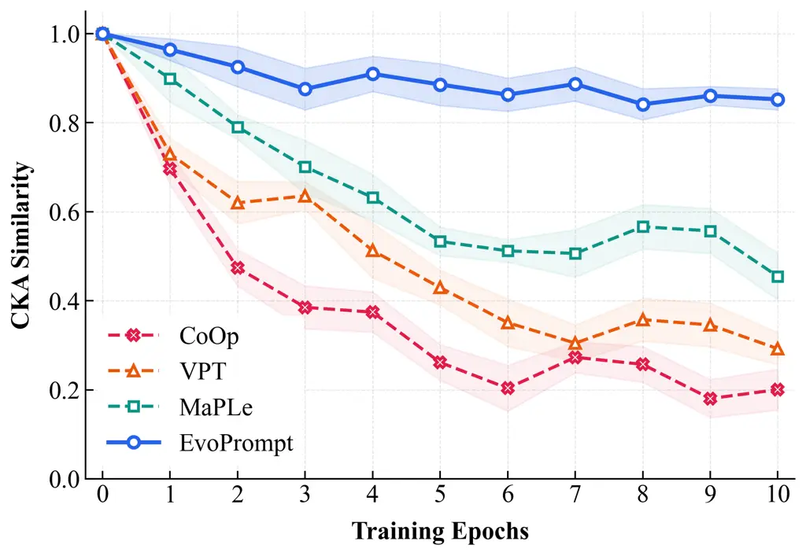
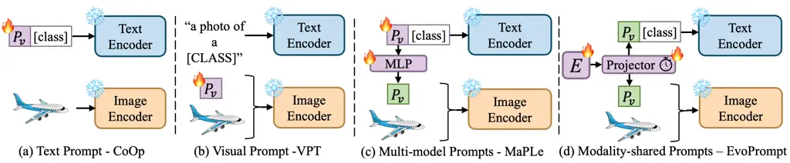
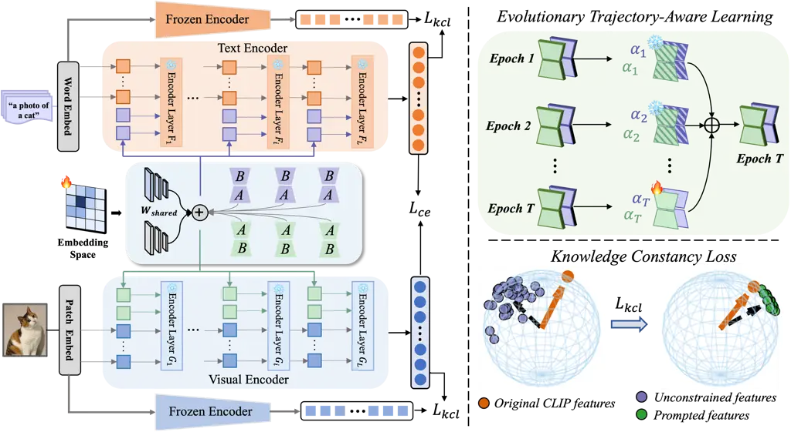
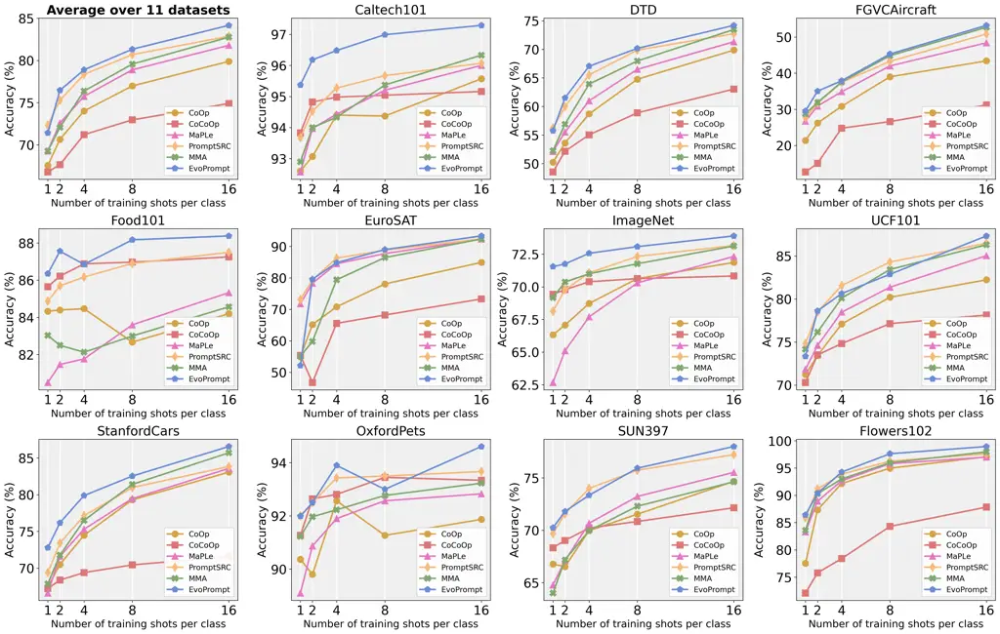
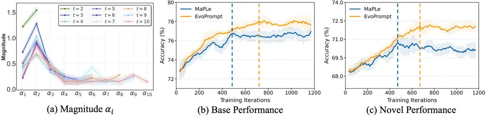

# Guided Prompt Evolution for Vision-Language Models Adaptation

Enming Zhang    Jiayang Li    Yanlong Wang    Yanru Wu    Zhenyu Liu   
Yang Li ^(†)^(†)thanks: Enming Zhang, Jiayang Li, Yanru Wu, Zhenyu Liu
are with Tsinghua Shenzhen International Graduate School, Tsinghua
University. Yanlong Wang is with Sun Yat-sen University. Yang Li is with
Chinese University of Hong Kong, Shenzhen. Corresponding author: Yang Li
(email: yangl@cuhk.edu.cn).

###### Abstract

The adaptation of large-scale vision-language models (VLMs) to
downstream tasks with limited labeled data remains a significant
challenge. While parameter-efficient prompt learning methods offer a
promising path, they often suffer from catastrophic forgetting of
pre-trained knowledge. Toward addressing this limitation, our work is
grounded in the insight that governing the evolutionary path of prompts
is essential for forgetting-free adaptation. To this end, we propose
EvoPrompt, a novel framework designed to explicitly steer the prompt
trajectory for knowledge-preserving fine-tuning. Specifically, our
approach employs a Modality-Shared Prompt Projector (MPP) to generate
hierarchical prompts from a unified embedding space. Critically, an
evolutionary training strategy decouples low-rank updates into
directional and magnitude components, preserving early-learned semantic
directions while only adapting their magnitude, thus enabling prompts to
evolve without discarding foundational knowledge. Extensive experiments
demonstrate that EvoPrompt achieves state-of-the-art performance in
few-shot learning while robustly preserving the original zero-shot
capabilities of pre-trained VLMs.

###### Index Terms: 

Parameter-Efficient Adaptation, Vision-Language Models, Prompt Learning.

## I Introduction

Large-scale pre-trained vision-language models (VLMs) \[39, 23, 54, 22,
29\], exemplified by works like CLIP \[39\] and ALIGN \[23\], have
revolutionized zero-shot generalization across diverse downstream tasks,
including image classification \[11, 13\], visual question answering
\[2, 16\], and cross-modal retrieval \[27, 7\]. Their success stems from
learning highly transferable visual and linguistic representations
through contrastive pre-training on massive web-scale datasets.

However, adapting these powerful models to specific downstream tasks
with limited labeled samples presents a significant challenge. The
conventional approach of full fine-tuning, which updates all model
parameters, is often prohibitively expensive in terms of computation and
storage, given the massive scale of VLMs \[1, 6\]. To address this,
parameter-efficient adaptation methods\[28\], particularly prompt
learning, have gained prominence. Techniques like CoOp \[58\] and CoCoOp
\[57\] introduce a set of learnable continuous prompts while keeping the
pre-trained backbone frozen, drastically reducing tunable parameters.



Fig. 1: CKA similarity between prompt-tuned features at each training
epoch and the frozen pre-trained VLM (Epoch 0). Baseline methods exhibit
increasing representational drift from the pre-trained semantic space,
whereas EvoPrompt maintains consistently structural similarity
throughout training.



Fig. 2: Comparison of our proposed EvoPrompt frameworks with related
representative efficient transfer learning for VLMs.

Despite this efficiency, a fundamental limitation has been largely
overlooked: existing prompt tuning methods optimize prompts solely to
minimize task loss, with no regard for their evolution during training.
As shown in Fig. 1, our Centered Kernel Alignment (CKA) analysis reveals
that this unconstrained optimization induces progressive
representational drift away from the pre-trained semantic space. Prompts
progressively abandon their broad semantic structure, collapsing into
narrow, task-specific representations—a manifestation of catastrophic
forgetting \[25, 46\] that undermines the zero-shot generalization
capabilities VLMs acquire through large-scale pre-training.

We therefore argue that governing the evolutionary trajectory of
prompts, rather than merely optimizing their final representations, is
the cornerstone of knowledge-preserving adaptation. As illustrated in
Fig. 2, current frameworks directly optimize raw prompt parameters with
no structural constraint, making their trajectories inherently unstable.
In contrast, we propose EvoPrompt, which generates prompts through a
shared embedding space to impose structural coherence over the entire
training trajectory. Specifically, we introduce a Modality-Shared Prompt
Projector (MPP) that replaces isolated per-layer prompts with a unified
embedding projected into layer-specific representations, establishing
structural coherence for stable evolution across layers and modalities.
We further regulate the temporal dynamics of adaptation via a
trajectory-aware training strategy that disentangles low-rank updates
into directional and magnitude components. Semantic directions captured
in early training are frozen, while only their magnitudes are refined,
enabling task-specific specialization without discarding pre-trained
knowledge. To further anchor the adapted features to the pre-trained
semantic space, we introduce a lightweight knowledge constancy loss that
constrains feature drift throughout training. Our contributions are
summarized as follows:

- •
  We uncover the representational drift inherent in unconstrained prompt
  optimization, establishing trajectory governance as a cornerstone for
  robust VLM adaptation.
- •
  We propose EvoPrompt, a trajectory-governed adaptation paradigm whose
  core is a trajectory-aware training strategy that factorizes prompt
  evolution into frozen semantic directions and adaptive magnitudes.
- •
  Extensive experiments on few-shot learning, cross-dataset transfer,
  and domain generalization demonstrate state-of-the-art performance
  with robust preservation of zero-shot generalization.

We will release the code and pretrained models upon acceptance of the
paper.

## II Related Work

### II-A Vision-Language Models

The landscape of computer vision has been profoundly reshaped by the
advent of Vision-Language Models (VLMs), which forge robust semantic
connections between visual and textual data. A myriad of foundational
architectures—such as CLIP \[39\], ALIGN \[23\], BLIP-2 \[29\], and
Flamingo \[1\]—have been trained on web-scale, paired multi-modal
datasets using self-supervised contrastive objectives \[36\]. By
assimilating unprecedented volumes of training samples \[42\], these
foundation models learn highly transferable feature representations,
yielding impressive zero-shot inference capabilities across a broad
array of applications. Despite these triumphs, effectively transferring
such massive architectures to specialized target distributions with
limited annotated data remains remarkably challenging. To navigate this
data-scarce regime, a vast corpus of literature has focused on tailoring
pre-trained VLMs to diverse downstream scenarios, encompassing few-shot
image classification \[55\], object detection \[12\], and semantic
segmentation \[40, 10\].

### II-B Efficient Transfer Learning for VLMs

Parameter-efficient fine-tuning (PEFT), particularly via prompting
techniques, originated in the natural language domain to steer massive
linguistic models without updating their full parameter space \[20, 30,
32, 21\]. This philosophy was subsequently extended to multi-modal
learning \[14, 55, 5, 44\], enabling the rapid adaptation of frozen
VLMs. Pioneering works like CoOp \[58\] appended optimizable continuous
tokens to the textual branch of CLIP, while CoCoOp \[57\] conditioned
these tokens on visual inputs to mitigate overfitting to seen classes.
To further regulate the optimization process and retain foundational
knowledge, methods such as KgCoOp \[52\] penalize the discrepancy
between the learned textual embeddings and the original frozen
embeddings, and PLOT \[4\] leverages optimal transport to holistically
match vision and text semantics. Moving beyond unimodal prompting, MaPLe
\[24\] synchronizes the adaptation by explicitly linking deep learnable
tokens across both vision and text encoders. More recently, approaches
like PromptSRC \[25\] and TCP \[53\] have integrated self-consistency
mechanisms and class-aware regularization to further constrain the
learning trajectory. While these prompt-driven methodologies have proven
highly effective in adapting large-scale models with minimal overhead,
they suffer from inherent structural limitations.

## III Method: EvoPrompt

We develop our EvoPrompt framework on top of the pre-trained CLIP
\[39\]. In the following, we first introduce preliminary knowledge on
CLIP and then present our proposed EvoPrompt.

### III-A Preliminaries

We provide a brief overview of the CLIP model’s notation and core
operations used in our method. CLIP contains two primary components: a
visual encoder $`F`$ and a text encoder $`G`$.

Image Feature Extraction. The visual encoder $`f`$ is structured as a
Vision Transformer (ViT) with $`L`$ consecutive transformer blocks,
$`\{F_{i}\}_{i=1}^{L}`$. An input RGB image
$`I\in\mathbb{R}^{H\times W\times 3}`$ is split into $`M`$
non-overlapping patches. A linear projection layer maps each patch to a
$`d_{v}`$-dimensional vector, producing the initial patch embedding
matrix $`E_{0}\in\mathbb{R}^{M\times d_{v}}`$. This matrix is prepended
with a learnable \[CLS\] token $`c_{0}`$, combined with positional
encodings, and fed into the transformer stack. The processing at the
$`i`$-th layer is formulated as:

```math
[c_{i},E_{i}]=F_{i}([c_{i-1},E_{i-1}]),\quad i=1,\dots,L. \tag{1}
```

The final \[CLS\] token representation $`c_{L}`$ is projected via a
linear layer $`\Phi_{v}`$ to obtain the image feature vector
$`f^{v}=\Phi_{v}(c_{L})\in\mathbb{R}^{d}`$.

Text Feature Extraction. For a text prompt $`T`$ (e.g., “a photo of a
\[CLASS\]”), the input is first tokenized into a sequence of $`N`$
tokens. These tokens are embedded as
$`T_{0}\in\mathbb{R}^{N\times d_{t}}`$ and concatenated with special
\[SOS\] and \[EOS\] tokens $`b_{0}`$ and $`e_{0}`$, along with
positional encodings. The sequence is processed by $`L`$ transformer
layers $`\{G_{i}\}_{i=1}^{L}`$ in the text encoder:

```math
[b_{i},T_{i},e_{i}]=G_{i}([b_{i-1},T_{i-1},e_{i-1}]),\quad i=1,\dots,L. \tag{2}
```

The final \[EOS\] token representation $`e_{L}`$ is linearly projected
to obtain the text feature vector
$`f^{t}=\Phi_{t}(e_{L})\in\mathbb{R}^{d}`$.

Zero-Shot Classification and Optimization. For a $`C`$-class task, we
construct $`C`$ text prompts to obtain text features
$`\{f^{t}_{c}\}_{c=1}^{C}`$. Given an image feature $`f^{v}`$, the
prediction probability for class $`c`$ is computed via cosine similarity
and a softmax with temperature $`\tau`$:

```math
p(y=c\mid f^{v})=\frac{\exp(s_{c}/\tau)}{\sum_{j=1}^{C}\exp(s_{j}/\tau)},\quad\textit{where}\quad s_{c}=\frac{{f^{v}}^{\top}f^{t}_{c}}{\|f^{v}\|\|f^{t}_{c}\|}, \tag{3}
```

where $`\top`$ denotes the vector transpose operation. The model is
typically optimized using the cross-entropy loss. For a training sample
with ground-truth label $`y`$, the loss is defined as:

```math
\mathcal{L}_{InfoNCE}(f^{v},f^{t})=-\log\frac{\exp(s_{y}/\tau)}{\sum_{j=1}^{C}\exp(s_{j}/\tau)}. \tag{4}
```

### III-B Modality-Shared Prompt Projector

Previous multimodal prompting schemes, such as MaPLe \[24\], typically
insert prompts into each layer independently. While this provides
layer-specific guidance, such isolated prompts often prevent the model
from distilling and propagating beneficial information across the
hierarchical depth of the encoders. We argue that prompts should capture
the hierarchical semantic progression across consecutive layers and
maintain a degree of inter-layer correlation. Furthermore, leveraging
complementary information across modalities can enrich the prompt
generation process. To this end, we propose the Modality-Shared Prompt
Projector (MPP), which jointly fosters cross-layer information flow and
complementary cross-modal interaction.



Fig. 3: Overview of the proposed EvoPrompt framework. Left:
Modality-shared projectors are used to inject prompts into dual
encoders. Right-Top: The low-rank adapter is decomposed into magnitude
$`\alpha_{i}`$ and direction components, with historical directions
frozen to preserve early geometric alignments, while the magnitudes
remain trainable. Right-Bottom: The knowledge constancy loss
$`\mathcal{L}_{kcl}`$ prevents feature drift and preserves pretrained
semantic structure.

#### III-B1 Learnable Embedding Space

We first initialize a unified, learnable embedding space
$`E\in\mathbb{R}^{K\times d_{r}}`$, where $`K`$ vectors are sampled from
a zero-mean Gaussian distribution $`\mathcal{N}(0,\sigma^{2})`$. This
shared embedding is then transformed into modality-specific prompts for
each layer through a projector. Specifically, prompts are inserted
starting from a predefined layer $`J`$ ($`1\leq J\leq L`$). For modality
$`m\in\{v,t\}`$ at each layer $`i\in\{J,\dots,L\}`$, the prompt
$`P_{i}^{m}\in\mathbb{R}^{l\times d_{m}}`$ is generated as:

```math
P_{i}^{m}=\text{Proj}_{i}^{m}(E), \tag{5}
```

where $`\text{Proj}_{i}^{m}(\cdot)`$ denotes a learnable projection
function tailored for layer $`i`$ and modality $`m`$. The generated
prompts $`P_{i}^{m}`$ are then concatenated with the original input
tokens at the corresponding layer.

#### III-B2 Decoupled Low-Rank Expansion

To efficiently model both the cross-layer semantic patterns and the
layer-specific adaptations, we propose a parameter-efficient projection
mechanism inspired by LoRA \[21\]. The core idea is to decouple the
projector’s weight matrix into a shared component and a low-rank,
layer-wise adapter. Typically, LoRA updates a frozen weight
$`W_{0}\in\mathbb{R}^{d\times k}`$ via a low-rank residual $`BA`$, where
$`B\in\mathbb{R}^{d\times r}`$ and $`A\in\mathbb{R}^{r\times k}`$
($`r\ll\min(d,k)`$). Extending this, for each projector associated with
layer $`i\in\{J,\dots,L\}`$, the projector weight matrix is first
decomposed as:

```math
W_{i}^{m}=W_{\text{shared}}^{m}+\Delta W_{i}^{m}, \tag{6}
```

where $`W_{\text{shared}}^{m}\in\mathbb{R}^{d_{r}\times d_{m}}`$ is a
modality-specific shared component maintained across layers from $`J`$
to $`L`$ to capture fundamental semantic knowledge and alleviate
redundancy. For notational brevity, we omit the modality superscript
$`m`$ in the following. The layer-specific adapter $`\Delta W_{i}`$ is
then parameterized via a low-rank decomposition, leading to the final
form:

```math
W_{i}=W_{\text{shared}}+A_{i}B_{i}, \tag{7}
```

where $`A_{i}\in\mathbb{R}^{d_{r}\times r}`$ and
$`B_{i}\in\mathbb{R}^{r\times d_{m}}`$ are trainable low-rank matrices.
The adoption of a single $`W_{\text{shared}}`$ coupled with layer-wise
low-rank adapters enables EvoPrompt to retain expressive power with
significantly fewer parameters. Consequently, the parameter complexity
is lowered from $`\mathcal{O}((L-J+1)\cdot d_{r}d_{m})`$ to
$`\mathcal{O}(d_{r}d_{m}+(L-J+1)\cdot r(d_{r}+d_{m}))`$. This
formulation naturally enforces structural alignment through the shared
base and strengthens generalization by cleanly separating common
knowledge from layer-specific adjustments.

### III-C Evolutionary Trajectory-Aware Learning Strategy

While the MPP architecture establishes structural bridges across layers,
optimizing prompts throughout the training process remains challenging
due to the risk of catastrophic forgetting. We observe that prompts,
which serve as general contextual anchors in early training stages, tend
to converge toward task-specific patterns in later epochs, potentially
overwriting previously acquired generalizable knowledge. To mitigate
this, inspired by progressive learning methods \[15, 51\], we introduce
an evolutionary trajectory-aware learning strategy. This approach
explicitly decouples and modulates parameter effects learned at
different phases, conceptualizing adaptation as a progressive
accumulation of knowledge.

#### III-C1 Incremental Magnitude-Direction Decoupling

Building on insights from weight decomposition analysis \[47\], we
factorize the layer-wise low-rank update $`\Delta W_{i}^{t}`$ at
training epoch $`t`$ into a learnable magnitude coefficient
$`\alpha_{i}^{t}`$ and a normalized directional matrix:

```math
\Delta W_{i}^{t}=\alpha_{i}^{t}\cdot\frac{\mathbf{A}_{i}^{t}\mathbf{B}_{i}^{t}}{\|\mathbf{A}_{i}^{t}\mathbf{B}_{i}^{t}\|_{F}}=\alpha_{i}^{t}\cdot\overline{\mathbf{A}_{i}^{t}\mathbf{B}_{i}^{t}}, \tag{8}
```

where $`\|\cdot\|_{F}`$ denotes the Frobenius norm. This explicit
decoupling grants independent control over the adaptation strength
($`\alpha_{i}^{t}`$) and its direction
($`\overline{\mathbf{A}_{i}^{t}\mathbf{B}_{i}^{t}}`$). To promote stable
progressive learning, we frame the training process as the accumulation
of directional knowledge. Prior work suggests the directional component
is more critical than its magnitude in low-rank adaptation \[31, 38\].
Accordingly, we extend Eq. (7) to compute the adapter weight for layer
$`i`$ at epoch $`T`$ as a historical sum:

```math
W_{i}^{T}=W_{\text{shared}}+\sum_{t=1}^{T-1}{\color[rgb]{1,0.5,0}\alpha_{i}^{t}}\overline{\mathbf{A}_{i}^{t}\mathbf{B}_{i}^{t}}+{\color[rgb]{1,0.5,0}\alpha_{i}^{T}}{\color[rgb]{1,0.5,0}\overline{\mathbf{A}_{i}^{T}\mathbf{B}_{i}^{T}}}, \tag{9}
```

Here, $`W_{\text{shared}}`$ acts as a fixed, modality-specific
foundation. During training at epoch $`T`$, we freeze all previously
acquired directions
$`\{\overline{\mathbf{A}_{i}^{t}\mathbf{B}_{i}^{t}}\}_{t=1}^{T-1}`$ to
preserve their geometric structure. Only the magnitude coefficients
$`\{\alpha_{i}^{t}\}_{t=1}^{T}`$ and the new direction
$`\overline{\mathbf{A}_{i}^{T}\mathbf{B}_{i}^{T}}`$ remain trainable.
This design enables the model to recalibrate the influence of past
knowledge via the learnable $`\alpha_{i}^{t}`$ while progressively
incorporating new directional adjustments, thereby adapting to the
evolving loss landscape without catastrophically forgetting previously
learned, robust features.

#### III-C2 Adaptive Rank Reduction

To enhance continual adaptation stability and mitigate the risk of
overfitting during later evolutionary stages, we introduce an empirical
rank-reduction mechanism. Denoting the total number of training epochs
as $`N_{e}`$, this strategy modulates the capacity of the learnable
matrices $`\mathbf{A}_{i}^{t}\in\mathbb{R}^{d_{r}\times r^{t}}`$ and
$`\mathbf{B}_{i}^{t}\in\mathbb{R}^{r^{t}\times d_{m}}`$ by adjusting the
rank $`r^{t}`$ in a controlled, stepwise manner:

```math
r^{1}=r^{2}=\dots>r^{\mu}=r^{\mu+1}=\dots>r^{\nu}=r^{\nu+1}=\dots=r^{N_{e}}, \tag{10}
```

where $`\mu`$ and $`\nu`$ ($`1<\mu<\nu\leq N_{e}`$) represent predefined
epoch indices at which the rank is reduced. By assigning lower-rank
weights to later epochs based on their diminishing marginal
contributions, this strategy imposes a structural regularization that
stabilizes the optimization landscape. Consequently, it significantly
reduces cumulative computational and memory overhead while maintaining
the model’s generalization ability.

### III-D Overall Training Objective

To preserve the rich semantic knowledge embedded in the pre-trained CLIP
model, we introduce a knowledge constancy loss on both modalities. Let
$`f^{v}`$ and $`f^{t}`$ be the prompted features for a single sample,
and let $`f^{v}_{0}`$ and $`f^{t}_{0}`$ denote the corresponding
features extracted by the original, frozen CLIP encoders (without
prompts). The constancy loss is formulated as:

```math
\mathcal{L}_{kcl}=\frac{1}{2}\left[\left(1-\frac{{f^{v}}^{\top}f^{v}_{0}}{\|f^{v}\|\|f^{v}_{0}\|}\right)+\left(1-\frac{{f^{t}}^{\top}f^{t}_{0}}{\|f^{t}\|\|f^{t}_{0}\|}\right)\right]. \tag{11}
```

This term ensures that the learned prompts do not cause the feature
representations to deviate excessively from the well-structured original
CLIP feature distribution, thereby maintaining its strong zero-shot
generalization capability.

Combining the standard contrastive alignment loss
$`\mathcal{L}_{InfoNCE}`$ and the knowledge constancy loss, our complete
training objective is:

```math
\mathcal{L}_{total}=\mathcal{L}_{InfoNCE}+\eta\mathcal{L}_{kcl}, \tag{12}
```

where $`\eta`$ is a balancing hyperparameter. This composite loss guides
the model to achieve strong cross-modal instance alignment while
preserving the pre-trained feature geometry. A complete algorithmic
flowchart illustrating our training strategy is summarized in Algorithm

1.

Input: Pre-trained encoders $`f_{0}^{v},f_{0}^{t}`$; embedding
$`E\in\mathbb{R}^{K\times d_{r}}`$; projector weights
$`W_{\text{shared}}^{m}`$; rank indices $`\mu,\nu`$; hyperparameter
$`\eta`$.

Output:
$`E,\ W_{\text{shared}}^{m},\ \{\alpha_{i}^{k}\},\ \mathcal{W}`$.

$`\mathcal{W}\leftarrow\emptyset`$

for _each training epoch $`T`$_ do

   if _$`T=\mu`$ or $`T=\nu`$_ then

      Reduce rank $`r^{T}`$

   Freeze all directional matrices in $`\mathcal{W}`$

   foreach _layer $`i\in\{J,\dots,L\}`$_ do

      $`\Delta W_{i}^{T}=\sum_{t=1}^{T-1}\alpha_{i}^{t}\overline{\mathbf{A}_{i}^{t}\mathbf{B}_{i}^{t}}+\alpha_{i}^{T}\overline{\mathbf{A}_{i}^{T}\mathbf{B}_{i}^{T}}`$

      $`P_{i}^{m}=E\cdot(W_{\text{shared}}^{m}+\Delta W_{i}^{T})`$

   Inject $`\{P_{i}^{m}\}_{i=J}^{L}`$; extract
$`\mathcal{F}^{v},\mathcal{F}^{t}`$ and frozen $`f_{0}^{v},f_{0}^{t}`$;

   $`\mathcal{L}_{total}=\mathcal{L}_{InfoNCE}+\eta\,\mathcal{L}_{kcl}`$

   Update
$`E,\ W_{\text{shared}}^{m},\ \{\alpha_{i}^{T}\},\ \mathbf{A}_{i}^{T},\ \mathbf{B}_{i}^{T}`$;

   foreach _layer $`i\in\{J,\dots,L\}`$_ do

      $`\mathcal{W}\leftarrow\mathcal{W}\cup\{\overline{\mathbf{A}_{i}^{T}\mathbf{B}_{i}^{T}}\}`$

return
_$`E,\ W_{\text{shared}}^{m},\ \{\alpha_{i}^{k}\},\ \mathcal{W}`$_

Algorithm 1 Evolutionary Trajectory-Aware Learning

## IV Experiment

We evaluate EvoPrompt under four standard experimental settings:
base-to-novel generalization, cross-dataset transfer, domain
generalization, and few-shot learning. Unless otherwise noted, we
strictly follow the evaluation protocols established in prior work \[58,
57\].

### IV-A Tasks and Datasets

#### IV-A1 Base-to-Novel Generalization

To evaluate the trade-off between task-specific adaptation and zero-shot
capability preservation, we split the categories of each dataset equally
into a base set for training and a novel set for evaluation. Models are
trained exclusively on the base classes and tested on both base and
novel classes. This experiment is conducted across 11 standard image
classification benchmarks: ImageNet \[9\], Caltech101 \[13\],
OxfordPets \[37\], StanfordCars \[26\], Flowers102 \[35\],
Food101 \[3\], FGVCAircraft \[34\], SUN397 \[48\], UCF101 \[43\],
DTD \[8\], and EuroSAT \[17\].

#### IV-A2 Cross-Dataset Transfer

Following CoCoOp \[57\], we assess out-of-distribution generalization by
training a 16-shot model on ImageNet (covering all 1,000 classes) and
then evaluating the frozen model directly on the other 10 datasets
without any further fine-tuning.

#### IV-A3 Domain Generalization

We measure robustness to distribution shifts by evaluating the same
ImageNet-trained model on four challenging ImageNet variants:
ImageNet-V2 \[41\], ImageNet-Sketch \[45\], ImageNet-A \[19\], and
ImageNet-R \[18\]. This evaluates the model’s ability to maintain
performance under domain shift.

#### IV-A4 Few-Shot Learning

To evaluate sample efficiency, we train models with varying numbers of
labeled examples (1, 2, 4, 8, and 16 shots per category) and test on the
full test sets of each benchmark. This setting probes the model’s
ability to learn effectively from extremely limited supervision and
reveals whether it acquires both task-specific discriminative patterns
and task-agnostic knowledge.

|            |              |       |       |            |       |       |            |       |       |              |       |       |
| ---------- | ------------ | ----- | ----- | ---------- | ----- | ----- | ---------- | ----- | ----- | ------------ | ----- | ----- |
| Method     | Average      |       |       | ImageNet   |       |       | Caltech101 |       |       | OxfordPets   |       |       |
|            | Base         | Novel | HM    | Base       | Novel | HM    | Base       | Novel | HM    | Base         | Novel | HM    |
| CLIP       | 69.34        | 74.22 | 71.70 | 72.43      | 68.14 | 70.22 | 96.84      | 94.00 | 95.40 | 91.17        | 97.26 | 94.12 |
| CoOp       | 82.69        | 63.22 | 71.66 | 76.47      | 67.88 | 71.92 | 98.00      | 89.81 | 93.73 | 93.67        | 95.29 | 94.47 |
| CoCoOp     | 80.47        | 71.69 | 75.83 | 75.98      | 70.43 | 73.10 | 97.96      | 93.81 | 95.84 | 95.20        | 97.69 | 96.43 |
| ProDA      | 81.56        | 72.30 | 76.65 | 75.40      | 70.23 | 72.72 | 98.27      | 93.23 | 95.68 | 95.43        | 97.83 | 96.62 |
| KgCoOp     | 80.73        | 73.60 | 77.00 | 75.83      | 69.96 | 72.78 | 97.72      | 94.39 | 96.03 | 94.65        | 97.76 | 96.18 |
| MaPLe      | 82.28        | 75.14 | 78.55 | 76.66      | 70.54 | 73.47 | 97.74      | 94.36 | 96.02 | 95.43        | 97.76 | 96.58 |
| PromptSRC  | 84.26        | 76.10 | 79.97 | 77.60      | 70.73 | 74.01 | 98.10      | 94.03 | 96.02 | 95.33        | 97.30 | 96.30 |
| ProVP      | 85.20        | 73.22 | 78.76 | 75.82      | 69.21 | 72.36 | 98.92      | 94.21 | 96.51 | 95.87        | 97.65 | 96.75 |
| MetaPrompt | 83.65        | 75.48 | 79.09 | 77.52      | 70.83 | 74.02 | 98.13      | 94.58 | 96.32 | 95.53        | 97.00 | 96.26 |
| TCP        | 84.13        | 75.36 | 79.51 | 77.27      | 69.87 | 73.38 | 98.23      | 94.67 | 96.42 | 94.67        | 97.20 | 95.92 |
| MMA        | 83.20        | 76.80 | 79.87 | 77.31      | 71.00 | 74.02 | 98.40      | 94.00 | 96.15 | 95.40        | 98.07 | 96.72 |
| EvoPrompt  | 85.90        | 78.35 | 81.95 | 77.98      | 72.10 | 74.92 | 99.11      | 95.30 | 97.17 | 96.13        | 98.40 | 97.25 |
| Method     | StanfordCars |       |       | Flowers102 |       |       | Food101    |       |       | FGVCAircraft |       |       |
|            | Base         | Novel | HM    | Base       | Novel | HM    | Base       | Novel | HM    | Base         | Novel | HM    |
| CLIP       | 63.37        | 74.89 | 68.65 | 72.08      | 77.80 | 74.83 | 90.10      | 91.22 | 90.66 | 27.19        | 36.29 | 31.09 |
| CoOp       | 78.12        | 60.40 | 68.13 | 97.60      | 59.67 | 74.06 | 88.33      | 82.26 | 85.19 | 40.44        | 22.30 | 28.75 |
| CoCoOp     | 70.49        | 73.59 | 72.01 | 94.87      | 71.75 | 81.71 | 90.70      | 91.29 | 90.99 | 33.41        | 23.71 | 27.74 |
| ProDA      | 74.70        | 71.20 | 72.91 | 97.70      | 68.68 | 80.66 | 90.30      | 88.57 | 89.43 | 36.90        | 34.13 | 35.46 |
| KgCoOp     | 71.76        | 75.04 | 73.36 | 95.00      | 74.73 | 83.65 | 90.50      | 91.70 | 91.09 | 36.21        | 33.55 | 34.83 |
| MaPLe      | 72.94        | 74.00 | 73.47 | 95.92      | 72.46 | 82.56 | 90.71      | 92.05 | 91.38 | 37.44        | 35.61 | 36.50 |
| PromptSRC  | 78.27        | 74.97 | 76.58 | 98.07      | 76.50 | 85.95 | 90.67      | 91.53 | 91.10 | 42.73        | 37.87 | 40.15 |
| ProVP      | 80.43        | 67.96 | 73.67 | 98.42      | 72.06 | 83.20 | 90.32      | 90.91 | 90.61 | 47.08        | 29.87 | 36.55 |
| MetaPrompt | 76.34        | 75.01 | 75.48 | 97.66      | 74.49 | 84.52 | 90.74      | 91.85 | 91.29 | 40.14        | 36.51 | 38.24 |
| TCP        | 80.80        | 74.13 | 77.32 | 97.73      | 75.57 | 85.23 | 90.57      | 91.37 | 90.97 | 41.97        | 34.43 | 37.83 |
| MMA        | 78.50        | 73.10 | 75.70 | 97.77      | 75.93 | 85.48 | 90.13      | 91.30 | 90.71 | 40.57        | 36.33 | 38.33 |
| EvoPrompt  | 81.15        | 75.90 | 78.44 | 98.70      | 78.33 | 87.34 | 91.10      | 92.78 | 91.93 | 47.42        | 39.54 | 43.12 |
| Method     | SUN397       |       |       | DTD        |       |       | EuroSAT    |       |       | UCF101       |       |       |
|            | Base         | Novel | HM    | Base       | Novel | HM    | Base       | Novel | HM    | Base         | Novel | HM    |
| CLIP       | 69.36        | 75.35 | 72.23 | 53.24      | 59.90 | 56.37 | 56.48      | 64.05 | 60.03 | 70.53        | 77.50 | 73.85 |
| CoOp       | 80.60        | 65.89 | 72.51 | 79.44      | 41.18 | 54.24 | 92.19      | 54.74 | 68.69 | 84.69        | 56.05 | 67.46 |
| CoCoOp     | 79.74        | 76.86 | 78.27 | 77.01      | 56.00 | 64.85 | 87.49      | 60.04 | 71.21 | 82.33        | 73.45 | 77.64 |
| ProDA      | 78.67        | 76.93 | 77.79 | 80.67      | 56.48 | 66.44 | 83.90      | 66.00 | 73.88 | 85.23        | 71.97 | 78.04 |
| KgCoOp     | 80.29        | 76.53 | 78.36 | 77.55      | 54.99 | 64.35 | 85.64      | 64.34 | 73.48 | 82.89        | 76.67 | 79.65 |
| MaPLe      | 80.82        | 78.70 | 79.75 | 80.36      | 59.18 | 68.16 | 94.07      | 73.23 | 82.35 | 83.00        | 78.66 | 80.77 |
| PromptSRC  | 82.67        | 78.47 | 80.52 | 83.37      | 62.97 | 71.75 | 92.90      | 73.90 | 82.32 | 87.10        | 78.80 | 82.74 |
| ProVP      | 80.67        | 76.11 | 78.32 | 83.95      | 59.06 | 69.34 | 97.12      | 72.91 | 83.29 | 88.56        | 75.55 | 81.54 |
| MetaPrompt | 82.26        | 79.04 | 80.62 | 83.10      | 58.05 | 68.35 | 93.53      | 75.21 | 83.38 | 85.33        | 77.72 | 81.35 |
| TCP        | 82.63        | 78.20 | 80.35 | 82.77      | 58.07 | 68.25 | 91.63      | 74.73 | 82.32 | 87.13        | 80.77 | 83.83 |
| MMA        | 82.27        | 78.57 | 80.38 | 83.20      | 65.63 | 73.38 | 85.46      | 82.34 | 83.87 | 86.23        | 80.03 | 82.20 |
| EvoPrompt  | 83.31        | 79.50 | 81.36 | 84.20      | 65.92 | 73.95 | 97.43      | 82.79 | 89.52 | 88.34        | 81.30 | 84.67 |

TABLE I: Comparison with state-of-the-art methods on base-to-novel
generalization across 11 datasets. EvoPrompt demonstrates strong
generalization results over existing methods. The best results are in
bold and the second-best results are underlined.

### IV-B Implementation Details

We adopt a pre-trained CLIP with a ViT-B/16 \[11\] backbone as our
foundation model. Unless investigating variable-shot performance, we
sample 16 shots per class following prior work \[58, 24, 50, 57, 52, 59,
53\]. Zero-shot classifier weights are generated using standard prompt
templates \[39, 58, 55\]. Both the visual encoder $`F`$ and the text
encoder $`G`$ remain fully frozen. For the learnable embedding space
$`E`$, we set the number of vectors to $`K=5`$ and the shared
representation dimension to $`d_{r}=512`$. Prompts with token length
$`l=5`$ are inserted from layer $`J=6`$ to the final layer $`L=12`$. For
the rank reduction mechanism, we set $`\mu{=}4`$ and $`\nu{=}7`$ with
$`N_{e}{=}10`$, reducing the rank as
$`r^{1}{=}8\to r^{\mu}{=}4\to r^{\nu}{=}2`$. The more detailed
configurations and analysis of these parameters, along with the
$`r^{t}`$, $`\mu`$ and $`\nu`$ in rank reduction mechanism, are provided
in the supplementary materials. All experiments are conducted on a
single NVIDIA A800 GPU, and we report the average top-1 accuracy over
three random seeds.

### IV-C Base-to-Novel Generalization

In this experiment, we evaluate the performance of EvoPrompt against
several representative benchmarks, including the zero-shot CLIP baseline
and various state-of-the-art prompt learning techniques such as CoOp
\[58\], CoCoOp \[57\], ProDA \[33\], KgCoOp \[52\], MaPLe \[24\],
PromptSRC \[25\], ProVP \[49\], MetaPrompt \[56\], TCP \[53\], and the
adapter-based method MMA \[50\]. To ensure a fair comparison, we exclude
methods that rely on large language models for external prompt priors or
those utilizing full unlabeled datasets for distillation.

Table I presents a comprehensive comparison highlighting the superior
average performance of EvoPrompt across 11 datasets. In particular, our
method surpasses the leading baselines by 1.55% on Novel classes and
1.82% in HM. Additionally, the results highlight an advanced transfer
learning capability, evidenced by substantial gains in base accuracy
alongside sustained strong generalizability.

[TABLE]

TABLE II: Comparison of Ours with previous state-of-the-art methods on
cross-dataset evaluation across 10 datasets.

### IV-D Cross-Dataset Evaluation

Tab. II presents the cross-dataset evaluation results, where all models
are trained on ImageNet and directly evaluated across 10 diverse target
datasets. Notably, EvoPrompt achieves the highest average target
accuracy of 67.41%, outperforming leading baselines such as MMA (66.61%)
and MaPLe (66.30%). Concurrently, it attains the top source accuracy on
ImageNet (72.10%). This dual superiority suggests that the shared
representation space of MPP, coupled with our evolutionary learning
strategy, yields highly transferable prompts that generalize better than
MaPLe’s independently parameterized per-layer design. Overall, EvoPrompt
achieves the best balance between source-domain performance and
cross-dataset transferability among all compared methods.

### IV-E Domain Generalization

Tab. III assesses model robustness under natural distribution shifts
using four challenging ImageNet variant datasets. EvoPrompt achieves the
best average accuracy across all domains, demonstrating that it not only
enhances in-distribution classification but also more effectively
preserves CLIP’s inherent out-of-distribution generalization
capabilities compared to existing adaptation methods.

|           | Source | Target |       |       |       |
| --------- | ------ | ------ | ----- | ----- | ----- |
|           | ImNet  | -V2    | -S    | -A    | -R    |
| CLIP      | 66.73  | 60.83  | 46.15 | 47.77 | 73.96 |
| CoOp      | 71.51  | 64.20  | 47.99 | 49.71 | 75.21 |
| CoCoOp    | 71.02  | 64.07  | 48.75 | 50.63 | 76.18 |
| MaPLe     | 70.72  | 64.07  | 49.15 | 50.90 | 76.98 |
| PromptSRC | 71.27  | 64.35  | 49.55 | 50.90 | 77.80 |
| MMA       | 71.00  | 64.33  | 49.13 | 51.12 | 77.32 |
| EvoPrompt | 72.10  | 64.40  | 49.72 | 51.30 | 77.90 |

TABLE III: Comparison of EvoPrompt with previous methods on domain
generalization across 4 datasets.

| Configuration                  | Base  | Novel | HM    |
| ------------------------------ | ----- | ----- | ----- |
| Baseline                       | 74.21 | 67.83 | 70.88 |
| \+ MPP                         | 75.34 | 69.12 | 72.09 |
| \+ $`W_{\text{shared}}`$ + AB  | 75.89 | 70.01 | 72.83 |
| \+ E.T. w/o Rank Reduction     | 76.73 | 70.50 | 73.48 |
| \+ E.T.                        | 76.45 | 70.98 | 73.61 |
| + $`\mathcal{L}_{kcl}`$ (full) | 77.98 | 72.10 | 74.92 |

TABLE IV: Cumulative component ablation on ImageNet. Each row adds one
design choice to the previous configuration. Bold denotes the best
result.



Fig. 4: EvoPrompt performance comparison in few-shot image recognition
setting.

### IV-F Few-Shot Learning

Few-shot classification results are presented in Fig. 4. EvoPrompt
demonstrates solid and competitive performance across the evaluated shot
settings. While performance is broadly comparable in the most
data-scarce regimes, the advantage of EvoPrompt becomes more pronounced
as the number of training examples increases. This scaling behavior
indicates that the framework effectively leverages additional
supervisory signals to learn increasingly transferable representations.

### IV-G Ablation Study

#### IV-G1 Component Analysis

Tab. IV presents a cumulative ablation study on ImageNet, where each row
incrementally integrates a specific design choice to demonstrate the
consistent and complementary contributions of individual modules.
Starting from the baseline configuration with isolated, independent
prompts (70.88% HM), introducing MPP yields the largest single-step
improvement (+1.21% HM), confirming that cross-layer and cross-modal
information sharing serves as a critical structural foundation. The
subsequent addition of the shared weight matrix $`W_{\text{shared}}`$
and the low-rank adapter (AB) contributes an additional +0.74% HM,
validating that our decoupled low-rank parameterization is both
parameter-efficient and expressive. Furthermore, incorporating the
evolutionary training strategy (E.T.) yields a further +0.78% HM gain,
effectively mitigating catastrophic forgetting while preserving robust
generalization capabilities. Notably, the adaptive rank reduction
mechanism itself contributes a measurable +0.13% HM gain (73.48% $`\to`$
73.61%); removing it causes the model to overfit the base distribution
(76.73% Base) at the expense of novel-class generalization (70.50%
Novel), confirming its role as an effective late-stage regularizer.
Finally, integrating the knowledge constancy loss $`\mathcal{L}_{kcl}`$
delivers a substantial +1.31% HM improvement, demonstrating that
constraining feature drift provides significant complementary benefits
on top of all preceding components. In its full configuration, EvoPrompt
achieves 74.92% HM, representing a total cumulative advancement of
+4.04% over the baseline.

| Loss     | Value | Base  | Novel | HM    |
| -------- | ----- | ----- | ----- | ----- |
| $`\eta`$ | 0.2   | 77.05 | 71.48 | 74.17 |
|          | 0.5   | 77.98 | 72.10 | 74.92 |
|          | 1.0   | 76.83 | 71.73 | 74.18 |
|          | 2.0   | 76.45 | 71.30 | 73.80 |

TABLE V: Sensitivity analysis of loss weights $`\eta`$ for
$`\mathcal{L}_{kcl}`$ on ImageNet. Bold denotes the best result.

| Method    | Params (M) | Time (ms) | FPS    |
| --------- | ---------- | --------- | ------ |
| MaPLe     | 3.555      | 39.5      | 1757.6 |
| PSRC      | 0.046      | 40.0      | 1764.2 |
| ProVP     | 0.147      | 6.4       | 928.9  |
| MetaP     | 0.031      | 30.7      | 659.8  |
| TCP       | 0.332      | 5.3       | 950.6  |
| MMA       | 0.675      | 2.2       | 688.5  |
| EvoPrompt | 0.764      | 4.5       | 1282.1 |

TABLE VI: Comparison of training efficiency on ImageNet. Trainable
parameters (M), training time (ms/image), and FPS (batch size=100) are
reported.

#### IV-G2 Loss Weight Sensitivity

We evaluate the sensitivity of the hyper-parameter $`\eta`$ (for
$`\mathcal{L}_{kcl}`$) on ImageNet, as shown in Tab. V. The model
achieves the optimal trade-off at $`\eta=0.5`$, reaching 74.92% HM.
Deviating from these values causes a performance drop, particularly in
the harmonic mean, suggesting that a balanced weighting of the proposed
losses is crucial for robust cross-class generalization.



Fig. 5: Analysis of training dynamics and performance. (a) The evolution
of learnable magnitudes $`\alpha_{i}`$. (b, c) Performance comparison
between MaPLe and EvoPrompt, where vertical dashed lines indicate
training breakpoints.

### IV-H Further Analysis

#### IV-H1 Computational Efficiency

As shown in Tab. VI, all methods are benchmarked on a single NVIDIA A800
GPU under a unified protocol: the reported training time covers both
forward and backward passes at batch size 100, while FPS measures
inference throughput with a single forward pass at the same batch size.
Under this protocol, EvoPrompt requires only 0.764M trainable parameters
when trained for 10 epochs, which is comparable to or fewer than most
efficient prior methods. Meanwhile, it attains a fast inference speed of
1282.1 FPS and requires only 4.5ms of training time per image. This
efficiency stems from our lightweight design. The decoupled MPP
structure cuts parameters by 4.6× compared to MaPLe. By freezing
historical directional updates and optimizing only their magnitude
coefficients, the expansion of learnable parameters throughout training
remains minimal. Additionally, our adaptive rank reduction mechanism
progressively decreases the rank of low-rank adapters in later epochs,
naturally limiting parameter growth. Together, these strategies ensure
that EvoPrompt maintains a lightweight and stable parameter footprint
while delivering scalable adaptation performance.

#### IV-H2 Evolution of Learned Magnitudes

Analysis of the learned magnitude coefficients $`\alpha`$ on ImageNet
reveals a distinct and stable evolutionary pattern across 10 training
epochs, as shown in Fig. 5 (a). The values do not peak at the initial
epoch $`\alpha_{1}`$, which can be attributed to the inherent
instability at the start of training as the model begins to explore and
adapt to the prompt space. Instead, they rise rapidly to a maximum at
$`\alpha_{2}`$. This is followed by a gradual decline in later epochs.
The pattern suggests a hierarchical importance: the prompt
representation quickly consolidates core features using directions
established early in training around $`\alpha_{2}`$, while later epochs
contribute directions with diminishing magnitudes, primarily serving for
fine-grained adjustment without drastically altering the established
semantic space.

#### IV-H3 Overfitting Phenomenon

We analyze the training dynamics of MaPLe and EvoPrompt on the ImageNet,
as illustrated in Fig. 5 (b,c). A critical “breakpoint” signifies a
phase transition. Before this point, both methods learn transferable
features, evidenced by joint performance gains on base and novel
classes. After the breakpoint, MaPLe begins to over-specialize on the
base training data, leading to unrecoverable performance degradation on
novel classes despite improving base accuracy. In contrast, EvoPrompt
maintains a stable and robust performance on novel classes after its
breakpoint, effectively mitigating the overfitting issue. This
demonstrates the superior generalization capability of EvoPrompt,
achieved by optimizing the prompt evolution process.

## V Conclusion

In this work, we introduced EvoPrompt, a novel prompt tuning framework
for few-shot adaptation of large vision-language models. At its core, a
trajectory-aware training strategy decouples prompt evolution into
frozen semantic directions and adaptive magnitudes, structurally
grounded by MPP and complemented by a knowledge constancy loss that
preserves pre-trained semantics. Experiments across diverse
vision-language benchmarks confirm that governing the evolutionary
trajectory of the prompts is the essence of effective and generalizable
VLM adaptation.

## References

- \[1\] J. Alayrac, J. Donahue, P. Luc, A. Miech, I. Barr, Y. Hasson, K.
  Lenc, A. Mensch, K. Millican, M. Reynolds, et al. (2022) Flamingo: a
  visual language model for few-shot learning. Advances in neural
  information processing systems 35, pp. 23716–23736. Cited by: §I,
  §II-A.
- \[2\] S. Antol, A. Agrawal, J. Lu, M. Mitchell, D. Batra, C. L.
  Zitnick, and D. Parikh (2015) VQA: visual question answering. In
  Proceedings of the IEEE International Conference on Computer Vision,
  pp. 2425–2433. Cited by: §I.
- \[3\] L. Bossard, M. Guillaumin, and L. Van Gool (2014)
  Food-101–mining discriminative components with random forests. In Eur.
  Conf. Comput. Vis., pp. 446–461. Cited by: §IV-A1.
- \[4\] G. Chen, W. Yao, X. Song, X. Li, Y. Lu, and Y. Gao (2023) Plot:
  prompt learning with optimal transport for vision-language models. In
  Int. Conf. Learn. Represent., Cited by: §II-B.
- \[5\] S. Chen, C. Ge, Z. Tong, J. Wang, Y. Song, J. Wang, and P.
  Luo (2022) Adaptformer: adapting vision transformers for scalable
  visual recognition. In Adv. Neural Inform. Process. Syst., Vol. 35,
  pp. 16664–16678. Cited by: §II-B.
- \[6\] X. Chen, J. Djolonga, P. Padlewski, B. Mustafa, S.
  Changpinyo, J. Wu, C. R. Ruiz, S. Goodman, X. Wang, Y. Tay, et
  al. (2024) On scaling up a multilingual vision and language model. In
  Proceedings of the IEEE/CVF Conference on Computer Vision and Pattern
  Recognition, pp. 14432–14444. Cited by: §I.
- \[7\] Y. Chen, L. Li, L. Yu, A. El Kholy, F. Ahmed, Z. Gan, Y. Cheng,
  and J. Liu (2020) UNITER: universal image-text representation
  learning. In European Conference on Computer Vision, pp. 104–120.
  Cited by: §I.
- \[8\] M. Cimpoi, S. Maji, I. Kokkinos, S. Mohamed, and A.
  Vedaldi (2014) Describing textures in the wild. In IEEE Conf. Comput.
  Vis. Pattern Recog., pp. 3606–3613. Cited by: §IV-A1.
- \[9\] J. Deng, W. Dong, R. Socher, L. Li, K. Li, and L. Fei-Fei (2009)
  Imagenet: a large-scale hierarchical image database. In IEEE Conf.
  Comput. Vis. Pattern Recog., pp. 248–255. Cited by: §IV-A1.
- \[10\] J. D. Dong et al. (2023) Zegclip: towards adapting clip for
  zero-shot semantic segmentation. In IEEE Conf. Comput. Vis. Pattern
  Recog., pp. 11112–11121. Cited by: §II-A.
- \[11\] A. Dosovitskiy, L. Beyer, A. Kolesnikov, D. Weissenborn, X.
  Zhai, T. Unterthiner, M. Dehghani, M. Minderer, G. Heigold, S. Gelly,
  et al. (2020) An image is worth 16x16 words: transformers for image
  recognition at scale. arXiv preprint arXiv:2010.11929. Cited by: §I,
  §IV-B.
- \[12\] Y. Du, F. Wei, Z. Zhang, M. Shi, Y. Gao, and G. Li (2022)
  Learning to prompt for open-vocabulary object detection with
  vision-language model. In IEEE Conf. Comput. Vis. Pattern Recog.,
  pp. 14084–14093. Cited by: §II-A.
- \[13\] L. Fei-Fei, R. Fergus, and P. Perona (2004) Learning generative
  visual models from few training examples: an incremental bayesian
  approach tested on 101 object categories. In 2004 Conference on
  Computer Vision and Pattern Recognition Workshop, pp. 178–178. Cited
  by: §I, §IV-A1.
- \[14\] P. Gao, S. Geng, R. Zhang, T. Ma, R. Fang, Y. Zhang, H. Li,
  and Y. Qiao (2024) Clip-adapter: better vision-language models with
  feature adapters. Int. J. Comput. Vis. 132 (2), pp. 581–595. Cited by:
  §II-B.
- \[15\] L. Gong, D. He, Z. Li, T. Qin, L. Wang, and T. Liu (2019)
  Efficient training of bert by progressively stacking. In International
  conference on machine learning, pp. 2337–2346. Cited by: §III-C.
- \[16\] Y. Goyal, T. Khot, D. Summers-Stay, D. Batra, and D.
  Parikh (2017) Making the v in vqa matter: elevating the role of image
  understanding in visual question answering. In Proceedings of the IEEE
  Conference on Computer Vision and Pattern Recognition, pp. 6904–6913.
  Cited by: §I.
- \[17\] P. Helber, B. Bischke, A. Dengel, and D. Borth (2019) Eurosat:
  a novel dataset and deep learning benchmark for land use and land
  cover classification. IEEE Journal of Selected Topics in Applied Earth
  Observations and Remote Sensing 12 (7), pp. 2217–2226. Cited by:
  §IV-A1.
- \[18\] D. Hendrycks, S. Basart, N. Mu, S. Kadavath, F. Wang, E.
  Dorundo, R. Desai, T. Zhu, S. Parajuli, M. Guo, et al. (2021) The many
  faces of robustness: a critical analysis of out-of-distribution
  generalization. In Int. Conf. Comput. Vis., pp. 8340–8349. Cited by:
  §IV-A3.
- \[19\] D. Hendrycks, K. Zhao, S. Basart, J. Steinhardt, and D.
  Song (2021) Natural adversarial examples. In IEEE Conf. Comput. Vis.
  Pattern Recog., pp. 15262–15271. Cited by: §IV-A3.
- \[20\] N. Houlsby, A. Giurgiu, S. Jastrzebski, B. Morrone, Q. De
  Laroussilhe, A. Gesmundo, M. Attariyan, and S. Gelly (2019)
  Parameter-efficient transfer learning for nlp. In Int. Conf. Mach.
  Learn., pp. 2790–2799. Cited by: §II-B.
- \[21\] E. J. Hu, Y. Shen, P. Wallis, Z. Allen-Zhu, Y. Li, S. Wang, L.
  Wang, and W. Chen (2022) LoRA: low-rank adaptation of large language
  models. In Int. Conf. Learn. Represent., Cited by: §II-B, §III-B2.
- \[22\] S. Huang, L. Dong, W. Wang, Y. Hao, S. Singhal, S. Ma, T.
  Lv, L. Cui, O. K. Mohammed, B. Patra, et al. (2023) Language is not
  all you need: aligning perception with language models. Advances in
  Neural Information Processing Systems 36, pp. 72096–72109. Cited by:
  §I.
- \[23\] C. Jia, Y. Yang, Y. Xia, Y. Chen, Z. Parekh, H. Pham, Q. Le, Y.
  Sung, Z. Li, and T. Duerig (2021) Scaling up visual and
  vision-language representation learning with noisy text supervision.
  In Int. Conf. Mach. Learn., pp. 4904–4916. Cited by: §I, §II-A.
- \[24\] M. U. Khattak, H. Rasheed, M. Maaz, S. Khan, and F. S.
  Khan (2023) MaPLe: multi-modal prompt learning. In IEEE Conf. Comput.
  Vis. Pattern Recog., pp. 19113–19122. Cited by: §II-B, §III-B, §IV-B,
  §IV-C.
- \[25\] M. U. Khattak, S. T. Wasim, M. Naseer, S. Khan, M. Yang,
  and F. S. Khan (2023) Self-regulating prompts: foundational model
  adaptation without forgetting. In Int. Conf. Comput. Vis.,
  pp. 15190–15200. Cited by: §I, §II-B, §IV-C.
- \[26\] J. Krause, M. Stark, J. Deng, and L. Fei-Fei (2013) 3d object
  representations for fine-grained categorization. In Proceedings of the
  IEEE International Conference on Computer Vision Workshops,
  pp. 554–561. Cited by: §IV-A1.
- \[27\] K. Lee, X. Chen, G. Hua, H. Hwang, and K. Chang (2018) Stacked
  cross attention for image-text matching. In Proceedings of the
  European Conference on Computer Vision (ECCV), pp. 201–216. Cited by:
  §I.
- \[28\] B. Lester, R. Al-Rfou, and N. Constant (2021) The power of
  scale for parameter-efficient prompt tuning. In Proceedings of the
  2021 Conference on Empirical Methods in Natural Language Processing,
  pp. 3045–3059. Cited by: §I.
- \[29\] J. Li, D. Li, S. Savarese, and S. Hoi (2023) Blip-2:
  bootstrapping language-image pre-training with frozen image encoders
  and large language models. In Int. Conf. Mach. Learn.,
  pp. 19730–19742. Cited by: §I, §II-A.
- \[30\] X. L. Li and P. Liang (2021) Prefix-tuning: optimizing
  continuous prompts for generation. In Proceedings of the 59th Annual
  Meeting of the Association for Computational Linguistics,
  pp. 4582–4597. Cited by: §II-B.
- \[31\] S. Liu, C. Wang, H. Yin, P. Molchanov, Y. F. Wang, K. Cheng,
  and J. Kautz (2024) DoRA: weight-decomposed low-rank adaptation. In
  Int. Conf. Mach. Learn., Cited by: §III-C1.
- \[32\] X. Liu, K. Ji, Y. Fu, W. Tam, Z. Du, Z. Yang, and J.
  Tang (2022) P-tuning: prompt tuning can be comparable to fine-tuning
  across scales and tasks. In Proceedings of the 60th Annual Meeting of
  the Association for Computational Linguistics (Volume 2: Short
  Papers), S. Muresan, P. Nakov, and A. Villavicencio (Eds.), Dublin,
  Ireland, pp. 61–68. External Links:
  [Link](https://aclanthology.org/2022.acl-short.8/),
  [Document](https://dx.doi.org/10.18653/v1/2022.acl-short.8) Cited by:
  §II-B.
- \[33\] Y. Lu, J. Liu, Y. Zhang, Y. Liu, and X. Tian (2022) Prompt
  distribution learning. In Proceedings of the IEEE/CVF Conference on
  Computer Vision and Pattern Recognition, pp. 5206–5215. Cited by:
  §IV-C.
- \[34\] S. Maji, E. Rahtu, J. Kannala, M. Blaschko, and A.
  Vedaldi (2013) Fine-grained visual classification of aircraft. arXiv
  preprint arXiv:1306.5151. Cited by: §IV-A1.
- \[35\] M. Nilsback and A. Zisserman (2008) Automated flower
  classification over a large number of classes. In 2008 Sixth Indian
  Conference on Computer Vision, Graphics & Image Processing,
  pp. 722–729. Cited by: §IV-A1.
- \[36\] A. v. d. Oord, Y. Li, and O. Vinyals (2018) Representation
  learning with contrastive predictive coding. arXiv preprint
  arXiv:1807.03748. Cited by: §II-A.
- \[37\] O. M. Parkhi, A. Vedaldi, A. Zisserman, and C. Jawahar (2012)
  Cats and dogs. In IEEE Conf. Comput. Vis. Pattern Recog.,
  pp. 3498–3505. Cited by: §IV-A1.
- \[38\] Z. Qiu, W. Liu, H. Feng, Y. Xue, Y. Feng, Z. Liu, D. Zhang, A.
  Weller, and B. Schölkopf (2023) Controlling text-to-image diffusion by
  orthogonal finetuning. Advances in Neural Information Processing
  Systems 36, pp. 79320–79362. Cited by: §III-C1.
- \[39\] A. Radford, J. W. Kim, C. Hallacy, A. Ramesh, G. Goh, S.
  Agarwal, G. Sastry, A. Askell, P. Mishkin, J. Clark, et al. (2021)
  Learning transferable visual models from natural language supervision.
  In Int. Conf. Mach. Learn., pp. 8748–8763. Cited by: §I, §II-A, §III,
  §IV-B.
- \[40\] Y. Rao, W. Zhao, G. Chen, Y. Tang, Z. Zhu, G. Huang, J. Zhou,
  and J. Lu (2022) Denseclip: language-guided dense prediction with
  context-aware prompting. In IEEE Conf. Comput. Vis. Pattern Recog.,
  pp. 18082–18091. Cited by: §II-A.
- \[41\] B. Recht, R. Roelofs, L. Schmidt, and V. Shankar (2019) Do
  imagenet classifiers generalize to imagenet?. In Int. Conf. Mach.
  Learn., pp. 5389–5400. Cited by: §IV-A3.
- \[42\] C. Schuhmann, R. Beaumont, R. Vencu, C. Gordon, et al. (2022)
  Laion-5b: an open large-scale dataset for training next generation
  image-text models. In Adv. Neural Inform. Process. Syst., Vol. 35,
  pp. 25278–25294. Cited by: §II-A.
- \[43\] K. Soomro, A. R. Zamir, and M. Shah (2012) UCF101: a dataset of
  101 human actions classes from videos in the wild. arXiv preprint
  arXiv:1212.0402. Cited by: §IV-A1.
- \[44\] Y. Sung, J. Cho, and M. Bansal (2022) Vl-adapter:
  parameter-efficient transfer learning for vision-and-language tasks.
  In IEEE Conf. Comput. Vis. Pattern Recog., pp. 5227–5237. Cited by:
  §II-B.
- \[45\] H. Wang, S. Ge, Z. Lipton, and E. P. Xing (2019) Learning
  robust global representations by penalizing local predictive power.
  Advances in Neural Information Processing Systems 32. Cited by:
  §IV-A3.
- \[46\] Z. Wang, Z. Zhang, C. Lee, et al. (2022) Dualprompt:
  complementary prompting for continual learning. In Eur. Conf. Comput.
  Vis., pp. 258–275. Cited by: §I.
- \[47\] Y. Wu, H. Piao, L. Huang, R. Wang, W. Li, H. Pfister, D.
  Meng, K. Ma, and Y. Wei (2025) Sd-lora: scalable decoupled low-rank
  adaptation for class incremental learning. arXiv preprint
  arXiv:2501.13198. Cited by: §III-C1.
- \[48\] J. Xiao, J. Hays, K. A. Ehinger, A. Oliva, and A.
  Torralba (2010) Sun database: large-scale scene recognition from abbey
  to zoo. In IEEE Conf. Comput. Vis. Pattern Recog., pp. 3485–3492.
  Cited by: §IV-A1.
- \[49\] C. Xu, Y. Zhu, H. Shen, B. Chen, Y. Liao, X. Chen, and L.
  Wang (2025) Progressive visual prompt learning with contrastive
  feature re-formation. International Journal of Computer Vision 133
  (2), pp. 511–526. Cited by: §IV-C.
- \[50\] L. Yang, R. Zhang, Y. Wang, and X. Xie (2024) Mma: multi-modal
  adapter for vision-language models. In IEEE Conf. Comput. Vis. Pattern
  Recog., pp. 23826–23837. Cited by: §IV-B, §IV-C.
- \[51\] K. Yano, S. Takase, S. Kobayashi, S. Kiyono, and J.
  Suzuki (2025) Efficient construction of model family through
  progressive training using model expansion. arXiv preprint
  arXiv:2504.00623. Cited by: §III-C.
- \[52\] H. Yao, R. Zhang, and C. Xu (2023) Visual-language prompt
  tuning with knowledge-guided context optimization. In IEEE Conf.
  Comput. Vis. Pattern Recog., pp. 6757–6767. Cited by: §II-B, §IV-B,
  §IV-C.
- \[53\] H. Yao, R. Zhang, and C. Xu (2024) Tcp: textual-based
  class-aware prompt tuning for visual-language model. In IEEE Conf.
  Comput. Vis. Pattern Recog., pp. 23438–23448. Cited by: §II-B, §IV-B,
  §IV-C.
- \[54\] J. Yu, Z. Wang, V. Vasudevan, L. Yeung, M. Seyedhosseini,
  and Y. Wu (2022) Coca: contrastive captioners are image-text
  foundation models. Transactions on Machine Learning Research. Cited
  by: §I.
- \[55\] R. Zhang, W. Zhang, R. Rong, C. Li, Y. Qiu, C. Cardie, et
  al. (2022) Tip-adapter: training-free adaption of clip for few-shot
  classification. In Eur. Conf. Comput. Vis., pp. 493–510. Cited by:
  §II-A, §II-B, §IV-B.
- \[56\] C. Zhao, Y. Wang, X. Jiang, Y. Shen, K. Song, D. Li, and D.
  Miao (2024) Learning domain invariant prompt for vision-language
  models. IEEE Transactions on Image Processing 33, pp. 1348–1360. Cited
  by: §IV-C.
- \[57\] K. Zhou, J. Yang, C. C. Loy, and Z. Liu (2022) Conditional
  prompt learning for vision-language models. In IEEE Conf. Comput. Vis.
  Pattern Recog., pp. 16816–16825. Cited by: §I, §II-B, §IV-A2, §IV-B,
  §IV-C, §IV.
- \[58\] K. Zhou, J. Yang, C. C. Loy, and Z. Liu (2022) Learning to
  prompt for vision-language models. Int. J. Comput. Vis. 130 (9),
  pp. 2337–2348. Cited by: §I, §II-B, §IV-B, §IV-C, §IV.
- \[59\] B. Zhu, Y. Niu, Y. Han, Y. Wu, and H. Zhang (2023)
  Prompt-aligned gradient for prompt tuning. In Proceedings of the
  IEEE/CVF international conference on computer vision, pp. 15659–15669.
  Cited by: §IV-B.
