\uselogo\reportnumber

# VQQA: An Agentic Approach for Video Evaluation and Quality Improvement

Yiwen Song Affiliation: \thepa    Tomas Pfister Affiliation: \thepa   
Yale Song Affiliation: \thepa

###### Abstract

Despite rapid advancements in video generation models, aligning their
outputs with complex user intent remains challenging. Existing test-time
optimization methods are typically either computationally expensive or
require white-box access to model internals. To address this, we present
VQQA (Video Quality Question Answering), a unified, multi-agent
framework generalizable across diverse input modalities and video
generation tasks. By dynamically generating visual questions and using
the resulting Vision-Language Model (VLM) critiques as semantic
gradients, VQQA replaces traditional, passive evaluation metrics with
human-interpretable, actionable feedback. This enables a highly
efficient, closed-loop prompt optimization process via a black-box
natural language interface. Extensive experiments demonstrate that VQQA
effectively isolates and resolves visual artifacts, substantially
improving generation quality in just a few refinement steps. Applicable
to both text-to-video (T2V) and image-to-video (I2V) tasks, our method
achieves absolute improvements of +11.57% on T2V-CompBench and +8.43% on
VBench2 over vanilla generation, significantly outperforming
state-of-the-art stochastic search and prompt optimization techniques.

Project Page:
[https://yiwen-song.github.io/vqqa/](https://yiwen-song.github.io/vqqa/)

## 1 Introduction

Driven by breakthroughs in diffusion and transformer architectures,
visual generative models have revolutionized dynamic, high-resolution
scene rendering (Peebles and Xie, 2023; Blattmann et al., 2023; OpenAI,
2024; Google DeepMind, 2025; Wan et al., 2025; Yang et al., 2024;
HaCohen et al., 2024; Team et al., 2025). However, aligning these models
with complex human intent remains challenging (Ma et al., 2025). Users
frequently encounter compositional errors, temporal inconsistencies, and
physical hallucinations (Liu et al., 2023b), which require tedious,
trial-and-error prompt engineering.

Furthermore, evaluation methods have not kept pace with model
development. Early metrics (Unterthiner et al., 2018; Salimans et al., 2016) measure basic visual distributions but miss complex compositional
alignment. Comprehensive benchmarks (Liu et al., 2023a; Liao et al.,
2024; Meng et al., 2024; Ling et al., 2025) address this but require
large, specialized model ensembles (Huang et al., 2024; Sun et al.,
2025; Huang et al., 2025; Zheng et al., 2025), creating significant
computational overhead. Alternatively, regressors or Vision-Language
Models (VLMs) can predict human opinion scores (Kou et al., 2024; Ge et
al., 2025; Lin et al., 2024). Yet, these systems act as passive
observers, lacking the flexibility to adapt to new tasks or provide
actionable feedback to correct generations.

Concurrently, agentic workflows, where AI systems autonomously plan,
execute, and refine their own output, show promise in overcoming
traditional generation limits (Wang et al., 2024; Li et al., 2025; Wu et
al., 2025). However, existing video test-time optimization typically
relies on computationally intensive selection (e.g., VISTA’s pairwise
tournaments (Long et al., 2025)) or requires white-box access to model
internals (Dalal et al., 2025). There is a critical need for an
interpretable, closed-loop system that diagnoses visual flaws and
iteratively refines videos via a black-box natural language interface.

To address this, we propose VQQA (Video Quality Question Answering), a
unified multi-agent framework for holistic evaluation and iterative
prompt refinement. By employing a dynamic question-answering paradigm
instead of static rubrics, VQQA adapts seamlessly to diverse conditional
tasks (e.g., T2V, I2V), transforming evaluation from a passive metric
into actionable feedback.

VQQA operates via three specialized agents: Question Generation
formulates targeted visual queries from inputs; Question Answering
evaluates the video to isolate critical flaws; and Prompt Refinement
uses these diagnostics as a semantic gradient (Yuksekgonul et al., 2024;
Lee et al., 2025) to optimize the prompt for the next iteration.

To prevent semantic drift during refinement, VQQA employs a Global
Selection mechanism where a VLM evaluates candidates against the initial
prompt. Coupled with a dynamic stopping criterion, this maximizes visual
quality and minimizes compute overhead. Furthermore, VQQA is strictly
model-agnostic, generalizing across models and modalities without
task-specific fine-tuning.

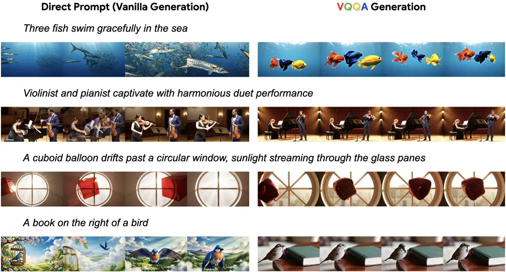

Figure 1: Videos generated by VQQA, showing improvements in categories
such as numeracy, interaction, dynamic attributes, and spatial
relationship.

Our main contributions are:

- •
  We propose VQQA, a multi-agent framework that transforms video
  evaluation from passive benchmarking into a dynamic question-answering
  paradigm, yielding actionable feedback across diverse generative
  tasks.
- •
  We formalize test-time scaling for video generation as a discrete,
  text-based optimization problem. By leveraging VLM-generated critiques
  as semantic gradients alongside a Global Selection and dynamic
  stopping mechanism, we iteratively correct visual flaws without
  requiring model weight access, effectively preventing semantic drift
  and ensuring efficiency.
- •
  Extensive experiments demonstrate that VQQA significantly outperforms
  state-of-the-art prompt optimization and sampling baselines across
  established benchmarks (T2V-CompBench (Sun et al., 2025), VBench2
  (Zheng et al., 2025), VBench-I2V (Huang et al., 2025)) using both
  open-weights and proprietary models (Yang et al., 2024; Google
  DeepMind, 2025).

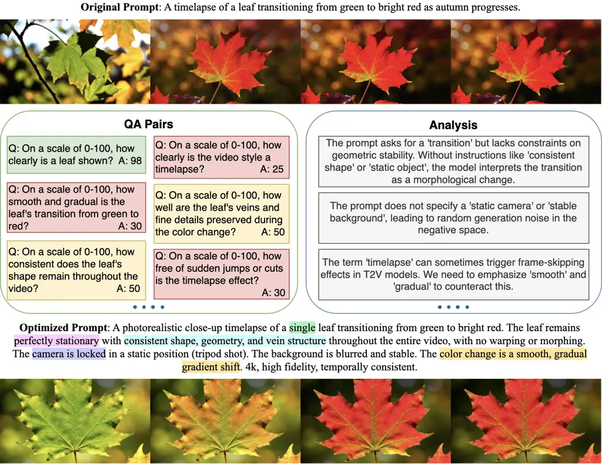

Figure 2: Qualitative example of VQQA iterative refinement process.
Utilizing low-scoring QA pairs to isolate visual flaws, VQQA constructs
an optimized prompt that successfully mitigates the localized artifacts
in the next generation.

## 2 Related Work

### 2.1 Video Evaluation Frameworks

The evaluation of generative video models has evolved from
distribution-level metrics to semantic, agentic assessments. Early
standard protocols relied on reference-based metrics like Fréchet Video
Distance (FVD) (Unterthiner et al., 2018) and Inception Score (IS)
(Salimans et al., 2016). While extended by Fréchet Video Motion Distance
(FVMD) (Liu et al., 2024) to better capture temporal dynamics, these
metrics correlate poorly with human perception at the instance level and
fail to provide actionable feedback.

To bridge this gap, the field shifted toward VLM-based evaluation.
Methods like CLIPScore (Hessel et al., 2021) and BLIP-Score (Li et al., 2022) measure frame-text consistency but lack temporal awareness. More
recent approaches leverage multimodal large language models as judges:
VQAScore (Lin et al., 2024) computes probabilities of affirmative
boolean answers, while T2VQA (Kou et al., 2024) and LMM-VQA (Ge et al., 2025) regress directly to Mean Opinion Scores (MOS). VideoScore2 (He et
al., 2025b) advances this by employing a “think-before-you-score”
mechanism to generate Chain-of-Thought (CoT) rationales. However, its
reasoning remains constrained to pre-defined axes, limiting its
flexibility in diagnosing unique, instance-specific artifacts.

Most recently, comprehensive benchmark suites and modular pipelines (Liu
et al., 2023a; Huang et al., 2024; Huang et al., 2025; Zheng et al.,
2025; Sun et al., 2025) have decomposed quality into disentangled axes.
While frameworks like Evaluation Agent (Zhang et al., 2025) employ
human-like, multi-round evaluation, they remain primarily designed for
passive performance benchmarking. In contrast, VQQA dynamically
generates context-dependent questions that serve as a direct language
interface for downstream refinement.

### 2.2 Prompt Optimization for Video Generation

Prompt engineering has become essential for unlocking the capabilities
of frozen generative models. Early text-based approaches like APE (Zhou
et al., 2022) and Promptist (Hao et al., 2023) utilized iterative search
to align prompts with model preferences. In the visual domain, methods
like Prompt-A-Video (Ji et al., 2025) and VPO (Cheng et al., 2025) adapt
these techniques to text-to-video diffusion. VPO, for instance,
optimizes prompts for harmlessness, accuracy, and helpfulness using
Direct Preference Optimization (DPO) (Rafailov et al., 2023).

However, most of these methods operate in an “open-loop”
fashion—optimizing prompts based on dataset-level priors rather than the
specific visual artifacts of the current generation. While
self-correcting approaches are widely established in LLMs (e.g.,
Self-Refine (Madaan et al., 2023), Reflexion (Shinn et al., 2023)),
systems for explicit self-critique and revision remain relatively
underexplored in video generation. Recent exceptions include VideoAgent
(Soni et al., 2024) for robotic planning and VideoRepair (Lee et al.,
2024), which employs a detect-and-patch” strategy to fix localized
misalignments. While effective for isolated errors, localized methods
cannot address global inconsistencies like temporal flow. VQQA overcomes
this via a holistic “closed-loop” system, iteratively updating the
entire prompt based on granular visual evidence to correct both local
and global failures.

### 2.3 Test-Time Scaling for Video Generation

Scaling compute at inference time has proven effective for complex
tasks. In LLMs, techniques like Tree-of-Thoughts (ToT) (Yao et al., 2023) and Chain-of-Verification (Dhuliawala et al., 2024) demonstrate
that iterative reasoning boosts performance without retraining.

In video generation, inference-time scaling typically manifests as
rejection sampling or trajectory search. Beyond the standard Best-of-N
approach, Video-T1 (Liu et al., 2025) formalizes test-time scaling as a
trajectory search problem using verifiers, while VISTA (Long et al., 2025) implements an agentic self-improving loop. Other approaches
intervene directly in generative physics: Video-TTT (Dalal et al., 2025)
applies gradient updates to RNN-based hidden states, while EvoSearch (He
et al., 2025a) mutates initial noise and intermediate latents to
discover higher-quality trajectories.

However, existing approaches face distinct limitations. Gradient-based
methods like Video-TTT and EvoSearch require white-box access to model
internals, rendering them incompatible with commercial APIs. Conversely,
agentic frameworks like VISTA incur massive computational costs by
requiring large candidate pools to identify improvements.

VQQA proposes an alternative inspired by text-based optimization.
Building on TextGrad (Yuksekgonul et al., 2024) and Feedback Descent
(Lee et al., 2025), which formalize backpropagation-like feedback via
natural language, VQQA treats the prompt as the optimization variable.
By using VLM-guided feedback as semantic gradients, VQQA achieves
precise adaptation and error correction strictly through a natural
language interface, bypassing the need for weight access or exhaustive
sampling.

## 3 Methodology

### 3.1 Problem Formulation

#### 3.1.1 Video Evaluation System

Let $`p`$ denote a text prompt, $`C=\{c_{1},c_{2},\dots,c_{n}\}`$ a set
of generation conditions (e.g., reference images), and $`M`$ a
pre-trained video generation model. The sampled video $`v`$ is:

```math
v=M(p,C) \tag{1}
```

The objective of an evaluation system is to design a reward function
$`f`$ that produces both a quantitative quality score $`S_{f}`$ and a
qualitative linguistic rationale $`R_{f}`$ based on the provided inputs:

```math
(S_{f},R_{f})=f(v,p,C) \tag{2}
```

Given an external ground-truth evaluation system $`g`$ (e.g., human Mean
Opinion Scores or established benchmark auto-raters), $`f`$ minimizes
the discrepancy between its predicted score $`S_{f}`$ and the target
score $`S_{g}=g(v,p,C)`$:

```math
f^{*}=\argmin_{f}\mathbb{E}\left[\Delta(S_{g},S_{f})\right] \tag{3}
```

Crucially, $`f`$ requires interpretability; it must approximate the
scalar score and generate human-interpretable reasoning $`R_{f}`$ to
justify evaluations and facilitate downstream refinement (Doshi-Velez
and Kim, 2017).

#### 3.1.2 Iterative Refinement via Test-Time Training (TTT)

Function $`f`$ ultimately guides the optimization of prompt $`p`$. We
formulate this as a Test-Time Training (TTT) task to find an optimal
prompt $`p^{*}`$ from the prompt space $`\mathcal{P}`$:

```math
p^{*}=\argmax_{p\in\mathcal{P}}g(M(p,C),p,C) \tag{4}
```

Since $`g`$ is typically unknown and non-differentiable at inference
time, we use $`f\approx f^{*}`$ as a proxy. This transforms video
refinement into discrete prompt-space optimization process (Yuksekgonul
et al., 2024; Lee et al., 2025). Rather than traditional gradient
descent, which is ill-defined for discrete text, we use the reasoning
component $`R_{f,t}`$ at step $`t`$ as a semantic gradient to identify
visual flaws. Letting $`(S_{f,t},R_{f,t})=f(v_{t},p_{t},C)`$, we define
the iterative update rule as:

```math
p_{t+1}=\text{VLM}(p_{t},R_{f,t}) \tag{5}
```

where the VLM acts as a refinement operator, leveraging the critique
$`R_{f,t}`$ to rectify flaws in the subsequent generation.

### 3.2 The VQQA Framework

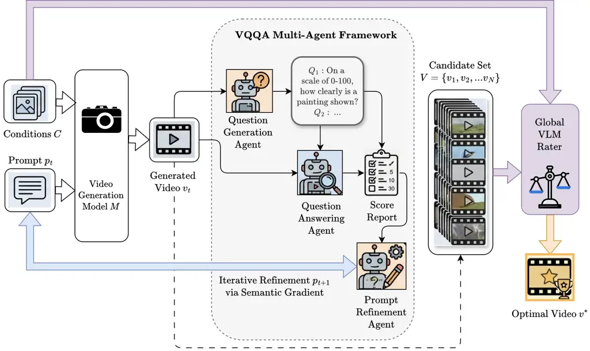

Figure 3: The VQQA framework: Given generation conditions $`C`$ and a
prompt $`p_{t}`$, the model $`M`$ produces a video $`v_{t}`$. The
multi-agent framework uses a Question Generation (QG) agent to formulate
visual queries $`Q`$ and a Question Answering (QA) agent to evaluate the
video and produce a score report. These outputs inform the Prompt
Refinement (PR) agent, which uses semantic gradient to update the prompt
for the next iteration. Finally, a Global VLM Rater assesses the
candidate set of generated videos against the original conditions to
select the optimal video $`v^{*}`$.

#### 3.2.1 Multi-Agent Architecture

As shown in Figure 3, VQQA decomposes interpretable video evaluation and
iterative refinement into three specialized agents:

- •
  Question Generation (QG) Agent: Analyzes the video $`v`$, prompt
  $`p`$, and conditions $`C`$ to dynamically generate a set of questions
  $`Q`$ across three dimensions: Video-Prompt Alignment, Visual Quality,
  and Condition Fidelity (when additional conditions $`C`$ are
  provided). This categorization directly mirrors the primary evaluation
  axes established by comprehensive benchmarks, ensuring robust and
  standardized coverage of critical failure modes.
- •
  Question Answering (QA) Agent: Acts as the primary evaluator,
  inspecting video $`v`$ against questions $`Q`$ to assign normalized
  scores $`s\in[0,100]`$ per question, constructing a detailed
  diagnostic map of critical visual flaws identified from the video.
- •
  Prompt Refinement (PR) Agent: Synthesizes QA feedback into an
  optimized prompt $`p_{t+1}`$. By processing multiple low-scoring QA
  pairs (the semantic gradient), the agent formulates a revised prompt
  that concurrently mitigates these localized errors in the next
  iteration.

Complete implementation details, including the prompts, models and
parameters, are provided in Appendix C.

#### 3.2.2 Global Selection and Convergence

The iterative refinement process is inherently stochastic, as it samples
different trajectories within the latent space of the generator $`M`$.
To ensure the framework identifies the optimal generation and terminates
efficiently, we define both a global selection mechanism and a
convergence criterion.

#####

Global Selection To prevent semantic drift—where localized refinements
cause deviation from overarching user intent—we employ a Global VLM
Rater to perform a holistic, post-hoc evaluation of the candidate set
$`\mathcal{V}=\{v_{1},v_{2},\dots,v_{N}\}`$. The rater assesses each
candidate against the original prompt $`p_{0}`$:

> On a scale of 0-100, how well does this video match ‘original prompt’
> (and ‘reference images’)?  
> Respond with only a number between 0 and 100.

The rater assigns a Global Score ($`GS`$) to each video, and the final
output $`v^{*}`$ is selected as the candidate that maximizes alignment:

```math
v^{*}=v_{i},\quad\text{where }i=\argmax_{i\in\{1,\dots,N\}}GS(v_{i},p_{0},C) \tag{6}
```

This mechanism ensures that while the Prompt Refinement Agent explores
variations to enhance visual quality, the final selection remains
anchored to the user’s primary goals. Unlike VQAScore (Lin et al.,
2024), which relies on models fine-tuned specifically for text-visual
alignment, our approach leverages the inherent visual reasoning
capabilities of VLMs. This flexibility allows $`GS`$ to evaluate
fidelity across multiple generation conditions without task-specific
training.

#####

Convergence Criterion To trade-off between inference cost and quality,
we employ early stopping based on the running maximum Global Score
$`S^{*}_{t}=\max_{\tau\in\{1,\dots,t\}}GS(v_{\tau})`$. Refinement
terminates at step $`t`$ if either condition is met:

1.  1.  Target Satisfaction: The system generates a video that meets the
        ideal quality standard, denoted by a threshold $`\gamma`$ (e.g.,
        $`\gamma=100`$).

    ```math
    S^{*}_{t}\geq\gamma \tag{7}
    ```

2.  2.  Performance Saturation: The global maximum score stagnates over a
        “patience” window $`k`$, where improvement falls below a marginal
        $`\epsilon`$:

    ```math
    \Delta(S^{*}_{t},S^{*}_{t-k})\leq\epsilon \tag{8}
    ```

This ensures that the framework halts immediately upon achieving an
optimal result or when additional compute yields no additional
improvement.

## 4 Experiments

### 4.1 Experimental Setup

#### 4.1.1 Tasks

We evaluate the VQQA framework on two video generation tasks:

##### Text-to-Video (T2V):

Given a text prompt $`p`$, the objective is to generate a video
$`v=M(p)`$ that accurately reflects the semantic and temporal content of
$`p`$.

##### Image-to-Video (I2V):

Given a prompt $`p`$ and reference images $`C=\{i_{1},\dots,i_{m}\}`$,
the goal is to synthesize a video $`v=M(p,C)`$ adhering to the textual
prompt while maintaining high visual fidelity to the reference image(s).

#####

Unlike traditional pipelines hard-coded for specific modalities, VQQA
acts as a task-agnostic optimizer. Its agents dynamically adapt visual
queries to the provided condition set (text-only or text+images). This
versatility allows us to seamlessly apply the exact same iterative
refinement process to both paradigms without architectural
modifications.

|                               |                                    |              |              |         |        |        |             |          |       |
| ----------------------------- | ---------------------------------- | ------------ | ------------ | ------- | ------ | ------ | ----------- | -------- | ----- |
| Method                        |                                    | Consist-attr | Dynamic-attr | Spatial | Motion | Action | Interaction | Numeracy | AVG   |
| Vanilla Generation            |                                    |              |              |         |        |        |             |          |       |
|                               | CogVideoX-5B (Yang et al., 2024)   | 61.64        | 2.19         | 51.72   | 26.58  | 53.33  | 60.69       | 37.06    | 41.89 |
| Prompt Optimizer              |                                    |              |              |         |        |        |             |          |       |
|                               | VPO (Cheng et al., 2025)           | 76.43        | 4.52         | 54.18   | 26.07  | 64.09  | 68.83       | 45.72    | 48.55 |
| Best-of-N $`\And`$            |                                    |              |              |         |        |        |             |          |       |
|                               | VQAScore (Lin et al., 2024)        | 80.83        | 2.48         | 56.62   | 26.24  | 64.31  | 65.96       | 44.48    | 48.70 |
|                               | VideoScore2 (He et al., 2025b)     | 80.86        | 1.99         | 56.90   | 26.82  | 58.24  | 61.54       | 39.53    | 46.55 |
| Best-of-N $`\And`$ VLM-Rating |                                    |              |              |         |        |        |             |          |       |
|                               | GPT-4o (Hurst et al., 2024)        | 80.17        | 2.00         | 56.36   | 27.29  | 60.59  | 66.06       | 42.19    | 47.81 |
|                               | Gemini-3-Pro (Pichai et al., 2025) | 79.00        | 2.34         | 58.36   | 28.63  | 60.31  | 58.97       | 43.42    | 47.29 |
| VQQA                          |                                    |              |              |         |        |        |             |          |       |
|                               | GPT-4o (Hurst et al., 2024)        | 82.96        | 4.88         | 58.73   | 28.51  | 66.72  | 69.57       | 47.75    | 51.30 |
|                               | Gemini-3-Pro (Pichai et al., 2025) | 84.58        | 7.92         | 66.03   | 27.73  | 68.50  | 68.54       | 50.91    | 53.46 |

Table 1: T2V-CompBench evaluation results on CogVideoX-5B. Performance
is reported using $`N=5`$ for Best-of-$`N`$ strategy, and 4 optimization
rounds for VQQA. Vanilla generation results are obtained from the
official leaderboard. Best and second-best scores are highlighted in
green and yellow. All numbers are percentages.

|                               |                                    |            |             |                 |                |         |             |
| ----------------------------- | ---------------------------------- | ---------- | ----------- | --------------- | -------------- | ------- | ----------- |
| Method                        |                                    | Creativity | Commonsense | Controllability | Human Fidelity | Physics | Total Score |
| Vanilla Generation            |                                    |            |             |                 |                |         |             |
|                               | CogVideoX-5B (Yang et al., 2024)   | 42.99      | 54.19       | 23.81           | 80.13          | 38.57   | 41.98       |
| Prompt Optimizer              |                                    |            |             |                 |                |         |             |
|                               | VPO (Cheng et al., 2025)           | 44.44      | 54.19       | 24.79           | 84.45          | 39.01   | 43.34       |
| Best-of-N $`\And`$            |                                    |            |             |                 |                |         |             |
|                               | VQAScore (Lin et al., 2024)        | 51.51      | 57.92       | 30.96           | 79.85          | 42.49   | 46.95       |
|                               | VideoScore2 (He et al., 2025b)     | 45.92      | 55.05       | 26.92           | 78.09          | 35.46   | 43.97       |
| Best-of-N $`\And`$ VLM-Rating |                                    |            |             |                 |                |         |             |
|                               | GPT-5.1 (Singh et al., 2025)       | 48.34      | 56.49       | 29.81           | 78.83          | 33.88   | 45.28       |
|                               | GPT-4o (Hurst et al., 2024)        | 48.19      | 57.06       | 28.25           | 80.05          | 41.03   | 46.15       |
|                               | Gemini-3-Pro (Pichai et al., 2025) | 47.96      | 57.64       | 28.79           | 79.69          | 31.05   | 44.76       |
| VQQA                          |                                    |            |             |                 |                |         |             |
|                               | GPT-4o (Hurst et al., 2024)        | 55.47      | 57.92       | 30.41           | 79.95          | 46.92   | 48.18       |
|                               | Gemini-3-Pro (Pichai et al., 2025) | 54.85      | 58.21       | 31.50           | 81.23          | 54.26   | 50.41       |

Table 2: VBench2 evaluation results on CogVideoX-5B. Performance is
reported with $`N=5`$ (Best-of-$`N`$) and 4 optimization rounds (VQQA).
All numbers are percentages.

#### 4.1.2 Baselines

We compare our method against established optimization frameworks and
stochastic search strategies using various scoring functions:

- •
  Video Prompt Optimization (VPO) (Cheng et al., 2025): A primary
  baseline for prompt refinement. VPO is a two-stage framework
  optimizing for harmlessness, accuracy, and helpfulness. It refines
  prompts to enhance both generation quality and safety.
- •
  Best-of-N (BoN) (Stiennon et al., 2020): A stochastic search baseline
  sampling $`N`$ candidates $`\{v_{1},\dots,v_{N}\}`$ from the initial
  prompt $`p_{0}`$, selecting the optimal video via a reward function.
  We implement BoN with three distinct scoring mechanisms:
  - –
    BoN with VQAScore (Lin et al., 2024): VQAScore is an automated
    metric based on fine-tuned Visual Question Answering (VQA) models.
    It measures alignment by averaging confidence scores of boolean
    questions (e.g., “Does this video show \[text\]?”) across video
    frames.
  - –
    BoN with VideoScore2 (He et al., 2025b): VideoScore2 is a
    regression-based reward model trained on large-scale human
    preference data. Unlike frame-averaging metrics, it uses a
    spatio-temporal representation to directly predict human-like
    quality and alignment scores for an entire video sequence.
  - –
    BoN with VLM-Rating: Prompts multimodal VLMs to act as judges,
    rating video-condition alignment on a 0–100 scale.

#### 4.1.3 Benchmarks

We evaluate our method on the following benchmarks:

- •
  T2V-CompBench (Sun et al., 2025): A text-to-video benchmark comprising
  1,400 prompts across seven categories. It is designed to evaluate
  compositional generation, measuring how effectively models integrate
  multiple objects, actions, and attributes into coherent, temporally
  consistent videos.
- •
  VBench2 (Huang et al., 2024): A text-to-video evaluation suite focused
  on measuring intrinsic faithfulness. VBench2 uses a multi-agent VLM
  system to evaluate five high-level dimensions: Human Fidelity,
  Controllability, Creativity, Physics, and Commonsense. This framework
  enables systematic assessment of a model’s ability to reduce complex
  physical and anatomical hallucinations.
- •
  VBench-I2V (Huang et al., 2025): An extension of VBench for
  image-to-video generation. It evaluates how faithfully a generated
  video aligns with a reference image, assessing temporal consistency,
  motion magnitude, and the preservation of the image’s identity and
  semantic details.

### 4.2 Results

#### 4.2.1 T2V-CompBench

Table 1 shows our VQQA framework consistently outperforming both the
vanilla generation and all baselines on T2V-CompBench. Using
Gemini-3-Pro, VQQA achieves the highest average score (53.46%),
delivering an absolute improvement of +11.57% over vanilla generation
and +4.76% over the strongest baseline (VQAScore). VQQA with GPT-4o
secures the second-best average (51.30%), showing the superiority of our
approach regardless of the underlying VLM. The iterative refinement
process effectively resolves compositional errors, yielding substantial
absolute gains across all categories, especially in consistent-attribute
(+22.94%), spatial understanding (+14.31%), and numeracy (+13.85%).

#### 4.2.2 VBench2

Results on the VBench2 benchmark (Table 2) further validate our
approach. The Gemini-3-Pro and GPT-4o variants of VQQA achieve the
highest (50.41%) and second-highest (48.18%) total scores, respectively.
VQQA with Gemini-3-Pro provides a +8.43% absolute increase over the
vanilla baseline and surpasses the best competing method (VQAScore) by
+3.46%.

#### 4.2.3 VBench-I2V

Evaluation results on the VBench-I2V benchmark (Table 3) further
demonstrate the versatility of the VQQA framework on the I2V task.
Despite the high saturation of this benchmark, VQQA with Gemini-3-Pro
achieves the highest performance across all evaluated axes, improving
upon vanilla generation by +1.24% and the strongest Best-of-N baseline
by +0.23%. Furthermore, VQQA exhibits remarkable efficiency, requiring
an average of only 1.6 iterations to satisfy the task’s stopping
criterion.

### 4.3 Analysis

|                               |                                      |                |                        |             |                     |                   |           |
| ----------------------------- | ------------------------------------ | -------------- | ---------------------- | ----------- | ------------------- | ----------------- | --------- |
| Method                        |                                      | I2V Background | Background Consistency | I2V Subject | Subject Consistency | Motion Smoothness | Avg Score |
| Vanilla Generation            |                                      |                |                        |             |                     |                   |           |
|                               | CogVideoX-5B-I2V (Yang et al., 2024) | 96.74          | 96.42                  | 97.19       | 94.34               | 98.40             | 96.62     |
| Best-of-N $`\And`$            |                                      |                |                        |             |                     |                   |           |
|                               | VQAScore (Lin et al., 2024)          | 98.96          | 97.19                  | 97.61       | 95.33               | 98.29             | 97.48     |
| Best-of-N $`\And`$ VLM-Rating |                                      |                |                        |             |                     |                   |           |
|                               | Gemini-3-Pro (Pichai et al., 2025)   | 99.03          | 97.37                  | 97.77       | 95.68               | 98.32             | 97.63     |
| VQQA                          |                                      |                |                        |             |                     |                   |           |
|                               | Gemini-3-Pro (Pichai et al., 2025)   | 99.08          | 97.40                  | 98.09       | 96.29               | 98.44             | 97.86     |

Table 3: VBench-I2V evaluation results on CogVideoX-5B-I2V. Performance
is reported with $`N=5`$ (Best-of-$`N`$) and 4 optimization rounds
(VQQA). Vanilla Generation results are obtained from the leaderboard.
All numbers are percentages.

|                     |           |          |            |
| ------------------- | --------- | -------- | ---------- |
| Method              | Precision | Q-Recall | E2E-Recall |
| VLM Direct Analysis | 99.94     | –        | 70.18      |
| VQQA                | 99.28     | 96.55    | 82.08      |

Table 4: Quality of the visual flaw identification process (Judged by
Gemini-3-Flash). Both methods use Gemini-3-Pro as the backbone. VQQA
Score threshold for E2E-Recall measurement is set to 60. All numbers are
percentages.

#### 4.3.1 Quality of Generated Questions

To evaluate the coverage and effectiveness of VQQA’s generated
questions, we use the VideoFeedback2 (He et al., 2025b) test split. We
construct a ground-truth (GT) set of visual flaws by prompting GPT-5.2
(Singh et al., 2025) to extract discrete problems from the dataset’s
reasoning trajectories. A judge model maps each GT problem to the
specific VQQA questions designed to detect it. We evaluate recall at two
levels: (1) Question Recall (Q-Recall), the percentage of GT problems
covered by at least one generated question; and (2) End-to-End (E2E)
Recall, the percentage of GT problems where the corresponding VQQA
question correctly receives a sub-threshold score from the QA agent.

We measure precision based on the generated questions’ relevance to the
input video and prompt, assessed via binary classification by a judge
model. We prioritize relevance over strict GT mapping for two reasons:
(i) the GT set, derived from Claude-4-Sonnet (Anthropic, 2025)
trajectories, may be incomplete; and (ii) VQQA proactively probes for
potential visual artifacts. Consequently, a contextually relevant
question remains valuable even if no flaw is ultimately confirmed.

Finally, we compare VQQA against a zero-shot VLM baseline that directly
identifies visual flaws. As Table 4 demonstrates, while both methods
maintain near-perfect precision (\>99%), VQQA yields a significant 11.9%
improvement in E2E-Recall over the baseline. This substantial gain in
recall means our system captures a considerably wider array of visual
artifacts, delivering the robust feedback necessary to effectively
correct errors and improve subsequent video generations. Qualitative
analysis indicates that the marginal precision deficits in both methods
primarily stem from infrequent VLM hallucinations during evaluation.

#### 4.3.2 Convergence and Efficiency

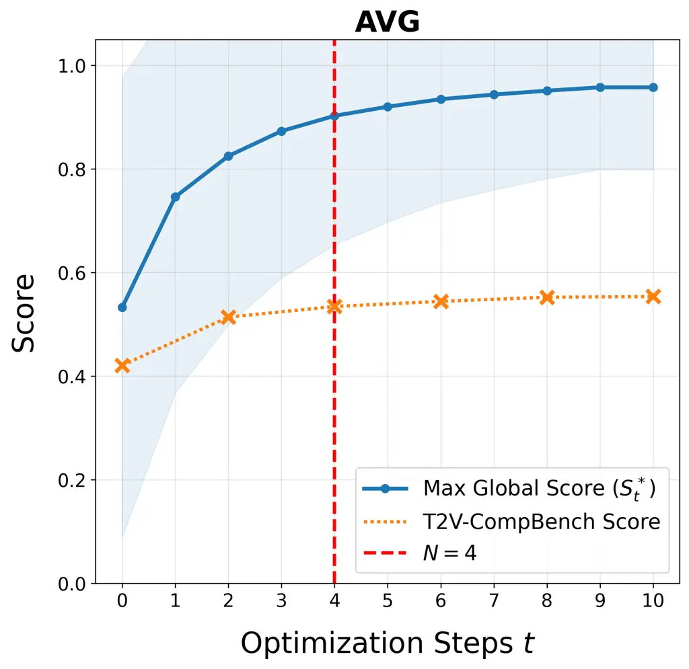

(a) VQQA performance across iterations

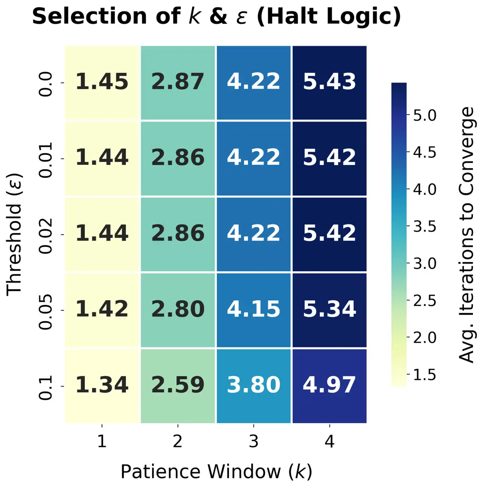

(b) Convergence parameter sensitivity

Figure 4: Convergence analysis of VQQA on T2V-CompBench. Evaluations are
performed for CogVideoX-5B generations using Gemini-3-Pro. (a)
Correlations between the maximum global score $`S^{*}_{t}`$ and the
T2V-CompBench metric across optimization steps. The blue shaded region
indicates $`\pm 1`$ standard deviation of $`S^{*}_{t}`$ across the 1400
evaluated samples. The detailed performance breakdown for each
individual category is provided in Appendix C.4. (b) Sensitivity
analysis of average iterations to converge given the patience window
$`k`$ and saturation threshold $`\epsilon`$ (Equation 8).

To evaluate the efficiency of the proposed stopping criterion
(Equation 8), we analyze optimization trajectories over a horizon of
$`N=10`$ steps. As illustrated in Figure 4, both the agent’s internal
score $`S^{*}_{t}`$ and the external T2V-CompBench metrics exhibit rapid
gains in the initial few iterations, reaching a saturation plateau
shortly thereafter.

The sensitivity analysis in Figure 4(b) demonstrates that for a standard
patience window $`k=3`$, the algorithm converges within $`3.80`$ to
$`4.22`$ iterations across various thresholds. This aligns with the
visual evidence in Figure 4(a), where the red dashed line (Iter=4)
indicates the majority of performance gains are captured within the
first four rounds. These results confirm that our dynamic termination
mechanism effectively prevents redundant inference steps by halting once
the semantic gradient vanishes, thereby maximizing computational
efficiency without sacrificing the video quality gain accumulated
through iterations.

### 4.4 Ablation Studies

|                               |                                    |              |              |         |        |        |             |          |       |
| ----------------------------- | ---------------------------------- | ------------ | ------------ | ------- | ------ | ------ | ----------- | -------- | ----- |
| Method                        |                                    | Consist-attr | Dynamic-attr | Spatial | Motion | Action | Interaction | Numeracy | AVG   |
| Vanilla Generation            |                                    |              |              |         |        |        |             |          |       |
|                               | Veo3.1 (Google DeepMind, 2025)     | 76.45        | 25.70        | 59.76   | 51.18  | 71.81  | 62.87       | 43.77    | 55.93 |
| Best-of-N $`\And`$            |                                    |              |              |         |        |        |             |          |       |
|                               | VQAScore (Lin et al., 2024)        | 78.21        | 26.13        | 63.76   | 52.03  | 74.83  | 66.99       | 54.59    | 59.51 |
|                               | VideoScore2 (He et al., 2025b)     | 78.19        | 24.76        | 60.99   | 54.49  | 73.52  | 65.98       | 46.7     | 57.80 |
| Best-of-N $`\And`$ VLM-Rating |                                    |              |              |         |        |        |             |          |       |
|                               | Gemini-3-Pro (Pichai et al., 2025) | 78.70        | 27.56        | 62.98   | 55.61  | 73.63  | 65.33       | 49.25    | 59.01 |
| VQQA                          |                                    |              |              |         |        |        |             |          |       |
|                               | Gemini-3-Pro (Pichai et al., 2025) | 82.00        | 26.44        | 65.73   | 59.70  | 74.31  | 68.02       | 56.47    | 61.81 |

Table 5: T2V-CompBench evaluation results on Veo3.1. Performance is
reported with $`N=5`$ (Best-of-$`N`$) and 4 optimization rounds (VQQA).
All numbers are percentages.

#### 4.4.1 Generalizability to Proprietary Models

To assess the model-agnostic nature of VQQA, we applied our prompt
optimization pipeline to the proprietary Google Veo 3.1 model (Google
DeepMind, 2025). As shown in Table 5, VQQA remains highly effective even
with Veo 3.1’s mandatory internal prompt optimization enabled. After
four rounds, VQQA improved the overall T2V-CompBench average score by an
absolute margin of +5.88% (from 55.93% to 61.81%), outperforming the
Best-of-N approaches using VQAScore (+3.58%) and Gemini-3-Pro (+3.08%).
Furthermore, VQQA achieves the highest performance across the majority
of compositional dimensions.

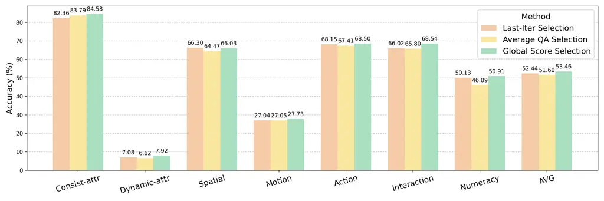

Figure 5: Ablation Study on Global Selection Mechanism. The number of
prompt optimization rounds for VQQA is fixed at N = 4.

#### 4.4.2 Global Selection Mechanism

We investigate the contribution of the Global Selection (Equation 6) by
comparing the selection function against two variants:

1.  1.  Last-Iter Selection ($`v_{N}`$): We disable the Global Rater and
        simply accept the output of the final iteration. A performance drop
        here indicates “semantic drift,” where the Prompt Refinement Agent
        optimizes for localized visual details at the expense of original
        user intent. As shown in Figure 5, omitting global selection
        decreases the overall average score by 1.02%, confirming that
        unanchored refinement drifts from primary constraints.
2.  2.  Average-QA Selection: We replace the Global Score $`GS`$ with the
        average score derived from the QA Agent’s internal questions. This
        tests whether a holistic, post-hoc evaluation supersedes the
        aggregated granular scores used during optimization. This variant
        underperforms the proposed global selection by an average margin of
        1.86%. This confirms that while granular QA scores provide effective
        semantic gradients for localized refinement, their unweighted
        aggregation fails to capture the “gestalt alignment” (Wagemans et
        al., 2012a; Wagemans et al., 2012b) required for optimal video
        selection.

Overall, Figure 5 demonstrates the necessity of decoupling the iterative
feedback loop from the final selection criterion. Because prompt
refinement targets specific visual bottlenecks, it does not guarantee
monotonic improvement in holistic text-to-video alignment at every step.
By employing the Global Score to evaluate the candidate pool against the
original prompt, the proposed mechanism successfully mitigates semantic
drift. This macro-level perspective ensures the final output achieves
the optimal balance across critical dimensions, outperforming
alternative selection strategies.

|                     |                                        |              |              |         |        |        |             |          |       |
| ------------------- | -------------------------------------- | ------------ | ------------ | ------- | ------ | ------ | ----------- | -------- | ----- |
| Method              |                                        | Consist-attr | Dynamic-attr | Spatial | Motion | Action | Interaction | Numeracy | AVG   |
| VQQA GS-in-the-loop |                                        |              |              |         |        |        |             |          |       |
|                     | Gemini-3-Pro (Pichai et al., 2025)     | 81.77        | 8.40         | 67.05   | 27.94  | 68.15  | 70.83       | 50.69    | 53.55 |
|                     | Gemini-2.5-Pro (Comanici et al., 2025) | 83.92        | 6.32         | 64.47   | 28.19  | 66.33  | 72.69       | 46.67    | 52.66 |
|                     | AVG                                    | 82.85        | 7.36         | 65.76   | 28.07  | 67.24  | 71.76       | 48.68    | 53.11 |
| VQQA Standard       |                                        |              |              |         |        |        |             |          |       |
|                     | Gemini-3-Pro (Pichai et al., 2025)     | 84.58        | 7.92         | 66.03   | 27.73  | 68.50  | 68.54       | 50.91    | 53.46 |
|                     | Gemini-2.5-Pro (Comanici et al., 2025) | 83.43        | 7.08         | 65.99   | 27.76  | 68.17  | 72.37       | 53.66    | 54.07 |
|                     | AVG                                    | 84.01        | 7.50         | 66.01   | 27.75  | 68.34  | 70.46       | 52.29    | 53.77 |

Table 6: Ablation Study on GlobalScore in the loop. Number of VQQA
optimization rounds is fixed at N = 4. Best and second-best average
scores across models for each strategy are highlighted in green and
yellow. All numbers are percentages.

#### 4.4.3 Prompt Refinement: GS-in-the-loop (or not?)

To evaluate if the global score $`GS`$ can further impact the
optimization process, we tried one variation of our method, which is
injecting the global score into the Prompt Refinement (PR) agent’s
context history, analyzing whether exposing the PR agent to this
high-level metric aids convergence or introduces noise that hampers
specific visual corrections.

As Table 6 shows, incorporating $`GS`$ during iterative refinement
degrades average generation quality (53.11% vs. the standard 53.77%).
Specifically, excluding $`GS`$ from the PR context better resolves
fine-grained compositional errors, outperforming the GS-in-the-loop
variant in attribute consistency (84.01% vs. 82.85%), spatial
understanding (66.01% vs. 65.76%), and numeracy (52.29% vs. 48.68%).

This indicates that providing a holistic metric during refinement
introduces optimization noise. When exposed to $`GS`$, the agent tends
to become distracted from the localized, specific bottlenecks identified
by the granular QA pairs. It attempts to prematurely optimize the global
score rather than sequentially resolving isolated visual errors.
Therefore, strictly decoupling the granular feedback loop (used for
targeted refinement) from the global score (used strictly for final
candidate selection) yields the most robust compositional improvements.

## 5 Conclusion

In this paper, we introduced VQQA, a novel multi-agent framework that
transforms the passive evaluation of video generation models into an
active, closed-loop refinement process. By dynamically generating visual
questions and leveraging Vision-Language Model critiques as semantic
gradients, VQQA enables precise, iterative prompt optimization through a
black-box natural language interface. Extensive evaluations across both
T2V and I2V tasks demonstrate that VQQA yields significant improvements
over strong baselines requiring very few iterations, generalizing
seamlessly across open-weights and proprietary models. Ultimately, VQQA
provides a scalable, task-agnostic solution for aligning visual
generative models with complex human intent, paving the way for more
controllable and interpretable AI-driven content creation.

## References

- Anthropic (2025) Anthropic Claude opus 4 & claude sonnet 4 system
  card. Technical report Anthropic. External Links:
  [Link](https://www.anthropic.com/news/claude-4) Cited by: §4.3.1.
- Blattmann et al. (2023) A. Blattmann, R. Rombach, H. Ling, T.
  Dockhorn, S. W. Kim, S. Fidler, and K. Kreis Align your latents:
  high-resolution video synthesis with latent diffusion models. In
  Proceedings of the IEEE/CVF conference on computer vision and pattern
  recognition, pp. 22563–22575. Cited by: §1.
- Cheng et al. (2025) J. Cheng, R. Lyu, X. Gu, X. Liu, J. Xu, Y. Lu, J.
  Teng, Z. Yang, Y. Dong, J. Tang, et al. Vpo: aligning text-to-video
  generation models with prompt optimization. arXiv preprint
  arXiv:2503.20491. Cited by: 1st item, §D.1, §2.2, 1st item, Table 1,
  Table 2.
- Comanici et al. (2025) G. Comanici, E. Bieber, M. Schaekermann, I.
  Pasupat, N. Sachdeva, I. Dhillon, M. Blistein, O. Ram, D. Zhang, E.
  Rosen, et al. Gemini 2.5: pushing the frontier with advanced
  reasoning, multimodality, long context, and next generation agentic
  capabilities. arXiv preprint arXiv:2507.06261. Cited by: Table 6,
  Table 6.
- Dalal et al. (2025) K. Dalal, D. Koceja, J. Xu, Y. Zhao, S. Han, K. C.
  Cheung, J. Kautz, Y. Choi, Y. Sun, and X. Wang One-minute video
  generation with test-time training. In Proceedings of the Computer
  Vision and Pattern Recognition Conference, pp. 17702–17711. Cited by:
  §1, §2.3.
- Dhuliawala et al. (2024) S. Dhuliawala, M. Komeili, J. Xu, R.
  Raileanu, X. Li, A. Celikyilmaz, and J. Weston Chain-of-verification
  reduces hallucination in large language models. In Findings of the
  association for computational linguistics: ACL 2024, pp. 3563–3578.
  Cited by: §2.3.
- Doshi-Velez and Kim (2017) F. Doshi-Velez and B. Kim Towards a
  rigorous science of interpretable machine learning. arXiv preprint
  arXiv:1702.08608. Cited by: §3.1.1.
- Ge et al. (2025) Q. Ge, W. Sun, Y. Zhang, Y. Li, Z. Ji, F. Sun, S.
  Jui, X. Min, and G. Zhai LMM-vqa: advancing video quality assessment
  with large multimodal models. IEEE Transactions on Circuits and
  Systems for Video Technology. Cited by: §1, §2.1.
- Google DeepMind (2025) Google DeepMind Veo: a text-to-video generation
  system (veo-3 technical report). Technical Report Google DeepMind.
  Note: Accessed: 2026-01-29 External Links:
  [Link](https://storage.googleapis.com/deepmind-media/veo/Veo-3-Tech-Report.pdf)
  Cited by: 2nd item, §C.2, 3rd item, §1, §4.4.1, Table 5.
- HaCohen et al. (2024) Y. HaCohen, N. Chiprut, B. Brazowski, D.
  Shalem, D. Moshe, E. Richardson, E. Levin, G. Shiran, N. Zabari, O.
  Gordon, P. Panet, S. Weissbuch, V. Kulikov, Y. Bitterman, Z. Melumian,
  and O. Bibi LTX-video: realtime video latent diffusion. arXiv preprint
  arXiv:2501.00103. Cited by: §1.
- Hao et al. (2023) Y. Hao, Z. Chi, L. Dong, and F. Wei Optimizing
  prompts for text-to-image generation. Advances in Neural Information
  Processing Systems 36, pp. 66923–66939. Cited by: §2.2.
- He et al. (2025a) H. He, J. Liang, X. Wang, P. Wan, D. Zhang, K. Gai,
  and L. Pan Scaling image and video generation via test-time
  evolutionary search. External Links: 2505.17618 Cited by: §2.3.
- He et al. (2025b) X. He, D. Jiang, P. Nie, M. Liu, Z. Jiang, M. Su, W.
  Ma, J. Lin, C. Ye, Y. Lu, et al. Videoscore2: think before you score
  in generative video evaluation. arXiv preprint arXiv:2509.22799. Cited
  by: 3rd item, §E.0.1, §2.1, 2nd item, §4.3.1, Table 1, Table 2, Table 5.
- Hessel et al. (2021) J. Hessel, A. Holtzman, M. Forbes, R. Le Bras,
  and Y. Choi Clipscore: a reference-free evaluation metric for image
  captioning. In Proceedings of the 2021 conference on empirical methods
  in natural language processing, pp. 7514–7528. Cited by: §2.1.
- Huang et al. (2024) Z. Huang, Y. He, J. Yu, F. Zhang, C. Si, Y.
  Jiang, Y. Zhang, T. Wu, Q. Jin, N. Chanpaisit, et al. Vbench:
  comprehensive benchmark suite for video generative models. In
  Proceedings of the IEEE/CVF Conference on Computer Vision and Pattern
  Recognition, pp. 21807–21818. Cited by: §1, §2.1, 2nd item.
- Huang et al. (2025) Z. Huang, F. Zhang, X. Xu, Y. He, J. Yu, Z.
  Dong, Q. Ma, N. Chanpaisit, C. Si, Y. Jiang, Y. Wang, X. Chen, Y.
  Chen, L. Wang, D. Lin, Y. Qiao, and Z. Liu VBench++: comprehensive and
  versatile benchmark suite for video generative models. IEEE
  Transactions on Pattern Analysis and Machine Intelligence. External
  Links: [Document](https://dx.doi.org/10.1109/TPAMI.2025.3633890) Cited
  by: §C.2, 3rd item, §1, §2.1, 3rd item.
- Hurst et al. (2024) A. Hurst, A. Lerer, A. P. Goucher, A. Perelman, A.
  Ramesh, A. Clark, A. Ostrow, A. Welihinda, A. Hayes, A. Radford, et
  al. Gpt-4o system card. arXiv preprint arXiv:2410.21276. Cited by: 2nd
  item, Table 1, Table 1, Table 2, Table 2.
- Ji et al. (2025) Y. Ji, J. Zhang, J. Wu, S. Zhang, S. Chen, C. Ge, P.
  Sun, W. Chen, W. Shao, X. Xiao, et al. Prompt-a-video: prompt your
  video diffusion model via preference-aligned llm. In Proceedings of
  the IEEE/CVF International Conference on Computer Vision,
  pp. 18725–18735. Cited by: §2.2.
- Kou et al. (2024) T. Kou, X. Liu, Z. Zhang, C. Li, H. Wu, X. Min, G.
  Zhai, and N. Liu Subjective-aligned dataset and metric for
  text-to-video quality assessment. In Proceedings of the 32nd ACM
  International Conference on Multimedia, pp. 7793–7802. Cited by: §1,
  §2.1.
- Lee et al. (2024) D. Lee, J. Yoon, J. Cho, and M. Bansal Videorepair:
  improving text-to-video generation via misalignment evaluation and
  localized refinement. arXiv preprint arXiv:2411.15115. Cited by: §2.2.
- Lee et al. (2025) Y. Lee, J. Boen, and C. Finn Feedback descent:
  open-ended text optimization via pairwise comparison. arXiv preprint
  arXiv:2511.07919. Cited by: §1, §2.3, §3.1.2.
- Li et al. (2022) J. Li, D. Li, C. Xiong, and S. Hoi Blip:
  bootstrapping language-image pre-training for unified vision-language
  understanding and generation. In International conference on machine
  learning, pp. 12888–12900. Cited by: §2.1.
- Li et al. (2025) M. Li, X. Hou, Z. Liu, D. Yang, Z. Qian, J. Chen, J.
  Wei, Y. Jiang, Q. Xu, and L. Zhang MCCD: multi-agent
  collaboration-based compositional diffusion for complex text-to-image
  generation. In Proceedings of the IEEE/CVF Conference on Computer
  Vision and Pattern Recognition (CVPR), pp. 13263–13272. Cited by: §1.
- Liao et al. (2024) M. Liao, Q. Ye, W. Zuo, F. Wan, T. Wang, Y.
  Zhao, J. Wang, X. Zhang, et al. Evaluation of text-to-video generation
  models: a dynamics perspective. Advances in Neural Information
  Processing Systems 37, pp. 109790–109816. Cited by: §1.
- Lin et al. (2024) Z. Lin, D. Pathak, B. Li, J. Li, X. Xia, G.
  Neubig, P. Zhang, and D. Ramanan Evaluating text-to-visual generation
  with image-to-text generation. In European Conference on Computer
  Vision, pp. 366–384. Cited by: 2nd item, §1, §2.1, §3.2.2, 1st item,
  Table 1, Table 2, Table 3, Table 5.
- Ling et al. (2025) X. Ling, C. Zhu, M. Wu, H. Li, X. Feng, C. Yang, A.
  Hao, J. Zhu, J. Wu, and X. Chu Vmbench: a benchmark for
  perception-aligned video motion generation. In Proceedings of the
  IEEE/CVF International Conference on Computer Vision, pp. 13087–13098.
  Cited by: §1.
- Liu et al. (2025) F. Liu, H. Wang, Y. Cai, K. Zhang, X. Zhan, and Y.
  Duan Video-t1: test-time scaling for video generation. arXiv preprint
  arXiv:2503.18942. Cited by: §2.3.
- Liu et al. (2024) J. Liu, Y. Qu, Q. Yan, X. Zeng, L. Wang, and R. Liao
  Fr$`\backslash`$’echet video motion distance: a metric for evaluating
  motion consistency in videos. arXiv preprint arXiv:2407.16124. Cited
  by: §2.1.
- Liu et al. (2023a) Y. Liu, X. Cun, X. Liu, X. Wang, Y. Zhang, H.
  Chen, Y. Liu, T. Zeng, R. Chan, and Y. Shan Evalcrafter: benchmarking
  and evaluating large video generation models. arXiv preprint
  arXiv:2310.11440. Cited by: §1, §2.1.
- Liu et al. (2023b) Y. Liu, L. Li, S. Ren, R. Gao, S. Li, S. Chen, X.
  Sun, and L. Hou Fetv: a benchmark for fine-grained evaluation of
  open-domain text-to-video generation. Advances in Neural Information
  Processing Systems 36, pp. 62352–62387. Cited by: §1.
- Long et al. (2025) D. X. Long, X. Wan, H. Nakhost, C. Lee, T. Pfister,
  and S. Ö. Arık VISTA: a test-time self-improving video generation
  agent. arXiv preprint arXiv:2510.15831. Cited by: §1, §2.3.
- Ma et al. (2025) Y. Ma, K. Feng, Z. Hu, X. Wang, Y. Wang, M. Zheng, B.
  Wang, Q. Wang, X. He, H. Wang, et al. Controllable video generation: a
  survey. arXiv preprint arXiv:2507.16869. Cited by: §1.
- Madaan et al. (2023) A. Madaan, N. Tandon, P. Gupta, S. Hallinan, L.
  Gao, S. Wiegreffe, U. Alon, N. Dziri, S. Prabhumoye, Y. Yang, et al.
  Self-refine: iterative refinement with self-feedback. Advances in
  Neural Information Processing Systems 36, pp. 46534–46594. Cited by:
  §2.2.
- Meng et al. (2024) F. Meng, J. Liao, X. Tan, W. Shao, Q. Lu, K.
  Zhang, Y. Cheng, D. Li, Y. Qiao, and P. Luo Towards world simulator:
  crafting physical commonsense-based benchmark for video generation.
  arXiv preprint arXiv:2410.05363. Cited by: §1.
- OpenAI (2024) OpenAI Video generation models as world simulators.
  External Links:
  [Link](https://openai.com/index/video-generation-models-as-world-simulators/)
  Cited by: §1.
- Peebles and Xie (2023) W. Peebles and S. Xie Scalable diffusion models
  with transformers. In Proceedings of the IEEE/CVF international
  conference on computer vision, pp. 4195–4205. Cited by: §1.
- Pichai et al. (2025) S. Pichai, D. Hassabis, and K. Kavukcuoglu A new
  era of intelligence with Gemini 3. Note:
  [https://blog.google/products-and-platforms/products/gemini/gemini-3/](https://blog.google/products-and-platforms/products/gemini/gemini-3/)Google
  Blog; accessed 2026-01-30 Cited by: Appendix B, 1st item, §D.2, Table
  1, Table 1, Table 2, Table 2, Table 3, Table 3, Table 5, Table 5,
  Table 6, Table 6.
- Rafailov et al. (2023) R. Rafailov, A. Sharma, E. Mitchell, C. D.
  Manning, S. Ermon, and C. Finn Direct preference optimization: your
  language model is secretly a reward model. Advances in neural
  information processing systems 36, pp. 53728–53741. Cited by: §2.2.
- Salimans et al. (2016) T. Salimans, I. Goodfellow, W. Zaremba, V.
  Cheung, A. Radford, and X. Chen Improved Techniques for Training GANs.
  Advances in neural information processing systems 29. Cited by: §1,
  §2.1.
- Shinn et al. (2023) N. Shinn, F. Cassano, A. Gopinath, K. Narasimhan,
  and S. Yao Reflexion: language agents with verbal reinforcement
  learning. Advances in Neural Information Processing Systems 36,
  pp. 8634–8652. Cited by: §2.2.
- Singh et al. (2025) A. Singh, A. Fry, A. Perelman, A. Tart, A.
  Ganesh, A. El-Kishky, A. McLaughlin, A. Low, A. Ostrow, A. Ananthram,
  et al. OpenAI GPT-5 System Card. arXiv preprint arXiv:2601.03267.
  Cited by: 2nd item, §E.0.1, §4.3.1, Table 2.
- Soni et al. (2024) A. Soni, S. Venkataraman, A. Chandra, S.
  Fischmeister, P. Liang, B. Dai, and S. Yang Videoagent: self-improving
  video generation. arXiv preprint arXiv:2410.10076. Cited by: §2.2.
- Stiennon et al. (2020) N. Stiennon, L. Ouyang, J. Wu, D. Ziegler, R.
  Lowe, C. Voss, A. Radford, D. Amodei, and P. F. Christiano Learning to
  summarize with human feedback. Advances in neural information
  processing systems 33, pp. 3008–3021. Cited by: 2nd item.
- Sun et al. (2025) K. Sun, K. Huang, X. Liu, Y. Wu, Z. Xu, Z. Li,
  and X. Liu T2v-compbench: a comprehensive benchmark for compositional
  text-to-video generation. In Proceedings of the Computer Vision and
  Pattern Recognition Conference, pp. 8406–8416. Cited by: 3rd item, §1,
  §2.1, 1st item.
- Team et al. (2025) K. Team, J. Chen, Y. Ci, X. Du, Z. Feng, K. Gai, S.
  Guo, F. Han, J. He, K. He, et al. Kling-omni technical report. arXiv
  preprint arXiv:2512.16776. Cited by: §1.
- Unterthiner et al. (2018) T. Unterthiner, S. Van Steenkiste, K.
  Kurach, R. Marinier, M. Michalski, and S. Gelly Towards accurate
  generative models of video: a new metric & challenges. arXiv preprint
  arXiv:1812.01717. Cited by: §1, §2.1.
- Wagemans et al. (2012a) J. Wagemans, J. H. Elder, M. Kubovy, S. E.
  Palmer, M. A. Peterson, M. Singh, and R. Von der Heydt A century of
  gestalt psychology in visual perception: i. perceptual grouping and
  figure–ground organization.. Psychological bulletin 138 (6), pp. 1172.
  Cited by: item 2.
- Wagemans et al. (2012b) J. Wagemans, J. Feldman, S. Gepshtein, R.
  Kimchi, J. R. Pomerantz, P. A. Van der Helm, and C. Van Leeuwen A
  century of gestalt psychology in visual perception: ii. conceptual and
  theoretical foundations.. Psychological bulletin 138 (6), pp. 1218.
  Cited by: item 2.
- Wan et al. (2025) T. Wan, A. Wang, B. Ai, B. Wen, C. Mao, C. Xie, D.
  Chen, F. Yu, H. Zhao, J. Yang, J. Zeng, J. Wang, J. Zhang, J. Zhou, J.
  Wang, J. Chen, K. Zhu, K. Zhao, K. Yan, L. Huang, M. Feng, N.
  Zhang, P. Li, P. Wu, R. Chu, R. Feng, S. Zhang, S. Sun, T. Fang, T.
  Wang, T. Gui, T. Weng, T. Shen, W. Lin, W. Wang, W. Wang, W. Zhou, W.
  Wang, W. Shen, W. Yu, X. Shi, X. Huang, X. Xu, Y. Kou, Y. Lv, Y.
  Li, Y. Liu, Y. Wang, Y. Zhang, Y. Huang, Y. Li, Y. Wu, Y. Liu, Y.
  Pan, Y. Zheng, Y. Hong, Y. Shi, Y. Feng, Z. Jiang, Z. Han, Z. Wu,
  and Z. Liu Wan: open and advanced large-scale video generative models.
  arXiv preprint arXiv:2503.20314. Cited by: §1.
- Wang et al. (2024) Z. Wang, A. Li, Z. Li, and X. Liu GenArtist:
  multimodal llm as an agent for unified image generation and editing.
  In Advances in Neural Information Processing Systems, A. Globerson, L.
  Mackey, D. Belgrave, A. Fan, U. Paquet, J. Tomczak, and C. Zhang
  (Eds.), Vol. 37, pp. 128374–128395. External Links:
  [Document](https://dx.doi.org/10.52202/079017-4077),
  [Link](https://proceedings.neurips.cc/paper_files/paper/2024/file/e7c786024ca718f2487712bfe9f51030-Paper-Conference.pdf)
  Cited by: §1.
- Wu et al. (2025) W. Wu, Z. Zhu, and M. Z. Shou Automated movie
  generation via multi-agent cot planning. arXiv preprint
  arXiv:2503.07314. Cited by: §1.
- Yang et al. (2024) Z. Yang, J. Teng, W. Zheng, M. Ding, S. Huang, J.
  Xu, Y. Yang, W. Hong, X. Zhang, G. Feng, et al. CogVideoX:
  text-to-video diffusion models with an expert transformer. arXiv
  preprint arXiv:2408.06072. Cited by: 1st item, 3rd item, §D.1, §D.2,
  3rd item, §1, Table 1, Table 2, Table 3.
- Yao et al. (2023) S. Yao, D. Yu, J. Zhao, I. Shafran, T. Griffiths, Y.
  Cao, and K. Narasimhan Tree of thoughts: deliberate problem solving
  with large language models. Advances in neural information processing
  systems 36, pp. 11809–11822. Cited by: §2.3.
- Yuksekgonul et al. (2024) M. Yuksekgonul, F. Bianchi, J. Boen, S.
  Liu, Z. Huang, C. Guestrin, and J. Zou Textgrad: automatic"
  differentiation" via text. arXiv preprint arXiv:2406.07496. Cited by:
  §1, §2.3, §3.1.2.
- Zhang et al. (2025) F. Zhang, S. Tian, Z. Huang, Y. Qiao, and Z. Liu
  Evaluation agent: efficient and promptable evaluation framework for
  visual generative models. In Proceedings of the 63rd Annual Meeting of
  the Association for Computational Linguistics (Volume 1: Long
  Papers), W. Che, J. Nabende, E. Shutova, and M. T. Pilehvar (Eds.),
  Vienna, Austria, pp. 7561–7582. External Links:
  [Link](https://aclanthology.org/2025.acl-long.374/),
  [Document](https://dx.doi.org/10.18653/v1/2025.acl-long.374), ISBN
  979-8-89176-251-0 Cited by: §2.1.
- Zheng et al. (2025) D. Zheng, Z. Huang, H. Liu, K. Zou, Y. He, F.
  Zhang, Y. Zhang, J. He, W. Zheng, Y. Qiao, and Z. Liu VBench-2.0:
  advancing video generation benchmark suite for intrinsic faithfulness.
  arXiv preprint arXiv:2503.21755. Cited by: §C.2, 3rd item, §1, §2.1.
- Zhou et al. (2022) Y. Zhou, A. I. Muresanu, Z. Han, K. Paster, S.
  Pitis, H. Chan, and J. Ba Large language models are human-level prompt
  engineers. In The eleventh international conference on learning
  representations, Cited by: §2.2.

## Appendix A Limitations

While VQQA demonstrates strong performance, its efficacy is inherently
bounded by its underlying foundation models. As a black-box optimizer,
it relies on Vision-Language Models (VLMs) for reasoning and base video
models for generation. Consequently, it cannot rectify fundamental
architectural flaws, synthesize out-of-distribution concepts, or
entirely eliminate noisy semantic gradients from VLM hallucinations.
However, its model-agnostic design ensures these constraints will
naturally diminish as foundation models advance. Furthermore, the
iterative multi-agent loop requires sequential generation and querying,
resulting in higher inference latency than parallelizable methods like
Best-of-$`N`$. Nevertheless, VQQA justifies this sequential compute cost
by achieving rapid convergence and superior alignment with complex user
intent.

## Appendix B Inference Cost

We analyze the number of VLM calls required by our pipeline compared to
the baseline methods. Let $`N`$ denote the number of sampled candidates
in the Best-of-$`N`$ strategy, and $`T`$ denote the number of
optimization iterations in VQQA.

As detailed in Table 7, standard Best-of-$`N`$ approaches require $`N`$
parallel VLM calls to evaluate the pre-generated candidate pool. In
contrast, VQQA actively forms a semantic gradient at each step,
requiring multiple VLM calls per iteration: Question Generation (2 calls
for T2V, plus $`k`$ calls for $`k`$ reference images in I2V settings),
Question Answering (1 call), and Prompt Refinement (1 call). This
results in $`(4+k)T`$ generation-phase calls. The Global Rater then
evaluates the $`T+1`$ generated candidates (the initial generation plus
the $`T`$ optimized outputs), adding $`T+1`$ evaluation calls.

While the theoretical maximum number of VLM calls for VQQA is
$`(5+k)T+1`$, our method converges rapidly in practice due to the
dynamic stopping criterion. On the T2V-CompBench dataset ($`k=0`$), VQQA
converges after an average of $`T=1.245`$ optimization rounds using the
Gemini-3-Pro (Pichai et al., 2025) model. By substituting this average
into our cost formulation, the expected total number of VLM calls for
VQQA is approximately $`7.23`$. This demonstrates that VQQA achieves its
significant improvements in visual quality and prompt alignment with an
inference footprint comparable to a standard Best-of-5 ($`N=5`$)
baseline.

|                            |             |            |              |                                   |
| -------------------------- | ----------- | ---------- | ------------ | --------------------------------- |
| Method                     | \#VLM Calls |            |              | T2V-CompBench Total ($`N=5,k=0`$) |
|                            | Generation  | Evaluation | Total        |                                   |
| Vanilla Generation         | 0           | 0          | 0            | 0                                 |
| Best-of-$`N`$ (VLM-Rating) | 0           | $`N`$      | $`N`$        | 5                                 |
| VQQA (Ours)                | $`(4+k)T`$  | $`T+1`$    | $`(5+k)T+1`$ | $`\sim 7.23`$                     |

Table 7: Comparison of VLM inference costs per prompt. For VQQA, $`k`$
denotes the number of reference images in I2V settings ($`k=0`$ for
T2V). When compared against a Best-of-5 ($`N=5`$) baseline, VQQA
requires an average of $`T=1.245`$ optimization rounds to converge on
T2V-CompBench (capped at a maximum of 4 optimization rounds).

## Appendix C Experiment Details

### C.1 Models

#### C.1.1 Vision-Language Models (VLMs)

- •
  Gemini API: We accessed the Gemini model (gemini-3-pro-preview and
  gemini-3-flash  
  -preview) (Pichai et al., 2025) via the Google Cloud Vertex AI
  platform.
- •
  OpenAI API: We utilized OpenAI models (gpt-4o-2024-08-06 (Hurst et
  al., 2024), gpt-  
  5.1-2025-11-13 and gpt-5.2-2025-12-11 (Singh et al., 2025)) accessed
  via the official OpenAI API.

#### C.1.2 Video Generation Models

- •
  CogVideoX-5B: (Yang et al., 2024) Accessed via the Hugging Face
  diffusers library (THUDM/  
  CogVideoX-5b). Generation parameters were set to 50 inference steps,
  41 frames, and a guidance scale of 6.0.
- •
  Veo 3.1: (Google DeepMind, 2025) Accessed via the Google Cloud Vertex
  AI API (veo-3.1-gene  
  rate-preview). Videos were generated with a 16:9 aspect ratio using
  default parameters. Generations that triggered safety filters were
  replaced with blank videos to maintain batch consistency.
- •
  CogVideoX-5B-I2V: (Yang et al., 2024) Accessed via the diffusers
  library (THUDM/CogVi  
  deoX-5b-I2V). Generation parameters were set to 50 inference steps, 49
  frames, and a guidance scale of 6.0.

#### C.1.3 Video Scoring Models

- •
  VPO: Accessed via the Hugging Face CLI (CCCCCC/VPO-5B) (Cheng et al.,
  2025). This model is specifically fine-tuned to optimize user prompts
  for CogVideoX-5B.
- •
  VQAScore: (Lin et al., 2024) Accessed via the t2v_metrics library. We
  employed llava-  
  onevision-qwen2-7b-ov as the backbone model to evaluate video-text
  alignment.
- •
  VideoScore2: (He et al., 2025b) Accessed via the Hugging Face API
  (TIGER-Lab/VideoSco  
  -re2). The model’s text-to-video alignment score was utilized as the
  reward signal during Best-of-N (BoN) selection.

### C.2 Video Generation Seeds

To ensure a fair comparison between the BoN and VQQA methods, the
initial video generation seed is fixed at 17 across all experiments for
models that accept seed inputs (i.e., CogVideoX-5B and CogVideoX5B-I2V;
note that Veo 3.1 (Google DeepMind, 2025) does not accept a seed input).
For the second and all subsequent generations during both BoN and VQQA
prompt optimization, the seed $`s`$ is sampled uniformly at random:

```math
s\sim\mathcal{U}(0,2^{32}-1) \tag{9}
```

In VBench2 (Zheng et al., 2025) and VBench-I2V (Huang et al., 2025),
where each prompt correlates to multiple sampled videos, optimization is
performed per sample rather than per prompt. Assuming $`n`$ samples are
required per prompt, the seed used for sample index $`k`$ in the initial
iteration is deterministically set to $`17+100k`$. All subsequent
iterations utilize random sampling as specified in Equation 9.

For the Prompt Optimizer (VPO) baseline, which requires only a single
video generation, a random seed is utilized.

### C.3 Parameters

Across all tasks—including question generation, question answering,
video analysis and prompt optimization—we strictly set the generation
temperature to 0.0. This ensures deterministic outputs, maximizes
response stability, and guarantees the reproducibility of our
experiments.

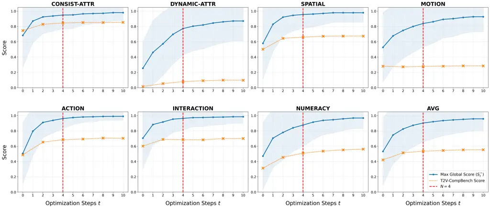

Figure 6: Full convergence analysis of VQQA on T2V-CompBench.
Evaluations are performed using CogVideoX-5B as the generator and
Gemini-3-Pro as the VLM.

### C.4 Long-horizon runs

Figure 6 details the performance breakdown for each T2V-CompBench
category over 10 VQQA prompt optimization iterations. It illustrates the
correlation between the running maximum global score $`S^{*}_{t}`$ and
the benchmark metric across optimization steps. Notably, most semantic
performance gains occur within the first four rounds across nearly all
categories, highlighting our method’s efficiency. This rapid convergence
justifies our decision to report experimental results using 4 VQQA
optimization rounds.

## Appendix D Visualization

### D.1 Side-by-Side Examples

We present additional visual results from our experiments, featuring
side-by-side comparisons of videos generated via direct prompting, VPO
(Cheng et al., 2025), and VQQA. Because the VPO model is specifically
trained for CogVideoX-5B (Yang et al., 2024), we utilize CogVideoX-5B as
the fixed video generation model for these comparisons.

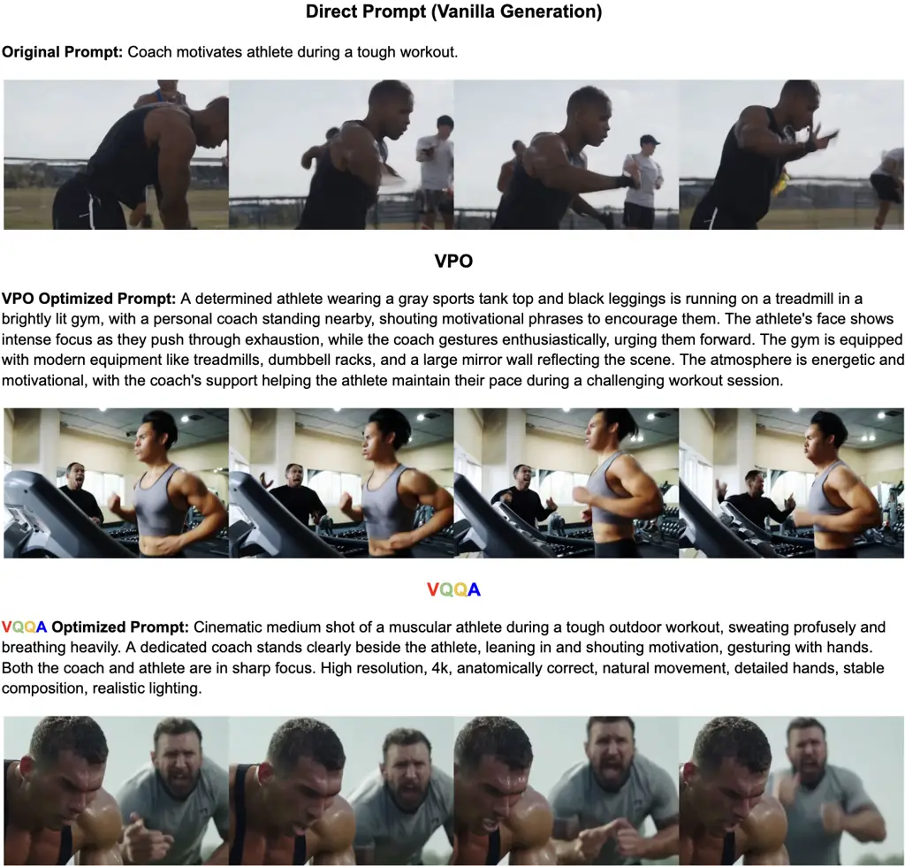

Figure 7: Side-by-side comparison of direct prompting, VPO, and VQQA
using CogVideoX-5B.

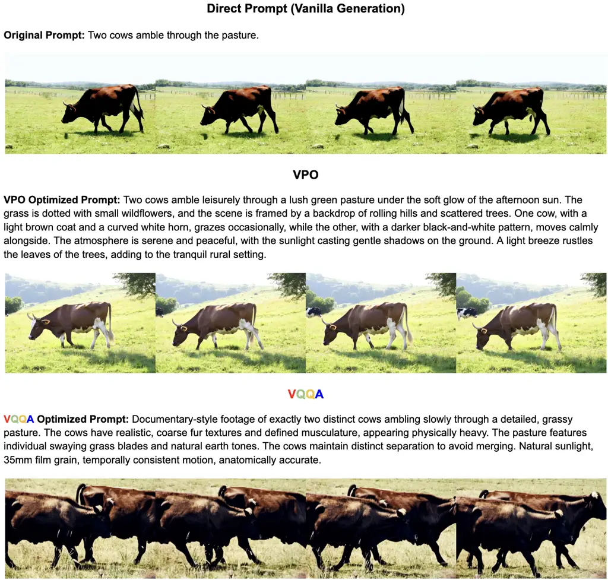

Figure 8: Side-by-side comparison of direct prompting, VPO, and VQQA
using CogVideoX-5B.

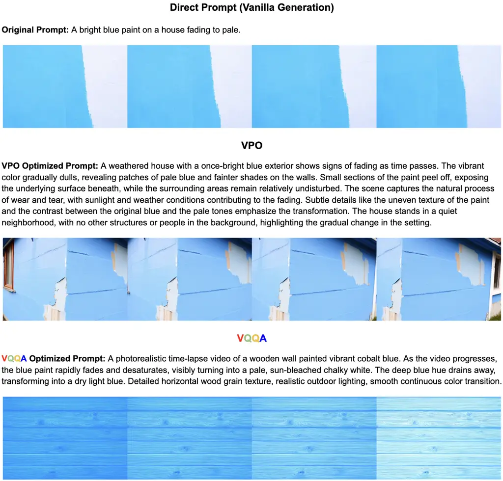

Figure 9: Side-by-side comparison of direct prompting, VPO, and VQQA
using CogVideoX-5B.

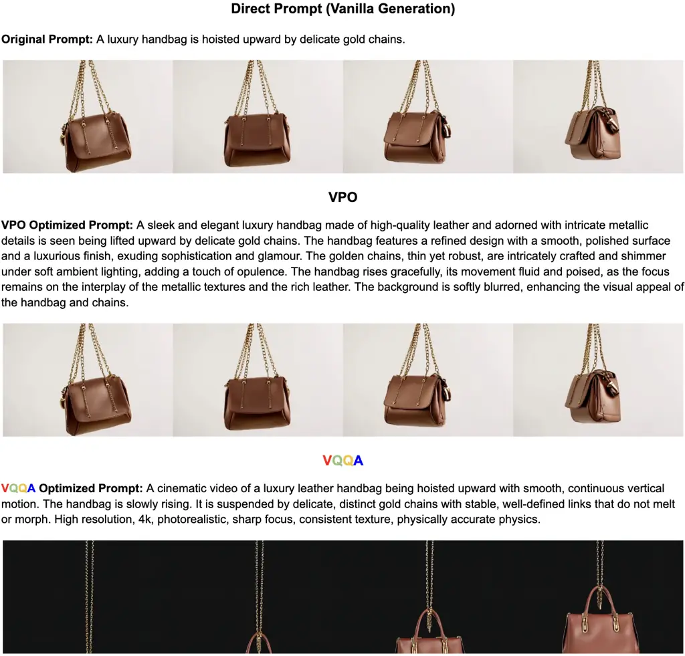

Figure 10: Side-by-side comparison of direct prompting, VPO, and VQQA
using CogVideoX-5B.

### D.2 VQQA Full Trajectory

This section illustrates a complete multi-turn trajectory of the VQQA
optimization process. In this example, we use CogVideoX-5B (Yang et al., 2024) as the video generator, and Gemini-3-Pro (Pichai et al., 2025) as
the underlying backbone for VQQA.

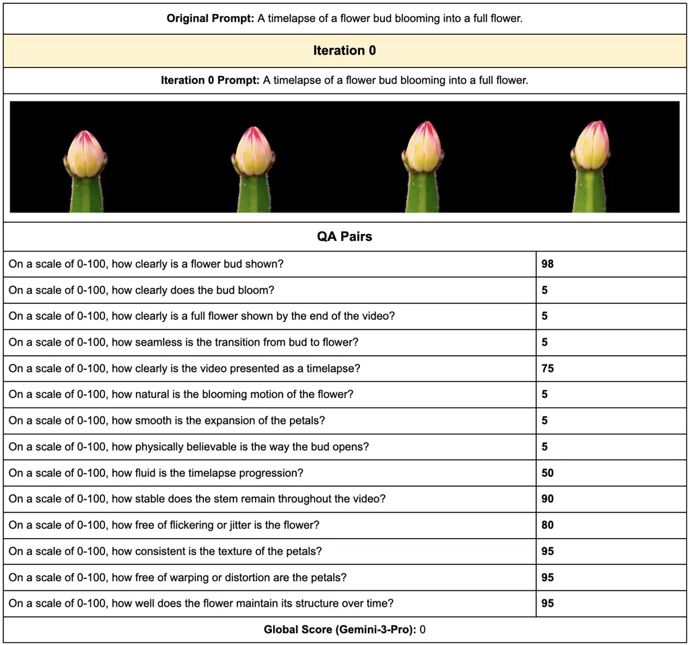

Figure 11: VQQA Example Trajectory Iteration 0


![[Uncaptioned
image]](arxiv-2603-12310v1--78cd4a3b44a0.figures/figure-13.webp)

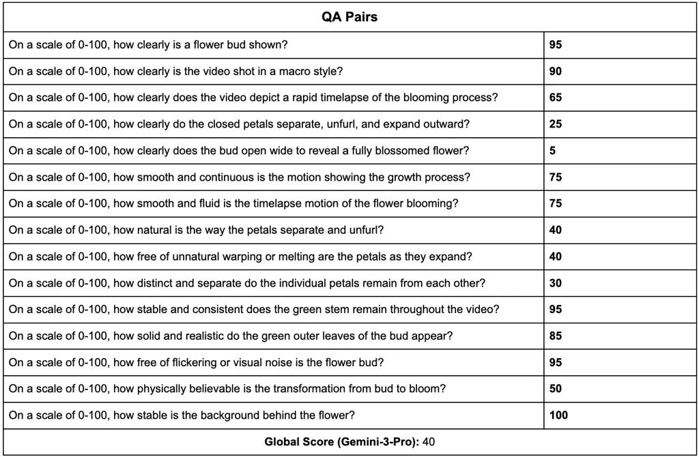

Figure 12: VQQA Example Trajectory Iteration 1


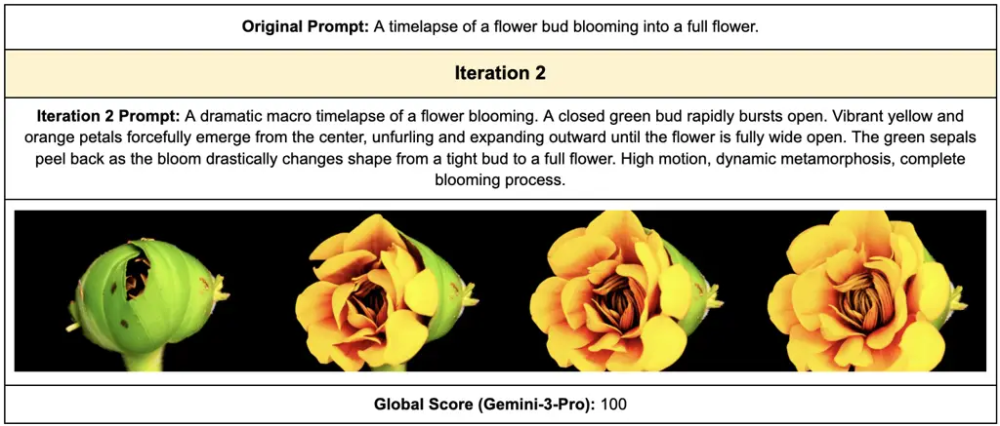

Figure 13: VQQA Example Trajectory Iteration 2

This example illustrates how VQQA iteratively refines the prompt,
amplifying action descriptions to overcome the model’s failure to
generate the required blooming motion. By successfully achieving
$`S_{t}^{*}=100`$ in just two iterations, this trajectory demonstrates
the overall effectiveness and efficiency of our approach.

## Appendix E Analysis Prompts

Here are the prompts we used to evaluate the effectiveness of the
questions generated by VQQA.

#### E.0.1 Dataset Construction

Here is the prompt we used to extract the ground-truth (GT) set of
visual flaws from the test split of the VideoFeedback2 (He et al.,
2025b) dataset by prompting GPT-5.2 (Singh et al., 2025).


#### E.0.2 Baseline Implementation

Here is the prompt we used to directly instruct the VLM to generate
visual flaws.


#### E.0.3 Metric Computation

Here are the prompts we used to compute Precision, Q-Recall, and
E2E-Recall.


## Appendix F Agent Prompts

In this section, we list all the agent prompts used in the VQQA
framework.

### F.1 Question Generation Agent


### F.2 Question Answering Agent


### F.3 Prompt Refinement Agent


