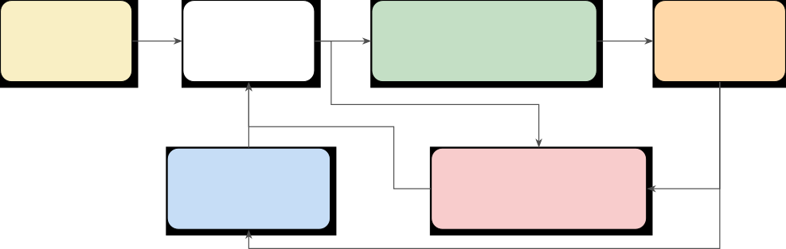
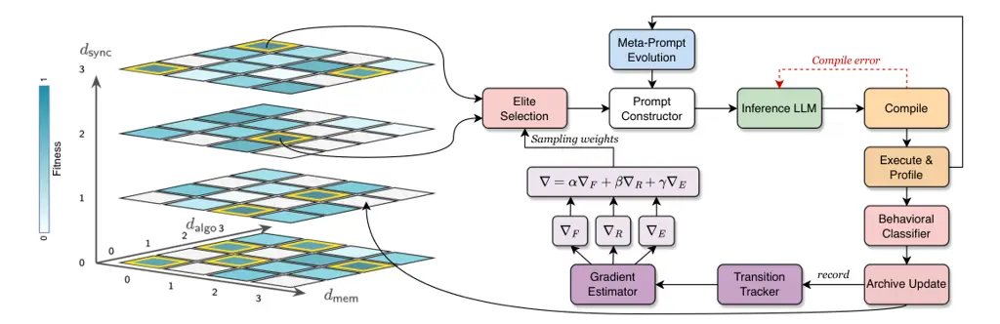
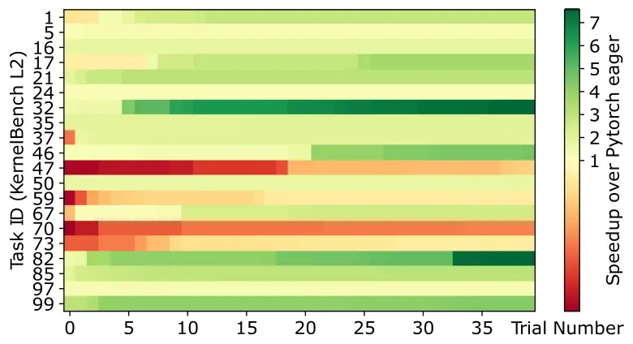
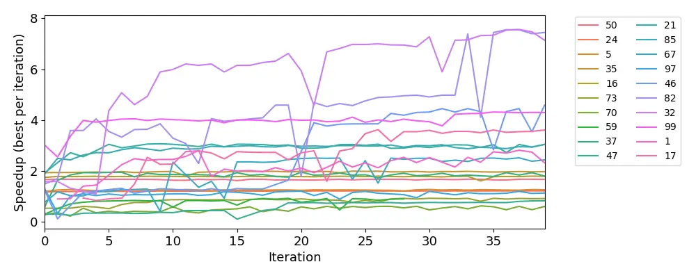
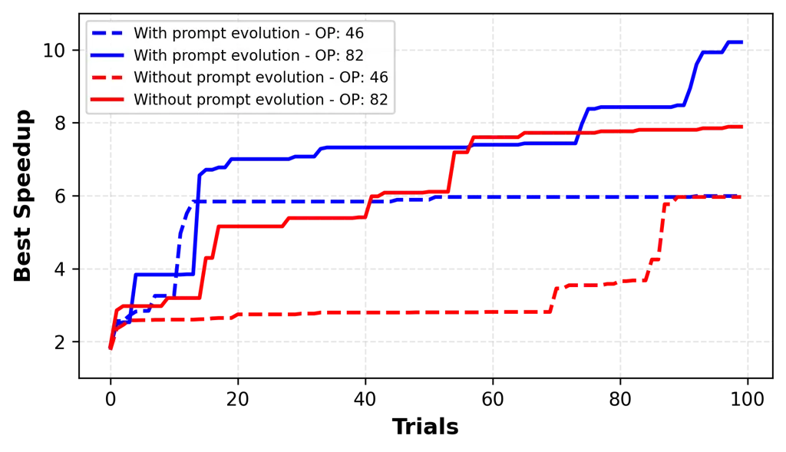
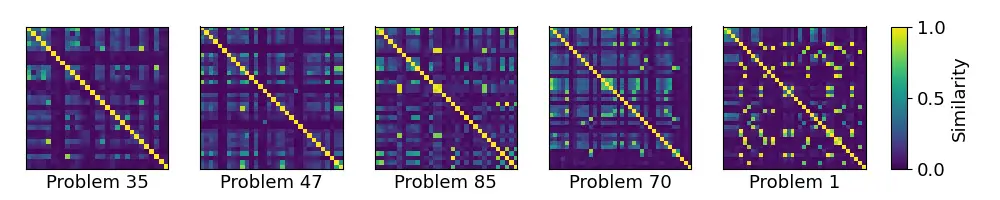

# KernelFoundry: Hardware-Aware Evolutionary GPU Kernel Optimization

Nina Wiedemann Affiliation: Intel Corporation \* Equal contribution
Correspondence to: <nina.wiedemann@intel.com>    Quentin Leboutet
Affiliation: Intel Corporation \* Equal contribution    Michael
Paulitsch Affiliation: Intel Corporation \* Equal contribution    Diana
Wofk Affiliation: Intel Corporation \* Equal contribution    Benjamin
Ummenhofer Affiliation: Intel Corporation \* Equal contribution

###### Abstract

GPU kernel optimization challenges LLMs beyond standard coding tasks, as
it requires an understanding of hardware architecture, parallel
computing optimization strategies, and profiling outputs. However, most
existing approaches leveraging LLMs for kernel generation apply standard
prompting and feedback loops, considering hardware only through
profiling feedback. We introduce KernelFoundry, an evolutionary
framework that efficiently explores the space of GPU kernels through
(1) MAP-Elites quality-diversity search with kernel-specific behavioral
dimensions to sustain exploration; (2) meta-prompt evolution that
co-evolves prompts with kernels to uncover task-specific optimization
strategies, and (3) a template-based parameter optimization approach to
tune kernels to inputs and hardware. We evaluate this framework on
KernelBench, robust-kbench and custom tasks, generating SYCL kernels as
a cross-platform GPU programming paradigm, and CUDA kernels for
comparison to prior work. Our approach consistently outperforms the
baseline methods and achieves an average speedup of 2.3 on KernelBench
for SYCL. Moreover, KernelFoundry is implemented as a distributed
framework with remote access to diverse hardware, allowing quick
benchmarking and featuring a flexible user input layer to support kernel
generation for a wide range of real use cases beyond benchmarking.

###### Keywords: 

GPU Kernel Optimization, Large Language Models, Evolutionary Algorithms,
Quality-Diversity, SYCL, CUDA, Triton

## 1 Introduction

Writing high-performance GPU kernels requires deep expertise in hardware
architectures, memory hierarchies, and parallel programming paradigms:
knowledge that remains scarce even among experienced engineers (Li et
al., 2025c). Yet, efficient GPU implementations are often decisive for a
method’s success and adoption, as illustrated by FlashAttention (Dao et
al., 2022), which was instrumental to the practical scalability of
Transformers. Following the release of KernelBench (Ouyang et al.,
2025a), a growing body of work has explored automating GPU kernel
development using LLMs. With few exceptions based on model
fine-tuning (Li et al., 2025c; Baronio et al., 2025), most approaches
rely on an iterative generate$`\to`$verify$`\to`$measure loop: kernels
proposed by an LLM are compiled, validated, benchmarked, and the
resulting feedback is used to steer subsequent generations. Variants of
this paradigm have been demonstrated across CUDA (Chen et al., 2025b;
Zhang et al., 2025; Lange et al., 2025b), Triton (Wang et al., 2025; Li
et al., 2025a), and Metal (Sereda et al., 2025), often augmented with
profiling tools (Zhang et al., 2025; Chen et al., 2025b; Lange et al.,
2025b; Sereda et al., 2025), multi-agent architectures (Wei et al.,
2025; Zhang et al., 2025; Lei et al., 2025), or evolutionary search
techniques (Liao et al., 2025; Lange et al., 2025a; Yan et al., 2026).
Despite known shortcomings in KernelBench that necessitate careful
interpretation of reported speedups (Lange et al., 2025b), these studies
collectively demonstrate that LLMs can produce correct and performant
kernels when guided by execution feedback. However, existing approaches
rely on general code-generation strategies that fail to address the
unique challenges of kernel optimization. Unlike standard programming
tasks, kernel generation demands (1) knowledge of memory access patterns
and an understanding of how parallelism maps to specific architectures,
and (2) a systematic exploration of optimization strategies.
Furthermore, iterative prompting and kernel validation loops suffer from
mode collapse – iterative refinement behaves as greedy local search,
with LLMs repeatedly proposing variants close to recent successes,
leading to premature convergence – and context degradation – as
optimization histories grow, failed attempts dominate the prompt
context.

To overcome these limitations, we propose KernelFoundry, an evolutionary
framework that maintains a diverse archive of kernel implementations and
systematically explores optimization techniques. To counteract mode
collapse, KernelFoundry adapts a MAP-Elites evolutionary
strategy (Mouret and Clune, 2015). Rather than defining generic
behavioral descriptors such as code length (Lehman et al., 2023), kernel
implementations are indexed along well-defined, domain-specific
dimensions addressing hardware system architecture, such as memory
access patterns or parallelism strategies. To mitigate context
degradation, we leverage meta-prompt evolution, allowing prompts to
co-evolve with kernels and uncover task-specific optimization
strategies. Finally, we propose to repurpose templated kernels to allow
the LLM to tune hardware-dependent values like tile and block sizes.

We evaluate KernelFoundry on KernelBench, robust-kbench, and custom
benchmark suites that span single-kernel operators, fusion patterns, and
full model architectures. Unlike prior work that targets NVIDIA’s
proprietary ecosystem almost exclusively, we additionally use SYCL, an
open-standard C++ abstraction that is vendor-agnostic and more
expressive than other cross-platform GPU programming frameworks such as
Triton. Furthermore, our framework is not limited to standardized tasks
or benchmarks. We introduce a custom input format that allows users to
optimize kernels based on arbitrary instructions (not restricted to
PyTorch code) and to employ complex test frameworks, provided they are
compatible with pytest. As a case study, we showcase the optimization of
a specific operation within a LLama3 model, illustrating the practical
utility of our pipeline for real-world, model-level tasks.

#### Conflict of Interest Disclosure.

The authors declare no financial conflicts of interest related to this
work.

## 2 Related Work

#### Traditional Kernel Optimization.

High-performance computing has long relied on separating algorithm
specification from optimization schedules, as exemplified in
Halide (Ragan-Kelley et al., 2013) or TVM (Chen et al., 2018a), whereas
lower-level models like CUDA and SYCL require both to be handled
together in code. Triton (Tillet et al., 2019) offers a middle ground
with a Python-based DSL that simplifies custom GPU kernel development
but still exposes scheduling control. Vendor libraries (cuDNN (Chetlur
et al., 2014), CUTLASS (NVIDIA Corporation, 2017), oneDNN (Intel
Corporation, 2016)) deliver peak performance but lack flexibility for
novel operators. Classical autotuners like ATLAS (Whaley et al., 2001)
and FFTW (Frigo and Johnson, 1998) demonstrate that systematic search
can match hand-tuned code. To avoid exhaustively evaluating every
schedule, systems like AutoTVM (Chen et al., 2018b), AnsorAnsor (Zheng
et al., 2020), and Ithemal (Mendis et al., 2019) use learned cost models
to predict performance, but these require extensive training data and
struggle to generalize across hardware. Despite these tools, algorithmic
kernel development remained a highly manual and expertise-driven
process.

#### LLM-Based Kernel Generation.

Large language models have sparked intense interest in automated kernel
synthesis, yet generating correct GPU code remains challenging, and
generating fast code is harder still. Early studies (Valero-Lara et al.,
2023; Godoy et al., 2023) evaluated Llama-2 and Codex on generating HPC
kernels. The introduction of KernelBench (Ouyang et al., 2025a)
established the de facto benchmark, comprising 250 tasks spanning single
operators, fusion patterns, and complete architectures. Results showed
that even frontier models achieve correctness on merely $`{\sim}20\%`$
of problems with substantial gaps to cuBLAS/cuDNN baselines. Recent work
has also highlighted validation challenges: spurious speedups of up to
50x can arise from incorrect kernels that pass test cases (Lange et al.,
2025b; Zhu et al., 2025), motivating more rigorous evaluation protocols.
Despite these challenges, KernelBench has inspired a plethora of
follow-up approaches (see Table 5 for a comprehensive overview). The
dominant paradigm is prompting with validation loop: correctness and
profiling outputs guide successive refinements of CUDA (Chen et al.,
2025b; Zhang et al., 2025; Lange et al., 2025b), Triton (Liao et al.,
2025; Li et al., 2025a), and Metal (Sereda et al., 2025) kernels.
PEAK (Tariq et al., 2025) expresses optimization strategies as natural
language transformations, achieving up to 95% of cuBLAS performance on
MatMul across CUDA, HIP, and HLSL. Multi-agent architectures decompose
the task into specialized roles: Astra (Wei et al., 2025) separates
planning, coding, testing, and profiling agents; STARK (Dong et al., 2025) uses plan-code-debug agents; QiMeng (Zhu et al., 2026) employs
macro/micro coding agents; and PRAGMA (Lei et al., 2025) coordinates
coder, verifier, and conductor roles. SwizzlePerf (Tschand et al., 2025)
stands out by injecting detailed microarchitecture knowledge (bank
conflicts, warp operations, coalescing) into prompts, demonstrating the
value of hardware awareness. Despite their sophistication, these
approaches share a common limitation: they explore the kernel design
space implicitly through generic code generation, without mechanisms to
preserve diversity across optimization trajectories.

An orthogonal direction is finetuning LLMs for kernel generation.
CUDA-L1 (Li et al., 2025c) combines supervised finetuning (SFT) with
“contrastive RL”; CUDA-L2 (Su et al., 2025) adds NCU profiler metrics
and multi-stage RL, exceeding cuBLASLt by 11% on HGEMM, TritonRL (Woo et
al., 2025) presents good results with SFT and GRPO for Triton, and
Kevin (Baronio et al., 2025) uses multi-turn RL to refine kernels across
dialogue turns. These methods achieve promising results but often cannot
match the performance of the latest closed-source LLMs.

Existing LLM kernel work targets CUDA almost exclusively.
MultiKernelBench (Wen et al., 2025) addresses this with benchmarks
spanning NVIDIA GPUs, Huawei NPUs, and Google TPUs, and NPUEval (Kalade
and Schelle, 2025) provides AMD NPU benchmarks. Translation systems like
BabelTower (Wen et al., 2022) and CodeRosetta (TehraniJamsaz et al., 2024) convert between CUDA and HIP/OpenCL but preserve rather than
optimize performance. Our work contributes to this direction by
targeting SYCL (Keryell et al., 2015) and hence enabling portability
across Intel, NVIDIA, and AMD accelerators.

#### LLM-Guided Evolutionary Search.

Evolutionary algorithms have a rich history in program synthesis (Koza,
1992). Quality-diversity (QD) methods (Pugh et al., 2016) shift from
single-objective optimization to maintaining diverse collections of
high-performing solutions: a property particularly relevant for kernel
optimization, where multiple valid implementation strategies exist.
MAP-Elites (Mouret and Clune, 2015) partitions the solution space by
behavioral descriptors, CMA-ME (Fontaine et al., 2020) adds continuous
optimization, and PGA-MAP-Elites (Fontaine and Nikolaidis, 2021)
integrates policy gradients. Recent work combines LLMs with evolutionary
search: FunSearch (Romera-Paredes et al., 2024) discovers mathematical
programs beyond human baselines, AlphaEvolve (Novikov et al., 2025) adds
multi-objective optimization, and CodeEvolve (Assumpção et al., 2025)
evolves prompts rather than code directly. PACEvolve (Yan et al., 2026)
characterizes three failure modes in LLM-assisted evolution: context
pollution from accumulated failures, mode collapse from poor
exploration-exploitation balance, and weak collaboration in multi-island
settings. While PACEvolve addresses these through hierarchical context
management for general search, kernel optimization presents a structured
space where domain-specific dimensions can be directly exploited. Our
approach leverages this structure: kernel-specific behavioral
coordinates (memory patterns, parallelism strategies) inherently
partition the solution space, preventing mode collapse by construction,
while meta-prompt evolution (Agrawal et al., 2025) counteracts context
degradation by enabling prompts to specialize for different optimization
regions.

## 3 Method

### 3.1 System Architecture



Figure 1: The KernelFoundry pipeline: evolutionary kernel optimization
with multi-level feedback and meta-prompt co-evolution.

We present KernelFoundry, an evolutionary framework for LLM-driven GPU
kernel optimization. Figure 1 illustrates the architecture, which
comprises five tightly-coupled components. The process begins with a
task specification layer that accepts kernel generation problems in a
flexible format, supporting PyTorch reference implementations,
high-level natural language descriptions, or existing kernels requiring
optimization. The system natively supports KernelBench (Ouyang et al.,
2025a) tasks as well as custom workloads with user-defined test
frameworks. A prompt construction engine then assembles context-aware
prompts by combining the task specification with hardware-specific
optimization guidance, sampled parent programs and inspirations from the
archive, gradient-derived mutation hints, and dynamically evolved prompt
components (§3.5). The resulting prompt is served to an LLM inference
backend, which provides a unified interface to both API-based models
(OpenAI, Anthropic) and locally-hosted models via vLLM, and generates
multiple candidate kernels. Candidates are processed by a compilation &
evaluation pipeline that compiles to the target backend (SYCL via Intel
DPC++, CUDA via nvcc, or Triton), validates numerical correctness
against reference implementations, measures execution time, and
optionally collects profiling data via Intel _unitrace_ or NVIDIA
_Nsight_. Finally, an evolutionary archive implements MAP-Elites (Mouret
and Clune, 2015) by organizing kernels according to behavioral
coordinates in an optimization feature space (§3.2). It retains the
best-performing kernel (elite) for each occupied cell, thereby
preserving diversity across qualitatively different optimization
strategies. In a similar spirit, we evolve sections of the prompt with
meta-prompt evolution, which maintains a separate archive with
successful guidance examples.  
The evolutionary loop proceeds as follows. At each iteration, parent
programs are sampled from the archive using selection strategies
informed by fitness, exploration potential, and gradient estimates. The
prompt constructor assembles a generation prompt, incorporating parent
code, feedback from prior evaluations, and optimization guidance. The
LLM generates candidate kernels, which are then compiled,
correctness-tested, and performance-measured. Candidates that run
correctly are assigned behavioral coordinates via static code analysis;
those improving upon existing elites are inserted into the archive.
Feedback from all outcomes (including failures) informs subsequent
iterations through the gradient estimator and meta-prompter.

### 3.2 Quality-Diversity Search with MAP-Elites

Standard evolutionary approaches optimize a single objective (e.g.,
runtime), risking convergence to local optima and failing to explore
alternative solution strategies. Quality-Diversity (QD) algorithms (Pugh
et al., 2016) address this limitation by maintaining diverse collections
of high-performing solutions in independent behavioral cells, enabling
discovery of stepping-stone solutions that facilitate escape from local
optima.

#### MAP-Elites Algorithm.

MAP-Elites (Mouret and Clune, 2015) partitions the solution space into a
discrete grid based on behavioral descriptors, which are low-dimensional
features characterizing solution behavior independent of fitness. Each
cell maintains the highest-fitness solution discovered for that
behavioral region. The algorithm iterates in four phases (selection,
variation, evaluation, and insertion). During selection, the system
samples parent kernel(s) from the archive using a configurable strategy
(uniform, fitness-proportionate, curiosity-driven, or island-based).
During variation, it produces offspring via LLM-based code modification
guided by the parent kernel, optimization hints, and meta-evolved prompt
content. During evaluation, the offspring is compiled, validated for
correctness, benchmarked for performance, and assigned behavioral
coordinates via static code analysis. During insertion, the offspring
replaces the incumbent elite if it improves upon the existing elite (or
if the target cell is empty); otherwise, it is discarded. This mechanism
maintains diversity by construction: the archive cannot collapse because
each cell evolves independently.



Figure 2: Gradient-informed MAP-Elites for kernel optimization. The
archive partitions kernels by behavioral coordinates
$`(d_{\text{mem}},d_{\text{algo}},d_{\text{sync}})`$. Elites are shown
in yellow. A Transition Tracker records parent$`\to`$child transitions
with behavioral coordinates and fitness deltas. The Gradient Estimator
combines fitness gradients ($`\nabla F`$), improvement-rate gradients
($`\nabla R`$), and exploration gradients ($`\nabla E`$) to produce
sampling weights and natural-language mutation hints that guide
subsequent generations.

#### Kernel-Specific Behavioral Descriptors.

Adapting the MAP-Elites algorithm to kernel optimization requires
defining behavioral descriptors that capture meaningful optimization
characteristics. With KernelFoundry, we propose a three-dimensional
optimization feature space with discrete levels reflecting increasingly
sophisticated optimization patterns. These coordinates are computed
deterministically from generated code via static pattern matching on
SYCL and CUDA constructs, ensuring reproducibility and reducing
execution-time variability.

1.  1.  Memory Access Pattern ($`d_{\text{mem}}\in\{0,1,2,3\}`$):

    0:  
    Scalar, strided, or uncoalesced access

    1:  
    Coalesced/vectorized (vec4, aligned loads)

    2:  
    Shared/local memory with explicit tiling

    3:  
    Multi-lev. hierarchy (SLM + reg. blocking + prefetch)

2.  2.  Algorithmic Structure ($`d_{\text{algo}}\in\{0,1,2,3\}`$):

    0:  
    Direct PyTorch translation

    1:  
    Fused operations (single-pass over data)

    2:  
    Reformulated algorithm (online norm., flash pattern)

    3:  
    Novel/asymptotically improved algorithm

3.  3.  Parallelism Coordination ($`d_{\text{sync}}\in\{0,1,2,3\}`$):

    0:  
    No synchronization (embarrassingly parallel)

    1:  
    Work-group barriers (group::barrier)

    2:  
    Sub-group primitives (shuffles, reductions, broadc.)

    3:  
    Global coordination (atomics, multi-pass with sync)

This three-dimensional grid yields $`4^{3}=64`$ behavioral cells. The
classifier employs weighted pattern matching with category-specific
patterns to avoid double-counting related constructs (e.g., a kernel
using _group_barrier_ for SLM synchronization receives credit in
$`d_{\text{mem}}`$ for SLM usage, not additionally in
$`d_{\text{sync}}`$ for the same barrier).

#### Fitness Function.

The fitness function prioritizes correctness while rewarding
performance:

```math
f(k)=\begin{cases}0&\text{if compilation fails},\\
0.1&\text{if compiles but incorrect},\\
0.5+0.5\cdot s_{\text{norm}}&\text{if correct},\end{cases}\vskip-5.69054pt
```

where $`s_{\text{norm}}=\min(1,\text{speedup}/\text{target})`$ is the
normalized speedup relative to a configurable target (default:
$`2\times`$ over PyTorch baseline). This design ensures that correctness
is a prerequisite for high fitness while providing a continuous gradient
for performance optimization.

#### Selection Strategies.

We implement four parent selection strategies, with configurable mixing
ratios. Uniform selection samples randomly from occupied cells to
maximize behavioral diversity. Fitness-proportionate selection weights
sampling by elite fitness to exploit high-performing regions.
Curiosity-driven selection prioritizes cells with high estimated
improvement potential as inferred from the gradient signal. Island-based
selection maintains $`K`$ independent sub-populations with periodic
migration every $`M`$ generations, balancing isolated exploration with
cross-pollination.

### 3.3 Gradient-Informed Evolution

While the archive structure prevents global mode collapse, individual
cells may stagnate if the LLM repeatedly produces similar variants.
Inspired by CMA-ME (Fontaine et al., 2020) and PGA-MAP-Elites (Fontaine
and Nikolaidis, 2021), we augment MAP-Elites with gradient-like signals
derived from evolutionary transition history. These gradients provide a
soft steering mechanism that complements the archive’s guarantees of
structural diversity.

#### Transition Tracking and gradient estimation.

We maintain a circular buffer of recent parent$`\to`$child transitions.
Each transition record stores the parent and child behavioral
coordinates $`(\mathbf{b}_{p},\mathbf{b}_{c})`$, the fitness delta
$`\Delta f=f_{c}-f_{p}`$, the transition outcome (improvement when the
child becomes an elite or discovers a new cell, neutral when it is
competitive but does not update the archive, or regression when fitness
decreases), as well as a timestamp and iteration number for temporal
weighting.  
From the accumulated transitions, we compute three gradient components
for each occupied cell $`\mathbf{b}`$. The Fitness gradient
$`\nabla_{\mathbf{b}}F`$ estimates which directions in behavioral space
improve fitness. For each dimension $`d`$, we aggregate transitions
weighted by fitness delta and direction:

```math
\nabla_{d}F\approx\frac{1}{|\mathcal{T}|}\sum_{t\in\mathcal{T}}\Delta f_{t}\cdot\text{sign}(b_{c}^{(d)}-b_{p}^{(d)})\cdot w(t) \tag{1}
```

where $`\mathcal{T}`$ is the set of transitions originating from cell
$`\mathbf{b}`$, and $`w(t)`$ applies exponential time decay to
prioritize recent experience. Improvement-rate gradient
$`\nabla_{\mathbf{b}}R`$ estimates which directions yield higher
improvement probability, independent of improvement magnitude:

```math
\nabla_{d}R\approx P(\text{imp.}\mid\Delta b_{d}>0)-P(\text{imp.}\mid\Delta b_{d}<0) \tag{2}
```

Exploration gradient $`\nabla_{\mathbf{b}}E`$ points to empty or
low-quality cells, weighted by inverse distance and improvement
potential:

```math
\nabla_{\mathbf{b}}E\propto\sum_{c\in\mathcal{E}}\frac{(f_{\max}-f_{c})}{\|\mathbf{c}-\mathbf{b}\|_{1}}\cdot\frac{\mathbf{c}-\mathbf{b}}{\|\mathbf{c}-\mathbf{b}\|_{1}} \tag{3}
```

where $`\mathcal{E}`$ is the set of empty cells and low-quality occupied
cells. The combined gradient is a weighted average,
$`\nabla_{\mathbf{b}}=\alpha\nabla F+\beta\nabla R+\gamma\nabla E`$,
with $`(\alpha,\beta,\gamma)=(0.4,0.4,0.2)`$.

#### Gradient-to-Prompt Translation.

Gradients inform the optimization process at two levels. For parent
selection, cells with strong positive gradient magnitudes receive higher
sampling probability, directing computational effort toward productive
regions. For prompt construction, gradient directions are translated
into natural-language mutation hints. For example, a positive gradient
in $`d_{\text{mem}}`$ yields hints such as “consider adding shared
memory tiling” or “implement register blocking for data reuse.” These
hints are injected into the generation prompt, providing actionable
guidance grounded in empirical transition success (see example in
Appendix E.3).

### 3.4 Templated Kernels for Parameter Tuning

Beyond algorithmic transformations, kernel performance depends
critically on hardware-specific parameters such as work-group
dimensions, tile sizes, and unroll factors. Rather than requiring the
LLM to guess optimal values, we enable explicit parameter exploration
through templated kernel generation. The prompt instructs the LLM to
optionally produce a templated kernel with configurable parameters
alongside a dispatch function enumerating valid parameter combinations.
Our evaluation pipeline detects templated kernels, extracts parameter
configurations, and evaluates each instantiation independently. The
best-performing configuration determines the kernel’s fitness, while all
results are logged to enable the LLM to refine parameter choices in
subsequent iterations. This approach separates algorithmic optimization
from parameter tuning, allowing the evolutionary search to explore both
dimensions efficiently.

### 3.5 Meta-Prompting Against Context Degradation

As evolutionary search progresses, accumulated experiment histories can
degrade generation quality as failed attempts dominate the context: a
phenomenon termed context pollution (Yan et al., 2026). Inspired by
CodeEvolve (Assumpção et al., 2025) and GEPA (Agrawal et al., 2025), we
introduce meta-prompt evolution: prompts are mutable and co-evolve with
kernels, enabling successful optimization strategies to propagate while
unsuccessful guidance is pruned.

#### Evolvable Prompt Regions.

The kernel generation prompt contains four evolvable sections, delimited
by special markers. Specifically, we evolve (1) optimization philosophy,
which encodes high-level principles that shape priorities (e.g.,
“prioritize memory bandwidth utilization before compute optimization”),
(2) optimization strategies, which enumerate concrete techniques
organized by category (memory, compute, parallelism) together with
canonical code patterns and short explanations, (3) common pitfalls,
which list anti-patterns and frequent mistakes to avoid (e.g., “avoid
bank conflicts by adding padding to shared memory arrays”), and (4)
analysis guidance, which provides a pre-coding reasoning scaffold that
prompts the LLM to identify likely bottlenecks before generating code.

#### Meta-Prompter LLM.

This dedicated LLM (distinct from the kernel generator) analyzes
generation outcomes and proposes prompt modifications. Given the current
evolvable prompt sections together with the generated kernel code and
evaluation metrics (correctness, speedup, and error messages), the
meta-prompter first diagnoses which guidance was missing, misleading, or
insufficiently specific for the observed outcome. It then prescribes
targeted updates as SEARCH/REPLACE diffs restricted to the evolvable
regions. This two-LLM architecture separates analysis from generation,
allowing the meta-prompter to specialize in prompt refinement without
conflating it with kernel synthesis.

#### Prompt Archive and Co-Evolution.

Evolved prompts are maintained in their own archive, with fitness
defined by the best kernel performance achieved using each prompt
variant. Kernels and prompts co-evolve in an interleaved schedule: every
$`N`$ kernel generations (default $`N=10`$), the meta-prompter proposes
prompt updates based on recent outcomes. This co-evolutionary dynamic
enables the system to discover task-specific optimization strategies
that would be difficult to engineer manually.

### 3.6 Distributed Execution Framework for Scalability

Scalability is essential in adoption of kernel generation in practice.
To support efficient parallel evaluation across heterogeneous hardware,
KernelFoundry employs a distributed architecture with four worker types
(see Appendix C Figure 4 for a graphical overview): (1) LLM server, (2)
compilation worker, (3) execution workers and (4) database server. While
parallelization for (1) is common, separation and distribution of (2)
and (3) makes KernelFoundry truly scale. The evaluation loop scales with
flexible hardware allocation as only execution workers require GPUs, and
users can target different backends (Intel, NVIDIA) by routing jobs to
appropriate workers. Additionally, multiple workers with identical
hardware can be used to speed up the pipeline to compile and evaluate
kernels in parallel.

## 4 Experimental setup

The field of kernel generation faces challenges in making fair
comparisons, because results depend heavily on the hardware used, the
programming approach, and the abilities of the LLM. To address this, we
carefully control these factors and conduct experiments across several
benchmarks, using different hardware types and programming languages.

#### Programming paradigm and hardware.

KernelFoundry supports CUDA, SYCL, and Triton. Our primary focus is on
SYCL for Intel hardware. SYCL offers several advantages: (1) it is an
open industry standard (Khronos Group) rather than a proprietary
language; (2) it provides C++ abstractions that are more amenable to LLM
generation than low-level intrinsics; (3) it enables true cross-platform
portability with a single codebase. The experiments are conducted on an
integrated Intel Arc 140V GPU and a discrete Intel Battlemage B580 GPU,
as well as an NVIDIA RTX A6000 GPU with Ampere architecture (for CUDA
comparisons). We implement a rigorous kernel performance benchmarking
with several improvements over prior work (see Appendix B).

#### Benchmarks.

We evaluate on KernelBench (Ouyang et al., 2025a) as the de-facto
standard for LLM kernel generation, comprising 250 tasks across three
levels (L1: single operators, L2: fusion patterns, L3: full
architectures). Following Lange et al. (2025b) and METR (2025), we
filter out flawed tasks prone to reward hacking or with inefficient
baselines, resulting in a filtered set of 111 tasks (80 L1, 31 L2). For
most experiments, we use a representative subset of 40 tasks (20 L1, 20
L2), that is selected based on related work (see Appendix D). Secondly,
we utilize 12 tasks from Robust-kbench (Lange et al., 2025b). They
provide 19 tasks including forward-backward operations; however, they
published their results (i.e., the best generated kernel, required for
comparison) only for 12 of those.

#### Baselines.

Following KernelBench, we compare to Pytorch eager execution and
torch.compile. Unfortunately, most related works only publish aggregated
numbers such as the average speedup per level, usually across all
KernelBench problems, and not the generated kernels themselves. Since
some KernelBench tasks are flawed and allow reward hacking, and the
performance is highly hardware dependent, comparability to these results
is inhibited. We thus compare to prior work that publish their
best-performing kernels: robust_kbench (Lange et al., 2025b), the AI
CUDA Engineer (Lange et al., 2025a) and Kernelsseum (Ouyang et al.,
2025b; Ouyang et al., 2025a). Due to model deprecation and access
restrictions, we are limited to using only the available subset of the
LLMs used in the baselines, which presents additional challenges for our
method. For comparison with robust-kbench, we utilize
GPT-{o3,o4-mini,4.1}, excluding Sonnet 3.7 used in their method. For
comparing to the AI CUDA engineer we could only use o3-mini (excluding
DeepSeek-{v3,R1}, GPT-{o1-preview,o1-high}, and Sonnet 3.5). Further
hyperparameter settings are given in Appendix B.

#### Metrics.

Following prior work, we report the correctness rate (fraction of tasks
with a kernel that compiles and yields numerically correct outputs) and
the fast*(p) metric, defined as the proportion of tasks with a speedup
greater than p:
$`\frac{1}{N}\sum*{i=1}^{N}\mathbf{1}[\text{speedup}_{i}>p]`$ where
$`N`$ is the number of tasks and the speedup is the baseline time
(pytorch eager if not denoted otherwise) divided by the kernel execution
time. For correctness, we apply stricter criteria than prior work since
we noticed that the precision used by KernelBench is very low, in
particular the absolute precision of $`10^{-2}`$, allowing erroneous
kernels to pass in cases of small output values which commonly appear
with AI operations. We thus rely on the relative precision
$`\nu=\frac{|y-\hat{y}|}{|y|+\epsilon}`$, where $`y`$ is the expected
output, $`\hat{y}`$ is the kernel output, and $`\epsilon`$ is a small
value preventing division by zero. However, due to hardware imprecision,
errors should be allowed in a small fraction of cases. Thus, we define a
kernel as correct if $`\nu<0.01`$ in 99% of the output values. As a
second measure for kernel correctness, we propose the cosine similarity
of the flattened output tensors as a measure of their angular
divergence.

## 5 Results

We first evaluate KernelFoundry’s ability to generate CUDA kernels in
comparison to prior work, and then demonstrate its versatility by
generating SYCL kernels. Furthermore, we showcase its adaptability to
custom tasks and analyze hardware-specific aspects.

### 5.1 Baseline comparison

Table 1compares our method to the kernels published by “AI CUDA
Engineer” and the robust-kbench method on the respective task set for
which the baseline kernels were available. We reproduce the speedup of
these kernels on our NVIDIA hardware for fair comparison; original
results are listed for reference but are not directly comparable due to
hardware-specific PyTorch execution times. We further include the
results originally published within KernelBench (“Kernelsseum”). Table 1
shows that the kernels generated with our approach consistently
outperform the baselines, despite using only a subset of the LLMs.
Specifically, our approach leads to an average speedup of 1.24 on the
KernelBench subset L1 and 2.1 on L2, compared to 1.01 and 1.61 for the
kernels published by Lange et al. (2025a). On the 12 robust-kbench tasks
which include backward operations, our approach also results in a 36%
higher speedup compared to the best kernels published by Lange et al.
(2025b). While for many tasks the general evolutionary selection
procedure already finds the suitable parameters (e.g. tile size), our
parameter optimization, applied only for 2 iterations (best@8), can push
the performance in some cases, leading to a notable improvement. For
results on a per-task level, see Appendix F. The cost per kernel is
around \$5.7 which is comparable to related work (see Appendix I).

|                                   |                               |                                                                |              |       |       |              |               |
| --------------------------------- | ----------------------------- | -------------------------------------------------------------- | ------------ | ----- | ----- | ------------ | ------------- |
| Task set $`n=\text{count}`$       | Method                        | LLMs                                                           | Correct rate | fast₁ | fast₂ | Avg. speedup | Geom. speedup |
| KernelBench repr. set L1 $`n=20`$ | Kernelsseum\*                 | GPT-{o1,4o}, DeepSeek-Coder, Sonnet-3.5, LLama-3.1-405B        | 0.65         | 15 %  | 0 %   | 0.765        | 0.600         |
|                                   | AI CUDA Engineer original^(†) | DeepSeek-{v3,R1}, GPT-{o1-preview,o1-high,o3-mini}, Sonnet-3.5 | 1.0          | 70 %  | 20 %  | 1.422        | 1.222         |
|                                   | AI CUDA Engineer re-eval      | DeepSeek-{v3,R1}, GPT-{o1-preview,o1-high,o3-mini}, Sonnet-3.5 | 1.0          | 40 %  | 50 %  | 1.005        | 0.909         |
|                                   | Ours                          | o3-mini                                                        | 1.0          | 55 %  | 10 %  | 1.204        | 1.092         |
|                                   | Ours + parameter optim.       | o3-mini                                                        | 1.0          | 55 %  | 15 %  | 1.241        | 1.124         |
| KernelBench repr. set L2 $`n=20`$ | Kernelsseum\*                 | GPT-{o1,4o}, DeepSeek-Coder, Sonnet-3.5                        | 0.65         | 10 %  | 0 %   | 0.874        | 0.854         |
|                                   | AI CUDA Engineer original^(†) | DeepSeek-{v3,R1}, GPT-{o1-preview,o1-high,o3-mini}, Sonnet-3.5 | 1.0          | 100%  | 10 %  | 1.589        | 1.524         |
|                                   | AI CUDA Engineer re-eval      | DeepSeek-{v3,R1}, GPT-{o1-preview,o1-high,o3-mini}, Sonnet-3.5 | 1.0          | 85 %  | 25 %  | 1.606        | 1.515         |
|                                   | Ours                          | o3-mini                                                        | 1.0          | 90 %  | 40 %  | 2.051        | 1.680         |
|                                   | Ours + parameter optim.       | o3-mini                                                        | 1.0          | 90 %  | 45 %  | 2.104        | 1.730         |
| Robust-kbench $`n=12`$            | Robust-kbench original^(†)    | GPT-{o3,o4-mini,4.1}, Sonnet-3.7                               | 1.0          | 92 %  | 50 %  | 15.622       | 2.591         |
|                                   | Robust-kbench re-eval         | GPT-{o3,o4-mini,4.1}, Sonnet-3.7                               | 1.0          | 92 %  | 58 %  | 8.865        | 3.499         |
|                                   | Ours                          | GPT-{o3,o4-mini,4.1}                                           | 1.0          | 100 % | 67 %  | 12.107       | 5.295         |
|                                   | Ours + parameter optim.       | GPT-{o3,o4-mini,4.1}                                           | 1.0          | 100 % | 67 %  | 12.081       | 5.225         |

Table 1: Comparison to baselines on CUDA kernel optimization. Best
results per task set in bold. \*_Kernelsseum_ evaluated on Nvidia L40S.
^(†)_AI CUDA Engineer original_ and _Robust-kbench original_ both
evaluated on Nvidia H100. All others evaluated on Nvidia A6000.

|                                   |                                       |          |                                    |              |       |       |              |               |
| --------------------------------- | ------------------------------------- | -------- | ---------------------------------- | ------------ | ----- | ----- | ------------ | ------------- |
| Task set $`n=\text{count}`$       | Method                                | Language | LLMs                               | Correct rate | fast₁ | fast₂ | Avg. speedup | Geom. speedup |
| KernelBench filtered $`n=111`$    | Ours                                  | SYCL     | GPT-{4.1, 5-mini}, Sonnet-4.5      | 0.97         | 71 %  | 42 %  | 2.32         | 1.38          |
|                                   | Robust-kbench                         | CUDA     | GPT-{o3, o4-mini, 4.1}, Sonnet-3.7 | \-           | \-    | \-    | 1.49         | \-            |
| KernelBench repr. set L2 $`n=20`$ | OpenEvolve (40 iters)                 | SYCL     | GPT-{4.1, 5-mini}, Sonnet-4.5      | 1.0          | 70 %  | 40 %  | 2.535        | 1.775         |
|                                   | Ours (40 iters + param. optim.)       | SYCL     | GPT-{4.1, 5-mini}, Sonnet-4.5      | 1.0          | 80 %  | 45 %  | 2.732        | 2.119         |
|                                   | OpenEvolve (10 iters)                 | SYCL     | GPT-{4.1, 5-mini}, Sonnet-4.5      | 1.0          | 70 %  | 20 %  | 1.483        | 1.202         |
|                                   | Ours (10 iters)                       | SYCL     | GPT-{4.1, 5-mini}, Sonnet-4.5      | 1.0          | 80 %  | 35 %  | 2.059        | 1.661         |
|                                   | Ours (20 iters)                       | SYCL     | GPT-{4.1, 5-mini}, Sonnet-4.5      | 1.0          | 70 %  | 50 %  | 2.539        | 1.833         |
|                                   | Ours (20 iters) w/o prompt evolution  | SYCL     | GPT-{4.1, 5-mini}, Sonnet-4.5      | 1.0          | 70 %  | 55 %  | 2.505        | 1.600         |
|                                   | Ours (20 iters) w/o gradient guidance | SYCL     | GPT-{4.1, 5-mini}, Sonnet-4.5      | 1.0          | 75 %  | 35 %  | 2.178        | 1.695         |

Table 2: Evaluating KernelFoundry on SYCL kernel generation.

### 5.2 Evaluation on SYCL kernel generation

Table 2presents our results for SYCL kernel generation. For comparison,
we include robust-kbench CUDA performance on the filtered KernelBench
tasks, as reported in (Lange et al., 2025b). Although SYCL is less
commonly used and less familiar to LLMs than CUDA, our method finds
correct kernels in 97% of cases and achieves an average speedup of 2.32.
We further compare to OpenEvolve, the open-source implementation of
AlphaEvolve (Novikov et al., 2025), which uses an evolutionary algorithm
but lacks kernel-specific optimization strategies, meta-prompting, and
parameter optimization. While OpenEvolve achieves a comparable speedup
to our method after 40 iterations, it requires substantially more
iterations to reach this level, as indicated by the notable performance
gap after 10 iterations (see Table 2). Ablation studies with 20
iterations show that the performance is reduced without prompt evolution
or without gradient guidance. Figure 3 illustrates how KernelFoundry
progressively improves kernel performance. Figure 6 shows two cases
where meta-prompting becomes increasingly valuable with prolonged
training, yielding consistent improvements over 100 iterations. For
reproducibility, we provide results obtained with GPT-OSS in Appendix G.



Figure 3: Improvement over iterations (cumulative best)

### 5.3 Validating hardware awareness

To analyze whether our method produces hardware-aware kernels, we
propose a crossover experiment: We run KernelFoundry on two distinctly
different GPUs, here Intel Arc B580 and an integrated Intel Arc 140V GPU
(LNL), and then benchmark the performance of the best generated kernels
on the respective other GPU. If KernelFoundry is successful in
generating hardware-aware kernels, we expect scenarios where the
top-performing kernel of the LNL-run outperforms the best kernel
optimized on B580 when both are benchmarked on LNL, and vice versa. To
quantify this, we introduce the hardware-speedup metric $`hws`$, defined
as the speedup of a kernel $`k^{A}`$ optimized on GPU $`A`$ over a
kernel $`k_{B}`$ optimized on GPU $`B`$:
$`hws(k^{A})=\frac{t_{A}(k^{B})}{t_{A}(k^{A})}`$, where $`t_{A}`$ is the
runtime of a kernel on GPU $`A`$. $`hws_{p}`$ is the percentage of
kernels for which $`hws>p`$. We again use the representative subset of
KernelBench L2 (20 tasks) and report average $`hws`$ for all kernels and
$`hws_{p}`$ for $`p`$ equal to 1.0 and 1.5, i.e. the relative amount of
kernels being quicker and 1.5 times quicker, respectively.

|                            |             |               |          |           |
| -------------------------- | ----------- | ------------- | -------- | --------- |
| Kernels                    | $`hws_{1}`$ | $`hws_{1.5}`$ | avg. hws | geom. hws |
| LNL-optimized $`k^{LNL}`$  | 70 $`\%`$   | 20 $`\%`$     | 1.537    | 1.297     |
| BMG-optimized $`k^{B580}`$ | 70 $`\%`$   | 15 $`\%`$     | 1.109    | 1.038     |

Table 3: Evaluating hardware awareness. Kernels optimized for the target
GPU outperform kernels optimized on another GPU.

As shown in Table 3, 70% of kernels are faster than their counterpart
optimized on another GPU, with average speed-up of 1.537 for
LNL-optimized kernels and 1.109 for BMG-optimized kernels. See
Appendix F.5 for per-task results.

### 5.4 Beyond Pytorch Eager - comparison to oneDNN

KernelBench and follow-ups usually just use Pytorch Eager and
torch.compile as baselines, which is a good common ground but adds
additional factors, like CPU overhead for routing to specific kernels of
a backend library or the effectiveness of the compiled graph. To
eliminate these factors and demonstrate the flexibility of our framework
beyond the KernelBench format, we directly compare to the high
performance kernel library oneDNN. We benchmark our framework on the
operations shown in Table 4 implementing them with the C++ API of oneDNN
and use operator fusion where possible. For the _concat(x,
layernorm(x))_ operation we use an initial implementation as starting
point using our framework for kernel optimization. For the softmax
operation we provide additional high level user guidance to implement an
optimization idea that reduces the load on special function units
inspired by Flash Attention 4.

Table 4shows that although the kernels in oneDNN are highly optimized,
oftentimes implemented directly in assembly language, the generated SYCL
kernels are competitive and provide a speedup in three cases.

|                          |               |                   |         |
| ------------------------ | ------------- | ----------------- | ------- |
| Operation                | Initial impl. | User instructions | Speedup |
| concat(x, layer_norm(x)) | X             |                   | 1.79    |
| Matmul with relu post-op |               |                   | 0.35    |
| MaxPool + Linear         |               |                   | 0.72    |
| Sum Reduction            |               |                   | 1.10    |
| Softmax                  |               | X                 | 1.70    |

Table 4: Speedup compared to the oneDNN C++ implementation

### 5.5 Case study: Accelerating an operation of Llama 3

A common use case for kernel optimization is accelerating LMs on given
hardware, often by allowing reduced precision as long as model
performance is unaffected. As a case study, we target an operation in
the Llama 3.2 1B model, the rotary positional embedding function, which
presents a bottleneck on Intel hardware. We define a custom task (see
Appendix C) with the PyTorch implementation (_apply_rotary_pos_emb_,
combining unsqueeze + rotate-half) as the reference. Correctness is
tested by comparing our kernel’s output to the reference output, and by
verifying that a full Llama3 model pass with our kernel yields identical
results on a simple query. KernelFoundry discovers a correct kernel in
just two iterations and achieves a 7.9× speedup within ten iterations.
This accelerates the rotary embedding operation, resulting in an 8%
reduction in total forward pass time (from 0.413 s to 0.38 s) on a B580
Intel GPU.

## 6 Conclusion

We presented KernelFoundry, an evolutionary framework for GPU kernel
optimization with LLMs. We combine kernel-specific quality-diversity
search, meta-prompting and parameter optimization to generate
high-performing CUDA and SYCL kernels, demonstrating cross-platform
applicability and outperforming SOTA methods. Our experiments highlight
the need for open, reproducible benchmarks and kernel databases to
advance the field.  
Future work includes templated kernel generation for speedups across
input ranges and tensor shapes, improved formal verification to
eliminate reward hacking, and deeper hardware specialization. Despite
the success of prompting-based frameworks, it remains a promising avenue
to finetune models, in particular through RL with verifiable rewards. As
LLMs and hardware evolve, frameworks like KernelFoundry will be
essential for automated, robust kernel optimization – enabling rapid
deployment of new language models and fast adaptation of kernels to new
hardware platforms.

## Impact Statement

This work advances Machine Learning and High-Performance Computing
through automated kernel optimization. By enabling efficient
cross-platform GPU kernel generation, our work aims to democratize
access to high-performance computing across diverse hardware ecosystems
and improve sustainability through optimized energy efficiency. While
automated code generation raises questions about code quality and
security, our framework includes rigorous correctness validation to
mitigate these concerns. We do not foresee specific negative societal
consequences that must be highlighted beyond those common to advances in
AI-assisted programming.

## Data and code availability

Code is available at
[https://github.com/isl-org/kernelfoundry](https://github.com/isl-org/kernelfoundry).

## References

- Agrawal et al. (2025) L. A. Agrawal, S. Tan, D. Soylu, N. Ziems, R.
  Khare, K. Opsahl-Ong, A. Singhvi, H. Shandilya, M. J. Ryan, M.
  Jiang, C. Potts, K. Sen, A. G. Dimakis, I. Stoica, D. Klein, M.
  Zaharia, and O. Khattab GEPA: reflective prompt evolution can
  outperform reinforcement learning. External Links: 2507.19457 Cited
  by: §2, §3.5.
- Assumpção et al. (2025) H. Assumpção, D. Ferreira, L. Campos, and F.
  Murai CodeEvolve: an open source evolutionary coding agent for
  algorithm discovery and optimization. arXiv preprint arXiv:2510.14150.
  Cited by: §2, §3.5.
- Baronio et al. (2025) C. Baronio, P. Marsella, B. Pan, S. Guo, and S.
  Alberti Kevin: multi-turn RL for generating CUDA kernels. The
  Exploration in AI Today Workshop at ICML. Cited by: Table 5, §1, §2.
- Chen et al. (2025a) J. Chen, Q. Wu, B. Li, L. Ma, X. Si, Y. Hu, S.
  Yin, and J. Yang cuPilot: a strategy-coordinated multi-agent framework
  for CUDA kernel evolution. arXiv preprint arXiv:2512.16465. Cited by:
  Table 5.
- Chen et al. (2018a) T. Chen, T. Moreau, Z. Jiang, L. Zheng, E. Yan, H.
  Shen, M. Cowan, L. Wang, Y. Hu, L. Ceze, et al. $`\{`$tvm$`\}`$: An
  automated $`\{`$end-to-end$`\}`$ optimizing compiler for deep
  learning. In 13th USENIX Symposium on Operating Systems Design and
  Implementation (OSDI 18), pp. 578–594. Cited by: §2.
- Chen et al. (2018b) T. Chen, L. Zheng, E. Yan, Z. Jiang, T. Moreau, L.
  Ceze, C. Guestrin, and A. Krishnamurthy Learning to optimize tensor
  programs. Advances in Neural Information Processing Systems 31. Cited
  by: §2.
- Chen et al. (2025b) W. Chen, J. Zhu, Q. Fan, Y. Ma, and A. Zou
  CUDA-LLM: LLMs can write efficient CUDA kernels. arXiv preprint
  arXiv:2506.09092. Cited by: §1, §2.
- Chetlur et al. (2014) S. Chetlur, C. Woolley, P. Vandermersch, J.
  Cohen, J. Tran, B. Catanzaro, and E. Shelhamer Cudnn: efficient
  primitives for deep learning. arXiv preprint arXiv:1410.0759. Cited
  by: §2.
- Dao et al. (2022) T. Dao, D. Fu, S. Ermon, A. Rudra, and C. Ré
  FlashAttention: fast and memory-efficient exact attention with
  IO-awareness. Advances in Neural Information Processing Systems 35,
  pp. 16344–16359. Cited by: §1.
- Dong et al. (2025) J. Dong, Y. Yang, T. Liu, Y. Wang, F. Qi, V.
  Tarokh, K. Rangadurai, and S. Yang STARK: strategic team of agents for
  refining kernels. arXiv preprint arXiv:2510.16996. Cited by: Table 5,
  §2.
- Du et al. (2025) J. Du, Q. Yuan, Z. Zhang, Y. Yi, J. Hu, W. Chen, Y.
  Zhu, Q. Zheng, W. Zou, X. Chang, et al. AKG kernel agent: a
  multi-agent framework for cross-platform kernel synthesis. arXiv
  preprint arXiv:2512.23424. Cited by: Table 5.
- Fontaine and Nikolaidis (2021) M. C. Fontaine and S. Nikolaidis
  Differentiable quality diversity. In Advances in Neural Information
  Processing Systems, Vol. 34. Cited by: §2, §3.3.
- Fontaine et al. (2020) M. C. Fontaine, J. Togelius, S. Nikolaidis,
  and A. K. Hoover Covariance matrix adaptation for the rapid
  illumination of behavior space. In Proceedings of the Genetic and
  Evolutionary Computation Conference, pp. 94–102. Cited by: §2, §3.3.
- Frigo and Johnson (1998) M. Frigo and S. G. Johnson FFTW: an adaptive
  software architecture for the fft. In Proceedings of the 1998 IEEE
  International Conference on Acoustics, Speech and Signal Processing,
  ICASSP’98 (Cat. No. 98CH36181), Vol. 3, pp. 1381–1384. Cited by: §2.
- Godoy et al. (2023) W. Godoy, P. Valero-Lara, K. Teranishi, P.
  Balaprakash, and J. Vetter Evaluation of OpenAI Codex for HPC parallel
  programming models kernel generation. In Proceedings of the 52nd
  International Conference on Parallel Processing Workshops,
  pp. 136–144. Cited by: §2.
- Intel Corporation (2016) Intel Corporation oneAPI deep neural network
  library (oneDNN). Note:
  [https://github.com/oneapi-src/oneDNN](https://github.com/oneapi-src/oneDNN)
  Cited by: §2.
- Kalade and Schelle (2025) S. Kalade and G. Schelle NPUEval: optimizing
  NPU kernels with LLMs and open source compilers. arXiv preprint
  arXiv:2507.14403. Cited by: Table 5, §2.
- Keryell et al. (2015) R. Keryell, R. Reyes, and L. Howes Khronos sycl
  for opencl: a tutorial. In Proceedings of the 3rd International
  Workshop on OpenCL, pp. 1–1. Cited by: §2.
- Koza (1992) J. R. Koza Genetic programming: on the programming of
  computers by means of natural selection. MIT Press. Cited by: §2.
- Lange et al. (2025a) R. T. Lange, A. Prasad, Q. Sun, M. Faldor, Y.
  Tang, and D. Ha The ai cuda engineer: agentic cuda kernel discovery,
  optimization and composition. Technical report Technical report,
  Sakana AI, 02 2025. Cited by: §B.4, item 3, Table 8, §1, §4, §5.1.
- Lange et al. (2025b) R. T. Lange, Q. Sun, A. Prasad, M. Faldor, Y.
  Tang, and D. Ha Towards robust agentic CUDA kernel benchmarking,
  verification, and optimization. arXiv preprint arXiv:2509.14279. Cited
  by: Table 5, §B.4, item 2, Appendix D, Appendix D, §1, §2, §4, §4,
  §5.1, §5.2.
- Lehman et al. (2023) J. Lehman, J. Gordon, S. Jain, K. Ndousse, C.
  Yeh, and K. O. Stanley Evolution through large models. In Handbook of
  evolutionary machine learning, pp. 331–366. Cited by: §1.
- Lei et al. (2025) K. Lei, H. Yang, H. Zhang, X. You, K. Zhang, Z.
  Luan, Y. Liu, and D. Qian PRAGMA: a profiling-reasoned multi-agent
  framework for automatic kernel optimization. arXiv preprint
  arXiv:2511.06345. Cited by: Table 5, §1, §2.
- Li et al. (2025a) H. Li, K. Man, P. Kanuparthy, H. Chen, W. Sun, S.
  Tallam, C. Zhu, K. Zhu, and Z. Qian TritonForge: profiling-guided
  framework for automated triton kernel optimization. arXiv preprint
  arXiv:2512.09196. Cited by: Table 5, §1, §2.
- Li et al. (2025b) J. Li, S. Li, Z. Gao, Q. Shi, Y. Li, Z. Wang, J.
  Huang, H. Wang, J. Wang, X. Han, et al. TritonBench: benchmarking
  large language model capabilities for generating triton operators. In
  Findings of the Association for Computational Linguistics: ACL 2025,
  pp. 23053–23066. Cited by: Table 5.
- Li et al. (2025c) X. Li, X. Sun, A. Wang, J. Li, and C. Shum CUDA-L1:
  improving CUDA optimization via contrastive reinforcement learning.
  arXiv preprint arXiv:2507.14111. Cited by: Table 5, §1, §2.
- Liao et al. (2025) G. Liao, H. Qin, Y. Wang, A. Golden, M. Kuchnik, Y.
  Yetim, J. J. Ang, C. Fu, Y. He, S. Hsia, et al. KernelEvolve: scaling
  agentic kernel coding for heterogeneous AI accelerators at meta. arXiv
  preprint arXiv:2512.23236. Cited by: Table 5, §1, §2.
- Mendis et al. (2019) C. Mendis, A. Renda, S. Amarasinghe, and M.
  Carbin Ithemal: accurate, portable and fast basic block throughput
  estimation using deep neural networks. In International Conference on
  machine learning, pp. 4505–4515. Cited by: §2.
- METR (2025) METR Measuring automated kernel engineering. External
  Links:
  [Link](https://metr.org/blog/2025-02-14-measuring-automated-kernel-engineering/)
  Cited by: Appendix D, §4.
- Mouret and Clune (2015) J. Mouret and J. Clune Illuminating search
  spaces by mapping elites. arXiv preprint arXiv:1504.04909. Cited by:
  §1, §2, §3.1, §3.2.
- Novikov et al. (2025) A. Novikov, N. Vũ, M. Eisenberger, E. Dupont, P.
  Huang, A. Z. Wagner, S. Shirobokov, B. Kozlovskii, F. J. Ruiz, A.
  Mehrabian, et al. AlphaEvolve: a coding agent for scientific and
  algorithmic discovery. arXiv preprint arXiv:2506.13131. Cited by: §2,
  §5.2.
- NVIDIA Corporation (2017) NVIDIA Corporation CUTLASS: CUDA templates
  for linear algebra subroutines. Note:
  [https://github.com/NVIDIA/cutlass](https://github.com/NVIDIA/cutlass)
  Cited by: §2.
- Ouyang et al. (2025a) A. Ouyang, S. Guo, S. Arora, A. L. Zhang, W.
  Hu, C. Re, and A. Mirhoseini KernelBench: can llms write efficient gpu
  kernels?. In International Conference on Machine Learning,
  pp. 47356–47415. Cited by: Table 5, §1, §2, §3.1, §4, §4.
- Ouyang et al. (2025b) A. Ouyang, S. Guo, S. Arora, A. L. Zhang, W.
  Hu, C. Ré, and A. Mirhoseini Kernelsseum. External Links:
  [Link](https://scalingintelligence.stanford.edu/KernelBenchLeaderboard/)
  Cited by: §4.
- Pugh et al. (2016) J. K. Pugh, L. B. Soros, and K. O. Stanley Quality
  diversity: a new frontier for evolutionary computation. Frontiers in
  Robotics and AI 3, pp. 40. Cited by: §2, §3.2.
- Ragan-Kelley et al. (2013) J. Ragan-Kelley, C. Barnes, A. Adams, S.
  Paris, F. Durand, and S. Amarasinghe Halide: a language and compiler
  for optimizing parallelism, locality, and recomputation in image
  processing pipelines. Acm Sigplan Notices 48 (6), pp. 519–530. Cited
  by: §2.
- Romera-Paredes et al. (2024) B. Romera-Paredes, M. Barekatain, A.
  Novikov, M. Balog, M. P. Kumar, E. Dupont, F. J. Ruiz, J. S.
  Ellenberg, P. Wang, O. Fawzi, et al. Mathematical discoveries from
  program search with large language models. Nature 625 (7995),
  pp. 468–475. Cited by: §2.
- Sereda et al. (2025) T. Sereda, N. Serrino, and Z. Asgar Speeding up
  PyTorch inference on Apple devices with AI-generated Metal kernels.
  External Links:
  [Link](https://gimletlabs.ai/blog/ai-generated-metal-kernels) Cited
  by: §1, §2.
- Sharma (2025) A. Sharma OpenEvolve: an open source implementation of
  Google DeepMind’s AlphaEvolve. Note:
  [https://github.com/codelion/openevolve](https://github.com/codelion/openevolve)
  Cited by: Table 9.
- Su et al. (2025) S. Su, X. Sun, X. Li, A. Wang, J. Li, and C. Shum
  CUDA-l2: surpassing cublas performance for matrix multiplication
  through reinforcement learning. arXiv preprint arXiv:2512.02551. Cited
  by: Table 5, §2.
- Tariq et al. (2025) M. U. Tariq, A. Jangda, A. Moreira, M. Musuvathi,
  and T. Sorensen PEAK: a performance engineering ai-assistant for gpu
  kernels powered by natural language transformations. arXiv preprint
  arXiv:2512.19018. Cited by: Table 5, §2.
- TehraniJamsaz et al. (2024) A. TehraniJamsaz, A. Bhattacharjee, L.
  Chen, N. K. Ahmed, A. Yazdanbakhsh, and A. Jannesari CodeRosetta:
  pushing the boundaries of unsupervised code translation for parallel
  programming. Advances in Neural Information Processing Systems 37,
  pp. 100965–100999. Cited by: §2.
- Tillet et al. (2019) P. Tillet, H. Kung, and D. Cox Triton: an
  intermediate language and compiler for tiled neural network
  computations. In Proceedings of the 3rd ACM SIGPLAN International
  Workshop on Machine Learning and Programming Languages, pp. 10–19.
  Cited by: §2.
- Tschand et al. (2025) A. Tschand, M. Awad, R. Swann, K.
  Ramakrishnan, J. Ma, K. Lowery, G. Dasika, and V. J. Reddi
  SwizzlePerf: hardware-aware LLMs for GPU kernel performance
  optimization. arXiv preprint arXiv:2508.20258. Cited by: Table 5, §2.
- Valero-Lara et al. (2023) P. Valero-Lara, A. Huante, M. Al Lail, W. F.
  Godoy, K. Teranishi, P. Balaprakash, and J. S. Vetter Comparing
  Llama-2 and GPT-3 LLMs for HPC kernels generation. In International
  Workshop on Languages and Compilers for Parallel Computing, pp. 20–32.
  Cited by: §2.
- Wang et al. (2025) J. Wang, V. Joshi, S. Majumder, X. Chao, B.
  Ding, Z. Liu, P. P. Brahma, D. Li, Z. Liu, and E. Barsoum GEAK:
  introducing triton kernel AI agent & evaluation benchmarks. arXiv
  preprint arXiv:2507.23194. Cited by: Table 5, §1.
- Wang (2025) L. Wang KernelFalcon: autonomous GPU kernel generation via
  deep agents. External Links:
  [Link](https://pytorch.org/blog/kernelfalcon-autonomous-gpu-kernel-%20generation-via-deep-agents/)
  Cited by: Table 5.
- Wei et al. (2025) A. Wei, T. Sun, Y. Seenichamy, H. Song, A.
  Ouyang, A. Mirhoseini, K. Wang, and A. Aiken Astra: a multi-agent
  system for GPU kernel performance optimization. In NeurIPS 2025 Fourth
  Workshop on Deep Learning for Code, Cited by: Table 5, §1, §2.
- Wen et al. (2022) Y. Wen, Q. Guo, Q. Fu, X. Li, J. Xu, Y. Tang, Y.
  Zhao, X. Hu, Z. Du, L. Li, et al. BabelTower: learning to
  auto-parallelized program translation. In International Conference on
  Machine Learning, pp. 23685–23700. Cited by: §2.
- Wen et al. (2025) Z. Wen, Y. Zhang, Z. Li, Z. Liu, L. Xie, and T.
  Zhang MultiKernelBench: a multi-platform benchmark for kernel
  generation. arXiv preprint arXiv:2507.17773. Cited by: Table 5, §2.
- Whaley et al. (2001) R. C. Whaley, A. Petitet, and J. J. Dongarra
  Automated empirical optimizations of software and the atlas project.
  Parallel computing 27 (1-2), pp. 3–35. Cited by: §2.
- Woo et al. (2025) J. Woo, S. Zhu, A. Nie, Z. Jia, Y. Wang, and Y. Park
  TritonRL: training LLMs to think and code triton without cheating.
  arXiv preprint arXiv:2510.17891. Cited by: Table 5, §2.
- Yan et al. (2026) M. Yan, B. Peng, B. Coleman, Z. Chen, Z. Xie, Z.
  He, N. Sachdeva, I. Ye, W. Wang, C. Wang, et al. PACEvolve: enabling
  long-horizon progress-aware consistent evolution. arXiv preprint
  arXiv:2601.10657. Cited by: §1, §2, §3.5.
- Zaeed et al. (2025) M. Zaeed, T. Z. Islam, and V. Indić Opal: a
  modular framework for optimizing performance using analytics and LLMs.
  arXiv preprint arXiv:2510.00932. Cited by: Table 5.
- Zhang et al. (2025) Z. Zhang, R. Wang, S. Li, Y. Luo, M. Hong, and C.
  Ding CudaForge: an agent framework with hardware feedback for CUDA
  kernel optimization. arXiv preprint arXiv:2511.01884. Cited by: Table
  5, §1, §2.
- Zheng et al. (2020) L. Zheng, C. Jia, M. Sun, Z. Wu, C. H. Yu, A.
  Haj-Ali, Y. Wang, J. Yang, D. Zhuo, K. Sen, et al. Ansor: generating
  $`\{`$high-performance$`\}`$ tensor programs for deep learning. In
  14th USENIX symposium on operating systems design and implementation
  (OSDI 20), pp. 863–879. Cited by: §2.
- Zhu et al. (2026) X. Zhu, S. Peng, J. Guo, Y. Chen, Q. Guo, Y. Wen, H.
  Qin, R. Chen, Q. Zhou, K. Gao, et al. Qimeng-kernel: macro-thinking
  micro-coding paradigm for llm-based high-performance gpu kernel
  generation. In Proceedings of the AAAI Conference on Artificial
  Intelligence, Vol. 40, pp. 29168–29176. Cited by: Table 5, §2.
- Zhu et al. (2025) Y. Zhu, T. Jin, Y. Pruksachatkun, A. Zhang, S.
  Liu, S. Cui, S. Kapoor, S. Longpre, K. Meng, R. Weiss, et al.
  Establishing best practices for building rigorous agentic benchmarks.
  arXiv preprint arXiv:2507.02825. Cited by: §2.

## Appendix A Summary of the Related Works

|                                                |                         |                         |                              |                              |                        |
| ---------------------------------------------- | ----------------------- | ----------------------- | ---------------------------- | ---------------------------- | ---------------------- |
| Reference                                      | Language                | Hardware                | Benchmark \[Count\]          | Method                       | Key Features           |
| Benchmarks                                     |                         |                         |                              |                              |                        |
| KernelBench (Ouyang et al., 2025a)             | CUDA / Triton           | NVIDIA                  | KernelBench \[250\]          | Repeated prompting           | De-facto standard      |
| MultiKernelBench (Wen et al., 2025)            | CUDA / Pallas / AscendC | NVIDIA / TPU / NPU      | KernelBench revised \[285\]  | Prompting                    | Multi-platform         |
| TritonBench (Li et al., 2025b)                 | Triton                  | NVIDIA                  | TritonBench \[184\]          | Prompting                    | Triton-specific        |
| NPUEval (Kalade and Schelle, 2025)             | C++ AIE                 | AMD NPU                 | Custom \[102\]               | Prompting + RAG              | NPU focus              |
| Approaches based on inference-validation loops |                         |                         |                              |                              |                        |
| Robust-kbench (Lange et al., 2025b)            | CUDA                    | NVIDIA                  | KernelBench + Custom \[269\] | Evolve                       | Robustness focus       |
| cuPilot (Chen et al., 2025a)                   | CUDA                    | NVIDIA                  | KernelBench L1 \[100\]       | Evolve                       | Strategy coordination  |
| KernelFalcon (Wang, 2025)                      | Triton                  | NVIDIA                  | KernelBench \[250\]          | Repeated prompting           | 100% correctness       |
| Opal (Zaeed et al., 2025)                      | CUDA / HIP              | NVIDIA / AMD            | Custom \[8\]                 | Prompting + 3 profilers      | Modular profiling      |
| SwizzlePerf (Tschand et al., 2025)             | HIP                     | AMD                     | Custom \[10\]                | HW-aware prompting           | Microarch knowledge    |
| TritonForge (Li et al., 2025a)                 | Triton                  | NVIDIA                  | TritonBench \[185\]          | Profiling-guided             | Automated profiling    |
| KernelEvolve (Liao et al., 2025)               | Triton / CuTE           | NVIDIA / AMD            | KernelBench \[250\]          | Tree search                  | Meta scaling           |
| Geak (Wang et al., 2025)                       | Triton                  | AMD                     | TritonBench-revised          | Prompting + Reflection       | AI agent               |
| PEAK (Tariq et al., 2025)                      | CUDA / HIP / HLSL       | NVIDIA / AMD / Qualcomm | MatMul                       | Natural transformations      | Iterative + Modular    |
| Multi-Agent Approaches                         |                         |                         |                              |                              |                        |
| Astra (Wei et al., 2025)                       | CUDA                    | NVIDIA                  | Custom \[3\]                 | Multi-agent                  | Plan/Code/Test/Profile |
| CudaForge (Zhang et al., 2025)                 | CUDA                    | NVIDIA                  | KernelBench \[25\]           | Coder + Judge                | Hardware feedback      |
| STARK (Dong et al., 2025)                      | CUDA                    | NVIDIA                  | KernelBench \[250\]          | Plan + Code + Debug          | Strategic agents       |
| QiMeng (Zhu et al., 2026)                      | Triton                  | NVIDIA                  | KernelBench + TritonBench    | Macro/Micro coding           | Two-stage thinking     |
| PRAGMA (Lei et al., 2025)                      | Triton / C++            | NVIDIA / Intel CPU      | KernelBench                  | Coder + Verifier + Conductor | Profiling-reasoned     |
| AKG Agent (Du et al., 2025)                    | Triton                  | NVIDIA / Ascend NPU     | KernelBench L1 \[100\]       | Coder + Designer             | Cross-platform         |
| Finetuning Approaches                          |                         |                         |                              |                              |                        |
| Kevin (Baronio et al., 2025)                   | CUDA                    | NVIDIA                  | KernelBench \[100\]          | Multi-turn RL                | Turn-level rewards     |
| CUDA-L1 (Li et al., 2025c)                     | CUDA                    | NVIDIA                  | KernelBench \[250\]          | Contrastive RL               | 3.12$`\times`$ speedup |
| CUDA-L2 (Su et al., 2025)                      | CUDA                    | NVIDIA (A100)           | HGEMM \[1000\]               | Multi-stage RL + NCU         | Beats cuBLAS (+11%)    |
| TritonRL (Woo et al., 2025)                    | Triton                  | NVIDIA                  | KernelBench \[200\]          | SFT + GRPO                   | No reward hacking      |
| KernelFoundry (Ours)                           | SYCL / CUDA / Triton    | Intel / NVIDIA          | KernelBench + Custom         | MAP-Elites + Meta-prompt     | QD + Parameter optim.  |

Table 5: Overview of related work on LLM-based kernel generation and
optimization. Methods are grouped by approach: benchmarks,
prompting-validation loops, multi-agent, and finetuning. Hardware is GPU
unless denoted otherwise.

## Appendix B Implementation Details

### B.1 System Configuration

KernelFoundry is implemented in Python with the following core
dependencies:

- •
  LLM inference: OpenAI API, Anthropic API, vLLM for local models
- •
  Compilation: Intel oneAPI DPC++ 2025.2, NVIDIA CUDA Toolkit 12.8,
  Triton 3.5
- •
  Profiling: Profiling Tools Interfaces for GPU (unitrace 2.3) for SYCL,
  NVIDIA Nsight Compute 2025.3.0.0 for CUDA
- •
  Testing: PyTorch 2.9

### B.2 Benchmarking kernel runtime

In contrast to prior work, we implement several improvements in the
kernel benchmarking to reduce the variance of runtime measurements. Our
implementation proceeds as follows: First, we run a fixed number of
initial trials to determine the rough runtime of the kernel. This
initial measurement informs the number of warmup trials and main trials,
which are set based on a minimal total time rather than a fixed amount
of trials (if the kernel is slow, less warmup trials and main trials are
required). Furthermore, we noticed that for very fast kernels, the
torch.cuda.synchronize or torch.xpu.synchronize operation has a
significant overhead. We reduce this overhead by running an inner loop
within the main trials, such that multiple trials are executed before
each synchronize.  
For all experiments, we set the minimum warmup time to 1 second, the
mininum warmup iterations to 10, the inner-loop minimum time to 0.01
seconds, the minimum number of main iterations to 10 and the minimum
runtime of the main performance measurement to 1s. This ensures that
measured durations are comfortably larger than the timer precision and
synchronization overhead while guaranteeing enough measurements to
compute runtime statistics.

Furthermore, we noticed that the runtime measurement of backward
operations in robust-kbench has a significant overhead due to using
torch.autograd, rather than measuring the kernel execution time
directly. We found a way to measure the isolated runtime of the kernel
which is more stable. However, for the reference we still need to
measure torch.autograd.grad. This leads to high speedups for backward
operations as can be seen in Table 7; however, this appeared as a minor
drawback to us compared to an incorrect kernel runtime measurement.

### B.3 Profiler Feedback

For correct kernels, optional profiling provides performance insights.
We collect and provide the following information:

- •
  Execution time: Wall-clock runtime
- •
  Memory bandwidth: Achieved vs. theoretical peak (via unitrace or
  Nsight Compute)
- •
  Compute utilization: ALU occupancy, instruction throughput
- •
  Bottleneck identification: Memory-bound vs. compute-bound
  classification

Profiler feedback is structured into natural language summaries (e.g.,
“Kernel is memory-bound at 45% of peak bandwidth. Consider shared memory
tiling to improve data reuse.”).

### B.4 Hyperparameters

Table 6 lists the default hyperparameters used in our experiments. The
number of iterations depends on the experiment: For a fair comparison to
The AI CUDA Engineer (Lange et al., 2025a), we set the number of
iterations to 40 and the population size to 4 to align with their
experimental setup. Robust-kbench (Lange et al., 2025b) sample 8
suggestions from the LLM in each iteration and show the results over 40
iterations, so we use the same (40 x 8) as used for SYCL kernel
generation (Table 2). As explained in section 4, we also align the LLMs
to the ones in the baseline papers. For the SYCL experiment, we chose to
prompt a powerful language model (Claude Sonnet 4.5) in the first
iteration to avoid getting trapped in a local minimum at the beginning.
After the first iteration, we use an ensemble of GPT 5 mini and GPT 4.1
(equal weights). After the 40 iterations, we run 2 iterations of
parameter optimization.

|                           |                      |
| ------------------------- | -------------------- |
| Parameter                 | Value                |
| Evolution                 |                      |
| Max generations           | 40 (\*)              |
| Population per generation | 8 (\*)               |
| Selection strategy        | Curiosity-driven     |
| Archive dimensions        | 4                    |
| Bins per dimension        | 4                    |
| Evaluation                |                      |
| Warmup iterations         | 10                   |
| Timing iterations         | 100                  |
| Target speedup            | 2.0$`\times`$        |
| Meta-prompting            |                      |
| Prompt update frequency   | Every 10 generations |
| Max prompt mutations      | 3 per update         |
| Prompt archive size       | 16                   |
| LLM                       |                      |
| Temperature               | 0.3                  |
| Max tokens                | 8000                 |
| Top-p                     | 1                    |

Table 6: Hyperparameters for KernelFoundry. (\*) number of operations,
population size, and LLM model vary dependent on the experiment.

## Appendix C Distributed System & Custom Task Input

Infrastructure  As shown in Figure 4, the KernelFoundry pipeline
utilizes a lightweight main thread that interacts with four servers. The
server processes can run on a single machine or on multiple remote
machines in the same network.

1.  1.  LLM Server: Hosts the generation model (Cloud services with REST-API
        or local vLLM instances).
2.  2.  Compilation Workers: Executes compiler toolchains (DPC++, nvcc).
        Does not need a GPU.
3.  3.  Execution Workers: Run correctness tests and benchmarks on GPU
        nodes. Connected via a task queue ensuring single-task-per-GPU
        isolation.
4.  4.  Database Server: Stores all generated kernels, evaluation results,
        and evolutionary state for reproducibility and analysis.

The LLM server, compile worker, and execution worker are connected via a
load balancer and queue system and allows to scale the number of workers
and increase parallelism.

Custom task  Tasks are defined by a set of files with special markers,
making them highly customizable and easy to integrate into existing
projects. A task is defined by a config file in YAML format containing
hyperparameters; a python module with a build function and correctness
and performance tests defined in the pytest framework; and a language
specific file for the generated code. Special markers are used to define
sections for the reference code, optional user instructions, and
optional initial kernel implementations passed to the model.

Figure 4: Overview of the KernelFoundry infrastructure and the custom
task format

## Appendix D KernelBench task filtering

We follow Lange et al. (2025b) and METR (2025) and filter out
KernelBench tasks that are flawed. Lange et al. (2025b) propose 5
criteria: (1) small output value range, (2) small output StD, (3) small
output StD across any axis, (4) small impact of inputs on the output,
(5) baseline inefficiencies. For our experiments, we select the same
task set as (Lange et al., 2025b) to ensure full consistency.

However, it is worth noting that we generally believe that criterion (3)
is too strict, as we did not observe issues with the kernels generated
for such tasks, and e.g. for outputs with shape 2 along one axis the StD
can naturally be low. Tasks with baseline inefficiencies (5) do not
necessarily need to be removed either, as the comparison is still fair.
Lange et al. (2025b) used an LLM to identify these tasks which sometimes
gave wrong responses on closer inspection. Filtering according to
criteria (1), (2) and (4) would retain 223 tasks across level 1, 2 and 3.

The set of representative tasks (20 L1, 20 L2, see Section 4) was
selected based on the following criteria:

1.  1.  Diversity: 20 tasks from level 1, 20 from level 2, covering all kind
        of operations (matmul, conv, conv transpose, activation functions,
        etc.)
2.  2.  Uncompromised: We only select tasks that comply with criteria
        (1)-(5) by Lange et al. (2025b), i.e. tasks that are not listed as
        “compromised tasks” in (Lange et al., 2025b) Appendix A.2 and A.3.
3.  3.  Availability of correct baseline kernels: For a fair comparison to
        (Lange et al., 2025a), we select only tasks for which they publish a
        kernel as part of their Huggingface dataset, and filtering only for
        the ones where their fastest kernel (per task) passes our
        correctness tests. Since our tests are more strict than the test
        used in (Lange et al., 2025a), 53 out of the 229 kernels failed our
        tests.

## Appendix E Prompts

### E.1 Main prompt


### E.2 Templated kernels for parameter optimization

To guide the model towards converting parameters to template parameters
which can then be tuned with our pipeline, we use the following prompt
and code example:


1 \#include \<sycl/sycl.hpp\>

2 \#include \<torch/extension.h\>

3 \#include \<c10/xpu/XPUStream.h\>

4

5 // Kernel name struct at namespace scope

6 template \<int BX, int BY\>

7 struct ElementwiseMulKernel {};

8

9 template \<int BLOCK_X, int BLOCK_Y\>

10 void elementwise_mul_sycl_kernel(

11 torch::Tensor A,

12 torch::Tensor B,

13 torch::Tensor C,

14 int N,

15 int M

16 ) {

17 auto a_data = A.data_ptr\<float\>();

18 auto b_data = B.data_ptr\<float\>();

19 auto c_data = C.data_ptr\<float\>();

20

21 sycl::queue& q = c10::xpu::getCurrentXPUStream().queue();

22

23 sycl::range\<2\> global_range(

24 ((N + BLOCK_Y - 1) / BLOCK_Y) \* BLOCK_Y,

25 ((M + BLOCK_X - 1) / BLOCK_X) \* BLOCK_X

26 );

27 sycl::range\<2\> local_range(BLOCK_Y, BLOCK_X);

28

29 q.submit(\[&\](sycl::handler& cgh) {

30 cgh.parallel_for\<ElementwiseMulKernel\<BLOCK_X, BLOCK_Y\>\>(

31 sycl::nd_range\<2\>(global_range, local_range),

32 \[=\](sycl::nd_item\<2\> item) {

33 int row = item.get_global_id(0);

34 int col = item.get_global_id(1);

35 if (row \< N && col \< M) {

36 int idx = row \* M + col;

37 c_data\[idx\] = a_data\[idx\] \* b_data\[idx\];

38 }

39 }

40 );

41 }).wait();

42 }

43

44 // 2. Templated forward function

45 template \<int BLOCK_X, int BLOCK_Y\>

46 torch::Tensor forward_templated(torch::Tensor A, torch::Tensor B) {

47 int N = A.size(0);

48 int M = A.size(1);

49 auto C = torch::empty({N, M}, A.options());

50 elementwise_mul_sycl_kernel\<BLOCK_X, BLOCK_Y\>(A, B, C, N, M);

51 return C;

52 }

53

54 // 3. Dispatcher - must have arguments corresponding to the template
parameters of forward_templated

55 torch::Tensor forward(torch::Tensor A, torch::Tensor B, int block_x,
int block_y) {

56 TORCH_CHECK(A.scalar_type() == torch::kFloat, "Only float32 supported
in this example");

57 TORCH_CHECK(A.dim() == 2 && B.dim() == 2, "Only 2D tensors
supported");

58 TORCH_CHECK(A.sizes() == B.sizes(), "Input sizes must match");

59

60 if (block_x == 16 && block_y == 16) {

61 return forward_templated\<16, 16\>(A, B);

62 } else if (block_x == 32 && block_y == 8) {

63 return forward_templated\<32, 8\>(A, B);

64 } else if (block_x == 8 && block_y == 32) {

65 return forward_templated\<8, 32\>(A, B);

66 } else {

67 TORCH_CHECK(false, "Unsupported block size combination");

68 }

69 }

70

71 // 4. Pybind11 interface

72 PYBIND11_MODULE(TORCH_EXTENSION_NAME, m) {

73 m.def("forward", &forward, "Elementwise multiplication with block
size dispatch");

74 }

Listing 1: Example SYCL kernel with parameter dispatch

### E.3 Example of optimization-aware prompting

To make optimization-aware prompting more tangible, consider the
following example: A parent kernel achieved a runtime of 0.021 ms. The
framework identified a positive fitness gradient along the memory
dimension and injected the following natural-language hint into the next
generation prompt: “Use register tiling: each thread computes an M×N
output block in registers. Apply \#pragma unroll to keep intermediate
values in registers and avoid spilling. Combine with shared memory
tiling for multi-level memory hierarchy optimization.” The child kernel
acted on this hint by replacing a flat accumulator array with an
explicit 2×2 register tile, restructuring the inner loop to accumulate
all four overlapping convolution outputs simultaneously, and adding
\#pragma unroll across all inner loops. This yielded a runtime of 0.0195
ms, a  7% improvement.

## Appendix F Per-task results

### F.1 Robust-kbench comparison

|                              |                        |                            |        |                         |
| ---------------------------- | ---------------------- | -------------------------- | ------ | ----------------------- |
|                              | Robust-kbench original | Robust-kbench re-evaluated | Ours   | Ours + parameter optim. |
| Operation                    |                        |                            |        |                         |
| layernorm_forward            | 165.678                | 55.116                     | 55.625 | 55.625                  |
| llama_ffw                    | 1.011                  | 1.010                      | 1.014  | 1.012                   |
| llama_rmsnorm_forward        | 3.920                  | 2.911                      | 3.529  | 3.517                   |
| mnist_conv_relu_pool_forward | 2.790                  | 3.947                      | 5.068  | 5.007                   |
| mnist_cross_entropy_backward | 0.958                  | 10.388                     | 23.905 | 23.905                  |
| mnist_cross_entropy_forward  | 1.933                  | 0.400                      | 1.434  | 1.389                   |
| mnist_linear_backward        | 1.200                  | 9.700                      | 22.000 | 22.000                  |
| mnist_linear_forward         | 2.517                  | 1.558                      | 1.669  | 1.520                   |
| mnist_linear_relu_backward   | 1.226                  | 15.446                     | 22.233 | 22.233                  |
| mnist_linear_relu_forward    | 2.494                  | 1.345                      | 2.726  | 2.675                   |
| mnist_pool_backward          | 1.116                  | 3.354                      | 4.761  | 4.761                   |
| resnet_block                 | 2.625                  | 1.205                      | 1.325  | 1.328                   |
| Average                      | 15.622                 | 8.865                      | 12.107 | 12.081                  |

Table 7: Comparison on robust-kbench by task

### F.2 Comparison to AI CUDA Engineer

|                                                    |       |                           |                               |       |                         |
| -------------------------------------------------- | ----- | ------------------------- | ----------------------------- | ----- | ----------------------- |
|                                                    | Level | AI CUDA Engineer original | AI CUDA Engineer re-evaluated | Ours  | Ours + parameter optim. |
| Operation                                          |       |                           |                               |       |                         |
| 20_LeakyReLU                                       | 1     | 1.134                     | 0.621                         | 0.910 | 0.955                   |
| 21_Sigmoid                                         | 1     | 1.109                     | 0.554                         | 0.805 | 0.805                   |
| 25_Swish                                           | 1     | 1.562                     | 1.016                         | 1.349 | 1.402                   |
| 30_Softsign                                        | 1     | 2.474                     | 1.724                         | 2.895 | 2.895                   |
| 33_BatchNorm                                       | 1     | 0.619                     | 0.975                         | 1.017 | 1.017                   |
| 44_Average_Pooling_1D                              | 1     | 1.238                     | 0.643                         | 0.769 | 0.824                   |
| 48_Mean_reduction_over_a_dimension                 | 1     | 1.760                     | 0.567                         | 0.887 | 0.887                   |
| 4_Matrix_vector_multiplication\_                   | 1     | 0.939                     | 0.897                         | 0.985 | 0.990                   |
| 53_Min_reduction_over_a_dimension                  | 1     | 2.187                     | 0.981                         | 1.317 | 1.317                   |
| 5_Matrix_scalar_multiplication                     | 1     | 0.999                     | 0.999                         | 1.003 | 1.008                   |
| 64_conv_transposed_1D                              | 1     | 1.021                     | 0.578                         | 1.017 | 1.213                   |
| 67_conv_standard_1D                                | 1     | 1.411                     | 1.199                         | 1.566 | 1.576                   |
| 72_ConvTranspose3d_BatchNorm_AvgPool_AvgPool       | 1     | 1.047                     | 1.030                         | 0.315 | 0.319                   |
| 76_conv_standard_1D_dilated_strided\_\_            | 1     | 1.883                     | 1.209                         | 1.325 | 1.325                   |
| 7_Matmul_with_small_K_dimension\_                  | 1     | 0.670                     | 0.612                         | 1.095 | 1.135                   |
| 82_conv_depthwise_2D_square_input_square_kernel    | 1     | 1.239                     | 1.530                         | 0.794 | 0.794                   |
| 86_conv_depthwise_separable_2D                     | 1     | 0.808                     | 0.574                         | 0.940 | 0.961                   |
| 87_conv_pointwise_2D                               | 1     | 0.249                     | 0.499                         | 1.000 | 1.000                   |
| 89_cumsum                                          | 1     | 2.214                     | 1.319                         | 1.824 | 2.127                   |
| 99_TripletMarginLoss                               | 1     | 3.873                     | 2.570                         | 2.278 | 2.278                   |
| Average                                            | 1     | 1.422                     | 1.005                         | 1.204 | 1.241                   |
| 16_ConvTranspose2d_Mish_Add_Hardtanh_Scaling       | 2     | 1.689                     | 1.684                         | 0.466 | 0.469                   |
| 17_Conv2d_InstanceNorm_Divide                      | 2     | 1.786                     | 2.036                         | 1.920 | 2.022                   |
| 1_Conv2D_ReLU_BiasAdd                              | 2     | 1.170                     | 1.626                         | 3.322 | 3.444                   |
| 21_Conv2d_Add_Scale_Sigmoid_GroupNorm              | 2     | 1.786                     | 1.982                         | 2.891 | 2.834                   |
| 24_Conv3d_Min_Softmax                              | 2     | 1.001                     | 1.026                         | 1.013 | 1.013                   |
| 32_Conv2d_Scaling_Min                              | 2     | 1.767                     | 1.537                         | 2.398 | 2.655                   |
| 35_Conv2d_Subtract_HardSwish_MaxPool_Mish          | 2     | 1.932                     | 2.331                         | 1.624 | 1.669                   |
| 37_Matmul_Swish_Sum_GroupNorm                      | 2     | 1.499                     | 1.804                         | 1.256 | 1.443                   |
| 46_Conv2d_Subtract_Tanh_Subtract_AvgPool           | 2     | 1.393                     | 2.333                         | 5.560 | 5.622                   |
| 47_Conv3d_Mish_Tanh                                | 2     | 1.086                     | 1.192                         | 1.361 | 1.379                   |
| 50_ConvTranspose3d_Scaling_AvgPool_BiasAdd_Scaling | 2     | 1.000                     | 1.019                         | 3.039 | 3.099                   |
| 59_Matmul_Swish_Scaling                            | 2     | 1.911                     | 0.954                         | 1.412 | 1.408                   |
| 5_ConvTranspose2d_Subtract_Tanh                    | 2     | 1.092                     | 1.153                         | 0.199 | 0.200                   |
| 67_Conv2d_GELU_GlobalAvgPool                       | 2     | 1.634                     | 2.000                         | 1.464 | 1.526                   |
| 70_Gemm_Sigmoid_Scaling_ResidualAdd                | 2     | 1.713                     | 0.781                         | 1.592 | 1.881                   |
| 73_Conv2d_BatchNorm_Scaling                        | 2     | 1.024                     | 0.924                         | 1.739 | 1.741                   |
| 82_Conv2d_Tanh_Scaling_BiasAdd_Max                 | 2     | 1.999                     | 2.712                         | 3.883 | 3.744                   |
| 85_Conv2d_GroupNorm_Scale_MaxPool_Clamp            | 2     | 1.241                     | 1.322                         | 2.037 | 2.077                   |
| 97_Matmul_BatchNorm_BiasAdd_Divide_Swish           | 2     | 2.277                     | 1.688                         | 1.662 | 1.726                   |
| 99_Matmul_GELU_Softmax                             | 2     | 2.778                     | 2.020                         | 2.183 | 2.124                   |
| Average                                            | 2     | 1.589                     | 1.606                         | 2.051 | 2.104                   |

Table 8: Comparison to the AI CUDA Engineer (Lange et al., 2025a) by
KernelBench task

### F.3 Comparison to OpenEvolve

|                                                    |       |            |
| -------------------------------------------------- | ----- | ---------- |
|                                                    | Ours  | OpenEvolve |
| Operation                                          |       |            |
| 16_ConvTranspose2d_Mish_Add_Hardtanh_Scaling       | 1.786 | 1.792      |
| 17_Conv2d_InstanceNorm_Divide                      | 3.550 | 1.851      |
| 1_Conv2D_ReLU_BiasAdd                              | 2.917 | 3.295      |
| 21_Conv2d_Add_Scale_Sigmoid_GroupNorm              | 3.045 | 6.612      |
| 24_Conv3d_Min_Softmax                              | 1.207 | 1.211      |
| 32_Conv2d_Scaling_Min                              | 7.871 | 10.296     |
| 35_Conv2d_Subtract_HardSwish_MaxPool_Mish          | 1.972 | 1.985      |
| 37_Matmul_Swish_Sum_GroupNorm                      | 1.928 | 0.520      |
| 46_Conv2d_Subtract_Tanh_Subtract_AvgPool           | 5.005 | 3.446      |
| 47_Conv3d_Mish_Tanh                                | 0.834 | 0.747      |
| 50_ConvTranspose3d_Scaling_AvgPool_BiasAdd_Scaling | 1.667 | 1.684      |
| 59_Matmul_Swish_Scaling                            | 0.913 | 0.674      |
| 5_ConvTranspose2d_Subtract_Tanh                    | 1.262 | 1.237      |
| 67_Conv2d_GELU_GlobalAvgPool                       | 2.498 | 4.061      |
| 70_Gemm_Sigmoid_Scaling_ResidualAdd                | 0.615 | 0.767      |
| 73_Conv2d_BatchNorm_Scaling                        | 0.904 | 0.748      |
| 82_Conv2d_Tanh_Scaling_BiasAdd_Max                 | 7.955 | 2.023      |
| 85_Conv2d_GroupNorm_Scale_MaxPool_Clamp            | 3.031 | 3.043      |
| 97_Matmul_BatchNorm_BiasAdd_Divide_Swish           | 1.441 | 0.471      |
| 99_Matmul_GELU_Softmax                             | 4.234 | 4.239      |
| Average                                            | 2.732 | 2.535      |

Table 9: Comparison to OpenEvolve (Sharma, 2025) by KernelBench task

### F.4 Ablation study with respect to prompt evolution and gradient guidance

|                                                    |                      |                             |                            |              |
| -------------------------------------------------- | -------------------- | --------------------------- | -------------------------- | ------------ |
|                                                    | W/o prompt evolution | Prompt evolution (every 10) | Prompt evolution (every 2) | W/o gradient |
| Operation                                          |                      |                             |                            |              |
| 16_ConvTranspose2d_Mish_Add_Hardtanh_Scaling       | 0.294                | 1.638                       | 1.654                      | 1.633        |
| 17_Conv2d_InstanceNorm_Divide                      | 3.249                | 3.293                       | 1.636                      | 2.866        |
| 1_Conv2D_ReLU_BiasAdd                              | 2.500                | 2.015                       | 3.296                      | 1.968        |
| 21_Conv2d_Add_Scale_Sigmoid_GroupNorm              | 3.169                | 2.807                       | 2.810                      | 2.144        |
| 24_Conv3d_Min_Softmax                              | 1.504                | 1.089                       | 1.098                      | 1.103        |
| 32_Conv2d_Scaling_Min                              | 9.541                | 9.196                       | 6.446                      | 8.455        |
| 35_Conv2d_Subtract_HardSwish_MaxPool_Mish          | 2.759                | 6.831                       | 8.717                      | 1.723        |
| 37_Matmul_Swish_Sum_GroupNorm                      | 1.452                | 0.775                       | 1.727                      | 1.983        |
| 46_Conv2d_Subtract_Tanh_Subtract_AvgPool           | 4.747                | 3.592                       | 1.774                      | 1.728        |
| 47_Conv3d_Mish_Tanh                                | 1.368                | 0.649                       | 0.525                      | 0.646        |
| 50_ConvTranspose3d_Scaling_AvgPool_BiasAdd_Scaling | 2.617                | 1.221                       | 2.972                      | 1.565        |
| 59_Matmul_Swish_Scaling                            | 0.653                | 0.656                       | 0.831                      | 0.647        |
| 5_ConvTranspose2d_Subtract_Tanh                    | 0.111                | 0.729                       | 1.176                      | 0.617        |
| 67_Conv2d_GELU_GlobalAvgPool                       | 3.247                | 3.868                       | 2.591                      | 2.971        |
| 70_Gemm_Sigmoid_Scaling_ResidualAdd                | 0.328                | 0.976                       | 0.692                      | 0.660        |
| 73_Conv2d_BatchNorm_Scaling                        | 0.696                | 1.670                       | 2.057                      | 1.698        |
| 82_Conv2d_Tanh_Scaling_BiasAdd_Max                 | 3.661                | 3.844                       | 4.760                      | 4.175        |
| 85_Conv2d_GroupNorm_Scale_MaxPool_Clamp            | 2.159                | 2.809                       | 2.674                      | 3.142        |
| 97_Matmul_BatchNorm_BiasAdd_Divide_Swish           | 0.723                | 0.462                       | 0.627                      | 0.623        |
| 99_Matmul_GELU_Softmax                             | 5.324                | 2.657                       | 2.787                      | 3.208        |
| Average                                            | 2.505                | 2.539                       | 2.542                      | 2.178        |
| Geometric mean                                     | 1.600                | 1.833                       | 1.944                      | 1.695        |

Table 10: Ablation studies with respect to prompt evolution and gradient
guidance.

### F.5 Evaluation of hardware-awareness

|                                                    |                       |                   |       |                        |                   |       |
| -------------------------------------------------- | --------------------- | ----------------- | ----- | ---------------------- | ----------------- | ----- |
|                                                    | Runtime \[ms\] on LNL |                   |       | Runtime \[ms\] on B580 |                   |       |
| Operation                                          | Optimized on LNL      | Optimized on B580 | hws   | Optimized on LNL       | Optimized on B580 | hws   |
| 16_ConvTranspose2d_Mish_Add_Hardtanh_Scaling       | 3.130                 | 3.140             | 1.003 | 0.850                  | 0.866             | 0.982 |
| 17_Conv2d_InstanceNorm_Divide                      | 0.269                 | 0.401             | 1.491 | 0.090                  | 0.071             | 1.268 |
| 1_Conv2D_ReLU_BiasAdd                              | 0.253                 | 0.214             | 0.846 | 0.055                  | 0.025             | 2.228 |
| 21_Conv2d_Add_Scale_Sigmoid_GroupNorm              | 0.532                 | 0.525             | 0.987 | 0.073                  | 0.050             | 1.474 |
| 24_Conv3d_Min_Softmax                              | 6.130                 | 6.150             | 1.003 | 1.820                  | 1.840             | 0.989 |
| 32_Conv2d_Scaling_Min                              | 0.088                 | 0.454             | 5.142 | 0.041                  | 0.040             | 1.010 |
| 35_Conv2d_Subtract_HardSwish_MaxPool_Mish          | 0.465                 | 0.476             | 1.024 | 0.053                  | 0.048             | 1.109 |
| 37_Matmul_Swish_Sum_GroupNorm                      | 0.075                 | 0.110             | 1.473 | 0.033                  | 0.055             | 0.608 |
| 46_Conv2d_Subtract_Tanh_Subtract_AvgPool           | 0.199                 | 0.527             | 2.648 | 0.076                  | 0.071             | 1.075 |
| 47_Conv3d_Mish_Tanh                                | 1.630                 | 1.160             | 0.712 | 0.420                  | 0.263             | 1.597 |
| 50_ConvTranspose3d_Scaling_AvgPool_BiasAdd_Scaling | 50.500                | 36.700            | 0.727 | 16.100                 | 10.400            | 1.548 |
| 59_Matmul_Swish_Scaling                            | 0.127                 | 0.128             | 1.008 | 0.051                  | 0.044             | 1.155 |
| 5_ConvTranspose2d_Subtract_Tanh                    | 0.959                 | 0.977             | 1.019 | 0.199                  | 0.196             | 1.015 |
| 67_Conv2d_GELU_GlobalAvgPool                       | 0.265                 | 0.211             | 0.796 | 0.090                  | 0.085             | 1.056 |
| 70_Gemm_Sigmoid_Scaling_ResidualAdd                | 0.182                 | 0.180             | 0.989 | 0.056                  | 0.055             | 1.013 |
| 73_Conv2d_BatchNorm_Scaling                        | 0.960                 | 1.200             | 1.250 | 0.537                  | 0.473             | 1.135 |
| 82_Conv2d_Tanh_Scaling_BiasAdd_Max                 | 0.132                 | 0.530             | 4.015 | 0.048                  | 0.094             | 0.510 |
| 85_Conv2d_GroupNorm_Scale_MaxPool_Clamp            | 0.485                 | 0.652             | 1.344 | 0.055                  | 0.141             | 0.391 |
| 97_Matmul_BatchNorm_BiasAdd_Divide_Swish           | 0.102                 | 0.126             | 1.235 | 0.055                  | 0.057             | 0.974 |
| 99_Matmul_GELU_Softmax                             | 0.009                 | 0.018             | 2.027 | 0.009                  | 0.009             | 1.038 |
| Average                                            | 3.325                 | 2.694             | 1.537 | 1.036                  | 0.744             | 1.109 |

Table 11: Crossover-experiment: Kernels are optimized in two separate
runs on an Intel B580 and Intel LNl GPU, and then benchmarked on the
respective other hardware as well. The hardware-speedup $`hws`$ is the
ratio of both runtimes. In most cases, the kernel optimized for the
target GPU outperforms the kernel that was optimized on the other GPU
(lower runtime on the target GPU, $`hws>1`$)

## Appendix G Results for open-source model (GPT-OSS 20B)

For the sake of reproducibility, we provide results of running
KernelFoundry with GPT-OSS 20B in Table 12. We use the representative
subset of 20 kernels of KernelBench level 2 and prompt the model to
generate SYCL kernels. Unfortunately, the model’s lower capabilities led
to failure in generating correct kernels in 7 out of 20 cases, even
after 40 iterations and using a population of 4 per generation. However,
in the successful cases, the kernels were optimized, achieving, for
instance, a speedup of 1.775 for operation 16 on an Intel LNL GPU.

|                                                       |         |
| ----------------------------------------------------- | ------- |
| Operation                                             | Speedup |
| 16_ConvTranspose2d_Mish_Add_Hardtanh_Scaling.py       | 1.775   |
| 17_Conv2d_InstanceNorm_Divide.py                      | \-      |
| 1_Conv2D_ReLU_BiasAdd.py                              | 1.708   |
| 21_Conv2d_Add_Scale_Sigmoid_GroupNorm.py              | \-      |
| 24_Conv3d_Min_Softmax.py                              | 0.989   |
| 32_Conv2d_Scaling_Min.py                              | 2.106   |
| 35_Conv2d_Subtract_HardSwish_MaxPool_Mish.py          | 0.865   |
| 37_Matmul_Swish_Sum_GroupNorm.py                      | 0.043   |
| 46_Conv2d_Subtract_Tanh_Subtract_AvgPool.py           | 1.576   |
| 47_Conv3d_Mish_Tanh.py                                | 0.304   |
| 50_ConvTranspose3d_Scaling_AvgPool_BiasAdd_Scaling.py | \-      |
| 5_ConvTranspose2d_Subtract_Tanh.py                    | 1.223   |
| 59_Matmul_Swish_Scaling.py                            | \-      |
| 67_Conv2d_GELU_GlobalAvgPool.py                       | 0.714   |
| 70_Gemm_Sigmoid_Scaling_ResidualAdd.py                | \-      |
| 73_Conv2d_BatchNorm_Scaling.py                        | 0.031   |
| 82_Conv2d_Tanh_Scaling_BiasAdd_Max.py                 | 1.085   |
| 85_Conv2d_GroupNorm_Scale_MaxPool_Clamp.py            | \-      |
| 97_Matmul_BatchNorm_BiasAdd_Divide_Swish.py           | 0.069   |
| 99_Matmul_GELU_Softmax.py                             | \-      |

Table 12: Results for GPT-OSS for reproducibility.

## Appendix H Convergence curves

Figure 5shows convergence over trials corresponding to the heatmap in
Figure 3, but reports the best speedup per iteration rather than the
cumulative best. This reveals that some iterations are more exploratory,
yielding lower speedups as the system searches broader regions of the
solution space. Figure 6 presents two examples of convergence behavior
when scaling to 100 iterations. Even after 80 iterations, KernelFoundry
continues to discover higher-performing kernels, particularly when using
meta-prompting.



Figure 5: Speedup per iteration



Figure 6: Convergence of the cumulative speedup over 100 iterations,
shown for two examples, with and without prompt evolution activated.

## Appendix I Cost estimation

We measured token usage for five KernelBench level 2 problems using the
same experimental configuration as Table 1 (40 iterations, 4 branches,
o3-mini). Average token consumption per kernel was 11,102 input tokens
and 5,377 output tokens. Using OpenAI’s pricing model (o3-mini: \$1.10
per 1M input tokens, \$4.40 per 1M output tokens), the cost to generate
160 kernels (40 iterations × 4 branches) amounts to approximately \$5.74
per kernel. With more recent models (gpt-5.4), costs increase to \$17.34
per kernel. These costs are comparable to related work: robust-kbench
reports \$5 API cost per kernel, while METR demonstrates convergence
with costs up to \$20 per kernel for o3-mini. Higher costs are justified
when tools substantially reduce manual engineering effort.

## Appendix J Qualitative analysis of prompt evolution

To better understand how prompts evolve during the training process, we
analyzed the changes in prompts generated across training iterations.
Figure 7 visualizes pairwise similarities between prompts generated at
different training steps for randomly selected problems, computed using
difflib’s SequenceMatcher.

The analysis reveals distinct patterns in prompt evolution. While
prompts change substantially for some problems, others exhibit
clustering behavior where prompts remain similar across multiple
iterations. Notably, we observe recurring patterns, with similarities
appearing between prompts generated early in training and those
generated substantially later, suggesting convergence toward stable
prompt structures.

Manual inspection indicates that the “optimization strategies” and
“common pitfalls” sections undergo the most frequent modifications,
while “optimization philosophy” and “analysis guidance” remain
relatively stable (see Section 3.5). Observed additions to prompts
include specific anti-patterns and their fixes, such as “Reinterpreting
host pointers to vector types inside kernels is unsafe unless the
pointer is device-USM and properly aligned. Anti-pattern seen in
generated code reinterpret_castsycl::float4\*(conv_out_ptr)\[i\]. Fix:
…”. Furthermore, additions include context-aware recommendations such as
“Use direct convolution with shared memory when kernel sizes are small
(3×3, 5×5) and memory reuse within a tile is high”. These findings
suggest that the training process effectively learns to refine
domain-specific guidance based on problem characteristics.



Figure 7: Prompt similarity (of evolvable prompt regions) between
iterations. Prompts are modified but patterns reoccur.
