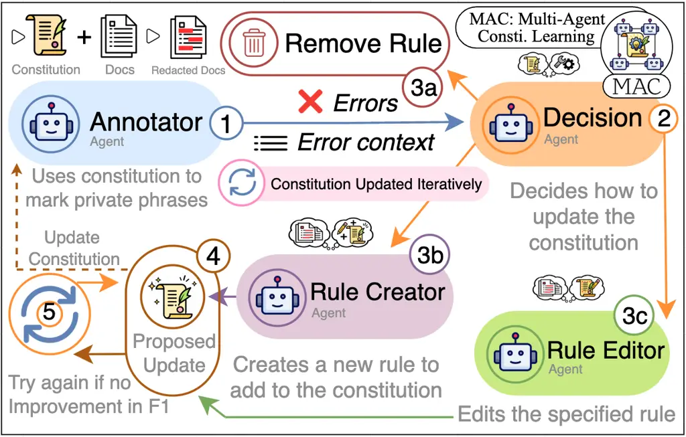
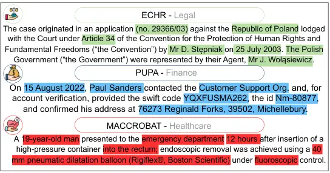
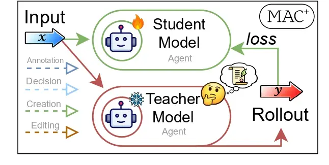
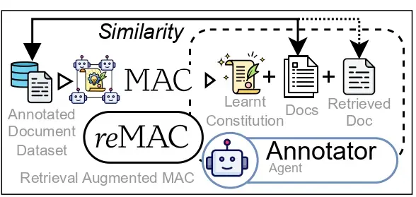
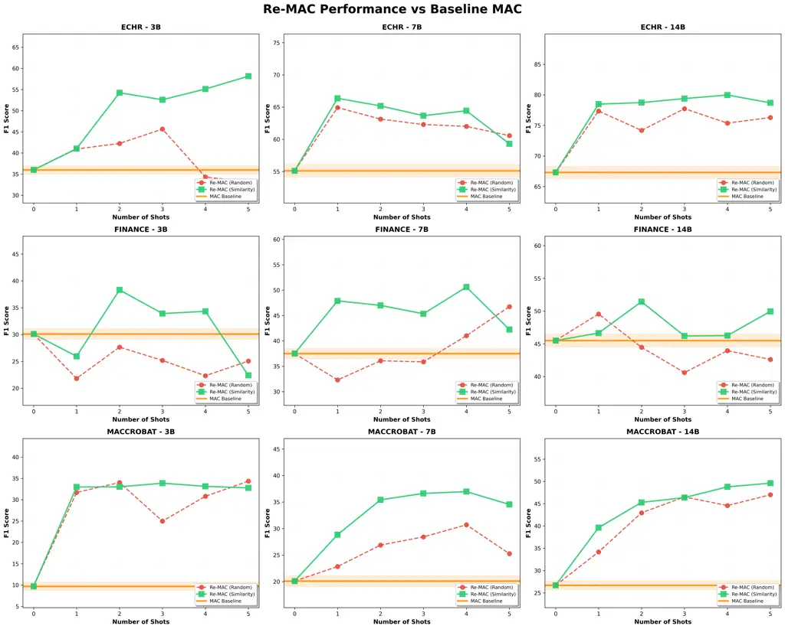
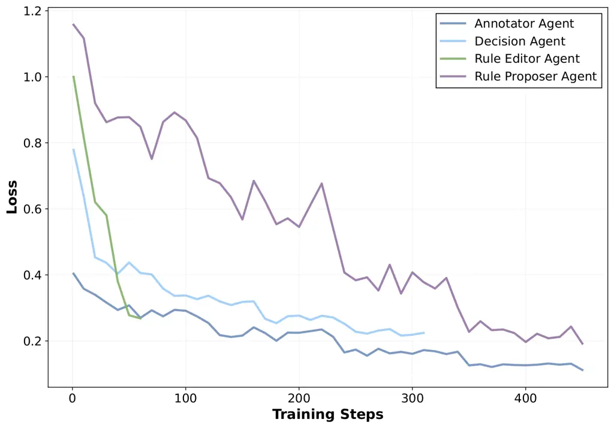

# MAC: Multi-Agent Constitution Learning

Rushil Thareja Affiliation: Mohamed bin Zayed University of Artificial
Intelligence (MBZUAI) Correspondence to: <rushil.thareja@mbzuai.ac.ae>
   Gautam Gupta Affiliation: Indraprastha Institute of Information
Technology Delhi (IIIT Delhi)    Francesco Pinto Affiliation: Google
DeepMind    Nils Lukas Affiliation: Mohamed bin Zayed University of
Artificial Intelligence (MBZUAI)

###### Abstract

Constitutional AI is a method to oversee and control LLMs based on a set
of rules written in natural language. These rules are typically written
by human experts, but could in principle be learned automatically given
sufficient training data for the desired behavior. Existing LLM-based
prompt optimizers attempt this but are ineffective at learning
constitutions since (i) they require many labeled examples and (ii) lack
structure in the optimized prompts, leading to diminishing improvements
as prompt size grows. To address these limitations, we propose
Multi-Agent Constitutional Learning (MAC), which optimizes over
structured prompts represented as sets of rules using a network of
agents with specialized tasks to accept, edit, or reject rule updates.
We also present MAC+, which improves performance by training agents on
successful trajectories to reinforce updates leading to higher reward.
We evaluate MAC on tagging Personally Identifiable Information (PII), a
classification task with limited labels where interpretability is
critical, and demonstrate that it generalizes to other agentic tasks
such as tool calling. MAC outperforms recent prompt optimization methods
by over 50%, produces human-readable and auditable rule sets, and
achieves performance comparable to supervised fine-tuning and GRPO
without requiring parameter updates.

[Github
Repo](https://github.com/rushil-thareja/MAC-Multi-Agent-Constitution-Learning)
  —   [PyPI Package](https://pypi.org/project/mac-prompt/)   —  
[Website](https://www.mac-prompt.com/)

###### Keywords: 

Machine Learning, ICML

## 1 Introduction

Constitutional AI guides LLM behavior using structured prompts that
enumerate natural-language rules defining what the model should and
should not do (Bai et al., 2022; Huang et al., 2024; Sharma et al.,
2025). Because these rules are applied at inference time rather than
embedded into model weights, they can be inspected, modified, and
audited without retraining. This makes constitutional AI particularly
attractive for domains such as healthcare, finance, and legal
compliance, where transparency is essential and task definitions evolve
over time.



Figure 1: In our MAC framework (1) an Annotator agent performs the
downstream task given the constitution. (2) A Decision agent analyzes
errors and reviews the constitution to add, edit, or remove rules. (3a)
The Rule Proposer creates new candidate rules and (3b) the Rule Editor
updates existing rules, producing a candidate constitution. (4) The
update is evaluated with the task metric, and (5) the process repeats k
times until performance improves.

A rule specifies when an action should or should not be taken. An
effective rule must be both unambiguous to a human auditor and reliably
followed by the LLM. However, writing such rules is difficult. Natural
language that seems clear to humans can be interpreted inconsistently by
models, and effectiveness must be validated empirically due to the
probabilistic nature of LLMs. In practice, developing a robust
constitution requires iterative refinement where experts write rules,
test them, observe failures, and revise. This process is slow,
expensive, and must be repeated whenever task definitions change or new
domains arise.

Automatic Prompt Optimization (APO) (Yang et al., 2023; Agrawal et al., 2025) methods could in principle automate this process, but existing
approaches are poorly suited for constitution learning. They typically
require large amounts of labeled data, produce unstructured prompt
modifications that are difficult to interpret, and show diminishing
returns as prompts grow longer (Ramnath et al., 2025). Moreover, they
discard the structured, rule-based format that makes constitutional AI
auditable in the first place.

We formalize constitution learning as the task of automatically deriving
a set of interpretable rules from limited input-output examples. Unlike
general prompt optimization, constitution learning restricts updates to
an explicit set of natural-language rules with predefined structure,
preserving the transparency that makes constitutional AI valuable.

We propose Multi-Agent Constitutional Learning (MAC), which optimizes
constitutions through a network of specialized agents that propose,
critique, and refine rule updates. Rather than optimizing a monolithic
prompt, MAC treats the constitution as a modular structure where rules
can be added, edited, or removed independently. Figure 1 illustrates our
overall approach. The multi-agent design decomposes the optimization
problem into subtasks, improving reliability and enabling lower-capacity
models to contribute effectively (Chan et al., 2023; Chen et al., 2024;
Du et al., 2023).

We evaluate MAC on Personally Identifiable Information (PII) tagging
across finance (Li et al., 2025), legal (Chalkidis et al., 2019), and
healthcare datasets (Caufield, 2020). PII tagging is a natural testbed
for constitution learning because it requires transparent
decision-making, suffers from limited labeled data, and definitions vary
substantially across domains and jurisdictions. Fine-tuning is also
impractical in this setting due to cost, and inference-time rule
application avoids the memorization risks associated with training on
sensitive data (Carlini et al., 2023; Huang et al., 2022; Kim et al.,
2023). We further demonstrate that MAC generalizes beyond classification
to agentic tasks by adapting it to tool calling on BFCL (Patil et al.,
2025).

### 1.1 Contributions

We make the following contributions:

- •
  We formalize constitution learning and propose Multi-Agent
  Constitutional Learning (MAC), where specialized agents propose,
  critique, and refine rules.
- •
  We evaluate MAC on PII tagging across finance, legal, and healthcare
  domains, demonstrating over 50% improvement over prompt optimization
  baselines and performance comparable to supervised fine-tuning.
- •
  We introduce two variants: reMAC, which uses test-time retrieval, and
  MAC+, which trains agents on successful trajectories to reinforce
  effective updates.
- •
  We show that MAC generalizes beyond classification to agentic tasks by
  adapting it to tool calling on BFCL.

| Domain     | Example Constitutional Rules                                                                                                                                                                                                                                                                                                                                                                                                                  |
| ---------- | --------------------------------------------------------------------------------------------------------------------------------------------------------------------------------------------------------------------------------------------------------------------------------------------------------------------------------------------------------------------------------------------------------------------------------------------- |
| Legal      | Mark as private specific dates when they appear in the context of personal events or actions, such as births, deaths, or significant life events. Do not mark general references or narrative text containing similar time periods. _Examples:_ mark “1975”, “22 August 2003”; do not mark “on a day in June”.                                                                                                                                |
| Healthcare | Mark terms such as heart failure subtypes (e.g., diastolic heart failure, systolic heart failure) when explicitly mentioned in a patient’s medical history as private. Do not mark generic medical conditions without an explicit subtype or detailed description.                                                                                                                                                                            |
| Finance    | Mark as private any phrase indicating a specific financial timeframe (e.g., FY2022, YTD FY2021) when it appears in direct association with identifiable information. Do not mark generic narrative context or standalone labels without specific identifiers. _Examples:_ mark “FY2022 balance sheet”, “Q4 2021 sales report” (if associated with identifiable information); do not mark “next year”, “past fiscal year” without identifiers. |

Table 1: Example natural-language constitutional rules learnt by MAC for
private information tagging across different domains.

## 2 Background

##### Controlling LLM Behavior.

Large language models can be controlled through two approaches:
training-time interventions and inference-time interventions.
Training-time methods include supervised fine-tuning (SFT) and
reinforcement learning from human feedback (RLHF). These methods are
effective but require vast labeled data, computational resources, and
risk memorization of sensitive training examples (Carlini et al., 2023).
Inference-time methods instead guide behavior through the prompt,
leaving model weights unchanged and includes few-shot prompting (Brown
et al., 2020), chain-of-thought prompting (Wei et al., 2022), and
rule-based prompting (Ouyang et al., 2022).

Constitutional AI guides LLM behavior at inference time using an
explicit constitution (Bai et al., 2022; Huang et al., 2024): a set of
natural-language rules, as illustrated in Table 1. By placing
constraints on the prompt’s structure, it improves transparent and
auditable control. For example, constitutional classifiers apply such
rules to judge whether input text is harmful or non-harmful (Sharma et
al., 2025).



Figure 2: Example document snippets with private spans indicated.

Automatic Prompt Optimization (APO) uses LLMs to iteratively refine
prompts based on task performance (Ramnath et al., 2025). Given labeled
examples and a task metric, APO methods generate candidate
modifications, evaluate them, and retain improvements.

We survey evolutionary and proposal-based prompt optimization methods,
such as Genetic-Pareto (GEPA) (Agrawal et al., 2025), which performs
guided evolutionary search over prompts using task feedback, and
Multiprompt Instruction Proposal Optimizer (MIPRO) (Opsahl-Ong et al.,
2024), which iteratively proposes and selects prompts based on
validation performance. Both methods optimize prompts as unstructured
text, putting no constraints on their format.

Private Information Tagging aims to identify sensitive text spans in
documents. These spans may correspond to direct identifiers such as
names or account numbers, or indirect references that become sensitive¹¹
1 Definitions of what constitutes private information vary across
organizations, jurisdictions, and datasets, and can evolve over time. in
context (Schwartz and Solove, 2011; McCallister, 2010). Existing
approaches typically rely on pretrained taggers, rule-based pattern
matching, or context-aware detectors operating over fixed label sets
(Microsoft, 2025; NVIDIA, 2025; Zaratiana et al., 2025).

Notation. Let $`x\in\mathcal{X}`$ denote an input (e.g., a document) and
$`y^{\star}(x)\in\mathcal{Y}`$ denote the ground-truth output (e.g., a
set of labeled spans), which reflects a task-specific definition
revealed only through labeled examples. The agent is guided by a
constitution $`C=\langle r_{1},\ldots,r_{|C|}\rangle`$, which is an
ordered list of natural-language rules. Let $`\theta`$ denote fixed LLM
weights and $`\pi`$ a fixed role prompt specifying the task and output
format. Given an input $`x`$ and constitution $`C`$, the agent produces
a prediction $`\hat{y}(x)=A_{\theta,\pi}(x;C)`$. We assume access to a
labeled dataset $`D=\{(x_{i},y_{i}^{\star})\}_{i=1}^{N}`$ and a
verifiable task metric
$`\mu:\mathcal{Y}\times\mathcal{Y}\rightarrow[0,1]`$ that compares
predictions to ground truth.

## 3 Conceptual Approach

We begin by describing our core algorithm for MAC and then we describe
two extension variants MAC+ and reMAC.

### 3.1 Constitutional Learning

The goal of constitution learning is to automatically derive a set of
interpretable rules from labeled examples. Given training data
$`D_{\text{train}}`$ and validation data $`D_{\text{val}}`$, and a task
metric $`\mu:\mathcal{Y}\times\mathcal{Y}\rightarrow[0,1]`$, we seek a
constitution $`C`$ that maximizes task performance. Formally, we
optimize:

```math
\displaystyle C^{\star}=\arg\max_{C\in\mathcal{C}}\ \mu\left(A_{\theta,\pi}(D_{\text{val};C}),Y^{\star}_{\text{val}}\right) \tag{1}
```

where $`A_{\theta,\pi}(x;C)`$ denotes the prediction of an LLM-based
agent with fixed weights $`\theta`$ and role prompt $`\pi`$, conditioned
on input $`x`$ and constitution $`C`$. Throughout optimization, the
model weights $`\theta`$ and role prompt $`\pi`$ remain fixed.

### 3.2 Multi-Agent Constitution Learning (MAC)

We call our algorithm _Multi-Agent Constitution Learning_ (MAC), which
optimizes constitutions through a network of specialized agents. MAC
consists of four agents:

- •
  Annotator($`B`$, $`C`$): applies the current constitution $`C`$ to a
  batch of inputs $`B`$ and produces predictions $`\hat{Y}`$.
- •
  Decision($`FN`$, $`FP`$, $`C`$, $`R_{\max}`$): analyzes errors and
  selects an update operation
  $`op\in\{\textsc{Add}\textsc{Edit},\textsc{Remove}\}`$, along with a
  rationale $`r`$ and target rule index $`i`$.
- •
  Creator($`FN`$, $`FP`$, $`r`$): drafts a new rule based on observed
  errors and the rationale.
- •
  Editor($`c_{i}`$, $`FN`$, $`FP`$, $`r`$): modifies existing rule
  $`c_{i}`$ based on observed errors and the rationale.

Given predictions $`\hat{Y}`$ and ground-truth labels $`Y^{\star}`$, a
helper function Match computes the task metric
$`\mu(\hat{Y},Y^{\star})`$ and extracts false negatives ($`FN`$) and
false positives ($`FP`$), along with their surrounding context within a
fixed character window. Because private information tagging is a
span-level classification task, we use F1 as the standard evaluation
metric, computed (using Match) via exact span-level matching between
predicted and ground-truth private phrases.

Using multiple agents allows decomposing the optimization problem into
subtasks, so that each agent can focus on its own individual task, which
has been shown to improve reliability (Chan et al., 2023; Chen et al.,
2024; Du et al., 2023). For reproducibility²² 2 We will also publish our
software with all details to reproduce our experiments, including the
learned constitutions as open-source code., we provide prompts for the
Annotator, Decision, Rule Creator, and Rule Editor agents in the
Appendices 9.2.1, 9.2.2, 9.2.3, and 9.2.4. Appendix 9.9 presents sample
outputs from individual MAC agents.

### 3.3 Core Algorithm for MAC

MAC optimizes the constitution through an iterative epoch-batch
procedure, summarized in Algorithm 1. At each step, the Annotator
applies the current constitution $`C`$ to a batch $`B`$ (Line 5). The
Match operation computes errors and the task metric $`\mu`$ (Line 6).
The Decision agent analyzes the errors and selects an update operation
(Line 7). Based on this decision, either the Creator or Editor agent
proposes an updated constitution $`C_{\text{prop}}`$ (Lines 8–14).

The proposed constitution is evaluated on the same batch (Line 15). If
the task metric improves ($`\mu_{\text{prop}}>\mu`$), the update is
accepted (Lines 16–18). Otherwise, the proposal is retried up to a fixed
number of times using a higher sampling temperature; if no retry yields
an improvement, the original constitution is retained. After a fixed
number of batches, the constitution is evaluated on the validation set
$`D_{\text{val}}`$, and the version with the highest validation
performance is retained as $`C^{\star}`$ (Lines 20–23). Validation F1
over batches for MAC runs across different models and datasets is shown
in Appendix 9.6.

1:  Input: Training data $`D_{\text{train}}`$, validation data
$`D_{\text{val}}`$, rule budget $`R_{\max}`$, epochs $`E`$

2:  Initialize: $`C\leftarrow\varnothing`$,
$`C^{\star}\leftarrow\varnothing`$, $`\mu^{\star}\leftarrow 0`$

3:  for $`e=1`$ to $`E`$ do

4:   for all batch $`B\subset D_{\text{train}}`$ do

5:    $`\hat{Y}\leftarrow\textsc{Annotator}(B,C)`$
  $`\triangleright`$ Apply current constitution

6:    $`FN,FP,\mu\leftarrow\textsc{Match}(\hat{Y},Y^{\star}_{B})`$
  $`\triangleright`$ Compute errors

7:    $`op,r,i\leftarrow\textsc{Decision}(FN,FP,C,R_{\max}`$)

8:    if $`op=\textsc{Add}`$ then

9:      $`C_{\text{prop}}\leftarrow C\cup\{\textsc{Creator}(FN,FP,r)\}`$

10:    else if $`op=\textsc{Edit}`$ then

11:
     $`C_{\text{prop}}\leftarrow(C\setminus\{c_{i}\})\cup\{\textsc{Editor}(c_{i},FN,FP,r)\}`$

12:    else

13:      $`C_{\text{prop}}\leftarrow C\setminus\{c_{i}\}`$
  $`\triangleright`$ Remove

14:    end if

15:
   $`\mu_{\text{prop}}\leftarrow\textsc{Match}(\textsc{Annotator}(B,C_{\text{prop}}),Y^{\star}_{B})`$

16:    if $`\mu_{\text{prop}}>\mu`$ then

17:      $`C\leftarrow C_{\text{prop}}`$   $`\triangleright`$ Accept
update

18:    end if

19:   end for

20:
  $`\mu_{\text{val}}\leftarrow\textsc{Match}(\textsc{Annotator}(D_{\text{val}},C),Y^{\star}_{\text{val}})`$

21:   if $`\mu_{\text{val}}>\mu^{\star}`$ then

22:    $`C^{\star}\leftarrow C`$,
$`\mu^{\star}\leftarrow\mu_{\text{val}}`$   $`\triangleright`$ Track
best

23:   end if

24:  end for

25:  Return: $`C^{\star}`$

Algorithm 1 MAC: Multi-Agent Constitution Learning

### 3.4 Two Variants: MAC+ and reMAC

##### MAC+.

The effectiveness of MAC depends on each agent performing its role
reliably, but smaller models (ex. 3B) may struggle with complex
reasoning tasks such as diagnosing error patterns or proposing precise
rules. MAC+ addresses this by fine-tuning each agent on high-quality
trajectories generated by a larger model (ex. 14B). Let $`A^{(S)}`$
denote an agent instantiated with a smaller model and $`A^{(L)}`$ the
same agent with a larger model. We execute MAC using $`A^{(L)}`$ and
collect input-output traces
$`\mathcal{T}_{A}=\{(z_{j},o_{j})\}_{j=1}^{M_{A}}`$ for each agent
$`A\in\{\textsc{Decision},\textsc{Creator},\textsc{Editor}\}`$, where
$`z_{j}`$ is the input context and $`o_{j}`$ is the output produced by
$`A^{(L)}`$. We then fine-tune $`A^{(S)}`$ on $`\mathcal{T}_{A}`$ via
supervised fine-tuning by training each agent only on traces relevant to
its role. To avoid memorization, we fine-tune on data from different
domains (healthcare & finance) than those used for evaluation (legal),
training agents on task structure rather than dataset-specific content.
Statistics on the collected trajectories from each agent used for
fine-tuning are shown in Appendix 9.8.



Figure 3: MAC+: Optimizing each agent for its assigned role via
supervised fine-tuning on rollouts generated by a larger model.



Figure 4: reMAC: Retrieval-augmented MAC, where documents from the
training set are retrieved and added at test time.

##### Retrieval-Augmented MAC (reMAC).

MAC learns a constitution that captures general domain patterns, but
abstract rules may be insufficient for highly specialized terminology or
context-dependent definitions. reMAC mitigates this by supplementing the
learned constitution with concrete examples at test time. Let
$`\mathcal{R}:\mathcal{X}\times D_{\text{train}}\times k\rightarrow\mathcal{X}^{k}`$
be a retrieval function returning $`k`$ training examples for a test
input $`x`$. The Annotator prediction becomes:

```math
\displaystyle\hat{y}(x)=A_{\theta,\pi}\big(x;C,\mathcal{R}(x,D_{\text{train}},k)\big) \tag{2}
```

where retrieved examples are included as few-shot demonstrations
alongside the constitution $`C`$. Importantly, as shown in Figure 4
retrieval is applied only at inference and does not modify the
constitution so that its auditability is preserved.

## 4 Evaluation

We evaluate MAC on private information tagging across legal, healthcare,
and finance domains and then show generalization to other tasks, such as
tool calling. We focus on tagging because it combines the core
challenges constitution learning addresses: (i) classification, (ii)
limited labeled data, (iii) a need for transparent, auditable decisions,
and (iv) settings where concerns about memorization make training-based
approaches undesirable.

### 4.1 Experimental Setup

##### Datasets.

We evaluate MAC on private information tagging across three domains:
legal, healthcare, and finance. For legal, we use the ECHR dataset
(Chalkidis et al., 2019), containing case documents from the European
Court of Human Rights. For healthcare, we use MACCROBAT (Caufield,
2020), containing clinical documents with dense, overlapping private
spans across 49 fine-grained privacy types. For finance, we use a subset
of PUPA (Li et al., 2025), derived from real-world user-assistant
interactions. These domains differ substantially in privacy definitions,
document structure, and annotation density, enabling evaluation across
sparse-privacy (legal), heavy-redaction (healthcare), and intermediate
(finance) regimes. We sample 192 documents per domain, split into 160
train, 16 validation, and 16 test documents. We use 192 documents
because the smallest dataset (MACCROBAT) contains 192 usable documents,
and we apply the same split consistently across all domains for
consistency. Full statistics are provided in Appendix 9.1.

##### Models and Metrics.

We use Qwen 2.5 Instruct models (Qwen et al., 2025) at 3B, 7B, and 14B
parameters, as they are standard non-reasoning instruction-tuned models
with a complete size family and are commonly used in prior
prompt-optimization work. We report F1 computed via exact span-level
matching between predicted and ground-truth private spans, which is the
standard evaluation metric for this task (Sang and De Meulder, 2003).

##### Baselines.

We compare MAC against 3 types of baselines: (i) Pretrained taggers:
Microsoft Presidio (Microsoft, 2025) with SpaCy, BERT, and Stanza
backends, and Nvidia GLiNER-PII (NVIDIA, 2025). (ii) Prompt
optimization: GEPA (Agrawal et al., 2025), which performs evolutionary
prompt search, and MIPRO (Opsahl-Ong et al., 2024), which iteratively
proposes and selects prompt variants. Both are configured with the same
computational budget as MAC (480 forward passes). (iii) Training-based:
Supervised fine-tuning (SFT) and GRPO (Shao et al., 2024), included as
upper-bound references despite memorization concerns. Full
implementation details are available in Appendix 9.3.

| Method                      | Legal | Finance | Healthcare |
| --------------------------- | ----- | ------- | ---------- |
| MAC (14B)                   | 67.3  | 45.5    | 26.7       |
| Microsoft Presidio (SpaCy)  | 57.3  | 32.8    | 12.0       |
| Microsoft Presidio (BERT)   | 10.4  | 5.2     | 2.7        |
| Microsoft Presidio (Stanza) | 54.0  | 44.7    | 9.1        |
| Nvidia GLiNER               | 57.1  | 35.9    | 5.3        |

Table 2: Performance comparison (F1) with pretrained taggers.

##### Computational Budget.

For fair comparison, all optimization-based methods use the same
computational budget. MAC runs for 3 epochs over 20 batches of 8
documents, totaling 480 forward passes. GEPA and MIPRO are configured
with equivalent budgets: GEPA uses $`\texttt{max\_metric\_calls}=480`$
and MIPRO is capped at 480 total evaluations. Training-based baselines
use the same data splits and epoch count. Full implementation details
are provided in Appendix 9.3.

### 4.2 Experimental Results

Figure 5 presents a comparison of test F1 between MAC, pretrained
taggers, and prompt-optimization baselines (GEPA & MIPRO) across model
sizes (3B, 7B, & 14B).

Figure 5: Test F1 across model sizes for MAC compared to baseline prompt
optimizers and pretrained PII taggers.

##### MAC matches or outperforms pretrained taggers.

Table 2 compares MAC (14B) against pretrained PII taggers commonly used
in practice, including Microsoft Presidio with different NER backends
and Nvidia GLiNER-PII.

MAC outperforms all baselines across domains: +17% in Legal (67.3 vs.
57.3), +2% in Finance (45.5 vs. 44.7), and +123% in Healthcare (26.7 vs.
12.0). The gain is largest in Healthcare, where pretrained taggers
struggle with fine-grained medical privacy types that fall outside
standard PII categories. In Finance, where privacy definitions more
closely align with standard PII, the gap is smaller but MAC still
achieves the best performance. Unlike pretrained taggers, which rely on
fixed label sets, MAC adapts to domain-specific privacy definitions
through the constitutions alone.

| Dataset    | Optimizer | 3B    | 7B    | 14B   |
| ---------- | --------- | ----- | ----- | ----- |
| Legal      | GEPA      | 12.70 | 52.05 | 50.09 |
|            | MIPRO     | 13.15 | 38.61 | 44.31 |
|            | MAC       | 36.00 | 55.10 | 67.30 |
| Finance    | GEPA      | 11.89 | 22.51 | 28.75 |
|            | MIPRO     | 9.81  | 22.34 | 26.80 |
|            | MAC       | 30.10 | 37.50 | 45.50 |
| Healthcare | GEPA      | 16.47 | 12.94 | 16.77 |
|            | MIPRO     | 12.47 | 16.75 | 20.60 |
|            | MAC       | 9.70  | 20.10 | 26.70 |

Table 3: Performance comparison (F1) across model sizes.

##### MAC outperforms prompt optimization baselines.

Table 3 compares MAC against GEPA and MIPRO across model sizes. MAC
outperforms both baselines in 8 of 9 dataset-model configurations. The
largest gain is observed in Legal at 3B (+174%, 36.0 vs. 13.15 F1). The
only case where MAC underperforms is Healthcare at 3B, where GEPA
achieves 16.47 vs. 9.70 F1. In all other settings, improvements range
from +28% to +153%. These results demonstrate that structured rule
optimization consistently outperforms unstructured prompt search.

|                             |       |        |        |        |        |
| --------------------------- | ----- | ------ | ------ | ------ | ------ |
| Dataset                     | Model | 0-Shot | 1-shot | 3-shot | 5-shot |
| Random Retrieval:           |       |        |        |        |        |
| Legal                       | 3B    | 38.79  | 40.94  | 45.64  | 33.17  |
|                             | 7B    | 54.85  | 64.93  | 62.29  | 60.56  |
|                             | 14B   | 73.41  | 77.35  | 77.74  | 76.29  |
| Finance                     | 3B    | 17.42  | 21.82  | 25.18  | 25.06  |
|                             | 7B    | 38.79  | 32.32  | 35.88  | 46.73  |
|                             | 14B   | 48.47  | 49.55  | 40.60  | 42.61  |
| Healthcare                  | 3B    | 16.43  | 31.72  | 24.99  | 34.35  |
|                             | 7B    | 10.06  | 22.84  | 28.43  | 25.27  |
|                             | 14B   | 16.16  | 34.18  | 46.51  | 47.00  |
| Similarity-Based Retrieval: |       |        |        |        |        |
| Legal                       | 3B    | 42.56  | 41.02  | 52.59  | 58.15  |
|                             | 7B    | 56.36  | 66.36  | 63.66  | 59.30  |
|                             | 14B   | 72.21  | 78.48  | 79.39  | 79.97  |
| Finance                     | 3B    | 13.82  | 25.95  | 33.92  | 22.39  |
|                             | 7B    | 38.79  | 47.88  | 45.33  | 50.60  |
|                             | 14B   | 48.47  | 46.64  | 46.19  | 49.95  |
| Healthcare                  | 3B    | 16.97  | 32.99  | 33.88  | 32.78  |
|                             | 7B    | 9.91   | 28.85  | 36.63  | 36.97  |
|                             | 14B   | 16.34  | 39.63  | 46.36  | 49.60  |

Table 4: reMAC: Retrieval-augmented MAC. F1 for varying numbers of
retrieved examples added to MAC constitutions.

##### reMAC improves utility during inference.

Table 4 shows results for reMAC, which augments the learned constitution
with retrieved examples at test time. While we evaluate
$`k\in{1,2,3,4,5}`$, we report the representative settings
$`k\in{1,3,5}`$ here for brevity; Appendix 9.5 presents the full test F1
curves over $`k`$ for all models and datasets. We evaluate two retrieval
strategies: random sampling from the training set, and similarity-based
retrieval using cosine similarity over sentence embeddings³³ 3 We use
the following pre-trained sentence transformer:
[https://huggingface.co/sentence-transformers/all-MiniLM-L6-v2](https://huggingface.co/sentence-transformers/all-MiniLM-L6-v2).

Retrieval consistently improves performance across all 18 dataset-model
configurations. The largest gain is observed in Healthcare at 7B with
similarity-based retrieval (+273%, 9.91 to 36.97 F1 at 5-shot). Averaged
across settings, reMAC yields improvements of 75.5% (3B), 90.4% (7B),
and 69.4% (14B). Gains are largest in Healthcare (176.5%), where
specialized medical terminology benefits most from concrete examples.
These results show that test-time retrieval complements learned
constitutions, particularly for domains with context-dependent
definitions.

|                     |           |        |       |
| ------------------- | --------- | ------ | ----- |
| Method              | Precision | Recall | F1    |
| Training Baselines: |           |        |       |
| GRPO                | 64.61     | 28.63  | 39.68 |
| SFT                 | 78.72     | 44.17  | 56.59 |
| MAC Variants:       |           |        |       |
| MAC                 | 64.32     | 24.95  | 35.96 |
| MAC+                | 75.93     | 48.27  | 59.02 |

Table 5: Optimized MAC vs. training-based baselines on legal for the 3B
Model. MAC+ tunes on Healthcare & Finance only.

##### MAC+ improves over MAC.

Table 5 compares MAC+ against training-based baselines on ECHR (Legal)
using a 3B model. MAC+ fine-tunes each agent on trajectories generated
by a 14B model executing MAC on out-of-domain data (healthcare and
finance), then evaluates on legal documents. Loss curves for all agents
are shown in Appendix 9.7, and we fine-tune agents using LoRA (rank 64).

This setup trains agents on task structure rather than domain-specific
patterns, avoiding memorization. MAC+ achieves 59.02 F1, outperforming
both SFT (56.59) and GRPO (39.68). Gains are primarily from higher
recall (48.27 vs. 44.17 for SFT) while maintaining comparable precision
(75.93 vs. 78.72), indicating that specialized agents identify more
private spans without sacrificing accuracy. Figure 6 shows that MAC+
also converges faster, exceeding 0.4 F1 within approximately 10 batches
while no baseline reaches this threshold. These results demonstrate that
agent-level distillation improves performance for smaller models without
requiring in-domain training data.

|                           |            |       |
| ------------------------- | ---------- | ----- |
| Agent                     | Base Model | MAC+  |
| Classification (F1 score) |            |       |
| Annotator Agent           | 32.9       | 59.02 |
| LLM-as-a-Judge (Win rate) |            |       |
| Decision Agent            | 9.0%       | 86.0% |
| Rule Editor Agent         | 25.0%      | 74.0% |
| Rule Proposer Agent       | 3.0%       | 97.0% |

Table 6: Performance of MAC+ agents. The Annotator is evaluated using F1
on the Legal test set. All other agents are evaluated using an
LLM-as-a-judge win rates (remaining cases are ties).

##### Analysis of MAC+.

To understand the source of MAC+ improvements, we evaluate each agent
individually. We construct an evaluation set of 100 input-output traces
per agent. For the Annotator, we use trajectories collected from MAC
executions with the 14B model (for which we have sufficient samples).
For the remaining agents, we supplement MAC-collected trajectories with
additional samples generated by a 7B model. For each trace, we re-run
the input through both the base model and the fine-tuned model, enabling
direct comparison under identical inputs. The Annotator is evaluated
using F1. Other agents are evaluated using an LLM-as-a-judge protocol
with GPT-OSS 120B (prompt in Appendix 9.12).

Table 6 shows substantial improvements across all agents after using
MAC+. The Annotator improves from 32.9 to 59.02 F1 (1.8$`\times`$). Win
rates increase from 9.0% to 86.0% for Decision (9.6$`\times`$), from
25.0% to 74.0% for Rule Editor (3.0$`\times`$), and from 3.0% to 97.0%
for Rule Proposer (32$`\times`$). These results confirm that MAC+ gains
stem from improved performance on each agent’s specialized sub-task,
rather than from any single component.

Figure 6: Validation F1 vs training batches comparison of MAC variants
against baselines on 3B models for the ECHR dataset.

##### Tool-MAC: MAC for agentic tool-calling.

To demonstrate that MAC applies beyond private information tagging, we
evaluate on the BFCL tool-calling benchmark (Patil et al., 2025),
specifically the _parallel_ sub-task that requires decomposing a single
natural-language request into multiple independent function calls. We
choose tool calling because it shares key properties with PII tagging:
both require precise structured outputs, and tool arguments can contain
sensitive information that must be handled correctly (Alizadeh et al.,
2025; Wang et al., 2025; Yan et al., 2025).

To adapt MAC for tool calling, we modify the agent prompts to reason
about function signatures rather than privacy definitions, replace the
optimization metric (accuracy instead of F1), and adapt the Match
operation to identify failed tool calls rather than false positives or
negatives. Table 7 shows results for a 3B model. MAC improves accuracy
by +5.5% over the 82% baseline, outperforming GEPA (+4.0%) and MIPRO
(+2.5%). The learned rules address common failure modes, such as
mismatched argument types, and improve tool selection for multi-step
user intents. These results show that MAC can learn constitutions for
diverse downstream tasks, with adaptations limited to task-specific
prompts and metrics while the core multi-agent optimization loop remains
unchanged.

### 4.3 Qualitative Analysis

The first three rules from all constitutions learned by MAC across
Legal, Healthcare, and Finance datasets and across the 3B, 7B, and 14B
model sizes are provided in Appendix 9.4. GEPA and MIPRO learned prompts
for the Legal dataset across the same three model sizes are provided in
Appendices 9.10 and 9.11, respectively.

On average, MAC learns 9 rules across datasets and model sizes,
following a consistent structure similar to the sample rules in Table 1.
Rules are typically phrased as “Mark …” definitions of private entities,
optionally augmented with examples or explicit inclusion/exclusion
criteria, ensuring transparency and enabling direct stakeholder
inspection and updates. Legal and Healthcare require a comparable number
of rules (7.33 and 7.67), while Finance requires more on average (12),
which we attribute to its sparser, shorter private entities and lowest
average characters per privacy group (Appendix 9.1), necessitating more
independent rules to precisely guide span boundaries and improve
performance. Overall, the length of full MAC prompts (with learned
constitutions) lies between MIPRO and GEPA (Table 8). On closer
inspection of the learned constitutions, we observe that smaller models
(3B) exhibit recurring artifacts, including overly short or low-quality
rules with substantial repetition, incorrect edit decisions, and
redundant updates, with the Decision Agent showing limited diversity and
a bias toward adding new rules. These issues are substantially reduced
when using larger models (14B), motivating the use of distillation in
MAC+, which yields significant performance improvements. Despite these
limitations, MAC still outperforms GEPA for smaller models. GEPA’s
reflection and full prompt rewrites make it difficult for low-capacity
models to preserve task-relevant behavior, whereas MAC constrains
updates to the constitution and decomposes the problem across
specialized agents, enabling the discovery of performance-improving rule
sets even with a 3B model.

| Method | Final Accuracy | Improvement |
| ------ | -------------- | ----------- |
| MAC    | 87.5%          | +5.5%       |
| GEPA   | 86.0%          | +4.0%       |
| MIPRO  | 84.5%          | +2.5%       |

Table 7: Tool-calling accuracy after optimization. Baseline = 82%.

## 5 Discussion & Limitations

MAC is particularly effective for smaller models. Table 3 shows that the
performance gap between MAC and prompt-optimization baselines decreases
as model size increases. The average improvement over GEPA drops from
98.5% at 3B to 50.6% at 14B. We attribute this to how MAC structures the
optimization problem. Rather than rewriting the full prompt, MAC
restricts updates to explicit rules while keeping the rest of the prompt
fixed. MAC further decomposes updates into decision, rule creation, and
rule editing stages handled by separate agents, limiting the complexity
of each LLM call. This decomposition is particularly beneficial for
smaller models, which struggle with complex multi-step reasoning in a
single call.

When does MAC underperform? MAC underperforms GEPA in one setting:
Healthcare at 3B (9.70 vs. 16.47 F1). We hypothesize this occurs because
healthcare privacy definitions in MACCROBAT span 49 fine-grained types
with dense, overlapping spans. At 3B, the Decision agent may lack the
capacity to diagnose such complex error patterns, leading to suboptimal
rule updates. This suggests MAC may struggle when (i) the task requires
fine-grained distinctions beyond the agent’s reasoning capacity, or (ii)
error patterns are too complex to address with single-rule updates.
Future work could explore hierarchical rule structures or ensemble
decision-making to address such cases.

Constitutional prompts are preferred for transparency. As model capacity
increases, the performance gap between MAC and baselines narrows.
However, MAC remains preferable from a transparency perspective. MAC
learns structured rules that follow a fixed format (Table 1), enabling
auditing beyond raw performance. Example constitutions are provided in
Appendix 9.4, with GEPA and MIPRO prompts in Appendices 9.10 and 9.11.
GEPA prompts are substantially more verbose than MAC and MIPRO
(Table 8). On average, MAC prompts are approximately 30% shorter than
GEPA prompts, and up to 70% shorter on Legal data. Because the base
prompt remains fixed and only the constitution evolves, stakeholders do
not need to repeatedly inspect entirely new prompts for each dataset or
task.

Agent specialization without memorization. MAC+ trains agents on
out-of-domain data (healthcare and finance) and evaluates on legal
documents, learning task structure rather than domain-specific patterns.
This is critical for private information tagging, where fine-tuning on
sensitive data risks memorization (Carlini et al., 2023). MAC+
outperforms both SFT and GRPO on out-of-domain evaluation (Table 5),
suggesting that agent-level distillation provides a safer alternative to
direct fine-tuning when privacy is a concern.

Limitations. While we perform extensive evaluations of our methods, we
identify the following limitations. First, the length of the
constitution presents a utility/transparency trade-off where adding
rules improves utility but makes them more difficult to audit. We do not
evaluate this trade-off, which would require a user-study and likely
exceeds the scope of our work. Second, our experiments assumes the task
metric is reliable. However, if $`\mu`$ is noisy, sparse, or misaligned
with the true objective, MAC may learn rules that optimize the metric
without improving actual task performance. Third, rules can interact in
unexpected ways when the constitution grows too large. Adding a new rule
may conflict with existing rules or cause unintended side effects on
previously correct predictions. This may become a problem once the
constitution outgrows the maximum context length of the Annotator or
Decision agent, which we do not evaluate in our work.

|                    |         |         |         |
| ------------------ | ------- | ------- | ------- |
| Metric             | MAC     | GEPA    | MIPRO   |
| Average Characters | 3,679.2 | 5,264.7 | 1,425.8 |

Table 8: Average prompt length across all datasets and models.

## 6 Conclusion

Constitutional AI offers transparent, inference-time control over LLM
behavior, but writing effective constitutions is difficult and
time-consuming. We formalize constitution learning as the task of
automatically deriving interpretable rules from labeled examples, and
propose MAC, a multi-agent method where specialized agents propose,
critique, and refine rules. MAC outperforms prompt-optimization
baselines by over 50% on private information tagging across legal,
healthcare, and finance domains, and matches or exceeds pretrained
taggers without task-specific training. Retrieval augmentation (reMAC)
improves performance for specialized domains, while agent specialization
(MAC+) enables smaller models to match larger ones without memorization
risks. MAC also generalizes to tool calling, demonstrating applicability
beyond classification. We hope this work initiates research on
constitution learning as a transparent and effective alternative to
unstructured prompt optimization.

## 7 Impact Statement

All datasets used in our experiments are publicly available and contain
either personally identifiable information (PII) that is authorized for
public release or data shared with full consent from the relevant
stakeholders. Any biases regarding what is considered private arise from
the provided annotations, which reflect domain- or stakeholder-specific
definitions. In addition, the underlying language models may encode
biases from their pretraining data, which are outside the scope of this
work and not modified by our approach.

This work lowers the barrier to deploying privacy-preserving language
model systems. By enabling privacy behavior to be specified and adapted
through explicit constitutions rather than model fine-tuning,
stakeholders can mark and revise what is considered private using only
rule updates, without retraining models or exposing sensitive data
during optimization. This is particularly important in privacy-sensitive
deployments, where fine-tuning can introduce memorization risks and
operational constraints.

More broadly, our work advances a new paradigm of constitution learning,
in which transparent, auditable rule sets are learned directly from data
under task feedback. By restricting optimization to explicit rules
rather than unconstrained prompt rewrites, this approach improves trust,
interpretability, and stakeholder control while achieving strong
performance. We believe this represents an important step toward safer
and more accountable use of language models in high-stakes applications.

## 8 Author Acknowledgment

Francesco Pinto (affiliated with Google DeepMind) contributed in an
individual advisory capacity.

## References

- Agrawal et al. (2025) L. A. Agrawal, S. Tan, D. Soylu, N. Ziems, R.
  Khare, K. Opsahl-Ong, A. Singhvi, H. Shandilya, M. J. Ryan, M.
  Jiang, C. Potts, K. Sen, A. G. Dimakis, I. Stoica, D. Klein, M.
  Zaharia, and O. Khattab GEPA: reflective prompt evolution can
  outperform reinforcement learning. External Links: 2507.19457,
  [Link](https://arxiv.org/abs/2507.19457) Cited by: §1, §2, §4.1, §9.3.
- Akbik et al. (2019) A. Akbik, T. Bergmann, D. Blythe, K. Rasul, S.
  Schweter, and R. Vollgraf FLAIR: an easy-to-use framework for
  state-of-the-art nlp. In Proceedings of the 2019 conference of the
  North American chapter of the association for computational
  linguistics (demonstrations), pp. 54–59. Cited by: §9.3.
- Alizadeh et al. (2025) M. Alizadeh, Z. Samei, D. Stetsenko, and F.
  Gilardi Simple prompt injection attacks can leak personal data
  observed by llm agents during task execution. arXiv preprint
  arXiv:2506.01055. Cited by: §4.2.
- Bai et al. (2022) Y. Bai, S. Kadavath, S. Kundu, A. Askell, J.
  Kernion, A. Jones, A. Chen, A. Goldie, A. Mirhoseini, C. McKinnon, et
  al. Constitutional ai: harmlessness from ai feedback. arXiv preprint
  arXiv:2212.08073. Cited by: §1, §2.
- Brown et al. (2020) T. Brown, B. Mann, N. Ryder, M. Subbiah, J. D.
  Kaplan, P. Dhariwal, A. Neelakantan, P. Shyam, G. Sastry, A. Askell,
  et al. Language models are few-shot learners. Advances in neural
  information processing systems 33, pp. 1877–1901. Cited by: §2.
- Carlini et al. (2023) N. Carlini, D. Ippolito, M. Jagielski, K.
  Lee, F. Tramer, and C. Zhang Quantifying memorization across neural
  language models. External Links: 2202.07646,
  [Link](https://arxiv.org/abs/2202.07646) Cited by: §1, §2, §5.
- Caufield (2020) J. H. Caufield MACCROBAT2020 dataset. Note:
  [https://doi.org/10.6084/m9.figshare.9764942.v2](https://doi.org/10.6084/m9.figshare.9764942.v2)Version
  2 of the MACCROBAT2018 dataset on Figshare Cited by: §1, §4.1.
- Chalkidis et al. (2019) I. Chalkidis, I. Androutsopoulos, and N.
  Aletras Neural legal judgment prediction in English. In Proceedings of
  the 57th Annual Meeting of the Association for Computational
  Linguistics, A. Korhonen, D. Traum, and L. Màrquez (Eds.), Florence,
  Italy, pp. 4317–4323. External Links:
  [Link](https://aclanthology.org/P19-1424),
  [Document](https://dx.doi.org/10.18653/v1/P19-1424) Cited by: §1,
  §4.1.
- Chan et al. (2023) C. Chan, W. Chen, Y. Su, J. Yu, W. Xue, S.
  Zhang, J. Fu, and Z. Liu Chateval: towards better llm-based evaluators
  through multi-agent debate. arXiv preprint arXiv:2308.07201. Cited by:
  §1, §3.2.
- Chen et al. (2024) J. Chen, S. Saha, and M. Bansal Reconcile:
  round-table conference improves reasoning via consensus among diverse
  llms. In Proceedings of the 62nd Annual Meeting of the Association for
  Computational Linguistics (Volume 1: Long Papers), pp. 7066–7085.
  Cited by: §1, §3.2.
- Du et al. (2023) Y. Du, S. Li, A. Torralba, J. B. Tenenbaum, and I.
  Mordatch Improving factuality and reasoning in language models through
  multiagent debate. In Forty-first International Conference on Machine
  Learning, Cited by: §1, §3.2.
- Hu et al. (2021a) E. J. Hu, Y. Shen, P. Wallis, Z. Allen-Zhu, Y.
  Li, S. Wang, L. Wang, and W. Chen Lora: low-rank adaptation of large
  language models. arXiv preprint arXiv:2106.09685. Cited by: §9.3.
- Hu et al. (2021b) E. J. Hu, Y. Shen, P. Wallis, Z. Allen-Zhu, Y.
  Li, S. Wang, L. Wang, and W. Chen LoRA: low-rank adaptation of large
  language models. External Links: 2106.09685,
  [Link](https://arxiv.org/abs/2106.09685) Cited by: §9.3.
- Huang et al. (2022) J. Huang, H. Shao, and K. C. Chang Are large
  pre-trained language models leaking your personal information?.
  External Links: 2205.12628, [Link](https://arxiv.org/abs/2205.12628)
  Cited by: §1.
- Huang et al. (2024) S. Huang, D. Siddarth, L. Lovitt, T. I. Liao, E.
  Durmus, A. Tamkin, and D. Ganguli Collective constitutional ai:
  aligning a language model with public input. In Proceedings of the
  2024 ACM Conference on Fairness, Accountability, and Transparency,
  pp. 1395–1417. Cited by: §1, §2.
- Kaur et al. (2024) N. Kaur, A. Saha, M. Swami, M. Singh, and R. Dalal
  Bert-ner: a transformer-based approach for named entity recognition.
  In 2024 15th international conference on computing communication and
  networking technologies (ICCCNT), pp. 1–7. Cited by: §9.3.
- Kim et al. (2023) S. Kim, S. Yun, H. Lee, M. Gubri, S. Yoon, and S. J.
  Oh ProPILE: probing privacy leakage in large language models. External
  Links: 2307.01881, [Link](https://arxiv.org/abs/2307.01881) Cited by:
  §1.
- Li et al. (2020) J. Li, A. Sun, J. Han, and C. Li A survey on deep
  learning for named entity recognition. IEEE transactions on knowledge
  and data engineering 34 (1), pp. 50–70. Cited by: §9.3.
- Li et al. (2025) S. Li, V. C. Raghuram, O. Khattab, J. Hirschberg,
  and Z. Yu Papillon: privacy preservation from internet-based and local
  language model ensembles. In Proceedings of the 2025 Conference of the
  Nations of the Americas Chapter of the Association for Computational
  Linguistics: Human Language Technologies (Volume 1: Long Papers),
  pp. 3371–3390. Cited by: §1, §4.1.
- McCallister (2010) E. McCallister Guide to protecting the
  confidentiality of personally identifiable information. Diane
  Publishing. Cited by: §2.
- Microsoft (2025) Microsoft Presidio: data protection and
  de-identification sdk. Note:
  [https://microsoft.github.io/presidio/](https://microsoft.github.io/presidio/)Accessed:
  2025-08-28 Cited by: §2, §4.1, §9.3.
- NVIDIA (2025) NVIDIA GLiNER-PII: PII/PHI Detection Model. Note:
  [https://huggingface.co/nvidia/gliner-PII](https://huggingface.co/nvidia/gliner-PII)Accessed:
  2026-01-05; Token classification model for detecting personally
  identifiable information (PII) and protected health information (PHI)
  built on the GLiNER architecture. Cited by: §2, §4.1, §9.3.
- Opsahl-Ong et al. (2024) K. Opsahl-Ong, M. J. Ryan, J. Purtell, D.
  Broman, C. Potts, M. Zaharia, and O. Khattab Optimizing instructions
  and demonstrations for multi-stage language model programs. External
  Links: 2406.11695, [Link](https://arxiv.org/abs/2406.11695) Cited by:
  §2, §4.1, §9.3.
- Ouyang et al. (2022) L. Ouyang, J. Wu, X. Jiang, D. Almeida, C.
  Wainwright, P. Mishkin, C. Zhang, S. Agarwal, K. Slama, A. Ray, et al.
  Training language models to follow instructions with human feedback.
  Advances in neural information processing systems 35, pp. 27730–27744.
  Cited by: §2.
- Patil et al. (2025) S. G. Patil, H. Mao, C. Cheng-Jie Ji, F. Yan, V.
  Suresh, I. Stoica, and J. E. Gonzalez The berkeley function calling
  leaderboard (bfcl): from tool use to agentic evaluation of large
  language models. In Forty-second International Conference on Machine
  Learning, Cited by: §1, §4.2.
- Qwen et al. (2025) Qwen, :, A. Yang, B. Yang, B. Zhang, B. Hui, B.
  Zheng, B. Yu, C. Li, D. Liu, F. Huang, H. Wei, H. Lin, J. Yang, J.
  Tu, J. Zhang, J. Yang, J. Yang, J. Zhou, J. Lin, K. Dang, K. Lu, K.
  Bao, K. Yang, L. Yu, M. Li, M. Xue, P. Zhang, Q. Zhu, R. Men, R.
  Lin, T. Li, T. Tang, T. Xia, X. Ren, X. Ren, Y. Fan, Y. Su, Y.
  Zhang, Y. Wan, Y. Liu, Z. Cui, Z. Zhang, and Z. Qiu Qwen2.5 technical
  report. External Links: 2412.15115,
  [Link](https://arxiv.org/abs/2412.15115) Cited by: §4.1, §9.3.
- Ramnath et al. (2025) K. Ramnath, K. Zhou, S. Guan, S. S. Mishra, X.
  Qi, Z. Shen, S. Wang, S. Woo, S. Jeoung, Y. Wang, et al. A systematic
  survey of automatic prompt optimization techniques. arXiv preprint
  arXiv:2502.16923. Cited by: §1, §2.
- Sang and De Meulder (2003) E. T. K. Sang and F. De Meulder
  Introduction to the conll-2003 shared task: language-independent named
  entity recognition. In Proceedings of the seventh conference on
  Natural language learning at HLT-NAACL 2003, pp. 142–147. Cited by:
  §4.1.
- Schmitt et al. (2019) X. Schmitt, S. Kubler, J. Robert, M. Papadakis,
  and Y. LeTraon A replicable comparison study of ner software:
  stanfordnlp, nltk, opennlp, spacy, gate. In 2019 sixth international
  conference on social networks analysis, management and security
  (SNAMS), pp. 338–343. Cited by: §9.3.
- Schwartz and Solove (2011) P. M. Schwartz and D. J. Solove The pii
  problem: privacy and a new concept of personally identifiable
  information. NYUL rev. 86, pp. 1814. Cited by: §2.
- Shao et al. (2024) Z. Shao, P. Wang, Q. Zhu, R. Xu, J. Song, X. Bi, H.
  Zhang, M. Zhang, Y. K. Li, Y. Wu, and D. Guo DeepSeekMath: pushing the
  limits of mathematical reasoning in open language models. External
  Links: 2402.03300, [Link](https://arxiv.org/abs/2402.03300) Cited by:
  §4.1, §9.3.
- Sharma et al. (2025) M. Sharma, M. Tong, J. Mu, J. Wei, J.
  Kruthoff, S. Goodfriend, E. Ong, A. Peng, R. Agarwal, C. Anil, et al.
  Constitutional classifiers: defending against universal jailbreaks
  across thousands of hours of red teaming. arXiv preprint
  arXiv:2501.18837. Cited by: §1, §2.
- Staab et al. (2024) R. Staab, M. Vero, M. Balunović, and M. Vechev
  Large language models are advanced anonymizers. arXiv preprint
  arXiv:2402.13846. Cited by: §9.3.
- Wang et al. (2025) B. Wang, W. He, S. Zeng, Z. Xiang, Y. Xing, J.
  Tang, and P. He Unveiling privacy risks in llm agent memory. In
  Proceedings of the 63rd Annual Meeting of the Association for
  Computational Linguistics (Volume 1: Long Papers), pp. 25241–25260.
  Cited by: §4.2.
- Wei et al. (2022) J. Wei, X. Wang, D. Schuurmans, M. Bosma, F. Xia, E.
  Chi, Q. V. Le, D. Zhou, et al. Chain-of-thought prompting elicits
  reasoning in large language models. Advances in neural information
  processing systems 35, pp. 24824–24837. Cited by: §2.
- Yan et al. (2025) B. Yan, K. Li, M. Xu, Y. Dong, Y. Zhang, Z. Ren,
  and X. Cheng On protecting the data privacy of large language models
  (llms) and llm agents: a literature review. High-Confidence Computing,
  pp. 100300. Cited by: §4.2.
- Yang et al. (2023) C. Yang, X. Wang, Y. Lu, H. Liu, Q. V. Le, D. Zhou,
  and X. Chen Large language models as optimizers. In The Twelfth
  International Conference on Learning Representations, Cited by: §1.
- Zaratiana et al. (2025) U. Zaratiana, G. Pasternak, O. Boyd, G.
  Hurn-Maloney, and A. Lewis GLiNER2: an efficient multi-task
  information extraction system with schema-driven interface. External
  Links: 2507.18546, [Link](https://arxiv.org/abs/2507.18546) Cited by:
  §2.

## 9 Appendix

### 9.1 Dataset Statistics

The full statistics for the Legal, Healthcare and finance datasets used
as part of this work are available in Table 9.

|                                      |                        |                |              |
| ------------------------------------ | ---------------------- | -------------- | ------------ |
| Statistic                            | MACCROBAT (Healthcare) | PUPA (Finance) | ECHR (Legal) |
| Total characters                     | 542,124                | 400,041        | 1,547,159    |
| Total private characters             | 297,616                | 53,701         | 158,007      |
| Private characters (%)               | 54.9                   | 13.42          | 10.21        |
| Public characters                    | 244,508                | 346,340        | 1,389,152    |
| Public characters (%)                | 45.1                   | 86.58          | 89.79        |
| Total private entities               | 24,155                 | 4,564          | 11,156       |
| Total private entity groups          | 41                     | 29             | 8            |
| Average entities per privacy group   | 589.15                 | 157.38         | 1,394.50     |
| Average characters per privacy group | 7,258.93               | 1,851.76       | 19,750.88    |
| Average characters per entity        | 12.32                  | 11.77          | 14.16        |

Table 9: Dataset statistics across domains after preprocessing and
subsampling. Statistics are reported over the final 192 documents.

### 9.2 Agent Prompts

The full system prompts used for each agent are lengthy and are omitted
for brevity. We instead summarize the key logic and responsibilities of
each agent below.

#### 9.2.1 Annotator Agent

The Annotator agent applies the current constitution to perform
span-level private information tagging. Its system prompt defines the
agent as a constitutional privacy annotation model and instructs it to
apply the natural-language rules _systematically_ to identify all
private phrases in a given document, targeting high precision and
recall.

The user prompt provides (i) the full constitution text as a list of
rules and (ii) the document to be annotated. The agent is required to
return a strict JSON object of the form {"private_phrases": \[...\]},
where each entry is a text span extracted from the document. The prompt
emphasizes that, when uncertain, the agent should prefer marking a span
as private, explicitly prioritizing low false negatives (FN) over low
false positives (FP), consistent with privacy-preserving deployment.

To improve generalization, the prompt instructs the agent to use
examples embedded in the rules as guidance but not to rely on examples
as an exhaustive list. Instead, the agent must extrapolate from the rule
descriptions to capture semantically similar spans. If the constitution
is empty or unavailable, the agent is instructed to fall back to its own
estimate of what constitutes private information, ensuring the system
remains functional even when rule learning has not yet produced a stable
constitution.

#### 9.2.2 Decision Agent

The Decision agent is the core control component that selects how to
update the constitution based on observed tagging errors. Its system
prompt specifies that it must (i) inspect the current constitution rules
used by the annotator, (ii) analyze the current validation error
profile, and (iii) choose a strategic action to update the rule set:
Add, Edit, or Remove. The prompt explicitly frames the decision as
optimizing downstream tagging robustness while keeping the constitution
concise.

The user prompt provides a structured snapshot of the current state,
including counts of false negatives (FN) and false positives (FP), total
errors, the FP-per-FN ratio, the current number of rules, and optional
trend information over recent updates. In addition, the agent is shown
representative error patterns as sampled FN phrases (missed private
spans) and FP phrases (incorrectly flagged spans), together with the
full list of current constitutional rules. This structure forces the
agent to ground decisions in concrete failure cases rather than abstract
policy.

The prompt then guides the agent through three checks: (1) assess
whether FN or FP is the dominant issue by examining both the counts and
the semantic patterns in the sampled phrases; (2) use the trend signal
to detect whether recent changes are making rules overly broad (e.g., FP
increasing) or overly conservative (e.g., persistent FN); and (3) verify
whether current rules already cover the observed FN patterns (suggesting
Edit) or whether there are clear gaps (suggesting Add), as well as
whether any rule appears to be responsible for systematic FP (suggesting
Remove or Edit).

Action selection is constrained by explicit heuristics. The agent is
instructed to choose Remove when FP dominates or when the constitution
becomes overly verbose, and to output the specific rule index to remove.
It is instructed to choose Add when FN is the primary issue and FP
remains controlled, provided the system has capacity to introduce
additional rules. It is instructed to choose Edit when existing rules
appear misaligned with the observed errors, e.g., a rule is too broad
and causes FP, or too narrow and causes FN, and to output the rule index
to edit. The prompt further prioritizes recall by explicitly instructing
the agent to prefer reducing FN over reducing FP, reflecting the task
objective that missing private spans is worse than over-redacting.

Finally, the agent is required to return a strict JSON object
containing: the chosen action, a rule index (or $`-1`$ for Add), and a
short step-by-step rationale. Enforcing a fixed JSON schema ensures the
decision is machine-readable and can be routed deterministically to the
Creator or Editor agent for the subsequent update step.

#### 9.2.3 RuleCreator Agent

The Creator agent is responsible for proposing new constitutional rules
when the decision agent selects an Add action. Its system prompt frames
the agent as an expert constitutional rule engineer whose objective is
to improve private information tagging performance by introducing a
single, well-targeted rule grounded in observed failure patterns.

The prompt provides the agent with several structured inputs. First, it
includes the prior decision analysis, which summarizes the reasoning
that led to the choice of adding a rule, ensuring the new rule is
aligned with the identified failure mode. Second, the current
constitution state is provided, allowing the agent to avoid duplicating
or overlapping existing rules. Third, the agent is shown sampled false
negatives and false positives together with their surrounding context.
These error examples are explicitly presented as partial evidence rather
than exhaustive cases, discouraging memorization and encouraging
generalization. Finally, a learning history of previously rejected
updates is included so that the agent can avoid repeating ineffective
rule formulations.

The prompt imposes strict constraints on rule construction. The agent
must output exactly one new rule, expressed as concise natural language
under a fixed length budget, and must not include literal private tokens
that would overfit to the observed data. Rules are required to clearly
specify what should be marked as private, followed by boundaries that
clarify what should not be marked. To support flexibility, the prompt
enumerates multiple permissible rule-writing styles (e.g., direct,
contrast-based, context-triggered, function-based), encouraging the
agent to select or combine styles that best address the observed errors
rather than mimicking existing rules.

The agent is required to return its output as a strict JSON object
containing only the proposed rule text. This constraint ensures the
output can be programmatically inserted into the constitution and
subsequently evaluated, while preserving interpretability and
auditability of the learned rules.

#### 9.2.4 RuleEditor Agent

The Editor agent is invoked when the decision agent selects an Edit
action. Its role is to revise a specific existing rule in the
constitution to correct observed failure modes while preserving the
overall structure and intent of the rule set. Unlike the creator agent,
which introduces new rules, the editor agent performs targeted
modifications to an identified rule.

The prompt provides the agent with the index of the rule to be edited
and the full current constitution, allowing the agent to localize the
change and avoid introducing redundancy. The agent is also given the
prior decision reasoning explaining why this rule was selected for
editing, grounding the update in the strategic diagnosis of the system’s
errors. In addition, the agent receives sampled false negatives and
false positives together with their surrounding context, which it must
analyze to understand how the existing rule contributes to over- or
under-marking.

To prevent ineffective updates, the prompt includes a history of
previously rejected edits based on validation F1, encouraging the agent
to avoid repeating unsuccessful modifications. The agent is instructed
to make _surgical_ edits, refining boundaries, conditions, or scope
rather than rewriting the rule wholesale, unless a change in style is
warranted. Multiple rule-writing styles are permitted, but all edits
must remain concise, avoid memorization of literal private tokens, and
stay within a fixed length budget.

The editor agent is required to output exactly one revised rule as a
strict JSON object. This constraint ensures that edits are directly
comparable, auditable, and can be automatically substituted into the
constitution for subsequent evaluation.

### 9.3 Implementation

For all evaluations, we use Qwen 2.5 Instruct models \[Qwen et al.,
2025\] at 3B, 7B, and 14B parameters, deployed with vLLM. Inference uses
temperature 1.0, sampling enabled, $`\texttt{top\_p}=0.9`$,
$`\texttt{top\_k}=50`$, and repetition penalty 1.0. We report F1 as the
primary metric, computed by exact matching between predicted and
ground-truth private spans, where only exact span matches are counted as
correct. We compare MAC against three baselines: pretrained PII taggers
used in practice, prompt-optimization methods that optimize
natural-language instructions without updating model parameters, and
training-based methods including supervised fine-tuning \[Hu et al.,
2021b\] and GRPO \[Shao et al., 2024\]. For all approaches, training is
run for 3 epochs over 20 batches, with validation performed every 5
batches.

Pretrained taggers: We compare against commonly used non-generative PII
tagging models. As a representative baseline, we use Microsoft Presidio
\[Microsoft, 2025\], a modular framework combining rule-based methods,
NER \[Li et al., 2020\], and context-aware detectors, and adopted in
prior work \[Staab et al., 2024\]. We evaluate its best-performing
components used in practice: BERT-NER \[Kaur et al., 2024\], SpaCy
\[Schmitt et al., 2019\], and Flair \[Akbik et al., 2019\], which
perform span-level tagging with fixed entity definitions. We also
benchmark GLiNER-PII \[NVIDIA, 2025\], a non-generative span-level model
that supports over 55 PII and PHI categories across structured and
unstructured text.

Prompt optimization baselines: We compare against Genetic-Pareto (GEPA)
\[Agrawal et al., 2025\], which performs evolutionary prompt search
using task feedback, and Multiprompt Instruction Proposal Optimizer
(MIPRO) \[Opsahl-Ong et al., 2024\], which iteratively proposes and
selects prompt variants. MAC uses 20 batches of 8 documents over 3
epochs, totaling 480 forward passes, and GEPA and MIPRO are configured
with the same budget for fairness. For GEPA, we set
$`\texttt{max\_metric\_calls}=480`$, $`\texttt{batch\_size}=8`$, and use
a reflection model with $`\texttt{max\_context\_length}=3000`$ and
$`\texttt{temperature}=1.0`$. For MIPRO, we cap optimization at 480
total evaluations for parity. We use $`\texttt{batch\_size}=8`$, run 60
trials with full evaluation every 5 steps, and consider 32 candidate
prompts per iteration. The reflection and evaluation models use a
$`\texttt{max\_context\_length}=3000`$ and $`\texttt{temperature}=1.0`$,
with minibatch-based evaluations over 8 documents.

Training-Based Baselines:

For GRPO, we train with 8 rollouts per prompt, a maximum completion
length of 512 tokens, and a maximum prompt length of 3000 tokens.
Training uses a per-device batch size of 8 for 3 epochs, with learning
rate $`1\times 10^{-5}`$, a cosine scheduler, and warmup ratio 0.1.
Sampling uses temperature 1.0 and top-$`p`$ 0.9, with no KL
regularization ($`\beta=0.0`$). To match data exposure, we sample 20
training examples per epoch and generate 8 rollouts per example,
yielding 160 rollouts per epoch. GRPO uses the same LoRA configuration
as SFT.

For SFT, we fine-tune using Low-Rank Adaptation (LoRA) \[Hu et al.,
2021a\] with rank $`r=64`$, scaling factor $`\alpha=128`$, and dropout
0.05, applied to attention and feed-forward projection layers (q_proj,
k_proj, v_proj, o_proj, up_proj, down_proj, gate_proj). Training uses
the same 20 batches for 3 epochs, with validation and testing on the
same 16-document splits used across all methods.

### 9.4 Constitutions learnt using MAC for all model sizes and datasets

The first 3 rules from MAC learnt constitutions are available in Table 10.

| Model | Legal                                                                                                                                                                                                                                                                                                                                                                                                                                                                    | Healthcare                                                                                                                                                                                                                                                                                                                                                                                                                                                                                                                                                                                | Finance                                                                                                                                                                                                                                                                                                                                                                                                                                                                                                                                                                                                                                                                                                                                                                                                                                    |
| ----- | ------------------------------------------------------------------------------------------------------------------------------------------------------------------------------------------------------------------------------------------------------------------------------------------------------------------------------------------------------------------------------------------------------------------------------------------------------------------------ | ----------------------------------------------------------------------------------------------------------------------------------------------------------------------------------------------------------------------------------------------------------------------------------------------------------------------------------------------------------------------------------------------------------------------------------------------------------------------------------------------------------------------------------------------------------------------------------------- | ------------------------------------------------------------------------------------------------------------------------------------------------------------------------------------------------------------------------------------------------------------------------------------------------------------------------------------------------------------------------------------------------------------------------------------------------------------------------------------------------------------------------------------------------------------------------------------------------------------------------------------------------------------------------------------------------------------------------------------------------------------------------------------------------------------------------------------------ |
| 3B    | \# Rules: 3                                                                                                                                                                                                                                                                                                                                                                                                                                                              | \# Rules: 7                                                                                                                                                                                                                                                                                                                                                                                                                                                                                                                                                                               | \# Rules: 13                                                                                                                                                                                                                                                                                                                                                                                                                                                                                                                                                                                                                                                                                                                                                                                                                               |
| Rules | 1. Mark names, dates, OTPs, IDs, phone numbers; exclude non-private terms (e.g., “applicant”, months); mark names only when supporting a specific private item/ID; exclude non-identifiers (e.g., “in”, “and”, “on”). 2. Mark numeric dates; do not mark surrounding words. Example: 1982, 15 December 2004. 3. Mark dates (YYYY, MM/DD/YYYY); exclude common non-private terms (e.g., “the applicant”, “court”); do not mark ordinal suffixes (“st”, “nd”, “rd”, “th”). | 1. Mark personal identifiers (names, dates, SSNs, phone numbers, emails, etc.); do not mark common words/placeholders (e.g., “IV”, “hands”, “died”). 2. Mark full names, dates, SSNs, phone numbers, emails, medical IDs (ICD/MRN), lab test IDs (PT#, CBC#), and identifiers in context (e.g., “ID:”, “DOB:”); do not mark clinical descriptors unless part of the identifier. 3. Mark full names, DOBs, SSNs, phone numbers, emails, medical/lab IDs and labeled identifiers; do not mark generic clinical terms (e.g., “progression”, “recovery”) unless tied to specific identifiers. | 1. Mark tokens that uniquely identify individuals (e.g., names, emails, phone numbers, SSNs, addresses, dates); avoid generic context or logs unless they explicitly identify a person; exclude non-identifying descriptors and industry terms. Example: John Doe ¡j.doe@company.com¿ 1952-06-24 95 AVA BLANCET FRAUZ. 2. Mark explicit identifiers and labeled fields (e.g., Name, Email, Address, Date) when they contain identifying information; exclude generic narrative text and industry-specific terminology without identifiers. Example: John Doe ¡j.doe@company.com¿ 1952-06-24 95 AVA BLANCET FRAUZ. 3. Mark identifiers appearing in structured or semi-structured contexts (e.g., IDs, contact fields, combined identifiers); do not mark log-only or industry terms unless they directly reference an identifiable entity. |
| 7B    | \# Rules: 4                                                                                                                                                                                                                                                                                                                                                                                                                                                              | \# Rules: 12                                                                                                                                                                                                                                                                                                                                                                                                                                                                                                                                                                              | \# Rules: 16                                                                                                                                                                                                                                                                                                                                                                                                                                                                                                                                                                                                                                                                                                                                                                                                                               |
| Rules | 1. Mark dates, times, and durations that specifically reference case numbers or dates of legal events; do not mark general temporal references or unrelated numbers. 2. Mark personal names; do not mark titles/roles unless they precede the name. 3. Mark nationality, titles following names, and specific government officials; do not mark generic titles or roles.                                                                                                 | 1. Mark phrases indicating medical conditions or treatments (drug names, disease names, procedures), but not surrounding text unless it directly identifies a person. 2. Mark phrases indicating medical conditions/treatments and clinical descriptors (e.g., “best-corrected visual acuity”); do not mark surrounding text unless directly identifying. 3. Mark age/gender/introduction phrases in records (e.g., “62-year-old”, “female”, “presented to…”); do not mark surrounding text unless directly identifying.                                                                  | 1. Mark dates, times, monetary values, and names as private; do not mark surrounding text unless it directly identifies a person. 2. Mark names as private; do not mark surrounding text unless it directly identifies a person. 3. Mark names, email addresses, and phone numbers as private; do not mark surrounding text unless it directly identifies a person.                                                                                                                                                                                                                                                                                                                                                                                                                                                                        |
| 14B   | \# Rules: 15                                                                                                                                                                                                                                                                                                                                                                                                                                                             | \# Rules: 4                                                                                                                                                                                                                                                                                                                                                                                                                                                                                                                                                                               | \# Rules: 7                                                                                                                                                                                                                                                                                                                                                                                                                                                                                                                                                                                                                                                                                                                                                                                                                                |
| Rules | 1. Mark as private specific dates and location names within legal/case documents; do not mark generic descriptors or full sentences containing such terms. 2. Mark official titles when they refer to individuals, specific dates, and specific location names; do not mark generic titles or broad locations. 3. Mark specific numbers in case details (e.g., witnesses, event dates) but not general narrative numbers.                                                | 1. Mark medical procedures, diagnoses, and medical equipment in clinical contexts as private; do not mark general terms outside medical narratives; split adjacent phrases when needed. 2. Mark conditions, treatments, procedures, and anatomical features in medical contexts; do not mark general terms outside medical narratives; split adjacent phrases when needed. 3. Mark age, gender, and personal titles when appearing in referral/record introductions (e.g., “A 68-year-old man…”).                                                                                         | 1. Context-triggered: mark dates/times/names/contact details when preceded by labels (e.g., “Date:”, “Name:”); do not mark the labels. 2. Mark any phrase that can uniquely identify an individual/organization (names, dates, contact details, identifiers); do not mark generic roles/broad locations/placeholders without identifiers. 3. Function-based: mark phrases containing multiple identifying elements in a single statement; avoid marking generic text unless it includes specific identifiers.                                                                                                                                                                                                                                                                                                                              |

Table 10: Learned constitutions (top 3 rules) for each model size and
dataset. Each cell lists the first three rules of the best-selected
constitution.

### 9.5 Re-MAC: Retrieval augmented MAC

Plots showcasing the improvement in performance by adding different few
shot samples (documents) using different strategies in Re-MAC is shown
in Figure 7.



Figure 7: Re-MAC: Retrieval augmented MAC, test-performance (F1) for
different numbers of retrieved examples.

### 9.6 Learning a constitution using MAC

Plots showcasing the evolution of validation F1 by updating the
constitution are shown in Figure 8.

Figure 8: Validation precision, recall and F1 over batches for MAC
across different model sizes.

### 9.7 MAC+ Loss Curves

Loss curves for all agents tuned as part of MAC+ are shown in Figure 9.



Figure 9: Loss curves over training steps for all agents in MAC.

### 9.8 Rollout Statistics for Dataset used for MAC+

Statistics for the dataset used to tune each agent in MAC to obtain MAC+
are shown in Table 11. We collect agent-specific execution trajectories
generated by the 14B model and use them to supervise and specialize each
agent via fine-tuning. Less frequently invoked agents contribute all
available trajectories, while more frequent agents are capped at 1,000
samples.

| Agent Role          | Rollouts | Total Input | Total Output | Avg. Input | Avg. Output |
| ------------------- | -------- | ----------- | ------------ | ---------- | ----------- |
| Annotator Agent     | 1,000    | 1,466,839   | 378,013      | 1,466.8    | 378.0       |
| Decision Agent      | 697      | 1,402,748   | 64,257       | 2,012.6    | 92.2        |
| Rule Editor Agent   | 132      | 366,927     | 11,327       | 2,779.8    | 85.8        |
| Rule Proposer Agent | 1,000    | 3,178,303   | 74,905       | 3,178.3    | 74.9        |
| Total               | 2,829    | 6,414,817   | 528,502      | 2,267.5    | 186.8       |

Table 11: Rollout statistics and token counts per agent role used for
supervised fine-tuning in MAC+.

### 9.9 Outputs from MAC Agents for a random rollout - Legal

Sample outputs from the MAC Annotator Agent are shown in Table 12.
Examples of Decision Agent actions are provided for adding rules
(Table 13), removing rules (Table 14), and editing rules (Table 15).


Table 12:


Table 13:


Table 14:


Table 15:

### 9.10 Learnt prompts for GEPA - Legal

GEPA-learned prompts for the Annotator Agent on the ECHR dataset are
provided as follows: 3B model prompts in Tables 16 and 17; 7B model
prompts in Tables 18, 19, and 20; and 14B model prompts in Tables 21 and 22.


Table 16:


Table 17:


Table 18:


Table 19:


Table 20:


Table 21:


Table 22:

### 9.11 Learnt prompts for MIPRO - Legal

MIPRO-learned prompts for the Annotator Agent on the ECHR dataset are
provided as follows: 3B model prompts in Table 23, 7B model prompts in
Table 24, and 14B model prompts in Table 25.


Table 23:


Table 24:


Table 25:

### 9.12 LLM-as-a-judge prompt for computing agent performance

The full LLM-as-a-judge prompt used to compare MAC+ performance is shown
in Tables 26 and 27.


Table 26:


Table 27:
