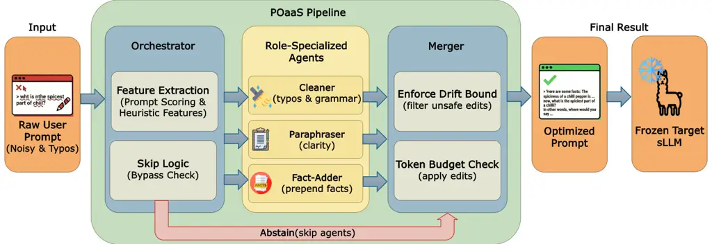

# POaaS: Minimal-Edit Prompt Optimization as a Service to Lift Accuracy and Cut Hallucinations on On-Device sLLMs

Jungwoo Shim    Dae Won Kim    Sun Wook Kim    Soo Young Kim
Affiliation: Myungcheol Lee    Jae-geun Cha    Hyunhwa Choi
^(†)^(†)thanks: Corresponding author. Affiliation: Electronics and
Telecommunications Research Institute, Republic of Korea
Email: [{right_rain,won22,swkim99,sykim,mclee,jgcha,hyunwha}@etri.re.kr](mailto:)

###### Abstract

Small language models (sLLMs) are increasingly deployed on-device, where
imperfect user prompts–typos, unclear intent, or missing context–can
trigger factual errors and hallucinations. Existing automatic prompt
optimization (APO) methods were designed for large cloud LLMs and rely
on search that often produces long, structured instructions; when
executed under an on-device constraint where the _same_ small model must
act as optimizer and solver, these pipelines can waste context and even
hurt accuracy. We propose POaaS, a minimal-edit prompt optimization
layer that routes each query to lightweight specialists (Cleaner,
Paraphraser, Fact-Adder) and merges their outputs under strict drift and
length constraints, with a conservative skip policy for well-formed
prompts. Under a strict fixed-model setting with Llama-3.2-3B-Instruct
and Llama-3.1-8B-Instruct, POaaS improves both task accuracy and
factuality while representative APO baselines degrade them, and POaaS
recovers up to +7.4% under token deletion and mixup. Overall, per-query
conservative optimization is a practical alternative to search-heavy APO
for on-device sLLMs.

## 1 Introduction

Large language models (LLMs) have rapidly become the default interface
for knowledge work, question answering, and decision support. Although
early deployments relied on large, server-hosted models Leon (2025);
Sparkman and Witt (2025), recent advances are pushing _small_ language
models (sLLMs) onto phones, browsers, and edge devices Gunter et al.
(2024); Grattafiori et al. (2024); Roh et al. (2024).

The first line of defense has been *manual prompt engineering* Reynolds
and McDonell (2021), but it is labor-intensive and brittle, and small
changes in domain, user intent, or input quality often require
re-design. To reduce this overhead, _automatic prompt optimization_
(APO) frameworks emerged Wan et al. (2024). Systems such as OPRO Yang et
al. (2023), PromptWizard Agarwal et al. (2025), and EvoPrompt Tong et
al. (2025) use iterative search and evolution to discover prompts that
help large cloud LLMs. However, these assumptions mismatch on-device
sLLMs. The search itself is expensive, optimized prompts can become long
and structured, and increased prompt complexity can raise verbose
eneration and hallucination risk in smaller models Li et al. (2025b);
Ramnath et al. (2025). This motivates a different design point:
_per-query, conservative edits_ that fix obvious input issues while
avoiding unnecessary rewriting.

#### Our approach: POaaS.

We introduce Prompt Optimization as a Service (POaaS), a lightweight
layer between the user prompt and the target model. POaaS uses three
specialists–Cleaner (typos/grammar), Paraphraser (clarity/fluency), and
Fact-Adder (concise contextual facts)–but applies them selectively via
CPU-only routing. It can _skip refinement_ for well-formed prompts, and
a drift-controlled merger rejects edits that deviate too far from the
user’s intent. GPU time remains dominated by the specialist calls that
are actually used.

#### Empirical findings.

Under a strict fixed-model policy, we compare POaaS to APO baselines on
reasoning tasks (BBH Suzgun et al. (2023), GSM8K Cobbe et al. (2021),
CommonsenseQA Talmor et al. (2019)) and factuality benchmark datasets
(HaluEval Li et al. (2023), HalluLens Bang et al. (2025), FActScore Min
et al. (2023)), under clean and degraded inputs. POaaS yields consistent
gains on both Llama-3.2-3B-Instruct and Llama-3.1-8B-Instruct, while APO
baselines degrade performance and add large prompt overheads; under
5–15% token deletion/mixup, POaaS recovers up to +7.4% over No
Optimization.

#### Contributions.

- •
  We introduce POaaS, a minimal-edit, microservice-style optimization
  layer for sLLMs that sits between user prompts and the target model,
  and show that it consistently improves accuracy where state-of-the-art
  APO methods reduces instead.
- •
  We show that POaaS is particularly effective under realistic input
  degradations that mimic human error (typos, deletions, and missing
  information), recovering performance on both reasoning and factuality
  benchmarks where APO baselines further amplify degradation.
- •
  We provide a capacity-aware design to deliver these gains with zero
  offline optimization cost and modest per-query latency, making POaaS
  suitable for on-device and edge deployments.

## 2 Related Work

### 2.1 Automatic Prompt Optimization (APO)

Automatic prompt optimization methods treat prompts as objects of
search, typically optimizing performance through iterative rewriting,
scoring, and selection (Ramnath et al., 2025). A recent survey
characterizes APO along dimensions such as candidate generation,
evaluation strategy, and search depth, spanning gradient-free methods,
meta-prompt design, and program-synthesis-style pipelines Chang et al.
(2024).

Representative systems include OPRO, which conditions on previously
generated prompts and their scores in a meta-prompt to propose new
instructions; PromptWizard, which uses a self-evolving loop of
LLM-driven mutation, critique, and in-context example optimization; and
EvoPrompt, which connects LLMs with evolutionary algorithms implementing
mutation and crossover operators. Other variants explore
self-referential prompt evolution (PromptBreeder Fernando et al.
(2023)), gradient-like textual feedback with bandit-style candidate
selection and Monte Carlo search (ProTeGi Pryzant et al. (2023)), Monte
Carlo Tree Search–based strategic planning over prompt states
(PromptAgent Wang et al. (2023)), and pipeline-level prompt and weight
optimization for multi-stage LM programs (DSPy Khattab et al. (2024)).

These methods have shown strong gains on cloud-scale LLMs, but their
assumptions differ from our target setting. They typically evaluate many
candidates, require substantial compute, and often yield long, highly
structured prompts that consume scarce tokens on small models. Moreover,
most APO work focuses on task accuracy rather than hallucination
robustness, and the resulting prompt complexity can increase
over-generation in sLLMs Cui et al. (2025).

### 2.2 Hallucination Mitigation Prompting

Hallucinations—fluent, but unsupported statements—pose critical
reliability risks, especially for smaller models with limited contextual
and reasoning capacity. Several benchmarks provide complementary views
of this phenomenon: FActScore decomposes generations into atomic claims
and measures evidential support; HaluEval offers a diverse hallucination
test suite with LLM-as-judge evaluation; and HalluLens organizes
intrinsic vs. extrinsic hallucinations and provides fine-grained error
profiles.

Most hallucination mitigation techniques operate _after_ generation,
using retrieval-augmented generation (RAG) Lewis et al. (2020), verifier
models, or domain guardrails. While effective for large server-hosted
LLMs, these methods increase system complexity and latency and may be
impractical for resource-constrained sLLM deployments. By contrast, much
less work focuses on _pre_-generation mitigation at the prompt level,
such as cleaning noisy inputs, clarifying underspecified instructions,
or injecting lightweight context before decoding. Such approaches are
attractive for on-device or latency-sensitive settings, because they can
wrap a fixed sLLM with a small controller and compose with RAG or
verification when available.

Our work follows this direction: we view hallucination risk as partly
induced by imperfect user prompts and introduce a modular
prompt-optimization layer that edits inputs within a fixed token budget,
positioning prompt-level optimization as a complementary building block
alongside post-hoc retrieval and verification.



Figure 1: POaaS pipeline overview. First, the orchestrator analyzes
input prompts using lightweight heuristics, routes to appropriate
specialists (Cleaner, Paraphraser, Fact-Adder), and then the Merger
applies drift-controlled merging to produce optimized prompts.

1: Prompt $`x`$; routing thresholds
$`\tau_{\text{typo}},\tau_{\text{comp}},\tau_{\text{flu}},\tau_{\text{skip}}`$

2: Drift/length caps
$`\delta_{\text{clean}},\delta_{\text{para}},\delta_{\max}`$; length cap
$`\rho_{\max}`$

3: Drift params
$`\theta_{\text{drift}}=(\delta_{\text{clean}},\delta_{\text{para}},\delta_{\max},\rho_{\max})`$

4: Optimized prompt $`\tilde{x}`$

5:
$`\phi\leftarrow\textsc{AnalyzePrompt}\big(x,\tau_{\text{typo}},\tau_{\text{comp}},\tau_{\text{flu}},\tau_{\text{skip}}\big)`$

6: if $`\textsc{ShouldSkip}(\phi)`$ then

7:   return $`x`$

8: end if

9: $`A\leftarrow\textsc{SelectAgents}(\phi)`$ $`\triangleright`$
Selected agents

10: $`\mathcal{C}\leftarrow\emptyset`$ $`\triangleright`$ Candidates

11: for each $`a\in A`$ do

12:   $`x^{\prime}\leftarrow a(x)`$

13:
  $`\textit{ok}\leftarrow\textsc{WithinDrift}(x,x^{\prime};\theta_{\text{drift}})`$

14:   if ok then

15:    $`\mathcal{C}\leftarrow\mathcal{C}\cup\{(a,x^{\prime})\}`$

16:   end if

17: end for

18: if $`\mathcal{C}=\emptyset`$ then

19:   return $`x`$

20: end if

21: $`\tilde{x}\leftarrow\textsc{Merge}(x,\mathcal{C})`$
$`\triangleright`$ Compose edits + context

22: return $`\tilde{x}`$

Algorithm 1 POaaS Minimal-Edit Optimization Pipeline

## 3 Method

POaaS places a lightweight, minimal-edit optimization layer in front of
a frozen target sLLM $`f_{\theta}`$ (Llama-3.2-3B-Instruct and
Llama-3.1-8B-Instruct; decoding fixed across all runs: temperature
$`0.2`$, top-$`p`$ $`0.9`$, fixed seed; max generation budget). Given a
prompt $`x`$, POaaS (i) scores prompt quality with CPU-only heuristics
and may skip optimization, (ii) selectively calls role-specialized
agents (Cleaner, Paraphraser, Fact-Adder), and (iii) merges their
outputs under strict drift/length and safety guards to produce
$`\tilde{x}`$, which is sent to $`f_{\theta}`$. We illustrate POaaS’s
pipeline overview in Figure 1.

### 3.1 Task Setup

Given a prompt $`x`$ and frozen $`f_{\theta}`$, POaaS seeks an optimized
prompt $`\tilde{x}`$ that improves downstream utility while avoiding
intent drift. We enforce:

#### Drift bound.

We use a CPU-only lexical similarity ensemble and define

```math
D(x,x^{\prime})=1-\text{sim}(x,x^{\prime})\in[0,1], \tag{1}
```

accepting edits only if $`D(x,x^{\prime})\leq\delta`$ (details and
ablations in Appendix C).

#### Length cap.

We cap expansion by the character-length ratio

```math
\rho(x,\tilde{x})=\frac{\text{len}(\tilde{x})}{\text{len}(x)}\leq\rho_{\max}, \tag{2}
```

and also cap specialist outputs (Fact-Adder: $`\leq`$120 tokens, up to 3
facts). Full budgets appear in Appendix A.

### 3.2 Prompt Analysis and Routing

The orchestrator computes lightweight CPU scores (typo, completeness,
fluency, clarity; all normalized to $`[0,1]`$) and applies threshold
routing: Cleaner for high typo, Fact-Adder for low completeness, and
Paraphraser for low fluency (Appendix B). Critically, POaaS uses a
conservative _skip_ gate: if the prompt is already high-quality, POaaS
returns $`x`$ unchanged to avoid harmful over-editing.

#### Skip logic.

We compute an overall quality score

```math
q(x)=1-\max\Big(\text{typo}(x),\,[\tau_{\text{comp}}-\text{comp}(x)]_{+},\\
[\tau_{\text{flu}}-\text{flu}(x)]_{+},\,[0.70-\text{clar}(x)]_{+}\Big), \tag{3}
```

and skip refinement when $`q(x)>1-\tau_{\text{skip}}`$ and typos are
low, with defaults $`\tau_{\text{skip}}=0.25`$ (so $`q(x)>0.75`$) and
$`\text{typo}(x)<0.20`$. This design is intentionally conservative:
POaaS prefers false negatives (missing a small potential improvement)
over false positives (unnecessary edits) to preserve intent on already
well-formed prompts.

### 3.3 Role-Specialized Agents

All agents run as vLLM-served Kwon et al. (2023) LoRA adapters Hu et al.
(2021) on frozen Llama backbones. Each specialist is trained to produce
_one_ transformation and then a secondary guard model verifies
faithfulness:

- •
  Cleaner (fine-tuned with JFLEG Napoles et al. (2017)): fixes
  typos/grammar with a minimal-change instruction. A guard rejects
  candidates that introduce new information, reverting to the original
  prompt if unsafe. Examples and guard details appear in Appendix D.
- •
  Paraphraser (fine-tuned with PAWS Zhang et al. (2019) and QQP Sharma
  et al. (2019)): rewrites for fluency while preserving meaning. A
  fidelity guard rewrites or vetoes unfaithful paraphrases. Examples and
  thresholds appear in Appendix D.
- •
  Fact-Adder (fine-tuned with Wikipedia and Wikidata-derived
  corpora Vrandečić and Krötzsch (2014)): generates up to three concise
  factual bullets (total $`\leq`$ 120 tokens under the target tokenizer)
  that are directly related to the user’s input entities/task, providing
  lightweight contextual support for the downstream sLLM. If no
  high-confidence facts can be produced, it outputs NONE and is skipped
  during merging. A grounding/answer-leakage guard rejects
  reasoning-like content and removes unsupported statements before any
  fact is prepended.

### 3.4 Agent Selection

Given the four scores from §3.2, POaaS uses thresholded routing: Cleaner
if $`\text{typo}(x)>\tau_{\text{typo}}`$; Fact-Adder if
$`\text{comp}(x)<\tau_{\text{comp}}`$ (underspecified prompts); and
Paraphraser if $`\text{flu}(x)<\tau_{\text{flu}}`$. Multiple agents may
be invoked in parallel; their outputs are accepted only if they satisfy
drift/length and safety guards, otherwise they are discarded and POaaS
falls back to the original prompt.

### 3.5 Drift-Controlled Merging

POaaS merges specialist edits only when they are proven to be low-risk
under cheap, deterministic checks. Concretely, each candidate
$`x^{\prime}`$ is sanitized (meta-commentary removed), scored for drift
$`D(x,x^{\prime})`$, checked for preservation of key content
(entities/numbers/quotes), and rejected if it violates drift/length
caps. Accepted edits are then composed into a single $`\tilde{x}`$ with
a fixed precedence: apply Cleaner edits first, then Paraphraser, and
finally prepend up to three Fact-Adder facts ($`\leq`$120 tokens total)
ahead of the user request. For few-shot prompts, POaaS isolates and
edits only the final question span, reattaching the untouched prefix.

#### Safety and guards.

POaaS uses layered fail-safes: per-agent guard models to reject
unfaithful edits (adding facts, dropping constraints, or answering the
question), orchestrator-side sanitization that strips meta-commentary,
and strict structural preservation (e.g., few-shot exemplars are kept
intact by editing only the final query span). If all candidates fail
checks, POaaS returns the original prompt.

#### Implementation.

POaaS is implemented as a FastAPI Lubanovic (2023) orchestrator (CPU)
that routes to vLLM+LoRA specialist services (GPU) and logs per-stage
latency/tokens with deterministic configs for reproducibility are listed
in Appendix F.

## 4 Experiments

We evaluate POaaS against state-of-the-art APO baselines on both task
accuracy and factuality metrics, under clean and degraded input
conditions. All experiments use fixed target models
(Llama-3.2-3B-Instruct and Llama-3.1-8B-Instruct) with frozen weights
and identical decoding parameters (temperature=0.2, top-$`p`$=0.9, max
tokens= 512), ensuring that any differences are attributable solely to
prompt optimization rather than model or decoding changes.

### 4.1 Experimental Setup

|              |                 | Task Accuracy |             |             |      | Factuality  |             |             |      |
| ------------ | --------------- | ------------- | ----------- | ----------- | ---- | ----------- | ----------- | ----------- | ---- |
| Model        | Method          | BBH           | GSM8K       | CSQA        | Avg. | HaluEval    | HalluLens   | FActScore   | Avg. |
| Llama-3.2-3B | No Optimization | 42.2          | 77.2        | 71.6        | 63.7 | 68.2        | 48.8        | 16.6        | 44.5 |
|              | EvoPrompt       | 35.8 (-6.4)   | 75.4 (-1.8) | 68.2 (-3.4) | 59.8 | 67.6 (-0.6) | 46.8 (-2.0) | 16.4 (-0.2) | 43.6 |
|              | OPRO            | 32.4 (-9.8)   | 74.2 (-3.0) | 65.8 (-5.8) | 57.5 | 66.8 (-1.4) | 45.6 (-3.2) | 15.8 (-0.8) | 42.7 |
|              | PromptWizard    | 10.4 (-31.8)  | 72.4 (-4.8) | 63.6 (-8.0) | 48.8 | 65.2 (-3.0) | 43.8 (-5.0) | 14.8 (-1.8) | 41.3 |
|              | POaaS (Ours)    | 46.0 (+3.8)   | 79.0 (+1.8) | 73.0 (+1.4) | 66.0 | 70.2 (+2.0) | 52.0 (+3.2) | 22.0 (+5.4) | 48.1 |
| Llama-3.1-8B | No Optimization | 51.8          | 82.4        | 76.2        | 70.1 | 74.6        | 56.2        | 24.8        | 51.9 |
|              | EvoPrompt       | 44.2 (-7.6)   | 80.6 (-1.8) | 73.4 (-2.8) | 66.1 | 74.0 (-0.6) | 54.2 (-2.0) | 24.4 (-0.4) | 50.9 |
|              | OPRO            | 40.6 (-11.2)  | 79.2 (-3.2) | 70.8 (-5.4) | 63.5 | 73.0 (-1.6) | 52.8 (-3.4) | 23.6 (-1.2) | 49.8 |
|              | PromptWizard    | 18.6 (-33.2)  | 77.8 (-4.6) | 68.2 (-8.0) | 54.9 | 71.4 (-3.2) | 50.2 (-6.0) | 22.6 (-2.2) | 48.1 |
|              | POaaS (Ours)    | 54.0 (+2.2)   | 83.2 (+0.8) | 77.2 (+1.0) | 71.5 | 76.0 (+1.4) | 57.6 (+1.4) | 26.2 (+1.4) | 53.3 |

Table 1: Task accuracy and factuality benchmark results (%) for POaaS
and APO baselines. Green/red show change vs No Optimization. Best in
bold.

#### Baselines.

We focus on three representative APO frameworks that we can apply under
our fixed-model, on-device constraint (i.e., _all_ LLM calls made inside
each APO pipeline are executed using the same 3B/8B backbone and matched
decoding): Length policy: we do not impose an explicit prompt-length cap
on APO baselines; they may generate arbitrarily long optimized
instructions (prompt/input tokens). By contrast, POaaS remains budgeted
and we fix the target model’s _generated output_ to a maximum of
512-tokens.

- •
  EvoPrompt: An evolutionary search method that maintains a population
  of prompt candidates and applies mutation/crossover operators to
  generate variants; candidates are scored and the best-performing
  prompts are retained across generations. We run EvoPrompt with 20
  generations and otherwise follow the authors’ recommended settings,
  using the same 3B/8B sLLM for all internal calls.
- •
  OPRO: A meta-prompt optimization framework that treats prompt
  optimization as black-box search: a meta-prompt summarizes prior
  candidate instructions and their scores, and the optimizer proposes
  the next candidate conditioned on this trajectory. We cap the
  optimization budget at 10 iterations and replace all
  optimizer/evaluator calls with the same 3B/8B backbone used for task
  inference.
- •
  PromptWizard: A critique-and-synthesis approach that iterates between
  generating candidate instructions, critiquing them, and synthesizing
  revised prompts (often with more structure). We follow the official
  hyperparameters with 10 iterations and run both generator and critic
  roles on the same 3B/8B backbone.

We start from the official repositories and recommended optimization
budgets, modifying only (i) the choice of backbone (our 3B/8B sLLMs),
and (ii) the matching decoding parameters. For each backbone, we adapt
_all_ LLM calls inside each APO pipeline to that backbone, so that the
same sLLM acts as optimizer, critic, and task model. This restriction
makes the comparison realistic for on-device scenarios where larger
cloud models are costly and ensures that any observed degradation is a
property of the APO design rather than access to a stronger teacher.

#### Benchmarks.

We evaluate on three task-accuracy benchmarks (BBH, GSM8K,
CommonsenseQA) and three factuality datasets (HaluEval, HalluLens,
FActScore). We treat the latter as _datasets_ and evaluate hallucination
avoidance with GPT-5-as-a-judge. We provide benchmark provenance, split
choices, and prompt templates in Appendix G.

- •
  _Task Accuracy_: BBH, GSM8K, and CommonsenseQA. These cover multi-step
  reasoning, arithmetic reasoning, and multiple-choice commonsense
  reasoning. We use standard few-shot prompting formats where applicable
  (BBH: task-specific 3-shot CoT prefix; GSM8K: 8-shot CoT prefix), but
  under our strict 512-token generation cap and fixed decoding; as a
  result, absolute scores are below leaderboard/official reports that
  use larger budgets and different decoding. The prompts used in
  evaluation are provided in Appendix I
- •
  _Factuality_: HaluEval, HalluLens, and FActScore. We use the
  dataset-provided inputs and any available reference context/evidence,
  and score whether model outputs are hallucinated via GPT-5-as-a-judge
  (binary non-hallucination rate; details and judge prompt in
  Appendix H).

For each benchmark, we randomly sample 500 examples from the official
training or evaluation splits. This choice balances three factors: (i)
the need to cover diverse phenomena within each dataset, (ii) the
computational cost of running 5 methods $`\times`$ 7 conditions (clean +
6 noise levels) $`\times`$ 6 benchmarks $`\times`$ 2 models, and (iii)
comparability with prior prompt-optimization and hallucination studies
that commonly report 100–1,000 examples per setting Opsahl-Ong et al.
(2024); Ravi et al. (2024). Sampling is deterministic given a fixed
seed; for BBH we stratify across subtasks to preserve task diversity.
Full sampling details are in Appendix G.

#### Evaluation.

- •
  _Task Accuracy_: For GSM8K, we extract the final numeric answer from
  the model output (e.g., “The answer is X” / last number) and score
  exact match against the gold answer (after normalization). For
  CommonsenseQA, we extract an answer letter (A–E) and score exact
  match. For BBH, we extract the final short answer (e.g., True/False or
  option letter depending on the task) and score exact match. The exact
  extraction patterns and normalization rules are listed in Appendix G.
- •
  _Factuality_: We evaluate hallucination avoidance using
  GPT-5-as-a-judge on the underlying datasets. For each sample, we
  provide GPT-5 with the dataset-provided reference context/evidence
  (when available) and the model answer, and ask for a strict binary
  label (hallucinated vs not hallucinated). We compute factuality as the
  percentage of answers labeled not hallucinated. Prompts used (judge +
  generation templates) are listed in Appendix H.
- •
  _Input Degradation_: To approximate typos and noisy user text, we
  inject token-level noise using two processes following prior
  robustness work (Ishibashi et al., 2023). For token deletion, we
  randomly delete 5%, 10%, or 15% of word tokens. For token mixup, we
  randomly replace 5%, 10%, or 15% of word tokens with unrelated content
  words from a fixed vocabulary Xie et al. (2017b). In both cases, we
  perturb only the user prompt (not the reference answers/labels), and
  perturbations are deterministic given a fixed seed. Full details are
  in Appendix J.

#### Metrics.

We report:

- •
  _Task accuracy_ (%) on BBH, GSM8K, and CSQA, computed as mean
  exact-match accuracy over 500 samples per benchmark after
  benchmark-specific answer extraction/normalization.
- •
  _Factuality_ (%, higher is better) on HaluEval, HalluLens, and
  FActScore datasets, computed as the proportion of outputs judged not
  hallucinated by GPT-5 given reference context/evidence.
- •
  _Efficiency_: (i) one-time offline optimization time and internal LLM
  calls for APO methods, and (ii) per-query refinement latency,
  specialist calls, and added prompt tokens for POaaS. Measurement
  protocol and prompts are listed in Appendix K.

|              |                 |              | Token Deletion |              |              | Token Mixup  |              |              |
| ------------ | --------------- | ------------ | -------------- | ------------ | ------------ | ------------ | ------------ | ------------ |
| Model        | Method          | Clean        | 5%             | 10%          | 15%          | 5%           | 10%          | 15%          |
| Llama-3.2-3B | No Optimization | 63.7         | 52.4           | 45.8         | 40.2         | 59.2         | 54.6         | 48.8         |
|              | EvoPrompt       | 59.8 (-3.9)  | 46.8 (-5.6)    | 39.2 (-6.6)  | 32.4 (-7.8)  | 54.6 (-4.6)  | 48.2 (-6.4)  | 41.6 (-7.2)  |
|              | OPRO            | 57.5 (-6.2)  | 44.2 (-8.2)    | 36.4 (-9.4)  | 29.2 (-11.0) | 52.0 (-7.2)  | 45.2 (-9.4)  | 38.4 (-10.4) |
|              | PromptWizard    | 48.8 (-14.9) | 35.6 (-16.8)   | 27.2 (-18.6) | 20.4 (-19.8) | 42.8 (-16.4) | 34.6 (-20.0) | 28.2 (-20.6) |
|              | POaaS           | 66.0 (+2.3)  | 58.4 (+6.0)    | 52.8 (+7.0)  | 47.6 (+7.4)  | 63.2 (+4.0)  | 59.4 (+4.8)  | 54.6 (+5.8)  |
| Llama-3.1-8B | No Optimization | 70.1         | 58.2           | 51.4         | 45.6         | 65.4         | 60.8         | 55.2         |
|              | EvoPrompt       | 66.1 (-4.0)  | 53.0 (-5.2)    | 45.2 (-6.2)  | 38.4 (-7.2)  | 60.6 (-4.8)  | 54.4 (-6.4)  | 47.8 (-7.4)  |
|              | OPRO            | 63.5 (-6.6)  | 49.8 (-8.4)    | 41.6 (-9.8)  | 34.2 (-11.4) | 57.4 (-8.0)  | 50.6 (-10.2) | 43.6 (-11.6) |
|              | PromptWizard    | 54.9 (-15.2) | 41.2 (-17.0)   | 32.4 (-19.0) | 25.6 (-20.0) | 48.4 (-17.0) | 40.2 (-20.6) | 33.4 (-21.8) |
|              | POaaS           | 71.5 (+1.4)  | 64.0 (+5.8)    | 58.2 (+6.8)  | 52.8 (+7.2)  | 68.6 (+3.2)  | 64.2 (+3.4)  | 59.0 (+3.8)  |

Table 2: Robustness under input degradation. Task accuracy (%) averaged
across BBH, GSM8K, and CSQA. Green/red show change vs No Optimization at
each noise level. Best in bold.

### 4.2 Main Results

Table 1 summarizes accuracy and factuality under clean conditions. POaaS
consistently _improves_ or at least preserves the No Optimization
baseline on all benchmarks and both model sizes: for POaaS with the 3B
backbone, average accuracy increases from 63.7% to 66.0% (+2.3%), and
for POaaS with the 8B backbone from 70.1% to 71.5% (+1.4%). Factuality
also improves, with gains of +2.0–5.4% for POaaS with the 3B backbone
and +1.4% across all three factuality datasets for POaaS with the 8B
backbone.

By contrast, we found that directly applying these APO methods to small
models hurts performance. Among the APO baselines, EvoPrompt degrades
the least overall, OPRO degrades more, and PromptWizard degrades the
most. PromptWizard is especially harmful on BBH: it drives BBH accuracy
down from 42.2% to 10.4% on the 3B backbone (and from 51.8% to 18.6% on
the 8B backbone). We observed a similar pattern on the factuality
datasets: all three APO baselines reduce factuality scores compared to
No Optimization, whereas POaaS consistently improves them. In short, our
findings back up the main hypothesis: the heavy search-based prompt
optimizations designed for large cloud LLMs don’t transfer well to small
on-device models, whereas a more capacity-aware approach with minimal
edits produces gains that, while modest, are consistent.

### 4.3 Robustness Under Input Degradation

Table 2 shows that POaaS is consistently the most robust method under
both token deletion and token mixup. For the Llama-3.2-3B, at 15%
deletion, No Optimization drops to 40.2% while POaaS recovers accuracy
to 47.6% (+7.4%); for Llama-3.1-8B, the corresponding improvement is
from 45.6% to 52.8% (+7.2%). Under mixup, POaaS similarly narrows the
degradation: at 15% token mixup, POaaS improves from 48.8% to 54.6%
(+5.8%) on Llama-3.2-3B and from 55.2% to 59.0% (+3.8%) on Llama-3.1-8B.

APO baselines not only start from lower clean accuracy but also degrades
more steeply as noise increases. PromptWizard is the most fragile,
losing nearly 20% relative to No Optimization at 15% deletion and 17–22%
under mixup; OPRO shows intermediate degradation, and EvoPrompt degrades
most moderately but still underperforms No Optimization across all noise
levels.

Overall, POaaS makes the performance drop under input noise much less
severe than what we see with No Optimization or the APO baselines – an
outcome that makes sense given how POaaS works. Its Cleaner agent
directly fixes corrupted tokens when needed, and the system only turns
that agent on when it detects input degradation, so it effectively
counteracts the noise especially at higher corruption levels.

### 4.4 Efficiency Analysis

|                 |               |              |           |
| --------------- | ------------- | ------------ | --------- |
| Method          | Opt. Time (s) | Added Tokens | LLM Calls |
| No Optimization | 0             | 0            | 0         |
| OPRO            | 455           | 2,840        | 130       |
| PromptWizard    | 336           | 3,520        | 96        |
| EvoPrompt       | 602           | 4,180        | 172       |
| POaaS (Ours)    | 0.95          | 48           | 1.4       |

Table 3: Efficiency summary (3B setting). “Opt. Time (s)” is the
wall-clock _prompt-improvement time_: for APO methods, the offline
optimization runtime to produce a single static instruction; for POaaS,
the _incremental per-query refinement latency_ (routing + specialist
calls) averaged over evaluation queries. “LLM calls” counts internal
optimizer calls for APO and specialist calls per query for POaaS. “Added
tokens” is the average additional _prompt/input_ tokens injected at
inference time.

Table 3 highlights the core deployment tradeoff between _offline prompt
search_ (APO) and _online per-query refinement_ (POaaS). APO baselines
spend minutes of offline search (hundreds of internal LLM calls under
our capped budgets) to produce a single static optimized instruction;
this instruction is then reused at inference time with no additional
per-query compute, but it typically introduces thousands of extra prompt
tokens that compete with user content under tight context budgets. In
contrast, POaaS uses fixed agent templates and routing thresholds (no
per-benchmark search), and pays a small _incremental_ latency only when
refinement is triggered. In the 3B setting, we measure POaaS refinement
overhead as end-to-end additional latency for the refinement stage
(router + specialist calls) with batch=1 on a warmed inference server;
this measurement excludes the target model’s answer-generation time and
excludes any GPT-judge cost. Averaged over evaluation queries (including
cases where refinement is skipped), POaaS adds $`\sim`$0.95s of
refinement overhead, invokes $`\sim`$1.4 specialist calls, and injects
$`\sim`$48 additional prompt tokens.

Clarifying notes. (1) “Opt. Time” for APO methods reflects our
evaluation-time configurations (budget-capped steps/candidates and a
fixed dev subset) rather than the much larger default budgets sometimes
used in original papers. (2) “Added Tokens” counts additional
_prompt/input_ tokens only; all methods share the same decoding
configuration and an identical cap on _generated output_ tokens (512).

### 4.5 Ablation Studies

|              |                  |             |             |             |
| ------------ | ---------------- | ----------- | ----------- | ----------- |
| Model        | Configuration    | Clean       | Del-10%     | Mix-10%     |
| Llama-3.2-3B | No Optimization  | 63.7        | 45.8        | 54.6        |
|              | Full POaaS       | 66.0 (+2.3) | 52.8 (+7.0) | 59.4 (+4.8) |
|              | w/o Cleaner      | 65.6 (+1.9) | 46.4 (+0.6) | 55.2 (+0.6) |
|              | w/o Paraphraser  | 64.8 (+1.1) | 51.4 (+5.6) | 57.8 (+3.2) |
|              | w/o Fact-Adder   | 64.2 (+0.5) | 52.2 (+6.4) | 58.8 (+4.2) |
|              | Cleaner only     | 63.9 (+0.2) | 51.6 (+5.8) | 58.4 (+3.8) |
|              | Paraphraser only | 65.0 (+1.3) | 46.6 (+0.8) | 55.4 (+0.8) |
|              | Fact-Adder only  | 65.6 (+1.9) | 46.2 (+0.4) | 55.0 (+0.4) |
| Llama-3.1-8B | No Optimization  | 70.1        | 51.4        | 60.8        |
|              | Full POaaS       | 71.5 (+1.4) | 58.2 (+6.8) | 64.2 (+3.4) |
|              | w/o Cleaner      | 71.2 (+1.1) | 52.0 (+0.6) | 61.2 (+0.4) |
|              | w/o Paraphraser  | 70.6 (+0.5) | 57.0 (+5.6) | 63.2 (+2.4) |
|              | w/o Fact-Adder   | 70.4 (+0.3) | 57.6 (+6.2) | 63.8 (+3.0) |
|              | Cleaner only     | 70.2 (+0.1) | 57.2 (+5.8) | 63.4 (+2.6) |
|              | Paraphraser only | 70.8 (+0.7) | 52.2 (+0.8) | 61.4 (+0.6) |
|              | Fact-Adder only  | 71.0 (+0.9) | 51.8 (+0.4) | 61.0 (+0.2) |

Table 4: Ablation study of POaaS components. Task accuracy (%) averaged
over all six benchmarks, with green showing improvement vs No
Optimization. Degradation results are averaged over 10% token deletion
(Del-10%) and 10% token mixup (Mix-10%).

For ablations, we reuse the full experimental setting: all datasets used
from the six benchmarks, both models, and the same clean samples, but
averaged the degraded samples to 10% deletion and 10% mixup conditions.
Table 4 shows that the full POaaS configuration yields the largest gains
on both Llama-3.2-3B and Llama-3.1-8B, with especially strong
improvements under degradation (+7.0%/+6.8% at 10% token deletion).
Cleaner-only variants recover most of the robustness gains but improve
clean accuracy only marginally, indicating that surface-level repair is
the primary driver of robustness. Removing the Fact-Adder sharply
reduces clean gains while preserving most robustness, suggesting that
fact priming mainly benefits clean queries. The Paraphraser contributes
moderate gains in both regimes. Overall, the full system consistently
outperforms any single-agent or ablated variant, indicating that the
three specialists provide complementary benefits that are best realized
when combined with routing and drift control.

## 5 Conclusion

We studied prompt-side refinement for capacity-constrained sLLMs under a
strict fixed-model policy. Across task-accuracy and factuality datasets,
POaaS—a minimal-edit, drift-guarded, per-input refinement
layer—consistently improves over a no-optimization baseline while
remaining robust under prompt corruption. In contrast, representative
search-based APO frameworks, when ported so that the same 3B/8B model
must serve as optimizer and solver, often degrade performance and
produce long prompts that are poorly matched to tight token budgets.
These findings suggest that, for on-device sLLM deployments, lightweight
conservative refinement with explicit drift/length controls is a
practical alternative to heavy global prompt search.

## Limitations

POaaS has three key limitations. (1) English-only: heuristics,
corruption detectors, and specialists are tuned for English;
multilingual extension (e.g., Korean/Japanese/Chinese) will require
re-deriving routing/drift metrics and retraining specialists. (2)
Empirical tuning: thresholds and caps are set empirically; more
principled or automated calibration would improve portability and
interpretability. (3) Limited agent set: we study three specialists;
future work should explore broader palettes (domain-specific or
retrieval-backed) while preserving minimal-edit guarantees and on-device
budgets.

## Acknowledgments

This work was supported by the Institute of Information & Communications
Technology Planning & Evaluation(IITP) grant funded by the Korea
government(MSIT) (No.RS-2025-02263869, Development of AI Semiconductor
Cloud Platform Establishment and Optimization Technology.

## References

- Agarwal et al. (2025) E. Agarwal, R. Magazine, J. Singh, V. Dani, T.
  Ganu, and A. Nambi Promptwizard: optimizing prompts via task-aware,
  feedback-driven self-evolution. In Findings of the Association for
  Computational Linguistics: ACL 2025, pp. 19974–20003. Cited by:
  Appendix G, §1.
- Bang et al. (2025) Y. Bang, Z. Ji, A. Schelten, A. Hartshorn, T.
  Fowler, C. Zhang, N. Cancedda, and P. Fung Hallulens: llm
  hallucination benchmark. arXiv preprint arXiv:2504.17550. Cited by:
  Appendix I, §1.
- Broder (1997) A. Z. Broder On the resemblance and containment of
  documents. In Proceedings of the Compression and Complexity of
  Sequences 1997, Cited by: §C.1.
- Cahyani et al. (2025) A. D. Cahyani, M. Fathoni, F. H. Rachman, A.
  Basuki, S. Amin, B. K. Khotimah, et al. Automatic essay scoring:
  leveraging jaccard coefficient and cosine similaritywith n-gram
  variation in vector space model approach. arXiv preprint
  arXiv:2510.15311. Cited by: 2nd item.
- Chang et al. (2024) K. Chang, S. Xu, C. Wang, Y. Luo, X. Liu, T. Xiao,
  and J. Zhu Efficient prompting methods for large language models: a
  survey. arXiv preprint arXiv:2404.01077. Cited by: §2.1.
- Cobbe et al. (2021) K. Cobbe, V. Kosaraju, M. Bavarian, M. Chen, H.
  Jun, L. Kaiser, M. Plappert, J. Tworek, J. Hilton, R. Nakano, et al.
  Training verifiers to solve math word problems. arXiv preprint
  arXiv:2110.14168. Cited by: 1st item, Appendix G, Appendix I, §1.
- Cui et al. (2025) W. Cui, J. Zhang, Z. Li, H. Sun, D. Lopez, K.
  Das, B. A. Malin, and S. Kumar Automatic prompt optimization via
  heuristic search: a survey. arXiv preprint arXiv:2502.18746. Cited by:
  §2.1.
- Fernando et al. (2023) C. Fernando, D. Banarse, H. Michalewski, S.
  Osindero, and T. Rocktäschel Promptbreeder: self-referential
  self-improvement via prompt evolution. arXiv preprint
  arXiv:2309.16797. Cited by: §2.1.
- Gomaa and Fahmy (2013) W. H. Gomaa and A. A. Fahmy A survey of text
  similarity approaches. International Journal of Computer Applications
  68 (13). Cited by: §C.1.
- Grattafiori et al. (2024) A. Grattafiori, A. Dubey, A. Jauhri, A.
  Pandey, A. Kadian, A. Al-Dahle, A. Letman, A. Mathur, A. Schelten, A.
  Vaughan, A. Yang, A. Fan, A. Goyal, A. Hartshorn, A. Yang, A.
  Mitra, A. Sravankumar, A. Korenev, A. Hinsvark, A. Rao, A. Zhang, A.
  Rodriguez, A. Gregerson, A. Spataru, B. Roziere, B. Biron, B. Tang, B.
  Chern, C. Caucheteux, C. Nayak, C. Bi, C. Marra, C. McConnell, C.
  Keller, C. Touret, C. Wu, C. Wong, C. C. Ferrer, C. Nikolaidis, D.
  Allonsius, D. Song, D. Pintz, D. Livshits, D. Wyatt, D. Esiobu, D.
  Choudhary, D. Mahajan, D. Garcia-Olano, D. Perino, D. Hupkes, E.
  Lakomkin, E. AlBadawy, E. Lobanova, E. Dinan, E. M. Smith, F.
  Radenovic, F. Guzmán, F. Zhang, G. Synnaeve, G. Lee, G. L.
  Anderson, G. Thattai, G. Nail, G. Mialon, G. Pang, G. Cucurell, H.
  Nguyen, H. Korevaar, H. Xu, H. Touvron, I. Zarov, I. A. Ibarra, I.
  Kloumann, I. Misra, I. Evtimov, J. Zhang, J. Copet, J. Lee, J.
  Geffert, J. Vranes, J. Park, J. Mahadeokar, J. Shah, J. van der
  Linde, J. Billock, J. Hong, J. Lee, J. Fu, J. Chi, J. Huang, J.
  Liu, J. Wang, J. Yu, J. Bitton, J. Spisak, J. Park, J. Rocca, J.
  Johnstun, J. Saxe, J. Jia, K. V. Alwala, K. Prasad, K. Upasani, K.
  Plawiak, K. Li, K. Heafield, K. Stone, K. El-Arini, K. Iyer, K.
  Malik, K. Chiu, K. Bhalla, K. Lakhotia, L. Rantala-Yeary, L. van der
  Maaten, L. Chen, L. Tan, L. Jenkins, L. Martin, L. Madaan, L. Malo, L.
  Blecher, L. Landzaat, L. de Oliveira, M. Muzzi, M. Pasupuleti, M.
  Singh, M. Paluri, M. Kardas, M. Tsimpoukelli, M. Oldham, M. Rita, M.
  Pavlova, M. Kambadur, M. Lewis, M. Si, M. K. Singh, M. Hassan, N.
  Goyal, N. Torabi, N. Bashlykov, N. Bogoychev, N. Chatterji, N.
  Zhang, O. Duchenne, O. Çelebi, P. Alrassy, P. Zhang, P. Li, P.
  Vasic, P. Weng, P. Bhargava, P. Dubal, P. Krishnan, P. S. Koura, P.
  Xu, Q. He, Q. Dong, R. Srinivasan, R. Ganapathy, R. Calderer, R. S.
  Cabral, R. Stojnic, R. Raileanu, R. Maheswari, R. Girdhar, R.
  Patel, R. Sauvestre, R. Polidoro, R. Sumbaly, R. Taylor, R. Silva, R.
  Hou, R. Wang, S. Hosseini, S. Chennabasappa, S. Singh, S. Bell, S. S.
  Kim, S. Edunov, S. Nie, S. Narang, S. Raparthy, S. Shen, S. Wan, S.
  Bhosale, S. Zhang, S. Vandenhende, S. Batra, S. Whitman, S. Sootla, S.
  Collot, S. Gururangan, S. Borodinsky, T. Herman, T. Fowler, T.
  Sheasha, T. Georgiou, T. Scialom, T. Speckbacher, T. Mihaylov, T.
  Xiao, U. Karn, V. Goswami, V. Gupta, V. Ramanathan, V. Kerkez, V.
  Gonguet, V. Do, V. Vogeti, V. Albiero, V. Petrovic, W. Chu, W.
  Xiong, W. Fu, W. Meers, X. Martinet, X. Wang, X. Wang, X. E. Tan, X.
  Xia, X. Xie, X. Jia, X. Wang, Y. Goldschlag, Y. Gaur, Y. Babaei, Y.
  Wen, Y. Song, Y. Zhang, Y. Li, Y. Mao, Z. D. Coudert, Z. Yan, Z.
  Chen, Z. Papakipos, A. Singh, A. Srivastava, A. Jain, A. Kelsey, A.
  Shajnfeld, A. Gangidi, A. Victoria, A. Goldstand, A. Menon, A.
  Sharma, A. Boesenberg, A. Baevski, A. Feinstein, A. Kallet, A.
  Sangani, A. Teo, A. Yunus, A. Lupu, A. Alvarado, A. Caples, A. Gu, A.
  Ho, A. Poulton, A. Ryan, A. Ramchandani, A. Dong, A. Franco, A.
  Goyal, A. Saraf, A. Chowdhury, A. Gabriel, A. Bharambe, A.
  Eisenman, A. Yazdan, B. James, B. Maurer, B. Leonhardi, B. Huang, B.
  Loyd, B. D. Paola, B. Paranjape, B. Liu, B. Wu, B. Ni, B. Hancock, B.
  Wasti, B. Spence, B. Stojkovic, B. Gamido, B. Montalvo, C. Parker, C.
  Burton, C. Mejia, C. Liu, C. Wang, C. Kim, C. Zhou, C. Hu, C. Chu, C.
  Cai, C. Tindal, C. Feichtenhofer, C. Gao, D. Civin, D. Beaty, D.
  Kreymer, D. Li, D. Adkins, D. Xu, D. Testuggine, D. David, D.
  Parikh, D. Liskovich, D. Foss, D. Wang, D. Le, D. Holland, E.
  Dowling, E. Jamil, E. Montgomery, E. Presani, E. Hahn, E. Wood, E.
  Le, E. Brinkman, E. Arcaute, E. Dunbar, E. Smothers, F. Sun, F.
  Kreuk, F. Tian, F. Kokkinos, F. Ozgenel, F. Caggioni, F. Kanayet, F.
  Seide, G. M. Florez, G. Schwarz, G. Badeer, G. Swee, G. Halpern, G.
  Herman, G. Sizov, Guangyi, Zhang, G. Lakshminarayanan, H. Inan, H.
  Shojanazeri, H. Zou, H. Wang, H. Zha, H. Habeeb, H. Rudolph, H.
  Suk, H. Aspegren, H. Goldman, H. Zhan, I. Damlaj, I. Molybog, I.
  Tufanov, I. Leontiadis, I. Veliche, I. Gat, J. Weissman, J.
  Geboski, J. Kohli, J. Lam, J. Asher, J. Gaya, J. Marcus, J. Tang, J.
  Chan, J. Zhen, J. Reizenstein, J. Teboul, J. Zhong, J. Jin, J.
  Yang, J. Cummings, J. Carvill, J. Shepard, J. McPhie, J. Torres, J.
  Ginsburg, J. Wang, K. Wu, K. H. U, K. Saxena, K. Khandelwal, K.
  Zand, K. Matosich, K. Veeraraghavan, K. Michelena, K. Li, K.
  Jagadeesh, K. Huang, K. Chawla, K. Huang, L. Chen, L. Garg, L. A, L.
  Silva, L. Bell, L. Zhang, L. Guo, L. Yu, L. Moshkovich, L.
  Wehrstedt, M. Khabsa, M. Avalani, M. Bhatt, M. Mankus, M. Hasson, M.
  Lennie, M. Reso, M. Groshev, M. Naumov, M. Lathi, M. Keneally, M.
  Liu, M. L. Seltzer, M. Valko, M. Restrepo, M. Patel, M. Vyatskov, M.
  Samvelyan, M. Clark, M. Macey, M. Wang, M. J. Hermoso, M. Metanat, M.
  Rastegari, M. Bansal, N. Santhanam, N. Parks, N. White, N. Bawa, N.
  Singhal, N. Egebo, N. Usunier, N. Mehta, N. P. Laptev, N. Dong, N.
  Cheng, O. Chernoguz, O. Hart, O. Salpekar, O. Kalinli, P. Kent, P.
  Parekh, P. Saab, P. Balaji, P. Rittner, P. Bontrager, P. Roux, P.
  Dollar, P. Zvyagina, P. Ratanchandani, P. Yuvraj, Q. Liang, R.
  Alao, R. Rodriguez, R. Ayub, R. Murthy, R. Nayani, R. Mitra, R.
  Parthasarathy, R. Li, R. Hogan, R. Battey, R. Wang, R. Howes, R.
  Rinott, S. Mehta, S. Siby, S. J. Bondu, S. Datta, S. Chugh, S.
  Hunt, S. Dhillon, S. Sidorov, S. Pan, S. Mahajan, S. Verma, S.
  Yamamoto, S. Ramaswamy, S. Lindsay, S. Lindsay, S. Feng, S. Lin, S. C.
  Zha, S. Patil, S. Shankar, S. Zhang, S. Zhang, S. Wang, S. Agarwal, S.
  Sajuyigbe, S. Chintala, S. Max, S. Chen, S. Kehoe, S. Satterfield, S.
  Govindaprasad, S. Gupta, S. Deng, S. Cho, S. Virk, S. Subramanian, S.
  Choudhury, S. Goldman, T. Remez, T. Glaser, T. Best, T. Koehler, T.
  Robinson, T. Li, T. Zhang, T. Matthews, T. Chou, T. Shaked, V.
  Vontimitta, V. Ajayi, V. Montanez, V. Mohan, V. S. Kumar, V.
  Mangla, V. Ionescu, V. Poenaru, V. T. Mihailescu, V. Ivanov, W. Li, W.
  Wang, W. Jiang, W. Bouaziz, W. Constable, X. Tang, X. Wu, X. Wang, X.
  Wu, X. Gao, Y. Kleinman, Y. Chen, Y. Hu, Y. Jia, Y. Qi, Y. Li, Y.
  Zhang, Y. Zhang, Y. Adi, Y. Nam, Yu, Wang, Y. Zhao, Y. Hao, Y.
  Qian, Y. Li, Y. He, Z. Rait, Z. DeVito, Z. Rosnbrick, Z. Wen, Z.
  Yang, Z. Zhao, and Z. Ma The llama 3 herd of models. External Links:
  [Link](https://arxiv.org/abs/2407.21783) Cited by: §1.
- Gunter et al. (2024) T. Gunter, Z. Wang, C. Wang, R. Pang, A.
  Narayanan, A. Zhang, B. Zhang, C. Chen, C. Chiu, D. Qiu, D.
  Gopinath, D. A. Yap, D. Yin, F. Nan, F. Weers, G. Yin, H. Huang, J.
  Wang, J. Lu, J. Peebles, K. Ye, M. Lee, N. Du, Q. Chen, Q.
  Keunebroek, S. Wiseman, S. Evans, T. Lei, V. Rathod, X. Kong, X.
  Du, Y. Li, Y. Wang, Y. Gao, Z. Ahmed, Z. Xu, Z. Lu, A. Rashid, A. M.
  Jose, A. Doane, A. Bencomo, A. Vanderby, A. Hansen, A. Jain, A. M.
  Anupama, A. Kamal, B. Wu, C. Brum, C. Maalouf, C. Erdenebileg, C.
  Dulhanty, D. Moritz, D. Kang, E. Jimenez, E. Ladd, F. Shi, F. Bai, F.
  Chu, F. Hohman, H. Kotek, H. G. Coleman, J. Li, J. Bigham, J. Cao, J.
  Lai, J. Cheung, J. Shan, J. Zhou, J. Li, J. Qin, K. Singh, K. Vega, K.
  Zou, L. Heckman, L. Gardiner, M. Bowler, M. Cordell, M. Cao, N.
  Hay, N. Shahdadpuri, O. Godwin, P. Dighe, P. Rachapudi, R. Tantawi, R.
  Frigg, S. Davarnia, S. Shah, S. Guha, S. Sirovica, S. Ma, S. Ma, S.
  Wang, S. Kim, S. Jayaram, V. Shankar, V. Paidi, V. Kumar, X. Wang, X.
  Zheng, W. Cheng, Y. Shrager, Y. Ye, Y. Tanaka, Y. Guo, Y. Meng, Z. T.
  Luo, Z. Ouyang, A. Aygar, A. Wan, A. Walkingshaw, A. Narayanan, A.
  Lin, A. Farooq, B. Ramerth, C. Reed, C. Bartels, C. Chaney, D.
  Riazati, E. L. Yang, E. Feldman, G. Hochstrasser, G. Seguin, I.
  Belousova, J. Pelemans, K. Yang, K. A. Vahid, L. Cao, M. Najibi, M.
  Zuliani, M. Horton, M. Cho, N. Bhendawade, P. Dong, P. Maj, P.
  Agrawal, Q. Shan, Q. Fu, R. Poston, S. Xu, S. Liu, S. Rao, T.
  Heeramun, T. Merth, U. Rayala, V. Cui, V. R. Sridhar, W. Zhang, W.
  Zhang, W. Wu, X. Zhou, X. Liu, Y. Zhao, Y. Xia, Z. Ren, and Z. Ren
  Apple intelligence foundation language models. arXiv preprint
  arXiv:2407.21075. External Links:
  [Link](https://arxiv.org/abs/2407.21075) Cited by: §1.
- Hu et al. (2021) E. J. Hu, Y. Shen, P. Wallis, Z. Allen-Zhu, Y. Li, S.
  Wang, L. Wang, and W. Chen LoRA: low-rank adaptation of large language
  models. arXiv preprint arXiv:2106.09685. Cited by: §3.3.
- Ishibashi et al. (2023) Y. Ishibashi, D. Bollegala, K. Sudoh, and S.
  Nakamura Evaluating the robustness of discrete prompts. arXiv preprint
  arXiv:2302.05619. External Links:
  [Link](https://arxiv.org/abs/2302.05619) Cited by: Appendix J, 3rd
  item.
- Khattab et al. (2024) O. Khattab, A. Singhvi, P. Maheshwari, Z.
  Zhang, K. Santhanam, S. Haq, A. Sharma, T. T. Joshi, H. Moazam, H.
  Miller, et al. Dspy: compiling declarative language model calls into
  state-of-the-art pipelines. In The Twelfth International Conference on
  Learning Representations, Cited by: §2.1.
- Kwon et al. (2023) W. Kwon, Z. Li, S. Zhuang, Y. Sheng, L.
  Zheng, C. H. Yu, J. Gonzalez, H. Zhang, and I. Stoica Efficient memory
  management for large language model serving with pagedattention. In
  Proceedings of the 29th symposium on operating systems principles,
  pp. 611–626. Cited by: §3.3.
- Leon (2025) M. Leon GPT-5 and open-weight large language models:
  advances in reasoning, transparency, and control. Information Systems,
  pp. 102620. Cited by: §1.
- Lewis et al. (2020) P. Lewis, E. Perez, A. Piktus, F. Petroni, V.
  Karpukhin, N. Goyal, H. Küttler, M. Lewis, W. Yih, T. Rocktäschel, et
  al. Retrieval-augmented generation for knowledge-intensive nlp tasks.
  Advances in neural information processing systems 33, pp. 9459–9474.
  Cited by: §2.2.
- Li et al. (2025a) D. Li, B. Jiang, L. Huang, A. Beigi, C. Zhao, Z.
  Tan, A. Bhattacharjee, Y. Jiang, C. Chen, T. Wu, et al. From
  generation to judgment: opportunities and challenges of
  llm-as-a-judge. In Proceedings of the 2025 Conference on Empirical
  Methods in Natural Language Processing, pp. 2757–2791. Cited by: §G.2.
- Li et al. (2023) J. Li, X. Cheng, W. X. Zhao, J. Nie, and J. Wen
  Halueval: a large-scale hallucination evaluation benchmark for large
  language models. arXiv preprint arXiv:2305.11747. Cited by: Appendix
  I, §1.
- Li et al. (2025b) W. Li, X. Wang, W. Li, and B. Jin A survey of
  automatic prompt engineering: an optimization perspective. arXiv
  preprint arXiv:2502.11560. Cited by: §1.
- Lubanovic (2023) B. Lubanovic FastAPI. " O’Reilly Media, Inc.". Cited
  by: §3.5.
- Min et al. (2023) S. Min, K. Krishna, X. Lyu, M. Lewis, W. Yih, P.
  Koh, M. Iyyer, L. Zettlemoyer, and H. Hajishirzi Factscore:
  fine-grained atomic evaluation of factual precision in long form text
  generation. In Proceedings of the 2023 Conference on Empirical Methods
  in Natural Language Processing, pp. 12076–12100. Cited by: Appendix I,
  §1.
- Napoles et al. (2017) C. Napoles, K. Sakaguchi, and J. Tetreault
  JFLEG: a fluency corpus and benchmark for grammatical error
  correction. In Proceedings of the 15th Conference of the European
  Chapter of the Association for Computational Linguistics: Volume 2,
  Short Papers, pp. 229–234. Cited by: 1st item, 1st item.
- Opsahl-Ong et al. (2024) K. Opsahl-Ong, M. J. Ryan, J. Purtell, D.
  Broman, C. Potts, M. Zaharia, and O. Khattab Optimizing instructions
  and demonstrations for multi-stage language model programs. In
  Proceedings of the 2024 Conference on Empirical Methods in Natural
  Language Processing, Miami, Florida, USA, pp. 9340–9366. External
  Links: [Link](https://aclanthology.org/2024.emnlp-main.525/),
  [Document](https://dx.doi.org/10.18653/v1/2024.emnlp-main.525) Cited
  by: §4.1.
- Pryzant et al. (2023) R. Pryzant, D. Iter, J. Li, Y. T. Lee, C. Zhu,
  and M. Zeng Automatic prompt optimization with" gradient descent" and
  beam search. arXiv preprint arXiv:2305.03495. Cited by: §2.1.
- Python Software Foundation (2023) Python Software Foundation Difflib —
  helpers for computing deltas (python documentation). Python 3
  documentation. Note: SequenceMatcher (Ratcliff/Obershelp-style
  matching) Cited by: 1st item.
- Ramnath et al. (2025) K. Ramnath, K. Zhou, S. Guan, S. S. Mishra, X.
  Qi, Z. Shen, S. Wang, S. Woo, S. Jeoung, Y. Wang, et al. A systematic
  survey of automatic prompt optimization techniques. CoRR. Cited by:
  §1, §2.1.
- Ratcliff and Metzener (1988) J. W. Ratcliff and D. E. Metzener Pattern
  matching: the gestalt approach. Dr. Dobb’s Journal. Cited by: 1st
  item, §C.1.
- Ravi et al. (2024) S. S. Ravi, B. Mielczarek, A. Kannappan, D. Kiela,
  and R. Qian Lynx: an open source hallucination evaluation model. arXiv
  preprint arXiv:2407.08488. Cited by: §4.1.
- Reynolds and McDonell (2021) L. Reynolds and K. McDonell Prompt
  programming for large language models: beyond the few-shot paradigm.
  In Extended Abstracts of the 2021 CHI Conference on Human Factors in
  Computing Systems, Cited by: §1.
- Richter (2023) D. (. Richter Wikidata-en-descriptions: english
  descriptions for wikidata entities. Note:
  [https://huggingface.co/datasets/derenrich/wikidata-en-descriptions](https://huggingface.co/datasets/derenrich/wikidata-en-descriptions)Hugging
  Face dataset, CC BY-SA 4.0, accessed 2025-12-11 Cited by: 3rd item.
- Roh et al. (2024) J. Roh, M. Kim, and K. Bae Towards a small language
  model powered chain-of-reasoning for open-domain question answering.
  ETRI Journal 46 (1), pp. 11–21. Cited by: §1.
- Sharma et al. (2019) L. Sharma, L. Graesser, N. Nangia, and U. Evci
  Natural language understanding with the quora question pairs dataset.
  arXiv preprint arXiv:1907.01041. Cited by: 2nd item, 2nd item.
- Sparkman and Witt (2025) M. Sparkman and A. Witt Claude ai and
  literature reviews: an experiment in utility and ethical use. Library
  Trends 73 (3), pp. 355–380. Cited by: §1.
- Suzgun et al. (2023) M. Suzgun, N. Scales, N. Schärli, S. Gehrmann, Y.
  Tay, H. W. Chung, A. Chowdhery, Q. Le, E. Chi, D. Zhou, et al.
  Challenging big-bench tasks and whether chain-of-thought can solve
  them. In Findings of the Association for Computational Linguistics:
  ACL 2023, pp. 13003–13051. Cited by: 3rd item, Appendix G, Appendix I,
  §1.
- Talmor et al. (2019) A. Talmor, J. Herzig, N. Lourie, and J. Berant
  Commonsenseqa: a question answering challenge targeting commonsense
  knowledge. In Proceedings of the 2019 Conference of the North American
  Chapter of the Association for Computational Linguistics: Human
  Language Technologies, Volume 1 (Long and Short Papers),
  pp. 4149–4158. Cited by: 2nd item, Appendix I, §1.
- Tong et al. (2025) Z. Tong, Z. Ding, and W. Wei Evoprompt: evolving
  prompts for enhanced zero-shot named entity recognition with large
  language models. In Proceedings of the 31st International Conference
  on Computational Linguistics, pp. 5136–5153. Cited by: §1.
- Vrandečić and Krötzsch (2014) D. Vrandečić and M. Krötzsch Wikidata: a
  free collaborative knowledge base. Communications of the ACM 57 (10),
  pp. 78–85. Cited by: 3rd item, 3rd item.
- Wan et al. (2024) X. Wan, R. Sun, H. Nakhost, and S. Arik Teach better
  or show smarter? on instructions and exemplars in automatic prompt
  optimization. Advances in Neural Information Processing Systems 37,
  pp. 58174–58244. Cited by: §1.
- Wang et al. (2023) X. Wang, C. Li, Z. Wang, F. Bai, H. Luo, J.
  Zhang, N. Jojic, E. P. Xing, and Z. Hu Promptagent: strategic planning
  with language models enables expert-level prompt optimization. arXiv
  preprint arXiv:2310.16427. Cited by: §2.1.
- Wei et al. (2022) J. Wei, X. Wang, D. Schuurmans, M. Bosma, F. Xia, E.
  Chi, Q. V. Le, D. Zhou, et al. Chain-of-thought prompting elicits
  reasoning in large language models. Advances in neural information
  processing systems 35, pp. 24824–24837. Cited by: Appendix I, Appendix
  I.
- Xie et al. (2017a) J. Xie, Z. Wang, Z. Li, et al. Data noising as
  smoothing in neural machine translation. In Proceedings of the 2017
  Conference on Empirical Methods in Natural Language Processing, Cited
  by: Appendix J.
- Xie et al. (2017b) Z. Xie, S. I. Wang, J. Li, D. Lévy, A. Nie, D.
  Jurafsky, and A. Y. Ng Data noising as smoothing in neural network
  language models. In International Conference on Learning
  Representations (ICLR), External Links:
  [Link](https://arxiv.org/abs/1703.02573) Cited by: 3rd item.
- Yang et al. (2023) C. Yang, X. Wang, Y. Lu, H. Liu, Q. V. Le, D. Zhou,
  and X. Chen Large language models as optimizers. In The Twelfth
  International Conference on Learning Representations, Cited by: §1.
- Zhang et al. (2019) Y. Zhang, J. Baldridge, and L. He PAWS: paraphrase
  adversaries from word scrambling. In Proceedings of NAACL-HLT,
  pp. 1298–1308. Cited by: 2nd item, 2nd item.
- Zheng et al. (2024) Y. Zheng, R. Zhang, J. Zhang, Y. Ye, Z. Luo, Z.
  Feng, and Y. Ma Llamafactory: unified efficient fine-tuning of 100+
  language models. arXiv preprint arXiv:2403.13372. Cited by: Appendix
  E.

## Appendix A POaaS Hyperparameters: Thresholds and Budgets

#### Heuristic scores (CPU-only).

POaaS computes four scalar scores in $`[0,1]`$: $`\text{typo}(x)`$
(higher-worse); $`\text{comp}(x)`$, $`\text{flu}(x)`$,
$`\text{clar}(x)`$ (higher-better).

#### Default routing thresholds.

We use:

```math
\displaystyle\tau_{\text{typo}} \displaystyle=0.30,
```

```math
\displaystyle\tau_{\text{comp}} \displaystyle=0.70,
```

```math
\displaystyle\tau_{\text{flu}} \displaystyle=0.80,
```

```math
\displaystyle\tau_{\text{skip}} \displaystyle=0.25.
```

and additionally require $`\text{typo}(x)<0.20`$ to enable skipping.

#### Prompt-length budget.

We cap prompt expansion using a character-length ratio

```math
\rho(x,\tilde{x})=\frac{\mathrm{len}(\tilde{x})}{\mathrm{len}(x)}\leq\rho_{\max},\qquad\rho_{\max}=2.4.
```

Here $`\mathrm{len}(\cdot)`$ is character length (CPU-cheap); we report
token-based added prompt tokens using the target tokenizer in
experiments.

#### Specialist output caps.

Each specialist call is capped at 512 generated output tokens. This
bounds cost and prevents runaway rewrites.

#### Fact-Adder budget.

When invoked, the Fact-Adder emits up to three factual bullets, capped
at $`\leq 120`$ tokens total (target tokenizer). The merger prepends
these bullets and rejects any output that (i) exceeds the cap or (ii)
contains reasoning/answer-like content (Appendix D).

#### Summary table (defaults).

| Component                                                        | Default                                                                |
| ---------------------------------------------------------------- | ---------------------------------------------------------------------- |
| Routing thresholds                                               | $`\begin{aligned} \tau*{\text{typo}}&=0.30,&\tau*{\text{comp}}&=0.70\\ |
| \tau*{\text{flu}}&=0.80,&\tau*{\text{skip}}&=0.25\end{aligned}`$ |
| Skip gate                                                        | $`q(x){>}0.75`$ and $`\text{typo}(x){<}0.20`$                          |
| Length cap                                                       | $`\rho_{\max}{=}2.4`$ (character ratio)                                |
| Specialist gen cap                                               | 512 output tokens / call                                               |
| Fact-Adder cap                                                   | $`\leq 3`$ bullets, $`\leq 120`$ tokens total                          |

Table 5: Default POaaS hyperparameters used across experiments unless
stated otherwise.

## Appendix B Prompt Quality Scores (CPU-only Heuristics)

All scores are clipped to $`[0,1]`$. We use whitespace tokenization plus
lightweight regex patterns.

### B.1 Typo score

Typo starts at $`0`$ and adds penalties; final score is

```math
\text{typo}(x)=\mathrm{clip}_{[0,1]}\Big(\sum_{k}p_{k}(x)\Big).
```

We use:

- •
  Misspellings / character noise: let $`m`$ be the number of matches
  against a compact list of common misspellings and noise regexes
  (repeated letters, dropped vowels, keyboard adjacency patterns). Add
  $`p_{\text{noise}}(x)=0.04\cdot\min(m,8)`$ (cap $`0.32`$).
- •
  Missing question punctuation: if the prompt begins with a wh-word
  (what/why/how/when/where/who) and does not end with ?s, add
  $`p_{?}(x)=0.05`$.
- •
  Case anomalies: if $`\geq 90\%`$ alphabetic characters are uppercase
  (ALL CAPS) or lowercase for prompts longer than 20 characters, add
  $`p_{\text{case}}(x)=0.05`$.
- •
  Short-word ratio: let $`r_{\leq 2}`$ be the fraction of non-stopword
  tokens with length $`\leq 2`$. If $`r_{\leq 2}>0.35`$, add
  $`p_{\text{short}}(x)=0.08`$.

### B.2 Completeness score

Completeness starts at $`1.0`$ and subtracts penalties:

```math
\text{comp}(x)=\mathrm{clip}_{[0,1]}\Big(1.0-\sum_{k}p_{k}(x)\Big).
```

We use:

- •
  Very short prompts: if token count $`<5`$, subtract $`0.25`$; else if
  $`<10`$, subtract $`0.15`$.
- •
  Missing detail cues: if token count $`<15`$ and the prompt contains no
  detail-seeking cues (e.g., explain/describe/context/assumptions),
  subtract $`0.10`$.
- •
  Vague templates: if the prompt matches a vague template like what is X
  / tell me about X without any constraints (no time scope, format,
  audience, or objective), subtract $`0.10`$.

### B.3 Fluency score

Fluency starts at $`1.0`$ and subtracts penalties:

```math
\text{flu}(x)=\mathrm{clip}_{[0,1]}\Big(1.0-\sum_{k}p_{k}(x)\Big).
```

We use:

- •
  Fragments: if token count $`<3`$, subtract $`0.25`$.
- •
  Degenerate repetition: if any exact repeated bigram occurs $`\geq 2`$
  times (e.g., the the), subtract $`0.15`$.
- •
  Surface capitalization cues: if token count $`\geq 12`$ and the first
  token is lowercase while the prompt contains sentence-ending
  punctuation, subtract $`0.10`$.

### B.4 Clarity score

Clarity starts at $`1.0`$ and subtracts penalties:

```math
\text{clar}(x)=\mathrm{clip}_{[0,1]}\Big(1.0-\sum_{k}p_{k}(x)\Big).
```

We use:

- •
  Low lexical diversity: for prompts with $`\geq 12`$ tokens, compute
  type-token ratio (TTR). If $`\text{TTR}<0.35`$, subtract $`0.15`$.
- •
  Ambiguous leading pronouns: if the prompt begins with
  it/this/that/they/them, subtract $`0.10`$.
- •
  Overlong, unfocused prompts: if token count $`>200`$, subtract
  $`0.08`$ (mild; primarily discourages unnecessary rewrites).

### B.5 Overall quality and skip gate

Let $`[z]_{+}=\max(z,0)`$. We compute:

```math
\displaystyle q(x) \displaystyle=1-\max\Big( \tag{4}
```

```math
\displaystyle\text{typo}(x),
```

```math
\displaystyle[\tau_{\text{comp}}-\text{comp}(x)]_{+},
```

```math
\displaystyle[\tau_{\text{flu}}-\text{flu}(x)]_{+},
```

```math
\displaystyle[0.70-\text{clar}(x)]_{+}
```

```math
\displaystyle\Big),
```

and skip refinement when $`q(x)>0.75`$ and $`\text{typo}(x)<0.20`$. This
is intentionally conservative: POaaS prefers missing marginal
improvements over risking harmful edits on already well-formed prompts.

## Appendix C Lexical Drift and Length Guards

### C.1 Drift calculation

We define lexical similarity as a weighted ensemble of standard
string/document similarity primitives (SequenceMatcher /
Ratcliff–Obershelp matching; n-gram Jaccard/shingling; and weighted
token overlap) commonly used in text similarity pipelines. (Ratcliff and
Metzener, 1988; Broder, 1997; Gomaa and Fahmy, 2013)

```math
\displaystyle\text{sim}(x,x^{\prime}) \displaystyle=0.5\,S_{\text{seq}}(x,x^{\prime})+0.3\,S_{\text{jac}}(x,x^{\prime}) \tag{5}
```

```math
\displaystyle+0.2\,S_{\text{tok}}(x,x^{\prime}),
```

```math
\displaystyle S_{\text{jac}} \displaystyle=0.6\,J_{c3}(x,x^{\prime})+0.4\,J_{w2}(x,x^{\prime}).
```

where:

- •
  $`S_{\text{seq}}`$ is the Python difflib.SequenceMatcher ratio
  computed on lowercased, whitespace-normalized strings. (Ratcliff and
  Metzener, 1988; Python Software Foundation, 2023)
- •
  $`J_{\text{char-3}}`$ is Jaccard similarity over sets of character
  trigrams; $`J_{\text{word-2}}`$ is Jaccard similarity over sets of
  word bigrams. (Cahyani et al., 2025)
- •
  $`S_{\text{tok}}`$ is a weighted token-overlap score:
  $`\sum_{t\in\cap}w(t)\,/\,\sum_{t\in\cup}w(t)`$ with $`w(t){=}1`$ for
  content tokens and $`w(t){=}0.2`$ for stopwords.

We define drift as $`D(x,x^{\prime})=1-\text{sim}(x,x^{\prime})`$.

### C.2 Content preservation penalty

We extract _key items_ from the original prompt $`x`$: numbers (regex
for integers/decimals), quoted spans (text inside quotes), URLs/emails,
and capitalized entity-like spans (two consecutive capitalized tokens).
Let this multiset be $`K(x)=\{k_{1},\dots,k_{M}\}`$ (after
normalization: lowercasing URLs/emails, stripping punctuation around
numbers/quotes). We compute an absolute match count

```math
c(x,x^{\prime})=\sum_{i=1}^{M}\mathbf{1}[k_{i}\text{ occurs in }x^{\prime}],
```

and define the preservation ratio

```math
P_{\text{content}}(x,x^{\prime})=\begin{cases}1.0&\text{if }M=0,\\
c(x,x^{\prime})/M&\text{otherwise.}\end{cases}
```

If $`P_{\text{content}}<0.8`$, we increase drift:

```math
\displaystyle D_{\text{final}} \displaystyle=\min\Big(1.0,\; \tag{6}
```

```math
\displaystyle D(x,x^{\prime})+0.2\cdot\big(1-P_{\text{content}}(x,x^{\prime})\big)\Big)
```

### C.3 Default drift caps

Defaults:

- •
  Cleaner: accept if $`D_{\text{final}}\leq 0.15`$ on clean prompts;
  relax progressively for high-typo prompts.
- •
  Paraphraser: accept if $`D_{\text{final}}\leq 0.08`$ (relax to 0.13
  when clarity is low).
- •
  Global clean-regime fail-safe: reject any candidate with
  $`D_{\text{final}}>\delta_{\max}`$, where $`\delta_{\max}=0.18`$.

### C.4 Length cap

We enforce $`\rho(x,\tilde{x})\leq\rho_{\max}`$ with $`\rho_{\max}=2.4`$
and also reject any specialist output that exceeds $`2\times`$ the
original character length after sanitization.

## Appendix D Safety and Guardrails

### D.1 Per-agent guard checks

- •
  Cleaner guard: rejects edits that add new content or remove explicit
  constraints; otherwise returns the corrected prompt.
- •
  Paraphraser guard: rejects/repairs paraphrases that change meaning,
  drop constraints, or inject new facts.
- •
  Fact-Adder grounding guard: filters out unsupported statements and
  returns NONE if no high-confidence facts remain.

### D.2 Merger-level filters

- •
  Sanitization: strip meta-commentary (e.g., Here is the rewrite),
  formatting artifacts, and enclosing quotes if the entire output is
  quoted.
- •
  Question structure: for question prompts, reject edits that remove a
  trailing ?.
- •
  Answer leakage: reject Fact-Adder context containing explicit answer
  phrases (e.g., the answer is), stepwise reasoning markers (e.g., step
  1), or standalone option letters/numeric answers likely to leak the
  solution.
- •
  Few-shot preservation: when few-shot exemplars are detected, only the
  final query span is editable; exemplars are preserved verbatim.
- •
  Fail-safe fallback: if all candidates fail, return the original prompt
  unchanged.

## Appendix E Specialist Fine-Tuning and LoRA Settings

#### LoRA configuration.

All specialists are LoRA adapters on frozen Llama backbones using the
open-source LlamaFactory framework Zheng et al. (2024) with $`r=16`$,
$`\alpha=32`$, dropout $`0.05`$, trained for 3 epochs (AdamW, cosine
schedule). We keep decoding fixed across conditions in the main
experiments.

#### Training data.

We train each specialist on _task-aligned_ pairs (or synthetic pairs)
that match the specialist’s contract: minimal edits, strict meaning
preservation, and no answer leakage. We de-duplicate across sources and
create a held-out validation split for early stopping / threshold
tuning. We do not use any samples from the six evaluation benchmarks for
specialist training.

- •
  Cleaner (error-correction pairs). We use sentence-level correction
  pairs from JFLEG Napoles et al. (2017), treating the noisy sentence as
  input and the corrected sentence as target. We convert each pair into
  an instruction-style example that explicitly enforces _minimal
  edits_: (i) fix typos/spacing/punctuation, (ii) preserve numbers,
  entities, URLs, and quoted spans verbatim, and (iii) never add new
  facts or constraints. To better match our inference-time corruptions,
  we optionally augment a fraction of inputs with light synthetic noise
  (random deletion/replacement at low rates) while keeping the original
  JFLEG correction as the target, and we discard examples where the
  target substantially rephrases content (to avoid training the Cleaner
  to paraphrase).
- •
  Paraphraser (semantic-equivalence pairs). We use paraphrase pairs from
  PAWS Zhang et al. (2019) and QQP Sharma et al. (2019), keeping only
  pairs labeled as semantically equivalent. Each example is formatted
  as: _(input prompt $`\rightarrow`$ clearer rewrite)_ with constraints:
  preserve intent, entities, numerals, and explicit constraints; keep
  the question type (question vs. instruction); and improve
  clarity/fluency without length inflation (we filter or downweight
  pairs whose target is excessively longer). We also include a small
  portion of NONE-style negatives where the input is already
  well-formed, training the Paraphraser to output the original text
  unchanged (or a special NO_CHANGE token) to support conservative
  behavior.
- •
  Fact-Adder (short grounded fact bullets). We construct a lightweight
  fact corpus from Wikipedia and Wikidata-style resources Vrandečić and
  Krötzsch (2014); Richter (2023) by extracting high-confidence atomic
  facts (e.g., entity definitions, key attributes, and simple relational
  triples) and converting them into short declarative sentences.
  Training inputs are prompts paired with _relevant_ fact bullets
  selected using lexical overlap between prompt keyphrases (entities,
  nouns, and numbers) and the fact corpus entries. Targets are capped to
  at most three bullets and a strict token budget, and we exclude facts
  that look like solutions to benchmark-style questions (to avoid answer
  leakage). We additionally include NONE targets when no high-confidence
  matching facts are found, teaching the Fact-Adder to abstain rather
  than hallucinate.

Splits are de-duplicated; a held-out slice is used for threshold
selection.

## Appendix F Implementation and Instrumentation

POaaS is deployed as FastAPI microservices: an orchestrator (POST
/infer) dispatches to specialist workers (POST /clean, POST /paraphrase,
POST /fact). Routing/scoring/drift checks run on CPU; specialists run on
GPU via vLLM with LoRA adapters. Each service exposes Prometheus metrics
at GET /metrics and logs per-stage latency, token usage, and error
counts. Runs are tracked via run_id and persisted artifacts (inputs,
intermediate outputs, merge decisions, timing) with a deterministic
configuration hash.

## Appendix G Benchmarks, Sampling, and Metrics

#### Benchmarks.

We evaluate task accuracy on BBH, GSM8K, and CommonsenseQA, and
factuality on HaluEval, HalluLens, and FActScore. We follow each
benchmark’s official splits and standard evaluation conventions from the
dataset papers and widely used LLM evaluation practice. (Cobbe et al.,
2021; Suzgun et al., 2023)

#### Sampling.

For each benchmark we sample $`n=500`$ examples deterministically (fixed
seed) from the official evaluation split. For BBH, we stratify across
subtasks to preserve task diversity. The same sampled indices are reused
across all methods and corruption conditions. Subsampled evaluation is
common in prompt-optimization pipelines under budget constraints (small
dev/eval subsets per setting). (Agarwal et al., 2025)

### G.1 Task accuracy

We report exact-match accuracy (%) using benchmark-specific answer
extraction consistent with common practice:

- •
  GSM8K: normalize by extracting the final numeric answer (model outputs
  are normalized to the last numeric span; gold answers use the
  dataset’s canonical final answer format). (Cobbe et al., 2021)
- •
  CSQA: extract a single option letter A–E near the end of the output
  (after stripping punctuation/whitespace). (Talmor et al., 2019)
- •
  BBH: extract the task-appropriate short answer (e.g., True/False,
  option letter, or short span) and normalize whitespace/casing,
  following BBH’s per-task evaluation conventions. (Suzgun et al., 2023)

### G.2 Factuality / hallucination avoidance

For HaluEval, HalluLens, and FActScore, we evaluate non-hallucination
rate (%) using an LLM-as-a-judge protocol: given dataset-provided
context/evidence when available, the judge outputs a strict binary
label. This follows established practice in LLM evaluation with strong
constraints (temperature 0, fixed output space). (Li et al., 2025a)

## Appendix H GPT-5-as-a-Judge Protocol

We use GPT-5 with temperature 0.0 and a small output budget. The judge
must output exactly one label.

#### Judge system prompt.

> You are a strict hallucination judge. Given a model answer and
> optional reference context, output exactly one token:  
> h̀allucinatedìf the answer introduces unsupported or contradicted
> facts;  
> ǹot_hallucinatedìf it is supported by the context/evidence.  
> Do not explain.

#### Judge user prompt template.

> Task: {task}  
> Evidence (if any):  
> {evidence}
>
> Gold / reference answer (if provided):  
> {gold}
>
> Model answer:  
> {answer}
>
> Output exactly one token: ‘hallucinated’ or ‘not_hallucinated’.

## Appendix I Evaluation Prompt Templates

#### Target model system prompt.

> You are a helpful assistant.

#### BBH template (3-shot CoT; per-task prefix).

We use the task-specific 3-shot CoT prompt prefix released with
BBH-style evaluations, and append the test question in the same format.
(Suzgun et al., 2023; Wei et al., 2022)

> {BBH_3shot_cot_prefix}
>
> Q: {question}  
> A: Let’s think step by step.

#### GSM8K template (common 8-shot CoT; “The final answer is”).

We follow the widely used GSM8K 8-shot CoT template used in common
evaluation harnesses. (Cobbe et al., 2021; Wei et al., 2022)

> As an expert problem solver, solve step by step the following
> mathematical questions.
>
> {GSM8K_8shot_cot_demos}
>
> Q: {question}  
> A: Let’s think step by step.

#### CommonsenseQA template (multiple-choice; letter output).

CommonsenseQA is natively a multiple-choice classification task; for a
generation-style interface we constrain outputs to a single option
letter. (Talmor et al., 2019)

> Q: {question}  
> (A) {choiceA}  
> (B) {choiceB}  
> (C) {choiceC}  
> (D) {choiceD}  
> (E) {choiceE}  
> Answer (A/B/C/D/E):

#### HaluEval / HalluLens / FActScore template.

We keep a minimal context+prompt+answer format aligned with common
benchmark usage. (Li et al., 2023; Bang et al., 2025; Min et al., 2023)

#### HaluEval-QA template (evidence-grounded QA).

> Knowledge (may be empty):  
> {knowledge}
>
> Question:  
> {question}
>
> Answer:

#### HaluEval-Dialogue template (multi-turn).

> Conversation:  
> {dialogue}  
> Assistant:

#### HalluLens PreciseWikiQA / LongWiki template (wiki-grounded QA).

> Context:  
> {wiki_context}
>
> Question:  
> {question}
>
> Answer (do not invent facts not supported by the context):

#### HalluLens NonExistentRefusal template (refuse if non-existent).

> User request:  
> {prompt}
>
> Answer. If the entity or requested information does not exist or
> cannot be verified, say you do not know rather than guessing:

#### FActScore biography prompt (official query form).

> Tell me a bio of {entity}.

## Appendix J Input Degradation Protocol

We perturb the _user prompt only_ and keep labels/answers unchanged. We
follow prior robustness-style token deletion, and implement token
replacement (mixup) as random word replacement from a fixed vocabulary.
(Ishibashi et al., 2023; Xie et al., 2017a)

- •
  Token deletion: delete $`r\in\{0.05,0.10,0.15\}`$ of word tokens
  uniformly at random.
- •
  Token mixup: replace $`r\in\{0.05,0.10,0.15\}`$ of word tokens with
  content words sampled from a fixed vocabulary.

Perturbations are deterministic under a fixed seed and applied
consistently across methods.

## Appendix K Efficiency Measurement Protocol

We report:

- •
  Opt. time and internal calls (APO): offline wall-clock time and the
  number of optimizer/critic/evaluator calls required to produce one
  optimized prompt per benchmark.
- •
  Specialist calls (POaaS): average number of specialist calls per query
  (often $`<1`$ due to skipping).
- •
  Added prompt tokens: additional _input_ tokens prepended at inference
  time (tokenized with the target tokenizer), distinct from the fixed
  512-token _generation_ cap.
