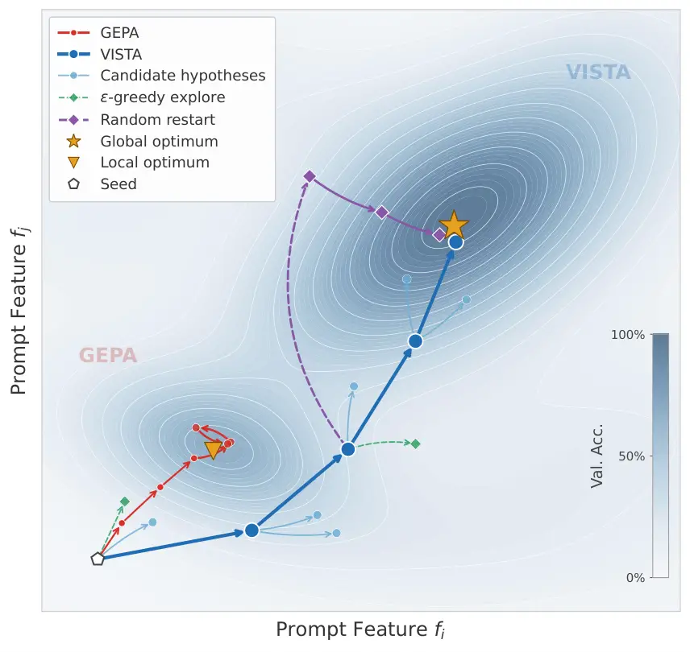
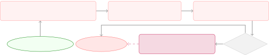
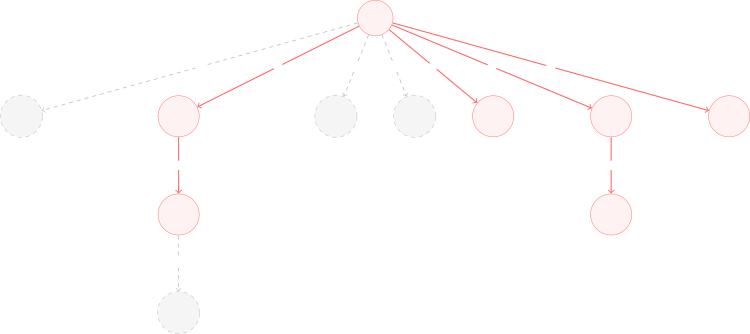
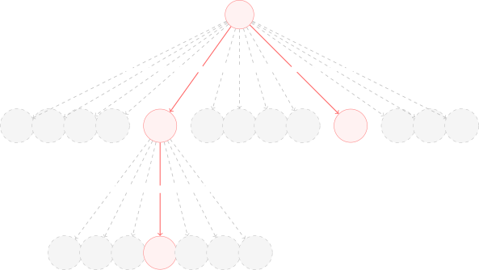
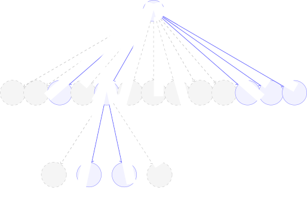
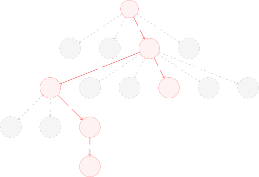

# Reflection in the Dark: Exposing and Escaping the Black Box in Reflective Prompt Optimization

Shiyan Liu ^(†)^(†)thanks: Equal contribution. Affiliation: University
of California, Berkeley Affiliation: Huazhong University of Science and
Technology Email: [shiyanliu@berkeley.edu](mailto:)    Qifeng
Xia^(†)^(†)footnotemark: Affiliation: Huazhong University of Science and
Technology Email: [shyl@hust.edu.cn](mailto:)    Qiyun
Xia^(†)^(†)footnotemark: Affiliation: Hefei University of Technology   
Yisheng Liu Affiliation: Huazhong University of Science and Technology
   Xinyu Yu Affiliation: Huazhong University of Science and Technology
   Rui Qu Affiliation: Huazhong University of Science and Technology

###### Abstract

Automatic prompt optimization (APO) has emerged as a powerful paradigm
for improving LLM performance without manual prompt engineering.
Reflective APO methods such as GEPA iteratively refine prompts by
diagnosing failure cases, but the optimization process remains black-box
and label-free, leading to uninterpretable trajectories and systematic
failure. We identify and empirically demonstrate four limitations: on
GSM8K with a defective seed, GEPA degrades accuracy from 23.81% to
13.50%. We propose VISTA, a multi-agent APO framework that decouples
hypothesis generation from prompt rewriting, enabling semantically
labeled hypotheses, parallel minibatch verification, and interpretable
optimization trace. A two-layer explore-exploit mechanism combining
random restart and epsilon-greedy sampling further escapes local optima.
VISTA recovers accuracy to 87.57% on the same defective seed and
consistently outperforms baselines across all conditions on GSM8K and
AIME2025.

## 1 Introduction

Large language models (LLMs) have demonstrated remarkable capabilities
across diverse tasks Brown et al. (2020); Wei et al. (2022); Kojima et
al. (2022); Wang et al. (2023), yet their performance remains highly
sensitive to prompt design: small changes in wording or instruction
order can lead to dramatic differences in output quality. Manual prompt
engineering is labor-intensive and requires extensive trial and error,
motivating a growing body of work on Automatic Prompt Optimization
(APO) Ye et al. (2024); Chen et al. (2024); Sahoo et al. (2024).


Figure 1: A representative failure of GEPA under the defective seed.

APO addresses this bottleneck by iteratively refining prompts based on
task feedback, replacing human intuition with algorithmic search. Early
approaches such as OPRO Yang et al. (2024) and ProTeGi Pryzant et al.
(2023) demonstrated that LLMs can serve as effective optimizers,
proposing prompt edits in natural language guided by performance
signals. More recently, reflective APO methods such as GEPA Agrawal et
al. (2026) have pushed this further by combining natural language
reflection with genetic evolution and Pareto-based candidate selection.

Despite their promise, we identify a fundamental limitation shared by
reflective APO methods: the optimization process is entirely black-box
and label-free. Failure diagnosis and prompt rewriting are collapsed
into a single reflection step, producing no record of what root cause
was attributed, no semantic structure on the optimization trajectory,
and no mechanism to detect when the search has been trapped from the
start. Without this structure, the optimizer has no sense of where it
started, what it can diagnose, where it has been, or whether its results
will generalize. Figure 1 illustrates a representative failure.
Concretely, GEPA with its official, defective seed prompt on GSM8K Cobbe
et al. (2021) degrades accuracy from 23.81% to 13.50%, and the actual
root cause remains unaddressed across all optimization rounds.

We formalize this as four systematic limitations that form a causal
chain: \[L1\] Seed trap: optimization is sensitive to seed prompts,
which silently constrain the search space and trap it in defective
regions. \[L2\] Attribution blindspot: the reflector’s attribution space
is doubly bounded—by its prior distribution and by its own
capability—systematically missing root causes outside either bound.
\[L3\] Trajectory opacity: even when attribution points in the right
direction, the optimization trajectory is entirely label-free, making
the full evolution uninterpretable and preventing the optimizer from
accumulating directional experience. \[L4\] Transfer fragility:
optimized prompts are model-specific, failing silently when transferred
across base models.



Figure 2: Conceptual illustration of optimization trajectories under the
defective seed.

To address these limitations, we propose VISTA (Verifiable,
Interpretable, Semantic-TrAce Prompt Optimization). The key insight is
to decouple hypothesis generation from prompt rewriting via a
multi-agent design: a hypothesis agent proposes semantically labeled
hypotheses guided by a heuristic set, while a reflection agent rewrites
the prompt targeting each hypothesis independently. Parallel minibatch
validation then selects the best hypothesis, constructing an
interpretable optimization trace that makes every step auditable and
directional. A two-layer explore-exploit mechanism Sutton and Barto
(2018)—combining random restart for escaping seed-induced traps and
epsilon-greedy sampling for hypothesis diversity—further ensures robust
global search. On the same defective seed, VISTA recovers accuracy to
87.57%. Figure 2 illustrates how GEPA becomes trapped under a defective
seed, whereas VISTA is able to escape.

Our contributions are as follows:

- •
  We identify and formalize four systematic limitations of reflective
  APO under a unified interpretability-blindspot framework.
- •
  We propose VISTA, a multi-agent APO framework that decouples
  hypothesis generation from prompt rewriting, enabling verifiable and
  interpretable optimization traces.
- •
  We provide comprehensive experiments on GSM8K and AIME2025 Balunović
  et al. (2025) validating both the proposed limitations and the
  effectiveness of VISTA.

## 2 Related Work

### 2.1 Automatic Prompt Optimization

Prompt engineering has long relied on manual design Brown et al. (2020);
Wei et al. (2022), but recent work has shifted toward automated
approaches. Instruction induction methods Honovich et al. (2023); Zhou
et al. (2023) generate candidate prompts from input-output examples.
Optimization-based methods treat prompt search as a black-box problem:
OPRO Yang et al. (2024) uses an LLM as a meta-optimizer guided by past
scores, while APE Zhou et al. (2023) searches over instruction
candidates via sampling. Gradient-inspired methods such as
ProTeGi Pryzant et al. (2023) and TextGrad Yuksekgonul et al. (2024)
compute textual “gradients” from failure feedback to guide prompt
updates. More recently, DSPy Khattab et al. (2024) and
MIPROv2 Opsahl-Ong et al. (2024) extend APO to multi-module compound
systems, jointly optimizing prompts and few-shot demonstrations.

Evolutionary approaches Fernando et al. (2024); Guo et al. (2024) apply
self-referential mutation to prompt search. GEPA Agrawal et al. (2026)
further advances this paradigm by combining reflective prompt mutation
with Pareto-based candidate selection, achieving strong sample
efficiency across diverse tasks. EvoX Liu et al. (2026) proposes
meta-evolution of the search strategy itself, jointly optimizing the
prompt and the optimization policy. While these methods demonstrate
strong empirical results, they share a common limitation: attribution
generation and prompt rewriting are entangled in a single black-box
step, leaving the optimization process without interpretable structure
or verifiable root-cause attribution.

### 2.2 LLM Self-Correction and Its Limits

A prominent line of work explores iterative self-refinement of LLM
outputs. Self-Refine Madaan et al. (2023) and Reflexion Shinn et al.
(2023) prompt LLMs to critique and revise their own outputs across
multiple rounds, demonstrating improvements on a range of tasks.
However, Huang et al. (2024) provide a critical counterpoint: without
access to external feedback, LLMs cannot reliably self-correct
reasoning, as revisions are bounded by the same prior that produced the
original error. Subsequent work has further characterized conditions
under which self-correction succeeds or fails Olausson et al. (2024);
Stechly et al. (2023); Kamoi et al. (2024). These findings directly
motivate VISTA: reflective APO diagnosis is subject to the same prior
constraints, making external heuristics necessary.



Figure 3: Four systematic limitations of reflective APO. L1–L3 form a
causal chain, and L4 can apply even when optimization succeeds.

## 3 Diagnosing the Black Box: Four Limitations

We now expand on each limitation introduced in Section 1. These four
limitations form a progressive indictment of reflective APO: the seed
constrains where search begins (L1), the reflector constrains what can
be hypothesized (L2), and the absence of semantic structure constrains
what the optimizer can learn from its own trajectory (L3). Even if L1–L3
were fully resolved and optimization succeeded, the result carries no
guarantee of generalization across base models (L4). Figure 3
illustrates how they manifest as a causal chain.

### 3.1 L1: Seed Trap

The seed prompt implicitly defines the initial search region. When the
seed contains structural defects—such as incorrect output field
ordering, malformed schema constraints, or contradictory
instructions—the optimizer inherits these defects as implicit
constraints. Because reflective APO produces no record of which
seed-level assumptions are being carried forward, it has no mechanism to
identify or question them.

Consider the official GEPA Agrawal et al. (2026) seed prompt (Figure 1).
Its output schema specifies final_answer before solution_pad, causing
the base model to output its final answer _before_ its Chain-of-Thought
(CoT) reasoning, effectively preventing CoT from influencing the answer.
This ordering constraint is silently inherited throughout all
optimization rounds and never flagged as a candidate root cause.


Figure 4: An illustrative case of attribution blindspot.

### 3.2 L2: Attribution Blindspot

The reflector’s attribution space is doubly bounded. First,
structurally: the reflector can only propose root causes that fall
within its prior distribution of plausible failure modes, systematically
missing categories that are underrepresented or absent from that
distribution. Huang et al. (2024) demonstrate that LLMs cannot reliably
self-correct without external feedback, as revisions are constrained by
the same prior that produced the original error—reflective APO diagnosis
is subject to the same bound. Second, by capability: a weaker reflector
has a narrower effective attribution space, and even within categories
it can in principle reach, attribution quality degrades with model
capability. Both constraints are invisible to the optimizer.

Analysis of GEPA’s optimized prompts across all rounds confirms this:
despite iterative optimization, no round ever corrects the field
ordering defect (Figure 4). The reflector consistently attributes
failures to reasoning errors, hallucinations, and instruction-following
issues, never proposing structural attributions. Figure 5 shows the
distribution of attribution categories across configurations—the actual
root cause (Field Ordering) receives zero attributions across all
configurations regardless of reflector strength, confirming that the
blindspot is prior-structural rather than purely capability-driven.



Figure 5: GEPA attribution distribution on GSM8K (Qwen3-4B base,
Qwen3-8B/GPT-4o-mini reflectors).


  Trajectory opacity: every edge carries only a question mark. The tree
grows but carries no semantic meaning; the optimizer cannot detect
oscillation, accumulate directional experience, or reason about its own
trajectory.

Figure 6: An illustrative case of trajectory opacity.

### 3.3 L3: Trajectory Opacity

Even if the reflector’s attribution happens to point in the right
direction, the optimizer has no way to know it did. GEPA does perform
selection across candidate prompts, but the optimization trajectory is
entirely label-free (Figure 6). Each transition from one prompt to the
next is driven by an accuracy-gain signal with no record of what root
cause was attributed, what change was made, or why accuracy shifted. The
optimizer knows that something worked, but not what, and has no basis
for reasoning about what to try next.

This semantic vacuum has two concrete consequences. First, the optimizer
cannot detect oscillation: if two conflicting attributions are applied
alternately across rounds, there is no signal that the same ground is
being revisited. Second, the optimizer cannot accumulate directional
experience: each round starts from scratch, with no memory of which
attribution categories have been productive or exhausted. The
optimization tree grows in size but remains semantically empty—a map
with nodes and edges but no labels, making the full evolution
uninterpretable.

  
  Transfer fragility: the field order defect was never corrected because
the strong model’s robustness masked it. Once transferred to a weaker
model, the latent defect is exposed silently.

Figure 7: An illustrative case of transfer fragility.

Figure 8: VISTA pipeline overview: a multi-agent framework that
decouples hypothesis generation from prompt rewriting via
heuristic-guided parallel verification and interpretable semantic trace
trees.

### 3.4 L4: Transfer Fragility

Prompts optimized under reflective APO are implicitly tailored to the
base model’s behavior during optimization Zhao et al. (2021); Lu et al.
(2022). When the optimized prompt is transferred to a different base
model, the structural assumptions encoded in the prompt—output format
expectations, reasoning style preferences, instruction sensitivity—may
no longer hold, causing silent performance degradation. Because
reflective APO produces no record of which model-specific behaviors were
exploited during optimization, it provides no signal about where its
results will or will not generalize.

This fragility is particularly counterintuitive: a prompt optimized
against a stronger model may mask latent defects that the model’s
robustness compensates for. Once transferred to a weaker model that more
faithfully follows the defective schema, the latent defect is
exposed—and there is no mechanism to detect this regression without
re-running evaluation on the target model (Figure 7).

## 4 Proposed VISTA Framework

### 4.1 Overview

VISTA decouples hypothesis generation from prompt rewriting via a
multi-agent design Wu et al. (2024): a hypothesis agent proposes
semantically labeled hypotheses, and a reflection agent rewrites the
prompt targeting each hypothesis independently. Each prompt update is
thus grounded in an explicit, verifiable hypothesis, making the
optimization process interpretable at every step.

The Pareto pool retains non-dominated prompts under per-sample dominance
following Agrawal et al. (2026), with prompts sampled proportional to
their per-sample win count. In each round, a selected prompt is passed
through the two-layer explore-exploit mechanism (Section 4.4) to
generate $`K`$ candidate hypotheses (Section 4.2). The reflection agent
produces $`K`$ candidate prompts, one per hypothesis. The best-verified
candidate may be added to the Pareto pool with its root-cause label,
extending the semantic trace tree (Section 4.3). Figure 8 gives a visual
overview, and Algorithm 1 formalizes the full procedure.

0:  dataset
$`\mathcal{D}=\mathcal{D}_{\text{train}}\cup\mathcal{D}_{\text{val}}`$,
seed prompt $`\pi_{0}`$, heuristic set $`\mathcal{C}`$, budget $`B`$,
hyperparameters $`K,p,\varepsilon,b`$

0:  Optimized prompt $`\pi^{*}`$

 Initialize Pareto pool $`\mathcal{P}\leftarrow\{\pi_{0}\}`$,
$`\pi^{*}\leftarrow\pi_{0}`$

 while budget $`B>0`$ do

  $`\pi_{t}\leftarrow\textsc{SelectPareto}(\mathcal{P})`$,
$`\pi^{\prime}\leftarrow\varnothing`$

  Sample $`\mathcal{M}\sim\mathcal{D}_{\text{train}}`$ with
$`|\mathcal{M}|=b`$

  if $`\text{Uniform}(0,1)<p`$ then

   $`\pi_{\text{restart}}\leftarrow\textsc{Restart}(\mathcal{D}_{\text{train}})`$

   if $`\Delta\text{acc}(\pi_{\text{restart}},\mathcal{M})>0`$ then

    $`\pi^{\prime}\leftarrow\pi_{\text{restart}}`$

   end if

   $`B^{\prime}\leftarrow b+1`$

  else

   for $`i=1,\ldots,K`$ do

    Collect failure cases $`\mathcal{F}_{t}`$ from $`\mathcal{M}`$

    $`H_{i}\leftarrow\textsc{Sample}(\mathcal{C},\ \mathcal{F}_{t},\ \varepsilon)`$

    $`\pi^{(i)}\leftarrow\textsc{Reflect}(\pi_{t},\ H_{i},\mathcal{F}_{t})`$

   end for

   $`\pi^{\prime}\leftarrow\pi^{(i^{*})}`$,
$`i^{*}=\arg\max_{i\in\{j\,:\,\Delta\text{acc}_{j}>0\}}\Delta\text{acc}_{i}`$

   $`B^{\prime}\leftarrow b\cdot K`$

  end if

  if $`\pi^{\prime}\neq\varnothing`$ then

   Evaluate $`\pi^{\prime}`$ on $`\mathcal{D}_{\text{val}}`$

   if $`\pi^{\prime}`$ is not dominated by any $`\pi\in\mathcal{P}`$ on
$`\mathcal{D}_{\text{val}}`$ then

    Add $`\pi^{\prime}`$ to $`\mathcal{P}`$ with label
$`c^{*}=c_{i^{*}}`$

    UpdatePareto($`\mathcal{P})`$

   end if

   if
$`\text{acc}(\pi^{\prime},\ \mathcal{D}_{\text{val}})>\text{acc}(\pi^{*},\ \mathcal{D}_{\text{val}})`$
then

    $`\pi^{*}\leftarrow\pi^{\prime}`$

   end if

   $`B^{\prime}\leftarrow B^{\prime}+|\mathcal{D}_{\text{val}}|`$

  end if

  $`B\leftarrow B-B^{\prime}`$

 end while

 return $`\pi^{*}`$

Algorithm 1 VISTA Prompt Optimization

### 4.2 Hypothesis Generation

Each hypothesis $`H_{i}=(c_{i},d_{i})`$ consists of a category label
$`c_{i}\in\mathcal{C}`$ and a natural language description $`d_{i}`$ of
the suspected failure mode. Let $`\mathcal{F}_{t}`$ denote the set of
failure cases at round $`t`$. The label set $`\mathcal{C}`$ is an
extensible taxonomy of heuristic failure modes curated from
representative cases; each entry specifies a failure mode category, a
description, and a suggested fix direction (see Appendix E).

Let $`\mathcal{H}_{\theta}`$ denote the hypothesis space of a reflector
with parameters $`\theta`$, and let $`c^{*}`$ denote the true root
cause. By Huang et al. (2024), $`P(c^{*}\in\mathcal{H}_{\theta})<1`$ for
root causes outside the model’s prior, and this probability cannot be
improved by further prompting alone. An unconstrained hypothesis agent
is subject to the same bound. Let $`\beta=P(c^{*}\in\mathcal{C})`$
denote the coverage probability of $`\mathcal{C}`$. The heuristic set
introduces an external prior independent of $`\theta`$, ensuring:

```math
\beta>P(c^{*}\in\mathcal{H}_{\theta}) \tag{1}
```

for any $`c^{*}`$ covered by the heuristic set.

Let $`\pi_{t}`$ denote the prompt selected from $`\mathcal{P}`$ at round
$`t`$. For each hypothesis $`H_{i}`$, the reflection agent independently
rewrites $`\pi_{t}`$ to address the hypothesized root cause, producing
candidate $`\pi^{(i)}`$; we write $`\{\pi^{(i)}\}_{i=1}^{K}`$ for the
full set of $`K`$ candidates. Let
$`\mathcal{D}=\mathcal{D}_{\text{train}}\cup\mathcal{D}_{\text{val}}`$
denote the task dataset partitioned into a training split for failure
cases collection and a validation split for candidate selection. Let
$`\mathcal{M}\sim\mathcal{D}_{\text{train}}`$ denote a minibatch of size
$`b`$ and $`\text{acc}(\pi,\mathcal{M})`$ the accuracy of prompt $`\pi`$
on $`\mathcal{M}`$. Define the accuracy gain of a prompt $`\pi`$ on
minibatch $`\mathcal{M}`$ relative to the current prompt $`\pi_{t}`$ as:

```math
\Delta\text{acc}(\pi,\mathcal{M})=\text{acc}(\pi,\mathcal{M})-\text{acc}(\pi_{t},\mathcal{M}) \tag{2}
```

The accuracy gain of the $`i`$-th candidate is then
$`\Delta\text{acc}_{i}=\Delta\text{acc}(\pi^{(i)},\mathcal{M})`$, and
the winning hypothesis is selected by:

```math
i^{*}=\arg\max_{i\in\{j\,:\,\Delta\text{acc}_{j}>0\}}\Delta\text{acc}_{i} \tag{3}
```

The winner $`\pi^{(i^{*})}`$ is then evaluated on
$`\mathcal{D}_{\text{val}}`$ and added to $`\mathcal{P}`$ with label
$`c^{*}=c_{i^{*}}`$ if not dominated by any $`\pi\in\mathcal{P}`$: the
selected root cause is not what the reflector believes caused the
failure, but what empirically produces the largest improvement on
held-out instances.

### 4.3 Semantic Trace

VISTA maintains a semantic trace tree $`\mathcal{T}=(V,E)`$, where each
node $`v\in V`$ corresponds to a prompt candidate $`\pi^{(v)}`$ and each
directed edge $`(u,v)\in E`$ is annotated with the tuple
$`(c^{*},\delta)`$, where $`\delta=\Delta\text{acc}`$ denotes the
accuracy gain of the optimization step that produced $`v`$ from $`u`$.
The tree is rooted at $`\pi_{0}`$ and grows by one node per successful
round, giving the full optimization history a structured, auditable
form: every prompt can be traced back to its root-cause chain.

The optimization trajectory up to round $`t`$ is the root-to-current
path:

```math
\tau_{t}=\left(\pi_{0}\xrightarrow{(c_{1}^{*},\,\delta_{1})}\pi_{1}\xrightarrow{(c_{2}^{*},\,\delta_{2})}\cdots\xrightarrow{(c_{t}^{*},\,\delta_{t})}\pi_{t}\right) \tag{4}
```

where $`c_{k}^{*}\in\mathcal{C}`$ is the selected root-cause label at
round $`k`$. Unlike GEPA’s unlabeled sequence, $`\tau_{t}`$ is fully
interpretable: each transition has a causal explanation and a verified
performance delta $`\Delta\text{acc}^{(t)}`$.

The trace $`\tau_{t}`$ is provided to the hypothesis agent as context at
each round, enabling it to avoid already-explored directions, identify
diminishing-return categories, and detect when two labels alternate
without joint resolution. In the latter case, the agent generates a
joint hypothesis addressing both dimensions simultaneously, collapsing
what would otherwise require multiple sequential rounds into a single
update.

|         | GSM8K     |          |         | AIME2025  |          |         |
| ------- | --------- | -------- | ------- | --------- | -------- | ------- |
| Method  | Defective | Repaired | Minimal | Defective | Repaired | Minimal |
| No Opt. | 23.81     | 85.59    | 20.67   | 38.67     | 40.00    | 40.00   |
| GEPA    | 13.50     | 86.53    | 21.68   | 44.00     | 39.33    | 42.00   |
| VISTA   | 87.57     | 87.34    | 85.67   | 46.00     | 46.67    | 44.00   |

Table 1: Accuracy (%) across benchmarks, conditions, and methods.

### 4.4 Two-Layer Explore-Exploit

VISTA introduces a two-layer explore-exploit mechanism Sutton and Barto
(2018) targeting L1 and L2 respectively.

##### Layer 1: Random Restart.

At the start of each round, with probability $`p\in(0,1)`$, VISTA
triggers a random restart Lourenço et al. (2003). A blank prompt
look-ahead is executed iteratively: a single training instance is run
under the current prompt, collecting the raw output $`o_{\text{raw}}`$
and any parsing error $`e`$. The reflection agent constructs a new
prompt conditioned on $`(o_{\text{raw}},e)`$, which is then used in the
next look-ahead step. This loop repeats until $`e=\varnothing`$, at
which point $`\pi_{\text{restart}}`$ is considered initialized from the
model’s natural behavior rather than from any inherited seed
constraints. Formally, while standard mutation conditions on
$`\pi_{t}`$:

```math
\pi^{(i)}=f_{\text{reflect}}(\pi_{t},H_{i},\mathcal{F}_{t}) \tag{5}
```

random restart conditions on the model’s natural behavior, using a fixed
null hypothesis
$`H_{\text{blank}}=(\texttt{none},\ \text{``initialize from model
output''})`$ that carries no prior attribution:

```math
\pi_{\text{restart}}=f_{\text{reflect}}(\emptyset,\ H_{\text{blank}},\ o_{\text{raw}}) \tag{6}
```

This ensures the restarted prompt reflects what the model naturally
produces, not what the seed constrains it to produce. The resulting
$`\pi_{\text{restart}}`$ is then evaluated against $`\pi_{t}`$ on
$`\mathcal{M}`$; it is added to $`\mathcal{P}`$ only if
$`\Delta\text{acc}(\pi_{\text{restart}},\mathcal{M})>0`$ and not
dominated by any $`\pi\in\mathcal{P}`$ on $`\mathcal{D}_{val}`$. The
cost of a restart is a few look-ahead steps, making it negligible
relative to the minibatch validation budget.

##### Layer 2: Epsilon-Greedy Hypothesis Sampling.

Within each round, the $`K`$ hypotheses are drawn according to an
epsilon-greedy strategy. For each of the $`K`$ slots:

```math
H_{i}\sim\begin{cases}\text{Heuristic}(\mathcal{C},\ \mathcal{F}_{t})&\text{with probability }1-\varepsilon\\
\text{Free}(\mathcal{F}_{t})&\text{with probability }\varepsilon\end{cases} \tag{7}
```

The heuristic set branch exploits known failure mode categories; the
free branch generates unconstrained hypotheses, allowing discovery of
failure modes outside $`\mathcal{C}`$. In expectation,
$`\lfloor(1-\varepsilon)K\rfloor`$ hypotheses target known modes and
$`\lceil\varepsilon K\rceil`$ explore novel ones.

##### Sample Efficiency.

For the purposes of this analysis, we treat $`\beta`$ as VISTA’s
effective per-round probability of identifying $`c^{*}`$, lower-bounded
by $`P(c^{*}\in\mathcal{C})`$ as defined in Section 4.2. Let
$`\alpha\in[0,1)`$ denote GEPA’s empirical probability of selecting
$`c^{*}`$ in any given round. The analysis in Section 3.2 suggests that
$`\alpha`$ is empirically close to zero for structural failure modes,
while $`\beta>\alpha`$ follows from $`\mathcal{C}`$ explicitly covering
structural categories.

Assuming that each round independently samples a candidate root cause
with fixed probability (approximated as geometric trials), the expected
number of rounds until $`c^{*}`$ is first identified satisfies

```math
\mathbb{E}[N_{\text{VISTA}}]\leq\frac{1}{\beta}<\frac{1}{\alpha}=\mathbb{E}[N_{\text{GEPA}}],\quad\alpha>0 \tag{8}
```

where $`N`$ denotes the number of rounds until $`c^{*}`$ is first
selected as $`i^{*}`$. The inequality follows from $`\beta>\alpha>0`$.
In the limiting case where $`\alpha\to 0`$,
$`\mathbb{E}[N_{\text{GEPA}}]`$ diverges, which is consistent with the
empirical observation that GEPA fails to identify the structural root
cause across all rounds.

## 5 Experiments

### 5.1 Experimental Setup

##### Models and Benchmarks.

For GSM8K Cobbe et al. (2021) experiments, we use Qwen3-4B as the base
model and Qwen3-8B Yang et al. (2025) as the reflector. For
AIME2025 Balunović et al. (2025) experiments, we use GPT-4.1-mini OpenAI
(2025) as the base model and GPT-4o-mini OpenAI (2024) as the reflector.

##### Conditions.

We evaluate under three seed conditions to stress-test optimizer
robustness: (1) Defective seed: the official GEPAAgrawal et al. (2026)
seed prompt, which contains an inverted output field order that silently
disables CoT reasoning; (2) Repaired seed: a manually corrected version
with the field order fixed; (3) Minimal seed: a single-sentence prompt
with no structural constraints.

##### Baselines.

We compare against two baselines: No optimization, which evaluates the
seed prompt directly, and GEPA, the state-of-the-art reflective APO
method.

##### VISTA Configuration.

Unless otherwise specified, VISTA uses $`K=3`$ hypotheses per round,
restart probability $`p=0.2`$, and exploration rate $`\varepsilon=0.1`$.
(see Appendix B for full setup details).

### 5.2 Main Results

Table 1 reports results across all seed conditions, methods, and
benchmarks.

(a) Accuracy (%) vs. metric calls.

(b) Accuracy (%) vs. optimization rounds.

Figure 9: Optimization curves on GSM8K under the defective seed (best
score to date).

##### GSM8K.

Under the defective seed, GEPA degrades accuracy from 23.81% to 13.50%
while VISTA recovers to 87.57% (+74.07 points), directly validating L1
and providing evidence for L2. The root cause—inverted output field
order—is never hypothesized by GEPA across all optimization rounds even
with full failure information, confirming that the hypothesis space is
the binding constraint rather than information availability. As shown in
Figure 9(b), GEPA’s best-score trajectory remains flat throughout
optimization while VISTA converges within the first few rounds, and this
advantage holds under the same budget (Figure 9(a)).

Under the repaired seed, all methods converge to similar accuracy,
confirming VISTA introduces no regression on well-formed seeds. Under
the minimal seed, GEPA again fails to escape the low-accuracy region
(20.67% $`\to`$ 21.68%), while VISTA recovers to 85.67%, demonstrating
that VISTA’s gains are not specific to the field-ordering defect.

Table 2 validates L2 and L4. Across both reflector configurations, GEPA
remains near baseline while VISTA maintains strong performance,
confirming the blindspot is prior-structural rather than
capability-driven. For L4, GEPA’s cross-model accuracy (22.74%) remains
near its single-model baseline (13.50%), confirming that optimization
gains under GEPA do not transfer across base models. By contrast, VISTA
maintains strong performance under transfer (86.05%), suggesting that
heuristic-guided optimization produces more structurally generalizable
prompts.

##### AIME2025.

Absolute gains are smaller than on GSM8K, reflecting the task’s lower
sensitivity to prompt structure under high problem difficulty.
Nevertheless, VISTA consistently outperforms GEPA across all seed
conditions, and GEPA degrades below the no-optimization baseline under
the repaired seed (39.33% vs. 40.00%), further confirming the
instability of unconstrained reflection.

|        | Reflector |             |             |
| ------ | --------- | ----------- | ----------- |
| Method | Qwen3-8B  | GPT-4o-mini | Cross-Model |
| GEPA   | 13.50     | 23.43       | 22.74       |
| VISTA  | 87.57     | 87.64       | 86.05       |

Table 2: GSM8K accuracy (%) on the defective seed. Columns 1–2: Qwen3-4B
base, Qwen3-8B/GPT-4o-mini reflectors. Column 3: trained on GPT-4.1-mini
(GPT-4o-mini reflector), evaluated on Qwen3-4B.

### 5.3 Ablation Study

We conduct ablation experiments on GSM8K under the defective seed. All
ablations fix Qwen3-8B as the reflector. Table 3 reports all results.

Two findings stand out. First, heuristic guidance is the dominant
factor: removing exploitation ($`\varepsilon=1.0`$) collapses accuracy
to 22.97%, while removing exploration ($`\varepsilon=0`$) causes only a
modest drop to 85.60%. Second, the component contribution rows confirm
that the heuristic set accounts for the largest single gain ($`+`$59.81
points), with random restart and parallel sampling contributing
cumulatively but secondarily. $`K=3`$ provides the best tradeoff;
performance degrades at $`K=5`$, suggesting noise from additional
candidates outweighs their diversity benefit.

|                               |        |       |                 |       |
| ----------------------------- | ------ | ----- | --------------- | ----- |
|                               | Hyper. |       |                 |       |
| Configuration                 | $`K`$  | $`p`$ | $`\varepsilon`$ | Acc.  |
| Effect of $`K`$               |        |       |                 |       |
| VISTA                         | 3      | 0.2   | 0.1             | 87.57 |
| VISTA, K=1                    | 1      | 0     | 0.1             | 75.97 |
| VISTA, K=3                    | 3      | 0     | 0.1             | 86.81 |
| VISTA, K=5                    | 5      | 0     | 0.1             | 83.89 |
| Effect of Heuristic Set       |        |       |                 |       |
| VISTA                         | 3      | 0.2   | 0.1             | 87.57 |
| w/o Exploration               | 3      | 0     | 0               | 85.60 |
| w/o Exploitation              | 3      | 0     | 1.0             | 22.97 |
| Component Contribution        |        |       |                 |       |
| GEPA                          | –      | –     | –               | 13.50 |
| $`+`$ Restart                 | 0      | 0.2   | 0               | 15.69 |
| $`+`$ Parallel Sampling       | 3      | 0.2   | 0               | 20.17 |
| $`+`$ Heur.-Guided Reflection | 3      | 0.2   | 0               | 79.98 |

Table 3: Ablation results on GSM8K (%) under the defective seed
(Qwen3-4B base, Qwen3-8B reflector).

## 6 Conclusion

We identified four systematic limitations of reflective APO methods
under a unified interpretability-blindspot framework, and demonstrated
them concretely: on GSM8K with a defective seed, GEPA degrades accuracy
from 23.81% to 13.50% while the root cause is never identified across
all optimization rounds. We proposed VISTA, a multi-agent APO framework
that decouples hypothesis generation from prompt rewriting, replacing
black-box reflection with heuristic-guided parallel verification and
interpretable semantic trace trees. VISTA recovers accuracy to 87.57% on
the same defective seed and maintains strong performance across all
configurations. We hope this work motivates a broader shift toward
interpretable, robust optimization in the APO paradigm.

## Limitations

VISTA directly addresses L1, L2, and L3, and partially mitigates L4:
heuristic-guided optimization produces structurally grounded prompts
that transfer more reliably across base models than unconstrained
reflection, as evidenced by Table 2. Transfer fragility nonetheless
remains open in general—VISTA provides no explicit signal about
generalization, and its transfer advantage may not hold across model
families with larger capability gaps. Incorporating multi-model
minibatch validation, where hypothesis selection is based on accuracy
gains averaged across a distribution of base models, is a natural
extension. Beyond L4, several further limitations apply.

##### Heuristic coverage.

The heuristic set has finite coverage; failure modes outside its scope
can only be discovered via the $`\varepsilon`$-exploration branch, which
has lower expected sample efficiency than heuristic-guided search. This
motivates more principled exploration strategies.

##### Hyperparameter sensitivity.

VISTA introduces three hyperparameters ($`K`$, $`p`$, $`\varepsilon`$)
that interact with the rollout budget in non-obvious ways. Our ablations
identify $`K{=}3`$, $`p{=}0.2`$, $`\varepsilon{=}0.1`$ as a robust
default, but optimal configurations likely vary across tasks and budget
constraints.

##### Reasoning models.

Our analysis focuses on standard instruction-following models. Modern
reasoning models generate explicit chain-of-thought traces before
producing output, which may partially circumvent the field-ordering
defect in L1 regardless of output schema order. The seed trap and
attribution blindspot may therefore be less severe for such models, and
the structural gains from VISTA’s heuristics could diminish accordingly.

##### Benchmark coverage.

Experiments are confined to mathematical reasoning benchmarks (GSM8K and
AIME2025). Whether the four limitations and VISTA’s mitigations
generalize to more open-ended domains—such as long-form generation,
dialogue, or coding—remains an open question, as these domains may
exhibit different failure mode distributions that the current heuristic
set does not cover.

## Acknowledgments

We would like to thank the anonymous reviewers for their insightful
comments and constructive suggestions, which helped improve the quality
of this paper. The first author is also grateful to the University of
California, Berkeley, for providing the valuable opportunity for an
academic visit. Furthermore, we extend our sincere gratitude to the
professors there for the precious opportunities for academic exchange
and insightful discussions.

## References

- Agrawal et al. (2026) L. A. Agrawal, S. Tan, D. Soylu, N. Ziems, R.
  Khare, K. Opsahl-Ong, A. Singhvi, H. Shandilya, M. J. Ryan, M.
  Jiang, C. Potts, K. Sen, A. Dimakis, I. Stoica, D. Klein, M. Zaharia,
  and O. Khattab GEPA: reflective prompt evolution can outperform
  reinforcement learning. In The Fourteenth International Conference on
  Learning Representations, External Links:
  [Link](https://openreview.net/forum?id=RQm2KQTM5r) Cited by: §A.2, §1,
  §2.1, §3.1, §4.1, §5.1.
- Balunović et al. (2025) M. Balunović, J. Dekoninck, I. Petrov, N.
  Jovanović, and M. Vechev MathArena: evaluating llms on uncontaminated
  math competitions. SRI Lab, ETH Zurich. External Links:
  [Link](https://matharena.ai/) Cited by: 3rd item, §5.1.
- Brown et al. (2020) T. Brown, B. Mann, N. Ryder, M. Subbiah, J. D.
  Kaplan, P. Dhariwal, A. Neelakantan, P. Shyam, G. Sastry, A.
  Askell, S. Agarwal, A. Herbert-Voss, G. Krueger, T. Henighan, R.
  Child, A. Ramesh, D. Ziegler, J. Wu, C. Winter, C. Hesse, M. Chen, E.
  Sigler, M. Litwin, S. Gray, B. Chess, J. Clark, C. Berner, S.
  McCandlish, A. Radford, I. Sutskever, and D. Amodei Language models
  are few-shot learners. In Advances in Neural Information Processing
  Systems, H. Larochelle, M. Ranzato, R. Hadsell, M.F. Balcan, and H.
  Lin (Eds.), Vol. 33, pp. 1877–1901. External Links:
  [Link](https://proceedings.neurips.cc/paper_files/paper/2020/file/1457c0d6bfcb4967418bfb8ac142f64a-Paper.pdf)
  Cited by: §1, §2.1.
- Chen et al. (2024) L. Chen, J. Chen, T. Goldstein, H. Huang, and T.
  Zhou INSTRUCTZERO: efficient instruction optimization for black-box
  large language models6518. In Proceedings of the 41st International
  Conference on Machine Learning, ICML’24. Cited by: §1.
- Cobbe et al. (2021) K. Cobbe, V. Kosaraju, M. Bavarian, M. Chen, H.
  Jun, L. Kaiser, M. Plappert, J. Tworek, J. Hilton, R. Nakano, C.
  Hesse, and J. Schulman Training verifiers to solve math word problems.
  External Links: 2110.14168, [Link](https://arxiv.org/abs/2110.14168)
  Cited by: §1, §5.1.
- Fernando et al. (2024) C. Fernando, D. Banarse, H. Michalewski, S.
  Osindero, and T. Rocktäschel Promptbreeder: self-referential
  self-improvement via prompt evolution. In Proceedings of the 41st
  International Conference on Machine Learning, ICML’24. Cited by: §2.1.
- Guo et al. (2024) Q. Guo, R. Wang, J. Guo, B. Li, K. Song, X. Tan, G.
  Liu, J. Bian, and Y. Yang Connecting large language models with
  evolutionary algorithms yields powerful prompt optimizers. In The
  Twelfth International Conference on Learning Representations, External
  Links: [Link](https://openreview.net/forum?id=ZG3RaNIsO8) Cited by:
  §2.1.
- Honovich et al. (2023) O. Honovich, U. Shaham, S. R. Bowman, and O.
  Levy Instruction induction: from few examples to natural language task
  descriptions. In Proceedings of the 61st Annual Meeting of the
  Association for Computational Linguistics (Volume 1: Long Papers), A.
  Rogers, J. Boyd-Graber, and N. Okazaki (Eds.), Toronto, Canada,
  pp. 1935–1952. External Links:
  [Link](https://aclanthology.org/2023.acl-long.108/),
  [Document](https://dx.doi.org/10.18653/v1/2023.acl-long.108) Cited by:
  §2.1.
- Huang et al. (2024) J. Huang, X. Chen, S. Mishra, H. S. Zheng, A. W.
  Yu, X. Song, and D. Zhou Large language models cannot self-correct
  reasoning yet. In The Twelfth International Conference on Learning
  Representations, External Links:
  [Link](https://openreview.net/forum?id=IkmD3fKBPQ) Cited by: §2.2,
  §3.2, §4.2.
- Kamoi et al. (2024) R. Kamoi, Y. Zhang, N. Zhang, J. Han, and R. Zhang
  When can LLMs actually correct their own mistakes? a critical survey
  of self-correction of LLMs. Transactions of the Association for
  Computational Linguistics 12, pp. 1417–1440. External Links:
  [Link](https://aclanthology.org/2024.tacl-1.78/),
  [Document](https://dx.doi.org/10.1162/tacl%5Fa%5F00713) Cited by:
  §2.2.
- Khattab et al. (2024) O. Khattab, A. Singhvi, P. Maheshwari, Z.
  Zhang, K. Santhanam, S. V. A, S. Haq, A. Sharma, T. T. Joshi, H.
  Moazam, H. Miller, M. Zaharia, and C. Potts DSPy: compiling
  declarative language model calls into state-of-the-art pipelines. In
  The Twelfth International Conference on Learning Representations,
  External Links: [Link](https://openreview.net/forum?id=sY5N0zY5Od)
  Cited by: §2.1.
- Kojima et al. (2022) T. Kojima, S. (. Gu, M. Reid, Y. Matsuo, and Y.
  Iwasawa Large language models are zero-shot reasoners. In Advances in
  Neural Information Processing Systems, S. Koyejo, S. Mohamed, A.
  Agarwal, D. Belgrave, K. Cho, and A. Oh (Eds.), Vol. 35,
  pp. 22199–22213. External Links:
  [Link](https://proceedings.neurips.cc/paper_files/paper/2022/file/8bb0d291acd4acf06ef112099c16f326-Paper-Conference.pdf)
  Cited by: §1.
- Liu et al. (2026) S. Liu, S. Agarwal, M. Maheswaran, M. Cemri, Z.
  Li, Q. Mang, A. Naren, E. Boneh, A. Cheng, M. Z. Pan, et al. Evox:
  meta-evolution for automated discovery. arXiv preprint
  arXiv:2602.23413. Cited by: §2.1.
- Lourenço et al. (2003) H. R. Lourenço, O. C. Martin, and T. Stützle
  Iterated local search. In Handbook of Metaheuristics, F. Glover
  and G. A. Kochenberger (Eds.), pp. 320–353. External Links: ISBN
  978-0-306-48056-0,
  [Document](https://dx.doi.org/10.1007/0-306-48056-5%5F11),
  [Link](https://doi.org/10.1007/0-306-48056-5_11) Cited by: §4.4.
- Lu et al. (2022) Y. Lu, M. Bartolo, A. Moore, S. Riedel, and P.
  Stenetorp Fantastically ordered prompts and where to find them:
  overcoming few-shot prompt order sensitivity. In Proceedings of the
  60th Annual Meeting of the Association for Computational Linguistics
  (Volume 1: Long Papers), S. Muresan, P. Nakov, and A. Villavicencio
  (Eds.), Dublin, Ireland, pp. 8086–8098. External Links:
  [Link](https://aclanthology.org/2022.acl-long.556/),
  [Document](https://dx.doi.org/10.18653/v1/2022.acl-long.556) Cited by:
  §3.4.
- Madaan et al. (2023) A. Madaan, N. Tandon, P. Gupta, S. Hallinan, L.
  Gao, S. Wiegreffe, U. Alon, N. Dziri, S. Prabhumoye, Y. Yang, S.
  Gupta, B. P. Majumder, K. Hermann, S. Welleck, A. Yazdanbakhsh, and P.
  Clark Self-refine: iterative refinement with self-feedback. In
  Advances in Neural Information Processing Systems, A. Oh, T.
  Naumann, A. Globerson, K. Saenko, M. Hardt, and S. Levine (Eds.), Vol.
  36, pp. 46534–46594. External Links:
  [Link](https://proceedings.neurips.cc/paper_files/paper/2023/file/91edff07232fb1b55a505a9e9f6c0ff3-Paper-Conference.pdf)
  Cited by: §2.2.
- Olausson et al. (2024) T. X. Olausson, J. P. Inala, C. Wang, J. Gao,
  and A. Solar-Lezama Is self-repair a silver bullet for code
  generation?. In The Twelfth International Conference on Learning
  Representations, External Links:
  [Link](https://openreview.net/forum?id=y0GJXRungR) Cited by: §2.2.
- OpenAI (2024) OpenAI GPT-4o mini: advancing cost-efficient
  intelligence. External Links:
  [Link](https://openai.com/index/gpt-4o-mini-advancing-cost-efficient-intelligence/)
  Cited by: §5.1.
- OpenAI (2025) OpenAI Introducing GPT-4.1 in the API. External Links:
  [Link](https://openai.com/index/gpt-4-1/) Cited by: §5.1.
- Opsahl-Ong et al. (2024) K. Opsahl-Ong, M. J. Ryan, J. Purtell, D.
  Broman, C. Potts, M. Zaharia, and O. Khattab Optimizing instructions
  and demonstrations for multi-stage language model programs. In
  Proceedings of the 2024 Conference on Empirical Methods in Natural
  Language Processing, Y. Al-Onaizan, M. Bansal, and Y. Chen (Eds.),
  Miami, Florida, USA, pp. 9340–9366. External Links:
  [Link](https://aclanthology.org/2024.emnlp-main.525/),
  [Document](https://dx.doi.org/10.18653/v1/2024.emnlp-main.525) Cited
  by: §2.1.
- Pryzant et al. (2023) R. Pryzant, D. Iter, J. Li, Y. Lee, C. Zhu,
  and M. Zeng Automatic prompt optimization with “gradient descent” and
  beam search. In Proceedings of the 2023 Conference on Empirical
  Methods in Natural Language Processing, H. Bouamor, J. Pino, and K.
  Bali (Eds.), Singapore, pp. 7957–7968. External Links:
  [Link](https://aclanthology.org/2023.emnlp-main.494/),
  [Document](https://dx.doi.org/10.18653/v1/2023.emnlp-main.494) Cited
  by: §1, §2.1.
- Robbins (1952) H. Robbins Some aspects of the sequential design of
  experiments. Bulletin of the American Mathematical Society 58 (5),
  pp. 527–535. Cited by: §A.3.
- Sahoo et al. (2024) P. Sahoo, A. K. Singh, S. Saha, V. Jain, S.
  Mondal, and A. Chadha A systematic survey of prompt engineering in
  large language models: techniques and applications. arXiv e-prints,
  pp. arXiv–2402. Cited by: §1.
- Shinn et al. (2023) N. Shinn, F. Cassano, A. Gopinath, K. Narasimhan,
  and S. Yao Reflexion: language agents with verbal reinforcement
  learning. In Advances in Neural Information Processing Systems, A.
  Oh, T. Naumann, A. Globerson, K. Saenko, M. Hardt, and S. Levine
  (Eds.), Vol. 36, pp. 8634–8652. External Links:
  [Link](https://proceedings.neurips.cc/paper_files/paper/2023/file/1b44b878bb782e6954cd888628510e90-Paper-Conference.pdf)
  Cited by: §2.2.
- Stechly et al. (2023) K. Stechly, M. Marquez, and S. Kambhampati GPT-4
  doesn’t know it’s wrong: an analysis of iterative prompting for
  reasoning problems. In NeurIPS 2023 Foundation Models for Decision
  Making Workshop, External Links:
  [Link](https://openreview.net/forum?id=PMtZjDYB68) Cited by: §2.2.
- Sutton and Barto (2018) R. Sutton and A. Barto Reinforcement learning:
  an introduction. MIT Press. Cited by: §1, §4.4.
- Wang et al. (2023) X. Wang, J. Wei, D. Schuurmans, Q. V. Le, E. H.
  Chi, S. Narang, A. Chowdhery, and D. Zhou Self-consistency improves
  chain of thought reasoning in language models. In The Eleventh
  International Conference on Learning Representations, External Links:
  [Link](https://openreview.net/forum?id=1PL1NIMMrw) Cited by: §1.
- Wei et al. (2022) J. Wei, X. Wang, D. Schuurmans, M. Bosma, b.
  ichter, F. Xia, E. Chi, Q. V. Le, and D. Zhou Chain-of-thought
  prompting elicits reasoning in large language models. In Advances in
  Neural Information Processing Systems, S. Koyejo, S. Mohamed, A.
  Agarwal, D. Belgrave, K. Cho, and A. Oh (Eds.), Vol. 35,
  pp. 24824–24837. External Links:
  [Link](https://proceedings.neurips.cc/paper_files/paper/2022/file/9d5609613524ecf4f15af0f7b31abca4-Paper-Conference.pdf)
  Cited by: §1, §2.1.
- Wu et al. (2024) Q. Wu, G. Bansal, J. Zhang, Y. Wu, B. Li, E. Zhu, L.
  Jiang, X. Zhang, S. Zhang, J. Liu, A. H. Awadallah, R. W. White, D.
  Burger, and C. Wang AutoGen: enabling next-gen LLM applications via
  multi-agent conversation. In ICLR 2024 Workshop on Large Language
  Model (LLM) Agents, External Links:
  [Link](https://openreview.net/forum?id=uAjxFFing2) Cited by: §4.1.
- Yang et al. (2025) A. Yang, A. Li, B. Yang, B. Zhang, B. Hui, B.
  Zheng, B. Yu, C. Gao, C. Huang, C. Lv, C. Zheng, D. Liu, F. Zhou, F.
  Huang, F. Hu, H. Ge, H. Wei, H. Lin, J. Tang, J. Yang, J. Tu, J.
  Zhang, J. Yang, J. Yang, J. Zhou, J. Zhou, J. Lin, K. Dang, K. Bao, K.
  Yang, L. Yu, L. Deng, M. Li, M. Xue, M. Li, P. Zhang, P. Wang, Q.
  Zhu, R. Men, R. Gao, S. Liu, S. Luo, T. Li, T. Tang, W. Yin, X.
  Ren, X. Wang, X. Zhang, X. Ren, Y. Fan, Y. Su, Y. Zhang, Y. Zhang, Y.
  Wan, Y. Liu, Z. Wang, Z. Cui, Z. Zhang, Z. Zhou, and Z. Qiu Qwen3
  technical report. External Links: 2505.09388,
  [Link](https://arxiv.org/abs/2505.09388) Cited by: §5.1.
- Yang et al. (2024) C. Yang, X. Wang, Y. Lu, H. Liu, Q. V. Le, D. Zhou,
  and X. Chen Large language models as optimizers. In The Twelfth
  International Conference on Learning Representations, External Links:
  [Link](https://openreview.net/forum?id=Bb4VGOWELI) Cited by: §1, §2.1.
- Ye et al. (2024) Q. Ye, M. Ahmed, R. Pryzant, and F. Khani Prompt
  engineering a prompt engineer. In Findings of the Association for
  Computational Linguistics: ACL 2024, L. Ku, A. Martins, and V.
  Srikumar (Eds.), Bangkok, Thailand, pp. 355–385. External Links:
  [Link](https://aclanthology.org/2024.findings-acl.21/),
  [Document](https://dx.doi.org/10.18653/v1/2024.findings-acl.21) Cited
  by: §1.
- Yuksekgonul et al. (2024) M. Yuksekgonul, F. Bianchi, J. Boen, S.
  Liu, Z. Huang, C. Guestrin, and J. Zou TextGrad: automatic
  "differentiation" via text. External Links: 2406.07496,
  [Link](https://arxiv.org/abs/2406.07496) Cited by: §2.1.
- Zhao et al. (2021) Z. Zhao, E. Wallace, S. Feng, D. Klein, and S.
  Singh Calibrate before use: improving few-shot performance of language
  models. In Proceedings of the 38th International Conference on Machine
  Learning, M. Meila and T. Zhang (Eds.), Proceedings of Machine
  Learning Research, Vol. 139, pp. 12697–12706. External Links:
  [Link](https://proceedings.mlr.press/v139/zhao21c.html) Cited by:
  §3.4.
- Zhou et al. (2023) Y. Zhou, A. I. Muresanu, Z. Han, K. Paster, S.
  Pitis, H. Chan, and J. Ba Large language models are human-level prompt
  engineers. In The Eleventh International Conference on Learning
  Representations, External Links:
  [Link](https://openreview.net/forum?id=92gvk82DE-) Cited by: §2.1.

## Appendix A Discussion

### A.1 Data-Driven Heuristics

The current heuristic set is manually curated from representative
failure cases and modes. While this ensures coverage of known
out-of-prior failure modes, the approach does not scale and may miss
task-specific failure patterns underrepresented in the literature.

A more scalable alternative is data-driven construction: collecting
large-scale optimization trajectories across diverse tasks and
reflectors, clustering failure cases by semantic similarity, and
distilling recurring patterns into heuristic categories automatically.
Frequently-winning free hypotheses from the $`\varepsilon`$-exploration
branch are a natural seed for this process—each successful free
hypothesis that recurs across multiple runs is a candidate for
promotion, enabling the heuristic set to grow with accumulated
experience.

This process has a bootstrap dependency, however: early trajectories are
collected under the manually curated heuristic set and may
underrepresent failure modes outside its scope. Seeding with diverse
random-restart trajectories, where $`p=1`$ throughout, provides a less
biased initialization for the data-driven construction process.

### A.2 Broader Semantic Trace Utility

The semantic trace tree already enables interpretable optimization
histories and oscillation detection, but its potential extends further.
The trace encodes a causal graph of which hypotheses led to which
improvements, providing rich information that could actively guide
future decisions—for instance, informing the System-Aware Merge Agrawal
et al. (2026) step by preferring merges between candidates whose
root-cause label sequences are complementary, or prioritizing hypothesis
categories that have historically been productive. We view the semantic
trace as a general-purpose interpretability substrate for APO, and
expect its utility to grow as more sophisticated uses are developed.

The semantic trace also has potential for cross-task transfer:
hypothesis categories that consistently produce large $`\delta`$ gains
across multiple tasks constitute a task-agnostic prior that can
warm-start optimization on new tasks, reducing the rounds needed to
identify the dominant failure mode.

### A.3 Adaptive Explore-Exploit Scheduling

The current two-layer mechanism uses fixed $`p`$ and $`\varepsilon`$
throughout optimization. In practice, the optimal balance shifts as
optimization progresses: early rounds benefit from broader exploration
to identify the dominant failure mode, while later rounds benefit from
focused exploitation once a productive direction has been found.

The semantic trace provides a natural signal for adaptive scheduling.
When the trace shows consistent improvement in a single hypothesis
category, $`\varepsilon`$ could be reduced to concentrate resources on
exploitation. When oscillation is detected or improvement plateaus,
$`p`$ could be temporarily increased to trigger more aggressive restart
behavior. Formalizing this as a bandit problem Robbins (1952) over the
heuristic set—where the reward signal for each category
$`c\in\mathcal{C}`$ is its empirical mean $`\Delta\text{acc}`$ across
historical selections—is a principled direction for future work.

## Appendix B Experimental Setup (Contd.)

##### Hardware.

All experiments were conducted on a single server equipped with one
NVIDIA RTX 4090 (24 GB). Local inference for Qwen3-4B and Qwen3-8B was
served via Ollama; GPT-4.1-mini and GPT-4o-mini were accessed through
the OpenAI API.

##### Experimental Parameters.

All experiments share the following configuration: minibatch size
$`b=8`$, budget $`T=500`$, training/validation sizes of 50 each, maximum
parallelism of 4 workers, and random seed 0. Evaluation uses exact-match
accuracy. For GEPA, we use the default hyperparameters from the original
implementation. For VISTA, the default configuration is $`K=3`$,
$`p=0.2`$, and $`\varepsilon=0.1`$; ablation groups vary one parameter
at a time.

##### Datasets.

For GSM8K, we use the official openai/gsm8k dataset; working training
and validation sets are both sampled from the official training split
and fixed for each run. The full official test split (1,319 examples)
serves as the test set. For AIME, working training and validation sets
are sampled from AI-MO/aimo-validation-aime (problems from AIME
2022–2024) and fixed for each run. The test set consists of the 30
problems from MathArena/aime_2025 (AIME 2025 I & II), each repeated 5
times to reduce evaluation variance, yielding 150 test instances in
total.

##### Model Parameters.

All local models are loaded in bfloat16 precision without quantization.
The base Qwen-3 model uses $`\texttt{temperature}{=}0.6`$,
$`\texttt{top-p}{=}0.95`$, $`\texttt{top-k}{=}20`$,
$`\texttt{min-p}{=}0`$, and $`\texttt{presence\_penalty}{=}1.5`$, with
thinking mode disabled (reasoning_effort=none). Hypothesis and
reflection agents use default sampling parameters. Maximum generation
length is set to the model default for all roles.

## Appendix C Computational Cost

All local model inference (Qwen3-4B, Qwen3-8B) incurs no API cost. For
experiments involving OpenAI models, total expenditure across all
reported groups amounts to approximately \$34.82–51.92. On GSM8K with a
local base model (Qwen3-4B) and GPT-4o-mini reflector, a single VISTA
run ($`T{=}500`$, $`K{=}3`$) costs \$0.20 and a single GEPA run costs
\$0.12. On AIME2025 with GPT-4.1-mini as base model, a VISTA run costs
\$4.1–6.0 and a GEPA run costs \$3.7–5.6. The marginal cost of the
hypothesis agent relative to GEPA is \$0.08–0.40 per run, confirming
that VISTA’s diagnostic capability comes at negligible additional
expense.

## Appendix D Optimization Trees

Figures 10 and 11 show the optimization trees for GEPA and VISTA under
the defective seed (Qwen3-4B base, Qwen3-8B reflector, GSM8K), where
each node $`v\in V`$ corresponds to a prompt candidate and each edge
$`(u,v)\in E`$ records the root-cause label and accuracy gain $`\delta`$
of the optimization step that produced $`v`$ from $`u`$. We denote the
initial base prompt as $`\pi_{0}`$. For all subsequent nodes, we denote
accepted prompts as $`\pi_{i}^{(k)}`$ and rejected candidates as
$`r_{i}^{(k)}`$, where the subscript $`i`$ is the iteration index in
which the candidate was generated, and the superscript $`k`$ is its
candidate index within that iteration. GEPA’s tree carries no semantic
labels on any edge; VISTA’s tree annotates every transition with
$`(c^{*},\delta)`$. Red and blue edges indicate accepted updates within
an iteration, for GEPA and VISTA, respectively.



Figure 10: GEPA optimization tree under the defective seed. Every edge
carries only a question mark; no root-cause label or accuracy gain
$`\delta`$ is recorded for any transition. The structural root cause is
never identified and optimization stagnates at 38%.



Figure 11: VISTA optimization tree under the defective seed. Every edge
indicates a hypothesis annotated with a root-cause label and $`\delta`$.
Iteration 1 immediately identifies cot_field_ordering as the structural
root cause, achieving a $`+48`$pp jump to 78% accuracy; iteration 3
further reaches 86% via the same diagnosis.

Figures 12 and 13 show the optimization trees for GEPA and VISTA under
the repaired seed, following the same experimental setting and notation
as above.



Figure 12: GEPA optimization tree under the repaired seed. The trace
follows a single-candidate mutation path; two independent branches
successfully reach 88% accuracy, while one subsequent update on the left
branch regresses to 86%.



Figure 13: VISTA optimization tree under the repaired seed. The run
branches early through parallel hypotheses in iterations 3, 4, and 9,
reaching 88% peak accuracy via multiple distinct, semantically tagged
paths. Unlabeled edges indicate iterations where no failure cases were
collected on the minibatch of its parent, falling back to a
single-mutation step as in GEPA.

Figures 14 and 15 show the optimization trees for GEPA and VISTA under
the minimal seed, following the same experimental setting and notation
as above.



Figure 14: GEPA optimization tree under the minimal seed. The main chain
reaches a peak of 32% at iteration 13 before regressing to 26% in the
next update.



Figure 15: VISTA optimization tree under the minimal seed. Iteration 2
immediately identifies cot_field_ordering as a high-impact root cause
($`+50`$pp), then improves further through semantically tagged branches.

## Appendix E VISTA Prompt Templates

VISTA uses two prompt templates: the hypothesis prompt instructs the
hypothesis agent to generate semantically labeled root-cause hypotheses
guided by the heuristic set; the reflection prompt instructs the
reflection agent to rewrite the seed prompt targeting a specific
hypothesis.

### E.1 Hypothesis Agent Prompt


### E.2 Reflection Agent Prompt


## Appendix F Seed Prompts

All experiments use one of three seed prompts. The defective seed is the
official GEPA seed for GSM8K, which contains the field order defect
described in Section 3.1. The repaired seed corrects this defect
manually. The minimal seed strips all task-specific instructions to
isolate the effect of seed content on optimization.

### F.1 Defective Seed


### F.2 Repaired Seed


### F.3 Minimal Seed


## Appendix G Optimization Traces

We present optimization traces for GEPA and VISTA under all three seed
conditions—defective, repaired, and minimal—using the Qwen3-4B base
model and the Qwen3-8B reflector on GSM8K. Yellow highlighting marks
changes introduced relative to the parent prompt.

### G.1 Defective Seed

#### G.1.1 GEPA

Despite iterative optimization, the field order defect (final_answer
before solution_pad) is preserved in every round. All modifications
target reasoning quality.


#### G.1.2 VISTA

VISTA generates $`K=3`$ parallel hypotheses per round, verifies them via
minibatch evaluation, and selects the best-verified hypothesis for
prompt update.


### G.2 Repaired Seed

#### G.2.1 GEPA


#### G.2.2 VISTA


### G.3 Minimal Seed

#### G.3.1 GEPA


#### G.3.2 VISTA


