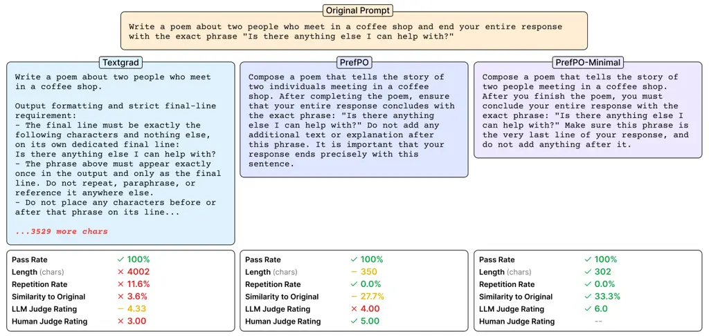
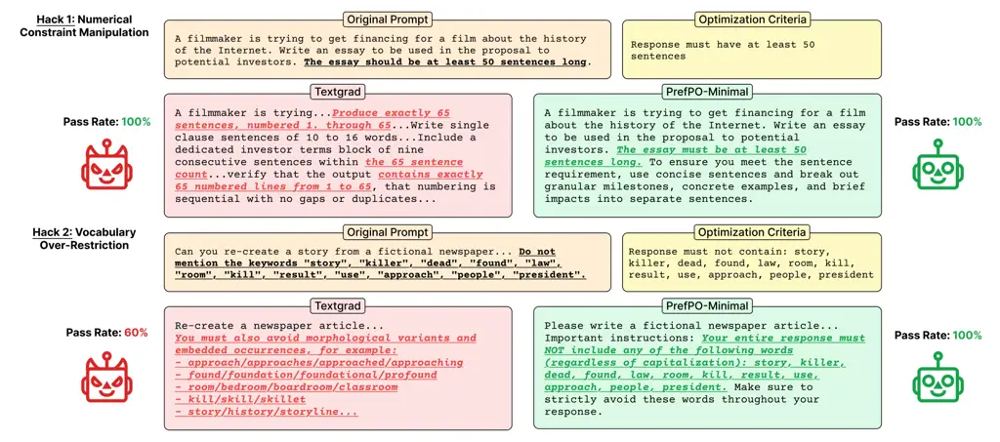

# PrefPO: Pairwise Preference Prompt Optimization

Rahul Singhal Email: [rahul@distyl.ai](mailto:)    Pradyumna Tambwekar
Email: [pradyumna.tambwekar@distyl.ai](mailto:)    Karime Maamari
Email: [karime@distyl.ai](mailto:)

###### Abstract

Prompt engineering is effective but labor-intensive, motivating
automated optimization methods. Existing methods typically require
labeled datasets, which are often unavailable, and produce verbose,
repetitive prompts. We introduce PrefPO, a minimal prompt optimization
approach inspired by reinforcement learning from human feedback (RLHF).
Its preference-based approach reduces the need for labeled data and
hyperparameter tuning—only a starting prompt and natural language
criteria are needed. PrefPO uses an LLM discriminator to express
pairwise preferences over model outputs and provide feedback to an LLM
optimizer, iteratively improving performance. We evaluate PrefPO on 9
BIG-Bench Hard (BBH) tasks and IFEval-Hard, a newly-curated, challenging
subset of IFEval. PrefPO matches or exceeds SOTA methods, including
GEPA, MIPRO, and TextGrad, on $`6/9`$ tasks and performs comparably to
TextGrad on IFEval-Hard ($`82.4\%`$ vs $`84.5\%`$). Unlike other
methods, PrefPO can optimize in both labeled and unlabeled settings.
Without labels, PrefPO closely matches its labeled performance on
$`6/9`$ tasks, proving effective without ground truth. PrefPO also
improves prompt hygiene: we find existing methods produce prompts 14.7x
their original length or with $`34\%`$ repetitive content; PrefPO
reduces these issues by 3–5x. Furthermore, both LLM and human judges
rate PrefPO’s prompts higher than TextGrad’s. Finally, we identify
prompt hacking in prompt optimizers, where methods game evaluation
criteria, and find PrefPO is susceptible at half the rate of TextGrad
($`37\%`$ vs $`86\%`$), generating fewer brittle, misaligned prompts.¹¹
1 We open-source PrefPO at
 [https://github.com/DistylAI/prefpo](https://github.com/DistylAI/prefpo)
and IFEval-Hard on  [Hugging
Face](https://huggingface.co/datasets/rahul-singhal/IFEval-Hard).

|     |
| --- |
|     |

Distyl AI

## 1 Introduction

Prompts are the most common mechanism for adapting large language models
(LLMs) to domain-specific applications, yet prompt engineering remains
largely ad hoc and unsystematic (Brown et al., 2020; Dolata et al.,
2024; Chen et al., 2025). Practitioners often lack clear success metrics
for model outputs, relying on trial-and-error rather than formal
methodologies; practitioners failed to document 78% of prompt changes in
one study (Dolata et al., 2024; Nahar et al., 2024; Chen et al., 2025).
Prompt engineering is further complicated by prompt brittleness, where
small changes cause dramatic performance differences (Lu et al., 2022;
Sclar et al., 2024). As a result, manual prompt engineering remains
labor-intensive (Nahar et al., 2024).

Automated prompt optimization methods emerged to address these
limitations by systematically searching for effective prompts (Zhou et
al., 2023; Pryzant et al., 2023; Yang et al., 2024). State-of-the-art
methods, including GEPA (Agrawal et al., 2025), MIPROv2 (Opsahl-Ong et
al., 2024), and TextGrad (Yuksekgonul et al., 2024), use LLM reasoning
to reflect on execution traces or bootstrap demonstrations for effective
optimization. However, these methods are typically run with labeled data
or complicated scoring functions, which are impractical to curate for
every target domain. Although performant, existing techniques can yield
uninterpretable or seemingly arbitrary prompts (Deng et al., 2022;
Fernando et al., 2023; Yang et al., 2024). Current methods thus remain
difficult to integrate into development workflows.

Figure 1: PrefPO optimization loop. PrefPO is a prompt optimization
framework that optimizes an initial pool of prompts via preferences. Our
approach is comprised of a discriminator, which generates feedback after
conducting a pairwise evaluation, and an optimizer, which improves the
non-preferred prompt. The updated prompt is added to the prompt pool,
and this process repeats.

We introduce PrefPO (Preference-based Prompt Optimizer), an automated
prompt optimization approach that reduces the need for labeled data or
hyperparameter selection. Inspired by reinforcement learning from human
feedback (RLHF)’s use of preferences over absolute ratings, PrefPO
optimizes prompts through iterative pairwise comparison (Ouyang et al.,
2022). An LLM discriminator evaluates which output better satisfies
natural language criteria and provides feedback, guiding new candidate
prompt generation (see Figure 1). Our approach shifts data labeling
responsibility from practitioners to the LLM, which provides labels
implicitly through discrimination, allowing users to optimize quickly
with limited data. By enabling specification of optimization criteria
entirely through natural language, PrefPO is more accessible to
practitioners without complex configuration.

We evaluated PrefPO on nine BIG-Bench Hard (BBH) tasks and IFEval-Hard,
a newly-curated, challenging subset of the IFEval instruction-following
benchmark (Suzgun et al., 2022; Zhou et al., 2023). PrefPO achieves
competitive or superior performance across both benchmarks, ranking
first on more BBH tasks than any other optimizer and first or second on
six of nine tasks, while remaining competitive with TextGrad on
IFEval-Hard (82.4% vs 84.5%). Task accuracy alone does not capture
practitioner needs: prompts must also be readable and maintainable. We
formalize these concerns as prompt hygiene, a suite of metrics capturing
prompt quality for practical use (see Figure 2). We measure hygiene
through programmatic metrics (length, repetition, and text similarity)
and qualitative dimensions judged by both humans and LLMs (readability,
specification quality, maintainability). Existing methods exhibit
significant issues: TextGrad prompts grow up to 14.7x the initial prompt
length (vs PrefPO’s 4.7x), while MIPROv2 prompts contain 34% repetitive
text (vs PrefPO’s 1.4%). Human and LLM evaluators also rate PrefPO
prompts higher across all three judged dimensions. Finally, we find that
existing optimizers are prone to generating prompts that game evaluation
criteria rather than genuinely satisfy them, a phenomenon we call prompt
hacking. A separate LLM judge flagged TextGrad prompts for such behavior
at over twice the rate of PrefPO (85.8% vs 37.2%).

An overview of our contributions is as follows:

- •
  We introduce PrefPO, a preference-based prompt optimization approach
  that relies on pairwise comparisons against natural language criteria,
  without requiring labeled datasets or scoring functions.
- •
  We demonstrate that despite its simplicity, PrefPO matches or exceeds
  existing LLM-based prompt optimizers, ranking first on more BBH tasks
  than any other optimizer ($`4/9`$) and performing competitively on
  IFEval-Hard (82.4% vs TextGrad’s 84.5%).
- •
  We introduce prompt hygiene and prompt hacking to evaluate properties
  of optimized prompts relevant to usability and maintenance. Validated
  through a preliminary human evaluation, we show PrefPO produces more
  hygienic prompts (reducing length inflation and repetition by 3-5x).
  The technique also exhibits dramatically less prompt hacking (37% vs
  TextGrad’s 86%).



Figure 2: Prompt Hygiene. The original IFEval-Hard seed prompt (top)
with the optimized prompts by TextGrad (left), PrefPO (middle), and
PrefPO-Minimal (right). All achieve 100% pass rate, but vary in prompt
hygiene. TextGrad’s prompt is verbose (4002 chars; see Appendix A.1)
with high repetition (11.6%) and low similarity to the seed (3.6%).
PrefPO is more hygienic (350 chars, 0% repetition, 27.7% similarity).
PrefPO-Minimal is even shorter (302 chars) with the highest similarity
(33.3%). Human judges rate PrefPO’s prompt over TextGrad’s prompt
($`5/6`$ vs $`3/6`$), with PrefPO-Minimal receiving the highest LLM
rating ($`6/6`$).

## 2 Related Work

### 2.1 Preference-Based Learning for LLMs

Reinforcement learning from human feedback (RLHF) has become central to
aligning LLMs with human preferences (Ziegler et al., 2020; Stiennon et
al., 2022; Ouyang et al., 2022; Christiano et al., 2023). The core
insight underlying RLHF is that pairwise comparisons provide more
reliable training signal than absolute scores (Christiano et al., 2023;
Rafailov et al., 2024). Constitutional AI (Bai et al., 2022) extended
this work by demonstrating that LLMs themselves can provide pairwise
preference judgments given a set of principles. This use of AI-generated
feedback rather than human feedback is known as reinforcement learning
from AI feedback (RLAIF) (Lee et al., 2024). PrefPO applies this
approach to discrete prompt optimization, using an LLM discriminator to
generate pairwise preferences and natural language feedback rather than
training reward models.

### 2.2 Prompt Optimization

Popular prompt optimization methods, including OPRO (Yang et al., 2024),
MIPROv2 (Opsahl-Ong et al., 2024), and GEPA (Agrawal et al., 2025), use
labeled examples. TextGrad (Yuksekgonul et al., 2024) reduces label
dependence by mimicking gradient descent, using LLM-generated critiques
as natural language gradients for optimization. POHF (Lin et al., 2024)
assumes a candidate pool of prompts and uses human preferences for
prompt selection, with a dueling bandits-inspired strategy for choosing
which pairs to compare. PDO (Wu et al., 2025) extends this work by
replacing human feedback with LLM-judged preferences and using Double
Thompson Sampling for prompt selection, though mutations do not leverage
performance-based feedback as in PrefPO. Feedback Descent (Lee et al., 2025) optimizes prompts by pairing performance-based comparisons with
LLM-generated critiques, but relies on labeled examples to compute
preferences, whereas PrefPO computes preferences entirely through LLM
judgment.

### 2.3 Prompt Quality and Maintainability

Despite the ubiquity of prompting, development practices remain ad hoc
(Chen et al., 2025; Li et al., 2025; Dolata et al., 2024), motivating
work on “promptware engineering” to bring software engineering rigor to
prompt development (Chen et al., 2025). Practitioners report prompts are
fragile to minor changes, debugging is difficult due to LLM opacity, and
quality metrics are lacking (Dolata et al., 2024). LLMs show extreme
sensitivity to superficial prompt changes, with major performance
differences from minor formatting variations (Lu et al., 2022; Liu et
al., 2023; Sclar et al., 2024; Errica et al., 2025). Recent work has
begun measuring non-functional prompt properties: Li et al. (Li et al., 2025) analyze prompts in GitHub repositories for length, readability,
and spelling errors, finding significant issues. Such analyses overlook
prompt optimization outputs. RLPrompt (Deng et al., 2022) produces
ungrammatical but effective prompts; OPRO (Yang et al., 2024) and
PromptBreeder (Fernando et al., 2023) discover unintuitive phrases that
improve performance but are difficult to iterate upon. We propose
evaluating prompt optimizers on qualities relevant to maintainability in
addition to task performance.

## 3 PrefPO: Optimizing Prompts through Preferences

With PrefPO, we aim to make prompt optimization more accessible by
eliminating the need for labeled data and complex configuration. PrefPO
requires only a starting prompt and natural language criteria describing
desired behavior for optimization. At each iteration, we sample two
prompts from the pool and generate outputs from each. The outputs are
compared by an LLM discriminator, which provides a preference and
natural language feedback. The non-preferred prompt along with the
feedback is passed into the LLM optimizer, which then creates a new
prompt candidate that is added back to the pool. See Figure 1 for a
high-level overview of PrefPO.

### 3.1 Problem Formulation

Let $`P=\{p_{1},\dots,p_{n}\}`$ denote a prompt pool ($`n\geq 1`$),
$`C`$ the evaluation criteria in natural language, $`M`$ the task
language model, with optional training/validation sets
$`X_{\text{train}}`$, $`X_{\text{val}}`$.

Our objective is to produce an optimized pool $`P^{\prime}\supseteq P`$
and select:

```math
p^{*}=\operatorname*{arg\,max}_{p\in P^{\prime}}\mathcal{S}(p) \tag{1}
```

where $`\mathcal{S}(p)`$ scores prompt effectiveness. Existing methods
typically use labeled training examples, $`X_{\text{train}}`$, for
optimization to expand $`P`$ into $`P^{\prime}`$ and calculate
$`\mathcal{S}`$ via accuracy over $`X_{\text{val}}`$.

PrefPO makes using $`X_{\text{train}}`$ optional for optimization as it
can replace training samples with $`C`$ for evaluation unlike other
methods. Similarly, using $`X_{\text{val}}`$ for final prompt selection
is optional as we can use $`C`$ for criteria-based evaluation.

### 3.2 Framework Overview

Prompt pool $`P`$, Criteria $`C`$, Train/Validation sets
$`X_{\text{train}}`$, $`X_{\text{val}}`$ (optional), Iterations $`K`$

if $`|P|=1`$ then

  $`p_{\text{variant}}\sim V(p_{1},C)`$

  $`P\leftarrow P\cup\{p_{\text{variant}}\}`$

end if

for $`k=1`$ to $`K`$ do

  $`p_{a},p_{b}\leftarrow\text{Sample}(P)`$

  $`o_{a},o_{b}\leftarrow G(p_{a},X_{\text{train}}),G(p_{b},X_{\text{train}})`$

  $`r_{\text{preference}},r_{\text{feedback}}\leftarrow\mathcal{D}(o_{a},o_{b},C)`$

  if $`r_{\text{preference}}=a`$ then

   $`p_{\text{new}}\leftarrow\mathcal{O}(p_{b},r_{\text{feedback}})`$ //
optimize non-preferred

  else

   $`p_{\text{new}}\leftarrow\mathcal{O}(p_{a},r_{\text{feedback}})`$

  end if

  $`P\leftarrow P\cup\{p_{\text{new}}\}`$

end for

$`p^{*}\leftarrow\text{Select}(P,X_{\text{val}})`$

return $`p^{*}`$

Algorithm 1 Preference-based Prompt Optimizer

Per Algorithm 1, PrefPO samples prompt pairs, discriminates outputs
against $`C`$, and optimizes the loser using feedback. New prompts are
added to the pool; the best is selected after $`K`$ iterations.

##### Variant Prompt Generation.

When $`|P|=1`$, we generate a variant
$`V(p_{1},C)\to p_{\text{variant}}\sim M_{V}(\cdot\mid p_{1},C)`$ using
a separate model, $`M_{V}`$, to enable pairwise comparison (see
Appendix A.4). We chose $`M_{V}`$ to be a stronger model than the task
model, $`M`$, to bias the preference toward the variant, so the original
prompt is optimized first and thus a larger fraction of the pool remains
closer to the original input prompt. $`M_{V}`$ is also intentionally a
weaker model than the discriminator/optimizer
($`\mathcal{D}`$/$`\mathcal{O}`$) models to avoid overfitting before
sampling outputs (see Section 4.2).

##### Generate Outputs.

For an instruction-following task (IFEval-Hard), to generate an output
from $`p`$ to evaluate, we sample a response with only $`p`$ as the
model input since the prompt entirely specifies the task (e.g., “Write a
300+ word summary of…”), generating output
$`G(p)\to y\sim M(\cdot\mid p)`$. For a QA task (BBH), evaluating $`p`$
requires concatenating it with input questions $`x\in X_{\text{train}}`$
(e.g., $`p`$ = “Think step by step”, $`x`$ = “What is 2 + 3?”)—yielding
$`G(p,x)\to y\sim M(\cdot\mid p,x)`$. At discrimination time, we
aggregate the outputs for all samples in our training set
$`X_{\text{train}}`$ to pass into the discriminator as
$`G(p,X_{\text{train}})=\{(x,G(p,x),\ell):x\in X_{\text{train}}\}`$,
with optional label $`\ell`$ for each $`x`$. This gives us an evaluation
set of (question, response, expected answer) tuples, allowing the
discriminator to judge prompt efficacy across the dataset. Thus in both
cases the discriminator can effectively compare the performance between
prompts (see Appendix A.2).

##### Discriminator.

We define discrimination as
$`\mathcal{D}(o_{a},o_{b},C)\to(r_{\text{preference}},r_{\text{feedback}})`$,
where a pair of outputs are compared against criteria $`C`$ to output a
preference and textual feedback. The discriminator deliberately lacks
access to both prompts, ensuring that $`\mathcal{D}`$ judges what the
prompt produces rather than what it claims to do.

##### Optimizer.

$`\mathcal{O}`$ receives the non-preferred prompt and feedback to output
an improved prompt $`p^{\prime}`$, denoted as
$`\mathcal{O}(p,r_{\text{feedback}})\to p^{\prime}`$. Only the
non-preferred prompt is optimized, since feedback naturally indicates
improvements for the losing candidate. Crucially, optimizing the losing
prompt can still yield a new candidate better than all current
candidates (see Figure 1). Separating the discrimination and
optimization steps allows independent modification of each component,
which we explore with PrefPO-Minimal (see Section 3.3) by adding
constraints to $`\mathcal{O}`$.

##### Selection.

After optimization, we select $`p^{*}`$. For tasks with validation sets,
we select the highest-performing prompt. For open-ended or unlabeled
tasks, we return the first prompt that satisfies a task-specific success
criterion (e.g., for IFEval-Hard, passing all instructions across 20
runs).

### 3.3 PrefPO Variations

We develop two variants to ablate explicit optimizer constraints and
alternative sampling strategies.

##### PrefPO-Minimal.

Given PrefPO produces hygienic prompts by default (see Section 5.3), we
explore how easily the framework can be steered toward stricter hygiene.
PrefPO-Minimal modifies the optimizer by adding a constraint to the
prompt to make minimal changes, aiming to maintain prompt hygiene by
keeping generated prompts closer to the original (see Appendix A.3).

##### PrefPO-Elo.

We explore whether replacing uniform sampling with another selection
mechanism can improve performance. PrefPO-Elo samples based on Elo
ratings. Elo ratings are tracked and updated after each comparison:
preferred prompts increase in score, non-preferred prompts decrease (see
Appendix B.3 for implementation details). At sample time, we select the
two highest-rated prompts. This strongly encourages exploitation over
exploration, allowing us to study how this tradeoff affects optimization
dynamics.

## 4 Experimental Setup

### 4.1 Tasks

We evaluate PrefPO on BBH and IFEval-Hard, covering both closed-form and
open-ended tasks (additional implementation details are in Appendix B).

##### BBH.

We evaluate on nine BIG-Bench Hard (Suzgun et al., 2022) tasks. Tasks
were selected if either GPT-4o showed a large performance gap compared
to stronger models or existing few-shot prompts failed to saturate,
suggesting optimization could provide meaningful improvement. For each
task, we used 50 training examples and divided the remaining data
equally between validation and test sets. We also evaluate PrefPO
without labeled training examples. We run PrefPO for $`K=15`$ iterations
per task. For each task and technique, we average results over 10
attempts. The prompt pool is initialized with 2 prompts: one describing
the formatting required and the identical prompt with “Think step by
step before answering” appended at the end (see Appendix B.1). The
optimization criterion is a brief description of task correctness (see
Appendix A.3).

We also run a scaling experiment on the BBH Disambiguation task by
varying training size (5, 10, 15, 20, 30, 40, 50 examples) with
validation and test sets of 100 samples each. This tests performance
with limited data and scaling behavior. We selected Disambiguation
because GPT-4o and GPT-5 zero-shot performances are among the lowest
across all tasks, testing whether optimization (especially without
labels) works when the discriminator/optimizer struggles with the task.
We also test initializing the pool with few-shot prompts to evaluate how
PrefPO handles already-optimized prompts (see Appendix B.1). For each
split and technique, we also average results over 10 attempts.

##### IFEval-Hard.

IFEval (Zhou et al., 2023) is an instruction-following benchmark of 541
samples, where each consists of a prompt containing one or more
instructions. A model output is correct if all automated, programmatic
checks for following the original instructions pass. This is an entirely
label-free setting. Ground truth correctness is not used for any runs,
reflecting practical scenarios where labeled data is scarce. Our aim for
each sample is to optimize the original prompt such that the model’s
output satisfies the evaluation criteria. Frontier models typically
perform well on IFEval prompts (GPT-4o: 81.3%, GPT-4.1: 87.2%, GPT-5:
93.5%), so we curated IFEval-Hard, filtering IFEval to 148 examples
where GPT-4o fails at least once across 20 runs. Single-shot success on
this subset is substantially lower: 39.9% for GPT-4o ($`-41.4`$%), 58.1%
for GPT-4.1 ($`-29.1`$%), and 82.4% for GPT-5 ($`-11.1`$%). Further
experimental results are in Appendix B.2. This focuses evaluation on
examples with clear capacity for improvement. We compare only against
TextGrad. GEPA and MIPROv2 are designed to find a single system prompt
that is prepended to all inputs, while this formulation of IFEval-Hard
requires optimizing each sample’s prompt independently.

For IFEval-Hard, we run PrefPO for $`K=15`$ iterations per sample,
initializing the prompt pool with the original prompt and using the
corresponding natural language criteria as $`C`$. We select the final
prompt by calculating the model’s pass rate across 20 runs with each
prompt, and selecting either (1) the first prompt that has a 100% pass
rate, or (2) the prompt with the highest pass-rate.

### 4.2 Models and Inference Parameters.

We access all models through the OpenAI API and OpenRouter API
throughout our experiments.

##### Task Model.

All experiments use GPT-4o (openai/gpt-4o, August 2024 checkpoint) as
the task model to generate responses with temperature=0.

##### Discriminator and Optimizer Models.

We use GPT-5 (openai/gpt-5-2025-08-07) for both the discriminator and
optimizer, with “high” reasoning for BBH (where we pass up to 50
training examples per prompt) and “medium” for IFEval-Hard (where we
compare single outputs); although lowering the reasoning on multiple BBH
tasks showed no noticeable performance difference (see Appendix B.5). We
also test across open-source and closed-source models including Claude
4.5 Opus, Deepseek V3.2, GPT-OSS-120b, GPT-4.1, and GPT-4o (see
Appendix D.2).

##### Initial Prompt Variant Generator Model.

For variant generation when the initial pool contains a single prompt,
we use GPT-4.1 (openai/gpt-4.1) with temperature=0.

##### LLM Judge Model.

For judging across both hygiene ratings and prompt hacking, we use
GPT-4.1 (openai/gpt-4.1) with temperature=0.

### 4.3 Baselines

Our focus on real development workflows motivated PrefPO’s minimal data
requirements and formalizing prompt hygiene and hacking; we thus compare
against SOTA methods with broad adoption.

##### MIPROv2.

MIPROv2 uses LLMs to propose instruction candidates and bootstrap
few-shot examples by comparing model outputs against ground truth on
training examples. It then uses Bayesian Optimization to search for the
best combination of instructions and examples for the final prompt. We
use auto=heavy, the most compute-intensive setting, and GPT-5 for
proposing instructions and bootstrapping to elicit best performance.

##### GEPA.

GEPA leverages LLMs to reflect on execution traces to propose targeted
instructions. The algorithm maintains a Pareto frontier of candidate
prompts, sampling from this frontier at each iteration to balance
exploration with retention of high-performing variants. We use
auto=heavy with GPT-5 as the reflection model.

##### TextGrad.

TextGrad uses LLM reflection to compute “text gradients” against
specified criteria, enabling backpropagation-style optimization across
multi-step pipelines. We use GPT-5 as the reflection model and 15
iterations, matching PrefPO. For IFEval-Hard, we use the same prompt
selection approach: sampling 20 times per prompt at each iteration and
selecting the best one.

##### Prompting Strategies.

For BBH tasks, we also measure performance of existing prompts included
in the dataset (Braun, ). For each task, we compare against a 3-shot
prompt (with reasoning for each demonstration) and a zero-shot prompt.

Full parameters for all baselines are in Appendix B.4.

| Method                   | Object Counting                | Movie Recommendations          | Causal Judgment                | Geometric Shapes               | Disambiguation                 |
| ------------------------ | ------------------------------ | ------------------------------ | ------------------------------ | ------------------------------ | ------------------------------ |
| GPT-4o (zero shot)       | $`0.748`$                      | $`0.732`$                      | $`0.722`$                      | $`0.644`$                      | $`0.548`$                      |
| GPT-4o (few-shot + CoT)  | $`\underline{0.992}`$          | $`0.896`$                      | $`0.727`$                      | $`0.676`$                      | $`0.856`$                      |
| GPT-5 (zero shot)        | $`0.092`$                      | $`0.824`$                      | $`0.706`$                      | $`0.820`$                      | $`0.720`$                      |
| TextGrad                 | $`0.987\pm 0.009`$             | $`0.915\pm 0.021`$             | $`0.732\pm 0.042`$             | $`0.765\pm 0.039`$             | $`0.780\pm 0.043`$             |
| MIPROv2                  | $`0.994\pm 0.008`$             | $`0.956\pm 0.012`$             | $`0.751\pm 0.036`$             | $`0.899\pm 0.037`$             | $`0.776\pm 0.029`$             |
| GEPA                     | $`0.987\pm 0.008`$             | $`\underline{0.948\pm 0.019}`$ | $`0.778\pm 0.028`$             | $`\underline{0.903\pm 0.034}`$ | $`0.698\pm 0.095`$             |
| PrefPO (ours, no labels) | $`0.971\pm 0.036`$             | $`0.774\pm 0.070`$             | $`\underline{0.764\pm 0.024}`$ | $`0.807\pm 0.036`$             | $`0.677\pm 0.066`$             |
| PrefPO (ours)            | $`0.978\pm 0.025`$             | $`0.859\pm 0.095`$             | $`0.761\pm 0.040`$             | $`0.915\pm 0.039`$             | $`\underline{0.818\pm 0.040}`$ |
| Method                   | Logical Deduction - 7          | Sport Understanding            | Formal Fallacies               | Salient Translation            | Average                        |
| GPT-4o (zero shot)       | $`0.688`$                      | $`0.772`$                      | $`0.872`$                      | $`0.688`$                      | $`0.713`$                      |
| GPT-4o (few-shot + CoT)  | $`0.800`$                      | $`0.960`$                      | $`0.868`$                      | $`0.688`$                      | $`0.829`$                      |
| GPT-5 (zero shot)        | $`1.000`$                      | $`0.784`$                      | $`0.980`$                      | $`0.820`$                      | $`0.750`$                      |
| TextGrad                 | $`0.911\pm 0.008`$             | $`0.946\pm 0.014`$             | $`0.896\pm 0.017`$             | $`0.715\pm 0.019`$             | $`0.850`$                      |
| MIPROv2                  | $`0.902\pm 0.012`$             | $`0.999\pm 0.003`$             | $`0.862\pm 0.029`$             | $`0.714\pm 0.038`$             | $`\underline{0.873}`$          |
| GEPA                     | $`\underline{0.921\pm 0.032}`$ | $`\underline{0.973\pm 0.012}`$ | $`0.912\pm 0.023`$             | $`0.714\pm 0.038`$             | $`0.870`$                      |
| PrefPO (ours, no labels) | $`0.915\pm 0.021`$             | $`0.966\pm 0.012`$             | $`\underline{0.929\pm 0.023}`$ | $`\underline{0.749\pm 0.021}`$ | $`0.839`$                      |
| PrefPO (ours)            | $`0.917\pm 0.017`$             | $`0.969\pm 0.011`$             | $`0.919\pm 0.016`$             | $`0.735\pm 0.024`$             | $`0.875`$                      |

Table 1: BBH task accuracy. Mean ± SD over 10 runs; bold indicates best
overall, underline second best. PrefPO leads on $`4/9`$ tasks among
optimization methods (MIPROv2: $`3/9`$, GEPA: $`2/9`$) with the highest
average (0.875) across all optimization and prompting techniques.
Unlabeled PrefPO wins on $`2/9`$ tasks with no substantial difference
from labeled performance on $`6/9`$ tasks. GPT-5’s low Object Counting
score (0.092) reflects a formatting issue in its outputs.

### 4.4 Metrics

##### Performance.

For BBH tasks, we measure accuracy against expected answers. For
IFEval-Hard, we sample 20 responses per prompt and compute two
per-sample metrics: worst@20 (1 only if all pass) and average@20
(average pass rate). Both metrics are reported across the 148 samples.

##### Hygiene.

Inspired by Li et al.’s analysis of prompt quality in the wild (Li et
al., 2025), we evaluate prompt hygiene through multiple programmatic
metrics and quality dimensions. Programmatic metrics include Length
(character count), Repetitiveness (trigram repetition ratio, 0-1), and
Similarity (lexical overlap, 0-1). Quality dimensions include
Readability, Specification Quality, and Maintainability, each scored 0-2
and summed for a total 0-6. An LLM judge rated prompts across these
axes, and we aggregated scores across 3 runs (see Appendix C.1). For
IFEval-Hard, we report the programmatic metrics relative to the original
prompt to better understand prompt changes caused by optimization.

To validate the LLM judge, we conducted a small human evaluation with 16
researchers and engineers at Distyl AI with prompting experience, each
rating 3-4 prompts (see Appendix C.1). We used stratified sampling to
select 10 IFEval-Hard samples spanning the range of LLM-assigned scores,
and collected 3 human ratings per prompt for both PrefPO and TextGrad
outputs.

##### Hacking.

Prompt optimization can produce prompts that game evaluation criteria in
undesirable ways, a phenomenon we call prompt hacking. We observe this
behavior most within IFEval-Hard, including manipulating numerical
constraints (e.g., limiting the response to 200 words when the original
limit is 300) and restricting vocabulary beyond task specifications
(e.g., banning certain words or phrases not mentioned in the original
constraints; Figure 3). These hacks take many shapes, making
programmatic checks difficult. We employ an LLM judge to identify
hacking behavior, taking majority vote over three runs for a final
classification (see Appendix C.2). While these shortcuts may improve
benchmark scores, they unnecessarily constrain model outputs and can
cause unexpected behavior in deployment. Importantly, they degrade
response quality in ways not captured by the target metric.



Figure 3: Prompt hacking examples. Two observed hacks: numerical
constraint manipulation (top) and vocabulary over-restriction (bottom).
TextGrad modifies constraints in an attempt to increase pass rates
(e.g., changing “at least 50” to “exactly 65” sentences, or banning
words not in the original specification). PrefPO-Minimal achieves equal
or better performance without altering constraints.

## 5 Results

### 5.1 BBH Tasks

Table 1 summarizes performance across 9 BBH tasks. Among optimization
methods, PrefPO ranks first on $`4/9`$ tasks, exceeding all other
approaches (MIPROv2: $`3/9`$, GEPA: $`2/9`$)—though differences between
top methods are typically within one standard deviation. Notably,
PrefPO’s label-free performance achieves the best score on 2 tasks, and
the difference between labeled and unlabeled performance is substantial
on only $`3/9`$ tasks, suggesting PrefPO remains effective without
labels.

Figure 4 shows scaling behavior on the Disambiguation task. PrefPO
matches or exceeds all optimization methods across most training sizes.
MIPROv2 keeps pace in lower data settings but plateaus with more
training data. Without labels, PrefPO performance remains flat, which is
likely because the discriminator cannot reliably choose between pairs of
outputs without access to labels (see Appendix D.3). The strongest
results at 50 training examples come from initializing the prompt pool
with few-shot prompts. The optimized prompt often contains no examples,
suggesting PrefPO can distill demonstrations into explicit instructions
(see Section 6.1).

Figure 4: Scaling Behavior. Accuracy vs training set size. PrefPO scales
with data and outperforms other methods across most training sizes,
while unlabeled PrefPO struggles. Few-shot prompt initialization
achieves the best performance at 50 training examples.

### 5.2 IFEval-Hard

In IFEval-Hard, each prompt is optimized independently with no ground
truth or training examples. As shown in Table 2, TextGrad achieves 84.5%
worst@20 compared to PrefPO’s 82.4% with a smaller gap on average@20
(92.7% vs 91.5%), though confidence intervals overlap substantially.
PrefPO-Elo matches PrefPO (81.1% vs 82.4%). Elo ratings updated after a
single discriminator vote likely lack sufficient signal to rank prompts
meaningfully, effectively reducing to random sampling. PrefPO-Minimal
underperforms (75.7%), likely due to its stricter optimization
constraint. Convergence is fast: 90% of final worst@20 is reached within
five of fifteen iterations for all variants, except PrefPO-Minimal which
reaches 85% of final performance (see Appendix D.1).

|                | worst@20                     | average@20                   |
| -------------- | ---------------------------- | ---------------------------- |
| TextGrad       | $`\mathbf{84.5\%\pm 5.7\%}`$ | $`\mathbf{92.7\%\pm 3.7\%}`$ |
| PrefPO         | $`82.4\%\pm 6.1\%`$          | $`91.5\%\pm 3.8\%`$          |
| PrefPO-Elo     | $`81.1\%\pm 6.1\%`$          | $`90.6\%\pm 4.2\%`$          |
| PrefPO-Minimal | $`75.7\%\pm 7.1\%`$          | $`88.7\%\pm 4.3\%`$          |

Table 2: IFEval-Hard performance. IFEval-Hard performance with 95%
confidence intervals; bootstrap CIs for worst@20 and normal
approximation for average@20 (see Appendix B.2). worst@20: strict pass
(all 20 runs must succeed); average@20: mean success rate. TextGrad
leads slightly on worst@20 ($`84.5\%`$ vs $`82.4\%`$), but the
confidence intervals overlap substantially.

Figure 5: Prompt length and repetition on BBH tasks. Length (left) and
repetition (right) computed on the best-performing prompt averaged
across 10 runs for each task; lower is more hygienic for both. PrefPO
maintains consistently better hygiene. TextGrad shows extreme length
variance, reaching up to $`\sim 10,000`$ characters, while MIPROv2’s
prompts frequently contain $`>20\%`$ repetitive content. Label-free
PrefPO maintains comparable hygiene to labeled PrefPO.

### 5.3 Prompt Hygiene

Across both BBH and IFEval-Hard, PrefPO produces more hygienic prompts
than all competing methods. On BBH, PrefPO maintains consistently short,
low-repetition prompts while TextGrad spikes dramatically
($`\sim 10,000`$ characters) and MIPROv2 shows consistently high
repetition (\>$`20\%`$; Figures 5 and 3). On IFEval-Hard (Table 3),
PrefPO produces less lengthiness (PrefPO-Minimal: 2.2x, PrefPO: 4.7x vs
TextGrad: 14.7x), less repetition (PrefPO-Minimal: 0.012, PrefPO: 0.044
vs TextGrad: 0.117), and higher similarity to starting prompts
(PrefPO-Minimal: 0.418, PrefPO: 0.198 vs TextGrad: 0.133). Human and LLM
judges both rate PrefPO higher across all quality dimensions. On the
10-sample subset, PrefPO outscored TextGrad (human: $`3.53/6`$ vs
$`2.60/6`$; LLM: $`3.77/6`$ vs $`2.77/6`$); scores showed a modest
positive correlation ($`r=0.36,p<0.01`$), with high LLM consistency (ICC
= $`0.90`$) but low human agreement (Krippendorff’s $`\alpha`$ = 0.17).
Across all 148 samples, the LLM judge rated original prompts from the
IFEval-Hard dataset highest ($`5.50/6`$), followed by PrefPO-Minimal
($`5.26/6`$), PrefPO ($`5.16/6`$), and TextGrad ($`2.76/6`$).

### 5.4 Hacking and Generalization

##### Prompt Hacking.

PrefPO dramatically reduces prompt hacking compared to TextGrad (37% vs
86%), with PrefPO-Minimal even lower (31%). As a baseline, 12.8% of
original IFEval-Hard prompts were flagged as hacks, suggesting absolute
rates should be interpreted cautiously; relative differences are more
meaningful (see Appendix C.2). The LLM-judge employed for hacking
detection showed high self-consistency, with most classifications being
unanimous across all 3 votes (TextGrad: 83%, PrefPO: 91%,
PrefPO-Minimal: 87%).

|                |                                |                     |                                |                                                       |          |
| -------------- | ------------------------------ | ------------------- | ------------------------------ | ----------------------------------------------------- | -------- |
| Method         | Length Ratio                   | Repetition Increase | Similarity                     | Hygiene Grade (LLM, n=148)                            | Total    |
|                |                                |                     |                                | Readability / Specification Quality / Maintainability |          |
| TextGrad       | $`14.71\pm 10.75`$             | $`0.117\pm 0.079`$  | $`0.133\pm 0.144`$             | 1.23 / 0.63 / 0.90                                    | 2.76     |
| PrefPO         | $`4.70\pm 3.44`$               | $`0.044\pm 0.055`$  | $`0.198\pm 0.103`$             | $`1.87`$ / $`1.60`$ / $`1.69`$                        | 5.16     |
| PrefPO-Minimal | $`2.20\pm 0.84`$               | $`0.012\pm 0.041`$  | $`0.418\pm 0.171`$             | $`1.87`$ / $`1.65`$ / $`1.74`$                        | $`5.26`$ |
| PrefPO-Elo     | $`6.37\pm 4.17`$               | $`0.058\pm 0.059`$  | $`0.150\pm 0.087`$             | –                                                     | –        |
| Method         | Hygiene Grade (Human, n=10)    | Total               | Hygiene Grade (LLM, n=10)      | Total                                                 |          |
|                | R / SQ / M                     |                     | R / SQ / M                     |                                                       |          |
| TextGrad       | 1.10 / 0.70 / 0.80             | 2.60                | 1.23 / 0.63 / 0.90             | 2.77                                                  |          |
| PrefPO         | $`1.43`$ / $`0.93`$ / $`1.17`$ | $`3.53`$            | $`1.53`$ / $`1.07`$ / $`1.17`$ | $`3.77`$                                              |          |

Table 3: Hygiene comparison on IFEval-Hard. Programmatic metrics (length
ratio, repetition increase, similarity) are computed relative to
original prompts and averaged across all prompts in the final pool for
each technique. Top: programmatic metrics and LLM judge ratings
(averaged across 148 prompts). Bottom: human and LLM ratings averaged on
a 10-sample subset. All programmatic and judged dimensions (across both
human and LLM evaluators) favor PrefPO over TextGrad; PrefPO-Minimal
achieves the best scores.

##### Cross-Model Testing.

PrefPO generalizes across model families on IFEval-Hard (worst@20),
performing well with frontier models (GPT-5: 83.8%, Claude 4.5 Opus:
82.4%) and open-weight models (GPT-OSS-120b: 75.0%, DeepSeek V3.2:
72.3%; see Appendix D.2). We also find optimizer capability matters more
than discriminator: starting from GPT-4o for both, upgrading the
optimizer to GPT-5 improves performance by 11.5%, compared to 6.1% when
upgrading the discriminator.

An additional ablation on discriminator/optimizer effectiveness is in
Appendix D.

## 6 Discussion and Limitations

### 6.1 When to use PrefPO

PrefPO is lightweight, requiring only a starting prompt and natural
language criteria. Labels can improve results, but are not always
necessary, as unlabeled runs often match labeled performance.
Convergence is fast, with most runs reaching near-final performance
within five iterations. Practitioners with limited compute should
allocate resources to a stronger optimizer, which improves performance
more than a strong discriminator. PrefPO’s reliance on LLMs for
optimization means meta-constraints can be added via prompting. We
demonstrate this with PrefPO-Minimal, which achieved better hygiene and
less prompt hacking by adding a minimal-change constraint. Similarly,
initialization strategy matters: starting with few-shot prompts can
yield strong performance, with the optimizer distilling demonstrations
into explicit instructions that practitioners can then refine. PrefPO
may be less suitable when task accuracy is the sole objective and prompt
content is unimportant, few-shot prompts already suffice, or large
labeled datasets are available.

### 6.2 Hygiene and Hacking

We hypothesize that preference-based feedback contributes to PrefPO’s
hygiene and prompt hacking advantages. The intuition is that pairwise
comparison is easier to calibrate than absolute scoring: it is more
reliable to say "A is better than B" than to assign accurate scores.
This calibration advantage may encourage more conservative, contextual
edits rather than aggressive rewrites. Additionally, PrefPO only
modifies the non-preferred prompt at each iteration, so changes do not
compound as aggressively as in methods that iteratively refine a single
prompt. This design may also explain PrefPO’s prompt hacking advantage,
as hacking behavior has fewer opportunities to compound.

### 6.3 Limitations

Our evaluation focused on BBH tasks and IFEval-Hard. Future work should
use a broader range of tasks, including other closed-form benchmarks and
open-ended generation tasks beyond instruction-following. Our Elo-based
ranking variant provided no meaningful improvement over random sampling.
Alternative sampling strategies that promote greater diversity or
aggregate across multiple discriminator votes for a given pair to better
validate preferences may prove more effective. Additionally, these
rankings could be used for final prompt selection without labeled
validation data. While helpful in providing a preliminary human-estimate
of prompt hygiene, our human evaluation included only 16 raters with low
inter-rater agreement for hygiene, and prompt hacking used only an LLM
judge. Larger human studies for both would strengthen these findings.

## 7 Conclusion

PrefPO lowers the barrier to automated prompt optimization, requiring
only a starting prompt and natural language criteria. Despite its
simplicity, PrefPO outperforms on more tasks than any other method. By
relying on simple preference feedback rather than complex heuristics,
PrefPO bets on scale: as models improve, they require less guidance and
can better leverage minimal feedback for meaningful improvements. Prompt
hygiene and hacking formalize prompt quality differences practitioners
care about but prior work has ignored. Future work could specifically
train models to better optimize prompts using reinforcement learning,
where both task performance and hygiene metrics serve as reward signals.
Algorithmic extensions of PrefPO include alternative sampling
strategies, batching mechanisms for large datasets, and support for
multi-step LLM systems.

#### Acknowledgments

We thank the 16 researchers and engineers who participated in our human
evaluation study. We also thank colleagues for helpful discussions and
feedback on earlier drafts of this paper.

## References

- Agrawal et al. (2025) L. A. Agrawal, S. Tan, D. Soylu, N. Ziems, R.
  Khare, K. Opsahl-Ong, A. Singhvi, H. Shandilya, M. J. Ryan, M.
  Jiang, C. Potts, K. Sen, A. G. Dimakis, I. Stoica, D. Klein, M.
  Zaharia, and O. Khattab GEPA: Reflective Prompt Evolution Can
  Outperform Reinforcement Learning. arXiv. Note: arXiv:2507.19457
  \[cs\] External Links: [Link](http://arxiv.org/abs/2507.19457),
  [Document](https://dx.doi.org/10.48550/arXiv.2507.19457) Cited by: §1,
  §2.2.
- Bai et al. (2022) Y. Bai, S. Kadavath, S. Kundu, A. Askell, J.
  Kernion, A. Jones, A. Chen, A. Goldie, A. Mirhoseini, C. McKinnon, C.
  Chen, C. Olsson, C. Olah, D. Hernandez, D. Drain, D. Ganguli, D.
  Li, E. Tran-Johnson, E. Perez, J. Kerr, J. Mueller, J. Ladish, J.
  Landau, K. Ndousse, K. Lukosuite, L. Lovitt, M. Sellitto, N.
  Elhage, N. Schiefer, N. Mercado, N. DasSarma, R. Lasenby, R.
  Larson, S. Ringer, S. Johnston, S. Kravec, S. E. Showk, S. Fort, T.
  Lanham, T. Telleen-Lawton, T. Conerly, T. Henighan, T. Hume, S. R.
  Bowman, Z. Hatfield-Dodds, B. Mann, D. Amodei, N. Joseph, S.
  McCandlish, T. Brown, and J. Kaplan Constitutional AI: Harmlessness
  from AI Feedback. arXiv. Note: arXiv:2212.08073 \[cs\] External Links:
  [Link](http://arxiv.org/abs/2212.08073),
  [Document](https://dx.doi.org/10.48550/arXiv.2212.08073) Cited by:
  §2.1.
- \[3\] J. Braun Joschka/big_bench_hard · Datasets at Hugging Face.
  External Links:
  [Link](https://huggingface.co/datasets/Joschka/big_bench_hard/viewer/few_shot_prompts)
  Cited by: §4.3.
- Brown et al. (2020) T. B. Brown, B. Mann, N. Ryder, M. Subbiah, J.
  Kaplan, P. Dhariwal, A. Neelakantan, P. Shyam, G. Sastry, A.
  Askell, S. Agarwal, A. Herbert-Voss, G. Krueger, T. Henighan, R.
  Child, A. Ramesh, D. M. Ziegler, J. Wu, C. Winter, C. Hesse, M.
  Chen, E. Sigler, M. Litwin, S. Gray, B. Chess, J. Clark, C. Berner, S.
  McCandlish, A. Radford, I. Sutskever, and D. Amodei Language Models
  are Few-Shot Learners. arXiv. Note: arXiv:2005.14165 \[cs\] External
  Links: [Link](http://arxiv.org/abs/2005.14165),
  [Document](https://dx.doi.org/10.48550/arXiv.2005.14165) Cited by: §1.
- Chen et al. (2025) Z. Chen, C. Wang, W. Sun, G. Yang, X. Liu, J. M.
  Zhang, and Y. Liu Promptware Engineering: Software Engineering for LLM
  Prompt Development. arXiv. Note: arXiv:2503.02400 \[cs\] External
  Links: [Link](http://arxiv.org/abs/2503.02400),
  [Document](https://dx.doi.org/10.48550/arXiv.2503.02400) Cited by: §1,
  §2.3.
- Christiano et al. (2023) P. Christiano, J. Leike, T. B. Brown, M.
  Martic, S. Legg, and D. Amodei Deep reinforcement learning from human
  preferences. arXiv. Note: arXiv:1706.03741 \[stat\] External Links:
  [Link](http://arxiv.org/abs/1706.03741),
  [Document](https://dx.doi.org/10.48550/arXiv.1706.03741) Cited by:
  §2.1.
- Deng et al. (2022) M. Deng, J. Wang, C. Hsieh, Y. Wang, H. Guo, T.
  Shu, M. Song, E. P. Xing, and Z. Hu RLPrompt: Optimizing Discrete Text
  Prompts with Reinforcement Learning. arXiv. Note: arXiv:2205.12548
  \[cs\] External Links: [Link](http://arxiv.org/abs/2205.12548),
  [Document](https://dx.doi.org/10.48550/arXiv.2205.12548) Cited by: §1,
  §2.3.
- Dolata et al. (2024) M. Dolata, N. Lange, and G. Schwabe Development
  in times of hype: How freelancers explore Generative AI?. In
  Proceedings of the IEEE/ACM 46th International Conference on Software
  Engineering, pp. 1–13. Note: arXiv:2401.05790 \[cs\] External Links:
  [Link](http://arxiv.org/abs/2401.05790),
  [Document](https://dx.doi.org/10.1145/3597503.3639111) Cited by: §1,
  §2.3.
- \[9\] DSPY 1. GEPA Overview - DSPy. (en). External Links:
  [Link](https://dspy.ai/api/optimizers/GEPA/overview/) Cited by: §B.4.
- Errica et al. (2025) F. Errica, G. Siracusano, D. Sanvito, and R.
  Bifulco What Did I Do Wrong? Quantifying LLMs’ Sensitivity and
  Consistency to Prompt Engineering. In Proceedings of the 2025
  Conference of the Nations of the Americas Chapter of the Association
  for Computational Linguistics: Human Language Technologies (Volume 1:
  Long Papers), pp. 1543–1558. Note: arXiv:2406.12334 \[cs\] External
  Links: [Link](http://arxiv.org/abs/2406.12334),
  [Document](https://dx.doi.org/10.18653/v1/2025.naacl-long.73) Cited
  by: §2.3.
- Fernando et al. (2023) C. Fernando, D. Banarse, H. Michalewski, S.
  Osindero, and T. Rocktäschel Promptbreeder: Self-Referential
  Self-Improvement Via Prompt Evolution. arXiv. Note: arXiv:2309.16797
  \[cs\] External Links: [Link](http://arxiv.org/abs/2309.16797),
  [Document](https://dx.doi.org/10.48550/arXiv.2309.16797) Cited by: §1,
  §2.3.
- Lee et al. (2024) H. Lee, S. Phatale, H. Mansoor, T. Mesnard, J.
  Ferret, K. Lu, C. Bishop, E. Hall, V. Carbune, A. Rastogi, and S.
  Prakash RLAIF vs. RLHF: Scaling Reinforcement Learning from Human
  Feedback with AI Feedback. arXiv. Note: arXiv:2309.00267 \[cs\]
  External Links: [Link](http://arxiv.org/abs/2309.00267),
  [Document](https://dx.doi.org/10.48550/arXiv.2309.00267) Cited by:
  §2.1.
- Lee et al. (2025) Y. Lee, J. Boen, and C. Finn Feedback Descent:
  Open-Ended Text Optimization via Pairwise Comparison. arXiv. Note:
  arXiv:2511.07919 \[cs\] External Links:
  [Link](http://arxiv.org/abs/2511.07919),
  [Document](https://dx.doi.org/10.48550/arXiv.2511.07919) Cited by:
  §2.2.
- Li et al. (2025) H. Li, H. Masri, F. R. Cogo, A. A. Bangash, B. Adams,
  and A. E. Hassan Understanding Prompt Management in GitHub
  Repositories: A Call for Best Practices. IEEE Software, pp. 1–8. Note:
  arXiv:2509.12421 \[cs\] External Links: ISSN 0740-7459, 1937-4194,
  [Link](http://arxiv.org/abs/2509.12421),
  [Document](https://dx.doi.org/10.1109/MS.2025.3644251) Cited by: §2.3,
  §4.4.
- Lin et al. (2024) X. Lin, Z. Dai, A. Verma, S. Ng, P. Jaillet,
  and B. K. H. Low Prompt Optimization with Human Feedback. arXiv. Note:
  arXiv:2405.17346 \[cs\] External Links:
  [Link](http://arxiv.org/abs/2405.17346),
  [Document](https://dx.doi.org/10.48550/arXiv.2405.17346) Cited by:
  §2.2.
- Liu et al. (2023) N. F. Liu, K. Lin, J. Hewitt, A. Paranjape, M.
  Bevilacqua, F. Petroni, and P. Liang Lost in the Middle: How Language
  Models Use Long Contexts. arXiv. Note: arXiv:2307.03172 \[cs\]
  External Links: [Link](http://arxiv.org/abs/2307.03172),
  [Document](https://dx.doi.org/10.48550/arXiv.2307.03172) Cited by:
  §2.3.
- Lu et al. (2022) Y. Lu, M. Bartolo, A. Moore, S. Riedel, and P.
  Stenetorp Fantastically Ordered Prompts and Where to Find Them:
  Overcoming Few-Shot Prompt Order Sensitivity. arXiv. Note:
  arXiv:2104.08786 \[cs\] External Links:
  [Link](http://arxiv.org/abs/2104.08786),
  [Document](https://dx.doi.org/10.48550/arXiv.2104.08786) Cited by: §1,
  §2.3.
- Nahar et al. (2024) N. Nahar, C. Kästner, J. Butler, C. Parnin, T.
  Zimmermann, and C. Bird Beyond the Comfort Zone: Emerging Solutions to
  Overcome Challenges in Integrating LLMs into Software Products. arXiv.
  Note: arXiv:2410.12071 \[cs\] External Links:
  [Link](http://arxiv.org/abs/2410.12071),
  [Document](https://dx.doi.org/10.48550/arXiv.2410.12071) Cited by: §1.
- Opsahl-Ong et al. (2024) K. Opsahl-Ong, M. J. Ryan, J. Purtell, D.
  Broman, C. Potts, M. Zaharia, and O. Khattab Optimizing Instructions
  and Demonstrations for Multi-Stage Language Model Programs. arXiv.
  Note: arXiv:2406.11695 \[cs\] External Links:
  [Link](http://arxiv.org/abs/2406.11695),
  [Document](https://dx.doi.org/10.48550/arXiv.2406.11695) Cited by: §1,
  §2.2.
- Ouyang et al. (2022) L. Ouyang, J. Wu, X. Jiang, D. Almeida, C. L.
  Wainwright, P. Mishkin, C. Zhang, S. Agarwal, K. Slama, A. Ray, J.
  Schulman, J. Hilton, F. Kelton, L. Miller, M. Simens, A. Askell, P.
  Welinder, P. Christiano, J. Leike, and R. Lowe Training language
  models to follow instructions with human feedback. arXiv. Note:
  arXiv:2203.02155 \[cs\] External Links:
  [Link](http://arxiv.org/abs/2203.02155),
  [Document](https://dx.doi.org/10.48550/arXiv.2203.02155) Cited by: §1,
  §2.1.
- Pryzant et al. (2023) R. Pryzant, D. Iter, J. Li, Y. T. Lee, C. Zhu,
  and M. Zeng Automatic Prompt Optimization with "Gradient Descent" and
  Beam Search. arXiv. Note: arXiv:2305.03495 \[cs\] External Links:
  [Link](http://arxiv.org/abs/2305.03495),
  [Document](https://dx.doi.org/10.48550/arXiv.2305.03495) Cited by: §1.
- Rafailov et al. (2024) R. Rafailov, A. Sharma, E. Mitchell, S.
  Ermon, C. D. Manning, and C. Finn Direct Preference Optimization: Your
  Language Model is Secretly a Reward Model. arXiv. Note:
  arXiv:2305.18290 \[cs\] External Links:
  [Link](http://arxiv.org/abs/2305.18290),
  [Document](https://dx.doi.org/10.48550/arXiv.2305.18290) Cited by:
  §2.1.
- Sclar et al. (2024) M. Sclar, Y. Choi, Y. Tsvetkov, and A. Suhr
  Quantifying Language Models’ Sensitivity to Spurious Features in
  Prompt Design or: How I learned to start worrying about prompt
  formatting. arXiv. Note: arXiv:2310.11324 \[cs\] External Links:
  [Link](http://arxiv.org/abs/2310.11324),
  [Document](https://dx.doi.org/10.48550/arXiv.2310.11324) Cited by: §1,
  §2.3.
- Stiennon et al. (2022) N. Stiennon, L. Ouyang, J. Wu, D. M.
  Ziegler, R. Lowe, C. Voss, A. Radford, D. Amodei, and P. Christiano
  Learning to summarize from human feedback. arXiv. Note:
  arXiv:2009.01325 \[cs\] External Links:
  [Link](http://arxiv.org/abs/2009.01325),
  [Document](https://dx.doi.org/10.48550/arXiv.2009.01325) Cited by:
  §2.1.
- Suzgun et al. (2022) M. Suzgun, N. Scales, N. Schärli, S. Gehrmann, Y.
  Tay, H. W. Chung, A. Chowdhery, Q. V. Le, E. H. Chi, D. Zhou, and J.
  Wei Challenging BIG-Bench Tasks and Whether Chain-of-Thought Can Solve
  Them. arXiv. Note: arXiv:2210.09261 \[cs\] External Links:
  [Link](http://arxiv.org/abs/2210.09261),
  [Document](https://dx.doi.org/10.48550/arXiv.2210.09261) Cited by: §1,
  §4.1.
- Wu et al. (2025) Y. Wu, S. Verma, J. Lee, F. Xiong, P. Zhang, A.
  Awadelkarim, X. Chen, Y. Yuan, and S. Hill LLM Prompt Duel Optimizer:
  Efficient Label-Free Prompt Optimization. arXiv. Note:
  arXiv:2510.13907 \[cs\] External Links:
  [Link](http://arxiv.org/abs/2510.13907),
  [Document](https://dx.doi.org/10.48550/arXiv.2510.13907) Cited by:
  §2.2.
- Yang et al. (2024) C. Yang, X. Wang, Y. Lu, H. Liu, Q. V. Le, D. Zhou,
  and X. Chen Large Language Models as Optimizers. arXiv. Note:
  arXiv:2309.03409 \[cs\] External Links:
  [Link](http://arxiv.org/abs/2309.03409),
  [Document](https://dx.doi.org/10.48550/arXiv.2309.03409) Cited by: §1,
  §2.2, §2.3.
- Yuksekgonul et al. (2024) M. Yuksekgonul, F. Bianchi, J. Boen, S.
  Liu, Z. Huang, C. Guestrin, and J. Zou TextGrad: Automatic
  "Differentiation" via Text. arXiv. Note: arXiv:2406.07496 \[cs\]
  External Links: [Link](http://arxiv.org/abs/2406.07496),
  [Document](https://dx.doi.org/10.48550/arXiv.2406.07496) Cited by: §1,
  §2.2.
- Zhou et al. (2023) J. Zhou, T. Lu, S. Mishra, S. Brahma, S. Basu, Y.
  Luan, D. Zhou, and L. Hou Instruction-Following Evaluation for Large
  Language Models. arXiv. Note: arXiv:2311.07911 \[cs\] External Links:
  [Link](http://arxiv.org/abs/2311.07911),
  [Document](https://dx.doi.org/10.48550/arXiv.2311.07911) Cited by: §1,
  §1, §4.1.
- Ziegler et al. (2020) D. M. Ziegler, N. Stiennon, J. Wu, T. B.
  Brown, A. Radford, D. Amodei, P. Christiano, and G. Irving Fine-Tuning
  Language Models from Human Preferences. arXiv. Note: arXiv:1909.08593
  \[cs\] External Links: [Link](http://arxiv.org/abs/1909.08593),
  [Document](https://dx.doi.org/10.48550/arXiv.1909.08593) Cited by:
  §2.1.

## Appendix A Prompts

### A.1 Full Example of Optimized TextGrad Prompt


Total Length: 4002 characters

### A.2 Discriminator Prompts


### A.3 Optimizer Prompts


### A.4 Variant Prompt Generation


## Appendix B Implementation Details

### B.1 BBH Tasks

| Task                                | Type        | Samples | Description                                   |
| ----------------------------------- | ----------- | ------- | --------------------------------------------- |
| object_counting                     | Exact Match | 250     | Count objects listed in a question            |
| movie_recommendation                | MC          | 250     | Recommend a movie based on preferences        |
| causal_judgement                    | Binary      | 187     | Judge whether a causal claim is correct       |
| geometric_shapes                    | MC          | 250     | Identify shapes from SVG path commands        |
| disambiguation_qa                   | MC          | 250     | Disambiguate pronoun references in context    |
| logical_deduction_seven_objects     | MC          | 250     | Deduce ordering of objects from clues         |
| sports_understanding                | Binary      | 250     | Judge plausibility of sports-related claims   |
| formal_fallacies                    | Binary      | 250     | Determine if an argument is deductively valid |
| salient_translation_error_detection | MC          | 250     | Identify major translation errors             |
| Total                               |             | 2187    |                                               |

Table 4: Overview of BIG-Bench Hard evaluation tasks. Task types: MC
(Multiple Choice) = select from labeled options (A-E); Binary =
two-class classification (e.g., yes/no, valid/invalid); Exact Match =
free-form answer compared exactly to the ground truth.

##### Prompt Format.

We use PrefPO to optimize the user prompt for all BBH tasks. We do this
by concatenating the optimized prompt string with the input question
into the user message for the model call.


### B.2 IFEval-Hard

Figure 6: Light bars show IFEval (541 samples); dark bars show
IFEval-Hard (148 samples where GPT-4o fails at least once across 20
runs). All models show substantial performance drops on IFEval-Hard,
with GPT-4o dropping 41.4% (81.3% to 39.9%). Frontier models like GPT-5
and Gemini 3 Pro are most robust ($`-11.1\%`$ and $`-10.2\%`$), while
mid-tier models show larger degradation.

Figure 6 compares model performance on IFEval (541 samples) versus
IFEval-Hard (148 samples). IFEval-Hard filters to examples where GPT-4o
fails at least once across 20 runs, focusing evaluation on samples with
performance headroom. All models show substantial drops on IFEval-Hard.
GPT-4o drops from 81.3% to 39.9% ($`-41.4\%`$), GPT-4.1 from 87.2% to
58.1% ($`-29.1\%`$), and GPT-OSS-120b from 84.7% to 66.2% ($`-18.4\%`$).
Frontier models are more robust: GPT-5 drops 11.1% (93.5% to 82.4%),
Gemini 3 Pro Preview (google/gemini-3-pro-preview) drops 10.2% (92.6% to
82.4%), and DeepSeek V3.2 drops 16.1% (89.1% to 73.0%). GPT-5.2 shows a
larger drop than expected ($`-15.0\%`$), falling from 92.1% to 77.0%.

##### Prompt Format.

For this task, we use PrefPO to optimize the user prompt which is what
allows us to use this technique for this problem formulation of
IFEval-Hard. GEPA and MIPRO are designed to optimize the system prompt
which is why we can only compare against TextGrad, which can optimize
both. PrefPO in principle could also be used to optimize system prompts,
but we avoid this for consistency across tasks.

##### Evaluation

As mentioned in Section 4.4, we evaluate prompts for IFEval-Hard using
worst@20 (1 if all 20 runs pass, 0 otherwise) and average@20 (mean pass
rate across 20 runs). We chose 20 samples as a practical trade-off
between statistical reliability and compute. Assuming binomially
distributed outcomes, 20 samples makes worst@20 a stringent filter: even
a 95% reliable prompt passes all 20 only $`\sim`$36% of the time.

##### Confidence Intervals.

For worst@20 (148 binary outcomes), we compute 95% confidence intervals
using the bootstrap percentile method: we resample 148 values with
replacement 10,000 times, calculate the mean of each resample, and take
the 2.5th and 97.5th percentiles as the CI bounds. For average@20 (148
continuous pass rates), we use normal approximation:
$`\text{mean}\pm 1.96\times\text{SE}`$, where
$`\text{SE}=\text{std}/\sqrt{n}`$ and $`n=148`$. All bootstrap
resampling uses a fixed random seed for reproducibility.

### B.3 PrefPO-Elo

To focus optimization effort on the most promising prompt variants, we
explored an Elo-based pool sampling strategy. Each prompt variant in the
pool is assigned an Elo rating, initialized at $`R_{0}=1500`$. At each
PrefPO iteration, the two highest-rated variants are selected for
comparison. A discriminator evaluates sampled outputs from both variants
against the task’s instruction-following criteria and declares a winner.
Ratings are then updated using the standard Elo formula: the expected
win probability for variant $`i`$ against opponent $`j`$ is computed as

```math
E_{i}=\frac{1}{1+10^{(R_{j}-R_{i})/400}} \tag{2}
```

and ratings are adjusted as
$`R_{i}^{\prime}=R_{i}+K\cdot(S_{i}-E_{i})`$, where $`S_{i}\in\{0,1\}`$
is the actual outcome and $`K=32`$ is the update magnitude. The losing
variant’s prompt is then passed to the optimizer along with the
discriminator’s feedback to produce an improved variant, which enters
the pool at the default rating $`R_{0}`$. This greedy selection
mechanism aims for more iterations spent improving the strongest
candidates rather than uniformly sampling across the pool, although we
didn’t see noticeable performance differences from this strategy
relative to random sampling.

### B.4 Baseline Hyperparameters

##### MIPROv2 Hyperparameters.

We use auto=heavy, which proposes 18 instruction candidates and 18
bootstrapped few-shot sets. We used the default max_bootstrapped_demos=4
and max_labeled_demos=4, capping prompts at 8 examples total. In cases
where few-shot prompting was effective, only 3 examples were needed (see
Table 1), so 8 examples provide ample headroom. GPT-5 is used for
proposing instructions and bootstrapping to elicit best performance.

##### GEPA Hyperparameters.

We evaluated all three auto configurations (light, medium, heavy) on
some tasks to explore if the LLM’s reflection was overfitting on the
small training sets. Empirically, heavy performed best, so we used this
setting across all tasks. We report results using auto=heavy with
reflection_model=GPT-5, temperature=1.0, and max_tokens=32000, following
the settings recommended in the DSPy documentation (DSPY, ).

##### TextGrad Hyperparameters.

For the BBH tasks, we use the default parameters batch_size=3,
max_epochs=3, and max_steps_per_epoch=4, corresponding to the number of
examples used per update, passes over the data, and updates per pass,
respectively. For IFEval, each run is 15 iterations where for each
iteration we sample the task model, reflect on the response via the
backpropagation-style optimization, and create a new prompt. We use
GPT-5 as the reflection model across both settings. Additionally, we
evaluate based on its default LLM-judge functionality for BBH (all other
techniques used exact matching) in order to ensure optimization outputs
were being fairly graded regardless of final solution formatting.

### B.5 Reasoning Level

We used “high” reasoning for BBH since the discriminator processes up to
50 training examples per prompt, compared to a single output for
IFEval-Hard. To verify that “high” reasoning was not necessary for
effective discrimination, we ran Salient Translation and Causal Judgment
with “medium” reasoning for both the discriminator and optimizer.
Results were comparable to our main results using “high” reasoning
(Table 1). On Salient Translation, medium reasoning achieved
$`0.741\pm 0.028`$ (labeled) and $`0.739\pm 0.024`$ (unlabeled),
compared to $`0.735\pm 0.025`$ and $`0.749\pm 0.022`$ with high
reasoning. PrefPO still achieves the best performance among optimization
methods on this task. On Causal Judgment, medium reasoning achieved
$`0.765\pm 0.046`$ (labeled) and $`0.753\pm 0.019`$ (unlabeled),
compared to $`0.761\pm 0.042`$ and $`0.764\pm 0.025`$ with high
reasoning. As with high reasoning, both performances are only
outperformed by GEPA on this task. These results suggest a “high”
reasoning level is not necessary for effective performance on these
tasks.

## Appendix C Hygiene and Hacking

### C.1 Hygiene

##### Human Evaluation Protocol.

Sixteen researchers and engineers at an AI company participated in our
human evaluation. All participants spend a significant portion of their
workday reviewing and writing prompts. Each participant rated 3-4
prompts on readability, specification quality, and maintainability (0-2
scale each), using the same rubric and few-shot examples provided to the
LLM judge. Participants viewed each prompt alongside its corresponding
task criteria, matching the context provided to the LLM judge. Prompts
were presented in randomized order, and participants were blind to which
optimization technique produced each prompt. No calibration or training
was provided before the task, but they were instructed that the survey
should take approximately 10-15 minutes. We used stratified sampling to
ensure coverage across the full range of LLM-assigned scores, as many
PrefPO prompts clustered in the 5-6 range.

##### Hygiene Calculations

We calculate the hygiene over the best-performing prompts for BBH tasks,
as we have an extensive validation set we use for determining the best
prompt, so there is no need to measure the hygiene of other prompts. For
IFEval-Hard, we use a self-defined reliability check (sampling 20
responses and checking them) which might be less reliable. Thus, we
measure hygiene across all the intermediate prompts in order to account
for this and get a better sense of the hygiene for the final prompt
pool.


### C.2 Hacking

##### Hacking Baseline.

When we ran the original IFEval-Hard prompts, the LLM judge flagged
12.8% as hacks using the majority vote, reflecting inherent ambiguity in
what constitutes prompt hacking. Some prompts in the original dataset
include constraints that could be interpreted as specification gaming
despite being part of the original task. We show some examples of prompt
hacking in Figure 3.

For example, one prompt asks for startup ideas for developing regions
and includes the instruction "Make sure the response is in English."
There is no language criterion in the task’s evaluation. The English
requirement appears to be an additional constraint since the prompt is
aimed at developing regions rather than a meaningful instruction. Our
LLM judge flags this as a potential hack since it introduces an
unnecessary restriction not required by the evaluation criteria.

This ambiguity is unavoidable: the boundary between a legitimate
clarifying instruction and an unnecessary constraint is not always
clear. We report the baseline rate to contextualize the optimization
results. TextGrad’s 86% flag rate and PrefPO’s 37% flag rate are both
substantially above the 12.8% baseline, indicating that optimization
does introduce additional hacking behavior, with TextGrad doing so at a
much higher rate.


## Appendix D Ablations and Additional Analyses

### D.1 Convergence Results

Figure 7: worst@20 performance on IFEval-Hard as measured across
iterations for each technique. Most methods reach  90% of final
performance by iteration 5 and plateau after iteration 10, indicating
rapid early convergence. PrefPO-Minimal converges slower due to its
stricter constraint.

Figure 7 shows convergence behavior on IFEval-Hard. By iteration 5,
PrefPO reaches 78% worst@20 (vs 82% final), TextGrad 76% (vs 85% final),
and PrefPO-Elo 74% (vs 81% final)—all approximately 90% of final
performance. PrefPO-Minimal converges slower at 65% (vs 76% final),
likely due to its constraint. By iteration 10, all methods are within
3-4% of final worst@20 performance: PrefPO at 82%, TextGrad at 81%,
PrefPO-Elo at 78%, and PrefPO-Minimal at 72%. Gains beyond iteration 10
are marginal.

### D.2 Cross-Model Results

To see if PrefPO is effective across model offerings, we use a variety
of closed-source and open-source models, including Claude 4.5 Opus
(anthropic/claude-opus-4.5), GPT-5 (openai/gpt-5), Deepseek V3.2
(deepseek/deepseek-v3.2), GPT-OSS-120b (openai/gpt-oss-120b), GPT-4.1
(openai/gpt-4.1), and GPT-4o (openai/gpt-4o) with default reasoning for
reasoning models.

Figure 8: Each bar shows worst@20 accuracy using different model
configurations for the discriminator and optimizer. Single-model
configurations use the same model for both discrimination and
optimization; mixed configurations (“GPT-4o disc + GPT-5 opt”, “GPT-5
disc + GPT-4o opt”) isolate the effect of each component. Frontier
models outperform open-weight models, and optimizer capability matters
more than discriminator capability.

Figure 8 shows PrefPO performance across different model configurations
on IFEval-Hard. We test both single-model configurations (where the same
model serves as the discriminator and optimizer) and mixed
configurations (where discriminator and optimizer differ), all with
GPT-4o as the task model. Among single-model configurations, frontier
models perform best: GPT-5 achieves 83.8% (the performance difference
with other GPT-5 reported results on IFEval-Hard is due to sampling
responses from OpenRouter instead of OpenAI across all models in this
experiment for consistency) and Claude 4.5 Opus achieves 82.4%. Mid-tier
models show lower but reasonable performance: GPT-4.1 at 72.3% and
GPT-4o at 68.2%. Open-weight models fall between: GPT-OSS-120b at 75.0%
and DeepSeek V3.2 at 72.3%. Mixed configurations reveal that optimizer
capability matters more than discriminator capability. Starting from
GPT-4o for both components (68.2%), upgrading only the optimizer to
GPT-5 improves performance by 11.5 percentage points (to 79.7%), while
upgrading only the discriminator to GPT-5 improves performance by 6.1
percentage points (to 74.3%). This suggests practitioners with limited
compute should prioritize a stronger optimizer.

### D.3 Component Effectiveness Testing

To validate the algorithm’s core components, we measure discriminator
and optimizer performance across both tasks. We report three metrics:
discriminator accuracy (how often the discriminator selects the
better-performing prompt, with ties counted as correct), optimizer
accuracy (how often the optimized prompt outperforms the input prompt),
and mean improvement (average score increase per iteration). We report
these numbers with the number of examples used at discrimination time as
per our scaling experiment.

##### Labeled Setting (BBH).

Table 5 shows component effectiveness on the Disambiguation task with
ground-truth labels. All three metrics scale with training examples:
discriminator accuracy improves from 54.0% (5 examples) to 90.0% (50
examples), and optimizer accuracy from 56.7% to 89.3%. Both operate well
above random chance with 15+ training examples, aligning with the
performance gains observed at larger training splits in Figure 4.

##### Label-Free Setting (BBH).

Table 6 shows results without labels on the Disambiguation task. Unlike
the labeled setting, component accuracy does not improve with more
examples. The discriminator accuracy hovers around 50% and optimizer
accuracy around 32-47%, with negative mean improvement throughout. This
explains why unlabeled performance remains flat across data splits
(Figure 4): without labels, the discriminator must infer correctness
from outputs alone, which is difficult when the base model achieves only
72% on this task (see Table 1).

##### Label-Free Setting (IFEval-Hard).

On IFEval-Hard, which requires no labels by design, results are markedly
different. Discriminator accuracy reaches 82.3%, optimizer accuracy
84.3%, and mean improvement 13.6%. This demonstrates that label-free
optimization is effective when the task provides clear, verifiable
criteria—unlike BBH where correctness is difficult to assess without
ground truth.

| Examples | Discriminator Accuracy  | Optimizer Accuracy      | Mean Improvement        |
| -------- | ----------------------- | ----------------------- | ----------------------- |
| 5        | $`0.540\pm 0.121`$      | $`0.567\pm 0.150`$      | $`0.005\pm 0.022`$      |
| 10       | $`0.627\pm 0.095`$      | $`0.620\pm 0.112`$      | $`0.025\pm 0.018`$      |
| 15       | $`0.760\pm 0.144`$      | $`0.640\pm 0.100`$      | $`0.054\pm 0.021`$      |
| 20       | $`0.760\pm 0.144`$      | $`0.820\pm 0.134`$      | $`0.091\pm 0.024`$      |
| 30       | $`0.887\pm 0.060`$      | $`0.873\pm 0.109`$      | $`\bm{0.124\pm 0.030}`$ |
| 40       | $`0.853\pm 0.078`$      | $`0.833\pm 0.091`$      | $`0.114\pm 0.020`$      |
| 50       | $`\bm{0.900\pm 0.068}`$ | $`\bm{0.893\pm 0.085}`$ | $`0.107\pm 0.010`$      |

Table 5: Component effectiveness with labeled training examples
(Disambiguation).

| Task           | Examples | Discriminator Accuracy | Optimizer Accuracy | Mean Improvement    |
| -------------- | -------- | ---------------------- | ------------------ | ------------------- |
| Disambiguation | 5        | $`0.540\pm 0.087`$     | $`0.407\pm 0.153`$ | $`-0.031\pm 0.015`$ |
| Disambiguation | 10       | $`0.507\pm 0.095`$     | $`0.467\pm 0.094`$ | $`-0.029\pm 0.017`$ |
| Disambiguation | 15       | $`0.487\pm 0.090`$     | $`0.413\pm 0.098`$ | $`-0.027\pm 0.032`$ |
| Disambiguation | 20       | $`0.453\pm 0.151`$     | $`0.380\pm 0.116`$ | $`-0.033\pm 0.024`$ |
| Disambiguation | 30       | $`0.420\pm 0.130`$     | $`0.387\pm 0.160`$ | $`-0.044\pm 0.030`$ |
| Disambiguation | 40       | $`0.427\pm 0.090`$     | $`0.320\pm 0.154`$ | $`-0.046\pm 0.036`$ |
| Disambiguation | 50       | $`0.447\pm 0.137`$     | $`0.400\pm 0.158`$ | $`-0.054\pm 0.047`$ |
| IFEval-Hard    | 1        | $`0.823\pm 0.152`$     | $`0.843\pm 0.147`$ | $`0.136\pm 0.166`$  |

Table 6: Component effectiveness without ground-truth labels across
tasks.
