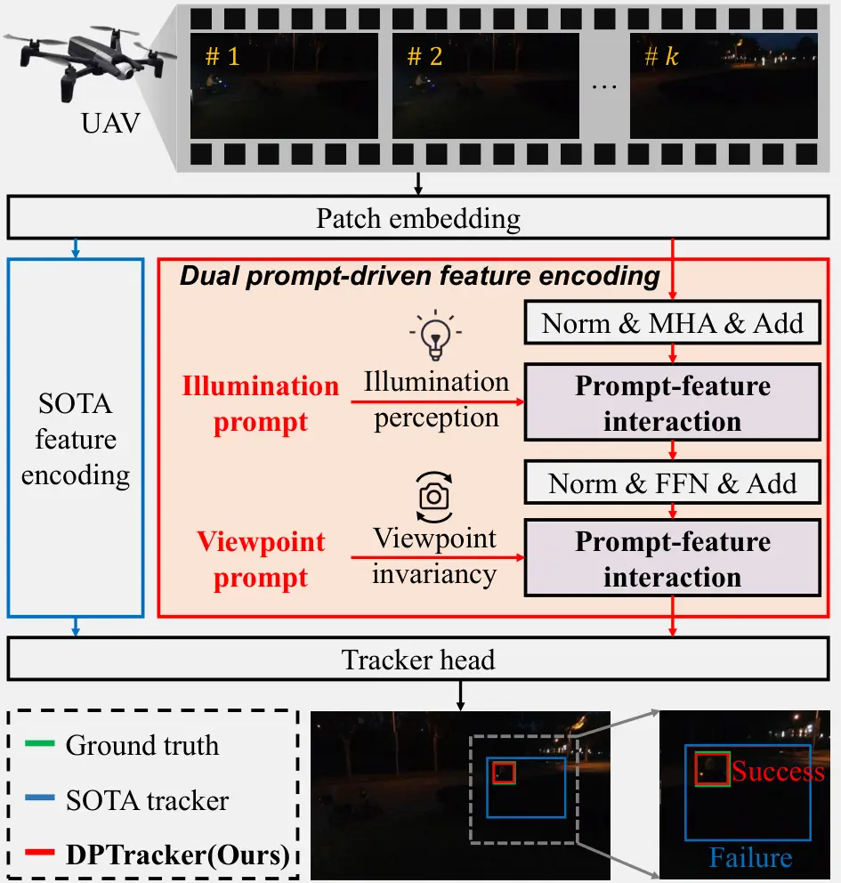
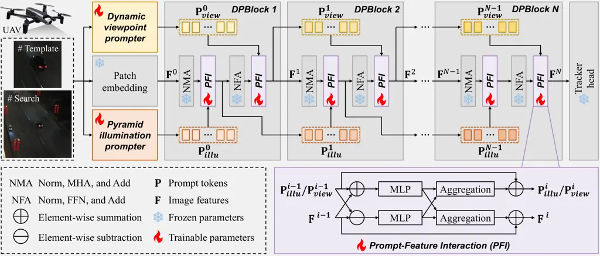
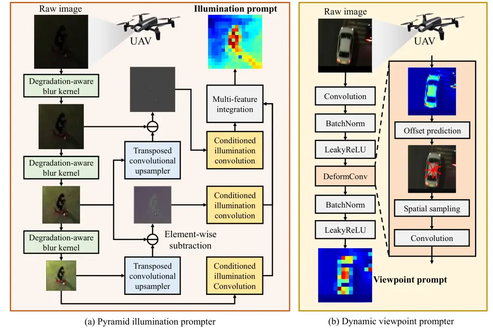
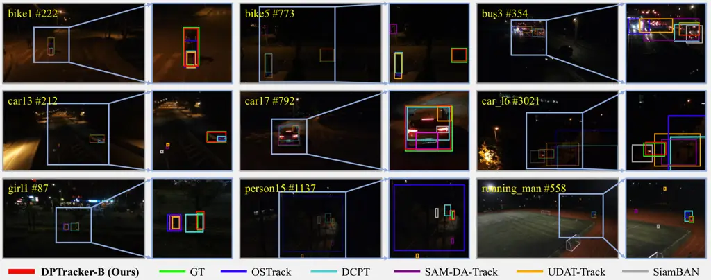
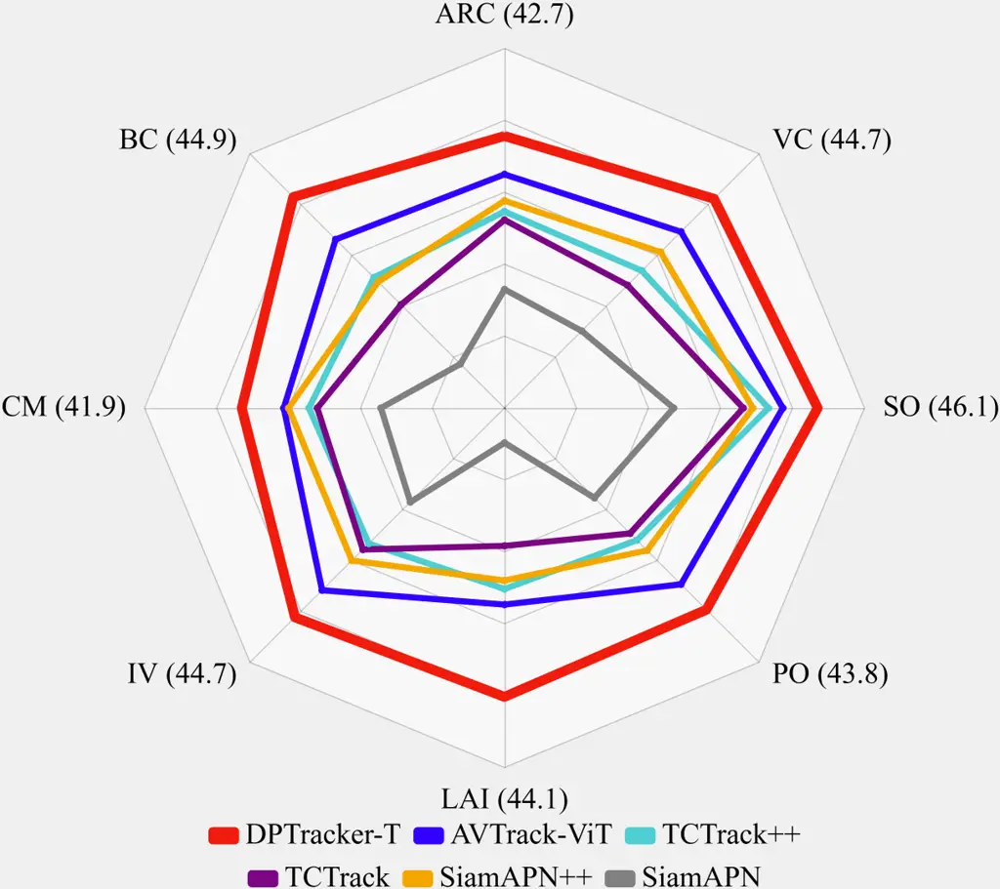
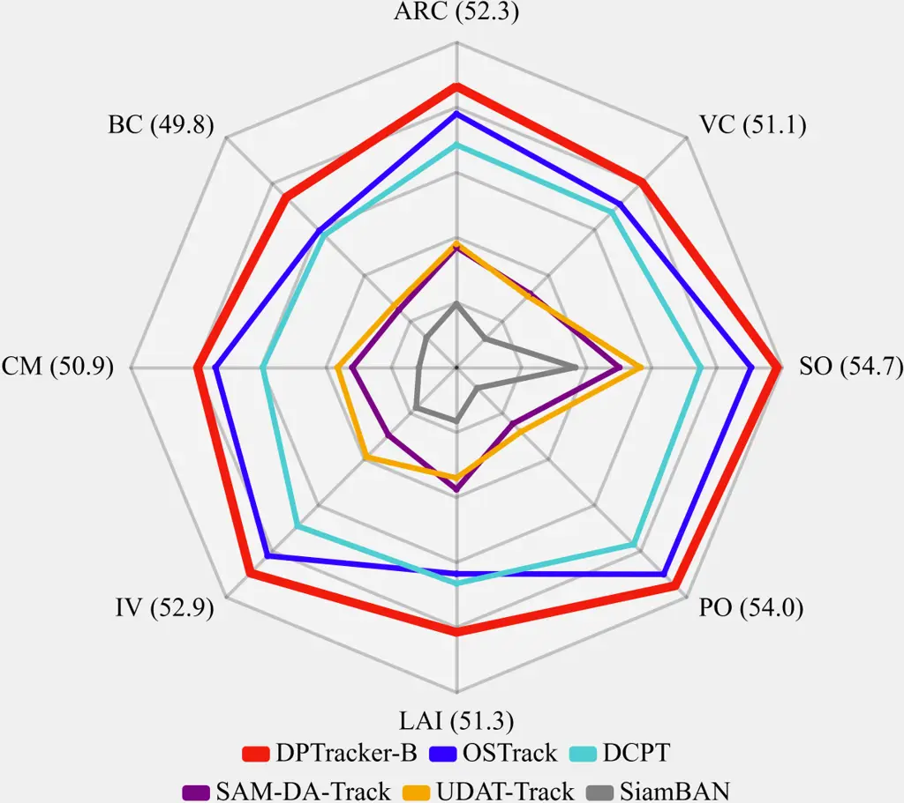
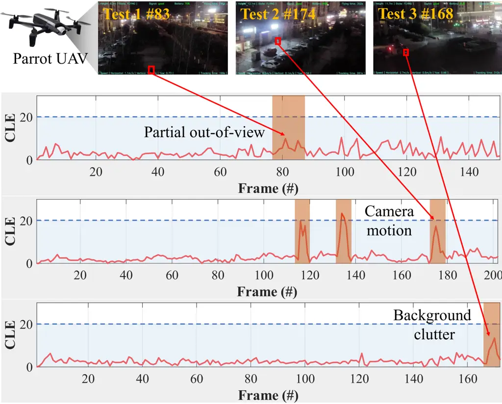

# Dual Prompt-Driven Feature Encoding for Nighttime UAV Tracking

Yiheng Wang Affiliation:  Yiheng Wang is with the Pratt School of
Engineering, Duke University, Durham 27705, United States.    Changhong
Fu Affiliation:  Changhong Fu, Liangliang Yao, and Zijie Zhang are with
the School of Mechanical Engineering, Tongji University, Shanghai
201804, China. Affiliation:  Changhong Fu is with the Shanghai Key
Laboratory of Wearable Robotics and Human Machine Interaction, Tongji
University, Shanghai 201804, China (e-mail: changhongfu@tongji.edu.cn).
   Liangliang Yao Affiliation:  Changhong Fu, Liangliang Yao, and Zijie
Zhang are with the School of Mechanical Engineering, Tongji University,
Shanghai 201804, China.    Haobo Zuo Affiliation:  Haobo Zuo is with the
School of Computing and Data Science, The University of Hong Kong, Hong
Kong, 999077, China.    Zijie Zhang ^(†)^(†)thanks: \* Corresponding
author. Affiliation:  Changhong Fu, Liangliang Yao, and Zijie Zhang are
with the School of Mechanical Engineering, Tongji University, Shanghai
201804, China.

###### Abstract

Robust feature encoding constitutes the foundation of UAV tracking by
enabling the nuanced perception of target appearance and motion, thereby
playing a pivotal role in ensuring reliable tracking. However, existing
feature encoding methods often overlook critical illumination and
viewpoint cues, which are essential for robust perception under
challenging nighttime conditions, leading to degraded tracking
performance. To overcome the above limitation, this work proposes a dual
prompt-driven feature encoding method that integrates prompt-conditioned
feature adaptation and context-aware prompt evolution to promote
domain-invariant feature encoding. Specifically, the pyramid
illumination prompter is proposed to extract multi-scale frequency-aware
illumination prompts. The dynamic viewpoint prompter modulates
deformable convolution offsets to accommodate viewpoint variations,
enabling the tracker to learn view-invariant features. Extensive
experiments validate the effectiveness of the proposed dual
prompt-driven tracker (DPTracker) in tackling nighttime UAV tracking.
Ablation studies highlight the contribution of each component in
DPTracker. Real-world tests under diverse nighttime UAV tracking
scenarios further demonstrate the robustness and practical utility. The
code and demo videos are available at
[https://github.com/yiheng-wang-duke/DPTracker](https://github.com/yiheng-wang-duke/DPTracker).

## I Introduction

Unmanned aerial vehicle (UAV) tracking has seen widespread adoption in
applications, e.g., localization and landing \[1\], traffic
surveillance \[2\], and autonomous navigation \[3\]. With the
advancement of deep neural networks and the availability of large-scale
annotated datasets, UAV tracking has achieved remarkable performance
gains. A key component contributing to these advances is strong feature
encoding ability of deeper models, which enables the construction of
discriminative representations by capturing both appearance and motion
cues, thereby forming the basis for accurate target localization and
trajectory estimation. However, when applied to nighttime scenarios, UAV
tracking remains highly challenging due to severe illumination
degradation and low contrast in low-light imagery, as well as the UAV
platform’s unique aerial viewpoints. The limited consideration of
illumination and viewpoint cues in feature encoding of state-of-the-art
(SOTA) trackers undermines reliable feature extraction, leading to poor
performance in nighttime UAV tracking scenarios \[4, 5\]. Addressing the
feature encoding insufficiency is critical for enabling reliable and
extensive UAV applications.



Fig. 1: The overall comparison between the SOTA method and the proposed
DPTracker. With prompt-feature interaction, DPTracker learns adaptive
features and outperforms SOTA trackers in nighttime UAV tracking.

Building on recent advances in deep learning, many SOTA trackers adopt
Vision Transformer \[6\] (ViT) architectures due to the strong
capability in modeling global dependencies and spatial relations. A
typical ViT-based tracking paradigm follows a three-stage pipeline:
patch embedding, feature encoding, and prediction head. Specifically,
the input image is first divided into non-overlapping patches, which are
then linearly projected into patch embeddings. The embeddings are
processed by a stack of ViT blocks to extract high-level features.
Finally, a tracker head decodes these features to predict the target’s
location and bounding box. However, the SOTA trackers are not
sufficiently effective for nighttime UAV tracking because their feature
encoding lacks robustness to domain-specific challenges \[4\]. Under
low-light conditions and dynamically varying aerial viewpoints, the
encoded visual tokens often suffer from degraded quality, misaligned
positional cues, and distorted semantic consistency, which collectively
lead to biased query–key relationships and unreliable attention
formation. Therefore, it is essential to incorporate illumination and
viewpoint information into the feature encoding stage to ensure reliable
representations for robust nighttime UAV tracking.  
To address the problem, this work proposes the dual prompt-driven
feature encoding block (DPBlock) to integrate illumination and viewpoint
prompt semantics into the feature encoding of the ViT backbone. DPBlock
establishes prompt-conditioned guidance, where the generated prompt
tokens modulate features, enabling the model to attend to critical
visual cues under degraded conditions. The prompt-driven feature
encoding enhances the model’s capacity to adapt representation to
low-light environments and dynamic aerial viewpoints, thereby improving
robustness in nighttime UAV tracking scenarios. In parallel,
intermediate representations are leveraged to refine the prompt tokens
through feedback connections, enabling the prompt tokens to dynamically
adjust based on the evolving feature context and better inform
subsequent conditioning.  
This work further designs prompters to learn prompt tokens that capture
illumination information and encode the dynamic aerial viewpoint
characteristics, as shown in Fig. 1. The pyramid illumination prompter,
inspired by the Laplacian pyramid \[7\], is designed to hierarchically
extract multi-scale illumination features from the input image. By
approximating the Laplacian decomposition structure, the prompter
captures frequency-aware features, which are then aggregated into
illumination prompt tokens that effectively represent the illumination
conditions. In addition, a dynamic viewpoint prompter is developed to
extract viewpoint information for prompt-driven feature encoding. This
module leverages deformable convolution to learn adaptive offsets for
feature sampling, enabling the viewpoint prompt tokens to perceive
geometric variations arising from dynamic UAV viewpoints, thereby
enhancing tracker adaptation to diverse aerial viewpoints and camera
poses. The contributions of this paper are summarized as:

- •
  An innovative dual prompt-driven feature encoding method is proposed,
  which integrates the prompt-feature interaction mechanism into the ViT
  backbone, enabling explicit bidirectional adaptation between prompt
  tokens and visual features for illumination-aware and
  viewpoint-invariant representation learning.
- •
  A novel pyramid illumination prompter is designed to approximate the
  Laplacian pyramid, hierarchically generate multi-scale illumination
  features, and further aggregate them into the illumination prompt
  tokens.
- •
  A dynamic viewpoint prompter is proposed to generate viewpoint prompt
  tokens, utilizing deformable convolution to adapt spatial sampling to
  different viewpoints.
- •
  Extensive experiments on nighttime UAV tracking benchmarks demonstrate
  the effectiveness of DPTracker, while real-world tests further
  validate its applicability and superior performance in practical
  scenarios.

## II Related Work

### II-A Nighttime UAV Tracking

Recent nighttime UAV tracking research is categorized into four
paradigms: low-light image enhancement, domain adaptation, training from
scratch, and prompt tuning. Low-light enhancement approaches \[8\]
employ plug-and-play modules to brighten images before tracking. While
boosting visual quality, such preprocessing is loosely coupled with
feature encoding and often yields suboptimal representations for
tracking. Domain adaptation methods aim to bridge the distribution gap
between daytime and nighttime images in an unsupervised manner.
UDAT \[4\] pioneers this approach by employing adversarial training to
learn domain-invariant features. SAM-DA \[9\] improves sample quality
through SAM-based swelling. TDA \[10\] incorporates temporal context
adaptation into the domain adaptation framework. However, without
explicitly modeling illumination and viewpoint cues, unsupervised domain
adaptation methods often suffer from training instability and limited
robustness. Training-from-scratch methods directly train models using
nighttime object detection annotations. DARTer \[11\] exploits
multi-perspective features and dynamic feature activators to achieve
better tracking performance, while MambaNUT \[12\] employs Vision Mamba
architectures with tailored data sampling and loss scheduler.
Nevertheless, training-from-scratch approaches are time-consuming and
prone to overfitting due to limited nighttime training data, making the
learned feature encoding less generalizable. Prompt tuning offers a
training-efficient and well-performing alternative solution by injecting
task-related priors into the feature encoding. However, the feature
encoding of existing prompt-based trackers insufficiently incorporates
illumination and viewpoint information, which in turn restricts their
robustness under challenging nighttime UAV tracking conditions.

### II-B Prompt Tuning for Tracking

Prompt tuning methods have emerged as an effective paradigm for adapting
frozen pre-trained foundation models to various tracking scenarios with
minimal parameter overhead. ViPT \[13\] and OneTracker \[14\] introduce
modality-relevant visual prompts to bridge the domain gap in multi-modal
tracking. UM-ODTrack \[15\] further incorporates dense temporal token
association and gated modules for adaptive cross-modal representation
learning. MM-Track \[16\] enhances the robustness of multi-modal
representations by adaptively transferring discriminative cues while
maintaining temporal consistency. MPT \[17\] proposes a lightweight
motion prompt module that encodes long-term trajectory information into
the visual embedding space. DCPT \[18\] pioneers the prompt tuning
techniques in nighttime UAV tracking. It introduces a darkness clue
prompter that injects anti-dark knowledge into a frozen daytime tracker.
However, these prompt tuning methods for visual tracking fail to
consider both illumination conditions and dynamic aerial viewpoint in
feature encoding, resulting in insufficient feature representations for
nighttime UAV tracking. Therefore, developing prompters to extract rich
illumination and viewpoint semantics is necessary to advance prompt
tuning-based nighttime UAV tracking.



Fig. 2: Overall model architecture of DPTracker. The interaction between
prompt tokens and features integrates prompt semantics into the features
while updating the prompt tokens, thereby enhancing nighttime UAV
tracking with more adaptive representations. The images are from
NAT2021-test \[4\].

## III Methodology

In this section, the proposed method is clearly illustrated.
Section III-A introduces the dual prompt-driven feature encoding module,
which enables prompt-conditioned feature adaptation and context-aware
prompt evolution. Section III-B presents the pyramid illumination
prompter, which extracts multi-scale, frequency-aware illumination
prompt tokens. Section III-C describes the dynamic viewpoint prompter,
which adaptively deforms convolutional kernels to capture viewpoint
prompt tokens from UAV-view images.

### III-A Dual Prompt-Driven Feature Encoding

To empower feature encoding with illumination and viewpoint cues, this
work proposes the dual prompt-driven feature encoding module (DPBlock).
As shown in Fig. 2, DPBlock integrates two prompt-feature interaction
(PFI) modules within the ViT structure. The first PFI module is
integrated after the self-attention sub-layer of ViT to disambiguate
target features from low-contrast backgrounds. By injecting
illumination-aware semantics, it compensates for MHA’s tendency to
produce indistinguishable responses in poorly-lit environments. The
second PFI module follows the feed-forward sub-layer to cultivate
viewpoint-invariant representations. While FFN deepens per-token
semantics, the PFI module rectifies the severe geometric distortions
inherent in UAV tracking with dynamic viewpoints. Specifically, PFI is
composed of two complementary methods, i.e., prompt-conditioned feature
adaptation and context-aware prompt evolution. Prompt-conditioned
feature adaptation integrates semantic cues from the prompt tokens into
the feature representations. Context-aware prompt evolution updates the
prompt tokens with the latest feature context, enabling them to convey
more precise guidance for feature adaptation.  
The prompt-conditioned feature adaptation incorporates element-wise
summation and subtraction to characterize the interplay between the
prompt tokens $`\mathbf{P}_{k}^{i}\in\mathbb{R}^{N\times d}`$ and the
features $`\mathbf{F}^{i}\in\mathbb{R}^{N\times d}`$, where $`i`$
denotes the index of the DPBlock and $`k\in\{illu,view\}`$ indicates the
type of prompt tokens. Specifically, the summation operation reinforces
shared feature manifolds to model the similarity between the prompt and
the latent representation, while the subtraction isolates residual,
distinctive components to capture the discrepancies between them. Then,
the multi-layer perceptron modules are applied to enhance and exaggerate
the encoded semantic similarity and difference. The process is
formulated as:

```math
\displaystyle\mathbf{E}_{sim}^{i} \displaystyle=LN(MLP(\mathbf{F}^{i-1}+\mathbf{P}^{i-1}_{k}))~, \tag{1}
```

```math
\displaystyle\mathbf{E}^{i}_{dif} \displaystyle=LN(MLP(\mathbf{F}^{i-1}-\mathbf{P}^{i-1}_{k}))~, \tag{2}
```

where $`\mathbf{E}_{sim}^{i}`$ and $`\mathbf{E}_{dif}^{i}`$ denote the
similarity-aware features and the difference-aware features in the
$`i`$-index DPBlock, $`MLP`$ function as the multi-layer perceptron
module, and $`LN`$ denotes layer normalization.  
The prompt-conditioned feature adaptation further incorporates the
similarity cues and suppresses difference cues, ensuring that the
feature representations emphasize semantic alignment with the prompt
tokens. The adaptation utilizes a simple weighted aggregation strategy,
formulated as:

```math
\displaystyle\mathbf{F}^{i} \displaystyle=\mathbf{F}^{i-1}+\alpha_{f}\cdot\mathbf{E}_{sim}^{i}-\beta_{f}\cdot\mathbf{E}_{dif}^{i}~, \tag{3}
```

where $`\alpha_{f}`$ and $`\beta_{f}`$ are learnable coefficients that
determine the contribution of each component in the feature
adaptation.  
The context-aware prompt evolution leverages a similar but asymmetric
weighted aggregation method. It attenuates similarity cues and enhances
difference cues, enabling the prompt tokens to dynamically adapt to the
latest feature context and provide more effective guidance for
subsequent feature adaptation. The process is formulated as:

```math
\displaystyle\mathbf{P}^{i} \displaystyle=\mathbf{P}^{i-1}-\alpha_{p}\cdot\mathbf{E}_{sim}^{i}+\beta_{p}\cdot\mathbf{E}_{dif}^{i}~, \tag{4}
```

where $`\alpha_{p}`$ and $`\beta_{p}`$ are learnable coefficients.  
Remark 1: Dual prompt-driven feature encoding method achieves a dynamic
interplay where features absorb semantic guidance from prompt tokens,
while prompt tokens evolve based on the latest feature context to
provide more precise adaptation guidance.



Fig. 3: The architecture of the pyramid illumination prompter and the
dynamic viewpoint prompter. The illumination prompter leverages a
learnable pyramid network to decompose images and aggregate multi-scale
features, while the dynamic viewpoint prompter combines standard and
deformable convolutions to adaptively capture viewpoint information
under UAV perspectives. The images are from DarkTrack2021 \[8\].

### III-B Pyramid Illumination Prompter

To learn nighttime adaptive features, the pyramid illumination prompter
(PIP) is proposed to comprehensively encode the lighting conditions into
the illumination prompt tokens. Previous research \[19\] has
demonstrated that the low-frequency levels of the Laplacian pyramid
encode substantial illumination and contrast-related information, while
the mid-frequency and high-frequency levels of the Laplacian pyramid
focus on structural information. Therefore, the Laplacian pyramid is
particularly well-suited for learning the illumination prompt. Building
upon this insight, the PIP is designed with a hierarchical architecture
to approximate the Laplacian pyramid structure, as shown in Fig. 3. The
traditional non-learnable operators for constructing the Laplacian
pyramid are replaced by learnable convolutional components to improve
the prompt learning capabilities.  
Given a raw image $`\mathbf{I}`$, the PIP employs degradation-aware blur
kernels whose weights are initialized to approximate Gaussian blur
kernels, which preserves the hand-crafted prior knowledge and allows the
model to adaptively refine features. The PIP constructs a multi-scale
feature hierarchy inspired by the Gaussian pyramid, formulated as:

```math
\mathbf{G}_{0}=\mathbf{I}~,\quad\mathbf{G}_{i+1}=DBK(\mathbf{G}_{i})~, \tag{5}
```

where $`DBK(\cdot)`$ denotes the learnable degradation-aware blur kernel
at level $`i`$, and $`\mathbf{G}_{i}`$ denotes the blurred image.  
Traditional upsampling operations are replaced with transposed
convolutional upsamplers, which allow the model to learn richer and more
informative representations of illumination at each scale. Residual
connections are introduced by subtracting the upsampled lower-frequency
features from the corresponding higher-frequency features, approximating
the Laplacian response at each scale. The whole process is formulated
as:

```math
\mathbf{L}_{i}=\mathbf{G}_{i}-UP_{i}(\mathbf{G}_{i+1})~, \tag{6}
```

where $`UP_{i}(\cdot)`$ denotes the transposed convolutional upsampler
at level $`i`$ and $`\mathbf{L}_{i}`$ denotes the corresponding
Laplacian component at level $`i`$.  
The conditioned illumination convolutional layers are applied to each
Laplacian component, and the final illumination prompt
$`\mathbf{P}_{illu}`$ is generated by concatenating the responses from
all levels along the channel dimension:

```math
\mathbf{P}_{illu}^{0}=\mathrm{Concat}(Conv_{0}(\mathbf{L}_{0}),\ldots,Conv_{n}(\mathbf{L}_{n}))~, \tag{7}
```

where $`\mathrm{Concat(\cdot)}`$ denotes the channel-wise concatenation
and $`n`$ is the total number of scales.  
Remark 2: By emulating the Laplacian pyramid in a learnable and
differentiable manner, the PIP effectively captures multi-scale
illumination information. The illumination prompt tokens are essential
for adapting representations to various illumination conditions in
nighttime UAV tracking scenarios.

### III-C Dynamic Viewpoint Prompter

Nighttime UAV tracking suffers from significant geometric and semantic
variations due to the inherently dynamic nature of aerial viewpoints. To
address this issue, a viewpoint prompter capable of dynamically
capturing geometric information is introduced, thereby facilitating
feature adaptation to the dynamic viewpoints of nighttime UAV
tracking.  
As shown in Fig. 3, the dynamic viewpoint prompter (DVP) is designed to
learn viewpoint prompt tokens through a coarse-to-fine prompt generation
strategy. Initially, DVP employs a standard convolutional layer to
extract local features from small image patches, capturing spatial
structures that serve as coarse viewpoint prompt tokens of the scene.
Given an input image I, the coarse viewpoint prompt tokens are computed
as:

```math
\textbf{P}_{view}^{c}=LR(BN(Conv(\textbf{I})))~, \tag{8}
```

where $`\textbf{P}_{view}^{c}`$ denotes the coarse viewpoint prompt
tokens, $`BN`$ represents the batch normalization, and $`LR`$ denotes
the LeakyReLU activation function.  
DVP subsequently applies a deformable convolutional layer to further
enhance finer viewpoint adaptivity. Unlike standard convolutions with
fixed grid-based sampling, deformable convolutions introduce learnable
spatial offsets, enabling each kernel position to adaptively sample from
geometrically relevant regions. The offset field
$`\Delta P\in\mathbb{R}^{2K\times H\times W}`$, where $`K`$ is the
number of sampling points, is predicted from the coarse viewpoint prompt
tokens $`\textbf{P}_{view}^{c}`$ by an offset generation module, which
is formulated as:

```math
\displaystyle\Delta P \displaystyle=OffConv(\textbf{P}_{view}^{c})~, \tag{9}
```

```math
\displaystyle\Delta P \displaystyle=\{\Delta p_{1},\Delta p_{2},\dots,\Delta p_{K}\}~, \tag{10}
```

where $`\Delta P`$ is the predicted offset and $`OffConv`$ is the offset
convolutional layer. Each $`\Delta p_{i}\in\mathbb{R}^{2}`$ denotes the
offset for the $`i`$-th sampling position.  
The deformable convolution at position $`p_{0}`$ is computed as:

```math
\textbf{R}(p_{0})=\sum_{k=1}^{K}w_{k}\cdot\textbf{P}_{view}^{c}\big(p_{0}+p_{k}+\Delta p_{k}\big)~, \tag{11}
```

where $`p_{0}`$ is the reference spatial location on the feature map,
$`p_{k}`$ denotes the predefined sampling location in the regular
convolution kernel, $`w_{k}`$ denotes the learnable kernel weight for
the $`k`$-th sampling location, and $`\textbf{R}(p_{0})`$ is the output
feature at location $`p_{0}`$.  
DVP further applies batch normalization and LeakyReLU activation to
generate the final fine-grained viewpoint prompt tokens, which is
formulated as:

```math
\textbf{P}_{view}^{0}=LR(BN(\textbf{R}))~, \tag{12}
```

where $`\textbf{P}_{view}^{0}`$ denotes the viewpoint prompt tokens.  
Remark 3: DVP produces viewpoint prompt tokens that encapsulate rich
geometric and semantic cues through coarse-to-fine refinement. The
viewpoint prompt tokens provide vital adaptive guidance for feature
learning under challenging nighttime UAV viewpoints.



Fig. 4: Tracking result visualization of DPTracker-B along with other
top trackers \[20, 18, 9, 4, 21\]. The sequences are selected from
UAVDark135 \[22\]. The proposed DPTracker-B shows more robust and
precise tracking performance under diverse nighttime UAV tracking
scenarios.

Method Source UAV UAVDark135 \[22\] DarkTrack2021 \[8\]
NAT2021-test \[4\] Params Prec. Norm.Prec. Succ. Prec. Norm.Prec. Succ.
Prec. Norm.Prec. Succ. (M) SiamAPN \[23\] ICRA 21 ✓ 42.4 39.5 30.1 41.9
37.9 30.7 55.8 41.8 33.7 15.2 SiamAPN++ \[24\] IROS 21 ✓ 42.3 39.1 32.5
48.3 43.5 36.5 60.8 48.4 40.8 15.4 TCTrack \[25\] CVPR 22 ✓ 48.8 45.4
36.2 53.5 46.8 39.3 61.2 46.8 39.4 10.4 TCTrack++ \[26\] TPAMI 23 ✓ 47.7
44.5 37.0 56.4 48.8 42.1 61.7 48.1 40.8 15.2 AVTrack-ViT \[5\] ICML 24 ✗
56.1 51.0 44.8 56.1 49.4 44.4 61.7 50.6 44.3 20.9 DPTracker-T Ours ✓
56.8 51.8 45.6 59.1 51.9 46.5 65.4 53.8 47.5 21.6 SiamBAN \[21\] CVPR 20
✗ 62.1 55.3 47.5 56.9 50.3 43.1 64.7 50.9 43.7 53.9 SiamRPN++-RBO \[27\]
CVPR 22 ✗ 63.3 57.6 49.5 58.5 52.9 45.2 68.2 54.8 46.9 54.0
UDAT-BAN \[4\] CVPR 22 ✓ 63.3 56.6 47.9 56.4 50.0 42.1 69.4 54.6 46.9
55.1 OSTrack \[20\] ECCV 22 ✗ 67.8 61.6 55.0 66.0 58.9 52.9 72.2 60.9
53.9 92.1 SAM-DA \[9\] ICARM 23 ✓ 62.3 56.2 47.9 59.2 52.9 45.4 67.0
53.6 46.0 53.9 SmallTrack \[28\] TGRS 23 ✗ 65.6 52.3 44.9 56.0 49.7 42.5
65.6 52.3 44.9 53.9 DCPT \[18\] ICRA 24 ✓ 70.3 63.9 57.1 67.1 59.9 53.7
69.4 58.4 52.0 92.9 DPTracker-B Ours ✓ 72.3 65.2 58.1 69.8 62.2 55.8
73.9 62.5 55.9 94.0

TABLE I: Comparison of tracking performance on UAVDark135 \[22\],
DarkTrack2021 \[8\], and NAT2021-test \[4\] benchmarks. The proposed
DPTracker-B and DPTracker-T outperform other trackers by notable
margins.




Fig. 5: Attribute-based tracking performance evaluation. As shown in the
left figure, DPTracker-T consistently achieves the best performance
across all 8 attributes on NAT2021-test\[4\], outperforming 5 other
lightweight trackers\[23, 24, 25, 26, 5\]. In the right figure,
DPTracker-B also demonstrates substantial performance improvements
compared to other well-performing trackers \[21, 4, 9, 18, 20\].

## IV Experiments

### IV-A Implementation Details

The models developed upon existing SOTA general object tracking models
AVTrack \[5\] and OSTrack \[20\] baselines are denoted as DPTracker-T
and DPTracker-B, respectively. A mixture of daytime and nighttime object
tracking data are used for training. The daytime training data include
GOT-10K \[29\], LASOT \[30\], COCO \[31\], and TrackingNet \[32\], while
the nighttime training datasets include ExDark \[33\], Shift \[34\], and
BDD100K \[35\]. The models are trained with classification and
regression losses for 30 epochs using the AdamW \[36\] optimizer on 2
NVIDIA A100 GPUs. The initial learning rate is set to 0.0004, which
decays at a rate of 10% at 24 epochs.

### IV-B Overall Performance Evaluation

As shown in Table I, experiments are conducted to comprehensively
evaluate the proposed method against SOTA trackers on three
benchmarks \[22, 8, 4\]. The bounding box in the first frame of each
sequence is provided.  
UAVDark135 \[22\] is a widely recognized benchmark designed for
evaluating object tracking performance in low-light UAV scenarios,
comprising 135 video sequences. Compared with SOTA trackers of similar
model size, DPTracker-T achieves the best overall performance across all
three metrics, with precision of 56.8%, normalized precision of 51.8%,
and success rate of 45.6%, surpassing other SOTA lightweight tracking
methods. As tracker size increases, DPTracker-B establishes new
state-of-the-art results with precision of 72.3%, normalized precision
of 65.2%, and success of 58.1%. Compared to the SOTA method \[18\],
DPTracker-B improves by +2.0%, +1.3%, and +1.0% in three metrics
respectively, demonstrating notable gains in both robustness and
accuracy. As shown in Fig. 4, the visualization results indicate the
superior capability of DPTracker-B in nighttime UAV tracking.

DarkTrack2021 \[8\] is an authoritative dataset comprising 110
sequences, widely adopted for evaluating UAV tracking under nighttime
conditions. Compared with trackers of similar size, DPTracker-T achieves
superior performance across all three evaluation metrics, reaching 59.1%
precision, 51.9% normalized precision, and 46.5% success rate, exceeding
all competing tracking methods. When scaling to larger trackers,
DPTracker-B outperforms other models with precision 69.8%, normalized
precision 62.2%, and success rate 55.8%. Compared to the SOTA
tracker \[18\], DPTracker-B achieves a relative improvement of +2.7%,
+2.3%, and +2.1% across the three metrics, underscoring its robustness
and strong adaptability in nighttime UAV tracking.

NAT2021-test \[4\] is a large-scale benchmark containing 180 video
sequences. When evaluated against trackers of similar scale, DPTracker-T
achieves new state-of-the-art performance with precision of 65.4%,
normalized precision of 53.8%, and success rate of 47.5%. As the
trackers scale up, DPTracker-B performs the best among all trackers with
precision 73.9%, normalized precision 62.5%, and success rate 55.9%.
These consistent improvements confirm the effectiveness of the proposed
method in nighttime UAV tracking across various challenging scenarios.

### IV-C Attribute-Based Evaluation

To further investigate tracking robustness under diverse nighttime UAV
tracking challenges, a further attribute-based evaluation, as shown in
Fig. 5, is conducted across eight key factors: aspect ratio change
(ARC), background clutter (BC), camera motion (CM), illumination
variation (IV), low ambient intensity (LAI), partial occlusion (PO),
similar object (SO), and viewpoint change (VC). DPTracker-T achieves the
most robust performance among trackers with similar model scales,
excelling under low ambient intensity 44.1% and illumination variation
44.7%. DPTracker-B also demonstrates remarkable superiority under
illumination-related challenges, achieving the highest success rates in
scenarios with low ambient intensity 51.3% and illumination variation
52.9%. Beyond illumination robustness, DPTracker also consistently
outperforms other trackers across the remaining attributes with notable
advantages. These results validate the effectiveness of the proposed
approach in handling challenges in nighttime UAV tracking scenarios.

### IV-D Ablation Study

To investigate the effectiveness of each component, ablation experiments
are conducted on PFI, PIP, and DVP using two evaluation metrics:
precision and success rate, as shown in Table II. To validate the PFI
module in the prompt-driven feature encoding, the prompters are replaced
with the patch embedding modules. Using PFI brings noticeable relative
gains of +5.3% and +4.5% in the two metrics, demonstrating that PFI can
effectively enhance the feature encoding for nighttime UAV tracking. PIP
and DVP provide granular refinements to further calibrate and polish the
learned representations. Utilizing PIP further achieves a performance of
71.9% and 57.8% on the two metrics, highlighting its ability to provide
multi-scale frequency-aware illumination prompts. Moreover,
incorporating DVP yields a performance of 72.3% and 58.1% on the two
metrics, demonstrating enhanced robustness by enabling the model to
capture viewpoint-invariant features across aerial perspectives. These
results verify that PFI, PIP, and DVP jointly contribute to robust
nighttime UAV tracking.

PFI PIP DVP Prec.(%) $`\Delta`$ (%) Succ.(%) $`\Delta`$ (%) ✗ ✗ ✗ 67.8 -
55.0 - ✓ ✗ ✗ 71.4 +5.3 57.5 +4.5 ✓ ✓ ✗ 71.9 +6.0 57.8 +5.1 ✓ ✓ ✓ 72.3
+6.6 58.1 +5.6

TABLE II: Ablation study of the PFI, PIP, and DVP. The performance on
UAVDark135 verifies the contribution of each component.



Fig. 6: Real-world UAV tracking tests under nighttime conditions.
Regions in blue, where the CLE is less than 20, are regarded as
successful tracking cases, while the orange regions represent
challenging tracking conditions.

### IV-E Real-World Tests

To assess real-world performance, a workstation equipped with an NVIDIA
RTX 3080Ti GPU serves as the ground control station (GCS). The Parrot
UAV captures images at 10 frames per second and transmits them to the
GCS via WiFi. Upon manual initialization of the target bounding box in
the initial frame, the tracker maintains a real-time inference speed of
54 FPS, facilitating continuous target localization and transmitting
target positions back to the UAV. As presented in Fig. 6, tracking
performance is evaluated using the center location error (CLE), where
values below 20 are regarded as successful localization. The proposed
DPTracker-T demonstrates reliable tracking across diverse nighttime
conditions. Test 1 is conducted under low ambient illumination, where
the partial out-of-view of the target further compounds the tracking
difficulty. Test 2 is primarily challenged by camera motion, which
introduces significant trajectory variations and appearance blur. Test 3
involves a street-crossing scene characterized by background clutter.
The proposed tracker demonstrates robust tracking performance under the
challenging nighttime scenarios.

## V Conclusions

This work proposes a dual prompt-driven feature encoding method to learn
illumination and view-adaptive representations for nighttime UAV
tracking. Prompt–feature interaction plays a central role in reinforcing
the mutual adaptation between prompts and visual features for enhanced
representation robustness. Built upon this interaction method, the
pyramid illumination prompter and dynamic viewpoint prompter further
strengthen the model’s ability to accommodate complex illumination
conditions and dynamic viewpoint changes. Comprehensive experiments and
ablation studies verify the effectiveness of these components. Future
research will extend this adaptive prompting paradigm to broader adverse
scenarios in autonomous aerial systems. In summary, this study
contributes to low-light object tracking for unmanned aerial vehicles in
adverse conditions.

## References

- \[1\] J. González-Trejo, D. Mercado-Ravell, I. Becerra, and R.
  Murrieta-Cid (2021) On the Visual-Based Safe Landing of UAVs in
  Populated Areas: A Crucial Aspect for Urban Deployment. IEEE Robotics
  and Automation Letters 6 (4), pp. 7901–7908. Cited by: §I.
- \[2\] B. Tian, Q. Yao, Y. Gu, K. Wang, and Y. Li (2011) Video
  Processing Techniques for Traffic Flow Monitoring: A Survey. In
  Proceedings of the International IEEE Conference on Intelligent
  Transportation Systems (ITSC), pp. 1103–1108. Cited by: §I.
- \[3\] X. Xiao, J. Dufek, T. Woodbury, and R. Murphy (2017) UAV
  Assisted USV Visual Navigation for Marine Mass Casualty Incident
  Response. In Proceedings of the IEEE/RSJ International Conference on
  Intelligent Robots and Systems (IROS), pp. 6105–6110. Cited by: §I.
- \[4\] J. Ye, C. Fu, G. Zheng, D. P. Paudel, and G. Chen (2022)
  Unsupervised Domain Adaptation for Nighttime Aerial Tracking. In
  Proceedings of the IEEE/CVF Conference on Computer Vision and Pattern
  Recognition (CVPR), pp. 8896–8905. Cited by: §I, §I, Fig. 2, §II-A,
  Fig. 4, Fig. 5, TABLE I, TABLE I, TABLE I, §IV-B, §IV-B.
- \[5\] Y. Li, M. Liu, Y. Wu, X. Wang, X. Yang, and S. Li (2024)
  Learning Adaptive and View-Invariant Vision Transformer for Real-Time
  UAV Tracking. In Proceedings of the International Conference on
  Machine Learning (ICML), pp. 28403–28420. Cited by: §I, Fig. 5, TABLE
  I, §IV-A.
- \[6\] A. Dosovitskiy, L. Beyer, A. Kolesnikov, D. Weissenborn, X.
  Zhai, T. Unterthiner, M. Dehghani, M. Minderer, G. Heigold, S. Gelly,
  et al. (2020) An Image is Worth 16x16 Words: Transformers for Image
  Recognition at Scale. In Proceedings of the International Conference
  on Learning Representations (ICLR), pp. 1–22. Cited by: §I.
- \[7\] P. J. Burt and E. H. Adelson (1987) The Laplacian Pyramid as A
  Compact Image Code. In Readings in Computer Vision, pp. 671–679. Cited
  by: §I.
- \[8\] J. Ye, C. Fu, Z. Cao, S. An, G. Zheng, and B. Li (2022) Tracker
  Meets Night: A Transformer Enhancer for UAV Tracking. IEEE Robotics
  and Automation Letters 7 (2), pp. 3866–3873. Cited by: §II-A, Fig. 3,
  TABLE I, TABLE I, §IV-B, §IV-B.
- \[9\] C. Fu, L. Yao, H. Zuo, G. Zheng, and J. Pan (2024) SAM-DA: UAV
  Tracks Anything at Night with Sam-Powered Domain Adaptation. In
  Proceedings of the International Conference on Advanced Robotics and
  Mechatronics (ICARM), pp. 31–38. Cited by: §II-A, Fig. 4, Fig. 5,
  TABLE I.
- \[10\] C. Fu, Y. Wang, L. Yao, G. Zheng, H. Zuo, and J. Pan (2024)
  Prompt-Driven Temporal Domain Adaptation for Nighttime UAV Tracking.
  In Proceedings of the IEEE/RSJ International Conference on Intelligent
  Robots and Systems (IROS), pp. 9706–9713. Cited by: §II-A.
- \[11\] X. Li, X. Li, and S. Hu (2025) DARTer: Dynamic Adaptive
  Representation Tracker for Nighttime UAV Tracking. In Proceedings of
  the International Conference on Multimedia Retrieval (ICMR),
  pp. 1998–2002. Cited by: §II-A.
- \[12\] Y. Wu, X. Yang, X. Wang, H. Ye, D. Zeng, and S. Li (2024)
  MambaNUT: Nighttime UAV Tracking via Mamba and Adaptive Curriculum
  Learning. arXiv e-prints:2412.00626, pp. 1–8. Cited by: §II-A.
- \[13\] J. Zhu, S. Lai, X. Chen, D. Wang, and H. Lu (2023) Visual
  Prompt Multi-Modal Tracking. In Proceedings of the IEEE/CVF Conference
  on Computer Vision and Pattern Recognition (CVPR), pp. 9516–9526.
  Cited by: §II-B.
- \[14\] L. Hong, S. Yan, R. Zhang, W. Li, X. Zhou, P. Guo, K. Jiang, Y.
  Chen, J. Li, Z. Chen, et al. (2024) OneTracker: Unifying Visual Object
  Tracking with Foundation Models and Efficient Tuning. In Proceedings
  of the IEEE/CVF Conference on Computer Vision and Pattern Recognition
  (CVPR), pp. 19079–19091. Cited by: §II-B.
- \[15\] Y. Zheng, B. Zhong, Q. Liang, S. Zhang, G. Li, X. Li, and R.
  Ji (2025) Towards Universal Modal Tracking with Online Dense Temporal
  Token Learning. IEEE Transactions on Pattern Analysis and Machine
  Intelligence, pp. 1–18. Cited by: §II-B.
- \[16\] B. Xu, R. Hou, T. Ren, and G. Wu (2025) Visual and Memory Dual
  Adapter for Multi-Modal Object Tracking. arXiv preprint
  arXiv:2506.23972, pp. 1–12. Cited by: §II-B.
- \[17\] J. Zhao, X. Chen, Y. Yuan, M. Felsberg, D. Wang, and H.
  Lu (2025) Efficient Motion Prompt Learning for Robust Visual Tracking.
  arXiv preprint arXiv:2505.16321, pp. 1–18. Cited by: §II-B.
- \[18\] J. Zhu, H. Tang, Z. Cheng, J. He, B. Luo, S. Qiu, S. Li, and H.
  Lu (2024) DCPT: Darkness Clue-Prompted Tracking in Nighttime UAVs. In
  Proceedings of the IEEE International Conference on Robotics and
  Automation (ICRA), pp. 7381–7388. Cited by: §II-B, Fig. 4, Fig. 5,
  TABLE I, §IV-B, §IV-B.
- \[19\] M. Afifi, K. G. Derpanis, B. Ommer, and M. S. Brown (2021)
  Learning Multi-Scale Photo Exposure Correction. In Proceedings of the
  IEEE/CVF conference on Computer Vision and Pattern Recognition (CVPR),
  pp. 9157–9167. Cited by: §III-B.
- \[20\] B. Ye, H. Chang, B. Ma, S. Shan, and X. Chen (2022) Joint
  Feature Learning and Relation Modeling for Tracking: A One-Stream
  Framework. In Proceedings of the European Conference on Computer
  Vision (ECCV), pp. 341–357. Cited by: Fig. 4, Fig. 5, TABLE I, §IV-A.
- \[21\] Z. Chen, B. Zhong, G. Li, S. Zhang, R. Ji, Z. Tang, and X.
  Li (2022) SiamBAN: Target-Aware Tracking with Siamese Box Adaptive
  Network. IEEE Transactions on Pattern Analysis and Machine
  Intelligence 45 (4), pp. 5158–5173. Cited by: Fig. 4, Fig. 5, TABLE I.
- \[22\] B. Li, C. Fu, F. Ding, J. Ye, and F. Lin (2022) All-Day Object
  Tracking for Unmanned Aerial Vehicle. IEEE Transactions on Mobile
  Computing 22 (8), pp. 4515–4529. Cited by: Fig. 4, TABLE I, TABLE I,
  §IV-B.
- \[23\] C. Fu, Z. Cao, Y. Li, J. Ye, and C. Feng (2021) Siamese Anchor
  Proposal Network for High-Speed Aerial Tracking. In Proceedings of the
  IEEE International Conference on Robotics and Automation (ICRA),
  pp. 510–516. Cited by: Fig. 5, TABLE I.
- \[24\] Z. Cao, C. Fu, J. Ye, B. Li, and Y. Li (2021) SiamAPN++:
  Siamese Attentional Aggregation Network for Real-Time UAV Tracking. In
  Proceedings of the IEEE/RSJ International Conference on Intelligent
  Robots and Systems (IROS), pp. 3086–3092. Cited by: Fig. 5, TABLE I.
- \[25\] Z. Cao, Z. Huang, L. Pan, S. Zhang, Z. Liu, and C. Fu (2022)
  TCTrack: Temporal Contexts for Aerial Tracking. In Proceedings of the
  IEEE/CVF Conference on Computer Vision and Pattern Recognition (CVPR),
  pp. 14798–14808. Cited by: Fig. 5, TABLE I.
- \[26\] Z. Cao, Z. Huang, L. Pan, S. Zhang, Z. Liu, and C. Fu (2023)
  Towards Real-World Visual Tracking with Temporal Contexts. IEEE
  Transactions on Pattern Analysis and Machine Intelligence 45 (12),
  pp. 15834–15849. Cited by: Fig. 5, TABLE I.
- \[27\] F. Tang and Q. Ling (2022) Ranking-Based Siamese Visual
  Tracking. In Proceedings of the IEEE/CVF Conference on Computer Vision
  and Pattern Recognition (CVPR), pp. 8741–8750. Cited by: TABLE I.
- \[28\] Y. Xue, G. Jin, T. Shen, L. Tan, N. Wang, J. Gao, and L.
  Wang (2023) SmallTrack: Wavelet Pooling and Graph Enhanced
  Classification for UAV Small Object Tracking. IEEE Transactions on
  Geoscience and Remote Sensing 61, pp. 1–15. Cited by: TABLE I.
- \[29\] L. Huang, X. Zhao, and K. Huang (2019) GOT-10k: A Large
  High-Diversity Benchmark for Generic Object Tracking in the Wild. IEEE
  Transactions on Pattern Analysis and Machine Intelligence 43 (5),
  pp. 1562–1577. Cited by: §IV-A.
- \[30\] H. Fan, L. Lin, F. Yang, P. Chu, G. Deng, S. Yu, H. Bai, Y.
  Xu, C. Liao, and H. Ling (2019) LASOT: A High-Quality Benchmark for
  Large-Scale Single Object Tracking. In Proceedings of the IEEE/CVF
  Conference on Computer Vision and Pattern Recognition (CVPR),
  pp. 5374–5383. Cited by: §IV-A.
- \[31\] T. Lin, M. Maire, S. Belongie, J. Hays, P. Perona, D.
  Ramanan, P. Dollár, and C. L. Zitnick (2014) Microsoft COCO: Common
  Objects in Context. In Proceedings of the European Conference on
  Computer Vision (ECCV), pp. 740–755. Cited by: §IV-A.
- \[32\] M. Muller, A. Bibi, S. Giancola, S. Alsubaihi, and B.
  Ghanem (2018) TrackingNet: A Large-Scale Dataset and Benchmark for
  Object Tracking in the Wild. In Proceedings of the European Conference
  on Computer Vision (ECCV), pp. 300–317. Cited by: §IV-A.
- \[33\] Y. P. Loh and C. S. Chan (2019) Getting to Know Low-Light
  Images with the Exclusively Dark Dataset. Computer Vision and Image
  Understanding 178, pp. 30–42. Cited by: §IV-A.
- \[34\] T. Sun, M. Segu, J. Postels, Y. Wang, L. Van Gool, B.
  Schiele, F. Tombari, and F. Yu (2022) SHIFT: A Synthetic Driving
  Dataset for Continuous Multi-Task Domain Adaptation. In Proceedings of
  the IEEE/CVF Conference on Computer Vision and Pattern Recognition
  (CVPR), pp. 21371–21382. Cited by: §IV-A.
- \[35\] F. Yu, H. Chen, X. Wang, W. Xian, Y. Chen, F. Liu, V. Madhavan,
  and T. Darrell (2020) BDD100K: A Diverse Driving Dataset for
  Heterogeneous Multitask Learning. In Proceedings of the IEEE/CVF
  Conference on Computer Vision and Pattern Recognition, pp. 2636–2645.
  Cited by: §IV-A.
- \[36\] I. Loshchilov and F. Hutter (2019) Decoupled Weight Decay
  Regularization. In Proceedings of the International Conference on
  Learning Representations (ICLR), pp. 1–19. Cited by: §IV-A.
