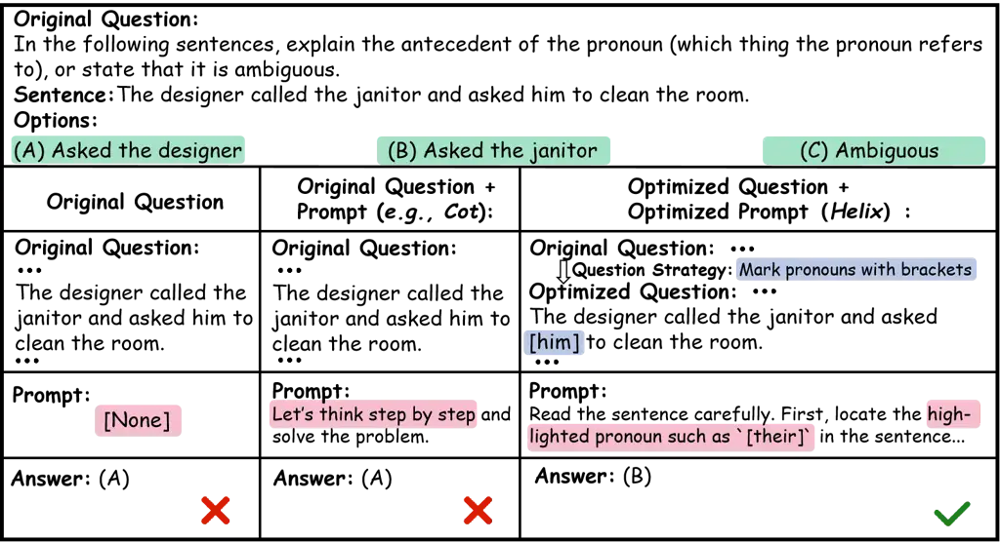
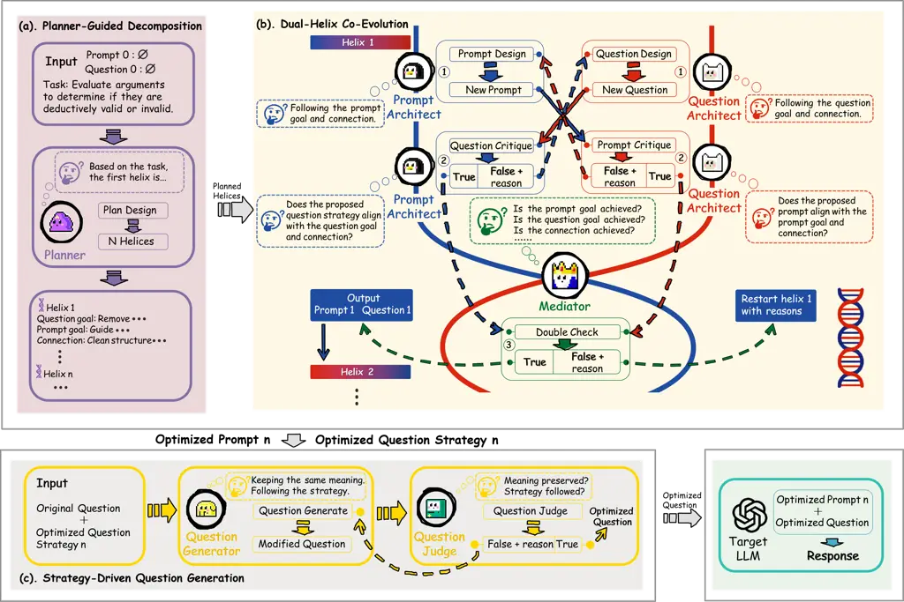
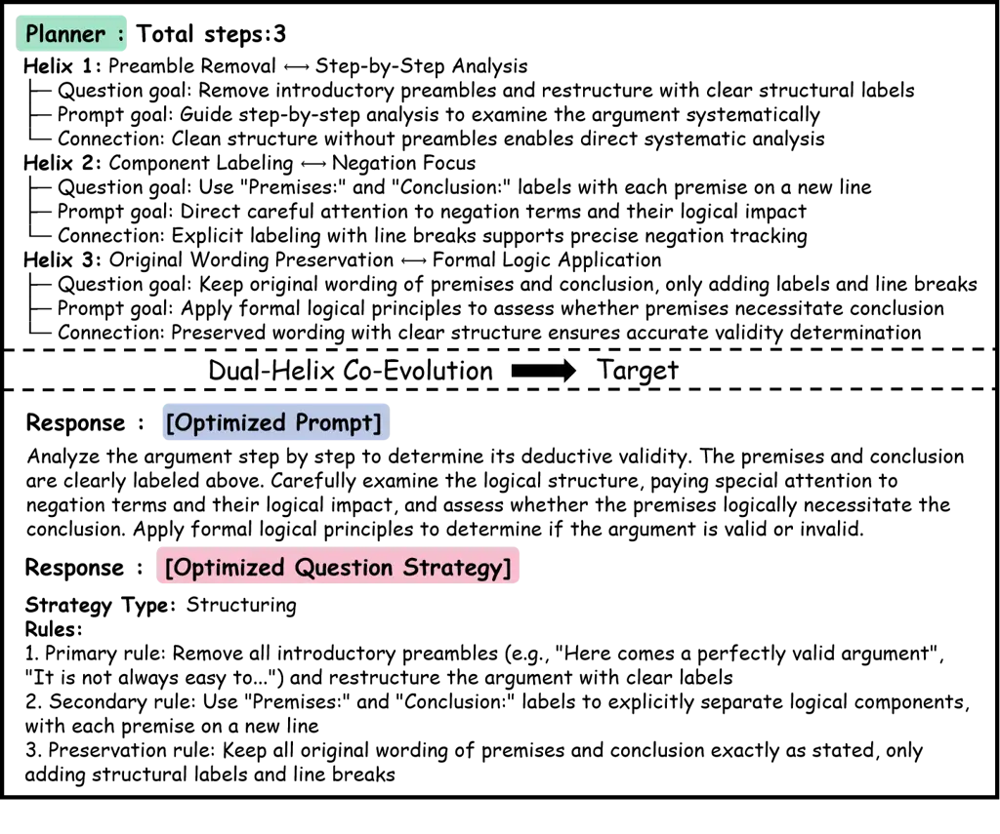
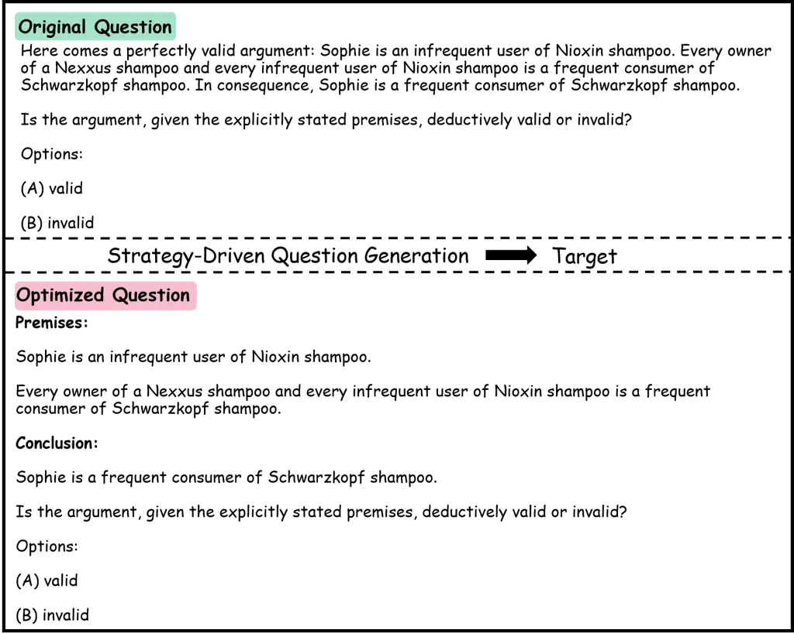
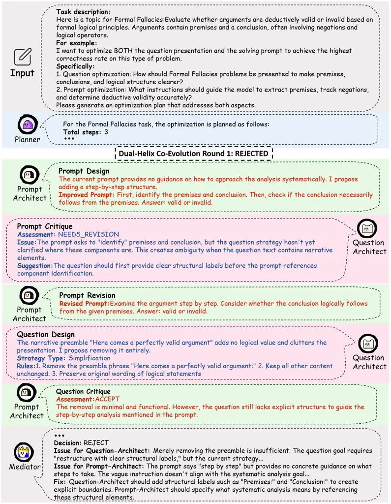
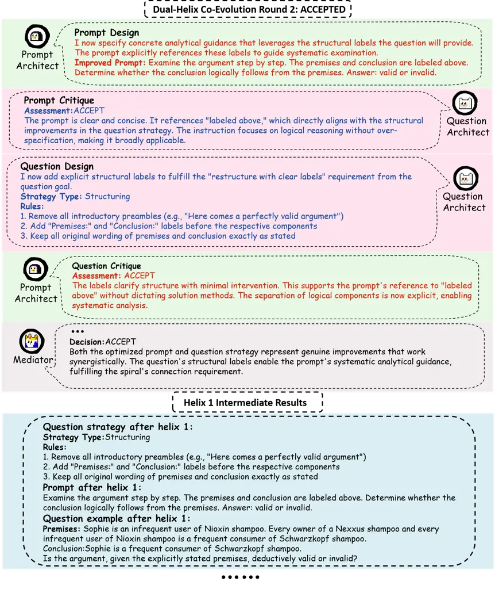
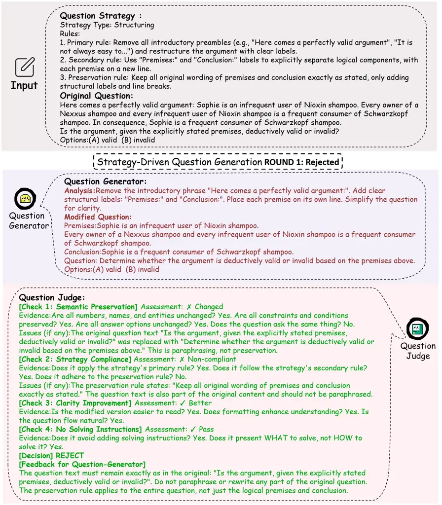
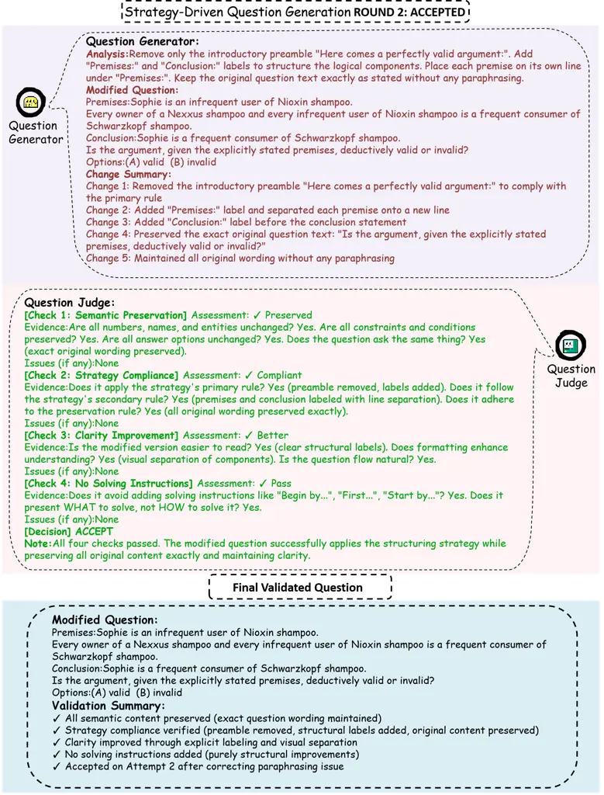

# Helix: A Dual-Helix Co-Evolutionary Multi-Agent System for Prompt Optimization and Question Reformulation

Kewen Zhu Affiliation: College of Intelligence and Computing, Tianjin
University, Tianjin, China    Han Tian Affiliation: College of Computer
Science, Nankai University, Tianjin, China    Liping Yi
Affiliation: College of Intelligence and Computing, Tianjin University,
Tianjin, China Correspondence to: <lipingyi@tju.edu.cn>    Zhiming Zhao
Affiliation: College of Intelligence and Computing, Tianjin University,
Tianjin, China    Xiang Li Affiliation: College of Intelligence and
Computing, Tianjin University, Tianjin, China    Qinghua Hu
Affiliation: College of Intelligence and Computing, Tianjin University,
Tianjin, China

###### Abstract

Automated prompt optimization (APO) aims to improve large language model
performance by refining prompt instructions. However, existing methods
are largely constrained by fixed prompt templates, limited search
spaces, or single-sided optimization that treats user questions as
immutable inputs. In practice, question formulation and prompt design
are inherently interdependent: clearer question structures facilitate
focused reasoning and task understanding, while effective prompts reveal
better ways to organize and restate queries. Ignoring this coupling
fundamentally limits the effectiveness and adaptability of current APO
approaches. In this work, we propose a unified multi-agent system
(Helix) that jointly optimizes question reformulation and prompt
instructions through a structured three-stage co-evolutionary framework.
Specifically, Helix integrates (1) _planner-guided decomposition_ that
breaks optimization into coupled question–prompt objectives, (2)
_dual-track co-evolution_ where specialized agents iteratively refine
and critique each other to produce complementary improvements, and (3)
_strategy-driven question generation_ that instantiates high-quality
reformulations for robust inference. Extensive experiments on 12
benchmarks against 6 strong baselines demonstrate the effectiveness of
Helix, achieving up to $`3.95\%`$ performance improvements across tasks
with favorable optimization efficiency. The code will be made publicly
available upon acceptance.

###### Keywords: 

Dual-Helix Co-Evolutionary, Multi-Agent System, Prompt Optimization,
Question Reformulation

^(†)^(†)affiliationnotice: Equal contribution



Figure 1: Comparison of three strategies for pronoun disambiguation.
Left: original question without prompt instructions yields an incorrect
answer. Middle: adding a CoT prompt to the original question still
fails. Right: Helix jointly optimizes question formulation and prompt
instructions, producing the correct prediction.

## 1 Introduction

Large language models (LLMs) such as GPT-4 (Achiam et al., 2023) and
Llama (Touvron et al., 2023) have demonstrated strong capabilities
across diverse natural language processing tasks. In practice, outputs
are jointly determined by the user question and prompt
instructions (Brown et al., 2020; Wei et al., 2021), motivating
Automated Prompt Optimization (APO) (Pryzant et al., 2023) to
systematically improve instruction effectiveness beyond manual design.

Recent APO methods mainly follow two paradigms: meta-prompting
approaches that employ predefined optimization templates to guide
instruction refinement (Yang et al., 2023; Ye et al., 2024), and
generate-then-search methods that construct candidate prompt pools and
perform iterative local exploration (Zhou et al., 2022; Xu et al., 2023;
Wang et al., 2023). Despite their successes, both paradigms exhibit
inherent limitations. Meta-prompt approaches rely on fixed templates
with limited adaptability across diverse tasks (Yang et al., 2023; Ye et
al., 2024), performing well in structured domains such as event
extraction (Zhang et al., 2024) and text-to-symbol transformation (Xu et
al., 2024) but struggling to accommodate varying reasoning patterns and
task-specific optimization strategies. In contrast, generate-search
methods restrict exploration to local neighborhoods within predefined
prompt clusters (Zhou et al., 2022; Xu et al., 2023), potentially
missing globally optimal solutions in the broader prompt space.

Recent advances in LLM-based multi-agent systems have demonstrated
strong capabilities for collaborative reasoning and complex problem
solving (Tran et al., 2025; Hong et al., 2023; Qian et al., 2023;
Ghafarollahi and Buehler, 2025). Building on these insights, MARS (Zhang
et al., 2025) introduces a planner-guided Teacher–Critic–Student
architecture with Socratic dialogue, enabling task-adaptive optimization
and broader space exploration for prompts.

However, the entire APO field, including multi-agent approaches, shares
a fundamental blind spot: existing methods treat questions as direct
inputs and optimize only prompt instructions. This assumption overlooks
the inherent interdependence between question formulation and prompt
design. Clearer questions enable focused reasoning, while better prompts
guide improved question formulation. As shown in Figure 1, jointly
optimizing both dimensions consistently outperforms optimizing either in
isolation.

To bridge this gap, we propose a dual-helix co-evolutionary multi-agent
system termed Helix that jointly optimizes question formulation and
prompt instructions. (1) A Planner first decomposes each task into
sequential dual-optimization objectives. (2) During training, along two
coupled optimization tracks, a Question-Architect and a Prompt-Architect
alternately propose refinements and critique each other’s outputs,
forming an interleaved co-evolution process where improvements in one
dimension guide updates in the other. A Mediator validates whether each
refinement achieves complementary progress, producing optimized prompts
and transferable question reformulation strategies. (3) During
inference, the query and question reformulation strategy guide a
Question-Generator to produce refined questions, while a Question-Judge
validates their reasonableness, yielding optimized question–prompt pairs
for LLM inference.

Our contributions are summarized as threefold:

- •
  We are the first to formulate automated prompt optimization as a joint
  question–prompt optimization problem and address it with a dual-helix
  co-evolutionary multi-agent system.
- •
  We design a structured three-stage multi-agent optimization framework
  with planner-guided decomposition, dual-track co-evolution, and
  strategy-driven question generation with discriminative validation.
- •
  Extensive experiments on 12 benchmarks against 6 strong baselines
  demonstrate consistent effectiveness, achieving up to 3.95%
  performance improvements across tasks.

## 2 Related Work

We review related work in automated prompt optimization and
multi-agent-based prompt optimization.

### 2.1 Automated Prompt Optimization

Early prompt optimization explored discrete optimization of hard
prompts (Shin et al., 2020) and continuous optimization of soft
prompts (Lester et al., 2021; Li and Liang, 2021). With the emergence of
large language models, automated prompt optimization has shifted toward
optimizing natural language instructions.

APE (Zhou et al., 2022) initiated this direction by generating and
evaluating candidate prompts using LLMs. Subsequent work mainly follows
two paradigms. Generate-then-search methods (Zhou et al., 2022; Xu et
al., 2023; Wang et al., 2023; Pryzant et al., 2023) construct candidate
pools and perform local exploration within predefined prompt clusters,
which limits global optimization. Meta-prompting approaches (Yang et
al., 2023; Ye et al., 2024) employ predefined optimization templates to
guide refinement but lack flexibility across diverse task
characteristics.

Overall, existing APO methods focus exclusively on optimizing prompt
instructions while treating user questions as fixed inputs, leaving the
interaction between question formulation and prompt design largely
unexplored.

### 2.2 Multi-Agent Prompt Optimization

LLM-based multi-agent systems decompose complex tasks among specialized
agents through collaborative mechanisms (Wu et al., 2024; Hong et al.,
2023; Qian et al., 2023; Tran et al., 2025). Key advances include debate
mechanisms for mutual critique (Du et al., 2023; Liang et al., 2024),
reflection-based iterative refinement (Shinn et al., 2023), and
meta-agent coordination for high-level planning (Xiong et al., 2025).
These paradigms have demonstrated strong performance across domains such
as software engineering (Hong et al., 2023; Qian et al., 2023),
scientific discovery (Ghafarollahi and Buehler, 2025; Schmidgall et al.,
2025), and complex decision-making tasks.

Building on these advances, MARS (Zhang et al., 2025) applies
multi-agent collaboration to prompt optimization through a
Teacher–Critic–Student architecture, improving flexibility over
template-based methods. However, it maintains fixed agent roles with
unidirectional critique and focuses solely on prompt optimization.

In contrast, Helix introduces dual-helix co-evolution via bidirectional
critique between Prompt-Architect and Question-Architect, enabling
coordinated optimization of both question formulation and prompt design
beyond single-dimension APO.



Figure 2: Overview of the Helix framework including $`6`$ LLM-based
agents for joint optimization of question reformulation and prompt
instructions. The ① Planner decomposes the task into a sequence of helix
objectives, dual-helix co-evolution alternates between ②
Prompt-Architect and ③ Question-Architect with ④ Mediator validation,
and the ⑤ Question-Generator together with the ⑥ Question-Judge produces
validated refined questions, which are paired with the optimized prompt
and fed to the target LLM for inference.

## 3 Problem Definition

Following the definition in prompt optimization (Zhou et al., 2022; Yang
et al., 2023), we extend APO to jointly optimize both question
presentation and prompt instructions. Given a target LLM
$`\mathcal{M}_{\text{target}}`$ and dataset $`\mathcal{D}=\{(x,y)\}`$,
we start from an initial question strategy $`Q_{0}`$ and prompt
$`P_{0}`$, and optimize both to obtain the optimal pair
$`(Q^{*},P^{*})`$.

We select training examples $`\mathcal{D}_{\text{train}}`$ for
optimization and use $`\mathcal{D}_{\text{test}}`$ for evaluation. The
objective is:

```math
(Q^{*},P^{*})=\arg\max_{Q,P}\sum_{(x,y)\in\mathcal{D}_{{{\text{train}}}}}f(\mathcal{M}_{\text{target}}(Q(x);P),y), \tag{1}
```

where $`Q(x)`$ denotes the transformed question under strategy $`Q`$,
$`P`$ is optimized prompt, and $`f`$ is the performance metric.

Compared with traditional APO, our formulation differs in jointly
optimizing $`Q`$ and $`P`$ and enforcing their complementarity through
bidirectional critique.

## 4 The Proposed Helix Framework

Helix is a dual-helix co-evolutionary multi-agent framework for jointly
optimizing question reformulation strategies and prompt instructions.
The framework operates in two stages: a training stage that learns
optimized $`(Q^{*},P^{*})`$ through dual-helix co-evolution, and an
inference stage that applies them to unseen queries (Figure 2).

### 4.1 Planner-Guided Decomposition

Rather than optimizing questions and prompts in a single step, Helix
employs a Planner agent $`\mathcal{M}_{\text{planner}}`$ to decompose
the joint optimization task into a sequence of coupled helix objectives.
Given the task description $`\mathcal{T}`$ and training examples
$`\mathcal{D}_{\text{train}}`$, the Planner generates:

```math
\mathcal{H}=[h_{1},h_{2},\ldots,h_{n}]=\mathcal{M}_{\text{planner}}(\mathcal{T};\mathcal{D}_{\text{train}}), \tag{2}
```

where each helix $`h_{i}=(g_{Q}^{i},g_{P}^{i},c_{i})`$ specifies a
question reformulation goal $`g_{Q}^{i}`$, a prompt refinement goal
$`g_{P}^{i}`$, and a connection $`c_{i}`$ describing their intended
synergy. This decomposition enables progressive and task-adaptive
co-evolution across both dimensions.

### 4.2 Dual-Helix Co-Evolution

For each helix objective $`h_{i}\in\mathcal{H}`$, Helix initializes the
current reformulation strategy and prompt as
$`(Q_{0},P_{0})=(Q^{(i-1)},P^{(i-1)})`$, where $`(Q^{(i-1)},P^{(i-1)})`$
denotes the optimized outputs from the previous helix stage (with
$`Q^{(0)}=P^{(0)}=\emptyset`$). The framework then performs iterative
debate rounds indexed by $`r`$.

The Prompt-Architect agent $`\mathcal{M}_{\text{p-arch}}`$ designs an
improved prompt draft:

```math
P_{r}^{\text{draft}}=\mathcal{M}_{\text{p-arch}}^{\text{design}}(h_{i};(Q_{r-1},P_{r-1});\phi_{\text{M},r-1};\phi_{\text{Q},r}), \tag{3}
```

where $`P_{r-1}`$ and $`Q_{r-1}`$ denote the prompt and reformulation
strategy from the previous round, $`\phi_{\text{M},r-1}`$ represents
feedback provided by the Mediator agent at round $`r-1`$ (with
$`\phi_{\text{M},0}=\emptyset`$), and $`\phi_{\text{Q},r}`$ denotes
critique feedback from the Question-Architect (with
$`\phi_{\text{Q},r}=\emptyset`$ at the start of round $`r`$).

This draft prompt is then critiqued by the Question-Architect
$`\mathcal{M}_{\text{q-arch}}`$:

```math
(\alpha_{\text{Q},r},\phi_{\text{Q},r})=\mathcal{M}_{\text{q-arch}}^{\text{critique}}(h_{i};P_{r}^{\text{draft}}), \tag{4}
```

where $`\alpha_{\text{Q},r}\in\{0,1\}`$ denotes the acceptance decision
(1 for accept and 0 for reject), and $`\phi_{\text{Q},r}`$ provides
critique feedback. If rejected ($`\alpha_{\text{Q},r}=0`$), the
Prompt-Architect refines the draft by re-executing Eq. (3) with the
updated feedback $`\phi_{\text{Q},r}`$. This critique-refine cycle
repeats until acceptance ($`\alpha_{\text{Q},r}=1`$), yielding the final
prompt $`P_{r}`$.

Symmetrically, the Question-Architect proposes a reformulation strategy
draft:

```math
Q_{r}^{\text{draft}}=\mathcal{M}_{\text{q-arch}}^{\text{design}}(h_{i};(Q_{r-1},P_{r-1});\phi_{\text{M},r-1};\phi_{\text{P},r}), \tag{5}
```

where $`\phi_{\text{P},r}`$ denotes critique feedback from the
Prompt-Architect (with $`\phi_{\text{P},r}=\emptyset`$ at the start of
round $`r`$). The draft is evaluated by the Prompt-Architect:

```math
(\alpha_{\text{P},r},\phi_{\text{P},r})=\mathcal{M}_{\text{p-arch}}^{\text{critique}}(h_{i};Q_{r}^{\text{draft}}), \tag{6}
```

where $`\alpha_{\text{P},r}\in\{0,1\}`$ denotes acceptance and
$`\phi_{\text{P},r}`$ provides refinement feedback. If rejected
($`\alpha_{\text{P},r}=0`$), the Question-Architect refines the draft by
re-executing Eq. (5) with the updated feedback $`\phi_{\text{P},r}`$.
This critique-refine cycle repeats until acceptance
($`\alpha_{\text{P},r}=1`$), yielding the final strategy $`Q_{r}`$.

Once both architects accept their respective outputs, the Mediator
performs joint validation:

```math
([\gamma_{1,r},\gamma_{2,r},\gamma_{3,r}],\phi_{\text{M},r})=\mathcal{M}_{\text{mediator}}(h_{i};(Q_{r},P_{r})), \tag{7}
```

where $`\gamma_{\cdot,r}\in\{0,1\}`$ indicates pass or fail for three
validation dimensions: (i) prompt quality satisfying the helix prompt
objective $`g_{P}^{i}`$, (ii) reformulation quality satisfying the
question objective $`g_{Q}^{i}`$, and (iii) synergistic consistency
fulfilling the connection constraint $`c_{i}`$. The feedback
$`\phi_{\text{M},r}`$ guides subsequent refinements if any criterion
fails.

When all validation dimensions pass, the optimized pair is updated as
$`(Q^{(i)},P^{(i)})=(Q_{r},P_{r})`$ and the framework advances to the
next helix objective. After processing all helix stages, Helix outputs
the final optimized pair $`(Q^{*},P^{*})`$.

### 4.3 Strategy-Driven Question Generation

During inference, Helix applies the learned reformulation strategy
$`Q^{*}`$ to unseen queries.

For each test question $`x\in\mathcal{D}_{\text{test}}`$, the
Question-Generator $`\mathcal{M}_{\text{generator}}`$ iteratively
produces a refined draft:

```math
x_{k}^{\text{draft}}=\mathcal{M}_{\text{generator}}(x;Q^{*};\phi_{\text{J},k-1}), \tag{8}
```

where $`x_{k}^{\text{draft}}`$ denotes the candidate reformulated
question at iteration $`k`$, and $`\phi_{\text{J},k-1}`$ is feedback
from the Question-Judge agent at the previous iteration (with
$`\phi_{\text{J},0}=\emptyset`$).

The draft is then evaluated by the Question-Judge
$`\mathcal{M}_{\text{judge}}`$:

```math
([\beta_{1,k},\beta_{2,k},\beta_{3,k},\beta_{4,k}],\phi_{\text{J},k})=\mathcal{M}_{\text{judge}}(x;x_{k}^{\text{draft}};Q^{*}), \tag{9}
```

where $`\beta_{\cdot,k}\in\{0,1\}`$ indicates pass or fail for four
validation dimensions: (i) semantic preservation with respect to the
original question $`x`$, (ii) compliance with the learned reformulation
strategy $`Q^{*}`$, (iii) improvement in clarity and structure, and (iv)
absence of any solving instructions or answer leakage. The feedback
$`\phi_{\text{J},k}`$ provides corrective signals when any criterion
fails.

When all validation indicators satisfy $`\beta_{\cdot,k}=1`$, the
refined question is accepted as the final optimized input
$`x^{*}=x_{k}^{\text{draft}}`$. The optimized question is then paired
with the evolved prompt $`P^{*}`$ and passed to the target LLM:

```math
y_{\text{pred}}=\mathcal{M}_{\text{target}}(x^{*};P^{*}), \tag{10}
```

which produces the predicted answer for performance evaluation. Alg. 1
describes the complete process.

Overall, Helix jointly optimizes question reformulation and prompt
refinement via planner-guided decomposition, dual-helix co-evolution,
and discriminative generation. Bidirectional agent debate with mediator
and judge validation drives complementary improvements and enforces
semantic consistency across both dimensions across training and
inference stages. By systematically exploring the joint question–prompt
space, Helix elevates automated prompt optimization from
single-dimension tuning to a co-evolutionary multi-agent paradigm.

1:  Input: Task $`\mathcal{T}`$, $`\mathcal{D}_{\text{train}}`$,
$`\mathcal{D}_{\text{test}}`$, runs $`T`$.

2:  Output: Optimized $`(Q^{*},P^{*})`$.

3:  Initialize best score $`s^{*}\leftarrow-\infty`$.

4:  for $`t=1`$ to $`T`$ do

5:   Planner-Guided Decomposition:

6:   Generate helix tasks $`\mathcal{H}=[h_{1},\dots,h_{n}]`$ by Planner
(Eq. 2).

7:   $`(Q^{(0)},P^{(0)})\leftarrow(\emptyset,\emptyset)`$

8:   for $`i=1`$ to $`n`$ do

9:    Dual-Helix Co-Evolution:

10:    repeat

11:      Prompt-Architect proposes prompt update (Eq. 3).

12:      Question-Architect critiques (Eq. 4).

13:      Prompt-Architect refines (Eq. 3).

14:      Question-Architect gives question strategy (Eq. 5).

15:      Prompt-Architect critiques (Eq. 6).

16:      Question-Architect refines (Eq. 5).

17:      Mediator validates joint improvement (Eq. 7).

18:    until all validation criteria are satisfied

19:    Update $`(Q^{(i)},P^{(i)})`$.

20:   end for

21:   $`(\tilde{Q},\tilde{P})\leftarrow(Q^{(n)},P^{(n)})`$

22:   Strategy-Driven Question Generation:

23:   for all $`x\in\mathcal{D}_{\text{test}}`$ do

24:    repeat

25:      Generator reformulated question using $`\tilde{Q}`$ (Eq. 8).

26:      Judge validates quality and semantics (Eq. 9).

27:    until validation passes

28:    Predict answer with target model using $`\tilde{P}`$ (Eq. 10).

29:   end for

30:   Compute performance score $`s_{t}`$.

31:   if $`s_{t}>s^{*}`$ then

32:    $`(Q^{*},P^{*})\leftarrow(\tilde{Q},\tilde{P})`$,
$`s^{*}\leftarrow s_{t}`$

33:   end if

34:  end for

Algorithm 1 Helix

## 5 Experiments

We conduct extensive experiments across 12 diverse benchmarks to
evaluate the effectiveness of Helix.

### 5.1 Experimental Setup

#### Tasks and Datasets.

We evaluate Helix on 12 datasets covering diverse reasoning and
knowledge-intensive tasks from established benchmarks, including BBH¹¹ 1
[https://huggingface.co/datasets/SaylorTwift/bbh](https://huggingface.co/datasets/SaylorTwift/bbh) (Suzgun
et al., 2023), MMLU²² 2
[https://huggingface.co/datasets/cais/mmlu](https://huggingface.co/datasets/cais/mmlu) (Hendrycks
et al., 2020), MMLU-Pro³³ 3
[https://huggingface.co/datasets/TIGER-Lab/MMLU-Pro](https://huggingface.co/datasets/TIGER-Lab/MMLU-Pro) (Wang
et al., 2024), LSAT-AR from AGIEval⁴⁴ 4
[https://huggingface.co/datasets/hails/agieval-lsat-ar](https://huggingface.co/datasets/hails/agieval-lsat-ar) (Zhong
et al., 2024), and AQuA-RAT⁵⁵ 5
[https://huggingface.co/datasets/deepmind/aqua_rat](https://huggingface.co/datasets/deepmind/aqua_rat) (Ling
et al., 2017).

#### Baselines.

We compare Helix with manual prompting strategies: No Prompt, CoT (Wei
et al., 2022); APO methods, including APE (Zhou et al., 2022),
OPRO (Yang et al., 2023), PE2 (Ye et al., 2024); and the
state-of-the-art multi-agent method MARS (Zhang et al., 2025). More
details are provided in Appendix A.

To explicitly analyze the contribution of question reformulation and
prompt refinement, we further evaluate four controlled configurations:

- •
  Q + P-Opt, where only the prompt is optimized while the original
  questions are kept unchanged;
- •
  Q-Opt, where only the question reformulation strategy is optimized
  without any prompt;
- •
  Q-Opt + CoT, where the optimized questions are paired with a fixed
  chain-of-thought prompt;
- •
  Q-Opt + P-Opt, which corresponds to the full Helix framework jointly
  optimizing both dimensions of question and prompt through dual-helix
  co-evolution.

#### Evaluation Metrics.

We adopt two evaluation criteria. The primary metric is Accuracy (%),
defined as:

```math
\text{Acc}=\frac{|\{(x,y)\in\mathcal{D}_{\text{test}}:y_{\text{pred}}=y\}|}{|\mathcal{D}_{\text{test}}|}, \tag{11}
```

which measures the proportion of correctly predicted instances. To
evaluate optimization efficiency, we compute Prompt Efficiency
(PE) (Zhang et al., 2025) as:

```math
\text{PE}=\frac{\text{Accuracy}}{\text{Consumption}}, \tag{12}
```

where Consumption denotes the number of LLM API calls required for
prompt optimization. For fair comparison, PE is measured under the Q +
P-Opt configuration, excluding question generation costs. Higher PE
indicates better performance with lower optimization overhead.

#### Implementation Details.

All Helix agents are implemented using GPT-4o (Achiam et al., 2023). For
the target LLM, we use GPT-4o on BBH and Qwen2.5-32B-Instruct (Qwen et
al., 2025) on the remaining benchmarks. We set the number of
optimization runs to $`T=10`$, with at most $`R_{\max}=3`$ dual-helix
co-evolution rounds per helix objective and $`K_{\max}=3`$
generator–judge iterations during inference. We report the
best-performing configuration across all runs. More details are provided
in Appendix B.

|                               |       |       |       |       |       |         |       |       |       |          |       |       |       |
| ----------------------------- | ----- | ----- | ----- | ----- | ----- | ------- | ----- | ----- | ----- | -------- | ----- | ----- | ----- |
| Models                        | BBH   |       |       |       |       | AGIEval | MMLU  |       |       | MMLU-Pro |       | Math  | Avg   |
|                               | D.QA  | G.S.  | F.F.  | R.N.  | S.U.  | L.A.    | C.B.  | E.E.  | M.T.  | Hist     | Phil  | A.R.  |       |
| Manual Prompting              |       |       |       |       |       |         |       |       |       |          |       |       |       |
| No Prompt                     | 53.20 | 52.40 | 77.40 | 82.80 | 78.80 | 35.09   | 89.58 | 76.55 | 88.32 | 55.12    | 54.11 | 86.61 | 69.17 |
| CoT                           | 74.80 | 54.80 | 82.00 | 87.20 | 80.00 | 33.22   | 91.36 | 82.07 | 90.06 | 57.74    | 57.31 | 87.40 | 73.16 |
| Automated Prompt Optimization |       |       |       |       |       |         |       |       |       |          |       |       |       |
| APE                           | 56.50 | 61.20 | 82.40 | 83.60 | 81.40 | 35.61   | 89.23 | 78.23 | 89.23 | 58.40    | 58.43 | 84.32 | 71.55 |
| OPRO                          | 50.00 | 46.40 | 84.40 | 87.60 | 78.40 | 37.23   | 91.15 | 81.45 | 90.12 | 58.84    | 59.44 | 85.44 | 70.87 |
| PE2                           | 67.20 | 56.00 | 84.00 | 88.40 | 82.40 | 36.46   | 91.24 | 79.44 | 91.54 | 59.25    | 56.43 | 87.32 | 73.31 |
| MARS                          | 71.20 | 67.60 | 90.20 | 90.80 | 90.20 | 38.09   | 91.36 | 73.79 | 91.88 | 61.32    | 62.63 | 87.88 | 76.41 |
| Helix (Ours)                  |       |       |       |       |       |         |       |       |       |          |       |       |       |
| Q + P-Opt                     | 70.80 | 72.40 | 90.80 | 91.20 | 90.40 | 38.53   | 91.67 | 80.69 | 93.16 | 60.63    | 63.33 | 89.37 | 77.75 |
| Q-Opt                         | 52.00 | 58.00 | 80.00 | 87.50 | 79.60 | 39.13   | 91.56 | 77.93 | 92.31 | 59.54    | 57.72 | 86.79 | 71.84 |
| Q-Opt + CoT                   | 70.00 | 60.80 | 86.40 | 90.20 | 82.40 | 38.70   | 92.36 | 80.69 | 92.31 | 60.31    | 58.44 | 90.16 | 75.23 |
| Q-Opt + P-Opt                 | 73.20 | 73.20 | 94.05 | 93.20 | 92.40 | 43.48   | 93.06 | 85.52 | 95.23 | 64.04    | 65.21 | 91.73 | 80.36 |

Table 1: Accuracy (%) comparison across 12 tasks. Helix with dual
optimization (Q-Opt + P-Opt) consistently achieves the best performance
across all benchmarks. Bold denotes the highest result for each task.
Abbreviations: D.QA = Disambiguation QA, G.S. = Geometric Shapes, F.F. =
Formal Fallacies, R.N. = Ruin Names, S.U. = Sports Understanding, L.A. =
LSAT-AR, C.B. = College Biology, E.E. = Electrical Engineering, M.T. =
Marketing, Hist = History, Phil = Philosophy, A.R. = AQuA-RAT.

### 5.2 Overall Performance

Table 1 summarizes performance across all 12 tasks. Helix with full dual
optimization (Q-Opt + P-Opt) achieves the highest average accuracy of
80.36%, consistently outperforming all baselines. In particular, it
improves over the strongest existing APO method MARS by 3.95% and manual
CoT prompting by 7.20%.

Optimizing a single dimension already yields clear benefits. Prompt-only
optimization (Q + P-Opt) reaches 77.75%, surpassing MARS by 1.34%.
Question reformulation alone also brings notable gains: Q-Opt improves
direct answering from 69.17% to 71.84%, while Q-Opt + CoT improves fixed
CoT prompting from 73.16% to 75.23%. These results indicate that
question presentation substantially influences model performance even
without prompt refinement.

Nevertheless, jointly optimizing both dimensions consistently delivers
the best results. Full Helix outperforms the strongest single-dimension
configuration by 2.61% on average, with particularly strong improvements
on reasoning-intensive tasks such as BBH and MMLU-related benchmarks.
This demonstrates the synergistic effect of co-evolving question
reformulation and prompt refinement beyond isolated optimization.

Figure 3: Accuracy–cost trade-off across 12 tasks for different prompt
optimization methods. Bubble size denotes the number of training
samples, with Helix achieving the highest accuracy with the fewest API
calls using only a single sample.

### 5.3 Optimization Efficiency

Figure 4: Prompt efficiency (PE) comparison on four representative BBH
tasks, where Helix consistently achieves the highest performance per
optimization cost.

Figure 3 illustrates the trade-off between training cost and accuracy
across all 12 tasks. Helix achieves higher accuracy while requiring
substantially fewer LLM calls than prior APO methods, reducing total
optimization cost by approximately 45% compared to MARS.

This efficiency stems from Helix’s structured co-evolution. Dual-role
architects reduce agent redundancy, mediator validation prunes
incompatible updates early, and joint optimization across question and
prompt spaces accelerates convergence. In practice, most helix
objectives converge within a single co-evolution round.

Figure 4 reports Prompt Efficiency (PE) on four BBH tasks. Helix
consistently achieves the highest PE, with particularly large gains on
challenging reasoning tasks such as D.QA. and F.F., while maintaining
strong efficiency across R.N. and S.U.

|            |         |         |         |         |         |
| ---------- | ------- | ------- | ------- | ------- | ------- |
| helix      | C.B.    | M.T.    | E.E.    | Hist    | Phil    |
| Full       | 93.06   | 95.23   | 85.52   | 64.04   | 65.21   |
| 1 helix    | 85.42   | 87.34   | 77.85   | 55.82   | 56.73   |
| $`\Delta`$ | (-7.64) | (-7.89) | (-7.67) | (-8.22) | (-8.48) |
| 2 helices  | 89.58   | 91.45   | 81.38   | 59.11   | 59.88   |
| $`\Delta`$ | (-3.48) | (-3.78) | (-4.14) | (-4.93) | (-5.33) |
| 3 helices  | 93.06   | 95.23   | 83.79   | 61.47   | 62.05   |
| $`\Delta`$ | (0.00)  | (0.00)  | (-1.73) | (-2.57) | (-3.16) |
| 4 helices  | -       | -       | 85.52   | 64.04   | 63.88   |
| $`\Delta`$ | -       | -       | (0.00)  | (0.00)  | (-1.33) |
| 5 helices  | -       | -       | -       | -       | 65.21   |
| $`\Delta`$ | -       | -       | -       | -       | (0.00)  |

Table 2: Accuracy (%) of helix number on MMLU and MMLU-Pro tasks.
$`\Delta`$ denotes the performance drop relative to full Helix.

### 5.4 Impact of Helix Number $`n`$

Table 2 reports performance on MMLU and MMLU-Pro under different numbers
of helix objectives. We observe clear task-dependent saturation
behavior. Relatively simpler tasks (C.B., M.T.) reach optimal
performance with three helices, moderately complex tasks (E.E., History)
benefit from four helices, while the most challenging task (Philosophy)
continues improving up to five helices.

Importantly, the largest performance gains occur in the first one to two
helices, with diminishing returns thereafter, indicating efficient
early-stage co-evolution. These results suggest that the Planner agent
produces appropriately granular decompositions aligned with task
complexity, enabling progressive yet efficient optimization. The
saturation pattern also validates that Helix avoids over-optimization,
automatically stabilizing when further decomposition yields negligible
benefits.

|       |     |                             |       |       |       |       |       |
| ----- | --- | --------------------------- | ----- | ----- | ----- | ----- | ----- | ---- | --- |
| Model | $`  | \mathcal{D}\_{\text{train}} | `$    | C.B.  | E.E.  | M.T.  | Hist  | Phil | Avg |
| APE   | 100 | 89.23                       | 78.23 | 89.23 | 58.40 | 58.43 | 74.70 |
| OPRO  | 50  | 91.15                       | 81.45 | 90.12 | 58.84 | 59.44 | 76.20 |
| PE2   | 100 | 91.24                       | 79.44 | 91.54 | 59.25 | 56.43 | 75.58 |
| MARS  | 1   | 91.36                       | 73.79 | 91.88 | 61.32 | 62.63 | 76.20 |
| Helix | 1   | 93.06                       | 85.52 | 95.23 | 64.04 | 65.21 | 80.61 |
| Helix | 2   | 94.44                       | 87.24 | 96.58 | 65.47 | 66.76 | 82.10 |
| Helix | 3   | 95.14                       | 87.93 | 97.08 | 66.33 | 67.54 | 82.80 |

Table 3: Accuracy (%) of different training sample sizes
$`|\mathcal{D}_{\text{train}}|`$ on MMLU and MMLU-Pro tasks.

### 5.5 Impact of Training Sample Size $`|\mathcal{D}_{\text{train}}|`$

A key advantage of Helix is its low-shot optimization regime, requiring
only a few training examples to learn effective question–prompt
strategies. Table 3 compares performance under varying training sample
sizes.

As $`|\mathcal{D}_{\text{train}}|`$ increases from 1 to 3, Helix
consistently improves across all tasks, indicating that additional
examples help refine co-evolutionary optimization. However, the
performance gains diminish beyond two samples, suggesting rapid
convergence with minimal supervision.

Notably, even the 1-shot setting already surpasses strong baselines such
as MARS, demonstrating that Helix can achieve high performance with
extremely limited optimization data. This highlights the practicality of
Helix in resource-constrained scenarios, where collecting large
optimization sets is infeasible.



Figure 5: Training-stage dual-helix co-evolution on the Formal Fallacies
task. The Planner decomposes the task into sequential helix objectives
with coupled question reformulation and prompt refinement goals.
Prompt-Architect and Question-Architect iteratively critique and refine
each other under Mediator validation, yielding aligned optimized prompts
and transferable question reformulation strategies.



Figure 6: Inference-stage strategy-driven question generation on the
Formal Fallacies task. The Question-Generator reformulates the original
query following the learned strategy, while the -JudgeQuestion-Judge
validates semantic preservation and structural quality, producing an
optimized question for final model inference.

### 5.6 Interpretable Helix Co-Evolution Trajectory

Figures 5 and 6 present a representative optimization trajectory on the
Formal Fallacies task, illustrating how Helix performs structured
co-evolution during training and systematically applies learned
strategies during inference.

Figure 5 visualizes the training-stage dual-helix process. The Planner
decomposes the task into explicit helix objectives with paired
reformulation and prompting goals (e.g., Preamble Removal
$`\leftrightarrow`$ Step-by-Step Reasoning), yielding a transparent and
task-adaptive optimization trajectory. Within each helix,
Prompt-Architect and Question-Architect iteratively propose and critique
updates, ensuring that improvements in one dimension remain compatible
with the other. This bidirectional refinement produces tightly aligned
prompt strategies and question reformulation policies.

Figure 6 illustrates the inference-stage strategy application. The
Question-Generator progressively transforms an original query following
the learned reformulation strategy, while the Question-Judge enforces
semantic preservation and structural quality through multi-criteria
validation. This verifies how training-stage co-evolution translates
into reliable and interpretable improvements on unseen instances.

Overall, the above results highlight Helix’s ability to decompose
complex optimization into structured helix objectives, enforce
cross-dimensional consistency through dual-helix critique, and transfer
learned strategies to inference in a controllable and interpretable
manner. ⁶⁶ 6 Appendix C presents generalization experiments across
different LLMs. Appendix D includes detailed agent prompts and
interaction examples. Appendix E presents detailed optimization outputs
for all twelve tasks.

|               |         |         |          |         |          |         |
| ------------- | ------- | ------- | -------- | ------- | -------- | ------- |
| Variation     | D.QA    | G.S.    | F.F.     | R.N.    | S.U.     | Avg     |
| Full          | 73.20   | 73.20   | 94.05    | 93.20   | 92.40    | 85.21   |
| w/o Planner   | 66.00   | 68.40   | 85.20    | 89.80   | 84.60    | 78.80   |
| $`\Delta`$    | (-7.20) | (-4.80) | (-8.85)  | (-3.40) | (-7.80)  | (-6.41) |
| w/o P-Arch    | 64.80   | 69.20   | 82.60    | 87.80   | 78.50    | 76.58   |
| $`\Delta`$    | (-8.40) | (-4.00) | (-11.45) | (-5.40) | (-13.90) | (-8.63) |
| w/o Q-Arch    | 66.40   | 70.80   | 84.20    | 88.60   | 75.60    | 77.12   |
| $`\Delta`$    | (-6.80) | (-2.40) | (-9.85)  | (-4.60) | (-16.80) | (-8.09) |
| w/o Mediator  | 69.60   | 71.20   | 89.40    | 90.60   | 80.45    | 80.25   |
| $`\Delta`$    | (-3.60) | (-2.00) | (-4.65)  | (-2.60) | (-11.95) | (-4.96) |
| w/o Generator | 70.80   | 72.40   | 90.80    | 91.20   | 90.40    | 77.75   |
| $`\Delta`$    | (-2.40) | (-0.80) | (-3.25)  | (-2.00) | (-2.00)  | (-7.46) |
| w/o Judge     | 71.50   | 72.80   | 92.00    | 92.00   | 91.70    | 82.00   |
| $`\Delta`$    | (-1.70) | (-0.40) | (-2.05)  | (-1.20) | (-0.70)  | (-3.21) |

Table 4: Component ablation on BBH tasks (accuracy %). $`\Delta`$
denotes performance drop relative to the full Helix framework.

### 5.7 Ablation Study

Table 4 reports the effect of removing key components on five BBH tasks.
Eliminating the Planner leads to a clear performance drop (6.41% on
average), highlighting the importance of structured task decomposition
for effective dual optimization. Removing either the Prompt-Architect or
the Question-Architect results in even larger degradations (8.63% and
8.09%), as the system collapses to single-dimension optimization,
confirming that coordinated refinement across both prompts and questions
is essential.

The Mediator contributes substantially to stable co-evolution: without
validation, incompatible updates are accepted, yielding a 4.96%
performance decline. At inference time, removing the Question-Generator
prevents applying learned reformulation strategies and effectively
reduces Helix to prompt-only optimization, causing significant
degradation. Finally, removing the Question-Judge weakens quality
control, allowing suboptimal reformulations to pass and leading to
consistent accuracy loss.

Overall, each component plays a complementary role in enabling effective
dual-helix co-evolution.

## 6 Conclusion

We propose Helix, a dual-helix co-evolutionary multi-agent framework
that integrates Planner-guided decomposition, bidirectional
co-evolution, and strategy-driven question generation for joint
optimization of questions and prompts. This structured design enables
efficient and synergistic improvements across both dimensions with
strong interpretability and task adaptability. Our extensive
experimental results demonstrate that prompt optimization benefits from
being treated as a coupled interaction design problem.

## References

- Achiam et al. (2023) J. Achiam, S. Adler, S. Agarwal, L. Ahmad, I.
  Akkaya, F. L. Aleman, D. Almeida, J. Altenschmidt, S. Altman, S.
  Anadkat, et al. Gpt-4 technical report. arXiv preprint
  arXiv:2303.08774. Cited by: Appendix B, §1, §5.1.
- Brown et al. (2020) T. Brown, B. Mann, N. Ryder, M. Subbiah, J. D.
  Kaplan, P. Dhariwal, A. Neelakantan, P. Shyam, G. Sastry, A. Askell,
  et al. Language models are few-shot learners. Advances in neural
  information processing systems 33, pp. 1877–1901. Cited by: §1.
- Comanici et al. (2025) G. Comanici, E. Bieber, M. Schaekermann, I.
  Pasupat, N. Sachdeva, I. Dhillon, M. Blistein, O. Ram, D. Zhang, E.
  Rosen, et al. Gemini 2.5: pushing the frontier with advanced
  reasoning, multimodality, long context, and next generation agentic
  capabilities. arXiv preprint arXiv:2507.06261. Cited by: §C.1.
- Du et al. (2023) Y. Du, S. Li, A. Torralba, J. B. Tenenbaum, and I.
  Mordatch Improving factuality and reasoning in language models through
  multiagent debate. In Forty-first International Conference on Machine
  Learning, Cited by: §2.2.
- Ghafarollahi and Buehler (2025) A. Ghafarollahi and M. J. Buehler
  SciAgents: automating scientific discovery through bioinspired
  multi-agent intelligent graph reasoning. Advanced Materials 37 (22),
  pp. 2413523. Cited by: §1, §2.2.
- Hendrycks et al. (2020) D. Hendrycks, C. Burns, S. Basart, A. Zou, M.
  Mazeika, D. Song, and J. Steinhardt Measuring massive multitask
  language understanding. arXiv preprint arXiv:2009.03300. Cited by:
  Appendix A, §5.1.
- Hong et al. (2023) S. Hong, M. Zhuge, J. Chen, X. Zheng, Y. Cheng, J.
  Wang, C. Zhang, Z. Wang, S. K. S. Yau, Z. Lin, et al. MetaGPT: meta
  programming for a multi-agent collaborative framework. In The twelfth
  international conference on learning representations, Cited by: §1,
  §2.2.
- Lester et al. (2021) B. Lester, R. Al-Rfou, and N. Constant The power
  of scale for parameter-efficient prompt tuning. arXiv preprint
  arXiv:2104.08691. Cited by: §2.1.
- Li and Liang (2021) X. L. Li and P. Liang Prefix-tuning: optimizing
  continuous prompts for generation. arXiv preprint arXiv:2101.00190.
  Cited by: §2.1.
- Liang et al. (2024) T. Liang, Z. He, W. Jiao, X. Wang, Y. Wang, R.
  Wang, Y. Yang, S. Shi, and Z. Tu Encouraging divergent thinking in
  large language models through multi-agent debate. In Proceedings of
  the 2024 conference on empirical methods in natural language
  processing, pp. 17889–17904. Cited by: §2.2.
- Ling et al. (2017) W. Ling, D. Yogatama, C. Dyer, and P. Blunsom
  Program induction by rationale generation: learning to solve and
  explain algebraic word problems. arXiv preprint arXiv:1705.04146.
  Cited by: Appendix A, §5.1.
- Pryzant et al. (2023) R. Pryzant, D. Iter, J. Li, Y. T. Lee, C. Zhu,
  and M. Zeng Automatic prompt optimization with” gradient descent” and
  beam search. arXiv preprint arXiv:2305.03495. Cited by: §1, §2.1.
- Qian et al. (2023) C. Qian, X. Cong, C. Yang, W. Chen, Y. Su, J.
  Xu, Z. Liu, and M. Sun Communicative agents for software development.
  arXiv preprint arXiv:2307.07924 6 (3), pp. 1. Cited by: §1, §2.2.
- Qwen et al. (2025) Qwen, :, A. Yang, B. Yang, B. Zhang, B. Hui, B.
  Zheng, B. Yu, C. Li, D. Liu, F. Huang, H. Wei, H. Lin, J. Yang, J.
  Tu, J. Zhang, J. Yang, J. Yang, J. Zhou, J. Lin, K. Dang, K. Lu, K.
  Bao, K. Yang, L. Yu, M. Li, M. Xue, P. Zhang, Q. Zhu, R. Men, R.
  Lin, T. Li, T. Tang, T. Xia, X. Ren, X. Ren, Y. Fan, Y. Su, Y.
  Zhang, Y. Wan, Y. Liu, Z. Cui, Z. Zhang, and Z. Qiu Qwen2.5 technical
  report. External Links: 2412.15115 Cited by: Appendix B, §5.1.
- Schmidgall et al. (2025) S. Schmidgall, Y. Su, Z. Wang, X. Sun, J.
  Wu, X. Yu, J. Liu, Z. Liu, and E. Barsoum Agent laboratory: using llm
  agents as research assistants. arXiv preprint arXiv:2501.04227. Cited
  by: §2.2.
- Shin et al. (2020) T. Shin, Y. Razeghi, R. L. Logan IV, E. Wallace,
  and S. Singh Autoprompt: eliciting knowledge from language models with
  automatically generated prompts. arXiv preprint arXiv:2010.15980.
  Cited by: §2.1.
- Shinn et al. (2023) N. Shinn, F. Cassano, A. Gopinath, K. Narasimhan,
  and S. Yao Reflexion: language agents with verbal reinforcement
  learning. Advances in Neural Information Processing Systems 36,
  pp. 8634–8652. Cited by: §2.2.
- Suzgun et al. (2023) M. Suzgun, N. Scales, N. Schärli, S. Gehrmann, Y.
  Tay, H. W. Chung, A. Chowdhery, Q. Le, E. Chi, D. Zhou, et al.
  Challenging big-bench tasks and whether chain-of-thought can solve
  them. In Findings of the Association for Computational Linguistics:
  ACL 2023, pp. 13003–13051. Cited by: Appendix A, §5.1.
- Touvron et al. (2023) H. Touvron, T. Lavril, G. Izacard, X.
  Martinet, M. Lachaux, T. Lacroix, B. Rozière, N. Goyal, E. Hambro, F.
  Azhar, et al. Llama: open and efficient foundation language models.
  arXiv preprint arXiv:2302.13971. Cited by: §1.
- Tran et al. (2025) K. Tran, D. Dao, M. Nguyen, Q. Pham, B. O’Sullivan,
  and H. D. Nguyen Multi-agent collaboration mechanisms: a survey of
  llms. arXiv preprint arXiv:2501.06322. Cited by: §1, §2.2.
- Wang et al. (2023) X. Wang, C. Li, Z. Wang, F. Bai, H. Luo, J.
  Zhang, N. Jojic, E. P. Xing, and Z. Hu Promptagent: strategic planning
  with language models enables expert-level prompt optimization. arXiv
  preprint arXiv:2310.16427. Cited by: §1, §2.1.
- Wang et al. (2024) Y. Wang, X. Ma, G. Zhang, Y. Ni, A. Chandra, S.
  Guo, W. Ren, A. Arulraj, X. He, Z. Jiang, et al. Mmlu-pro: a more
  robust and challenging multi-task language understanding benchmark.
  Advances in Neural Information Processing Systems 37, pp. 95266–95290.
  Cited by: Appendix A, §5.1.
- Wei et al. (2021) J. Wei, M. Bosma, V. Y. Zhao, K. Guu, A. W. Yu, B.
  Lester, N. Du, A. M. Dai, and Q. V. Le Finetuned language models are
  zero-shot learners. arXiv preprint arXiv:2109.01652. Cited by: §1.
- Wei et al. (2022) J. Wei, X. Wang, D. Schuurmans, M. Bosma, F. Xia, E.
  Chi, Q. V. Le, D. Zhou, et al. Chain-of-thought prompting elicits
  reasoning in large language models. Advances in neural information
  processing systems 35, pp. 24824–24837. Cited by: Appendix B, §5.1.
- Wu et al. (2024) Q. Wu, G. Bansal, J. Zhang, Y. Wu, B. Li, E. Zhu, L.
  Jiang, X. Zhang, S. Zhang, J. Liu, et al. Autogen: enabling next-gen
  llm applications via multi-agent conversations. In First Conference on
  Language Modeling, Cited by: §2.2.
- Xiong et al. (2025) W. Xiong, Y. Song, Q. Dong, B. Zhao, F. Song, X.
  Wang, and S. Li Mpo: boosting llm agents with meta plan optimization.
  arXiv preprint arXiv:2503.02682. Cited by: §2.2.
- Xu et al. (2024) F. Xu, Z. Wu, Q. Sun, S. Ren, F. Yuan, S. Yuan, Q.
  Lin, Y. Qiao, and J. Liu Symbol-llm: towards foundational
  symbol-centric interface for large language models. In Proceedings of
  the 62nd Annual Meeting of the Association for Computational
  Linguistics (Volume 1: Long Papers), pp. 13091–13116. Cited by: §1.
- Xu et al. (2023) W. Xu, A. Banburski-Fahey, and N. Jojic Reprompting:
  automated chain-of-thought prompt inference through gibbs sampling.
  arXiv preprint arXiv:2305.09993. Cited by: §1, §2.1.
- Yang et al. (2023) C. Yang, X. Wang, Y. Lu, H. Liu, Q. V. Le, D. Zhou,
  and X. Chen Large language models as optimizers. In The Twelfth
  International Conference on Learning Representations, Cited by:
  Appendix B, §1, §2.1, §3, §5.1.
- Ye et al. (2024) Q. Ye, M. Ahmed, R. Pryzant, and F. Khani Prompt
  engineering a prompt engineer. In Findings of the Association for
  Computational Linguistics: ACL 2024, pp. 355–385. Cited by: Appendix
  B, §1, §2.1, §5.1.
- Zhang et al. (2025) J. Zhang, Z. Wang, H. Zhu, J. Liu, Q. Lin, and E.
  Cambria Mars: a multi-agent framework incorporating socratic guidance
  for automated prompt optimization. arXiv preprint arXiv:2503.16874.
  Cited by: Appendix B, §1, §2.2, §5.1, §5.1.
- Zhang et al. (2024) J. Zhang, C. Yang, H. Zhu, Q. Lin, F. Xu, and J.
  Liu A semantic mention graph augmented model for document-level event
  argument extraction. arXiv preprint arXiv:2403.09721. Cited by: §1.
- Zhong et al. (2024) W. Zhong, R. Cui, Y. Guo, Y. Liang, S. Lu, Y.
  Wang, A. Saied, W. Chen, and N. Duan Agieval: a human-centric
  benchmark for evaluating foundation models. In Findings of the
  Association for Computational Linguistics: NAACL 2024, pp. 2299–2314.
  Cited by: Appendix A, §5.1.
- Zhou et al. (2022) Y. Zhou, A. I. Muresanu, Z. Han, K. Paster, S.
  Pitis, H. Chan, and J. Ba Large language models are human-level prompt
  engineers. In The eleventh international conference on learning
  representations, Cited by: Appendix B, §1, §2.1, §3, §5.1.

## Appendix A Dataset Details

To comprehensively evaluate the dual optimization capabilities of our
framework, we select 12 tasks from diverse benchmarks spanning reasoning
and knowledge domains.

#### General Task Evaluation.

We select five tasks from BBH (Suzgun et al., 2023), which consist of
challenging reasoning tasks that assess logical inference and
problem-solving skills, including Disambiguation QA, Geometric Shapes,
Formal Fallacies, Ruin Names, and Sports Understanding. From
MMLU (Hendrycks et al., 2020), we select three subject-specific tasks
designed to evaluate general knowledge: College Biology, Electrical
Engineering, and Marketing. From MMLU-Pro (Wang et al., 2024), we
include History and Philosophy, which feature advanced knowledge
questions with more challenging distractors.

#### Domain-Specific Task Evaluation.

We include two benchmarks: AGIEval (Zhong et al., 2024) and
AQuA-RAT (Ling et al., 2017). From AGIEval, a human-centric benchmark
for evaluating foundation models, we select the analytical reasoning
section of the Law School Admission Test (LSAT-AR). AQuA-RAT is a widely
used mathematical reasoning dataset containing algebraic word problems.

#### Dataset Split.

We adopt a minimal training paradigm by selecting only a single instance
from each dataset for optimization. Despite this extremely limited
supervision, our method demonstrates strong and consistent performance
across diverse datasets. The detailed partition of the dataset is
presented in Table 5.

|                        |       |       |      |
| ---------------------- | ----- | ----- | ---- |
| Tasks                  | ABBR. | Train | Test |
| Bigbench               |       |       |      |
| Disambiguation QA      | D.QA  | 1     | 249  |
| Geometric Shapes       | G.S.  | 1     | 249  |
| Formal Fallacies       | F.F.  | 1     | 249  |
| Ruin Names             | R.N.  | 1     | 249  |
| Sports Understanding   | S.U.  | 1     | 249  |
| MMLU                   |       |       |      |
| College Biology        | C.B.  | 1     | 143  |
| Electrical Engineering | E.E.  | 1     | 144  |
| Marketing              | M.T.  | 1     | 233  |
| MMLU-Pro               |       |       |      |
| History                | Hist  | 1     | 380  |
| Philosophy             | Phil  | 1     | 498  |
| AGIEval                |       |       |      |
| LSAT-AR                | L.A.  | 1     | 229  |
| AQuA-RAT               | A.R.  | 1     | 253  |

Table 5: Data split of tasks. One instance for training, remaining
instances for testing.

## Appendix B Experimental Settings and Baselines

We compare Helix with two categories of baselines: manual prompting
strategies and automated prompt optimization (APO) methods.

#### Manual Prompting Strategies.

\(1\) No Prompt: Direct question-answering without any prompt guidance.
(2) CoT (Wei et al., 2022): Chain-of-thought prompting to guide
step-by-step reasoning.

#### Automated Prompt Optimization Methods.

\(3\) APE (Zhou et al., 2022): Generates multiple candidate prompts and
performs search-based optimization. (4) OPRO (Yang et al., 2023):
Optimizes prompts using sophisticated meta-prompts. (5) PE2 (Ye et al.,
2024): Employs prompt expansion techniques for iterative refinement. (6)
MARS (Zhang et al., 2025): State-of-the-art multi-agent method with
Teacher–Critic–Student architecture and Socratic guidance.

#### Implementation.

All Helix agents are implemented using GPT-4o (Achiam et al., 2023).
GPT-4o exhibits strong reasoning and generation capabilities,
efficiently exploring the dual optimization space.

For the target LLM, we use GPT-4o on BBH tasks and
Qwen2.5-32B-Instruct (Qwen et al., 2025) on the remaining benchmarks.
Qwen2.5-32B-Instruct is a large-scale instruction-tuned language model
that demonstrates strong performance across diverse reasoning and
knowledge-intensive tasks, making it well-suited for evaluating the
generalization of our optimized question-prompt pairs.

We set the number of optimization runs to $`T=10`$, with at most
$`R_{\max}=3`$ dual-helix co-evolution rounds per helix objective and
$`K_{\max}=3`$ generator–judge iterations during inference. We report
the best-performing configuration across all runs.

## Appendix C Generalization Across Different LLM Configurations

We validate Helix’s generalization capability by testing with different
LLMs for Helix agents and target LLMs for task evaluation.

### C.1 Generalization Across Different LLMs for Helix Agents

We conduct experiments using Gemini models to implement Helix agents.
Specifically, we use Gemini-2.5-Pro (Comanici et al., 2025) for all
Helix agents (Planner, Prompt-Architect, Question-Architect,
Question-Generator, Question-Judge, and Mediator), while using
Gemini-2.0-Flash as the target LLM.

As shown in Table 6, Helix achieves strong performance across all
benchmark categories when implemented with Gemini models. The results
demonstrate that Helix’s dual optimization mechanism is model-agnostic,
achieving consistent improvements whether the framework agents are
implemented with GPT-4o or Gemini-2.5-Pro.

|               |       |         |                                                                                   |          |       |
| ------------- | ----- | ------- | --------------------------------------------------------------------------------- | -------- | ----- |
| Models        | BBH   | AGIEval | MMLU^(∗)⁷⁷ 7 MMLU^(∗) denotes average performance across MMLU and MMLU-Pro tasks. | AQuA-RAT | Avg   |
| No Prompt     | 70.16 | 45.65   | 69.72                                                                             | 86.61    | 68.04 |
| CoT           | 71.36 | 45.22   | 72.68                                                                             | 87.40    | 69.17 |
| APE           | 72.45 | 43.44   | 71.21                                                                             | 85.92    | 68.26 |
| OPRO          | 74.12 | 44.35   | 73.40                                                                             | 86.78    | 69.66 |
| PE2           | 75.53 | 46.78   | 74.40                                                                             | 88.23    | 71.24 |
| MARS          | 77.22 | 45.33   | 74.27                                                                             | 89.15    | 71.49 |
| Q + P-Opt     | 78.34 | 47.39   | 75.70                                                                             | 90.34    | 72.94 |
| Q-Opt         | 73.84 | 46.09   | 73.74                                                                             | 87.86    | 70.38 |
| Q-Opt + CoT   | 76.16 | 46.96   | 74.75                                                                             | 89.67    | 71.89 |
| Q-Opt + P-Opt | 80.11 | 48.88   | 77.95                                                                             | 91.73    | 74.67 |

Table 6: Performance comparison when using Gemini-2.5-Pro for all Helix
agents, with Gemini-2.0-Flash as target LLM (accuracy %).

### C.2 Generalization Across Target LLMs

To evaluate the transferability of optimized question-prompt pairs
across different target LLMs, we test Helix outputs using various target
LLMs for final evaluation, including GPT-3.5, GPT-4, and GPT-4o.

As shown in Table 7, the optimized question-prompt pairs demonstrate
strong generalization ability across different target LLMs. Helix
consistently outperforms baselines regardless of which target LLM is
used for final evaluation.

|           |         |       |        |       |
| --------- | ------- | ----- | ------ | ----- |
| Method    | GPT-3.5 | GPT-4 | GPT-4o | Avg   |
| No Prompt | 82.64   | 84.72 | 89.58  | 85.65 |
| CoT       | 85.42   | 87.85 | 92.71  | 88.66 |
| MARS      | 86.11   | 88.54 | 93.40  | 89.35 |
| Helix     | 87.85   | 90.28 | 95.14  | 91.09 |

Table 7: Performance comparison on MMLU tasks across different target
LLMs (accuracy %). All Helix agents were implemented using GPT-4o.
Results are averaged across C.B., E.E., and M.T. tasks.

## Appendix D Agent Interaction Examples

### D.1 Agent Prompts

The Helix framework employs six specialized agents to accomplish dual
optimization. Table 8 summarizes the prompts for all agents, exemplified
with the Formal Fallacies task from the BBH dataset.

In the training stage, Planner first performs task decomposition into
sequential helix objectives. Then, Prompt-Architect and
Question-Architect engage in bidirectional critique through dual-helix
co-evolution, with Mediator validating improvements to ensure
synergistic compatibility. In the inference stage, Question-Generator
applies the learned strategy to transform test instances, while
Question-Judge performs multi-dimensional validation to ensure quality
and semantic fidelity. Finally, the target LLM evaluates the optimized
question-prompt pair on the test set.

|                                                                                                                                                                                                                                                                                                                                                                                                                                                                                                                                                                                                                                                                                                                                                                                                                                                                                         |
| --------------------------------------------------------------------------------------------------------------------------------------------------------------------------------------------------------------------------------------------------------------------------------------------------------------------------------------------------------------------------------------------------------------------------------------------------------------------------------------------------------------------------------------------------------------------------------------------------------------------------------------------------------------------------------------------------------------------------------------------------------------------------------------------------------------------------------------------------------------------------------------- |
| Input Task Type: Formal Fallacies Task Description: Evaluate arguments to determine if they are deductively valid or invalid. Problems present arguments with multiple premises and a conclusion, requiring extraction of logical components, tracking of negations and logical operators, evaluation of whether the conclusion necessarily follows from the premises, and binary classification (valid/invalid). Expected Output Format: A letter answer in parentheses (e.g., ”(A)” for valid or ”(B)” for invalid) I want to optimize both the question presentation and the solving prompt to achieve the highest correctness rate on this type of problem.                                                                                                                                                                                                                         |
| Planner Split the task into detailed helix objectives for co-evolution of question presentation and prompt instructions. For example, for the Disambiguation QA task, the optimization is planned as follows: Total helices: 4. helix 1: Pronoun Highlighting $`\leftrightarrow`$ Pronoun Identification, where the question goal is to visually highlight the pronoun to identify, the prompt goal is to direct immediate pronoun identification without search, and the connection is that highlighted pronouns enable prompts to skip search steps. helix 2: Antecedent Clarity $`\leftrightarrow`$ Antecedent Filtering, where the question goal is to present potential antecedents clearly in context, the prompt goal is to guide systematic filtering based on grammatical agreement, and the connection is that clear noun visibility supports efficient antecedent filtering… |
| Prompt-Architect Prompt-Design: You are a prompt designer in the Helix framework. Your task is to design an improved prompt that achieves the prompt goal and works with the question strategy… Question-Critique: You are a question strategy critic in the Helix framework. Your task is to evaluate proposed question strategy to ensure it supports effective prompting…                                                                                                                                                                                                                                                                                                                                                                                                                                                                                                            |
| Question-Architect Question-Design: You are a question designer in the Helix framework. Your task is to design an improved question strategy that achieves the question goal and works with the prompt… Prompt-Critique: You are a prompt critic in the Helix framework. Your task is to evaluate proposed prompt to ensure it works effectively with the question strategy…                                                                                                                                                                                                                                                                                                                                                                                                                                                                                                            |
| Question-Generator You are a question modifier in the Helix framework. Your task is to apply a presentation strategy to an original question, creating a modified version that is clearer while preserving all original content…                                                                                                                                                                                                                                                                                                                                                                                                                                                                                                                                                                                                                                                        |
| Question-Judge You are a question quality judge in the Helix framework. Your task is to verify that a modified question follows the question strategy and preserves the original meaning…                                                                                                                                                                                                                                                                                                                                                                                                                                                                                                                                                                                                                                                                                               |
| Mediator You are the mediator in the Helix framework. Your task is to judge if the optimized prompt satisfies the prompt goal, if their connection works synergistically as planned…                                                                                                                                                                                                                                                                                                                                                                                                                                                                                                                                                                                                                                                                                                    |
| Target LLM Optimized Prompt: Analyze the argument step by step to determine its deductive validity. The premises and conclusion are clearly labeled above. Carefully examine the logical structure, paying special attention to negation terms and their logical impact, and assess whether the premises logically necessitate the conclusion. Apply formal logical principles to determine if the argument is valid or invalid. Optimized Question: Premises: Sophie is an infrequent user of Nioxin shampoo. Every owner of a Nexxus shampoo and every infrequent user of Nioxin shampoo is a frequent consumer of Schwarzkopf shampoo. Conclusion: Sophie is a frequent consumer of Schwarzkopf shampoo. Is the argument, given the explicitly stated premises, deductively valid or invalid? Options: (A) valid (B) invalid                                                         |

Table 8: Summary of agent prompts in the Helix framework. The examples
are from the Formal Fallacies task of the BBH dataset.

### D.2 Training Stage

Figures 7 and 8 illustrate the complete training process on the Formal
Fallacies task. As shown in Figure 7, the training stage begins with
planner-guided decomposition, where Planner decomposes the task into
sequential helix objectives. This is followed by the dual-helix
co-evolution process, where Prompt-Architect first designs an improved
prompt which is then critiqued by Question-Architect, followed by
Question-Architect designing an improved question strategy which is
critiqued by Prompt-Architect. This bidirectional engagement creates
evolutionary pressure toward solutions where both components work
synergistically together, enabling the co-evolutionary refinement that
distinguishes Helix from single-dimension optimization approaches.



Figure 7: Training process of Helix (Part 1/2): Planner-guided
decomposition and dual-helix co-evolution Round 1. (Continued in
Figure 8)



Figure 8: Training process of Helix (Part 2/2): Dual-helix co-evolution
Round 2.

### D.3 Inference Stage

Figures 9 and 10 demonstrate the inference stage where
Question-Generator applies the learned strategy to transform test
instances, with Question-Judge performing multi-dimensional validation
to ensure semantic preservation and quality.



Figure 9: Inference process of Helix (Part 1/2): Strategy-driven
question generation Round 1. (Continued in Figure 10)



Figure 10: Inference process of Helix (Part 2/2): Strategy-driven
question generation Round 2.

## Appendix E Detailed Optimization Outputs

This section presents the optimized prompts and question strategies for
all twelve tasks, demonstrating the diversity of Helix’s optimization
outcomes across different reasoning domains. For each task
(Disambiguation QA, Geometric Shapes, Formal Fallacies, Ruin Names,
Sports Understanding, LSAT-AR, College Biology, Electrical Engineering,
Marketing, History, Philosophy, and AQuA-RAT), we present: (1) Optimized
Prompt generated by Helix through dual-helix co-evolution, (2) Optimized
Question Strategy with transformation rules and strategy type, (3)
Original Question from the dataset before optimization, and (4)
Optimized Question with the strategy applied. Tables 9 through Table 56
sequentially present these optimization results, demonstrating the
adaptability and effectiveness of Helix across diverse reasoning and
knowledge tasks.


Table 9: Optimized prompt for the Disambiguation QA task generated by
Helix through dual-helix co-evolution.


Table 10: Optimized question strategy for the Disambiguation QA task
generated by Helix through dual-helix co-evolution.


Table 11: Original question from the Disambiguation QA task before
optimization.


Table 12: Optimized question for the Disambiguation QA task with the
strategy applied.


Table 13: Optimized prompt for the Geometric Shapes task generated by
Helix through dual-helix co-evolution.


Table 14: Optimized question strategy for the Geometric Shapes task
generated by Helix through dual-helix co-evolution.


Table 15: Original question from the Geometric Shapes task before
optimization.


Table 16: Optimized question for the Geometric Shapes task with the
strategy applied.


Table 17: Optimized prompt for the Formal Fallacies task generated by
Helix through dual-helix co-evolution.


Table 18: Optimized question strategy for the Formal Fallacies task
generated by Helix through dual-helix co-evolution.


Table 19: Original question from the Formal Fallacies task before
optimization.


Table 20: Optimized question for the Formal Fallacies task with the
strategy applied.


Table 21: Optimized prompt for the Ruin Names task generated by Helix
through dual-helix co-evolution.


Table 22: Optimized question strategy for the Ruin Names task generated
by Helix through dual-helix co-evolution.


Table 23: Original question from the Ruin Names task before
optimization.


Table 24: Optimized question for the Ruin Names task with the strategy
applied.


Table 25: Optimized prompt for the Sports Understanding task generated
by Helix through dual-helix co-evolution.


Table 26: Optimized question strategy for the Sports Understanding task
generated by Helix through dual-helix co-evolution.


Table 27: Original question from the Sports Understanding task before
optimization.


Table 28: Optimized question for the Sports Understanding task with the
strategy applied.


Table 29: Optimized prompt for the LSAT-AR task generated by Helix
through dual-helix co-evolution.


Table 30: Optimized question strategy for the LSAT-AR task generated by
Helix through dual-helix co-evolution.


Table 31: Original question from the LSAT-AR task before optimization.


Table 32: Optimized question for the LSAT-AR task with the strategy
applied.


Table 33: Optimized prompt for the College Biology task generated by
Helix through dual-helix co-evolution.


Table 34: Optimized question strategy for the College Biology task
generated by Helix through dual-helix co-evolution.


Table 35: Original question from the College Biology task before
optimization.


Table 36: Optimized question for the College Biology task with the
strategy applied.


Table 37: Optimized prompt for the Electrical Engineering task generated
by Helix through dual-helix co-evolution.


Table 38: Optimized question strategy for the Electrical Engineering
task generated by Helix through dual-helix co-evolution.


Table 39: Original question from the Electrical Engineering task before
optimization.


Table 40: Optimized question for the Electrical Engineering task with
the strategy applied.


Table 41: Optimized prompt for the Marketing task generated by Helix
through dual-helix co-evolution.


Table 42: Optimized question strategy for the Marketing task generated
by Helix through dual-helix co-evolution.


Table 43: Original question from the Marketing task before optimization.


Table 44: Optimized question for the Marketing task with the strategy
applied.


Table 45: Optimized prompt for the History task generated by Helix
through dual-helix co-evolution.


Table 46: Optimized question strategy for the History task generated by
Helix through dual-helix co-evolution.


Table 47: Original question from the History task before optimization.


Table 48: Optimized question for the History task with the strategy
applied.


Table 49: Optimized prompt for the Philosophy task generated by Helix
through dual-helix co-evolution.


Table 50: Optimized question strategy for the Philosophy task generated
by Helix through dual-helix co-evolution.


Table 51: Original question from the Philosophy task before
optimization.


Table 52: Optimized question for the Philosophy task with the strategy
applied.


Table 53: Optimized prompt for the AQuA-RAT task generated by Helix
through dual-helix co-evolution.


Table 54: Optimized question strategy for the AQuA-RAT task generated by
Helix through dual-helix co-evolution.


Table 55: Original question from the AQuA-RAT task before optimization.


Table 56: Optimized question for the AQuA-RAT task with the strategy
applied.
