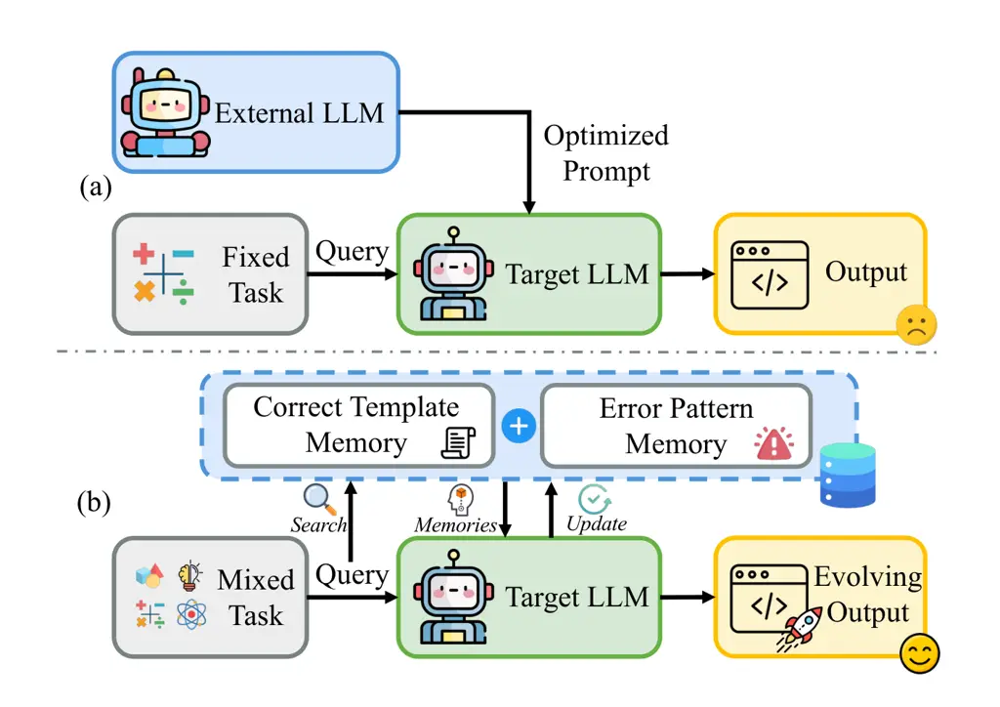
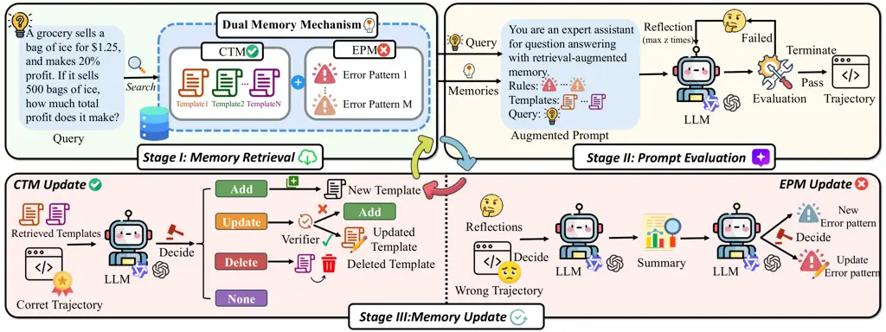

# Generalizable Self-Evolving Memory for Automatic Prompt Optimization

Guanbao Liang    Yuanchen Bei    Sheng Zhou    Yuheng Qin
Affiliation: Alibaba Group{liangguanbao, zhousheng_zju, bjj}@zju.edu.cn,
bei4@illinois.edu    Huan Zhou, Bingxin Jia, Bin Li, Jiajun Bu
Email: [{qinyuheng.qyh, xinyan.zh, bingxin.jbx,
yansheng}@alibaba-inc.com\* Equal contribution, \$†\$ Corresponding
author](mailto:*%20Equal%20contribution,%20%24%E2%80%A0%24%20Corresponding%20author)
Affiliation: Zhejiang University Affiliation: Alibaba
Group{liangguanbao, zhousheng_zju, bjj}@zju.edu.cn, bei4@illinois.edu
Affiliation: University of Illinois Urbana-Champaign

###### Abstract

Automatic prompt optimization is a promising approach for adapting large
language models (LLMs) to downstream tasks, yet existing methods
typically search for a specific prompt specialized to a fixed task. This
paradigm limits generalization across heterogeneous queries and prevents
models from accumulating reusable prompting knowledge over time. In this
paper, we propose MemAPO, a memory-driven framework that
reconceptualizes prompt optimization as generalizable and self-evolving
experience accumulation. MemAPO maintains a dual-memory mechanism that
distills successful reasoning trajectories into reusable strategy
templates while organizing incorrect generations into structured error
patterns that capture recurrent failure modes. Given a new prompt, the
framework retrieves both relevant strategies and failure patterns to
compose prompts that promote effective reasoning while discouraging
known mistakes. Through iterative self-reflection and memory editing,
MemAPO continuously updates its memory, enabling prompt optimization to
improve over time rather than restarting from scratch for each task.
Experiments on diverse benchmarks show that MemAPO consistently
outperforms representative prompt optimization baselines while
substantially reducing optimization cost.

## 1 Introduction



Figure 1: Comparison between MemAPO and existing works. (a) Existing
paradigm: an external LLM iteratively refines prompts for one specific
task. (b) MemAPO: self-organizes reusable memories across multiple
tasks.

Large language models (LLMs) have demonstrated remarkable capabilities
across a wide range of tasks, including logical reasoning, mathematical
problem solving, and knowledge-intensive question answering Jaech et al.
(2024); Comanici et al. (2025); Yang et al. (2025); Guo et al. (2025);
Team et al. (2025); Zeng et al. (2025). In practice, however, the
performance of LLMs is highly sensitive to prompt design. Carefully
crafted prompts can substantially improve model performance, while
poorly specified prompts often lead to unstable or suboptimal outputs Li
and Liang (2021); Lester et al. (2021); Liu et al. (2024); Liu et al.
(2022); Dong et al. (2024). As a result, prompt engineering has become a
critical interface for adapting general-purpose LLMs to downstream
applications Wei et al. (2022); Deng et al. (2023); Huang et al. (2026).

Despite its importance, designing effective prompts remains a
labor-intensive and iterative process that requires both domain
expertise and extensive experimentation. To alleviate this burden,
recent studies have explored automatic prompt optimization (APO), which
leverages LLMs to iteratively refine prompts based on task feedback Zhou
et al. (2022); Pryzant et al. (2023); Yang et al. (2023); Guo et al.
(2023). Existing APO approaches typically treat prompt optimization as a
search problem in natural language space. Representative strategies
include text-gradient-based optimization Pryzant et al. (2023);
Yuksekgonul et al. (2025), trajectory-based prompt refinement Yang
et al. (2023); Tang et al. (2025), and evolutionary prompt
search Fernando et al. (2023); Guo et al. (2023). These methods have
shown promising improvements in controlled settings by automatically
generating and refining prompts through iterative evaluation Yuksekgonul
et al. (2025); Xiang et al. (2025).

However, most existing APO methods are formulated as a prompt search
problem, where the objective is to identify a specific prompt that
performs well on a fixed task distribution, as illustrated in
Figure 1-(a). While effective in controlled settings, this formulation
faces fundamental challenges in realistic environments. First, prompt
optimization is inherently unstable due to the extremely large and
stochastic prompt space. Small variations in prompts can lead to
significantly different reasoning behaviors, making optimization brittle
and often requiring repeated exploration. Second, useful prompting
knowledge is frequently reusable across queries. Many tasks share
underlying reasoning strategies, such as decomposition, verification, or
step-by-step deduction. Treating prompt optimization as an isolated
search process for each task fails to capture these shared structures
and prevents the model from accumulating transferable prompting
knowledge. These observations suggest that prompt optimization should
not be viewed merely as prompt search. Instead, it is more naturally
framed as a continual knowledge accumulation process, where reusable
prompting strategies are progressively discovered and refined through
interaction with tasks. Moreover, simply compressing historical
interactions into a single summary is often insufficient. Successful and
failed reasoning trajectories contain fundamentally different types of
information: successful cases reveal effective reasoning strategies,
while failures expose recurring mistakes that should be avoided. A
practical system therefore needs to accumulate and organize both types
of experience to guide future reasoning.

Motivated by this perspective, as shown in Figure 1-(b), we propose
MemAPO, a self-evolving memory framework for automatic prompt
optimization agents. MemAPO enables a target LLM to progressively
accumulate prompting experiences and reuse them across heterogeneous
tasks. Specifically, MemAPO maintains a dual-memory mechanism that
captures both successful strategies and recurrent failure signals.
Successful prompting trajectories are distilled into reusable reasoning
strategies, while incorrect generations are abstracted into structured
failure rules that help prevent recurring mistakes. To handle
heterogeneous query distributions, MemAPO dynamically retrieves relevant
experiences from memory based on the characteristics of each input
query. Retrieved reasoning strategies provide guidance for effective
problem solving, while failure rules help the model avoid previously
observed mistakes when constructing prompts. When existing experiences
fail to provide adequate guidance, the model autonomously generates new
strategies through a self-reflection mechanism and updates the memory
accordingly, enabling the prompting knowledge to evolve over time.
Through this process, prompt optimization is transformed from an
externally supervised search procedure into an internal capability that
continuously improves through experience accumulation. We evaluate
MemAPO on diverse prompt optimization benchmarks. Experimental results
show that MemAPO consistently outperforms representative automatic
prompt optimization baselines across multiple datasets and model
backbones. In addition, by amortizing optimization cost through
experience reuse, MemAPO significantly reduces token consumption and API
calls, making it more practical for large-scale deployment. Our key
contributions are summarized as follows:

- •
  We introduce a new perspective on prompt optimization by framing it as
  a self-evolving experience accumulation problem, moving beyond the
  traditional paradigm of searching for a task-specific optimal prompt.
- •
  We propose MemAPO, a self-evolving memory framework that enables LLMs
  to internalize, store, and reuse prompting experiences through a
  dual-memory mechanism capturing both strategy templates and error
  patterns.
- •
  Extensive experiments across diverse reasoning benchmarks demonstrate
  that MemAPO achieves superior performance and generalization while
  substantially reducing optimization cost.

Figure 2: Comparison of performance and optimization costs across six
automatic prompt optimization methods, six tasks, and two backbones.
MemAPO achieves the best average performance across all datasets on both
backbones, while notably reducing cost by approximately 57.2% compared
to the strong baseline TextGrad.

## 2 Related Work

### 2.1 Automatic Prompt Optimization

Research on engineering effective prompts for LLMs has been rapidly
advancing. Early works like in-context learning Dong et al. (2024),
chain-of-thoughts Wei et al. (2022); Kojima et al. (2022), developed
through human insights and extensive experimentation, significantly
boost the performance of LLMs. To further automate this process, recent
works have shifted towards utilizing LLMs as optimizers, which can be
broadly categorized into three paradigms. (1) Text Gradient-Based
Optimization Pryzant et al. (2023); Yuksekgonul et al. (2025), which
utilizes natural language feedback as optimization signals to refine
prompts; (2) Trajectory-Based Optimization Yang et al. (2023); Tang
et al. (2025), which leverages historical prompt-score pairs to guide
iterative improvement; and (3) Evolutionary-Based Optimization Guo
et al. (2023); Fernando et al. (2023), which employs mutation and
selection operators on a prompt population. Despite their effectiveness,
these approaches generally depend on external, more capable LLM (e.g.,
GPT-5) serving as the optimizer for a weaker target model (e.g.,
GPT-4o-mini), which limits their scalability and practical deployment.

### 2.2 Self-Evolving Agents

The inherent dependency on external supervision raises a fundamental
question: Can a model optimize itself without external guidance? Early
works Madaan et al. (2023); Lu et al. (2023) mainly focus on
self-correction and iterative refinement, where a model bootstraps its
own performance by critiquing and revising its initial outputs. Drawing
inspiration from human cognitive processes, where past experiences are
distilled to inform current decisions, recent research Hu et al. (2025);
Wei et al. (2025); Bei et al. (2026) has incorporated memory-augmented
mechanisms to store and retrieve historical insights. From the
perspective of memory abstraction, existing self-learning methods can be
broadly divided into two categories. The first group Shinn et al.
(2023); Zhang et al. (2023) focuses on episodic memory, where concrete
interaction trajectories and failure cases are stored and reused. In
contrast, the second group abstracts historical interactions into
higher-level rules or guidelines, as exemplified by Zhao et al. (2024);
Fu et al. (2024).

## 3 Methodology of MemAPO



Figure 3: Overall illustration of MemAPO. (I) Memory Retrieval: it first
retrieves relevant strategies and failure patterns according to the
given query. (II) Prompt Evaluation: Then, the augmented prompt is
constructed and iteratively evaluated. (III) Memory Update: Newly
acquired experiecnes are consolidated into memory.

### 3.1 Problem Definition

Consider a downstream task $`\mathcal{D}=\{(q_{i},a_{i})\}_{i=1}^{n}`$
consisting of $`n`$ question-answer pairs, where $`q_{i}`$ denotes the
input query and $`a_{i}`$ is the corresponding ground-truth answer. Let
$`\mathcal{M}_{t}`$ denote the target LLM, and let $`\phi(\cdot,\cdot)`$
be an evaluation function that measures the quality of a generated
response with respect to the ground truth.

The objective of prompt optimization is to learn a prompt $`p`$ that
maximizes the expected task performance of the target model over the
data distribution. Formally, the optimal prompt $`p^{*}`$ can be defined
as

```math
p^{*}=\underset{p}{\arg\max}\,\mathbb{E}_{(q,a)\sim\mathcal{D}}\Big[\phi\big(\mathcal{M}_{t}(q;p),a\big)\Big], \tag{1}
```

where $`\mathcal{M}_{t}(q;p)`$ denotes the response generated by the
target model conditioned on the input query $`q`$ and prompt $`p`$.
Unlike conventional automatic prompt optimization approaches that search
for a single static prompt, we model the prompt as a composition of two
components $`p=[p_{\mathrm{Inst}},\,p_{\mathrm{Mem}}(q)]`$. The first
component $`p_{\mathrm{Inst}}`$ represents the invariant instruction
that specifies general task guidelines such as reasoning style or output
format. The second component $`p_{\mathrm{Mem}}(q)`$ is a
query-dependent memory augmentation retrieved from historical
experience, which provides task-relevant strategies or constraints for
the specific query $`q`$.

Under this formulation, prompt optimization can be viewed as learning
how to accumulate, organize, and retrieve reusable prompting knowledge
such that the memory-augmented prompt $`p`$ improves the model’s
performance across heterogeneous queries.

### 3.2 MemAPO Overview

The overview architecture of MemAPO is illustrated in Figure 3.
Specifically, MemAPO maintains a Dual-Memory Mechanism (Section 3.3)
that organizes past iteration experiences into two complementary forms
of knowledge: (1) _Correct templates_ for transferable prompting
strategies; and (2) _Error patterns_ for preventing repeated mistakes.
Based on this memory structure, MemAPO contains three stages:

(1) Memory Retrieval (Section 3.4). Given an input query, the framework
retrieves relevant strategy templates and global error patterns from
memory to construct a memory-augmented prompt that constrains the
model’s reasoning behavior.

(2) Prompt Evaluation (Section 3.5). The target LLM generates responses
conditioned on the retrieved memory, while a self-reflection mechanism
iteratively evaluates intermediate outputs and produces corrective
feedback to improve reasoning.

(3) Memory Update (Section 3.6). Newly acquired experiences are
consolidated into memory by either creating/updating templates or
summarizing error patterns, enabling the memory repository to evolve
over time.

During inference, MemAPO directly retrieves relevant memory and performs
a single-pass response generation without invoking the reflection loop,
allowing efficient deployment while benefiting from accumulated
prompting knowledge.

### 3.3 Dual Memory Mechanism

To enable continual improvement through experience accumulation, MemAPO
maintains a structured memory that abstracts reusable knowledge from
historical interactions. Specifically, MemAPO organizes historical
experiences into two complementary memory components: Correct-Template
Memory (CTM), which captures reusable successful strategies, and
Error-Pattern Memory (EPM), which summarizes recurring failure modes.
Together, these two components provide both positive guidance and
negative constraints during prompt construction.

##### Correct-Template Memory (CTM).

Inspired by schema theory in cognitive science, humans interpret new
situations by activating previously learned knowledge structures rather
than reasoning from scratch Rumelhart (2017). Similarly, CTM abstracts
successful interaction histories into structured templates that can be
reused across semantically similar queries. Formally, the template
repository is defined as
$`\mathcal{E}_{\mathrm{CTM}}=\{T_{1},T_{2},\dots\}`$. Each template is
represented as $`T=\{I,S,C\}`$. Here, $`I`$ denotes the index, which
specifies the applicability conditions of the template and serves as a
retrieval key. $`S`$ denotes the strategy, which distills transferable
reasoning procedures extracted from successful trials. By separating
strategies from specific inputs, CTM enables knowledge reuse across
heterogeneous queries. Finally, $`C`$ denotes the set of supporting
cases, which store verifiable exemplars that ground the abstract
strategy and facilitate imitation during prompting.

##### Error-Pattern Memory (EPM).

While CTM captures successful experiences, Error-Pattern Memory records
common failure patterns observed during previous trials. Instead of
storing raw incorrect responses, EPM abstracts them into high-level
reflective rules that describe typical reasoning mistakes and
corresponding prevention principles. Formally, the error-pattern
repository is defined as
$`\mathcal{E}_{\mathrm{EPM}}=\{R_{1},R_{2},\ldots\}`$. where each $`R`$
represents a generalized description of a recurrent failure mode derived
from reflection on erroneous outputs.

### 3.4 Memory Retrieval

Given a query $`q`$, the memory retrieval stage selects relevant
experiences from the dual-memory repository to construct a
memory-augmented prompt. Formally, the retrieval process can be
expressed as

```math
\mathcal{T}_{q}^{(k)},\mathcal{R}_{q}=\mathcal{F}_{\mathrm{Retrieval}}\left(\mathcal{E}_{\mathrm{CTM}},\mathcal{E}_{\mathrm{EPM}}\,\middle|\,q\right), \tag{2}
```

where $`\mathcal{T}_{q}^{(k)}`$ denotes the set of retrieved strategy
templates from CTM and $`\mathcal{R}_{q}`$ represents the retrieved
error patterns from EPM.

##### CTM Retrieval.

To identify relevant prompting strategies, we retrieve templates from
the Correct-Template Memory $`\mathcal{E}_{\mathrm{CTM}}`$ according to
semantic similarity between the query and template indices.
Specifically, let $`\mathbf{e}_{q}`$ denote the embedding of the query
and $`\mathbf{e}_{I}`$ denote the embedding of a template index $`I`$.
The similarity score is computed as
$`f_{\mathrm{sim}}(q,T)=\cos(\mathbf{e}_{q},\mathbf{e}_{I})`$. The
retrieved template set is defined as:

```math
\mathcal{T}_{q}^{(k)}=\mathrm{TopK}_{T\in\mathcal{E}_{\mathrm{CTM}}}\;f_{\mathrm{sim}}(q,T), \tag{3}
```

where $`\mathcal{T}_{q}^{(k)}=\{T_{q}^{(1)},\ldots,T_{q}^{(k)}\}`$
contains the top-$`k`$ templates with the highest similarity scores. To
avoid retrieving irrelevant strategies, we further filter templates
whose similarity scores fall below a predefined threshold
$`\theta_{\mathrm{corr}}`$.

##### EPM Retrieval.

Unlike CTM, Error-Pattern Memory encodes global behavioral constraints
that apply broadly across queries. Therefore, all stored error patterns
are retrieved and incorporated into the prompt context
$`\mathcal{R}_{q}=\mathcal{E}_{\mathrm{EPM}}`$. These patterns provide
negative guidance during reasoning by discouraging the model from
reproducing previously observed failure modes.

### 3.5 Prompt Evaluation

Given the retrieved strategy templates $`\mathcal{T}_{q}^{(k)}`$ and
error patterns $`\mathcal{R}_{q}`$, MemAPO constructs a memory-augmented
prompt to guide the reasoning process of the target model. The augmented
prompt is defined as
$`p_{\mathrm{aug}}=[p_{\mathrm{Inst}},\mathcal{R}_{q},\mathcal{T}_{q}^{(k)}]`$
where $`p_{\mathrm{Inst}}`$ denotes the task instruction, while
$`\mathcal{R}_{q}`$ and $`\mathcal{T}_{q}^{(k)}`$ provide negative
constraints and positive reasoning strategies retrieved from memory.

To acquire informative experiences for future memory updates, MemAPO
employs a self-reflection mechanism Shinn et al. (2023) that iteratively
evaluates intermediate reasoning attempts and produces corrective
feedback. Let $`\mathcal{L}`$ denote the set of accumulated reflections,
initialized as $`\mathcal{L}=\{\emptyset\}`$. Conditioned on the query,
augmented prompt, and current reflections, the target model generates an
initial attempt

```math
\hat{a}_{0}=\mathcal{M}_{t}(q,p_{\mathrm{aug}},\mathcal{L};p_{\mathrm{ans}}^{\mathrm{meta}}), \tag{4}
```

where $`p_{\mathrm{ans}}^{\mathrm{meta}}`$ is a meta-prompt that
instructs the model to incorporate retrieved memories and reflections
during reasoning.

The generated answer is then evaluated using the task evaluation
function $`\phi(\hat{a}_{0},a)`$. If the attempt fails, the model is
prompted to reflect on the reasoning process and produce a corrective
insight

```math
\mathrm{ref}=\mathcal{M}_{t}(q,p_{\mathrm{aug}},\mathcal{L},\hat{a}_{0};p_{\mathrm{ref}}^{\mathrm{meta}}), \tag{5}
```

where $`p_{\mathrm{ref}}^{\mathrm{meta}}`$ denotes the meta-prompt for
reflection. The newly generated reflection is incorporated into the
reflection set via
$`\mathcal{L}\leftarrow\mathcal{L}\cup\{\mathrm{ref}\}`$. The model then
retries answer generation using the updated reflection context according
to Eq. 4. This self-reflection loop continues until either a correct
answer is produced or the maximum number of retries is reached.

### 3.6 Memory Update

After prompt generation and evaluation, MemAPO updates its memory
repository based on the outcome of the reasoning attempt.

##### CTM Update.

Correct-Template Memory evolves by incorporating successful reasoning
experiences into reusable templates. If no template is retrieved for the
current query, the model constructs a new template by summarizing the
successful interaction. Concretely, the target model generates a new
template index and strategy using a meta-prompt
$`p_{\mathrm{corr}}^{\mathrm{meta}}`$:

```math
(I_{\mathrm{new}},S_{\mathrm{new}})=\mathcal{M}_{t}(q,\hat{a},\mathcal{L};p_{\mathrm{corr}}^{\mathrm{meta}}), \tag{6}
```

where $`\hat{a}`$ denotes the final correct response and $`\mathcal{L}`$
contains the accumulated reflections. The resulting template
$`T_{\mathrm{new}}=\{I_{\mathrm{new}},S_{\mathrm{new}},C_{\mathrm{new}}\}`$
is added to the CTM repository $`\mathcal{E}_{\mathrm{CTM}}`$, where
$`C_{\mathrm{new}}=\{(q,\hat{a})\}`$ stores the corresponding
interaction case.

When relevant templates are retrieved, the new successful interaction
$`(q,\hat{a})`$ is appended to their case sets to enrich supporting
examples. To further maintain template quality, the retrieved templates
$`\mathcal{T}_{q}^{(k)}`$, together with the interaction $`(q,\hat{a})`$
and reflections $`\mathcal{L}`$, are provided to the model via a
meta-prompt $`p_{\mathrm{act}}^{\mathrm{meta}}`$ that determines how the
templates should evolve. The model selects one of the following template
operations: (1) $`\mathrm{ADD}`$: create a new template when the current
interaction represents a novel reasoning pattern. (2)
$`\mathrm{UPDATE}`$: refine an existing template by incorporating
complementary strategy information. (3) $`\mathrm{DELETE}`$: remove
templates that are contradicted by newly observed evidence. (4)
$`\mathrm{NONE}`$: retain the existing template without modification.
For the $`\mathrm{UPDATE}`$ operation, we perform a verification step: a
subset of stored cases from the original template is sampled, and the
updated strategy is accepted only if it successfully solves all sampled
cases. Otherwise, the update is rejected, and a new template is created
instead. Further, to prevent unbounded growth of the template
repository, MemAPO periodically performs template consolidation when the
number of templates exceeds a predefined capacity. Similar templates are
merged to maintain a compact and diverse set of strategies.

##### EPM Update.

While CTM records successful experiences, Error-Pattern Memory captures
recurring failure modes. After a failed attempt, the accumulated
reflections $`\mathcal{L}`$ are summarized into a generalized error
pattern

```math
R_{\mathrm{sum}}=\mathcal{M}_{t}(q,a,\mathcal{L};p_{\mathrm{sum}}^{\mathrm{meta}}), \tag{7}
```

where $`p_{\mathrm{sum}}^{\mathrm{meta}}`$ is a meta-prompt that
abstracts the reflection trajectory into a concise rule describing the
failure cause. To maintain a compact error memory, we identify similar
error patterns in the repository according to semantic similarity

```math
\mathcal{R}=\{R_{i}\mid f_{\mathrm{sim}}(R_{i},R_{\mathrm{sum}})>\theta_{\mathrm{error}}\}, \tag{8}
```

where $`\theta_{\mathrm{error}}`$ denotes a similarity threshold. If
similar patterns exist, the model decides whether to refine them by
incorporating the new rule; otherwise, a new error pattern is added to
the repository.

## 4 Experiment

|                                                                                            |                                                            |                   |                 |                          |               |                     |                |                         |                              |
| ------------------------------------------------------------------------------------------ | ---------------------------------------------------------- | ----------------- | --------------- | ------------------------ | ------------- | ------------------- | -------------- | ----------------------- | ---------------------------- |
| Backbone                                                                                   |  | Logical Reasoning |                 | Mathematical Calculation |               | Knowledge Intensive |                | Avg. Perf. $`\uparrow`$ | Avg. Cost(\$) $`\downarrow`$ |
|                                                                                            |                                                            | GeoShape (BBH)    | GeoShape (BBEH) | AQuA-RAT                 | Gaokao MathQA | Gaokao Geography    | Gaokao History |                         |                              |
| Qwen3-8B ![[Uncaptioned image]](arxiv-2603-21520v1--9ab139e193d4.figures/figure-3.webp)    | IO                                                         | 23.0              | 6.0             | 79.9                     | 68.5          | 72.7                | 80.0           | 55.0                    | \-                           |
|                                                                                            | CoT Wei et al. (2022)                                      | 64.0              | 6.0             | 82.5                     | 65.7          | 76.8                | 78.5           | 62.3                    | \-                           |
|                                                                                            | Step-Back Zheng et al. (2023)                              | 58.0              | 8.0             | 81.8                     | 64.5          | 70.7                | 76.3           | 59.9                    | \-                           |
|                                                                                            | RaR Deng et al. (2023)                                     | 53.0              | 3.0             | 80.5                     | 70.1          | 78.8                | 77.8           | 60.5                    | \-                           |
|                                                                                            | ProTeGi Pryzant et al. (2023)                              | 56.0              | 7.0             | 81.2                     | 74.5          | 75.8                | 80.7           | 62.5                    | 7.44                         |
|                                                                                            | OPRO Yang et al. (2023)                                    | 36.0              | 9.0             | 82.5                     | 63.3          | 72.7                | 77.0           | 56.8                    | 1.81                         |
|                                                                                            | TextGrad Yuksekgonul et al. (2025)                         | 39.0              | 14.0            | 80.5                     | 78.5          | 76.8                | 79.3           | 61.4                    | 0.99                         |
|                                                                                            | PromptBreeder Fernando et al. (2023)                       | 23.0              | 10.0            | 74.0                     | 76.6          | 70.7                | 81.5           | 56.0                    | 10.44                        |
|                                                                                            | SPO Xiang et al. (2025)                                    | 28.0              | 25.0            | 72.7                     | 51.0          | 71.7                | 78.5           | 54.5                    | 0.08                         |
|                                                                                            | MemAPO                                                     | 77.0              | 24.0            | 83.1                     | 76.9          | 79.8                | 83.0           | 70.6                    | 0.41                         |
|                                                                                            |                                                            |                   |                 |                          |               |                     |                |                         |                              |
| GPT-4o-mini ![[Uncaptioned image]](arxiv-2603-21520v1--9ab139e193d4.figures/figure-4.webp) | IO                                                         | 35.0              | 13.0            | 61.7                     | 39.4          | 71.7                | 71.9           | 48.8                    | \-                           |
|                                                                                            | CoT Wei et al. (2022)                                      | 47.0              | 17.0            | 69.5                     | 35.5          | 70.7                | 67.4           | 51.2                    | \-                           |
|                                                                                            | Step-Back Zheng et al. (2023)                              | 61.0              | 25.0            | 59.7                     | 41.8          | 62.6                | 60.7           | 51.8                    | \-                           |
|                                                                                            | RaR Deng et al. (2023)                                     | 43.0              | 30.0            | 66.9                     | 38.6          | 67.7                | 58.5           | 50.8                    | \-                           |
|                                                                                            | ProTeGi Pryzant et al. (2023)                              | 71.0              | 14.0            | 76.0                     | 45.0          | 68.7                | 60.0           | 55.8                    | 4.52                         |
|                                                                                            | OPRO Yang et al. (2023)                                    | 35.0              | 18.0            | 79.2                     | 49.4          | 71.7                | 68.1           | 53.6                    | 0.81                         |
|                                                                                            | TextGrad Yuksekgonul et al. (2025)                         | 76.0              | 23.0            | 79.9                     | 56.2          | 73.7                | 72.6           | 63.6                    | 0.70                         |
|                                                                                            | PromptBreeder Fernando et al. (2023)                       | 42.0              | 13.0            | 78.6                     | 46.6          | 66.7                | 65.9           | 52.1                    | 6.28                         |
|                                                                                            | SPO Xiang et al. (2025)                                    | 54.0              | 24.0            | 77.9                     | 47.0          | 72.7                | 70.4           | 57.7                    | 0.05                         |
|                                                                                            | MemAPO                                                     | 90.0              | 43.0            | 82.5                     | 62.2          | 73.7                | 72.6           | 70.7                    | 0.31                         |

Table 1: Main comparison results across three domains. Tasks from
similar domains are merged into a unified training set, and the
optimized prompt is evaluated separately on each task. All methods use
the same model for both prompt optimization and evaluation, and
experiments are conducted on Qwen3-8B and GPT-4o-mini, respectively.
GeoShape refers to the “Geometric Shapes" task, Avg. Perf and Avg. Cost
refers to the average performance and the average optimization cost,
respectively.

### 4.1 Experimental Setup

##### Datasets.

We evaluate MemAPO on a collection of datasets spanning logical
reasoning, mathematical calculation, and knowledge-intensive tasks. For
logical reasoning, we adopt two established datasets, Big-Bench Hard
(BBH) Suzgun et al. (2023) and Big-Bench Extra Hard (BBEH) Kazemi et al.
(2025), and focus on the Geometric Shapes task. We use multiple
sub-tasks from AGIEval Zhong et al. (2024), including AQuA-RAT and
Gaokao-Math for mathematical calculation, as well as Gaokao-Geography
and Gaokao-History for knowledge-intensive reasoning. Following
Yuksekgonul et al. (2025), we sampled portions from original tasks as
test sets for each sub-task. Detailed construction procedures are
provided in the Appendix  A.1.

##### Baselines.

We compare MemAPO with representative APO methods: ProTeGi Pryzant
et al. (2023), OPRO Yang et al. (2023), TextGrad Yuksekgonul et al.
(2025), PromptBreeder Fernando et al. (2023), SPO Xiang et al. (2025).
In addition, we also consider conventional prompting methods, comprising
IO (direct inference), CoT (chain-of-thought) Wei et al. (2022),
Step-Back Zheng et al. (2023), and RaR (rephrase and respond) Deng
et al. (2023).

##### Implementation Details & Metrics.

We conduct experiments with GPT-4o-mini and Qwen3-8B Yang et al. (2025),
respectively, using the same model as both the task executor and the
prompt optimizer. We report the performance using accuracy, following
Suzgun et al. (2023); Kazemi et al. (2025); Zhong et al. (2024). We also
measure the optimization cost to assess efficiency. Other details are
provided in the Appendix  A.2.

### 4.2 Experimental Results and Analysis

##### Main Results.

Table 1 reports the performance of different APO methods under
heterogeneous settings, where tasks from similar domains are jointly
optimized and evaluated separately. On GPT-4o-mini, our method achieves
the best average performance 70.7% across all tasks, outperforming the
strongest baseline TextGrad by 7.1%. Compared with baselines that
exhibit clear trade-offs across tasks, improving some datasets while
degrading others, our method consistently yields stable gains across all
tasks, demonstrating the effectiveness of the generalizable and
self-evolving experience accumulation design.

To further demonstrate the effectiveness of MemAPO, we conduct
experiments on Qwen3-8B backbone and observe similar trends.
Specifically, MemAPO achieves 70.6% average accuracy, exhibiting the
best performance on most datasets. These results indicate that our
proposed MemAPO generalizes well across both proprietary and open-source
models.

##### Cost Analysis.

Besides the performance, we present a comparison of optimization costs
and performance between MemAPO and other methods in Figure 2. It shows
optimization costs on the x-axis and performance on the y-axis, with
methods towards the top-left being more efficient and powerful. Whether
using Qwen3-8B or GPT-4o-mini as the target LLM, our method achieves
superior performance while ranking second in optimization efficiency
across all methods. Compared to the strong baseline TextGrad, it reduces
costs by 58.6% and 55.7%, respectively. This significant optimization
cost reduction can be attributed to the efficient experience reuse,
making MemAPO suitable for practical applications.

##### Generalization Analysis.

|               |               |                |
| ------------- | ------------- | -------------- |
| Method        | Gaokao MathQA | Gaokao History |
| IO            | 39.4          | 71.9           |
| CoT           | 35.5          | 67.4           |
| StepBack      | 41.8          | 60.7           |
| Rephrase      | 38.6          | 58.5           |
| ProTeGi       | 45.0          | 53.3           |
| OPRO          | 56.2          | 67.4           |
| TextGrad      | 59.0          | 69.6           |
| PromptBreeder | 37.5          | 71.1           |
| SPO           | 35.9          | 71.9           |
| MemAPO        | 61.8          | 72.6           |

Table 2: Cross-domain (Gaokao MathQA and Gaokao History) experiment
using GPT-4o-mini.

We have discussed the results under an intra-domain setting where tasks
from the same domain are jointly optimized. A more challenging and
practical scenario arises when mixing tasks from different domains. We
construct a heterogeneous dataset by selecting Gaokao Math QA and Gaokao
History from the mathematical calculating and knowledge-intensive
domains, respectively. As shown in Table  2, most baselines suffer from
severe performance degradation, exemplified by SPO, whose performance
drops 11.1% on Gaokao MathQA. This indicates that a specific optimized
prompt struggles to reconcile the conflicting reasoning demands of
different domains. In contrast, MemAPO maintains improvements on two
tasks, achieving the best performance, which demonstrates the
generalization ability.

### 4.3 Ablation Study

|                         |                      |          |               |
| ----------------------- | -------------------- | -------- | ------------- |
| Correct Template Memory | Error Pattern Memory | AQuA-RAT | Gaokao MathQA |
| ✗                       | ✗                    | 61.7     | 39.4          |
| ✗                       | ✓                    | 77.9     | 60.2          |
| ✓                       | ✗                    | 80.5     | 61.0          |
| ✓                       | ✓                    | 82.5     | 62.2          |

Table 3: Ablation study on the effect of dual memory components in
MemAPO using GPT-4o-mini.

|               |             |            |               |            |
| ------------- | ----------- | ---------- | ------------- | ---------- |
| Method        | AQUA-RAT    |            | Gaokao MathQA |            |
|               | GPT-4o-mini | GPT-5-Chat | GPT-4o-mini   | GPT-5-Chat |
| ProTeGi       | 76.0        | 82.5       | 45.0          | 50.6       |
| OPRO          | 79.2        | 79.2       | 49.4          | 47.0       |
| TextGrad      | 79.9        | 81.8       | 56.2          | 60.2       |
| PromptBreeder | 78.6        | 80.5       | 46.6          | 36.3       |
| SPO           | 77.9        | 79.2       | 47.0          | 63.3       |
| MemAPO        | 82.5        | 83.8       | 62.2          | 64.5       |

Table 4: Ablation study on the effect of self-evolving paradigm. We
compare performance across different LLMs for prompt optimization while
adopting GPT-4o-mini for prompt evaluation.

##### The Effect of Dual Memory Components.

To verify the effectiveness of two key components, CTM and EPM, in our
dual-memory mechanism, we conduct an ablation experiment on the
mathematical domain using GPT-4o-mini, as shown in Table 3. The
experiment results demonstrate that CTM improves the performance by 18.8
and 21.6 on AQuA-RAT and Gaokao MathQA, respectively, while EPM yields
improvements of 16.2 and 20.8. Combining with both CTM and EPM, MemAPO
obtains further 2.0 and 1.2 gains, respectively, confirming that
relevant strategies and failure patterns promote effective reasoning
while discouraging known mistakes.

##### The Effect of Self-Evolving Paradigm.

We further conduct an ablation study to validate the effectiveness of
the self-evolving paradigm on the mathematical domain, as shown in Table
 4. The experiment results show that introducing a stronger LLM as
optimizer generally leads to performance improvements (9/12), but may
sometimes have the opposite effect, as exemplified by PromptBreeder and
OPRO, which exhibit performance degradation on Gaokao MathQA
(46.6$`\rightarrow`$36.3, 49.4$`\rightarrow 4`$7.0). For MemAPO, it
still maintains the averaged second-best performance when using
GPT-4o-mini as the optimizer, achieving 98.4% and 96.4% of the
performance obtained with GPT-5, respectively, demonstrating the
effectiveness of the self-evolving paradigm designed in MemAPO.

##### The Impact of Template Number.

Figure 4: Ablation study on the impact of template number with
GPT-4o-mini.

As shown in Figure  4, we analyze the impact of Top-$`k`$ templates
retrieved from CTM on model performance and inference token consumption
on the mathematical domain using GPT-4o-mini. The performance curves on
AQuA-RAT and Gaokao MathQA show similar trends: As the number of
templates increases, the performance initially improves and then
declines, peaking at the top 3 templates. A possible explanation is that
a moderate number of templates offers effective reasoning guidance,
whereas retrieving too many templates introduces redundant or noisy
information and significantly increases the burden on the LLM to manage
multiple templates, potentially leading to instability. In terms of
inference token consumption, as the number of templates increases, the
input context to the LLM becomes longer, resulting in a steady increase
in token usage. Based on the above analysis, we select the top-$`3`$
templates to achieve a good balance of performance and costs.

## 5 Conclusion

In this paper, we revisit automatic prompt optimization from a new
perspective. Instead of treating prompt optimization as a static prompt
search problem, we formulate it as a continual experience accumulation
process. Based on this insight, we propose MemAPO, a self-evolving
memory that enables LLM agents to progressively accumulate and reuse
prompting knowledge across heterogeneous tasks. MemAPO maintains a
dual-memory mechanism that organizes successful reasoning strategies and
failure signals into structured experiences, which are dynamically
retrieved to guide prompt construction and refined through iterative
self-reflection. Extensive experiments demonstrate that MemAPO
consistently improves performance while substantially reducing
optimization cost.

## Limitations

While MemAPO demonstrates strong performance in automatic prompt
optimization through self-evolving memory, some limitations remain. The
current framework focuses on textual reasoning tasks and prompt
optimization in language-based settings, without explicitly modeling
multimodal information such as visual, audio, or structured environment
signals. Extending the memory architecture to support multimodal
experiences may further enhance the generality of the framework in
broader agentic environments.

## References

- Bei et al. (2026) Yuanchen Bei, Tianxin Wei, Xuying Ning, Yanjun Zhao,
  Zhining Liu, Xiao Lin, Yada Zhu, Hendrik Hamann, Jingrui He, and
  Hanghang Tong. 2026. Mem-gallery: Benchmarking multimodal long-term
  conversational memory for mllm agents. _arXiv preprint
  arXiv:2601.03515_.
- Comanici et al. (2025) Gheorghe Comanici, Eric Bieber, Mike
  Schaekermann, Ice Pasupat, Noveen Sachdeva, Inderjit Dhillon, Marcel
  Blistein, Ori Ram, Dan Zhang, Evan Rosen, and 1 others. 2025. Gemini
  2.5: Pushing the frontier with advanced reasoning, multimodality, long
  context, and next generation agentic capabilities. _arXiv preprint
  arXiv:2507.06261_.
- Deng et al. (2023) Yihe Deng, Weitong Zhang, Zixiang Chen, and
  Quanquan Gu. 2023. Rephrase and respond: Let large language models ask
  better questions for themselves. _arXiv preprint arXiv:2311.04205_.
- Dong et al. (2024) Qingxiu Dong, Lei Li, Damai Dai, Ce Zheng, Jingyuan
  Ma, Rui Li, Heming Xia, Jingjing Xu, Zhiyong Wu, Baobao Chang, and 1
  others. 2024. A survey on in-context learning. In _Proceedings of the
  2024 conference on empirical methods in natural language processing_,
  pages 1107–1128.
- Fernando et al. (2023) Chrisantha Fernando, Dylan Banarse, Henryk
  Michalewski, Simon Osindero, and Tim Rocktäschel. 2023. Promptbreeder:
  Self-referential self-improvement via prompt evolution. _arXiv
  preprint arXiv:2309.16797_.
- Fu et al. (2024) Yao Fu, Dong-Ki Kim, Jaekyeom Kim, Sungryull Sohn,
  Lajanugen Logeswaran, Kyunghoon Bae, and Honglak Lee. 2024. Autoguide:
  Automated generation and selection of context-aware guidelines for
  large language model agents. _Advances in Neural Information
  Processing Systems_, 37:119919–119948.
- Guo et al. (2025) Daya Guo, Dejian Yang, Haowei Zhang, Junxiao Song,
  Ruoyu Zhang, Runxin Xu, Qihao Zhu, Shirong Ma, Peiyi Wang, Xiao Bi,
  and 1 others. 2025. Deepseek-r1: Incentivizing reasoning capability in
  llms via reinforcement learning. _arXiv preprint arXiv:2501.12948_.
- Guo et al. (2023) Qingyan Guo, Rui Wang, Junliang Guo, Bei Li, Kaitao
  Song, Xu Tan, Guoqing Liu, Jiang Bian, and Yujiu Yang. 2023.
  Connecting large language models with evolutionary algorithms yields
  powerful prompt optimizers. _arXiv preprint arXiv:2309.08532_.
- Hu et al. (2025) Yuyang Hu, Shichun Liu, Yanwei Yue, Guibin Zhang,
  Boyang Liu, Fangyi Zhu, Jiahang Lin, Honglin Guo, Shihan Dou, Zhiheng
  Xi, and 1 others. 2025. Memory in the age of ai agents. _arXiv
  preprint arXiv:2512.13564_.
- Huang et al. (2026) Wei-Chieh Huang, Weizhi Zhang, Yueqing Liang,
  Yuanchen Bei, Yankai Chen, Tao Feng, Xinyu Pan, Zhen Tan, Yu Wang,
  Tianxin Wei, and 1 others. 2026. Rethinking memory mechanisms of
  foundation agents in the second half. _arXiv preprint
  arXiv:2602.06052_.
- Jaech et al. (2024) Aaron Jaech, Adam Kalai, Adam Lerer, Adam
  Richardson, Ahmed El-Kishky, Aiden Low, Alec Helyar, Aleksander Madry,
  Alex Beutel, Alex Carney, and 1 others. 2024. Openai o1 system card.
  _arXiv preprint arXiv:2412.16720_.
- Kazemi et al. (2025) Mehran Kazemi, Bahare Fatemi, Hritik Bansal, John
  Palowitch, Chrysovalantis Anastasiou, Sanket Vaibhav Mehta, Lalit K
  Jain, Virginia Aglietti, Disha Jindal, Yuanzhu Peter Chen, and 1
  others. 2025. Big-bench extra hard. In _Proceedings of the 63rd Annual
  Meeting of the Association for Computational Linguistics (Volume 1:
  Long Papers)_, pages 26473–26501.
- Kojima et al. (2022) Takeshi Kojima, Shixiang Shane Gu, Machel Reid,
  Yutaka Matsuo, and Yusuke Iwasawa. 2022. Large language models are
  zero-shot reasoners. _Advances in neural information processing
  systems_, 35:22199–22213.
- Lester et al. (2021) Brian Lester, Rami Al-Rfou, and Noah
  Constant. 2021. The power of scale for parameter-efficient prompt
  tuning. In _Proceedings of the 2021 conference on empirical methods in
  natural language processing_, pages 3045–3059.
- Li and Liang (2021) Xiang Lisa Li and Percy Liang. 2021.
  Prefix-tuning: Optimizing continuous prompts for generation. In
  _Proceedings of the 59th Annual Meeting of the Association for
  Computational Linguistics and the 11th International Joint Conference
  on Natural Language Processing (Volume 1: Long Papers)_, pages
  4582–4597.
- Liu et al. (2022) Xiao Liu, Kaixuan Ji, Yicheng Fu, Weng Tam,
  Zhengxiao Du, Zhilin Yang, and Jie Tang. 2022. P-tuning: Prompt tuning
  can be comparable to fine-tuning across scales and tasks. In
  _Proceedings of the 60th Annual Meeting of the Association for
  Computational Linguistics (Volume 2: Short Papers)_, pages 61–68.
- Liu et al. (2024) Xiao Liu, Yanan Zheng, Zhengxiao Du, Ming Ding,
  Yujie Qian, Zhilin Yang, and Jie Tang. 2024. Gpt understands, too. _AI
  Open_, 5:208–215.
- Lu et al. (2023) Jianqiao Lu, Wanjun Zhong, Wenyong Huang, Yufei Wang,
  Qi Zhu, Fei Mi, Baojun Wang, Weichao Wang, Xingshan Zeng, Lifeng
  Shang, and 1 others. 2023. Self: Self-evolution with language
  feedback. _arXiv preprint arXiv:2310.00533_.
- Madaan et al. (2023) Aman Madaan, Niket Tandon, Prakhar Gupta, Skyler
  Hallinan, Luyu Gao, Sarah Wiegreffe, Uri Alon, Nouha Dziri, Shrimai
  Prabhumoye, Yiming Yang, and 1 others. 2023. Self-refine: Iterative
  refinement with self-feedback. _Advances in Neural Information
  Processing Systems_, 36:46534–46594.
- Pryzant et al. (2023) Reid Pryzant, Dan Iter, Jerry Li, Yin Lee,
  Chenguang Zhu, and Michael Zeng. 2023. Automatic prompt optimization
  with “gradient descent” and beam search. In _Proceedings of the 2023
  conference on empirical methods in natural language processing_, pages
  7957–7968.
- Rumelhart (2017) David E Rumelhart. 2017. Schemata: The building
  blocks of cognition. In _Theoretical issues in reading comprehension_,
  pages 33–58. Routledge.
- Shinn et al. (2023) Noah Shinn, Federico Cassano, Ashwin Gopinath,
  Karthik Narasimhan, and Shunyu Yao. 2023. Reflexion: Language agents
  with verbal reinforcement learning. _Advances in Neural Information
  Processing Systems_, 36:8634–8652.
- Suzgun et al. (2023) Mirac Suzgun, Nathan Scales, Nathanael Schärli,
  Sebastian Gehrmann, Yi Tay, Hyung Won Chung, Aakanksha Chowdhery, Quoc
  Le, Ed Chi, Denny Zhou, and 1 others. 2023. Challenging big-bench
  tasks and whether chain-of-thought can solve them. In _Findings of the
  Association for Computational Linguistics: ACL 2023_, pages
  13003–13051.
- Tang et al. (2025) Xinyu Tang, Xiaolei Wang, Wayne Xin Zhao, Siyuan
  Lu, Yaliang Li, and Ji-Rong Wen. 2025. Unleashing the potential of
  large language models as prompt optimizers: Analogical analysis with
  gradient-based model optimizers. In _Proceedings of the AAAI
  Conference on Artificial Intelligence_, volume 39, pages 25264–25272.
- Team et al. (2025) Kimi Team, Yifan Bai, Yiping Bao, Guanduo Chen,
  Jiahao Chen, Ningxin Chen, Ruijue Chen, Yanru Chen, Yuankun Chen,
  Yutian Chen, and 1 others. 2025. Kimi k2: Open agentic intelligence.
  _arXiv preprint arXiv:2507.20534_.
- Wei et al. (2022) Jason Wei, Xuezhi Wang, Dale Schuurmans, Maarten
  Bosma, Fei Xia, Ed Chi, Quoc V Le, Denny Zhou, and 1 others. 2022.
  Chain-of-thought prompting elicits reasoning in large language models.
  _Advances in neural information processing systems_, 35:24824–24837.
- Wei et al. (2025) Tianxin Wei, Noveen Sachdeva, Benjamin Coleman,
  Zhankui He, Yuanchen Bei, Xuying Ning, Mengting Ai, Yunzhe Li, Jingrui
  He, Ed H Chi, and 1 others. 2025. Evo-memory: Benchmarking llm agent
  test-time learning with self-evolving memory. _arXiv preprint
  arXiv:2511.20857_.
- Xiang et al. (2025) Jinyu Xiang, Jiayi Zhang, Zhaoyang Yu, Fengwei
  Teng, Jinhao Tu, Xinbing Liang, Sirui Hong, Chenglin Wu, and Yuyu
  Luo. 2025. Self-supervised prompt optimization. _arXiv preprint
  arXiv:2502.06855_.
- Yang et al. (2025) An Yang, Anfeng Li, Baosong Yang, Beichen Zhang,
  Binyuan Hui, Bo Zheng, Bowen Yu, Chang Gao, Chengen Huang, Chenxu Lv,
  and 1 others. 2025. Qwen3 technical report. _arXiv preprint
  arXiv:2505.09388_.
- Yang et al. (2023) Chengrun Yang, Xuezhi Wang, Yifeng Lu, Hanxiao Liu,
  Quoc V Le, Denny Zhou, and Xinyun Chen. 2023. Large language models as
  optimizers. In _The Twelfth International Conference on Learning
  Representations_.
- Yuksekgonul et al. (2025) Mert Yuksekgonul, Federico Bianchi, Joseph
  Boen, Sheng Liu, Pan Lu, Zhi Huang, Carlos Guestrin, and James
  Zou. 2025. Optimizing generative ai by backpropagating language model
  feedback. _Nature_, 639(8055):609–616.
- Zeng et al. (2025) Aohan Zeng, Xin Lv, Qinkai Zheng, Zhenyu Hou, Bin
  Chen, Chengxing Xie, Cunxiang Wang, Da Yin, Hao Zeng, Jiajie Zhang,
  and 1 others. 2025. Glm-4.5: Agentic, reasoning, and coding (arc)
  foundation models. _arXiv preprint arXiv:2508.06471_.
- Zhang et al. (2023) Danyang Zhang, Lu Chen, Situo Zhang, Hongshen Xu,
  Zihan Zhao, and Kai Yu. 2023. Large language models are
  semi-parametric reinforcement learning agents. _Advances in Neural
  Information Processing Systems_, 36:78227–78239.
- Zhao et al. (2024) Andrew Zhao, Daniel Huang, Quentin Xu, Matthieu
  Lin, Yong-Jin Liu, and Gao Huang. 2024. Expel: Llm agents are
  experiential learners. In _Proceedings of the AAAI Conference on
  Artificial Intelligence_, volume 38, pages 19632–19642.
- Zheng et al. (2023) Huaixiu Steven Zheng, Swaroop Mishra, Xinyun Chen,
  Heng-Tze Cheng, Ed H Chi, Quoc V Le, and Denny Zhou. 2023. Take a step
  back: Evoking reasoning via abstraction in large language models.
  _arXiv preprint arXiv:2310.06117_.
- Zhong et al. (2024) Wanjun Zhong, Ruixiang Cui, Yiduo Guo, Yaobo
  Liang, Shuai Lu, Yanlin Wang, Amin Saied, Weizhu Chen, and Nan
  Duan. 2024. Agieval: A human-centric benchmark for evaluating
  foundation models. In _Findings of the Association for Computational
  Linguistics: NAACL 2024_, pages 2299–2314.
- Zhou et al. (2022) Yongchao Zhou, Andrei Ioan Muresanu, Ziwen Han,
  Keiran Paster, Silviu Pitis, Harris Chan, and Jimmy Ba. 2022. Large
  language models are human-level prompt engineers. In _The eleventh
  international conference on learning representations_.

## Appendix A Appendix

### A.1 Tasks and Data Details

In this section, we present the details of the experimental dataset
sizes and data splits in Table 5. Table 6 presents the details of the
dataset licenses and sources. All datasets are released under the MIT
License or the Apache License 2.0 and are open for academic research. No
personal privacy information is included.

|                          |             |      |
| ------------------------ | ----------- | ---- |
| Dataset Name             | Train & Dev | Test |
| BBH-Geometric Shapes     | 150         | 100  |
| BBEH-Geometric Shapes    | 100         | 100  |
| AGIEval-AQuA-RAT         | 100         | 154  |
| AGIEval-Gaokao MathQA    | 100         | 251  |
| AGIEval-Gaokao Geography | 100         | 99   |
| AGIEval-Gaokao History   | 100         | 135  |

Table 5: Dataset sizes and data splits.

|                          |                    |                                                                                                                                                                                              |
| ------------------------ | ------------------ | -------------------------------------------------------------------------------------------------------------------------------------------------------------------------------------------- |
| Dataset                  | License            | Source                                                                                                                                                                                       |
| BBH-Geometric Shapes     | MIT License        | [https://github.com/suzgunmirac/BIG-Bench-Hard/blob/main/bbh/geometric_shapes.json](https://github.com/suzgunmirac/BIG-Bench-Hard/blob/main/bbh/geometric_shapes.json)                       |
| BBEH-Geometric Shapes    | Apache License 2.0 | [https://github.com/google-deepmind/bbeh/tree/main/bbeh/benchmark_tasks/bbeh_geometric_shapes](https://github.com/google-deepmind/bbeh/tree/main/bbeh/benchmark_tasks/bbeh_geometric_shapes) |
| AGIEval-AQuA-RAT         | MIT License        | [https://github.com/ruixiangcui/AGIEval/blob/main/data/v1/aqua-rat.jsonl](https://github.com/ruixiangcui/AGIEval/blob/main/data/v1/aqua-rat.jsonl)                                           |
| AGIEval-Gaokao MathQA    | MIT License        | [https://github.com/ruixiangcui/AGIEval/blob/main/data/v1/gaokao-mathqa.jsonl](https://github.com/ruixiangcui/AGIEval/blob/main/data/v1/gaokao-mathqa.jsonl)                                 |
| AGIEval-Gaokao Geography | MIT License        | [https://github.com/ruixiangcui/AGIEval/blob/main/data/v1/gaokao-geography.jsonl](https://github.com/ruixiangcui/AGIEval/blob/main/data/v1/gaokao-geography.jsonl)                           |
| AGIEval-Gaokao History   | MIT License        | [https://github.com/ruixiangcui/AGIEval/blob/main/data/v1/gaokao-history.jsonl](https://github.com/ruixiangcui/AGIEval/blob/main/data/v1/gaokao-history.jsonl)                               |

Table 6: License and Source of the datasets.

##### BBH-Geometric Shapes

is a sub-task from the BIG-Bench Hard dataset Suzgun et al. (2023). This
task focuses on geometric reasoning, requiring the model to determine
the geometric shape that would be generated based on the given SVG path
element containing multiple commands. In the experiments, we follow the
dataset split used by Yuksekgonul et al. (2025).

##### BBEH-Geometric Shapes

is a sub-task from the BIG-Bench Extra Hard dataset Kazemi et al. (2025)
that builds upon BBH by replacing each of the 23 tasks from BBH with a
novel counterpart. BBEH-Geometric Shapes is much more difficult than the
BBH-Geometric Shapes because each set of given commands can draw
multiple shapes and may involve many useless commands. Following the
Yuksekgonul et al. (2025), we randomly split (seed=42) the data into
training, validation, and test sets with a 50:50:100 ratio.

##### AGIEval-AQuA-RAT

is a subset of the AGIEval benchmark Zhong et al. (2024), focusing on
evaluating the mathematical problem-solving ability using questions from
the GRE and GMAT exams. In the experiments, 100 samples are randomly
selected (seed=42) for the training and development set, with the
remaining samples used for testing. AGIEval-Gaokao MathQA,
AGIEval-Gaokao Geography, and AGIEval-Gaokao History adopt the same data
split to facilitate the heterogeneous datasets’ construction. For
brevity, we omit repeating this split strategy when introducing these
tasks later.

##### AGIEval-Gaokao MathQA

is a subset of the AGIEval Zhong et al. (2024) that measures
mathematical reasoning performance on Chinese college-entrance exam
questions.

##### AGIEval-Gaokao Geography

This AGIEval subset Zhong et al. (2024) targets geography-oriented
question answering and is composed of problems collected from the
Chinese Gaokao Geography exam.

##### AGIEval-Gaokao History

Within AGIEval Zhong et al. (2024), this subset focuses on historical
understanding by evaluating responses to questions drawn from the
Chinese Gaokao History exam.

### A.2 Baseline Details

In this section, we report the configurations of the baselines used for
comparison with MemAPO in the experiments. Except for the analysis
described in section 4.3, all LLM components serving as different roles
in the methods are instantiated using the same underlying model.

##### ProTeGi

performs prompt optimization for 6 iterations with a minibatch size of 64. At each iteration, the prompt is evaluated on sampled training
examples to identify errors, which are summarized into textual gradients
describing how the prompt should be improved. The prompt is then edited
in the opposite semantic direction of these gradients to generate new
candidate prompts. A beam search with bandit-based selection retains the
top 4 prompts for the next iteration.

##### OPRO

treats the large language model as an optimizer that iteratively
generates candidate prompts based on a meta-prompt containing previously
generated prompts and their performance scores. The iterative process
runs for 20 rounds, with 8 prompts generated in each round.

##### TextGrad

conducts prompt optimization across 3 epochs with 4 steps per epoch,
employing stochastic gradient descent with a batch size of 3. At each
step, gradient signals are derived by back-propagating the feedback
produced by the optimizer, enabling iterative refinement of the system
prompt. A validation-based rollback mechanism is employed such that any
update that reduces validation performance is discarded, reverting the
prompt to its previous state.

##### PromptBreeder

optimizes prompts using an evolutionary algorithm that maintains a
population of task-prompts and mutation-prompts. The evolution is
initialized with 5 mutation prompts and 5 thinking styles, and runs for
20 generations. In each generation, the LLM generates mutated prompt
variants, evaluates their performance (fitness) on training examples,
and iteratively selects and evolves better prompts.

##### SPO

performs self-supervised prompt optimization without relying on external
ground-truth labels. The optimization runs for 10 iterations, each
iteration randomly selects 3 questions (without answers) from the
training and validation datasets.

### A.3 Implementation Details

The effectiveness of MemAPO is validated on both a closed-source
commercial model (GPT-4o-mini) and an open-source model (Qwen3-8B). For
the dual-memory mechanism, we implement it on top of vector databases as
the underlying storage layer. Embeddings are generated with
Qwen3-Embedding-8B, and semantic similarity is utilized as the retrieval
criterion. In Stage I, for CTM retrieval, we retrieve the top-3
templates during both training and inference, with similarity thresholds
$`\theta_{corr}`$ set to 0.3 and 0.1, respectively; for EPM retrieval,
we retrieve all recorded error patterns, as they represent the full
spectrum of error types observed in previous attempts. In Stage II, for
the self-reflection mechanism, the maximum number of retries is set to 3. In Stage III, for the CTM update, we introduce an additional
verification step: each updated template’s strategy must succeed on all
3 cases randomly sampled from the corresponding original correct
template, otherwise the system will fall back into the template creation
process. Moreover, the maximum number of templates in the system is
capped at 30. Once this limit is exceeded, the template merge operation
will be triggered to reduce template counts; for EPM update, the
similarity threshold $`\theta_{error}`$ is set to 0.7. In the
experiments we report, we conducted a single run.

##### Initial Prompt

For the initial prompt, we use the original ones from Suzgun et al.
(2023) for logical reasoning tasks, “Let’s solve the problem” from Tang
et al. (2025) for mathematical calculation and knowledge-intensive
tasks.

### A.4 Experimental Environments Details

For all models used in this paper, we accessed them through their
official APIs. The parameter sizes of closed-source models, such as
GPT-4o-mini and GPT-5-Chat, are not publicly available. For the
open-source setting, we employ an 8B large language model and an 8B
embedding model, respectively. The total API compute budget was under
one thousand US dollars. All experiments were conducted on a Linux-based
system. The memory model implementation and reproduction are built based
on the open-sourced vectore stores ChromaDB.

### A.5 More Experiments

##### Computation Consumption

|                                                                                            |                         |                              |                             |
| ------------------------------------------------------------------------------------------ | ----------------------- | ---------------------------- | --------------------------- |
| Method                                                                                     | Avg. Call$`\downarrow`$ | Avg. Token (M)$`\downarrow`$ | Avg. Cost(\$)$`\downarrow`$ |
| Qwen3-8B ![[Uncaptioned image]](arxiv-2603-21520v1--9ab139e193d4.figures/figure-3.webp)    |                         |                              |                             |
| ProTeGi                                                                                    | 15682                   | 17.14                        | 7.44                        |
| OPRO                                                                                       | 4849                    | 3.97                         | 1.81                        |
| TextGrad                                                                                   | 2016                    | 2.86                         | 0.99                        |
| PromptBreeder                                                                              | 27660                   | 32.76                        | 10.44                       |
| SPO                                                                                        | 75                      | 0.37                         | 0.08                        |
| MemAPO                                                                                     | 469                     | 1.60                         | 0.41                        |
| GPT-4o-mini ![[Uncaptioned image]](arxiv-2603-21520v1--9ab139e193d4.figures/figure-4.webp) |                         |                              |                             |
| ProTeGi                                                                                    | 15451                   | 13.27                        | 4.52                        |
| OPRO                                                                                       | 2915                    | 2.28                         | 0.81                        |
| TextGrad                                                                                   | 2059                    | 1.92                         | 0.70                        |
| PromptBreeder                                                                              | 27664                   | 22.65                        | 6.28                        |
| SPO                                                                                        | 75                      | 0.30                         | 0.05                        |
| MemAPO                                                                                     | 490                     | 1.39                         | 0.31                        |

Table 7: Comparison of averaged API calls, token consumption, and
optimization costs across different methods and backbones on Qwen3-8B
and GPT-4o-mini.

The specific values, including averaged API calls, token consumption,
and optimization cost, are shown in table 7.

### A.6 Meta Prompt

In this section, we present the meta prompts used in section 3 in Figure
5, 6, 7, 8, 9, 10, 11.


Figure 5: Meta prompt for answering query.


Figure 6: Meta prompt for self-reflection.


Figure 7: Meta prompt for template creation.


Figure 8: Meta prompt for template update.


Figure 9: Meta prompt for template merge.


Figure 10: Meta prompt for error summarization.


Figure 11: Meta prompt for error pattern update.

### A.7 Ethical Statement

#### A.7.1 Scientific Artifacts

All data sources and models underlying the experiment are used with
explicit references and official links. Detailed information can be
found in Appendix A.1, A.2. The experiments primarily target English and
Chinese language questions across three domains: logical reasoning,
mathematical problem solving, and knowledge-intensive question
answering. The codes and experiment results will be released publicly
with clear documentation, permitting use for research purposes. We
manually collected the dataset according to its original requirements
and, through manual review, excluded any data related to personal
privacy.

#### A.7.2 Potential Risks

MemAPO is designed for efficient and accurate prompt optimization, it
not only improves task performance but also reduces optimization costs.
However, potential risks may arise from unintended misuse, such as
over-interpreting experiment results as indicators of real-world
deployment readiness or being maliciously exploited to generate harmful
or misleading content.

### A.8 Use of AI Assistants

LLMs are used in this work strictly as auxiliary tools for limited
language polishing of the manuscript, including improving fluency and
presentation. All technical content, experimental analysis, and
scientific claims are authored and finalized by the authors.
