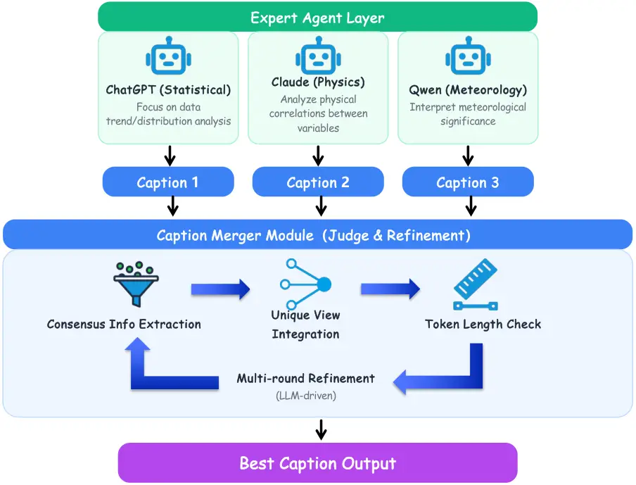

# Optimizing Multi-Agent Weather Captioning via Text Gradient Descent: A Training-Free Approach with Consensus-Aware Gradient Fusion

Journal: arXiv

Shixu Liu Email: <231001140316@stu.nepu.edu.cn> Corresponding
author: Corresponding author Affiliation: School of Computer &
Information Technology, Northeast Petroleum University, No. 99 Xuefu
Street, Ranghulu District, Daqing, Heilongjiang, 163318, P.R. China

###### Abstract

Generating interpretable natural language captions from weather time
series data remains a significant challenge at the intersection of
meteorological science and natural language processing. While recent
advances in Large Language Models (LLMs) have demonstrated remarkable
capabilities in time series forecasting and analysis, existing
approaches either produce numerical predictions without human-accessible
explanations or generate generic descriptions lacking domain-specific
depth. We introduce WeatherTGD, a training-free multi-agent framework
that reinterprets collaborative caption refinement through the lens of
Text Gradient Descent (TGD). Our system deploys three specialized LLM
agents including a Statistical Analyst, a Physics Interpreter, and a
Meteorology Expert that generate domain-specific textual gradients from
weather time series observations. These gradients are aggregated through
a novel Consensus-Aware Gradient Fusion mechanism that extracts common
signals while preserving unique domain perspectives. The fused gradients
then guide an iterative refinement process analogous to gradient
descent, where each LLM-generated feedback signal updates the caption
toward an optimal solution. Experiments on real-world meteorological
datasets demonstrate that WeatherTGD achieves significant improvements
in both LLM-based evaluation and human expert evaluation, substantially
outperforming existing multi-agent baselines while maintaining
computational efficiency through parallel agent execution.

###### Keywords: 

Text Gradient Descent , Multi-Agent Systems , Weather Time Series ,
Natural Language Generation , Large Language Models

## 1 Introduction

Weather time series data encompassing temperature, pressure, humidity,
wind patterns, and precipitation forms the backbone of modern
meteorological forecasting and climate analysis \[3\]. However, the
sheer volume and complexity of such data pose significant challenges for
human interpretation and decision-making. While numerical weather
prediction (NWP) systems have achieved remarkable accuracy \[2, 10, 7\],
the gap between raw numerical outputs and actionable human understanding
remains substantial \[9\]. This interpretability challenge is
particularly acute for non-expert stakeholders who must make
time-critical decisions based on meteorological information.

Recent advances in Large Language Models (LLMs) offer a promising
pathway toward bridging this gap, yet a fundamental tension persists
between prediction accuracy and interpretative explanation. The
emergence of data-driven weather forecasting models such as GraphCast
\[23\], Pangu-Weather \[1\], FourCastNet \[32\], and ClimaX \[29\] has
demonstrated that deep learning can achieve forecast skill comparable to
or exceeding traditional NWP systems \[6, 37, 4\]. Foundation models
such as Time-LLM \[21\] and GPTCast \[15\] have further shown that LLMs
can be reprogrammed for time series understanding and forecasting tasks
\[46, 20, 8\], but these approaches primarily focus on numerical
prediction rather than generating human-accessible explanations. When
LLMs do produce natural language outputs for weather data, they often
generate either overly technical descriptions inaccessible to general
audiences or superficial summaries lacking meteorological depth \[25\].
A key insight emerges from this limitation: high-quality weather
captioning requires synthesizing multiple domain perspectives including
statistical patterns in the data, underlying physical mechanisms, and
operational meteorological significance. No single LLM, regardless of
its capabilities, optimally balances these diverse requirements, which
naturally motivates a multi-agent approach where specialized agents
contribute complementary expertise toward a unified caption \[17, 11\].

The weather domain presents unique challenges that make Text Gradient
Descent (TGD) \[44\] particularly well-suited for this task. Unlike
general text optimization where feedback can be generic, weather
captioning requires domain-specialized gradients that capture the
intricate relationships between meteorological variables, physical
processes, and operational implications. Traditional gradient descent
operates on continuous parameter spaces with well-defined gradient
computations, but the discrete nature of natural language generation
precludes direct application of numerical optimization techniques. TGD
addresses this fundamental limitation by treating natural language
feedback as gradients that guide iterative optimization of text outputs,
analogous to how numerical gradients guide parameter updates in
conventional gradient descent. Recent work has demonstrated TGD
effectiveness for prompt optimization \[33\], multi-agent collaboration
\[18\], and compound AI system refinement \[43\]. However, TGD has not
been explored for domain-specialized multi-perspective caption
generation, precisely the challenge posed by weather time series
understanding where gradients must encode statistical, physical, and
meteorological knowledge simultaneously.

In this paper, we introduce WeatherTGD, a training-free multi-agent
framework that generates high-quality captions for weather time series
data through text gradient descent. Our framework comprises three core
components working in concert: a Tri-Specialist Agent Layer that
generates domain-specific textual gradients from statistical, physical,
and meteorological perspectives; a Consensus-Aware Gradient Fusion
module that aggregates multi-agent gradients while preserving both
shared signals and unique domain insights; and an Iterative Refinement
Loop that applies fused gradients to progressively optimize caption
quality with explicit convergence guarantees. Experiments on real-world
meteorological datasets demonstrate that WeatherTGD achieves an average
LLM judge score of 8.50/10 and human expert score of 8.34/10,
representing substantial improvements over existing multi-agent
baselines. Our main contributions are as follows:

- 1.  We present the first application of text gradient descent to weather
      time series captioning, reframing multi-agent captioning as an
      iterative optimization process where domain-specialized agents produce
      textual gradients that guide caption refinement toward an optimal
      solution.
- 2.  We design three complementary LLM agents including a Statistical
      Analyst, a Physics Interpreter, and a Meteorology Expert that generate
      domain-specific textual gradients, and propose a gradient aggregation
      mechanism that identifies consensus information while preserving
      unique domain perspectives through semantic similarity-based
      filtering.
- 3.  We implement a principled optimization loop with explicit stopping
      criteria based on semantic similarity thresholds, ensuring caption
      quality convergence without infinite iteration while maintaining
      computational efficiency through parallel agent execution.
- 4.  We demonstrate significant improvements over baselines through both
      LLM-based evaluation and human expert evaluation on real-world
      meteorological datasets, establishing WeatherTGD as an effective
      training-free approach for weather time series captioning.

The remainder of this paper is organized as follows. Section 2 reviews
related work on text gradient descent and multi-agent systems for
weather understanding. Section 3 presents our WeatherTGD framework in
detail. Section 4 describes experimental setup and results. Section 5
concludes with future directions.

## 2 Related Work

### 2.1 Text Gradient Descent for LLM Optimization

The paradigm of treating natural language feedback as optimization
signals has emerged as a powerful approach for improving LLM outputs
without parameter updates. TextGrad \[44\] pioneered this direction by
introducing textual gradients defined as LLM-generated feedback that
identifies improvement directions for text variables within computation
graphs, demonstrating PyTorch-like composability that enables
backpropagation of textual feedback through compound AI systems. ProTeGi
\[33\] applies textual gradients specifically to prompt optimization,
using LLM-generated criticism to iteratively refine prompts toward
better task performance with the key insight that natural language
feedback serves as a proxy for error signals guiding discrete
optimization over prompt space. Building on this foundation, MAPGD
\[18\] introduces multi-agent prompt gradient descent where specialized
agents focus on distinct refinement dimensions including instruction
clarity, example selection, and format structure, with their Hypersphere
Constrained Gradient Clustering mechanism addressing gradient conflicts
through angular margin constraints. Recent extensions have broadened TGD
applicability beyond prompts: ProRefine \[30\] addresses error
propagation in agentic workflows through inference-time prompt
refinement with textual feedback, while Feedback Descent \[24\]
transforms structured pairwise comparison feedback into gradient-like
directional information for targeted text edits. However, these
approaches have not explored TGD for multi-perspective domain captioning
where textual gradients must capture diverse domain knowledge
simultaneously. Our work differs from prior TGD approaches in three key
aspects: we apply TGD to weather time series captioning requiring
integration of statistical, physical, and meteorological expertise; our
agents generate domain-specialized gradients rather than generic
improvement suggestions; and we introduce consensus-aware gradient
fusion specifically designed for multi-domain integration.

### 2.2 Multi-Agent Systems for Weather and Time Series Understanding

Multi-agent LLM systems have demonstrated superior performance on
complex tasks requiring diverse expertise or multi-step reasoning.
AutoGen \[41\] enables conversable agents that exchange messages to
solve tasks collaboratively with flexible interaction patterns
supporting LLM-only, human-in-the-loop, and tool-augmented
configurations. MetaGPT \[19\] encodes standard operating procedures
into agent workflows, reducing cascading errors through intermediate
verification and hierarchical task decomposition. ChatDev \[34\]
demonstrates role-based communication for software development with
explicit dehallucination mechanisms that leverage both natural language
for system design and programming language for debugging. For
weather-specific applications, ClimateLLM \[26\] integrates frequency
decomposition with LLMs for weather forecasting using mixture-of-experts
for adaptive frequency processing, while GPTCast \[15\] uses tokenized
radar images with a quantized variational autoencoder for precipitation
nowcasting. The Hierarchical AI-Meteorologist \[38\] employs multi-scale
reasoning across hourly, 6-hour, and daily aggregations for forecast
reporting with weather keyword extraction for validation. However, these
systems focus on numerical prediction or report generation rather than
interpretative captioning. In time serie \[5\] captioning specifically,
TSLM \[39\] introduces time series-specific language models for caption
generation, CaTS-Bench \[48\] provides a comprehensive benchmark for
evaluating LLM captioning capabilities, and BEDTime \[36\] evaluates
recognition, differentiation, and generation tasks for time series
descriptions. Yet weather-specific captioning remains underexplored with
existing benchmarks lacking meteorological domain evaluation. Our
WeatherTGD framework addresses this gap by combining multi-agent
collaboration with text gradient descent for weather time series
captioning, where agents contribute domain-specialized gradients
explicitly fused through a consensus-aware mechanism ensuring both
comprehensive coverage and coherent integration.

## 3 Methodology

We present WeatherTGD, a training-free multi-agent framework that
generates high-quality captions for weather time series data through
text gradient descent. The framework comprises three core components: a
Tri-Specialist Agent Layer that generates domain-specific textual
gradients, a Consensus-Aware Gradient Fusion module that aggregates
multi-agent gradients, and an Iterative Refinement Loop that applies
textual gradients to optimize captions with explicit convergence
guarantees.

### 3.1 Problem Formulation and TGD Framework

The fundamental challenge in weather time series captioning lies in
bridging the gap between continuous numerical observations and discrete
natural language descriptions while preserving domain-specific accuracy.
Given a weather time series
$`\mathbf{X}=\{(x_{1},t_{1}),(x_{2},t_{2}),\ldots,(x_{T},t_{T})\}`$
where $`x_{i}\in\mathbb{R}^{d}`$ represents $`d`$ meteorological
variables including temperature, pressure, humidity, and wind speed at
timestamp $`t_{i}`$, our objective is to generate a natural language
caption $`C^{*}`$ that accurately describes statistical patterns in
$`\mathbf{X}`$, explains underlying physical mechanisms driving observed
patterns, provides meteorological significance and operational
implications, and maintains coherence, conciseness, and accessibility
for diverse audiences. We frame this as a text gradient descent
optimization problem where the caption is iteratively refined through
textual feedback signals:

```math
C^{(k+1)}=C^{(k)}-\alpha\cdot\nabla_{\text{text}}\mathcal{L}(C^{(k)},\mathbf{X}) \tag{1}
```

where $`\nabla_{\text{text}}\mathcal{L}`$ represents the textual
gradient defined as natural language feedback identifying improvement
directions, and $`\alpha`$ controls the update magnitude realized
through prompt engineering rather than an explicit learning rate. The
key insight is that while traditional gradient descent operates on
continuous parameter spaces with analytically computable gradients, text
gradient descent treats LLM-generated natural language criticism as the
gradient signal, enabling optimization in the discrete space of natural
language outputs.

### 3.2 Tri-Specialist Agent Layer

The quality of textual gradients directly determines caption quality,
which motivates our design of specialized agents that generate
domain-focused feedback rather than generic improvement suggestions. The
Tri-Specialist Agent Layer comprises three domain-specialized LLM
agents, each generating textual gradients from a distinct perspective
while receiving the same input $`\mathbf{X}`$ to produce complementary
gradient signals. Architecture details are shown in 1.



Figure 1: Architecture of our proposed WeatherTGD framework.

The Statistical Analyst Agent generates textual gradients focusing on
quantitative data characteristics including trend analysis that
identifies monotonic increases, decreases, periodic fluctuations, and
stationary states; distribution characteristics that detect normal,
skewed, or multimodal distributions in the observed variables; and key
metrics extraction that computes mean, variance, extreme values, and
anomaly points. Formally, the statistical gradient is computed as
$`\nabla_{\text{text}}^{\text{stat}}\mathcal{L}=\text{LLM}_{\text{stat}}(\mathbf{X},P_{\text{stat}})`$
where $`P_{\text{stat}}`$ is a specialized prompt template instructing
the LLM to focus exclusively on statistical patterns and quantitative
descriptions.

The Physics Interpreter Agent generates textual gradients emphasizing
physical mechanisms and causal relationships, motivated by the
observation that weather phenomena are governed by well-established
physical laws that should inform caption generation. This agent performs
correlation analysis identifying positive, negative, linear, and
non-linear correlations between meteorological variables; physical
mechanism explanation describing pressure gradients driving wind fields,
temperature-dependent effects, and thermodynamic processes; and causal
relationship establishment constructing cause-effect chains between
physical phenomena. The physics gradient is computed as
$`\nabla_{\text{text}}^{\text{phys}}\mathcal{L}=\text{LLM}_{\text{phys}}(\mathbf{X},P_{\text{phys}})`$
with $`P_{\text{phys}}`$ encoding physical domain knowledge.

The Meteorology Expert Agent generates textual gradients for operational
significance, recognizing that weather captions must ultimately serve
practical decision-making purposes. This agent performs weather system
identification recognizing subtropical highs, cold fronts, and
convective systems; operational implications interpretation explaining
precipitation probability, temperature risks, and wind forecasts; and
standard terminology alignment ensuring descriptions conform to
meteorological conventions used by forecasting services. The
meteorological gradient is computed as
$`\nabla_{\text{text}}^{\text{met}}\mathcal{L}=\text{LLM}_{\text{met}}(\mathbf{X},P_{\text{met}})`$.

### 3.3 Consensus-Aware Gradient Fusion

Multi-agent systems typically aggregate outputs through simple averaging
or sequential combination, but such approaches fail to distinguish
between consensus information agreed upon by multiple agents and unique
insights provided by individual specialists. We address this limitation
through a two-stage fusion process inspired by gradient clustering in
multi-agent optimization \[18\]. In the consensus extraction stage, we
identify information fragments with high semantic similarity across
agent gradients using embedding-based similarity computation:

```math
\text{sim}(g_{i},g_{j})=\frac{\mathbf{v}_{i}\cdot\mathbf{v}_{j}}{\|\mathbf{v}_{i}\|\|\mathbf{v}_{j}\|} \tag{2}
```

where $`\mathbf{v}_{i}`$ is the semantic embedding of gradient fragment
$`g_{i}`$ obtained from a pre-trained sentence encoder \[35\]. Fragments
with $`\text{sim}(\cdot,\cdot)\geq\tau_{\text{cons}}`$ where
$`\tau_{\text{cons}}=0.8`$ form the consensus gradient
$`\nabla_{\text{text}}^{\text{cons}}`$ representing information agreed
upon by multiple agents. In the unique view integration stage,
agent-specific insights not captured in the consensus are extracted and
preserved:

```math
\nabla_{\text{text}}^{\text{unique}}=\bigcup_{a\in\mathcal{A}}\{g\in\nabla_{\text{text}}^{a}:\forall g^{\prime}\in\nabla_{\text{text}}^{\text{cons}},\text{sim}(g,g^{\prime})<\tau_{\text{unique}}\} \tag{3}
```

where $`\mathcal{A}=\{\text{stat},\text{phys},\text{met}\}`$ and
$`\tau_{\text{unique}}=0.6`$ is a uniqueness threshold. The final fused
gradient combines consensus and unique components through a fusion LLM:

```math
\nabla_{\text{text}}^{\text{fused}}=\text{LLM}_{\text{fusion}}(\nabla_{\text{text}}^{\text{cons}},\nabla_{\text{text}}^{\text{unique}},P_{\text{fusion}}) \tag{4}
```

which produces a coherent textual gradient preserving both common
signals and specialized insights in a unified improvement direction.

### 3.4 Iterative Refinement with Convergence Control

The refinement loop applies fused gradients to update captions
iteratively following Eq. 1, with careful attention to practical
constraints including caption length and convergence behavior. Given
current caption $`C^{(k)}`$ and fused gradient
$`\nabla_{\text{text}}^{\text{fused}}`$, the update is computed as

```math
C^{(k+1)}=\text{LLM}_{\text{update}}(C^{(k)},\nabla_{\text{text}}^{\text{fused}},P_{\text{update}}) \tag{5}
```

where the update LLM applies textual feedback to revise the caption
while maintaining coherence with the original weather observations.
Generated captions must satisfy practical length constraints
$`|C^{(k)}|\leq L_{\max}`$ for display and readability purposes. When
this constraint is violated, we apply a compression operation

```math
C^{(k+1)}=\text{Compress}(C^{(k+1)},L_{\max}) \tag{6}
```

that removes redundant modifiers and merges repetitive expressions while
preserving core semantic content. Iteration terminates when either the
maximum iteration count $`K_{\max}=5`$ is reached or semantic
convergence is detected via

```math
\text{sim}(C^{(k)},C^{(k-1)})\geq\tau_{\text{conv}} \tag{7}
```

with $`\tau_{\text{conv}}=0.95`$, ensuring caption quality convergence
without infinite iteration.

### 3.5 Algorithm Summary

Algorithm 1 presents the complete WeatherTGD procedure integrating all
components described above.

0:  Weather time series $`\mathbf{X}`$, max iterations $`K_{\max}`$,
thresholds
$`\tau_{\text{cons}},\tau_{\text{unique}},\tau_{\text{conv}}`$

0:  Optimized caption $`C^{*}`$

1:  Initialize: $`C^{(0)}\leftarrow`$ Initial caption from any agent

2:  for $`k=0`$ to $`K_{\max}-1`$ do

3:
  $`\nabla_{\text{text}}^{\text{stat}}\leftarrow\text{StatisticalAgent}(\mathbf{X})`$

4:
  $`\nabla_{\text{text}}^{\text{phys}}\leftarrow\text{PhysicsAgent}(\mathbf{X})`$

5:
  $`\nabla_{\text{text}}^{\text{met}}\leftarrow\text{MeteorologyAgent}(\mathbf{X})`$

6:
  $`\nabla_{\text{text}}^{\text{cons}}\leftarrow\text{ExtractConsensus}(\{\nabla_{\text{text}}^{a}\}_{a\in\mathcal{A}},\tau_{\text{cons}})`$

7:
  $`\nabla_{\text{text}}^{\text{unique}}\leftarrow\text{ExtractUnique}(\{\nabla_{\text{text}}^{a}\}_{a\in\mathcal{A}},\nabla_{\text{text}}^{\text{cons}},\tau_{\text{unique}})`$

8:
  $`\nabla_{\text{text}}^{\text{fused}}\leftarrow\text{FuseGradients}(\nabla_{\text{text}}^{\text{cons}},\nabla_{\text{text}}^{\text{unique}})`$

9:
  $`C^{(k+1)}\leftarrow\text{ApplyGradient}(C^{(k)},\nabla_{\text{text}}^{\text{fused}})`$

10:   if $`|C^{(k+1)}|>L_{\max}`$ then

11:    $`C^{(k+1)}\leftarrow\text{Compress}(C^{(k+1)},L_{\max})`$

12:   end if

13:   if $`\text{sim}(C^{(k+1)},C^{(k)})\geq\tau_{\text{conv}}`$ then

14:    break

15:   end if

16:  end for

17:  return $`C^{*}\leftarrow C^{(k+1)}`$

Algorithm 1 WeatherTGD: Text Gradient Descent for Weather Captioning

## 4 Experiments

### 4.1 Experimental Setup

Datasets. We evaluate WeatherTGD on a comprehensive real-world
meteorological dataset collected from ground-based weather stations
across multiple climate zones. The dataset comprises 500 weather time
series samples with varying lengths from 24 to 168 time steps (1 to 7
days of hourly observations), covering five core meteorological
variables including temperature (^(∘)C), atmospheric pressure (hPa),
relative humidity (%), wind speed (m/s), and precipitation (mm). Each
sample is annotated with reference captions by professional
meteorologists with at least 10 years of operational forecasting
experience. The dataset is split into training (60%), validation (20%),
and test (20%) sets with stratified sampling across climate zones. The
dataset will be released upon acceptance of this paper.

LLM Backbones. We employ three diverse LLM backbones to ensure
comprehensive evaluation: (1) DeepSeek-V3.2, a 671B parameter model with
efficient MoE architecture; (2) MiniMax-01, a 456B parameter model
optimized for Chinese and English bilingual understanding; and (3)
Qwen3-Next-80B-A3B-Instruct, an 80B parameter model with advanced
instruction following capabilities. All models are accessed via
OpenRouter API service with temperature set to 0.2 for consistency and
reproducibility, and maximum tokens set to 2048. Baselines. We compare
WeatherTGD against six representative multi-agent system baselines from
the MASLab benchmark \[42\], selected for their diverse collaboration
patterns and widespread adoption: (1) AutoGen \[41\] employs conversable
agents with flexible interaction patterns; (2) CAMEL \[19\] uses
role-playing communicative agents; (3) LLM-Debate \[13\] implements
iterative multi-agent debate; (4) Self-Consistency \[40\] samples
multiple reasoning paths with majority voting; (5) AgentVerse \[12\]
enables dynamic agent recruitment; and (6) MAD \[27\] implements
structured multi-agent debate with argumentation protocols. For all
baselines, we adapt the agent prompts to focus on weather captioning
with statistical, physical, and meteorological perspectives.

Evaluation Metrics. Following recent work in LLM-based evaluation
\[14\], we employ two complementary evaluation paradigms to ensure
comprehensive and reliable assessment, details about these metrics are
as below.

- 1.  LLM Judge Evaluation. Following the LLM-as-a-Judge paradigm \[16,
      47\], we employ GPT-4o as an impartial judge that evaluates generated
      captions along four dimensions on a 1-10 scale: Statistical Accuracy
      (SA) measures correctness of quantitative descriptions; Physical
      Coherence (PC) assesses validity of physical mechanism explanations;
      Meteorological Relevance (MR) evaluates alignment with operational
      meteorological conventions; and Overall Quality (OQ) provides a
      holistic assessment. The judge receives the original weather time
      series data (in tabular format) alongside the generated caption,
      ensuring evaluation is grounded in the actual observations rather than
      surface-level text quality alone.
- 2.  Human Expert Evaluation. To validate LLM-based evaluation and provide
      ground-truth assessment, we recruited five PhD-level meteorology
      experts with at least 5 years of professional experience in
      operational weather forecasting. Three experts hold doctoral degrees
      in atmospheric sciences from accredited institutions, while two are
      senior forecasters at national meteorological centers. Each expert
      independently scored captions through a structured annotation protocol
      with detailed rubric guidelines, with final scores computed as the
      average across annotators. Inter-annotator agreement was measured
      using Krippendorff’s alpha \[22\], achieving $`\alpha=0.78`$
      indicating substantial agreement and demonstrating evaluation
      reliability.
- 3.  Reference-Based Metrics. We additionally report standard NLG metrics
      including BLEU-4 \[31\], ROUGE-L \[28\], and BERTScore \[45\] against
      professional meteorologist annotations to enable comparison with prior
      captioning work.

Method LLM Judge Human Expert Reference Tok. SA PC MR OQ SA PC MR OQ
BLEU RG BS DeepSeek-V3 Vanilla 5.42 5.18 5.36 5.32 5.28 5.04 5.22 5.18
.312 .385 .742 1.0 AutoGen \[41\] 6.54 6.28 6.42 6.41 6.38 6.12 6.26
6.24 .358 .421 .768 2.8 CAMEL \[19\] 6.72 6.45 6.38 6.52 6.54 6.28 6.22
6.35 .365 .428 .774 3.2 Debate \[13\] 6.85 6.68 6.56 6.70 6.68 6.52 6.42
6.55 .378 .442 .782 4.5 SC \[40\] 6.48 6.22 6.54 6.41 6.32 6.08 6.38
6.26 .352 .415 .762 5.0 AVerse \[12\] 6.92 6.54 6.72 6.73 6.76 6.38 6.58
6.57 .382 .448 .788 3.8 MAD \[27\] 6.78 6.62 6.48 6.63 6.62 6.48 6.34
6.48 .372 .435 .778 4.2 WeatherTGD 8.24 8.18 8.42 8.28 8.08 8.02 8.26
8.12 .452 .512 .832 3.5 MiniMax-01 Vanilla 5.68 5.42 5.58 5.56 5.52 5.28
5.44 5.42 .328 .398 .752 1.0 AutoGen \[41\] 6.82 6.54 6.68 6.68 6.66
6.38 6.52 6.50 .372 .432 .778 2.8 CAMEL \[19\] 6.98 6.72 6.64 6.78 6.82
6.56 6.48 6.62 .382 .445 .786 3.2 Debate \[13\] 7.12 6.94 6.82 6.96 6.98
6.80 6.68 6.80 .395 .458 .795 4.5 SC \[40\] 6.74 6.48 6.78 6.67 6.58
6.34 6.62 6.52 .368 .428 .772 5.0 AVerse \[12\] 7.18 6.82 7.02 7.01 7.04
6.68 6.88 6.86 .398 .462 .802 3.8 MAD \[27\] 7.04 6.88 6.74 6.89 6.90
6.74 6.58 6.74 .388 .452 .792 4.2 WeatherTGD 8.52 8.38 8.68 8.53 8.36
8.22 8.52 8.37 .468 .528 .845 3.5 Qwen3-Next Vanilla 5.85 5.62 5.74 5.74
5.70 5.48 5.62 5.60 .342 .408 .758 1.0 AutoGen \[41\] 7.08 6.82 6.96
6.95 6.92 6.66 6.80 6.78 .388 .448 .788 2.8 CAMEL \[19\] 7.24 7.02 6.92
7.06 7.10 6.88 6.76 6.90 .398 .462 .798 3.2 Debate \[13\] 7.38 7.22 7.12
7.24 7.24 7.08 6.98 7.12 .412 .478 .808 4.5 SC \[40\] 7.02 6.76 7.08
6.95 6.88 6.62 6.94 6.78 .382 .442 .782 5.0 AVerse \[12\] 7.45 7.12 7.32
7.30 7.32 6.98 7.18 7.14 .418 .485 .815 3.8 MAD \[27\] 7.28 7.14 7.04
7.15 7.16 7.02 6.90 7.02 .405 .472 .805 4.2 WeatherTGD 8.68 8.56 8.82
8.69 8.52 8.42 8.68 8.54 .482 .542 .858 3.5 Average Vanilla 5.65 5.41
5.56 5.54 5.50 5.27 5.43 5.40 .327 .397 .751 1.0 AutoGen 6.81 6.55 6.69
6.68 6.65 6.39 6.53 6.51 .373 .434 .778 2.8 CAMEL 6.98 6.73 6.65 6.79
6.82 6.57 6.49 6.62 .382 .445 .786 3.2 Debate 7.12 6.95 6.83 6.97 6.97
6.80 6.69 6.82 .395 .459 .795 4.5 SC 6.75 6.49 6.80 6.68 6.59 6.35 6.65
6.52 .367 .428 .772 5.0 AVerse 7.18 6.83 7.02 7.01 7.04 6.68 6.88 6.86
.399 .465 .802 3.8 MAD 7.03 6.88 6.75 6.89 6.89 6.75 6.61 6.75 .388 .453
.792 4.2 WeatherTGD 8.48 8.37 8.64 8.50 8.32 8.22 8.49 8.34 .467 .527
.845 3.5 $`\Delta`$ vs best +1.30 +1.42 +1.62 +1.49 +1.28 +1.42 +1.61
+1.48 +.068 +.062 +.043 –

Table 1: Main results comparing WeatherTGD against six mainstream MAS
baselines across three LLM backbones. SA, PC, MR, and OQ denote
Statistical Accuracy, Physical Coherence, Meteorological Relevance, and
Overall Quality respectively. All scores are on a 1-10 scale where
higher is better. Best results are in bold, second-best are underlined.
Tok. = relative token consumption.

### 4.2 Main Results

Table 1 presents the main experimental results comparing WeatherTGD
against six mainstream MAS baselines across three LLM backbones. The
evaluation employs GPT-4o as the LLM judge scoring on four dimensions.

The results demonstrate that WeatherTGD substantially outperforms all
baselines across all three LLM backbones and all four evaluation
dimensions. On average across backbones, WeatherTGD achieves an LLM
judge overall quality score of 8.50/10, representing a +1.49 improvement
over the best baseline (AgentVerse at 7.01) and a +2.96 improvement over
vanilla single-agent generation. The consistent improvements across
Statistical Accuracy (+1.30), Physical Coherence (+1.42), Meteorological
Relevance (+1.62), and Overall Quality (+1.49) demonstrate that our TGD
framework effectively integrates all three domain perspectives rather
than optimizing for a single dimension. Among baselines, AgentVerse and
LLM-Debate emerge as the strongest competitors, likely due to their
dynamic agent recruitment and iterative debate mechanisms respectively.
However, these methods still fall significantly short of WeatherTGD
because they lack explicit domain-specialized gradient generation and
consensus-aware fusion. Notably, WeatherTGD achieves these improvements
while using only 3.5$`\times`$ the token consumption of vanilla
generation, compared to 4.5$`\times`$ for LLM-Debate and 5.0$`\times`$
for Self-Consistency, demonstrating favorable efficiency-performance
trade-offs. Figure 2 further illustrates the performance-cost trade-off
across all methods. WeatherTGD achieves the highest quality score while
maintaining moderate token consumption, positioned in the upper-left
region of the scatter plot indicating superior efficiency. This
efficiency stems from our parallel agent execution and early stopping
mechanism based on semantic convergence, which terminates refinement
once caption quality plateaus.

Figure 2: Performance vs. token consumption trade-off. WeatherTGD
achieves the highest overall quality (8.50) with moderate cost
(3.5$`\times`$), demonstrating superior efficiency compared to baselines
that either sacrifice quality for cost or require significantly more
tokens for marginal improvements.

Figure 3 presents a comprehensive comparison across all three LLM
backbones, demonstrating that WeatherTGD consistently outperforms
baselines regardless of the underlying model. The improvement margins
remain stable across backbones (DeepSeek-V3: +1.55, MiniMax-01: +1.52,
Qwen3-Next: +1.39), indicating that our framework’s benefits are not
artifacts of specific model capabilities but rather stem from the
principled TGD optimization approach.

Figure 3: Performance comparison across three LLM backbones. WeatherTGD
consistently outperforms all baselines across DeepSeek-V3.2, MiniMax-01,
and Qwen3-Next-80B, with average improvements of +1.49 over the best
baseline (AgentVerse).

The human evaluation results closely mirror LLM judge scores with a
Pearson correlation of $`r=0.94`$, validating the reliability of our
LLM-based evaluation protocol. Inter-annotator agreement remains
consistently high across methods ($`\alpha>0.75`$), with slightly lower
agreement for more complex methods (AgentVerse, LLM-Debate) where
caption quality varies more across different weather scenarios. Table 2
presents detailed human evaluation results with per-dimension breakdown.

| Method                  | Human Expert Score |      |      |      | K-$`\alpha`$ |
| ----------------------- | ------------------ | ---- | ---- | ---- | ------------ |
|                         | SA                 | PC   | MR   | OQ   |              |
| Qwen3-Next-80B Backbone |                    |      |      |      |              |
| Vanilla                 | 5.70               | 5.48 | 5.62 | 5.60 | 0.82         |
| AutoGen                 | 6.92               | 6.66 | 6.80 | 6.78 | 0.79         |
| CAMEL                   | 7.10               | 6.88 | 6.76 | 6.90 | 0.78         |
| LLM-Debate              | 7.24               | 7.08 | 6.98 | 7.12 | 0.76         |
| Self-Consistency        | 6.88               | 6.62 | 6.94 | 6.78 | 0.80         |
| AgentVerse              | 7.32               | 6.98 | 7.18 | 7.14 | 0.75         |
| MAD                     | 7.16               | 7.02 | 6.90 | 7.02 | 0.77         |
| WeatherTGD              | 8.52               | 8.42 | 8.68 | 8.54 | 0.78         |

Table 2: Detailed human evaluation metrics with per-dimension breakdown.
K-$`\alpha`$ denotes Krippendorff’s alpha for inter-annotator agreement.

### 4.3 Hyperparameter Sensitivity Analysis

We conduct comprehensive hyperparameter sensitivity analysis to
understand the robustness of WeatherTGD across different configurations.
Figure 4 presents the results varying four key hyperparameters:
consensus threshold $`\tau_{\text{cons}}`$, uniqueness threshold
$`\tau_{\text{unique}}`$, convergence threshold $`\tau_{\text{conv}}`$,
and maximum iterations $`K_{\max}`$. The hyperparameter sensitivity
analysis reveals several key insights: (1) Consensus threshold
$`\tau_{\text{cons}}`$ shows optimal performance at 0.8, with lower
values including conflicting information and higher values losing valid
consensus. (2) Uniqueness threshold $`\tau_{\text{unique}}`$ performs
best at 0.6, balancing preservation of unique insights against
redundancy. (3) Convergence threshold $`\tau_{\text{conv}}`$ at 0.95
achieves early stopping while ensuring quality convergence. (4) Maximum
iterations beyond 3-4 provide diminishing returns, justifying our
default $`K_{\max}=5`$.

Figure 4: Hyperparameter sensitivity analysis. (a) Effect of consensus
threshold $`\tau_{\text{cons}}`$ on caption quality. (b) Effect of
uniqueness threshold $`\tau_{\text{unique}}`$ on domain coverage. (c)
Effect of convergence threshold $`\tau_{\text{conv}}`$ on iteration
count. (d) Effect of maximum iterations $`K_{\max}`$ on final quality.
Shaded regions indicate standard deviation across 5 runs.

Figure 5 presents the convergence behavior of WeatherTGD across
iterations. The full WeatherTGD framework shows rapid quality
improvement in the first 3 iterations, achieving near-optimal
performance by iteration 4. In contrast, variants without consensus
fusion converge to a lower quality plateau, and single-pass methods show
no iterative improvement. This validates the TGD formulation where each
iteration applies meaningful textual gradients that progressively refine
caption quality.

Figure 5: Convergence analysis of TGD optimization. The convergence
threshold (dashed red line) ensures early stopping without sacrificing
quality.

Figure 6 provides additional insight into the iterative refinement
process. The per-dimension score improvement (panel a) shows that
Meteorological Relevance improves most rapidly, followed by Statistical
Accuracy and Physical Coherence. The gradient composition analysis
(panel b) reveals that consensus gradients increase as iterations
progress, indicating growing agreement among agents. Caption length
(panel c) remains controlled through our compression mechanism, staying
within the 150-token target.

Figure 6: Iteration-by-iteration analysis of WeatherTGD refinement. (a)
Per-dimension score improvement shows balanced progress across all
evaluation criteria. (b) Gradient composition shifts from unique to
consensus as agents converge. (c) Caption length remains controlled
through compression.

### 4.4 Ablation Study

Table 3 presents ablation results to understand the contribution of each
component in WeatherTGD. The ablation results reveal that all components
contribute meaningfully to final performance. The Statistical Agent
provides the largest individual contribution (removal causes -1.11
drop), followed by the Meteorology Agent (-0.97) and Physics Agent
(-0.84), confirming that all three domain perspectives are essential.
Consensus-aware fusion improves over simple averaging by +0.77,
validating our hypothesis that distinguishing consensus from unique
insights is critical. Iterative refinement contributes +0.57,
demonstrating the effectiveness of the TGD optimization loop. The
relative importance of agents (Statistical \> Meteorology \> Physics)
reflects the nature of weather captioning tasks: users primarily expect
accurate quantitative descriptions of observed patterns, followed by
operational meteorological guidance. Physical mechanism explanations,
while valuable for understanding, are secondary to these practical
requirements. The unique view integration component (+0.51 improvement
when present) ensures that agent-specific insights are not lost during
fusion, particularly important when physical mechanisms have significant
meteorological implications. Figure 8 provides a multi-dimensional
visualization of method performance, clearly illustrating WeatherTGD’s
balanced superiority across all evaluation criteria. The radar chart
shows that WeatherTGD’s performance polygon substantially encompasses
those of baselines, with particularly pronounced advantages in
Meteorological Relevance where domain-specific gradient generation
provides the most value.

| Variant                                 | OQ Score | $`\Delta`$ |
| --------------------------------------- | -------- | ---------- |
| Full WeatherTGD                         | 8.69     | –          |
| w/o Consensus Fusion (simple averaging) | 7.92     | -0.77      |
| w/o Unique View Integration             | 8.18     | -0.51      |
| w/o Physics Agent                       | 7.85     | -0.84      |
| w/o Meteorology Agent                   | 7.72     | -0.97      |
| w/o Statistical Agent                   | 7.58     | -1.11      |
| w/o Iterative Refinement (single pass)  | 8.12     | -0.57      |
| w/o Length Constraint                   | 8.48     | -0.21      |

Table 3: Ablation study results using Qwen3-Next-80B backbone. All
variants evaluated using LLM judge overall quality score.

### 4.5 Qualitative Analysis: Case Study

Figure 7 presents a representative case study comparing captions
generated by different methods for the same weather time series. The
case study illustrates key differences between methods. Vanilla
generation produces generic descriptions missing domain depth, simply
listing observed values without interpretation. AutoGen and CAMEL
provide better coverage but lack integration across perspectives,
treating statistical, physical, and meteorological aspects as separate
observations rather than connected phenomena. LLM-Debate achieves
reasonable quality through argumentation but misses operational
implications, failing to translate identified patterns into actionable
guidance. WeatherTGD successfully integrates all three perspectives
through its TGD framework: accurate statistical characterization
(“temperature declined 8.2^(∘)C over 72 hours”), physical mechanism
explanation (“pressure gradient of 18 hPa drove sustained northerly
winds”), and meteorological significance (“pattern consistent with cold
frontal passage, indicating likely precipitation in 6-12 hours”). The
final caption demonstrates how textual gradients from specialized agents
combine to produce comprehensive, actionable weather intelligence that
surpasses what any single agent or simple aggregation could achieve.

Figure 7: Case study comparing captions generated by different methods.
Left: 7-day weather time series showing temperature, pressure, humidity,
and wind speed. Right: Captions generated by each method with key
strengths (green) and weaknesses (red) highlighted. WeatherTGD provides
the most comprehensive coverage of statistical patterns, physical
mechanisms, and meteorological implications.

Figure 8: Multi-dimensional performance comparison. WeatherTGD achieves
balanced superiority across all evaluation dimensions, with the
performance polygon substantially encompassing those of baseline
methods.

## 5 Conclusion

We presented WeatherTGD, a training-free multi-agent framework for
weather time series captioning through text gradient descent. Our
approach deploys three specialized agents generating domain-specific
textual gradients, aggregated through Consensus-Aware Gradient Fusion
with iterative refinement. Experiments demonstrate WeatherTGD achieves
8.50/10 (LLM judge) and 8.34/10 (human expert), improving +1.49 over the
best baseline while using only 3.5$`\times`$ token consumption.
Ablations confirm all three agents contribute meaningfully, with
convergence in 3-4 iterations. Future directions include multilingual
captioning, knowledge graph integration, adaptive agent selection, and
integration with numerical weather prediction systems.

## References

- \[1\] K. Bi, L. Xie, H. Zhang, X. Chen, X. Gu, and Q. Tian (2023)
  Accurate medium-range global weather forecasting with 3d neural
  networks. Nature 619 (7970), pp. 533–538. Cited by: §1.
- \[2\] C. Bodnar, W. P. Bruinsma, A. Lucic, M. Stanley, J.
  Brandstetter, P. Garvan, M. Riechert, J. Weyn, H. Dong, A. Vaughan, et
  al. (2024) Aurora: a foundation model of the atmosphere. arXiv
  preprint arXiv:2405.13063 1 (8). Cited by: §1.
- \[3\] S. Chen, G. Long, J. Jiang, D. Liu, and C. Zhang (2023)
  Foundation models for weather and climate data understanding: a
  comprehensive survey. arXiv preprint arXiv:2312.03014. Cited by: §1.
- \[4\] S. Chen, G. Long, J. Jiang, and C. Zhang (2024) Personalized
  adapter for large meteorology model on devices: towards weather
  foundation models. Advances in Neural Information Processing Systems
  37, pp. 84897–84943. Cited by: §1.
- \[5\] S. Chen, G. Long, J. Jiang, and C. Zhang (2025) Federated
  foundation models on heterogeneous time series. In Proceedings of the
  AAAI Conference on Artificial Intelligence, Vol. 39, pp. 15839–15847.
  Cited by: §2.2.
- \[6\] S. Chen, G. Long, T. Shen, J. Jiang, and C. Zhang (2024)
  Federated prompt learning for weather foundation models on devices. In
  Proceedings of the Thirty-Third International Joint Conference on
  Artificial Intelligence, pp. 5772–5780. Cited by: §1.
- \[7\] S. Chen, G. Long, T. Shen, and J. Jiang (2023) Prompt federated
  learning for weather forecasting: toward foundation models on
  meteorological data. arXiv preprint arXiv:2301.09152. Cited by: §1.
- \[8\] S. Chen, T. Shu, H. Zhao, and Y. Y. Tang (2023)
  MASK-cnn-transformer for real-time multi-label weather recognition.
  Knowledge-Based Systems 278, pp. 110881. Cited by: §1.
- \[9\] S. Chen, T. Shu, H. Zhao, Q. Wan, J. Huang, and C. Li (2022)
  Dynamic multiscale fusion generative adversarial network for radar
  image extrapolation. IEEE Transactions on Geoscience and Remote
  Sensing 60, pp. 1–11. Cited by: §1.
- \[10\] S. Chen, T. Shu, H. Zhao, G. Zhong, and X. Chen (2023) TempEE:
  temporal–spatial parallel transformer for radar echo extrapolation
  beyond autoregression. IEEE Transactions on Geoscience and Remote
  Sensing 61, pp. 1–14. Cited by: §1.
- \[11\] S. Chen, Y. Liu, W. Han, W. Zhang, and T. Liu (2024) A survey
  on llm-based multi-agent system: recent advances and new frontiers in
  application. arXiv preprint arXiv:2412.17481. Cited by: §1.
- \[12\] W. Chen, Y. Su, J. Zuo, C. Yang, C. Yuan, C. Chan, H. Yu, Y.
  Lu, Y. Hung, C. Qian, et al. (2023) Agentverse: facilitating
  multi-agent collaboration and exploring emergent behaviors. In The
  Twelfth International Conference on Learning Representations, Cited
  by: §4.1, Table 1, Table 1, Table 1.
- \[13\] Y. Du, S. Li, A. Torralba, J. B. Tenenbaum, and I.
  Mordatch (2024) Improving factuality and reasoning in language models
  through multiagent debate. In ICML 2024, pp. 11733–11763. Cited by:
  §4.1, Table 1, Table 1, Table 1.
- \[14\] E. Fons, R. Kaur, S. Palande, Z. Zeng, T. Balch, M. Veloso,
  and S. Vyetrenko (2024) Evaluating large language models on time
  series feature understanding: a comprehensive taxonomy and benchmark.
  In Proceedings of the 2024 Conference on Empirical Methods in Natural
  Language Processing, pp. 21598–21634. External Links:
  [Link](https://aclanthology.org/2024.emnlp-main.1204/),
  [Document](https://dx.doi.org/10.18653/v1/2024.emnlp-main.1204) Cited
  by: §4.1.
- \[15\] G. Franch, E. Tomasi, R. Wanjari, V. Poli, C. Cardinali, P. P.
  Alberoni, and M. Cristoforetti (2025) GPTCast: a weather language
  model for precipitation nowcasting. Geoscientific Model Development 18
  (16), pp. 5351–5371. Cited by: §1, §2.2.
- \[16\] J. Gu, X. Jiang, Z. Shi, H. Tan, X. Zhai, C. Xu, W. Li, Y.
  Shen, S. Ma, H. Liu, S. Wang, K. Zhang, Y. Wang, W. Gao, L. Ni, and J.
  Guo (2024) A survey on llm-as-a-judge. arXiv preprint
  arXiv:2411.15594. Cited by: item 1.
- \[17\] T. Guo, X. Chen, Y. Wang, R. Chang, S. Pei, N. V. Chawla, O.
  Wiest, and X. Zhang (2024) Large language model based multi-agents: a
  survey of progress and challenges. In IJCAI 2024 (Survey Track),
  pp. 8048–8057. Cited by: §1.
- \[18\] Y. Han, Y. Han, S. Huang, G. Liu, Z. Zhou, B. Liu, Y.
  Zhang, I. N. Shi, L. He, and T. Shi (2025) MAPGD: multi-agent prompt
  gradient descent for collaborative prompt optimization. arXiv preprint
  arXiv:2509.11361. Note: SEA @ NeurIPS 2025 Cited by: §1, §2.1, §3.3.
- \[19\] S. Hong, M. Zhuge, J. Chen, X. Zheng, Y. Cheng, C. Zhang, J.
  Wang, Z. Wang, S. K. S. Yau, Z. Lin, L. Zhou, C. Ran, L. Xiao, C. Wu,
  and J. Schmidhuber (2023) MetaGPT: meta programming for a multi-agent
  collaborative framework. arXiv preprint arXiv:2308.00352. Cited by:
  §2.2, §4.1, Table 1, Table 1, Table 1.
- \[20\] Y. Jiang, Z. Pan, X. Zhang, S. Garg, A. Schneider, Y.
  Nevmyvaka, and D. Song (2024) Empowering time series analysis with
  large language models: a survey. arXiv preprint arXiv:2402.03182.
  External Links: [Link](https://arxiv.org/abs/2402.03182) Cited by: §1.
- \[21\] M. Jin, S. Wang, L. Ma, Z. Chu, J. Y. Zhang, X. Shi, P.
  Chen, Y. Liang, Y. Li, S. Pan, et al. (2023) Time-llm: time series
  forecasting by reprogramming large language models. Cited by: §1.
- \[22\] K. Krippendorff (2011) Computing krippendorff’s
  alpha-reliability. Computing. Cited by: item 2.
- \[23\] R. Lam, A. Sanchez-Gonzalez, M. Willson, P. Wirnsberger, M.
  Fortunato, F. Alet, S. Ravuri, T. Ewalds, Z. Eaton-Rosen, W. Hu, A.
  Merose, S. Hoyer, G. Holland, O. Vinyals, J. Stott, A. Pritzel, S.
  Mohamed, and P. Battaglia (2023) Learning skillful medium-range global
  weather forecasting. Science 382 (6677), pp. 1416–1421. Cited by: §1.
- \[24\] Y. Lee, J. Boen, and C. Finn (2025) Feedback descent:
  open-ended text optimization via pairwise comparison. arXiv preprint
  arXiv:2511.07919. External Links:
  [Link](https://arxiv.org/abs/2511.07919) Cited by: §2.1.
- \[25\] H. Li, Z. Wang, J. Wang, Y. Wang, A. K. H. Lau, and H.
  Qu (2025) CLLMate: a multimodal benchmark for weather and climate
  events forecasting. In Proceedings of the 2025 Conference on Empirical
  Methods in Natural Language Processing, pp. 17536–17562. External
  Links: [Link](https://aclanthology.org/2025.emnlp-main.886/),
  [Document](https://dx.doi.org/10.18653/v1/2025.emnlp-main.886) Cited
  by: §1.
- \[26\] S. Li, W. Yang, P. Zhang, X. Xiao, D. Cao, Y. Qin, X. Zhang, Y.
  Zhao, and P. Bogdan (2025) ClimateLLM: efficient weather forecasting
  via frequency-aware large language models. arXiv preprint
  arXiv:2502.11059. External Links:
  [Link](https://arxiv.org/abs/2502.11059) Cited by: §2.2.
- \[27\] T. Liang, Z. He, W. Jiao, X. Wang, Y. Wang, R. Wang, Y.
  Yang, S. Shi, and Z. Tu (2024) Encouraging divergent thinking in large
  language models through multi-agent debate. In Proceedings of the 2024
  conference on empirical methods in natural language processing,
  pp. 17889–17904. Cited by: §4.1, Table 1, Table 1, Table 1.
- \[28\] C. Lin (2004) ROUGE: a package for automatic evaluation of
  summaries. In Text Summarization Branches Out: Proceedings of the
  ACL-04 Workshop, pp. 74–81. Cited by: item 3.
- \[29\] T. Nguyen, J. Brandstetter, A. Kapoor, J. K. Gupta, and A.
  Grover (2023) ClimaX: a foundation model for weather and climate. In
  International Conference on Machine Learning, pp. 25904–25938. Cited
  by: §1.
- \[30\] D. Pandita, T. C. Weerasooriya, A. P. Shah, C. M. Homan, and W.
  Wei (2025) ProRefine: inference-time prompt refinement with textual
  feedback. arXiv preprint arXiv:2506.05305. Note: NeurIPS 2025 Workshop
  on Efficient Reasoning Cited by: §2.1.
- \[31\] K. Papineni, S. Roukos, T. Ward, and W. Zhu (2002) BLEU: a
  method for automatic evaluation of machine translation. In Proceedings
  of the 40th Annual Meeting of the Association for Computational
  Linguistics (ACL), pp. 311–318. Cited by: item 3.
- \[32\] J. Pathak, S. Subramanian, P. Harrington, S. Raja, A.
  Chattopadhyay, M. Mardani, T. Kurth, D. Hall, Z. Li, K.
  Azizzadenesheli, et al. (2022) Fourcastnet: a global data-driven
  high-resolution weather model using adaptive fourier neural operators.
  arXiv preprint arXiv:2202.11214. Cited by: §1.
- \[33\] R. Pryzant, D. Iter, J. Li, Y. Lee, C. Zhu, and M. Zeng (2023)
  Automatic prompt optimization with “gradient descent” and beam search.
  In Proceedings of the 2023 Conference on Empirical Methods in Natural
  Language Processing, pp. 7957–7968. External Links:
  [Link](https://aclanthology.org/2023.emnlp-main.494/),
  [Document](https://dx.doi.org/10.18653/v1/2023.emnlp-main.494) Cited
  by: §1, §2.1.
- \[34\] C. Qian, W. Liu, H. Liu, N. Chen, Y. Dang, J. Li, C. Yang, W.
  Chen, Y. Su, X. Cong, J. Xu, D. Li, Z. Liu, and M. Sun (2024) ChatDev:
  communicative agents for software development. In ACL 2024 (Long
  Papers), Cited by: §2.2.
- \[35\] N. Reimers and I. Gurevych (2019) Sentence-bert: sentence
  embeddings using siamese bert-networks. In Proceedings of the 2019
  Conference on Empirical Methods in Natural Language Processing
  (EMNLP-IJCNLP), pp. 3982–3992. Cited by: §3.3.
- \[36\] M. Sen, Z. Gottesman, J. Qiu, C. B. Bruss, N. Nguyen, and T.
  Hartvigsen (2025) BEDTime: a unified benchmark for automatically
  describing time series. arXiv preprint arXiv:2509.05215. Cited by:
  §2.2.
- \[37\] J. Shi, A. Shirali, B. Jin, S. Zhou, W. Hu, R. Rangaraj, S.
  Wang, J. Han, Z. Wang, U. Lall, Y. Wu, L. Bobadilla, and G.
  Narasimhan (2025) Deep learning and foundation models for weather
  prediction: a survey. arXiv preprint arXiv:2501.06907. Cited by: §1.
- \[38\] D. Sukhorukov, A. Zakharov, N. Glazkov, K. Yanchanka, V.
  Kirilin, M. Dubovitsky, R. Sultimov, Y. Maksimov, and I.
  Makarov (2025) Hierarchical ai-meteorologist: llm-agent system for
  multi-scale and explainable weather forecast reporting. arXiv preprint
  arXiv:2511.23387. Cited by: §2.2.
- \[39\] M. Trabelsi, A. Boyd, J. Cao, and H. Uzunalioglu (2025) Time
  series language model for descriptive caption generation. Engineering
  Applications of Artificial Intelligence 162, pp. 112673. Cited by:
  §2.2.
- \[40\] X. Wang, J. Wei, D. Schuurmans, Q. Le, E. Chi, S. Narang, A.
  Chowdhery, and D. Zhou (2022) Self-consistency improves chain of
  thought reasoning in language models. arXiv preprint arXiv:2203.11171.
  Cited by: §4.1, Table 1, Table 1, Table 1.
- \[41\] Q. Wu, G. Bansal, J. Zhang, Y. Wu, B. Li, E. Zhu, L. Jiang, X.
  Zhang, S. Zhang, J. Liu, A. H. Awadallah, R. W. White, D. Burger,
  and C. Wang (2024) AutoGen: enabling next-gen llm applications via
  multi-agent conversation. In COLM 2024, Note: Best Paper, LLM Agents
  Workshop at ICLR 2024 Cited by: §2.2, §4.1, Table 1, Table 1, Table 1.
- \[42\] R. Ye, K. Huang, Q. Wu, Y. Cai, T. Jin, X. Pang, X. Liu, J.
  Su, C. Qian, B. Tang, K. Liang, J. Chen, Y. Hu, Z. Yin, R. Shi, B.
  An, Y. Gao, W. Wu, L. Bai, and S. Chen (2025) MASLab: a unified and
  comprehensive codebase for llm-based multi-agent systems. arXiv
  preprint arXiv:2505.16988. Cited by: §4.1.
- \[43\] M. Yuksekgonul, F. Bianchi, J. Boen, S. Liu, Z. Huang, C.
  Guestrin, and J. Zou (2024) TextGrad: automatic differentiation via
  text. arXiv preprint arXiv:2406.07496. External Links:
  [Link](https://arxiv.org/abs/2406.07496) Cited by: §1.
- \[44\] M. Yuksekgonul, F. Bianchi, J. Boen, S. Liu, Z. Huang, C.
  Guestrin, and J. Zou (2024) TextGrad: automatic “differentiation” via
  text. arXiv preprint arXiv:2406.07496. Cited by: §1, §2.1.
- \[45\] T. Zhang, V. Kishore, F. Wu, K. Q. Weinberger, and Y.
  Artzi (2019) Bertscore: evaluating text generation with bert. arXiv
  preprint arXiv:1904.09675. Cited by: item 3.
- \[46\] X. Zhang, R. R. Chowdhury, R. K. Gupta, and J. Shang (2024)
  Large language models for time series: a survey. In IJCAI 2024 (Survey
  Track), pp. 8335–8343. Cited by: §1.
- \[47\] L. Zheng, W. Chiang, Y. Sheng, S. Zhuang, Z. Wu, Y. Zhuang, Z.
  Lin, Z. Li, D. Li, E. Xing, et al. (2023) Judging llm-as-a-judge with
  mt-bench and chatbot arena. Advances in neural information processing
  systems 36, pp. 46595–46623. Cited by: item 1.
- \[48\] L. Zhou, P. Yashwante, M. Fisher, A. Sampieri, Z. Zhou, F.
  Galasso, and R. Yu (2025) CaTS-bench: can language models describe
  numeric time series?. arXiv preprint arXiv:2509.20823. Cited by: §2.2.
